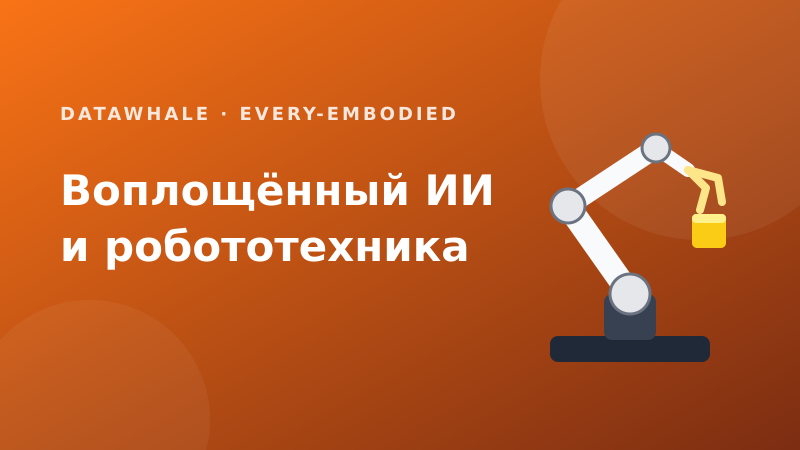
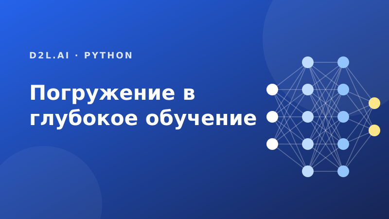
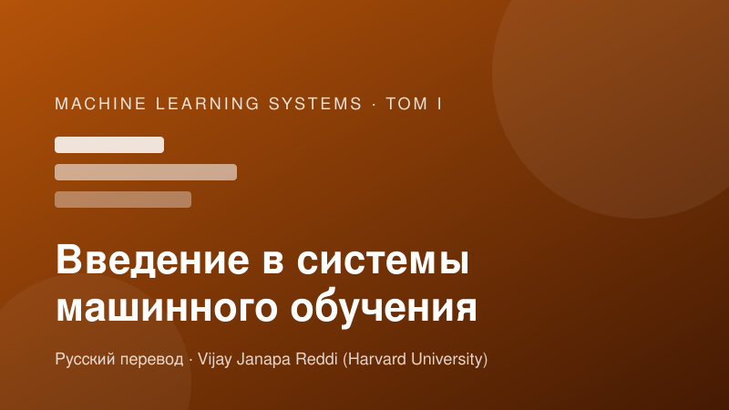
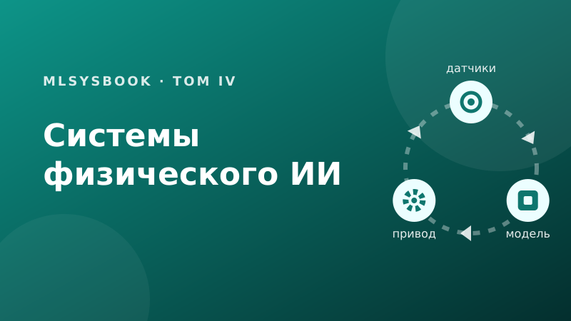
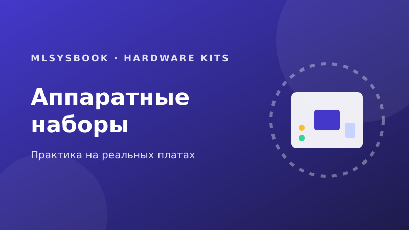
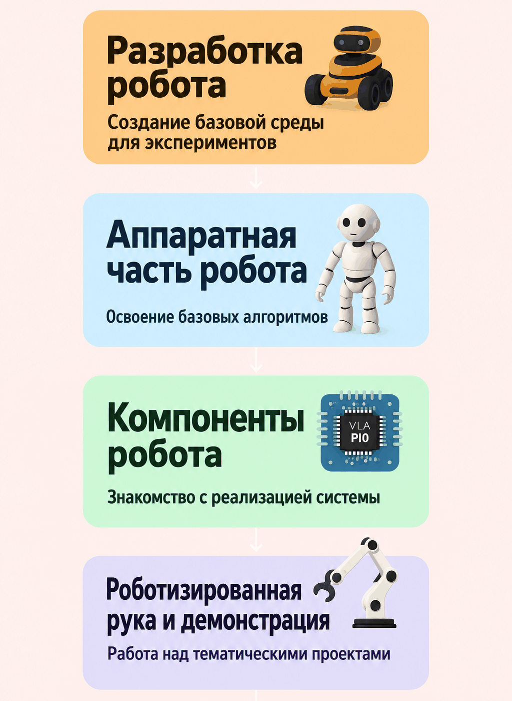

# AI-Robotics-Rus: книги по ИИ и робототехнике на русском

Библиотека русскоязычных переводов открытых книг по воплощённому ИИ, робототехнике, глубокому обучению и системам машинного обучения. Книги выбраны за то, что в них есть знания, которые трудно найти на русском языке: практика китайских робототехнических команд, систематический курс глубокого обучения с кодом на нескольких фреймворках, а также системный взгляд на основы машинного обучения, агентов, физический ИИ и встраиваемые платы из курса «Machine Learning Systems» Гарвардского университета.

Тексты книг переведены на русский. Код, имена библиотек, команды и сообщения программ остаются на английском, как принято в этих областях.

> **Важно:** это учебные материалы, а не справочник. Ключевые детали сверяйте с оригиналами.

**Читать онлайн:** [r007.github.io/AI-Robotics-Rus](https://r007.github.io/AI-Robotics-Rus/) · **Исходный код:** [github.com/r007/AI-Robotics-Rus](https://github.com/r007/AI-Robotics-Rus)

<p align="center">
  <a href="https://r007.github.io/AI-Robotics-Rus/embodied-ai/"></a>
  <a href="https://r007.github.io/AI-Robotics-Rus/dive-into-deep-learning/"></a>
  <a href="https://r007.github.io/AI-Robotics-Rus/intro-ml-systems/"></a>
</p>
<p align="center">
  <a href="https://r007.github.io/AI-Robotics-Rus/agentic-ml-systems/"></a>
  <a href="https://r007.github.io/AI-Robotics-Rus/physical-ai-systems/"></a>
  <a href="https://r007.github.io/AI-Robotics-Rus/hardware-kits/"></a>
</p>

## 📚 Книги

| Книга | О чём | Статус | Лицензия |
|---|---|---|---|
| **[Воплощённый ИИ и робототехника](https://r007.github.io/AI-Robotics-Rus/embodied-ai/)** ([исходники](books/embodied-ai/)) | От кинематики и координации «рука — глаз» до моделей VLA, навигации и симуляции. | Полный перевод | CC BY 4.0 |
| **[Погружение в глубокое обучение](https://r007.github.io/AI-Robotics-Rus/dive-into-deep-learning/)** ([исходники](books/dive-into-deep-learning/)) | Математика, архитектуры и исполняемый код на Python. | Полный перевод | CC BY-SA 4.0 (код — MIT-0) |
| **[Введение в системы машинного обучения](https://r007.github.io/AI-Robotics-Rus/intro-ml-systems/)** ([исходники](books/intro-ml-systems/)) | Как устроены системы машинного обучения: данные, вычисления и физические ограничения, которые задают поведение модели. Том I «Machine Learning Systems». | Полный перевод: главы 1–16, приложения, глоссарий, список литературы | CC BY-NC-SA 4.0 |
| **[Масштабирование систем машинного обучения](https://r007.github.io/AI-Robotics-Rus/scaling-ml-systems/)** ([исходники](books/scaling-ml-systems/)) | Как системы машинного обучения выходят за пределы одной машины: сеть, отказы, координация и управление парком. Том II «Machine Learning Systems». | Переведены главы 1 «Введение», 2 «Вычислительная инфраструктура», 4 «Хранение данных», 6 «Коллективные коммуникации», 7 «Отказоустойчивость», 8 «Оркестрация парка», 9 «Инженерия производительности», первая часть главы 5, книга в работе | CC BY-NC-SA 4.0 |
| **[Агентные системы машинного обучения](https://r007.github.io/AI-Robotics-Rus/agentic-ml-systems/)** ([исходники](books/agentic-ml-systems/)) | Память, инструменты, среда выполнения и надёжность систем вокруг языковой модели. Том III «Machine Learning Systems». | Переведены все 18 глав, приложения в работе | CC BY-NC-SA 4.0 |
| **[Системы физического ИИ](https://r007.github.io/AI-Robotics-Rus/physical-ai-systems/)** ([исходники](books/physical-ai-systems/)) | Машины, в которых обученная модель действует безопасно и проверяемо. Том IV «Machine Learning Systems». | Полный перевод, оригинал дорабатывается | CC BY-NC-SA 4.0 |
| **[Аппаратные наборы](https://r007.github.io/AI-Robotics-Rus/hardware-kits/)** ([исходники](books/hardware-kits/)) | Лабораторные работы на реальных платах: от классификации изображений до LLM на Raspberry Pi. | Полный перевод, часть схем на английском | CC BY-NC-SA 4.0 |

Книги по лицензии CC BY-NC-SA 4.0 распространяются **только для некоммерческого использования**.

## 🧭 С чего начать

Книги можно читать независимо. Выберите ту, что ближе к вашей задаче.

| Если вы… | Читайте |
|---|---|
| только начинаете с машинного обучения и хотите понять нейросети вместе с кодом | [Погружение в глубокое обучение](https://r007.github.io/AI-Robotics-Rus/dive-into-deep-learning/) |
| хотите понять, почему модель из ноутбука может подвести в эксплуатации и как данные, вычисления и железо задают поведение системы | [Введение в системы машинного обучения](https://r007.github.io/AI-Robotics-Rus/intro-ml-systems/) |
| интересуетесь роботами, моделями VLA и симуляцией и хотите маршрут от основ до практики | [Воплощённый ИИ и робототехника](https://r007.github.io/AI-Robotics-Rus/embodied-ai/) |
| строите агентов на основе языковых моделей и хотите, чтобы они были надёжными | [Агентные системы машинного обучения](https://r007.github.io/AI-Robotics-Rus/agentic-ml-systems/) |
| проектируете систему, в которой обученная модель управляет железом, и вас волнует безопасность | [Системы физического ИИ](https://r007.github.io/AI-Robotics-Rus/physical-ai-systems/) |
| хотите запустить модель на реальной плате, от Grove Vision AI до Raspberry Pi | [Аппаратные наборы](https://r007.github.io/AI-Robotics-Rus/hardware-kits/) |

«Введение в системы машинного обучения» — том I того же курса: с него удобно начинать, если хочется основ. «Агентные системы» и «Системы физического ИИ» — тома III и IV, написанные в общей системной оптике: модель только предлагает действие, а выполняет и проверяет его отдельная инфраструктура. «Аппаратные наборы» — практикум к тому же курсу.

## ✨ Почему именно эти книги

- **Воплощённый ИИ и робототехника.** Курс собран Datawhale и китайскими командами, которые первыми воспроизводят свежие работы по VLA и гуманоидам на доступном железе. Такие разборы почти не публикуют вне китайского языка.
- **Погружение в глубокое обучение.** По нему учатся во многих университетах. Каждая идея объяснена математикой и работающим кодом, а китайское издание содержит код для четырёх фреймворков, включая PaddlePaddle.
- **Введение в системы машинного обучения.** Том I курса «Machine Learning Systems»: от данных и математики нейронной сети до аппаратуры, бенчмаркинга и эксплуатации. Вместо перечня инструментов книга даёт количественные принципы (железный закон, арифметическая интенсивность, Roofline), которые переживают смену фреймворков и ускорителей.
- **Агентные системы машинного обучения.** От вызова модели к траектории задачи: модель предлагает действия, среда выполнения проверяет и выполняет их, а результат принимается только по независимым свидетельствам. Инженерия агентов с точки зрения системы, а не промпта.
- **Системы физического ИИ.** Взгляд от соучредителя MLCommons (MLPerf) и автора программы TinyML в Гарварде: от бюджетов задержки до выпуска в эксплуатацию. Такой сквозной постановки мало в других источниках.
- **Аппаратные наборы.** Практический путь от выбора платы до первой развёрнутой модели. Платы стоят от $25, поэтому системы можно проверить на железе, а не только в симуляторе.

## 🎓 Что внутри

<details>
<summary><b>Воплощённый ИИ и робототехника</b> · 21 глава</summary>

<p align="center">
  <br>
  <sub>Маршрут обучения: русская версия карты из every-embodied (Datawhale, CC BY 4.0)</sub>
</p>

- **Основы (главы 1–4).** История и состав роботов; системы координат, кинематика, динамика, якобиан, ПИД, калибровка «рука — глаз»; платы RDK X5, LeRobot, приводы и датчики; SAM, оценка глубины, 3D-реконструкция.
- **Обучение (глава 5).** Глубокое обучение и обучение с подкреплением для роботов: HIMLoco, AGILE, Open Duck Mini, SMP, UniCross.
- **Манипуляции (главы 6–7).** Модели VLA (RT, OpenVLA, SmolVLA, π0, DiT4DiT, WALL), воспроизведение в MuJoCo, управление движением.
- **Навигация и данные (главы 8–9).** Навигация и VLN, наборы LIBERO и SimplerEnv, сбор данных, оценка.
- **Симуляторы (главы 10–11).** Isaac Sim и Isaac Lab, ManiSkill, Genesis, вспомогательные инструменты.
- **Практика (главы 12–16).** Вопросы с собеседований, воспроизведение проектов, соревнования, учебные программы.
- **Новое (главы 17–21).** Модели мира, беспилотники, проектирование роботов.

После этой книги вы сможете описать, из чего состоит робот и как он движется, запустить обучение политики в симуляторе, воспроизвести современную модель VLA, подключить манипулятор LeRobot и плату RDK X5 и понять, как устроены соревнования и проекты сообщества.

</details>

<details>
<summary><b>Погружение в глубокое обучение</b> · 16 глав</summary>

- **Основы (главы 1–3).** Введение, подготовка (тензоры, линейная алгебра, анализ, вероятность, автоматическое дифференцирование), линейные и softmax-модели.
- **Базовые сети (главы 4–5).** Многослойные перцептроны, переобучение, регуляризация, dropout, устройство модулей и работа с GPU.
- **Сети для изображений (главы 6–7).** Свёрточные сети, LeNet, AlexNet, VGG, ResNet, DenseNet.
- **Последовательности (главы 8–10).** Рекуррентные сети, LSTM, GRU, seq2seq, механизмы внимания и Transformer.
- **Практика обучения (главы 11–12).** Алгоритмы оптимизации, вычислительная производительность, несколько GPU.
- **Приложения (главы 13–15).** Компьютерное зрение, предобучение (word2vec, BERT) и обработка естественного языка.
- **Приложение (глава 16).** Jupyter, облачные платформы, выбор GPU, вклад в проект.

Код приведён для четырёх фреймворков (MXNet, PyTorch, TensorFlow, PaddlePaddle); на сайте варианты показаны вкладками, выбор запоминается.

</details>

<details>
<summary><b>Введение в системы машинного обучения</b> · 16 глав в 4 частях</summary>

- **Основы систем ML (главы 1–4).** Зачем инженерии ИИ свои принципы; облачные, периферийные, мобильные и микроконтроллерные системы и стена памяти; жизненный цикл ML; инженерия данных.
- **Разработка и обучение (главы 5–8).** Вычисления в нейронных сетях, архитектуры (MLP, CNN, RNN, трансформеры, DLRM), фреймворки, обучение моделей и выявление узких мест.
- **Оптимизация и ускорение (главы 9–12).** Отбор данных, сжатие моделей, аппаратное ускорение, бенчмаркинг и MLPerf.
- **Развертывание и эксплуатация (главы 13–16).** Обслуживание моделей и хвостовая задержка, MLOps, ответственная инженерия, заключение с тринадцатью количественными принципами.
- **Приложения.** Таксономия D·A·M, основы данных, алгоритмов и машины, системные допущения; глоссарий.

После этой книги вы сможете найти узкое место системы по железному закону (данные, арифметика или память), оценить память, время и стоимость обучения и вывода на бумаге, выбрать технику сжатия под физические ограничения и спланировать мониторинг, откаты и проверки справедливости.

</details>

<details>
<summary><b>Агентные системы машинного обучения</b> · 18 глав в 7 частях</summary>

- **Модель (главы 1–3).** Агентная система как «стохастический компьютер», границы того, что может гарантировать модель; вызов модели и его цена; вычисления на этапе тестирования и отбор кандидатов.
- **Память (главы 4–6).** Инженерия контекста и рабочий набор, управление KV-кешем, долговременная память и извлечение.
- **Инструменты (главы 7–8).** Типизированный вызов инструментов, песочницы и изоляция как граница полномочий.
- **Среда выполнения (главы 9–12).** Обвязка агента, долговечное выполнение, восстановление после сбоев и саги, оценка агентов.
- **Обучение на траекториях (главы 13–15).** Курирование траекторий, дообучение, обучение с подкреплением по верифицируемым наградам.
- **Масштаб (главы 16–17).** Координация нескольких агентов, экономика агентов и стоимость принятой задачи.
- **Синтез (глава 18).** Одна траектория через всю систему, лестница вмешательств и граница спецификации: работа, которую машина оставляет инженеру.

Предисловие, части и приложения пока доступны только в оригинале и будут добавлены по мере перевода.

</details>

<details>
<summary><b>Системы физического ИИ</b> · 17 глав и приложения</summary>

- **Введение (глава 1).** Каузальная граница: почему команду, достигшую двигателя, нельзя отозвать.
- **Анатомия машины (главы 2–4).** Тело, мозг и нервная система: бюджеты времени, момента, тепла и энергии.
- **Обучение машины (главы 5–7).** Физические данные, обучение политик, оценка в замкнутом контуре.
- **Работа машины (главы 8–13).** Восприятие, пространственная память, намерение, планирование, принудительное обеспечение безопасности, размещение на кремнии.
- **Управление машиной (главы 14–16).** Вмешательство супервизора, верификация, выпуск в эксплуатацию.
- **Заключение (глава 17).** Эпистемическая граница: что остаётся непроверенным.
- **Приложения.** Основы машинного обучения, управление и динамика, системы и оборудование, справочник S·P·A.

Вы научитесь рассуждать о системе целиком: какие гарантии должна давать машина, прежде чем предложение обученной модели превратится в физическую работу, как проверять такие гарантии и как честно называть то, что не проверено.

Оригинал — рабочий черновик, и его автор просит не цитировать и не использовать том для преподавания, пока он меняется.

</details>

<details>
<summary><b>Аппаратные наборы</b> · четыре платформы и общие лабораторные</summary>

- **Начало работы.** Выбор платформы, настройка среды разработки.
- **Grove Vision AI V2** (около $25). Классификация изображений, обнаружение объектов, приложения без кода.
- **XIAOML Kit (Seeed XIAO ESP32S3)** (около $40). Зрение, звук и движение: классификация изображений, распознавание ключевых слов, классификация движения и обнаружение аномалий, обнаружение объектов.
- **Raspberry Pi** ($60–80). Классификация изображений, обнаружение объектов, малые языковые модели и визуально-языковые модели.
- **Arduino Nicla Vision** (около $95). Те же четыре лабораторные в профессиональном корпусе.
- **Общие лабораторные.** Спектральные признаки DSP и инженерия признаков для распознавания ключевых слов.

</details>

## 🔎 Оригиналы

- Воплощённый ИИ и робототехника — [every-embodied](https://github.com/datawhalechina/every-embodied) (Datawhale).
- Погружение в глубокое обучение — [d2l-zh](https://github.com/d2l-ai/d2l-zh), сайт [zh.d2l.ai](https://zh.d2l.ai).
- Введение в системы машинного обучения, Агентные системы машинного обучения, Системы физического ИИ, Аппаратные наборы — [cs249r_book](https://github.com/harvard-edge/cs249r_book) (тома I, III и IV и раздел Hardware Kits), сайт [mlsysbook.ai](https://mlsysbook.ai).

Авторство, лицензия и список изменений относительно оригинала — на страницах «Авторство и лицензия» и «Происхождение материалов» в конце каждой книги.

## 💻 Локальный просмотр и сборка

Нужны Python 3.11 или новее и [mdBook](https://rust-lang.github.io/mdBook/guide/installation.html) 0.5.4 с плагинами `mdbook-mermaid` 0.17.1 и `mdbook-katex` 0.10.0:

```bash
cargo install --locked mdbook@0.5.4 mdbook-mermaid@0.17.1 mdbook-katex@0.10.0

git clone https://github.com/r007/AI-Robotics-Rus.git
cd AI-Robotics-Rus

mdbook serve books/embodied-ai          # одна книга: http://localhost:3000
python3 scripts/build_site.py           # все книги и страница каталога в site/
python3 -m http.server -d site 8000     # смотреть собранный сайт: http://localhost:8000
```

Проверки перед отправкой изменений:

```bash
python3 scripts/check_books.py                                        # структура книг и метаданные
for book in books/*/; do python3 scripts/check_links.py "${book}src"; done   # относительные ссылки
python3 scripts/check_site.py site                                    # ссылки и рисунки в готовом сайте
```

Контейнер для самостоятельного хостинга описан в [docker/README.md](docker/README.md).

## 🗂️ Структура репозитория

```text
books/<книга>/        самостоятельная книга mdBook
  book.toml           настройки mdBook
  meta.toml           данные для каталога: статус, теги, «что вы узнаете», источник, лицензия
  NOTICE.md           авторство, источник и лицензия текста
  PROVENANCE.md       что переведено, что изменено относительно оригинала
  LICENSE             лицензия текста книги
  src/                страницы книги; SUMMARY.md — оглавление
covers/               обложки для страницы каталога и README
directory/            шаблон страницы каталога
scripts/              сборка сайта, препроцессоры mdBook и проверки
docker/               сборка и запуск сайта в контейнере
assets/               рисунки для README
```

## 🤝 Участие

Исправления опечаток, неточностей и терминов приветствуются. Порядок работы, глоссарии и правила перевода описаны в [CONTRIBUTING.md](CONTRIBUTING.md). Сообщить о замечании к тексту можно через [issue](https://github.com/r007/AI-Robotics-Rus/issues/new/choose).

## 🙏 Авторы и благодарности

Сборник основан на работе авторов оригинальных книг. Их имена и сведения о происхождении текста сохранены в `NOTICE.md` и `PROVENANCE.md` каждой книги.

- **Datawhale и соавторы** — проект [every-embodied](https://github.com/datawhalechina/every-embodied), основа книги «Воплощённый ИИ и робототехника»;
- **Aston Zhang, Zachary C. Lipton, Mu Li, Alexander J. Smola и соавторы** — [Dive into Deep Learning](https://d2l.ai), китайская версия [d2l-zh](https://github.com/d2l-ai/d2l-zh);
- **Vijay Janapa Reddi** и соавторы (Harvard University) — [Machine Learning Systems](https://mlsysbook.ai): том I «Introduction to Machine Learning Systems», том III «Agentic Machine Learning Systems», том IV «Physical AI Systems» и раздел Hardware Kits;
- **Marcelo Rovai** — лабораторные работы раздела Hardware Kits.

Перевод и редакция: **Сергей Монин**.

## 📜 Лицензии

Каждая книга распространяется по лицензии, которую указал её автор. Файлы лицензий лежат в папках книг.

- **Воплощённый ИИ и робототехника** (`books/embodied-ai/`) — текст CC BY 4.0; код и примеры — как указано в исходных проектах.
- **Погружение в глубокое обучение** (`books/dive-into-deep-learning/`) — текст CC BY-SA 4.0, код MIT-0.
- **Введение в системы машинного обучения** (`books/intro-ml-systems/`) — CC BY-NC-SA 4.0, **только некоммерческое использование**.
- **Агентные системы машинного обучения** (`books/agentic-ml-systems/`) — CC BY-NC-SA 4.0, **только некоммерческое использование**.
- **Системы физического ИИ** (`books/physical-ai-systems/`) — CC BY-NC-SA 4.0, **только некоммерческое использование**.
- **Аппаратные наборы** (`books/hardware-kits/`) — CC BY-NC-SA 4.0, **только некоммерческое использование**.

Скрипты сборки, конфигурация CI и Docker, страница каталога и обложки распространяются по лицензии [MIT](LICENSE). Названия языков, инструментов и библиотек принадлежат их правообладателям. Для юридических формулировок приоритет имеет английский текст лицензий.
