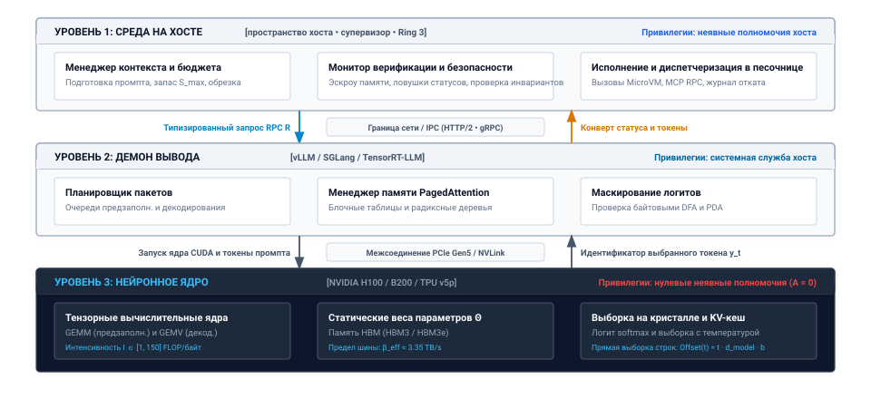
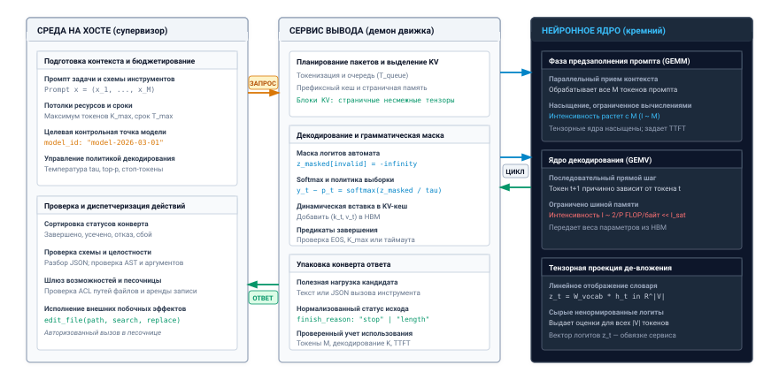
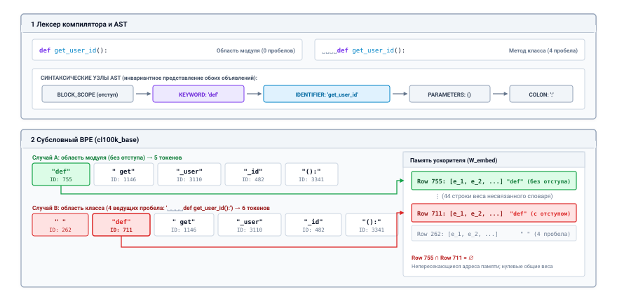
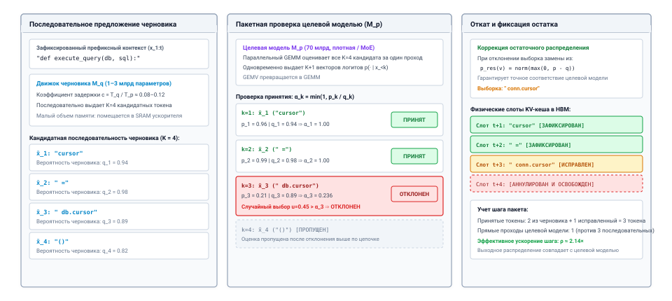
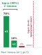
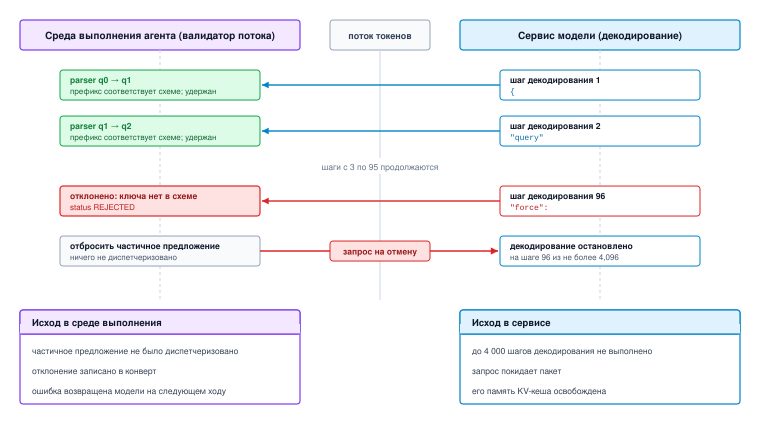
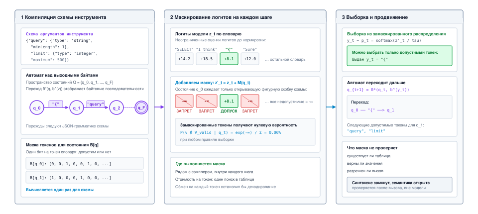
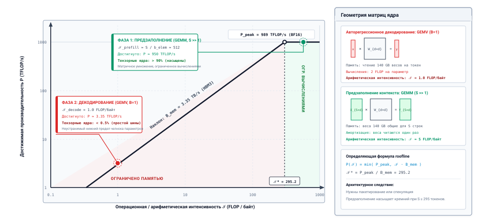

<a id="sec-vol3-foundation-model"></a>

# Базовая модель


## Назначение

_Почему самая мощная часть агента — та, чей результат нельзя выполнить так, как он выдан?_

Каждый ход агента — это один вызов базовой модели. Среда выполнения отправляет контекст из сообщений, определений инструментов и ограничений, а модель возвращает предложение: текст, структурированный объект или запрос на вызов инструмента, а также причину остановки. Это предложение беглое и часто верное, но оно не проверено: при повторной отправке того же запроса оно может отличаться, а его цена растет с каждым токеном, который модель пишет, и с каждым токеном, который агент повторно передает на следующем ходу. Среда выполнения, которая примет чистую остановку за завершенную задачу, корректно оформленный объект за правильный или вызов модели за дешевый, построит на этом ложном допущении каждый следующий механизм. Поэтому вызов — это контракт из трех частей: что модель читает, что возвращает и чего он стоит. Один вызов выполняет один ход, ничего не сохраняет между вызовами и ничего не делает в среде, поэтому он не добавляет ни одной из экспозиций H·S·A, а все последующие части книги измеряют горизонт, состояние и полномочия, отталкиваясь от этого контракта.

> **Цели обучения**
>
> - Объяснить, как базовая модель превращает контекст из токенов в предложение и какие решения вокруг вызова принадлежат среде выполнения.
> - Рассчитать бюджет вызова модели в токенах относительно фиксированного окна контекста, оставив запас для вывода.
> - Объяснить, почему вызов модели недетерминирован, в том числе при температуре ноль, и что из этого следует для воспроизведения и оценки.
> - Задать запрос и ответ вызова модели: сообщения и роли, определения инструментов, лимиты вывода и рассуждений, причины остановки и нормализованный конверт статуса.
> - Отличать грамматически ограниченное декодирование от обученного форматирования вызовов инструментов, а синтаксическую корректность от правильности.
> - Оценить задержку одного вызова и стоимость траектории из нескольких ходов в токенах, с префиксным кешированием и без него.
> - Сравнивать конкурирующие интерфейсы моделей по проверенному успеху задачи при равном бюджете, а не по доле успешного разбора.

<a id="sec-vol3-foundation-model-role"></a>

## Граница вызова модели


*Один вызов выполняет один ход, не несет состояния и не имеет неявных полномочий.*

Модель правдоподобного отказа ([«Модель правдоподобного отказа»](01_introduction.md#sec-vol3-intro-fail-plausible)) и нулевые неявные полномочия ([«Момент агентных систем»](01_introduction.md#sec-vol3-intro-operational-incident)) уже велят среде выполнения не доверять тому, что выдает модель. Но они не говорят, куда уходит вызов, что он возвращает и какой компонент отвечает за каждое решение по пути. Один вызов выполняет один ход, не хранит состояния между вызовами и ничего не делает в среде, поэтому он не добавляет ни одной из экспозиций H·S·A ([«Экспозиции H·S·A»](01_introduction.md#sec-vol3-intro-hsa)) и служит точкой отсчета, от которой все последующие части книги измеряют эти экспозиции.

**Проследите один вызов от среды выполнения до ускорителя и обратно, и появятся три компонента, у каждого из которых своя задача и свой способ отказать.** Среда выполнения готовит промпт и оценивает результат, демон обслуживания распределяет работу по ускорителю, а модель — замороженный набор весов $\Theta$, вычисляемый конвейерами матричного умножения, — считает распределение над следующим токеном. Терминология машинного обучения скрывает такое разделение обязанностей. [«Розеттский камень систем машинного обучения»](02_foundation_model.md#tbl-vol3-ml-systems-rosetta) показывает, чем становится каждый знакомый термин модели, когда его помещают на этот путь.

| Концепция машинного обучения       | Перевод в архитектуру систем                                                                                                    | Режим отказа системы и эксплуатационное следствие                                                  |
|:-----------------------------------|:--------------------------------------------------------------------------------------------------------------------------------|:---------------------------------------------------------------------------------------------------|
| **Промпт / окно контекста**        | Подготовленный буфер входных данных только для чтения; непрерывное рабочее пространство виртуальной памяти для вычисления внимания. | Переполнение буфера, деградация внимания, усечение контекста и трешинг вытеснения кеша.            |
| **Авторегрессионная генерация**    | Итеративный цикл вывода, выполняющий последовательные ядра тензорной свертки над статическими весами $\Theta$.                   | Голод полосы пропускания памяти, высокая хвостовая задержка и неограниченно длинные цепочки последовательных зависимостей. |
| **Логиты / распределение softmax** | Ненормированный вектор логарифмов шансов над словарем $\mathcal{V}$, отображаемый на симплекс вероятностей $\Delta^{\vert\mathcal{V}\vert-1}$. | Дрейф энтропии выборки, повреждение хвоста распределения и крайняя численная нестабильность логитов. |
| **Галлюцинация**                   | Непойманное нарушение семантического инварианта; генерация синтаксически корректного, но фактически выдуманного состояния.       | Тихое повреждение данных правдоподобного вида, возникающее при нормальном статусе транспорта и разбора. |
| **Вызов инструмента / вызов функции** | Непроверенная спецификация кандидатного вызова RPC, переданная в эскроу памяти хоста.                                       | Несоответствие сигнатуры удаленного интерфейса, внедрение параметров, несанкционированный вызов возможности. |
| **HTTP 200 OK / завершение ответа модели** | Подтверждение доставки на транспортном уровне для непроверенного конверта кандидатного ответа.                       | Ошибка доставки: успех транспорта принимается за семантическую корректность или выполнение задачи. |

<a id="tbl-vol3-ml-systems-rosetta"></a>

***Розеттский камень систем машинного обучения**: перевод статистических абстракций на язык операционных систем и архитектурных примитивов.*

На этом пути нулевые неявные полномочия получают точный физический смысл. Когда модель генерирует строку `rm -rf /` или JSON-объект с просьбой удалить таблицу базы данных, ни один байт на хосте не меняется. Выход — это массив целочисленных идентификаторов токенов в памяти с высокой пропускной способностью (HBM) ускорителя. Он пересекает межсоединение, демон вывода декодирует его в символы, и результат попадает в буфер пользовательского пространства, которым владеет среда выполнения хоста. Там он и остается, в эскроу памяти, пока среда выполнения не решит, что с ним делать.

Эта физическая граница делит современную среду выполнения агентов на трехуровневую архитектуру ([«Трехуровневая архитектура систем машинного обучения»](02_foundation_model.md#fig-vol3-three-tier-architecture)). В основании находится **Нейронное ядро** — блоки аппаратного матричного умножения (например, потоковые мультипроцессоры GPU или тензорные ядра TPU), которые выполняют низкоуровневые тензорные свертки над статическими матрицами параметров $\mathbf{\Theta}$, находящимися в памяти с высокой пропускной способностью (HBM). Доступ к Нейронному ядру опосредует **Демон сервиса вывода** — высокопроизводительная системная служба (например, vLLM, SGLang или оптимизированная среда поставщика). Он управляет физическим выделением ускорителя, планирует пакетные запросы вывода, управляет тензорной памятью ключей и значений через PagedAttention и координирует цикл авторегрессионной генерации. Наконец, в пользовательском пространстве хоста работает **Среда выполнения агента на хосте** — авторитетный супервизор. Она владеет состоянием окружения, хранит административные учетные данные, готовит контекст модели, соблюдает бюджеты аппаратных ресурсов и задержки и проверяет все кандидатные выходы, прежде чем предоставить им право на выполнение.

Как показано на рисунке [«Трехуровневая архитектура систем машинного обучения»](02_foundation_model.md#fig-vol3-three-tier-architecture), эти уровни разделены физическими аппаратными и транспортными интерфейсами. Уровень 1 (среда выполнения агента на хосте) отправляет типизированные запросы RPC через локальную границу IPC или сети (HTTP/2 или gRPC) уровню 2 (демону сервиса вывода). Уровень 2 переводит запросы в потоки пакетных вычислений и запускает ядра CUDA через межсоединения PCIe Gen5 или NVLink, управляя уровнем 3 (Нейронным ядром). Уровень 3 не обладает никакими неявными полномочиями. Его вычислительные блоки выдают только идентификаторы выбранных токенов ($y_t$). Они возвращаются через межсоединение демону для упаковки в конверт и затем среде выполнения хоста для проверки — на стороне хоста границы «ускоритель — хост», описанной в [«Архитектурная граница „ускоритель — хост“»](01_introduction.md#sec-vol3-intro-accelerator-host).

<a id="fig-vol3-three-tier-architecture"></a>


***Трехуровневая архитектура систем машинного обучения**: физические границы привилегий и разделение исполнения в средах выполнения агентов. Среда выполнения агента на хосте работает как авторитетный супервизор в пользовательском пространстве хоста (Ring 3): она подготавливает буферы контекста, соблюдает пределы ресурсов и проверяет исполнение действий инструментов. Демон сервиса вывода координирует очереди непрерывной пакетной обработки, блочные таблицы PagedAttention с преобразованием логических адресов в физические и маски логитов на основе автоматов с магазинной памятью. Нейронное ядро выполняет сырую тензорную арифметику на кремнии ускорителя и не имеет никаких неявных полномочий.*

<a id="dfn-zero-ambient-authority"></a>

> **Нулевые неявные полномочия**
>
> ***Нулевые неявные полномочия*** — это фундаментальный инвариант системной безопасности, при котором непривилегированный исполнитель, в частности ядро базовой модели, не имеет собственного права инспектировать, изменять или выделять внешние системные ресурсы: $\text{Privileges}(\pi_\theta) = \emptyset$.
>
> 1.  **Значение**: гарантирует, что сырые выбранные токены, которые выдают блоки матричного умножения ускорителя, остаются в эскроу памяти хоста. Так непроверенные выходы модели не могут напрямую изменять постоянные файловые системы, вызывать системные вызовы ядра или выполнять сетевой ввод-вывод.
> 2.  **Отличие**: в отличие от классических процессов операционной системы, которые наследуют неявные права своего пользовательского контекста (UID/GID), стохастическое ядро модели не имеет неявных возможностей. Каждая привилегированная операция требует явного перехвата супервизором, проверки схемы, проверки возможностей и диспетчеризации в песочнице.
> 3.  **Типичная ошибка**: выдача агентным процессам неявных учетных данных или неограниченного доступа к системе (например, монтирование корневых каталогов хоста в контейнеры или передача неограниченных API-ключей в системные промпты). Это позволяет инъекции промпта или галлюцинированным действиям скомпрометировать инфраструктуру хоста.

Определение ниже задает модель правдоподобного отказа из раздела [«Модель правдоподобного отказа»](01_introduction.md#sec-vol3-intro-fail-plausible) для одного вызова — в терминах, которыми среда выполнения пользуется, чтобы его проверить.

<a id="dfn-fail-plausible-fault"></a>

> **Правдоподобный отказ**
>
> ***Правдоподобный отказ*** — это режим отказа исполнения, при котором непривилегированное нейронное исполнительное ядро выдает предложение действия $a_{\text{prop}} \sim \pi_\theta(\cdot \mid c_t)$, которое удовлетворяет синтаксической грамматике $\mathcal{L}(G)$ и выполняется в среде с кодом возврата 0, но переводит состояние среды за пределы семантической спецификации ($s_t \in \mathcal{I} \implies s_{t+1} \notin \mathcal{I}$).
>
> 1.  **Значение**: показывает, почему обычный программный мониторинг и распределенные сторожевые таймеры (`if (exit_code != 0) retry()`) не работают в агентных системах. Беглость на поверхности и успешные завершения процессов регулярно маскируют катастрофические семантические регрессии.
> 2.  **Отличие**: в отличие от отказов с остановкой, при которых компонент явно падает и детерминированно прекращает выполнение, или византийских отказов, при которых злонамеренный узел намеренно отклоняется в сетевых каналах, правдоподобные отказы возникают из статистической оптимизации правдоподобия над замороженными обучающими распределениями, не привязанными к физическому состоянию среды.
> 3.  **Типичная ошибка**: опора на коды возврата процессов или на самоотчет модели о завершении («я проверил, что ошибка исправлена») как на свидетельство успеха. Надежная работа требует супервизорного ограждения и внешних верификационных оракулов, которые проверяют физические изменения состояния.

Вторая ошибка возникает на транспортном уровне, и эта глава называет ее **ошибкой доставки** (Delivery Fallacy). В наивных программных реализациях агентная система отправляет HTTP-запрос сервису вывода, получает статус ответа `HTTP 200 OK`, успешно разбирает тело ответа как JSON и сразу фиксирует действие. Здесь смешиваются доставка и выполнение задачи. `HTTP 200 OK` означает лишь то, что транспортный уровень успешно передал пакеты через сетевой интерфейс и что демон вывода завершил цикл генерации, не упав. Он не несет никакой информации о том, решила ли модель задачу, произошло ли усечение контекста, сработал ли внутренний отказ по соображениям безопасности или модель выдала галлюцинированный запрос на возможность.

Надежная среда выполнения хоста изолирует эту границу, нормализуя все входящие сырые ответы вывода в структурированный конверт статуса. Среда выполнения оценивает, завершилась ли генерация штатно (`COMPLETED`), исчерпала ли выделенный бюджет токенов до естественного завершающего токена (`TRUNCATED`), была ли она прервана фильтром безопасности на уровне ускорителя (`REFUSED`) или столкнулась с неустранимым разрывом сети или аппаратуры (`TRANSPORT_FAILURE`). Только кандидаты с чистым конвертом статуса передаются в конвейер проверки супервизора. Так формируется граница исполнения в замкнутом контуре, показанная на рисунке [«Граница исполнения в замкнутом контуре»](02_foundation_model.md#fig-vol3-closed-loop-boundary).

Жизненный цикл исполнения на рисунке [«Граница исполнения в замкнутом контуре»](02_foundation_model.md#fig-vol3-closed-loop-boundary) проходит четыре последовательных этапа через физическую границу привилегий. На этапе 1 (подготовка контекста и бюджетирование) супервизор хоста составляет последовательность промпта $\mathbf{x} = (x_1, \dots, x_M)$, назначает операционные лимиты токенов $K_{\max}$, задает предельный срок по часам $T_{\max}$ и упаковывает гиперпараметры декодирования в типизированный запрос RPC. Механизм вывода принимает этот пакет, планирует выделение пакета и вычисляет предзаполнение промпта (GEMM), прежде чем войти в цикл авторегрессионного декодирования (этап 2). На каждом шаге декодирования слитые маски логитов подавляют неграмматические токены до редукции softmax и добавляют выбранные векторы на страницы KV-кеша устройства. По достижении маркера конца последовательности или ограничения этап 3 упаковывает кандидатные токены в нормализованный конверт ответа с проверенным учетом использования. Наконец, этап 4 (проверка и диспетчеризация действий) получает полезную нагрузку в эскроу памяти хоста, подвергает кандидатные вызовы инструментов проверке AST и проверке ACL песочницы, прежде чем разрешить диспетчеризацию побочных эффектов.

<a id="fig-vol3-closed-loop-boundary"></a>


***Граница исполнения в замкнутом контуре**: четырехэтапный жизненный цикл, опосредующий непривилегированную генерацию нейронного ядра и авторитетную диспетчеризацию действий на хосте. Среда выполнения хоста подготавливает промпты задач и границы политики (этап 1), отправляя типизированные запросы RPC через границу сервиса. Сервис вывода планирует пакетные очереди и вычисляет предзаполнение промпта (GEMM) перед входом в авторегрессионный цикл декодирования (этап 2) со слитым маскированием логитов. Сырые предсказания токенов нормализуются в структурированные конверты статуса (этап 3) перед попаданием в пользовательское пространство хоста. Там этап 4 сортирует коды завершения, распаковывает кандидатные полезные нагрузки в эскроу памяти и проверяет ACL возможностей перед срабатыванием исполнительного механизма.*

Чистый конверт допускает кандидата к оценке, но не к исполнению. Собственный вердикт модели о своем выводе не имеет доказательной силы ([«Эпистемическая граница: обеспеченные оболочки против семантической корректности»](01_introduction.md#sec-vol3-intro-epistemic-boundary)), поэтому среда выполнения принимает кандидата только на основании свидетельств детерминированных проверок вне модели: компиляторов, проверок типов, статических анализаторов и наборов тестов. Эти проверки входят в уровни свидетельств замыкания из раздела [«Уровни свидетельств замыкания»](01_introduction.md#sec-vol3-intro-closure-evidence), а [«Верификация кандидатных последовательностей»](02_foundation_model.md#sec-vol3-foundation-model-continuations) строит их для одного вызова.

Физическая граница между супервизором хоста и нейронным ядром также накладывает жесткие ограничения на межсоединение и память. Типичный архитектурный вопрос: где должна проходить граница между оценкой вывода и стохастической выборкой? Должен ли ускоритель передавать сырые ненормированные логиты обратно центральному процессору хоста, позволяя среде выполнения выбирать токены локально, или выборка должна выполняться непосредственно на кремнии ускорителя?

Количественный анализ трафика межсоединения показывает, почему выборка по логитам должна выполняться целиком на ускорителе. Единственной неделимой единицей обмена через интерфейс хоста становится идентификатор токена.

<a id="nbk-logit-interconnect-bottleneck"></a>

> **Узкое место межсоединения для логитов**
>
> **Задача:** рассмотрим сервис вывода, который обслуживает открытую базовую модель с современным размером словаря $|V| =$ 128 000 субсловных токенов. Сервис вывода держит активный параллельный пакет из $B =$ 64 потоков, работающих на одной плате ускорителя, подключенной по стандартному межсоединению PCIe 4.0 $\times 16$. Каждый поток генерации выдает результат со средней скоростью декодирования $R =$ 40 токенов/с.
>
> Вычислите непрерывную пропускную способность межсоединения, необходимую в двух случаях: если ускоритель передает сырые 16-битные логиты с плавающей точкой (`fp16`, 2 байта на логит) обратно центральному процессору хоста для выборки, и если он передает дискретные 32-битные целочисленные идентификаторы токенов (`uint32`, 4 байта на токен). Оцените системную осуществимость выборки на стороне хоста при мелкозернистых накладных расходах PCIe.
>
> **Решение:**
>
> *Случай 1: передача сырых векторов логитов через межсоединение.*
> Для каждого нового токена ускоритель выдает плотный ненормированный вектор логитов размерности $|V|$. При 2 байтах на элемент:
> $$\text{Полезная нагрузка на токен} = 128\,000 \times 2\text{ байт} = 256\,000\text{ байт} = 256\text{ КБ/токен}$$
>
> Совокупная скорость генерации по всем 64 потокам:
> $$\text{Суммарная скорость токенов} = B \times R = 64 \times 40\text{ токенов/с} = 2\,560\text{ токенов/с}$$
>
> Непрерывная скорость передачи данных через межсоединение составляет:
> $$\text{Bandwidth}_{\text{logits}} = 2\,560\text{ токенов/с} \times 256\text{ КБ/токен} = 655\,360\text{ КБ/с} = 655{,}36\text{ МБ/с}$$
>
> Пиковая теоретическая шина PCIe 4.0 $\times 16$ обеспечивает примерно 31,5 ГБ/с однонаправленной пропускной способности, но эта цифра предполагает крупные непрерывные транзакции прямого доступа к памяти (DMA). Вопреки этому допущению цикл авторегрессионного обслуживания отправляет буферы по 256 КБ мелкими асинхронными пакетами 2 560 раз в секунду. При такой гранулярности передачи накладные расходы пакетизации PCIe, обработка прерываний хоста, задержки синхронизации завершения DMA и конкуренция за шину памяти хоста ухудшают производительность и вносят заметный джиттер в цикл декодирования. Если размер словаря вырастет до $|V| =$ 256 000 или параллелизм — до $B =$ 256, требуемая пропускная способность превысит 5,24 ГБ/с и серьезно перегрузит очереди межсоединения системы.
>
> *Случай 2: редукция логитов на кремнии ускорителя.*
> Если top-$p$, top-$k$, масштабирование температурой и мультиномиальная категориальная выборка выполняются непосредственно в ядре ускорителя, ускоритель сводит вектор логитов размером 256 КБ к одному скалярному идентификатору токена:
> $$\text{Полезная нагрузка на токен} = 4\text{ байт/токен}$$
>
> Итоговая непрерывная пропускная способность межсоединения составляет:
> $$\text{Bandwidth}_{\text{tokens}} = 2\,560\text{ токенов/с} \times 4\text{ байт/токен} = 10\,240\text{ байт/с} \approx 10{,}24\text{ КБ/с}$$
>
> **Вывод:** выполнение выборки логитов на кремнии ускорителя снижает нагрузку на пропускную способность межсоединения в 64 000 раз:
> $$\frac{256\,000\text{ байт}}{4\text{ байт}} = 64\,000\times$$
> Это сокращение превращает затор на межсоединении в незначительный поток 10,24 КБ/с, освобождая интерфейс между хостом и ускорителем для больших обновлений весов модели и приема входного контекста. Дискретный идентификатор токена — обязательная и оптимальная по пропускной способности валюта обмена на границе вызова модели.

<a id="chk-02-stochastic-processor-boundary"></a>

> **Проверка: граница вызова модели**
>
> Прежде чем переходить к дискретному представлению токенов, проверьте понимание стохастических уровней исполнения и границ хоста:
>
> - [ ] **Неявные полномочия**: почему автоматически сгенерированная командная строка, находящаяся в памяти ускорителя, не имеет привилегий до явной диспетчеризации на хосте?
> - [ ] **Семантика отказов**: чем системные последствия правдоподобных отказов нейронной модели отличаются от контрактов ошибок с остановкой классических процессоров?
> - [ ] **Пропускная способность межсоединения**: почему выполнение выборки логитов и редукции top-$p$/top-$k$ непосредственно на кремнии ускорителя на порядки эффективнее по пропускной способности, чем передача сырых тензоров логитов по PCIe?
> - [ ] **Сквозная верификация**: при каких условиях демон вывода или нейронный самопроверяющий механизм может гарантировать корректность инвариантов исполнения?

Поэтому среда выполнения владеет каждым решением, имеющим последствия. [«Что среда выполнения обязана делать вокруг вызова модели»](02_foundation_model.md#tbl-vol3-foundation-model-responsibilities) перечисляет, к чему обязывает среду выполнения каждый знакомый термин модели.

| Термин модели               | Обязанность среды выполнения                                                  | Сбой, если среда выполнения ее игнорирует                            |
|:----------------------------|:------------------------------------------------------------------------------|:---------------------------------------------------------------------|
| **Окно контекста**          | Собрать контекст и удерживать его вместе с лимитом вывода внутри окна         | Усеченный ввод или вывод; вызов инструмента, оборванный на середине аргумента |
| **Параметры выборки**       | Выбирать их для каждого вызова и сохранять вместе с выводом                   | Траектории, которые нельзя объяснить или воспроизвести               |
| **Вызов инструмента**       | Проверить, авторизовать и выполнить его, затем вернуть результат как сообщение | Некорректные или несанкционированные воздействия на среду           |
| **Причина остановки**       | Направлять по ней цикл: диспетчеризация, проверка, карантин или эскалация     | Усеченный или отклоненный вывод, принятый за завершенный            |
| **Беглый, но неверный вывод** | Проверить предложение по состоянию среды средствами вне модели              | Правдоподобное повреждение, которое проходит все поверхностные тесты |
| **Успешный ответ**          | Считать успех транспорта доставкой предложения, а не завершением задачи       | Ошибка доставки: код состояния принимается за свидетельство корректности |

<a id="tbl-vol3-foundation-model-responsibilities"></a>

***Что среда выполнения обязана делать вокруг вызова модели**: каждое понятие на стороне модели создает обязанность среды выполнения, а каждое невыполненное обязательство имеет характерный сбой.*

<a id="sec-vol3-foundation-model-tokenization"></a>

## Дискретное представление токенов

Базовая модель не умеет читать строки. Программисты и программные инструменты обмениваются структурированным текстом в Unicode, а конвейеры тензорной свертки современных ускорителей работают исключительно с плотными массивами чисел с плавающей точкой фиксированной размерности. Перекрыть этот семантический разрыв может только непривилегированный слой сериализации — токенизатор. На программном интерфейсе токенизатор работает как дискретный двунаправленный транскодер: он отображает потоки байтов переменной длины в ограниченные последовательности целочисленных идентификаторов из конечного словаря $\mathcal{V}$. На аппаратном интерфейсе эти идентификаторы выполняют гораздо более требовательную физическую роль: они индексируют строки основной таблицы вложений модели, а их суммарная длина последовательности $S$ определяет физический объем памяти с высокой пропускной способностью (HBM), который занимают кеши внимания ускорителя.

**Токенизатор — по сути статистический компрессор байтов, а не грамматически осведомленный лексер компилятора. Это архитектурное различие порождает серьезные рассогласования с деревьями синтаксического разбора языков программирования, раздувает задержку и накладные расходы памяти при структурированной сериализации и накладывает жесткий физический налог на память ускорителя.** Когда супервизор агента отправляет промпт или принимает трассировку выполнения, он должен считать токены не как абстрактные лексические единицы, а как физическое выделение ресурсов, которое расходует пропускную способность кремниевой памяти и ограничивает горизонт выполнения нейронного движка.

### Граница лексирования

Традиционные фронтенды компиляторов разбивают исходный текст с помощью детерминированных, управляемых грамматикой лексеров. Лексер компилятора превращает поток символов в поток типизированных токенов, определенных формальной спецификацией языка (например, `IDENTIFIER`, `KEYWORD_DEF` или `OPERATOR_PLUS`). В агентных системах открытой области этот детерминированный подход сразу дает сбой. Естественный язык обладает богатым морфологическим разнообразием, а трассировки выполнения программ содержат неограниченный набор строк с открытым словарем: динамически генерируемые UUID, криптографические хеши, полезные нагрузки base64, запутанные URL и произвольные имена переменных вроде `getUserById_v2_final`. Словарь на уровне слов, который пытался бы каталогизировать эту открытую вселенную, разросся бы до миллионов записей, исчерпав память хоста и размыв статистическую эффективность обучения. И наоборот, ограничение словаря слов фиксированным порогом заставляет любой невиденный токен схлопываться в сигнальный маркер вне словаря (`<UNK>`), необратимо разрушая синтаксическую структуру и семантику выполнения.

На противоположном архитектурном полюсе чисто посимвольный токенизатор работает над крошечным фиксированным алфавитом (например, 256 отдельных значений байтов сырого Unicode). Словарь символов ограничивает $|\mathcal{V}|$ минимальным объемом, но длина последовательности $S$ раздувается в четыре-пять раз по сравнению с естественными словами. В архитектурах трансформеров самовнимание вычисляет попарные взаимодействия по всем входным позициям, и вычислительная сложность при этом растет квадратично с длиной последовательности ($O(S^2)$). Увеличение длины последовательности в 4 раза дает катастрофический рост вычислений предзаполнения и промежуточных активаций в $(4)^2 = 16\times$. Посимвольная токенизация обменивает простоту словаря на неприемлемый аппаратный штраф.

Современные движки вывода решают этот компромисс с помощью кодирования пар байтов (Byte-Pair Encoding, BPE) — управляемого данными алгоритма субсловной токенизации, который работает непосредственно над последовательностями байтов. Начиная с базового словаря отдельных байтовых примитивов ($|\mathcal{V}_{\text{base}}| = 256$), BPE анализирует большие корпуса и итеративно находит и объединяет наиболее часто соседствующие пары байтов в составные субсловные токены. Этот процесс слияния повторяется до достижения целевого размера словаря $|\mathcal{V}|$, который в современных базовых моделях обычно составляет от $32\,000$ до $128\,000$ записей (а в крупномасштабных передовых архитектурах достигает $256\,000$). Частые строки (например, распространенные ключевые слова вроде `return` или корни естественного языка вроде `process`) срастаются в единые атомарные идентификаторы токенов, а редкие идентификаторы распадаются на последовательности более коротких субслов или отдельных байтов. BPE гарантирует ограниченную длину последовательностей и устраняет режимы отказа из-за слов вне словаря: любую произвольную двоичную полезную нагрузку или неизвестный идентификатор можно сериализовать как запасную последовательность составляющих байтовых токенов.

**Накладные расходы памяти таблицы вложений:**
Матрица вложений с $|\mathcal{V}| = 128\,000$ строками и скрытой размерностью $d_{\text{model}} = 4096$, хранимая в 16-битной точности, занимает:
$$128\,000 \times 4096 \times 2\text{ байт} \approx 1{,}05\text{ ГБ}$$
Если выходная проекция (unembedding) не связывает свои веса с $\mathbf{W}_{\text{embed}}$, одно лишь представление словаря занимает более $2{,}1\text{ ГБ}$ HBM ускорителя еще до загрузки хотя бы одного слоя трансформера.

Как только строка сериализована в массив дискретных целочисленных идентификаторов токенов $\mathbf{t} = [t_1, t_2, \dots, t_S]$, где каждое $t_i \in \{0, 1, \dots, |\mathcal{V}|-1\}$, среда выполнения хоста размещает этот буфер в памяти ускорителя. На кремнии первым вычислением модели становится поиск в таблице вложений. Математически эта операция эквивалентна умножению вектора one-hot $\mathbf{e}_{t_i} \in \{0, 1\}^{|\mathcal{V}|}$ на матрицу весов $\mathbf{W}_{\text{embed}} \in \mathbb{R}^{|\mathcal{V}| \times d_{\text{model}}}$. В физических ядрах ускорителя, однако, разреженное матричное умножение по $128\,000$-мерному вектору впустую расходовало бы вычислительные ресурсы кремния. Поэтому контроллер памяти ускорителя выполняет прямую операцию выборки строки (row-gather). Целое значение $t_i$ работает как указатель шага адреса в памяти:

$$\text{Offset}(t_i) = t_i \cdot d_{\text{model}} \cdot b$$

где $b$ — численная точность в байтах на элемент (например, $b=2$ для 16-битных форматов с плавающей точкой, таких как FP16 или BF16). Иерархия памяти ускорителя извлекает непрерывный вектор-строку по адресу $\text{Offset}(t_i)$ из внешней памяти с высокой пропускной способностью (HBM) в регистры потокового мультипроцессора (SM) и SRAM-скретчпад на кристалле. Последовательность дискретных целочисленных идентификаторов таким образом материализуется в плотный тензор активаций $\mathbf{X} \in \mathbb{R}^{S \times d_{\text{model}}}$, готовый войти в конвейер многоголового внимания.

### Структурное рассогласование


*Перемещение модели на 70 миллиардов параметров по шине памяти задает неустранимую нижнюю границу задержки шага при декодировании одного токена.*

Поскольку BPE строит таблицу слияний по статистической частоте сырых потоков символов, он полностью нечувствителен к формальным грамматикам языков программирования, деревьям синтаксического разбора и областям видимости, задаваемым отступами. Это расхождение создает архитектурное рассогласование (impedance mismatch) между детерминированными компиляторами, работающими в среде хоста, и субсловными токенизаторами, стоящими перед нейронным движком.

Рассмотрим абстрактное синтаксическое дерево (AST) компилятора. Лексер компилятора трактует пробельные символы строго как разделители (или как явные ограничители блоков в языках, чувствительных к отступам, таких как Python) и выдает инвариантный токен `IDENTIFIER` для имени функции независимо от того, где она стоит в строке. Статистический субсловный токенизатор, напротив, жадно сливает ведущие пробелы непосредственно с буквенно-цифровыми субсловами на основе статистики совместной встречаемости в корпусе.

```python
import tiktoken
enc = tiktoken.get_encoding("cl100k_base")

# Объявление верхнего уровня модуля и метод класса с отступом в 4 пробела
unindented = enc.encode("def get_user_id():")
indented   = enc.encode("    def get_user_id():")

print(f"Unindented tokens: {unindented}")
# Вывод: [755, 1146, 3110, 482, 3341]     (def -> 755)
print(f"Indented tokens:   {indented}")
# Вывод: [262, 711, 1146, 3110, 482, 3341] (пробел -> 262, def -> 711)
```

Как показано в эмпирической трассировке выше, объявление `def get_user_id():` на уровне модуля дает для ключевого слова `def` идентификатор токена `755`. Если то же самое объявление сдвинуть на четыре пробела внутрь определения класса, конструкция распадается на токен `262` (представляющий четыре пробела), за которым следует токен `711` (представляющий `def`). На кремнии ускорителя строка `755` и строка `711` матрицы $\mathbf{W}_{\text{embed}}$ — полностью независимые векторы в $\mathbb{R}^{d_{\text{model}}}$. У них нет общих весов, адресов памяти и структурной связи. Нейронной сети приходится тратить статистическую емкость обучения лишь на то, чтобы выяснить, что строка `755` и строка `711` обозначают одно и то же синтаксическое ключевое слово в разных контекстах отступов. Этот структурный разрыв показан на рисунке [«Структурное рассогласование лексирования AST компилятора и субсловной токенизации»](02_foundation_model.md#fig-vol3-token-ast-mismatch).

На [«Структурное рассогласование лексирования AST компилятора и субсловной токенизации»](02_foundation_model.md#fig-vol3-token-ast-mismatch) (панель 1) детерминированный лексер компилятора выдает инвариантную последовательность синтаксических токенов AST (`KEYWORD: 'def'`, `IDENTIFIER: 'get_user_id'`, `PARAMETERS: ()`, `COLON: ':'`), трактуя отступы исключительно как иерархическое свойство области видимости (`BLOCK_SCOPE`). На панели 2 же субсловный BPE дробит код на основе жадной статистики совместной встречаемости. Случай A (уровень модуля) дает пять токенов (`[755, 1146, 3110, 482, 3341]`), а случай B (отступ в четыре пробела) — шесть токенов (`[262, 711, 1146, 3110, 482, 3341]`). При отображении на физическую таблицу вложений ускорителя $\mathbf{W}_{\text{embed}}$ строки 755 и 711 располагаются по непересекающимся адресам памяти ($\text{Строка } 755 \cap \text{Строка } 711 = \emptyset$). Это вынуждает ранние слои самовнимания трансформера тратить репрезентационную емкость на восстановление лексической идентичности, прежде чем может начаться какое-либо семантическое рассуждение.

<a id="fig-vol3-token-ast-mismatch"></a>


***Структурное рассогласование лексирования AST компилятора и субсловной токенизации**: сравнение детерминированного грамматического лексирования компилятора со статистическим кодированием пар байтов (cl100k_base). На панели 1 синтаксический парсер AST компилятора присваивает языковым конструкциям инвариантную синтаксическую идентичность (`KEYWORD: 'def'`, `IDENTIFIER: 'get_user_id'`) и трактует ведущие пробелы строго как свойство области видимости блока. На панели 2 BPE дробит синтаксис по жадным слияниям символов: `def` на уровне модуля отображается в идентификатор токена 755, тогда как `def` с отступом в четыре пробела распадается на токен пробела 262 и токен 711. В высокоскоростной памяти GPU строки 755 и 711 матрицы вложений $\mathbf{W}_{\text{embed}}$ — полностью непересекающиеся векторы параметров без общей памяти и структурной идентичности.*

Это структурное трение резко усиливается, когда среды выполнения агентов обмениваются структурированными форматами сериализации, такими как JSON, YAML или XML. Современные супервизоры агентов полагаются на структурированные форматы, чтобы проверять схему вызовов инструментов, оболочечных команд и обратной связи среды. Однако стандартные словари BPE сильно оптимизированы под естественную прозу, где слова разделены одиночными пробелами. Структурированные схемы нарушают эти статистические распределения: они насыщены синтаксическими разделителями, такими как двойные кавычки (`"`), двоеточия (`:`), фигурные скобки (`{`, `}`), экранирующие обратные слэши (`\`) и символы перевода строки (`\n`).

Когда агент вызывает инструмент через JSON, эти структурные разделители не могут слиться с окружающим буквенно-цифровым содержимым. Вместо этого они распадаются на изолированные токены из одного символа или одного байта. Вложенная команда оболочки с флагами, кавычками и регулярными выражениями платит вопиющий *налог на сериализацию*, разрастаясь в длинный массив низкоинформативных токенов.

| Домен полезной нагрузки   | Описание содержимого                              | Сырые символы | Количество токенов | Байт на токен | Коэффициент сжатия (символы на токен) |
|:--------------------------|:--------------------------------------------------|:-------------:|:------------------:|:-------------:|:-------------------------------------:|
| Технический текст         | Документация по архитектуре системы               |     4 120     |       1 005        |     4,10      |                 4,10                  |
| Исходный код на Python    | Алгоритмическая логика и стандартные библиотеки   |     3 850     |       1 132        |     3,40      |                 3,40                  |
| Стандартная полезная нагрузка JSON | Плоские параметры «ключ — значение» и идентификаторы | 2 940    |       1 176        |     2,50      |                 2,50                  |
| Экранированный вызов инструмента JSON | Вложенная команда bash с флагами, кавычками и регулярными выражениями | 2 180 | 1 282 | 1,70 | 1,70 |
| Шестнадцатеричный хеш / UUID | Дайджесты SHA-256 и сырые строки байтов        |     1 024     |        682         |     1,50      |                 1,50                  |

<a id="tbl-token-compression-ratios"></a>

***Эмпирические коэффициенты сжатия токенов**: коэффициенты сжатия токенов для разных текстовых представлений под словарем tiktoken cl100k_base. Структурированные схемы JSON и экранированный синтаксис страдают от сильного раздувания токенов: эффективность в символах на токен падает более чем на 40 % по сравнению с непрерывной прозой.*

Как показано в таблице [«Эмпирические коэффициенты сжатия токенов»](02_foundation_model.md#tbl-token-compression-ratios), естественная проза сжимается эффективно, примерно до 4,1 символа на токен. Напротив, экранированный вызов инструмента JSON падает до 1,7 символа на токен, то есть плотность информации ухудшается на 58 процентов. Агентная система хоста платит прямой 43-процентный штраф за раздувание токенов лишь за передачу синтаксического каркаса, растрачивая дорогой контекст и пропускную способность памяти ускорителя на накладные расходы схемы, а не на содержательную логику решения задачи.

### Динамика бюджетирования контекста


*Монолитный JSON нарушает задержку SLA в 15 секунд на 166 процентов, тогда как якорный дифф завершается за 2,85 секунды.*
Распространенная системная ошибка при проектировании среды выполнения агентов — опора на наивные эмпирические правила, например широко цитируемую эвристику «один токен равен четырем символам». Это приближение справедливо для непрерывных англоязычных абзацев, но [«Эмпирические коэффициенты сжатия токенов»](02_foundation_model.md#tbl-token-compression-ratios) показывает, что оно полностью отказывает, когда его применяют к исходному коду, диагностическим трассировкам компилятора и конвертам RPC в JSON.

Рассмотрим агента, который отслеживает сбой сборки. 8-килобайтная трассировка компилятора с управляющими последовательностями ANSI, адресами памяти и путями к файлам при эвристике «четыре символа на токен» будет оценена примерно в 2 000 токенов. На деле же субсловная фрагментация доводит число токенов за пределы 5 000. Если супервизор хоста выделяет память контекста по количеству символов, он неожиданно нарушит физический предел контекста движка вывода.

Каждая базовая модель работает внутри жесткого архитектурного окна контекста $S_{\max}$, которое задается параметризацией схемы позиционных вложений (например, Rotary Position Embeddings, или RoPE). Кроме того, среда выполнения агента всегда должна сохранять зарезервированный запас генерации $K_{\max}$, чтобы модель могла выдать свою трассировку рассуждений и конверт вызова инструмента. Следовательно, менеджер подготовки контекста хоста должен соблюдать строгое динамическое ограничение бюджета:

$$S \le S_{\max} - K_{\max}$$

Если неуправляемый конвейер приема контекста выталкивает $S$ за пределы $S_{\max} - K_{\max}$, движок вывода упирается в жесткую границу усечения. Как только суммарная длина последовательности $S + K$ достигает $S_{\max}$, цикл авторегрессионного декодирования безусловно останавливается, а статус завершения принимает состояние исчерпанной длины (`finish_reason == "length"`).

```json
{"tool": "execute_command", "command": "find /var/log -name '*.log' -exec grep -H 'FATAL' {} \;
```

Как видно в усеченной трассировке выше, достижение физической границы контекста обрывает генерацию на полпути. В структурированном вызове инструмента вывод заканчивается незакрытыми кавычками, пропущенными закрывающими фигурными скобками и обрезанными параметрами. Если такая частичная строка наивно передается внешнему парсеру JSON или оболочке, система отказывает непредсказуемо. Испорченная командная строка может выполнить непреднамеренную разрушительную операцию, а сбой десериализатора может вызвать необработанное исключение в супервизоре агента.

Поэтому кандидат, сгенерированный при исчерпанном бюджете (`finish_reason == "length"`) или без закрывающих ограничителей, считается недоверенным. Поскольку у модели нет неявных полномочий, испорченная полезная нагрузка может причинить вред, только если среда выполнения передаст ее дальше. Поэтому среда выполнения не допускает ее ни на один путь исполнения и отбрасывает любое предлагаемое изменение состояния. [«Контракт вызова»](02_foundation_model.md#sec-vol3-foundation-model-contract) превращает это правило в проверку конверта статуса.

<a id="chk-02-context-exhaustion-quarantine"></a>

> **Инварианты исчерпания контекста и карантина**
>
> Прежде чем передавать кандидатные выходы модели на диспетчеризацию в среду, проверьте, как среда выполнения обрабатывает границы усеченной генерации:
>
> - [ ] **Завершение по длине**: почему любой кандидатный payload, возвращенный с `finish_reason == "length"`, нужно безусловно помещать в карантин, а не выполнять частично?
> - [ ] **Синтаксическое замыкание**: как диспетчеризация частично разобранного JSON-payload или незакрытой командной строки нарушает границу изоляции хоста?
> - [ ] **Откат состояния**: какие механизмы гарантируют, что предлагаемые изменения состояния из неполного хода генерации отбрасываются до запуска последующих эффектов?

Когда возникает сбой границы генерации, среда выполнения хоста должна либо запустить явную стратегию сжатия контекста (например, удалить старые ходы выполнения инструментов), либо сообщить пользователю о неустранимом исчерпании ресурса. Непроверенный, частично сгенерированный поток токенов никогда не должен пересекать границу изоляции и попадать в активную среду операционной системы.

### Физический объем памяти кеша ключей и значений

Дискретное представление токенов — это не просто абстракция для входной стадии. Каждый активный токен занимает физическую аппаратную память на протяжении всего выполнения агента. Хотя встраивающая выборка входа выполняется однократно при первом проходе обработки промпта, каждый токен оставляет постоянный след в памяти с высокой пропускной способностью ускорителя: кеш ключей и значений (Key-Value, KV).

В декодер-трансформере генерация каждого нового токена требует вычисления самовнимания по всем предшествующим позициям токенов. Чтобы не пересчитывать на каждом авторегрессионном шаге проекции ключей ($\mathbf{K}$) и значений ($\mathbf{V}$) для исторических токенов, что дало бы избыточные вычислительные затраты $O(S^2)$, движок вывода хранит эти промежуточные матрицы проекций в буфере памяти ускорителя.

Физический объем памяти этого кеша прямо пропорционален количеству обработанных токенов. Пусть:

- $L$ — общее число слоев трансформера в модели.
- $n_{\text{kv}}$ — число голов внимания «ключ — значение» на слой.
- $d_{\text{head}}$ — размерность каждой головы внимания ($d_{\text{head}} = d_{\text{model}} / n_{\text{q}}$, где $n_{\text{q}}$ — число голов запросов).
- $b$ — численная точность в байтах на элемент ($b=2$ для 16-битной точности FP16/BF16; $b=1$ для 8-битного FP8).

Для всей модели физический объем памяти, занимаемый KV-кешем на одну позицию токена, выводится непосредственно из размерностей тензоров:

$$\text{Mem}_{\text{KV,token}} = 2 \cdot L \cdot (n_{\text{kv}} \cdot d_{\text{head}}) \cdot b \quad \left[\frac{\text{bytes}}{\text{token}}\right]$$

Составляющие множители отражают физическую структуру архитектуры внимания:

1. **Множитель 2:** кеш должен хранить два различных тензора проекций для каждой позиции токена: вектор ключа внимания $\mathbf{k}$ и вектор значения внимания $\mathbf{v}$.
2. **Глубина слоев ($L$):** каждый слой трансформера вычисляет независимые проекции внимания, поэтому кеш должен сохранять состояние для всех $L$ слоев.
3. **Ширина головы ($n_{\text{kv}} \cdot d_{\text{head}}$):** в ранних конструкциях многоголового внимания (Multi-Head Attention, MHA) число голов «ключ — значение» равнялось числу голов запросов ($n_{\text{kv}} = n_{\text{q}}$). Современные архитектуры с длинным контекстом используют групповое внимание с запросами (Grouped-Query Attention, GQA), где несколько голов запросов разделяют одну голову «ключ — значение» ($n_{\text{kv}} \ll n_{\text{q}}$). Это сокращает общий объем кешированного состояния на порядок.
4. **Точность хранения ($b$):** размер слова определяет трафик памяти и объем, занимаемый каждым элементом тензора.

Для активного контекста из $S$ токенов общий физический объем памяти, выделенный под KV-кеш, растет линейно:

$$\text{Mem}_{\text{KV}}(S) = S \cdot \text{Mem}_{\text{KV,token}}$$

Такое линейное масштабирование памяти создает безжалостное системное ограничение: на аппаратуре ускорителя длина контекста напрямую переходит в насыщение физической емкости.

<a id="nbk-02-kv-cache-memory-explosion"></a>

> **Взрыв памяти KV-кеша в узле обслуживания с контекстом 128k**
>
> Рассмотрим агентного ассистента для программирования, развернутого на передовой модели, архитектура которой соответствует Llama-3-70B. Параметры сети:
>
> - Глубина слоев: $L =$ 80
> - Головы запросов: $n_{\text{q}} =$ 64
> - Головы «ключ — значение» (GQA): $n_{\text{kv}} =$ 8
> - Размерность головы: $d_{\text{head}} =$ 128 (скрытая размерность $d_{\text{model}} = 64 \times 128 =$ 8 192)
> - Точность по умолчанию: FP16 ($b = 2\text{ байт}$)
>
> Сначала вычислим память, необходимую для хранения проекций KV-кеша одного токена:
>
> $$\text{Mem}_{\text{KV,token}} = 2 \cdot 80 \cdot (8 \cdot 128) \cdot 2 = 327\,680\text{ байт/токен} = 320\text{ КиБ/токен}$$
>
> Теперь рассмотрим агента, который выполняет сложный анализ кодовой базы по большому контексту репозитория и задает активное окно контекста $S =$ 128 000 токенов. Память, которую требует исключительно KV-кеш:
>
> $$\text{Mem}_{\text{KV}}(128\text{k}) = 128\,000 \times 327\,680\text{ байт} = 41\,943\,040\,000\text{ байт} \approx 41{,}94\text{ ГБ}$$
>
> Допустим, узел обслуживания оснащен стандартным в отрасли ускорителем NVIDIA A100-SXM4-80GB или H100-SXM5-80GB с 80 ГБ памяти с высокой пропускной способностью (HBM). Чтобы запустить эту модель на 70 миллиардов параметров, среда выполнения использует квантованные 8-битные веса и выделяет статические рабочие области CUDA, буферы коммуникаций и буферы выполнения, что дает базовый резидентный объем 70 ГБ:
>
> $$W = 70{,}00\text{ ГБ}$$
>
> Когда агент пытается загрузить контекст 128k, суммарная физическая память, требуемая на кремнии ускорителя, составляет:
>
> $$\text{Mem}_{\text{total, FP16}} = 70{,}00\text{ ГБ} + 41{,}94\text{ ГБ} = 111{,}94\text{ ГБ}$$
>
> Поскольку 111,94 ГБ $>$ 80 ГБ, выделение превышает физическую емкость, и сервис выполнения падает с ошибкой CUDA Out-of-Memory (OOM).
>
> Чтобы смягчить это узкое место, системный инженер может попытаться квантовать KV-кеш до 8-битной точности (FP8, где $b = 1\text{ байт}$). Вдвое меньшая точность хранения сокращает объем памяти на токен до 163 840 байт/токен, что дает:
>
> $$\text{Mem}_{\text{KV, FP8}}(128\text{k}) = 128\,000 \times 163\,840\text{ байт} \approx 20{,}97\text{ ГБ}$$
>
> Пересчет общего объема памяти ускорителя при FP8 дает:
>
> $$\text{Mem}_{\text{total, FP8}} = 70{,}00\text{ ГБ} + 20{,}97\text{ ГБ} = 90{,}97\text{ ГБ}$$
>
> Даже при 8-битном квантованном KV-кеше 90,97 ГБ $>$ 80 ГБ. Движок обслуживания все равно падает на устройстве с 80 ГБ.
>
> В продакшн-средах устранение этого режима отказа требует одного из двух структурных системных вмешательств:
>
> 1. **Тензорный параллелизм ($TP \ge 2$):** система распределяет веса модели и 8 голов KV между двумя или более связанными GPU. При $TP = 2$ каждый GPU держит лишь 4 головы KV (10,49 ГБ в FP8 или 20,97 ГБ в FP16) и половину весов модели (35 ГБ), что оставляет объем памяти на каждом GPU с большим запасом относительно порога 80 ГБ.
> 2. **Миграция на аппаратуру:** система переходит на ускорители следующего поколения с увеличенной физической емкостью HBM, такие как NVIDIA H200 (141 ГБ HBM3e) или NVIDIA B200 (192 ГБ HBM3e), которые могут с запасом вместить веса модели и большие непрерывные буферы KV на одном устройстве.

Дискретное представление токенов, таким образом, управляет всем жизненным циклом ресурсов движка вывода. Токен начинается как статистический субслов, индексирующий строку таблицы вложений, создает измеримые накладные расходы сериализации на структурированные системные схемы и в конечном счете определяет, помещается ли контекст агента в физические границы памяти кремния ускорителя.

***

После того как среда выполнения хоста сериализует входной контекст в массив дискретных идентификаторов токенов, разместит их векторы вложений в SRAM ускорителя и выделит их буферы проекций ключей и значений в памяти с высокой пропускной способностью (HBM), базовая модель готова сгенерировать ответ. Однако порождение кандидатного действия — это не атомарное вычисление за один проход. В отличие от первичного приема контекста, который обрабатывает все размещенные токены одновременно и параллельно, генерация нового вывода требует итеративного цикла исполнения: он вычисляет сеть, выбирает один дискретный токен и добавляет его обратно во входной буфер. Здесь мы подходим к операционному ядру движка вывода: как сервисная среда выполнения организует этот неустранимо последовательный авторегрессионный цикл генерации на параллельном кремнии ускорителя?

<a id="sec-vol3-foundation-model-autoregressive"></a>

## Авторегрессионная генерация

Цикл авторегрессионной генерации — основной цикл исполнения современного обслуживания языковых моделей: он превращает по своей природе параллельный тензорный ускоритель в синхронную пошаговую машину состояний. Современный аппаратный ускоритель содержит десятки тысяч арифметических блоков, рассчитанных на полную загрузку при крупномасштабных матричных умножениях. Однако генерация текста заставляет эту вычислительную структуру работать как итеративную последовательную цепочку зависимостей: чтобы выдать последовательность из $K$ выходных токенов, среда выполнения должна выполнить $K$ последовательных прямых проходов через сеть. Каждый проход вычисляет модель, порождает распределение вероятностей по дискретному словарю, выбирает ровно один токен и добавляет его в буфер контекста, прежде чем может начаться следующий прямой проход.

**Ключевое понятие: авторегрессионная факторизация**
Вероятностный контракт, по которому совместное правдоподобие последовательности токенов раскладывается в произведение условных вероятностей, каждая из которых зависит от всех ранее выданных токенов.

**Фундаментальная дилемма генерации последовательности состоит в том, что ускоритель не может вычислить токен $t$, пока дискретная идентичность токена $t-1$ не окончательно определена и не связана с кешем ключей и значений.** Генерация последовательности требует итеративного цикла обслуживания, который многократно вычисляет модель и выбирает токен, создавая неустранимо последовательную причинную зависимость вдоль одного выходного пути. Для инженера систем агентов эта эксплуатационная реальность определяет и характеристики задержки вызова модели, и недетерминированные границы интерфейса, через которые выдаются кандидатные вызовы инструментов и структурированные планы.

### Авторегрессионная факторизация

Математически базовая модель не порождает всю последовательность $\mathbf{y} = (y_1, y_2, \dots, y_K)$ одним целостным вычислением. Вместо этого она задает совместное распределение вероятностей по кандидатным последовательностям токенов, обусловленное входным промптом $\mathbf{x} = (x_1, x_2, \dots, x_S)$. По правилу цепочки вероятностей это совместное распределение строго раскладывается в направленное произведение условных вероятностей следующего токена ([«авторегрессионная факторизация»](02_foundation_model.md#eq-autoregressive-factorization)):

<a id="eq-autoregressive-factorization"></a>

$$P(y_{1:K} \mid x_{1:S}) = \prod_{t=1}^{K} P(y_t \mid x_{1:S}, y_{1:t-1})$$

В этой факторизации условие для токена $y_t$ состоит из двух различных сегментов: статического неизменяемого входного префикса $x_{1:S}$, который передает прикладная программа хоста, и динамического префикса уже сгенерированных токенов $y_{<t} = (y_1, \dots, y_{t-1})$, порожденных предыдущими итерациями цикла декодирования. На каждом шаге генерации $t$ нейронная сеть выступает как параметризованная функция $\mathbf{f}_\Theta$, которая отображает текущую историю последовательности $(x_{1:S}, y_{<t})$ в ненормированный вектор оценок по дискретному словарю $\mathcal{V}$ ([«генерация логитов»](02_foundation_model.md#eq-logit-generation)):

<a id="eq-logit-generation"></a>

$$\mathbf{z}_t = \mathbf{f}_\Theta(x_{1:S}, y_{<t}) \in \mathbb{R}^{|\mathcal{V}|}$$

Вектор $\mathbf{z}_t$ содержит *логиты* модели. Проецирование этих сырых вещественных оценок на симплекс вероятностей $\Delta^{|\mathcal{V}|-1}$ дает условное категориальное распределение, из которого выбирается следующий токен $y_t$.

Поскольку размер словаря $|\mathcal{V}|$ обычно составляет от $32\,000$ до $128\,000$ уникальных субсловных токенов, общее число различных выходных последовательностей длины $K$ равно $|\mathcal{V}|^K$. Для выходной последовательности умеренной длины, например $K = 512$, мощность этого выходного пространства ($|\mathcal{V}|^{512} \approx 10^{2400}$) делает невычислимой глобальную оптимизацию последовательности, например поиск точной последовательности, которая максимизирует совместное правдоподобие $\arg\max_{\mathbf{y}} P(\mathbf{y} \mid \mathbf{x})$.

Классические процедуры поиска, например лучевой поиск (beam search), на каждом шаге сохраняют небольшой пул кандидатных гипотез, но их потребление памяти растет линейно с шириной луча и вносит значительные накладные расходы синхронизации декодирования. Современные высокопроизводительные движки вывода и среды выполнения агентов почти повсеместно отказываются от лучевого поиска и вместо него используют поточечную выборку или жадный выбор вдоль одной траектории.

### Конечный автомат обслуживания

Чтобы выполнить эту математическую факторизацию на физическом оборудовании, среда выполнения обслуживания заключает нейронную сеть в итеративный управляющий цикл. Этот цикл поддерживает динамическое состояние исполнения между итерациями и координирует буферы памяти, ядра устройства и разделители завершения.

На каждом шаге $t$ конечный автомат обслуживания отслеживает четыре основные структуры: активный входной токен, постоянные тензоры кеша ключей и значений (Key-Value, KV) ускорителя, выданный вектор логитов и монотонную историю последовательности. Последовательность исполнения проходит через пять синхронных фаз:

1. **Запуск ядра:** среда выполнения подает последний выбранный токен $y_{t-1}$ в вычислительный граф модели на ускорителе, опираясь на накопленные тензоры ключей и значений с предыдущих шагов.
2. **Проекция логитов:** последний слой сети проецирует нормированный вектор скрытых активаций через языковую головную часть $\mathbf{W}_{\text{embed}}^T$ и получает вектор логитов $\mathbf{z}_t \in \mathbb{R}^{|\mathcal{V}|}$.
3. **Ядро дискретизации:** среда выполнения масштабирует $\mathbf{z}_t$ и запускает ядро выборки или argmax непосредственно на устройстве, определяя один дискретный целочисленный идентификатор токена $y_t \in [0, |\mathcal{V}|-1]$.
4. **Фиксация состояния:** внутренние векторы проекций $\mathbf{k}_t$ и $\mathbf{v}_t$, вычисленные на шаге $t$, добавляются в физическую память KV-кеша, выделенную в памяти с высокой пропускной способностью (HBM) ускорителя.
5. **Оценка границы:** супервизор хоста проверяет $y_t$ по заранее заданным условиям остановки. Если условие границы истинно, цикл завершается; иначе $y_t$ становится входом для шага $t+1$.

```python
def decode_loop(model, kv_cache, prompt_tokens, stop_token_ids, max_tokens):
    generated = []
    current_token = prompt_tokens[-1]
    for _ in range(max_tokens):
        logits = model.forward_decode_step(current_token, kv_cache)
        next_token = sample_simplex(logits, temperature=0.7, top_p=0.9)
        generated.append(next_token)
        if next_token in stop_token_ids:
            break
        current_token = next_token
    return generated
```

Критерии завершения, которые оцениваются на шаге 5, служат основными защитными ограничениями среды выполнения. Они действуют над компонентами состояния, сведенными в таблице [«Компоненты состояния цикла обслуживания»](02_foundation_model.md#tbl-serving-state). Без строгих проверок завершения модель может бесконечно циклиться по повторяющимся токенам или продолжать генерировать спекулятивный текст, пока физический KV-кеш не исчерпает выделенный ему буфер.

| Компонент состояния      | Обозначение                          | Физическая основа                        | Время жизни в памяти              |
|:-------------------------|:-------------------------------------|:-----------------------------------------|:----------------------------------|
| **Входной токен шага**   | $y_{t-1}$                            | SRAM / регистры ускорителя               | Один шаг (1 итерация)             |
| **Ненормированные логиты** | $\mathbf{z}_t$                     | SRAM ускорителя / память с высокой пропускной способностью | Переходный вектор на шаг |
| **Тензоры KV-кеша**      | $\mathbf{K}_{1:t}, \mathbf{V}_{1:t}$ | Память с высокой пропускной способностью ускорителя | Сохраняется на протяжении всей последовательности |
| **Журнал последовательности** | $\mathbf{y}_{1:t}$             | Системная память хоста (DRAM)            | Долговечная транзакционная запись хоста |

<a id="tbl-serving-state"></a>

***Компоненты состояния цикла обслуживания**: компоненты состояния, которые поддерживаются в цикле авторегрессионного обслуживания на разных аппаратных основах.*

Супервизор хоста применяет три различных условия остановки при оценке границы:

*   **Конец последовательности токенизатора (EOS):** модель выдает зарезервированный структурный токен (например, `<|endoftext|>` или `<|im_end|>`), сигнализируя, что ее выученное статистическое априорное распределение сошлось к завершению последовательности.
*   **Стоп-разделители хоста:** среда выполнения сопоставляет выданные субсловные последовательности с байтовыми строками, которые задало приложение (например, `\nObservation:` или `</tool_call>`), и немедленно прекращает выполнение модели, когда генерация пересекает внешнюю архитектурную границу.
*   **Ресурсные ограничения ($T_{\max}$):** цикл достигает строгого максимального лимита выходных токенов $T_{\max}$, что предотвращает незавершающиеся циклы и обеспечивает изоляцию бюджета.

### Причинный барьер сериализации

Для инженеров, которые работали с внеочередными суперскалярными микропроцессорами, этот итеративный цикл выглядит вопиюще неэффективным. Современные микропроцессоры извлекают обширный параллелизм на уровне инструкций (ILP), заглядывая на десятки или сотни тактов вперед в поток инструкций, выполняя инструкции не в порядке программы и используя сложные предсказатели ветвлений, чтобы спекулятивно миновать условные переходы. Естественно спросить: почему высокопроизводительный тензорный ускоритель не может спекулятивно вычислить токен $t+50$, пока выбирается токен $t$?

Препятствие заключается в математической структуре механизма самовнимания и в крайне большой мощности словаря токенов. В многослойном трансформере вектор запроса $\mathbf{Q}_t$, вектор ключа $\mathbf{K}_t$ и вектор значения $\mathbf{V}_t$, вычисленные на слое $l$ для шага $t$, непосредственно зависят от контекстного представления, выданного слоем $l-1$ ([«причинный шаг внимания»](02_foundation_model.md#eq-attention-causal-step)):

<a id="eq-attention-causal-step"></a>

$$\operatorname{Attention}(\mathbf{Q}_t, \mathbf{K}_{1:t}, \mathbf{V}_{1:t}) = \operatorname{softmax}\left(\frac{\mathbf{Q}_t \mathbf{K}_{1:t}^T}{\sqrt{d_k}}\right) \mathbf{V}_{1:t}$$

Здесь $\mathbf{K}_{1:t}$ и $\mathbf{V}_{1:t}$ представляют собой полную конкатенированную историю ключей и значений от промпта до шага $t$. Важно, что $\mathbf{Q}_t$ выводится непосредственно из вложения $y_{t-1}$, пропущенного через преобразования нижних слоев. Если дискретная идентичность токена $y_{t-1}$ меняется, входной вектор первого слоя меняется, и каждое последующее промежуточное представление вплоть до $\mathbf{Q}_t$, $\mathbf{K}_t$ и $\mathbf{V}_t$ полностью расходится.

**Сравнение: предсказание ветвлений и спекуляция по симплексу**
Предсказатель ветвлений ЦПУ выбирает между двумя явными адресами инструкций ($0$ или $1$). Авторегрессионная модель на каждом шаге ветвится по симплексу из $|\mathcal{V}| \ge 32\,000$ возможных переходов.

На универсальном процессоре условные ветвления бинарны и обладают сильной временной и пространственной корреляцией, что позволяет предсказателям ветвлений достигать точности свыше 95 процентов. Однако на ускорителе, который вычисляет авторегрессионную языковую модель, коэффициент ветвления на каждом шаге составляет $|\mathcal{V}| \approx 32\,000$–$128\,000$. Спекуляция всего на четыре токена вперед без разрешения промежуточных выборов потребовала бы развернуть комбинаторное дерево из $|\mathcal{V}|^4 \approx 10^{18}$ параллельных путей исполнения, что намного превышает совокупную вычислительную мощность любого физического дата-центра.

Следовательно, генерация связана абсолютным *причинным барьером сериализации*. Идентичность токена $y_t$ зависит от $y_{t-1}$, идентичность $y_{t+1}$ зависит от $y_t$, и никакой математический обходной путь не позволяет движку вычислить представления состояния для шага $t+1$, не зафиксировав конкретный выбор для $y_t$. Хотя такие методы, как спекулятивное декодирование, могут использовать меньшую вспомогательную модель для предложения кандидатных линейных последовательностей, основная модель все равно должна проверить эти токены по своим последовательным представлениям KV, как показано на рисунке [«Конвейер спекулятивной выборки с отклонением»](02_foundation_model.md#fig-vol3-speculative-decoding). Для стандартных авторегрессионных циклов декодирования реальное время выполнения строго линейно растет с числом сгенерированных токенов $K$.

Архитектура спекулятивного декодирования на рисунке [«Конвейер спекулятивной выборки с отклонением»](02_foundation_model.md#fig-vol3-speculative-decoding) решает проблему узкого места пропускной способности памяти с помощью трехфазного конвейера, который сохраняет точное математическое распределение. На фазе 1 (последовательное предложение черновика) сверхлегкая модель-черновик $M_q$ (1–3 млрд параметров, коэффициент задержки $c = T_q / T_p \approx 0{,}1$) последовательно порождает спекулятивную последовательность из $K = 4$ кандидатных токенов $(\widetilde{x}_1, \dots, \widetilde{x}_4)$ с вероятностями черновика $q_k$. Поскольку $M_q$ полностью помещается в SRAM ускорителя или кеш L2, эта генерация завершается с минимальной задержкой. На фазе 2 (пакетная проверка целевой моделью) основная 70-миллиардная целевая модель $M_p$ оценивает все $K$ кандидатов одновременно в одном пакетном прямом проходе GEMM, вычисляя целевые вероятности $p(x_k \mid x_{<k})$ и поэлементный критерий принятия:

$$\alpha_k = \min\left(1, \; \frac{p_k}{q_k}\right)$$

Для каждого кандидатного шага сервисный модуль вытягивает равномерную случайную величину $u_k \sim U[0, 1]$. Если $u_k \le \alpha_k$, кандидат принимается. В трассировке на рисунке [«Конвейер спекулятивной выборки с отклонением»](02_foundation_model.md#fig-vol3-speculative-decoding) токены $k=1$ (`"cursor"`, $\alpha_1 = 1{,}00$) и $k=2$ (`" ="`, $\alpha_2 = 1{,}00$) принимаются безусловно. На шаге $k=3$ (`" db.cursor"`) целевая модель назначает меньшую вероятность, чем черновик ($p_3 = 0{,}21$ против $q_3 = 0{,}89$), что дает $\alpha_3 = 0{,}236$. Выбор $u_3 = 0{,}45$, превышающий $\alpha_3$, запускает отклонение и останавливает дальнейшую проверку кандидата $k=4$. На фазе 3 (откат и фиксация остатка) среда выполнения фиксирует принятые слоты $t+1$ и $t+2$ в физической памяти HBM GPU, помечает непроверенный слот $t+4$ как недействительный и выбирает заменяющий токен $x_{\text{corr}} =$ `" conn.cursor"` из нормированного остаточного распределения:

$$p_{\text{res}}(v) = \frac{\max(0, \; p(v) - q(v))}{\sum_{w \in \mathcal{V}} \max(0, \; p(w) - q(w))}$$

Это гарантирует, что совокупное выходное распределение побитно совпадает с выборкой непосредственно из 70-миллиардной целевой модели, при этом за один шаг целевой модели выдается 3 токена (ускорение по реальному времени $\rho \approx 2{,}14\times$).

<a id="fig-vol3-speculative-decoding"></a>


***Конвейер спекулятивной выборки с отклонением**: трехфазный конвейер спекулятивного исполнения, который превращает простаивающую пропускную способность памяти ускорителя в ускорение генерации токенов, сохраняя математическую эквивалентность целевой модели. (1) Легкая модель-черновик $M_q$ (1–3 млрд параметров) последовательно предлагает $K=4$ кандидатных токена $(\widetilde{x}_1, \dots, \widetilde{x}_4)$ с малой задержкой из SRAM на кристалле. (2) Целевая модель $M_p$ (70 млрд параметров, плотная или MoE) оценивает все $K$ кандидатов параллельно в одном пакетном прямом проходе GEMM, вычисляя поэлементный критерий принятия $\alpha_k = \min\left(1, \frac{p_k}{q_k}\right)$ относительно случайных выборок $u_k \sim U[0, 1]$. (3) Фиксация и откат KV-кеша: принятые токены ($k=1, 2$) фиксируют свои физические слоты HBM; первый отклоненный кандидат ($k=3$, где $u_3 > \alpha_3$) запускает заменяющую выборку из нормированного остаточного распределения $p_{\text{res}}(v)$, а нижележащие спекулятивные хвостовые слоты ($k=4$) становятся недействительными и освобождаются в памяти GPU.*

### Выборка по симплексу словаря



*Top-p динамически сжимается до двух токенов высокой уверенности, тогда как жесткий top-k вынуждает включать маловероятные хвостовые токены.*
Как только шаг выполнения выдает ненормированный вектор логитов $\mathbf{z}_t \in \mathbb{R}^{|\mathcal{V}|}$, среда выполнения должна отобразить эти сырые оценки на вероятностное распределение по симплексу словаря. Это преобразование регулируется параметром масштабирования *температуры* $\tau > 0$, который изменяет относительную резкость распределения перед применением оператора softmax ([«температурный softmax»](02_foundation_model.md#eq-temperature-softmax)):

<a id="eq-temperature-softmax"></a>

$$P(y_t = v \mid x_{1:S}, y_{<t}) = \frac{\exp\left(z_{t, v} / \tau\right)}{\sum_{w \in \mathcal{V}} \exp\left(z_{t, w} / \tau\right)}$$

Параметр температуры действует как модулятор энтропии в пространстве выходов:

*   **Жадный предел ($\tau \to 0$):** когда $\tau$ приближается к нулю, относительная численная разница между максимальным логитом $\max_w z_{t, w}$ и всеми конкурирующими оценками усиливается до бесконечности. Функция softmax вырождается в дельта-распределение Дирака, полностью сосредоточенное на argmax:
    $$\lim_{\tau \to 0} P(y_t = v \mid x_{1:S}, y_{<t}) = \begin{cases} 1 & \text{если } v = \arg\max_{w \in \mathcal{V}} z_{t, w} \\ 0 & \text{иначе} \end{cases}$$
    Жадное декодирование полностью детерминировано. При одинаковом промпте и фиксированной конфигурации среды выполнения движок всегда проходит один и тот же путь в пространстве последовательностей.

*   **Калиброванное априорное распределение ($\tau = 1{,}0$):** выходное распределение непосредственно отражает неизмененные предсказания нейронной сети, откалиброванные по перекрестной энтропии.
*   **Высокая энтропия ($\tau \gg 1{,}0$):** когда $\tau \to \infty$, масштабированные логиты $z_{t, v} / \tau$ стремятся к нулю. Экспоненты $\exp(0)$ равны 1, и распределение выравнивается к равномерному категориальному распределению по всему словарю: $P(y_t = v) \to \frac{1}{|\mathcal{V}|}$.

Неограниченная стохастическая выборка по всему словарю $\mathcal{V}$ часто приводит к катастрофическим сбоям в автоматизированных агентах. Поскольку словари языковых моделей содержат десятки тысяч субслов, совокупная вероятностная масса в крайнем хвосте распределения (он включает редкие последовательности unicode, синтаксические ошибки и маловероятные токены) далеко не пренебрежимо мала. Когда выборка берет токен из этого длинного хвоста, ошибка накапливается: на следующем шаге $t+1$ модель обусловливается этим испорченным токеном и часто сбивает последующее рассуждение.

Чтобы подавить этот хвост, среды обслуживания применяют *фильтры усечения* до нормировки:

**Усечение top-$k$ и top-$p$**
Top-$k$ задает жесткий потолок по рангу независимо от уверенности. Top-$p$ динамически расширяет или сужает набор кандидатов в зависимости от совокупной формы распределения вероятностей.

1.  **Усечение top-$k$:** среда выполнения сортирует вектор логитов и задает $z_{t, v} = -\infty$ для всех токенов, ранжированных ниже фиксированного порога $k \in \mathbb{N}^+$:
    $$\mathcal{V}_k = \{v \in \mathcal{V} \mid \operatorname{rank}(z_{t, v}) \le k\}$$
    Хотя top-$k$ гарантирует, что среда выполнения никогда не рассматривает токены вне первых $k$ кандидатов, его фиксированная граница плохо соответствует переменной уверенности модели. Если модель очень уверена (например, предсказывает закрывающую скобку вызова функции), верхний кандидат может иметь $99\%$ вероятностной массы, но top-$k$ все равно заставит включить $k-1$ нерелевантных вариантов. И наоборот, если распределение плоское по десяткам правдоподобных синонимов, top-$k$ преждевременно обрезает жизнеспособные продолжения.

2.  **Усечение top-$p$ (ядро):** вместо фиксации числа кандидатов ядерное усечение динамически подбирает размер набора кандидатов так, чтобы он был наименьшим подмножеством $\mathcal{V}_p \subseteq \mathcal{V}$, совокупная вероятность которого превышает заданный порог $p \in (0, 1]$:
    $$\mathcal{V}_p = \arg\min_{\mathcal{S} \subseteq \mathcal{V}} |\mathcal{S}| \quad \text{при условии} \quad \sum_{v \in \mathcal{S}} P(v \mid x_{1:S}, y_{<t}) \ge p$$
    Все токены вне $\mathcal{V}_p$ получают логиты, замаскированные в $-\infty$, а оставшиеся оценки нормируются заново. При высокой уверенности $|\mathcal{V}_p|$ естественно сжимается до одного-двух токенов; при высокой энтропии $|\mathcal{V}_p|$ расширяется, чтобы вместить широкий пул кандидатов.

<a id="nbk-02-logit-scaling-and-truncation-on"></a>

> **Масштабирование логитов и усечение на симплексе словаря**
>
> Рассмотрим сокращенный словарь $\mathcal{V} = \{v_1, v_2, v_3, v_4, v_5\}$, где шаг выполнения выдает ненормированные логиты $\mathbf{z}_t = [12{,}0, 10{,}5, 9{,}0, 6{,}0, 3{,}0]$. Мы рассмотрим получающиеся распределения вероятностей для трех различных конфигураций выборки среды выполнения.
>
> **Шаг 1: базовый softmax при единичной температуре ($\tau = 1{,}0$)**
> Сначала вычислим экспоненты $\exp(z_i)$:
> $$\exp(\mathbf{z}_t) = [162754{,}8, 36315{,}5, 8103{,}1, 403{,}4, 20{,}1]$$
> Сумма членов дает $\sum_i \exp(z_i) =$ 207596,9. Деление каждого члена на знаменатель дает:
> $$\mathbf{P}_{\tau=1{,}0} = [0{,}7840, 0{,}1749, 0{,}0390, 0{,}0019, 0{,}0001]$$
>
> **Шаг 2: низкотемпературное заострение ($\tau = 0{,}5$)**
> Масштабируем логиты на $\tau = 0{,}5$, что удваивает каждый показатель: $\mathbf{z}_t / 0{,}5 = [24{,}0, 21{,}0, 18{,}0, 12{,}0, 6{,}0]$.
> Вычисляем новые экспоненты:
> $$\exp(\mathbf{z}_t / 0{,}5) = [2{,}649 \times 10^{10}, 1{,}319 \times 10^9, 6{,}566 \times 10^7, 1{,}628 \times 10^5, 403{,}4]$$
> Сумма почти полностью определяется верхним токеном: $\sum_i \exp(z_i / 0{,}5) \approx 2{,}788 \times 10^{10}$.
> Нормировка дает заостренные вероятности:
> $$\mathbf{P}_{\tau=0{,}5} = [0{,}9502, 0{,}0473, 0{,}0024, 0{,}0000, 0{,}0000]$$
> Понижение температуры сосредоточивает 95 процентов всей вероятностной массы на верхнем токене $v_1$, резко снижая энтропию шага генерации.
>
> **Шаг 3: ядерное усечение ($p =$ 0,90, $\tau = 1{,}0$)**
> Исходя из неизмененных вероятностей $\mathbf{P}_{\tau=1{,}0} = [0{,}7840, 0{,}1749, 0{,}0390, 0{,}0019, 0{,}0001]$, отсортируем токены по убыванию и вычислим их кумулятивное распределение:
>
> *   Токен $v_1$: $P(v_1) = 0{,}7840$ (кумулятивно: $0{,}7840 < 0{,}90$)
> *   Токен $v_2$: $P(v_2) = 0{,}1749$ (кумулятивно: $0{,}7840 + 0{,}1749 = 0{,}9589 \ge 0{,}90$)
>
> Кумулятивный порог 0,90 превышается при включении $v_2$. Следовательно, ядерный набор равен $\mathcal{V}_p = \{v_1, v_2\}$.
> Логиты токенов $v_3, v_4, v_5$ приравниваются к $-\infty$. Нормируем заново оставшееся подмножество $\{v_1, v_2\}$:
> $$\text{Denominator} = 0{,}7840 + 0{,}1749 = 0{,}9589$$
> $$P_{\text{nucleus}}(v_1) = \frac{0{,}7840}{0{,}9589} \approx 0{,}8176, \quad P_{\text{nucleus}}(v_2) = \frac{0{,}1749}{0{,}9589} \approx 0{,}1824$$
> Токены $v_3, v_4$ и $v_5$ получают нулевую вероятностную массу, что устраняет риск хвоста при сохранении пропорционального стохастического выбора между двумя правдоподобными кандидатами.

Для проектировщика агентных систем выбор между детерминированным жадным декодированием ($\tau = 0$) и ядерной выборкой ($p < 1{,}0, \tau > 0$) представляет собой архитектурный компромисс между *воспроизводимостью* и *устойчивостью*:

*   **Детерминизм и тестируемость:** жадное декодирование обеспечивает строгий детерминизм на интерфейсе модели. Для инструментальных цепочек компиляторов, запросов к базам данных и задач конфигурации системы детерминизм жизненно важен: регрессионный тест, выполненный против детерминированной модели, дает воспроизводимые трассировки, что позволяет инженерам локализовать ошибки в логике среды выполнения, не борясь с дисперсией выборки.
*   **Вырождение путей:** несмотря на воспроизводимость, жадное декодирование особенно уязвимо для *патологических аттракторов*. Если некалиброванная модель попадает в повторяющийся цикл (например, выдает повторяющиеся пробелы или циклически переключается между двумя противоречивыми логическими утверждениями), жадный argmax на шаге $t+m$ выберет тот же самый токен, который запустил цикл на шаге $t$, и закрепит генерацию в бесконечном цикле до исчерпания $T_{\max}$. Введение умеренной энтропии через ядерную выборку ($p = 0{,}95, \tau = 0{,}7$) возмущает эти детерминированные бассейны аттракторов и позволяет генерации вырваться из повторяющихся циклов.

***

Допустим, что цикл авторегрессионного обслуживания завершает обход по симплексу словаря, не встретив аномального аппаратного исключения. Шаг за шагом он вычислил причинные слои внимания, выбрал токены с высокой индивидуальной условной правдоподобностью и корректно остановился, встретив назначенный разделитель остановки. Теперь хост владеет полной, беглой кандидатной последовательностью $\mathbf{y}_{1:K}$ в эскроу памяти.

Означает ли высокая правдоподобность последовательности, что сгенерированная полезная нагрузка корректна, синтаксически правильна или безопасна в эксплуатации? Нет. Авторегрессионный цикл оптимизирует только статистическую правдоподобность относительно обучающего распределения. У него нет внутренней модели истинного состояния системы, он не знает инвариантов операционной системы и не имеет механизма, который проверил бы, выполнится ли предложенная команда оболочки или транзакция базы данных или же испортит состояние. Базовая модель выполняла роль непривилегированного генератора гипотез. Прежде чем какой-либо выданной кандидатной последовательности будет разрешено изменять внешнее состояние системы, среда выполнения агента на хосте обязана передать предложение явной детерминированной верификации кандидатной последовательности.

<a id="sec-vol3-foundation-model-continuations"></a>

## Верификация кандидатных последовательностей

Рассмотрим среду выполнения агента, которая решает задачу обслуживания системы: базовая модель завершает фазу авторегрессионного декодирования и выдает кандидатную последовательность, содержащую команду оболочки для очистки устаревших временных файлов: `rm -rf /var/log/app_temp_${ENV}/*`. Каждый отдельный токен на этой траектории генерации был выбран с индивидуальной условной вероятностью выше 0,95; последовательность в целом обладает исключительно высокой статистической правдоподобностью по распределению параметров модели. Однако если хост не задал переменную `ENV`, оболочка интерпретирует строку как `rm -rf /var/log/app_temp_/*` или, что хуже, если перед косой чертой был галлюцинирован пробельный токен, как `rm -rf /`. Физическая операционная система не оценивает статистическую правдоподобность: она слепо выполняет команду через интерфейс POSIX, усекая иерархии файловой системы и вызывая невосстановимое разрушение состояния.

**Правдоподобность последовательности измеряет статистическую типичность в пределах обучающего корпуса, а не операционную корректность, семантическую истинность или сохранение системных инвариантов.** Базовая модель порождает гипотезы, а не проверенные операционные команды. Поскольку модель не имеет нулевых неявных полномочий ([«Граница вызова модели»](02_foundation_model.md#sec-vol3-foundation-model-role)), приведенная выше команда не могла бы выполниться сама по себе, а решение о ее запуске принимает среда выполнения. Среда выполнения агента на хосте обязана поместить каждого выданного кандидата в эскроу памяти и подвергнуть его многоуровневому детерминированному периметру верификации, прежде чем будет разрешен какой-либо переход состояния.

### Эпистемический разрыв

Во время авторегрессионной генерации вероятность, которую получает полная кандидатная последовательность $\mathbf{y}_{1:K} = (y_1, y_2, \dots, y_K)$ при условии промпта $\mathbf{x}$ и весов модели $\Theta$, равна произведению правдоподобий отдельных токенов:

$$P(\mathbf{y}_{1:K} \mid \mathbf{x}; \Theta) = \prod_{t=1}^K P(y_t \mid \mathbf{x}, \mathbf{y}_{<t}; \Theta)$$

Стандартная цель обучения — минимизация перекрестной энтропии по миллиардам веб-документов и репозиториев исходного кода — максимизирует эту вероятность по историческому тексту. Однако статистическая правдоподобность в языковом корпусе резко расходится с логической и операционной корректностью на физическом вычислительном оборудовании.

Открытые обучающие наборы данных переполнены устаревшими сигнатурами API, ошибочными фрагментами с форумов, галлюцинированными флагами командной строки и синтаксически некорректными скриптами конфигурации. Когда цикл авторегрессионного декодирования выбирает токены, максимизирующие $P(\mathbf{y}_{1:K} \mid \mathbf{x}; \Theta)$, он выбирает последовательности, типичные для этого разнородного корпуса, а не последовательности, удовлетворяющие формальным инвариантам среды хоста. Более того, модель не видит напрямую состояние ядра операционной системы хоста, иерархию файловой системы или топологию сети, кроме того статического контекста, который был сериализован в $\mathbf{x}$. Даже если этот контекст безупречно точен, модель выполняет статистическое продолжение, а не формальное доказательство теорем.

Этот разрыв — правдоподобный отказ из раздела [«Граница вызова модели»](02_foundation_model.md#sec-vol3-foundation-model-role), увиденный изнутри цикла декодирования. Выход синтаксически беглый, семантически связный и неверный в своих побочных эффектах. Кандидатный вызов инструмента может ссылаться на несуществующие столбцы базы данных, галлюцинировать параметры API или выдавать инвертированную булеву логику, при этом демонстрируя вероятности на уровне токенов, которые не уступают вероятностям безупречного кода.

Рассмотрим конкретную трассировку сбоя, в которой модель генерирует кандидатный патч конфигурации с высокой статистической уверенностью, но выдумывает несуществующий параметр:

```bash
$ pydantic-validator validate --schema deploy_schema.json --input candidate.json
ValidationError: 1 validation error for DeployConfig
worker_threads
  Extra inputs are not permitted [type=extra_forbidden, input_value=16]
Found 1 validation failure in candidate payload staged in escrow.
```

Модель сгенерировала `"worker_threads": 16`, потому что многопоточные конфигурации повсеместны в серверном программном обеспечении. Однако целевая архитектура микросервиса навязывает асинхронный однопоточный цикл событий, поэтому этот атрибут — недопустимая запись конфигурации, которая помешала бы инициализации сервиса.

### Механика эскроу памяти

Нулевые неявные полномочия защищают ресурсы хоста от правдоподобных кандидатов. Модель не имеет системных дескрипторов, файловых дескрипторов или сетевых сокетов и обменивается данными только через интерфейс ввода-вывода в памяти, которым управляет среда выполнения хоста. Когда авторегрессионный движок выдает кандидатные токены, среда выполнения хоста перехватывает поток и помещает его в *эскроу памяти*.

Эскроу памяти — это временный буфер, выделяемый хостом, который изолирует непроверенные кандидатные последовательности от операционной среды исполнения. Токены накапливаются, декодируются в текстовые или бинарные полезные нагрузки и структурируются в символьные представления кандидатов, при этом им не выдаются никакие токены возможностей. Пока последовательность находится в эскроу, она остается пассивными данными: она не может изменить регистры, манипулировать блоками диска или передавать сетевые датаграммы.

Жизненный цикл каждой кандидатной последовательности внутри супервизора хоста следует строгому, не обходимому автомату состояний:

1. `EMITTED`: модель генерирует токены через интерфейс ускорителя в кольцевой буфер на стороне хоста.
2. `STAGED_ESCROW`: среда выполнения обнаруживает разделитель конца последовательности или достижение лимита бюджета генерации, блокирует буфер эскроу и формирует объект кандидата.
3. `VALIDATING`: среда выполнения хоста передает подготовленную полезную нагрузку детерминированному периметру верификации. На этой фазе модель не может изменить полезную нагрузку.
4. `COMMITTED` или `REJECTED`: если все шлюзы периметра верификации пройдены, среда выполнения выдает возможности исполнения, повышая кандидата до исполняемой системной команды. Если какой-либо шлюз отклоняет полезную нагрузку, кандидат отбрасывается и синтезируется конверт ошибки для диагностического журнала или последующей обработки.

### Ошибка авторегрессионной самопроверки

Соблазнительный, но принципиально ошибочный подход к верификации — *авторегрессионная самопроверка*: базовую модель просят изучить собственное сгенерированное продолжение и ответить, корректно ли предложенное действие. Практики часто строят промпты такого вида: *«Ты сгенерировал команду оболочки выше. Проверь ее внимательно. Корректна ли она и безопасна ли для выполнения? Ответь YES или NO.»*

Этот подход нарушает фундаментальный системный принцип независимой верификации. С архитектурной точки зрения самопроверка предполагает, что непривилегированный движок вывода может выступать собственным эталонным монитором. Это предположение не выдерживает проверки по трем механистическим причинам.

Во-первых, *коррелированное смещение параметров*. Модель, которая оценивает кандидатную последовательность, разделяет с моделью, которая ее сгенерировала, идентичную матрицу весов $\Theta$, идентичные векторы вложений токенов и одинаковые априорные распределения обучения. Если веса внимания модели во время генерации отдали предпочтение галлюцинированному флагу CLI, потому что такой шаблон часто встречался в низкокачественных обучающих данных, те же самые головы внимания активируются и во время промпта верификации, подтверждая галлюцинацию. Генератор и оценщик страдают от отказа по общей причине (common-mode failure).

Во-вторых, *асимметричная калибровка при формулировке промпта*. Авторегрессионные модели подвержены угодничеству и предвзятости подтверждения. Когда в промпте уже есть существующая последовательность, механизм внимания модели выделяет вероятностную массу токенам, которые подтверждают внутреннюю связность контекста, а не токенам, которые ей противоречат. Априорная вероятность того, что самопроверяющий механизм выдаст `YES` на недопустимой последовательности, резко выше вероятности того же ответа у внешнего беспристрастного судьи.

В-третьих, *бесконечная регрессия непроверенной вероятности*. Базовая модель не может выдать булевой гарантии; она выдает распределение вероятностей над симплексом словаря. Даже если модель присваивает вероятность $P(\text{"YES"} \mid \mathbf{y}) = 0{,}99$, это значение не замыкает инвариант. Если система требует верификации верификатора, нужно запустить вторую самопроверку, что дает каскад:

$$P(\text{инвариант замкнут}) = \prod_{j=1}^M P(\text{verdict}_j = \text{VALID}) < 1{,}0$$

Поскольку каждый шаг оценки несет независимую вероятность ошибки выборки, каскадные авторегрессионные проверки накапливают задержку и стоимость вывода, оставляя фундаментальную неопределенность строго незамкнутой.

В архитектуре агента базовая модель — промежуточный генератор гипотез. В соответствии с принципом замыкания инвариантов ([«Принцип замыкания инвариантов»](01_introduction.md#pri-invariant-closure)) корректность задачи может быть установлена только на конечной точке среды выполнения хоста — детерминированными инструментами верификации, которые обладают авторитетом над истинным состоянием среды. В терминах формальных методов детерминированный программный валидатор, такой как компилятор, линтер или парсер схемы, обеспечивает *корректность* (soundness) относительно проверяемых им инвариантов. Он никогда не одобряет полезную нагрузку, которая нарушает один из этих инвариантов ($P(\text{PASS} \mid \text{Defective}) = 0$ для проверяемых инвариантов), однако ничего не говорит об инвариантах, которые он не проверяет. Авторегрессионный самопроверяющий механизм не обеспечивает ни корректности, ни полноты. Он регулярно одобряет недопустимые полезные нагрузки (ложноположительные срабатывания) и отклоняет допустимые, но новые структуры (ложноотрицательные), что лишает его права выступать эталонным монитором.

<a id="psp-02-the-fallacy-of-correlated-self-verification"></a>

> **Ошибка коррелированной самопроверки**
>
> При проектировании конвейеров верификации для агентных систем инженеры часто пытаются устранить дефектные выходы, предлагая базовой модели проверить собственные сгенерированные артефакты. Эта стратегия содержит фундаментальную системную ошибку: статистическая самопроверка с коррелированными режимами отказа не может установить замыкание инвариантов.
>
> Рассмотрим среду выполнения агента, в которой кандидатные полезные нагрузки исполнения имеют операционную частоту дефектов $\epsilon = 0{,}18$ (18 процентов сгенерированных полезных нагрузок нарушают инварианты среды выполнения). Если среда выполнения просит порождающую модель $\mathbf{f}_\Theta$ аудировать собственный вывод, рецензент разделяет с генератором веса параметров, границы токенизации и предвзятости предобучения. Даже если рецензент демонстрирует кажущуюся истинно положительную долю $0{,}85$ на допустимых полезных нагрузках, общая поверхность отказов приводит к высокой доле ложноположительных срабатываний на недопустимых артефактах ($\alpha_{\text{model}} = P(\text{PASS} \mid \text{Defective}) = 0{,}65$). Применив теорему Байеса, найдем апостериорную частоту дефектов:
>
> $$P(\text{Defective} \mid \text{PASS}) = \frac{\alpha_{\text{model}} \cdot \epsilon}{\alpha_{\text{model}} \cdot \epsilon + P(\text{PASS} \mid \text{Valid}) \cdot (1 - \epsilon)} = \frac{0{,}65 \times 0{,}18}{(0{,}65 \times 0{,}18) + (0{,}85 \times 0{,}82)} \approx 14{,}37\%$$
>
> Даже после явной нейронной самопроверки более 14 из каждых 100 одобренных действий остаются дефектными, что недопустимо для промышленной инфраструктуры.
>
> Напротив, детерминированный внешний валидатор, такой как компилятор или парсер схемы, обеспечивает корректность в отношении проверяемых им инвариантов ($\alpha_{\text{ext}} = 0$). Это сводит $P(\text{Defective} \mid \text{PASS})$ к нулю для этих инвариантов и оставляет непроверенным все остальное, поскольку проверка устанавливает только то, что покрывает (принцип «Асимметрия верификации»).
>
> **Системный вывод**: замыкание инвариантов — свойство границы среды, а не движка генерации. Авторегрессионный самопересмотр может уточнять пояснения на поверхностном естественном языке, но корректность могут установить только детерминированные внешние арбитры, обладающие авторитетом истинного исполнения, и только для тех инвариантов, которые они проверяют.

### Детерминированный периметр верификации

Вместо опоры на саморефлексию модели надежные архитектуры агентов строят внешний *детерминированный периметр верификации*. Этот периметр состоит из конвейера специализированных программных валидаторов, работающих вне нейронного движка вывода. Каждый валидатор действует как сито: он перехватывает кандидатные полезные нагрузки, удерживаемые в эскроу памяти, и оценивает их на соответствие явным непробабилистическим инвариантам.

Периметр верификации построен иерархически, как сведено в таблице [«Детерминированный периметр верификации»](02_foundation_model.md#tbl-verification-layers). Среда выполнения запускает проверки в порядке возрастания вычислительной стоимости, что позволяет использовать быстрые пути отклонения для грубых структурных ошибок до того, как хост потратит ресурсы на дорогостоящую семантическую оценку.

| Слой верификации           | Механизм шлюза                           | Обеспечиваемый инвариант                                           | Накладные расходы по задержке | Авторитет эталонной истины   |
|:---------------------------|:-----------------------------------------|:-------------------------------------------------------------------|:------------------------------|:-----------------------------|
| **1. Лексический и синтаксический** | Потоковый парсер, построитель AST | Корректная грамматика, сбалансированные разделители, полная кодировка JSON/YAML | $< 100\text{ мкс}$ | Формальная грамматика языка |
| **2. Структурный и схемный** | Типизированные десериализаторы (Pydantic, Protobuf) | Наличие параметров, соответствие типов, ограниченные диапазоны, допустимость значений перечислений | $0{,}1 - 1\,\text{мс}$ | Статическое определение схемы |
| **3. Статический семантический** | Линтеры, проверяющие типы (`tsc`, `mypy`) | Область видимости, разрешенные идентификаторы, существование символов в таблице, импорты | $10 - 500\,\text{мс}$ | Таблица символов рабочего пространства хоста |
| **4. Динамический поведенческий** | Песочничный пробный прогон, имитация исполнения | Нулевой код выхода, выполнение утверждений о состоянии, соблюдение бюджета | $50\,\text{мс} - 5\,\text{с}$ | Изолированное исполнение среды выполнения |

<a id="tbl-verification-layers"></a>

***Детерминированный периметр верификации**: четырехуровневая модель эшелонированной защиты, которая оценивает предложения модели до изменения среды.*

Слоистая архитектура из таблицы [«Детерминированный периметр верификации»](02_foundation_model.md#tbl-verification-layers) проводит через всю оценку кандидатов принцип *быстрого отказа* (fail-fast). Если кандидатная последовательность содержит некорректный синтаксис, например незакрытую кавычку или недопустимый разделитель JSON, слой 1 обнаруживает дефект менее чем за 100 микросекунд. Супервизор хоста немедленно прекращает дальнейшую оценку и отбрасывает недопустимую полезную нагрузку, не расходуя миллисекунды, нужные для запуска проверяющего типы инструмента, или секунды, нужные для динамического теста.

Слой 2 проверяет, что кандидат соответствует программному контракту интерфейса нужного инструмента. Если непривилегированная модель предлагает вызов API с пропущенными обязательными аргументами, лишними полями или численными значениями вне диапазона, типизированный валидатор схемы детерминированно отклоняет операцию.

Слой 3 отвечает за семантическую корректность в текущей кодовой базе или операционном контексте. Кандидатная правка кода может быть синтаксически безупречным Python и точно соответствовать схеме вызова функции, но при этом пытаться вызвать функцию, которая была объявлена устаревшей или удалена в текущей ревизии git. Инструменты статического анализа, линтеры и проверяющие типы сопоставляют абстрактное синтаксическое дерево (AST) с авторитетной таблицей символов хоста и проверяют, что все упомянутые идентификаторы и типы действительно существуют.

Наконец, слой 4 оценивает динамическое поведение, запуская кандидата в изолированной среде, чтобы наблюдать побочные эффекты. Если кандидат проходит все статические шлюзы, среда выполнения может запустить пробный прогон или набор модульных тестов, чтобы проверить, что предложенная команда завершается с кодом выхода ноль и удовлетворяет явным утверждениям о постусловиях.

Ключевая архитектурная идея состоит в том, что периметр верификации четко отделяет *порождение кандидатных решений* от *проверки инвариантов*. Базовая модель обеспечивает эвристический поиск по астрономическому пространству возможных действий, которое не смог бы легко обойти ни один комбинаторный алгоритм. Детерминированный периметр верификации обеспечивает абсолютное непробабилистическое соблюдение инвариантов, которое никакая нейронная сеть не может гарантировать по своей природе. Сочетая непривилегированный вероятностный генератор с авторитетным детерминированным верификатором, среда выполнения агента строит надежную систему из недетерминированных компонентов.

Чтобы реализовать этот периметр верификации в работающей архитектуре агента, хост-система не может рассматривать вызовы базовой модели как неформальные операции «строка на входе, строка на выходе». Голый API-вызов, который возвращает поток текста без обрамления, не позволяет среде выполнения отличить генерацию, которая остановилась естественным образом, от вывода, обрезанного посреди выражения бюджетом токенов, или от соединения, оборванного по таймауту транспорта. Чтобы обеспечить детерминированную верификацию, среда выполнения хоста должна управлять каждым взаимодействием с моделью через строго типизированный контракт удаленного вызова процедур (Remote Procedure Call, RPC). Этот контракт обязан задавать однозначные эксплуатационные границы: указывать максимальные выделения на предзаполнение и декодирование, жесткие таймауты задержки исполнения и структурированные конверты статуса, которые инкапсулируют кандидатные полезные нагрузки вместе с их физическими метаданными обслуживания. Далее мы переходим к архитектурной спецификации этого контракта вызова базовой модели.

<a id="sec-vol3-foundation-model-contract"></a>

## Контракт вызова

Рассмотрение вызова базовой модели как обычного Unix-канала — потоковой передачи произвольных символов UTF-8 от непривилегированного генератора в среду выполнения хоста — создает немедленную границу отказа в распределенных программных системах. Когда стандартный удаленный вызов процедур (RPC) сталкивается с ошибкой исполнения, его транспортный уровень передает типизированную ошибку, среда выполнения разрушает выделенные буферы, а вызывающий процесс сохраняет свои локальные инварианты. Напротив, неограниченный вызов языковой модели отказывает неоднозначно. Если ускоритель исчерпывает бюджет памяти или достигает предела длины последовательности на полпути цикла авторегрессионного декодирования, он внезапно прекращает генерацию токенов, не выдав закрывающего синтаксиса, границ переменных или структурных терминаторов. Для наивного потребителя на хосте прерванный вызов bash или усеченное абстрактное синтаксическое дерево (AST) выглядит не как катастрофическое аппаратное прерывание, а как обычная, пусть и синтаксически неполная, строка.

Вызов базовой модели — это дорогостоящий, имеющий состояние и недетерминированный удаленный вызов процедуры, выполняемый над дефицитной памятью ускорителя. Чтобы частичные, некорректные или неконтролируемо разрастающиеся исполнения не портили среду хоста, среда выполнения агента обязана управлять каждым вызовом через строго типизированный контракт, ограниченный явными потолками токенов и задержки, контролируемый через примитивы потоковой отмены и заключенный в нормализованный конверт статуса.

Рассмотрение вызовов моделей как типизированных RPC реализует принцип *модульного обеспечения границ* (Saltzer and Kaashoek): хост-система никогда не доверяет непривилегированной подсистеме самостоятельно соблюдать собственные границы исполнения или честно сообщать о своем внутреннем исчерпании ресурсов.

### Формальная спецификация запроса

В надежной среде выполнения агента вызов базовой модели нельзя опосредовать через специальное форматирование строк. Среда выполнения хоста обязана формализовать вызов как неизменяемый типизированный кортеж запроса:

$$\mathcal{R} = \langle \mathbf{x}, \text{ModelID}, K_{\max}, T_{\max}, \mathcal{S}, \mathbf{\Theta}_{\text{sample}} \rangle$$

Здесь $\mathbf{x} = (x_1, x_2, \dots, x_S)$ представляет последовательность идентификаторов токенов промпта, размещенную в контексте хоста и взятую из словаря модели $\mathcal{V}$, так что длина промпта удовлетворяет условию $S \le S_{\max}$. Поле `ModelID` однозначно связывает выполнение с конкретной контрольной точкой параметров $\mathbf{\Theta}$ и схемой квантования весов. Вектор гиперпараметров $\mathbf{\Theta}_{\text{sample}} = (\tau, \text{top\_p})$ управляет стохастическим отображением сырых логитов в выходные токены при авторегрессионной выборке.

Параметры $K_{\max}$ и $T_{\max}$ — это потолки, которые супервизор хоста замыкает механически, ниже модели, как того требует принцип замыкания инвариантов ([«Принцип замыкания инвариантов»](01_introduction.md#pri-invariant-closure)) для каждого ресурсного ограничения. Потолок генерации $K_{\max}$ задает максимальное число новых токенов, которые ускорителю разрешено добавить к последовательности. Без явного $K_{\max}$ цикл авторегрессионного декодирования, попавший в повторяющийся семантический цикл или в состязательное расширение цепочки рассуждений, продолжал бы выделять память кеша ключей и значений (KV), пока не исчерпается физическая память с высокой пропускной способностью (HBM) ускорителя. Это исчерпает срок процесса хоста и лишит ресурсов параллельные запросы, которые разделяют пул ускорителей. Предельный срок по часам $T_{\max}$ задает абсолютный таймаут задержки для вызова. Если сервисная среда выполнения сталкивается с сетевой перегрузкой, остановкой очереди или медленными шагами декодирования, которые мешают завершить последовательность в пределах $T_{\max}$, среда выполнения хоста разрывает транспортный канал. Помимо потолков токенов и срока, контракт предписывает *границы буферного запаса хоста*: супервизор накладывает строгий лимит на выделения памяти под неразобранные полезные нагрузки ($M_{\text{staging}} \le M_{\max}$). Это гарантирует, что сбойная модель, выдающая глубоко вложенные массивы, раздутые data-URI или вредоносные JSON-бомбы амплификации, не сможет вызвать исчерпание кучи или спровоцировать срабатывание механизма нехватки памяти ядра хоста (`oom-killer`) против процесса супервизора.

Граница запроса обязана удовлетворять инварианту $S + K_{\max} \le S_{\text{total}}$, где $S_{\text{total}}$ — максимальная длина контекста, поддерживаемая схемой позиционного кодирования архитектуры модели и бюджетом страничной подкачки физического KV-кеша.

Наконец, запрос задает набор дискретных стоп-последовательностей $\mathcal{S} \subset \mathcal{V}^*$. Эти комбинации токенов явно сигнализируют движку обслуживания ускорителя, что непривилегированная модель завершила порождение логического кандидата. Когда цикл авторегрессионного декодирования выдает любую последовательность $s \in \mathcal{S}$, движок обслуживания обязан немедленно прекратить генерацию токенов и вернуть управление исполнением супервизору хоста, минуя любой оставшийся запас выделения в пределах $K_{\max}$.

### Механика потокового исполнения

Поскольку авторегрессионная генерация токенов упирается в пропускную способность памяти ускорителя на фазе декодирования, генерация нескольких тысяч токенов — по своей сути медленный физический процесс. Бюджет генерации $K_{\max} = 2\,048$ токенов, исполняемый на корпоративном ускорителе со скоростью 40 токенов в секунду, потребляет более 50 секунд непрерывных вычислений. Если бы среда выполнения агента на хосте выполняла этот вызов как монолитный блокирующий RPC — синхронно дожидаясь появления всех $K_{\max}$ токенов перед проверкой полезной нагрузки, — агент утратил бы весь динамический контроль над работающим процессом.

Чтобы сохранять эксплуатационный контроль, контракт вызова обязан предписывать инкрементальную потоковую передачу токенов по мультиплексированному транспортному протоколу, такому как кадрирование HTTP/2, gRPC или Server-Sent Events (SSE). При такой модели потоковой передачи каждый идентификатор токена $y_t$ упаковывается в пакет и передается через сетевую границу среде выполнения хоста в тот же момент, когда его вектор логитов выбран на ускорителе.

Потоковая передача принципиально меняет позицию безопасности и эффективности среды выполнения агента на хосте: она позволяет *реактивную инспекцию потока*. Когда инкрементальный поток токенов $\mathbf{y}_{1:t} = (y_1, \dots, y_t)$ пересекает сетевой сокет, непривилегированный потребитель потока в среде выполнения хоста пропускает возникающую байтовую последовательность через легковесный конечный автомат частичной проверки, реализуя протокол последовательности, показанный на [«Потоковая проверка токенов и протокол отмены передачи»](02_foundation_model.md#fig-vol3-streaming-token-cancellation).

Как видно на временной шкале [«Потоковая проверка токенов и протокол отмены передачи»](02_foundation_model.md#fig-vol3-streaming-token-cancellation), доставка токенов происходит асинхронно через границу транспорта. На шагах декодирования $t=1$ и $t=2$ GPU выбирает дискретные токены ($y_1 =$ `"{"`, $y_2 =$ `"query"`) и помещает каждый в кадр DATA протокола HTTP/2. По прибытии инкрементальный детерминированный конечный автомат (Deterministic Finite Automaton, DFA) хоста проверяет, что частичный префикс удовлетворяет грамматике схемы, продвигает состояние парсера $q_0 \to q_1 \to q_2$ и помещает токены в карантин эскроу непривилегированной памяти хоста. На ускорителе физические страницы памяти GPU HBM остаются заблокированными, чтобы сохранить активации ключей и значений этой последовательности.

Штатная потоковая передача продолжается до токена `96`, где непривилегированная модель выдает неавторизованную инструкцию или недопустимый терминал (`"DROP"`). Потребитель потока на хосте вычисляет переход автомата $\delta^*(q_{95}, y_{96}) = \emptyset$; встреча с неопределенным переходом немедленно запускает **ловушку нарушения инварианта** (Invariant Violation Trap). Вместо того чтобы пассивно ждать, пока исчерпается оставшийся бюджет генерации, супервизор хоста выполняет два согласованных действия: он очищает карантинный буфер эскроу (гарантируя, что никакие неавторизованные побочные эффекты не достигнут реальных исполнительных механизмов) и отправляет немедленный кадр отмены `HTTP/2 RST_STREAM` с кодом ошибки `CANCEL` через сокет.

Системное следствие этой ранней отмены на кремнии ускорителя немедленно и значительно. Получив кадр отмены, демон вывода прерывает рабочий поток декодирования, удаляет идентификатор последовательности из планировщика непрерывных пакетов и возвращает все физические страницы KV-кеша обратно в распределитель памяти ускорителя. Как выведено в примере [«Освобождение памяти и пропускной способности при ранней отмене потока»](02_foundation_model.md#nbk-02-memory-and-bandwidth-reclamation-via), при лимите вывода в 4 096 токенов отмена на токене 96 избавляет до 4 000 дополнительных шагов декодирования, то есть примерно от 84 секунд при однопоточной скорости, описанной в разделе [«Задержка обслуживания на ускорителе»](02_foundation_model.md#sec-vol3-foundation-model-cost).

<a id="fig-vol3-streaming-token-cancellation"></a>


***Протокол проверки потоковых токенов и отмены передачи**: инкрементальная потоковая передача токенов по мультиплексированным каналам HTTP/2 или gRPC позволяет среде выполнения хоста проверять кандидатные последовательности на лету. На шагах декодирования $t=1$ и $t=2$ выбранные токены проходят через сетевой сокет в кадрах DATA, где инкрементальный конечный автомат частичной проверки проверяет префиксы синтаксиса и удерживает кандидатов в эскроу памяти хоста. Когда на шаге $t=96$ выдается недопустимая последовательность токенов, нарушающая инварианты схемы, хост немедленно отправляет кадр отмены `HTTP/2 RST_STREAM`. Сервис вывода завершает рабочий поток декодирования, удаляет запрос из очереди непрерывных пакетов и мгновенно освобождает физические страницы KV-кеша из памяти GPU с высокой пропускной способностью.*

<a id="nbk-02-memory-and-bandwidth-reclamation-via"></a>

> **Освобождение памяти и пропускной способности при ранней отмене потока**
>
> Рассмотрим агента на хосте, который контролирует вызов модели на 70 миллиардов параметров с групповым вниманием с запросами (Grouped-Query Attention, GQA). Архитектура модели включает $L =$ 80 слоев трансформера, внутреннюю размерность головы $d =$ 128 и $H_{KV} =$ 8 голов «ключ — значение». Каждый элемент весов и кеша хранится в 16-битной точности (2 байта на значение).
>
> Сначала вычислим физический объем KV-кеша, который занимает один токен во всех слоях:
> $$M_{\text{token}} = 2 \times (\text{Key} + \text{Value}) \times L \times H_{KV} \times d$$
> $$M_{\text{token}} = 2 \times 2 \times 80 \times 8 \times 128\text{ байт} = 327\,680\text{ байт} = 320\text{ КиБ на токен}$$
>
> Допустим, хост задает бюджет генерации $K_{\max} =$ 4 096 токенов для сложной задачи рефакторинга кода. На шаге декодирования $t =$ 96 модель галлюцинирует недопустимый префикс команды, который нарушает схему инструментов среды выполнения агента.
>
> Если хост пассивно ждет завершения, движок вывода выполнит оставшиеся $4\,096 - 96 =$ 4 000 шагов декодирования. Физическая память KV-кеша, которую одна эта последовательность удерживает за эти шаги, составляет:
> $$\text{Выделенная память} = 4\,000 \text{ токенов} \times 320\text{ КиБ/токен} = 1\,280\,000\text{ КиБ} \approx 1{,}22\text{ ГиБ}$$
>
> Кроме того, на фазе авторегрессионного декодирования движок вывода должен передавать всю модель на $70\times 10^9$ параметров из памяти с высокой пропускной способностью в тензорные ядра на *каждом шаге декодирования*. При хранении в 16-битной точности веса модели занимают:
> $$\text{Объем весов} = 70 \times 10^9 \times 2\text{ байт} = 140\text{ ГБ}$$
>
> Немедленно выдав `RST_STREAM` на токене `96`, супервизор хоста не дает ускорителю выполнить 4 000 итераций декодирования, ограниченных пропускной способностью памяти. Это исключает необходимость передавать:
> $$\text{Сэкономленная пропускная способность} = 4\,000 \text{ шагов} \times 140\text{ ГБ/шаг} = 560\text{ ТБ}$$
> совокупных передач памяти по шине памяти ускорителя, освобождая значительную вычислительную мощность для параллельных пакетов обслуживания.

### Нормализованный конверт статуса

Надежная архитектура среды выполнения отвергает сырые строковые возвраты. Вместо этого каждый вызов модели обязан свестись к авторитетному нормализованному конверту статуса $\mathcal{E}$:

$$\mathcal{E} = \langle \text{status}, \mathbf{y}, \mathbf{m} \rangle$$

Полезная нагрузка $\mathbf{y}$ содержит накопленную последовательность токенов, а $\mathbf{m}$ — запись метаданных, которая фиксирует телеметрию исполнения на аппаратном уровне, включая задержку предзаполнения, число шагов декодирования, число токенов промпта $S$, число сгенерированных токенов $K$ и флаги завершения ускорителя.

Ядро конверта — нормализованный дискриминатор `status`. Поскольку распределенные движки вывода, облачные API и локальные среды выполнения сообщают о рабочих состояниях через противоречивые схемы и транспортные коды, супервизор агента на хосте приводит все сырые исходы к закрытой таксономии статусов, подробно описанной в таблице [«Нормализованный конверт статуса вызова»](02_foundation_model.md#tbl-vol3-invocation-status).

| Флаг статуса       | Условие завершения                                                           | Целостность полезной нагрузки                          | Допустимое действие хоста                                         |
|:-------------------|:-----------------------------------------------------------------------------|:-------------------------------------------------------|:------------------------------------------------------------------|
| `COMPLETED`        | Модель выдала естественный EOS или стоп-токен $s \in \mathcal{S}$ в пределах лимитов. | Структурно целая; полностью сгенерированная кандидатная строка. | Освободить полезную нагрузку из эскроу; передать верификатору.   |
| `TRUNCATED`        | Исполнение достигло потолка токенов $K_{\max}$ до выдачи стоп-токена.        | Нарушенный синтаксис; неполное AST или обрезанные флаги CLI. | **Окончательно поместить в карантин.** Отбросить кандидата; никогда не исполнять. |
| `REFUSED`          | Классификатор безопасности модели или системный барьер заблокировал генерацию. | Строка пояснения политики или пустой буфер.           | Прекратить траекторию; записать нарушение политики управления.    |
| `TRANSPORT_FAILURE` | Обрыв сетевого сокета, ошибка HTTP 5xx или истек срок $T_{\max}$.           | Пустой или фрагментированный сетевой буфер.            | Зафиксировать сбой транспорта; обработать ошибку соединения.      |
| `REJECTED`         | Монитор потока на стороне хоста обнаружил нарушение структурного инварианта. | Усеченная строка до точки сбоя.                        | **Окончательно поместить в карантин.** Передать сбой супервизору среды выполнения. |
| `CANCELED`         | Супервизор хоста выдал `RST_STREAM` по внешнему сигналу.                     | Произвольная частичная последовательность токенов.     | Удалить полезную нагрузку; вернуть ресурсы памяти хоста.          |
| `FAULTED`          | Сбой CUDA OOM на стороне движка, паника ядра или срабатывание аппаратного сторожевого таймера. | Пустая полезная нагрузка.                 | Оповестить менеджер кластера; изолировать отказавший узел ускорителя. |

<a id="tbl-vol3-invocation-status"></a>

***Нормализованный конверт статуса вызова**: детерминированные коды статуса, условия переходов и классификация сбоев для исполнения на хосте.*

Закрытая таксономия из таблицы [«Нормализованный конверт статуса вызова»](02_foundation_model.md#tbl-vol3-invocation-status) позволяет среде выполнения сформулировать правило безопасности для одного вызова в терминах одного поля конверта.

<a id="pri-02-quarantining-invariant"></a>

> **Инвариант карантина**
>
> **Инвариант**: полезная нагрузка, конверт вызова которой сообщает любой статус, кроме `COMPLETED`, не является завершенным кандидатом и не может поступать в верификацию, компиляцию или исполнение.
>
> **Следствие**: среда выполнения проверяет статус конверта до распаковки полезной нагрузки и направляет любой другой статус на путь восстановления из таблицы [«Нормализованный конверт статуса вызова»](02_foundation_model.md#tbl-vol3-invocation-status), но никогда на исполнение как есть. Любой поиск, который останавливается по квоте токенов, наследует то же правило для отсекаемых им ветвей.

Полезные нагрузки `TRUNCATED` яснее всего показывают, почему нужен инвариант карантина. Когда авторегрессионный генератор исчерпывает потолок генерации $K_{\max}$, последовательность токенов обрывается произвольно, на том токене, который случайно оказался в последней позиции. Рассмотрим незащищенную модель, которая генерирует команду оболочки для очистки временных артефактов сборки. Полная кандидатная строка, которую задумала модель, могла быть такой:

```bash
rm -rf /tmp/scratch/cache_dir
```

Если потолок токенов $K_{\max}$ достигается как раз в момент, когда модель выдает префикс пути, обрезанная полезная нагрузка, доставленная в сетевом буфере, может оказаться такой:

```bash
rm -rf /tmp/scratch
```

Если эта непроверенная, обрезанная строка минует проверку конверта на хосте и передается напрямую в песочницу исполнения, она выполняет операцию, которая меняет объем удаления файлов: уничтожается весь временный каталог вместо целевого подкаталога кеша. В конвейерах синтеза кода обрезанные AST точно так же вызывают каскадные сбои компилятора, которые отравляют последующие контексты исполнения.

Чтобы обеспечить инвариант карантина, среда выполнения хоста реализует строгую проверку на входе, которая инспектирует конверт вызова до распаковки его содержимого:

```python
def release_payload_from_escrow(envelope: InvocationEnvelope) -> CandidateString:
    """Обеспечивает инвариант карантина на границе хоста."""
    if envelope.status != InvocationStatus.COMPLETED:
        raise QuarantinedPayloadError(
            status=envelope.status,
            tokens_emitted=envelope.metadata.generated_tokens,
            detail="Payload halted abnormally; strictly barred from actuation."
        )
    # Полезная нагрузка структурно завершена; теперь она может поступить на верификацию.
    return envelope.payload
```

Благодаря этой проверке на входе среда выполнения хоста гарантирует, что частичные, прерванные или сбойные генерации удерживаются в эскроу памяти и отбрасываются, прежде чем смогут взаимодействовать с внешним миром.

Хотя типизированные контракты RPC, потоковая отмена и конверты статуса надежно изолируют систему хоста от некорректных или обрезанных полезных нагрузок, реактивное отклонение остается экономически и вычислительно неэффективным. Если модель генерирует недопустимую синтаксическую структуру, система хоста обнаруживает ошибку, выдает `RST_STREAM` и помещает результат в карантин, однако все операции предзаполнения ускорителя и итерации декодирования, потраченные до этого момента, безвозвратно потеряны. Если среда выполнения агента на хосте уже знает формальную грамматику или схему, которым должен соответствовать вывод, позволять модели свободно выбирать недопустимые токены лишь для того, чтобы отклонить их на границе, — фундаментальная растрата вычислительной мощности. Это напряжение ставит архитектурный вопрос: может ли среда выполнения хоста вкладывать структурные ограничения непосредственно в цикл декодирования ускорителя, гарантируя, что модель математически не способна выдать синтаксически недопустимые токены с самого начала? Далее мы переходим к механике декодирования с грамматическими ограничениями.

<a id="sec-vol3-foundation-model-grammar-constrained"></a>

## Декодирование с грамматическими ограничениями

Когда непривилегированная базовая модель генерирует структурированные данные при стандартном авторегрессионном декодировании, один ошибочный байт, выданный через несколько сотен токенов после начала генерации, делает недействительной всю полезную нагрузку. Пропущенная кавычка, недопустимый escape-символ или незакрытая фигурная скобка заставляют парсеры JSON, SQL или XML прерываться с фатальной синтаксической ошибкой. В наивной архитектуре под управлением хоста, где синтаксическая проверка выполняется только после завершения генерации токенов, среда выполнения агента на хосте обязана отбросить всю последовательность и повторить вызов. Такое реактивное отклонение тратит значительную пропускную способность памяти, увеличивает стоимость обслуживания и отбрасывает все промежуточное состояние ускорителя, накопленное на предзаполнении и итерациях декодирования. Фундаментальный дефект постфактум-проверки архитектурный: он позволяет непривилегированному предсказателю свободно искать по огромному пространству словаря, где подавляющее большинство кандидатных путей нарушает элементарные синтаксические инварианты.

**Декодирование с грамматическими ограничениями** переносит принудительное обеспечение синтаксической структуры из постфактум-парсеров на хосте непосредственно на стадию выбора токенов ускорителя. Компилируя формальные грамматики в детерминированные автоматы, которые динамически проецируют допустимые маски переходов на кандидатные логиты перед выборкой, среда выполнения обслуживания гарантирует, что выданные последовательности строго соответствуют целевой спецификации. Синтаксические ошибки при этом устраняются, а семантическая корректность остается полностью непроверенной.

### Маскирование токенов на основе автоматов

Чтобы обеспечить структурный синтаксис на кремнии ускорителя, среда выполнения агента на хосте обязана компилировать высокоуровневые схемы — такие как схемы JSON, регулярные выражения или контекстно-свободные грамматики (CFG) — в низкоуровневые конечные автоматы, которые могут оценивать допустимость токена во время цикла декодирования. Регулярные выражения и нерекурсивные синтаксические шаблоны компилируются непосредственно в детерминированные конечные автоматы (DFA). Контекстно-свободные структуры с произвольной вложенностью, например рекурсивные объекты JSON или сбалансированные математические выражения, компилируются в магазинные автоматы (PDA) с явным стеком разбора $S_{\text{parse}}$. Формально детерминированный автомат задается кортежем $\mathcal{A} = (Q, \Sigma, \delta, q_0, F)$, где $Q$ — конечное множество состояний парсера, $\Sigma$ — алфавит допустимых значений байтов UTF-8, $\delta: Q \times \Sigma \to Q$ — функция перехода между состояниями, $q_0 \in Q$ — начальное состояние, а $F \subseteq Q$ — множество принимающих состояний.

*Декодирование с грамматическими ограничениями* обеспечивает соблюдение формальных синтаксических правил, обрезая недопустимые переходы непосредственно в распределении вероятностей, так что каждая порожденная байтовая строка принимается управляющим автоматом.

Фундаментальное системное рассогласование возникает между алфавитом $\Sigma$ на уровне символов или байтов из теории формальных языков и дискретным субсловным словарем $\mathcal{V}$, который используют базовые модели. Современные токенизаторы сегментируют текст на десятки тысяч субсловных байтовых последовательностей переменной длины, а не на отдельные символы. Один токен $y \in \mathcal{V}$ может представлять многобайтовую строку, охватывающую структурную пунктуацию, пробелы и литеральные символы, например `",\n  \"status\":"` или `" true}"`. Следовательно, автомат не может оценивать токен как атомарный символ алфавита; он должен проверить, образует ли байтовая последовательность токена непрерывный допустимый путь по графу переходов.

Пусть токену $i \in \mathcal{V}$ соответствует байтовая последовательность $\mathbf{b}^{(i)} = (b_1^{(i)}, b_2^{(i)}, \dots, b_m^{(i)})$. Для текущего состояния автомата $q \in Q$ токен $i$ допустим тогда и только тогда, когда существует последовательность промежуточных состояний $(q^{(0)}, q^{(1)}, \dots, q^{(m)})$ такая, что $q^{(0)} = q$ и определен каждый последующий байтовый переход:

$$q^{(j)} = \delta\left(q^{(j-1)}, b_j^{(i)}\right) \neq \emptyset \quad \forall j \in \{1, \dots, m\}$$

Если на каком-либо промежуточном переходе встречается неопределенный переход $\emptyset$, токен $i$ нарушает грамматику и должен быть запрещен. Среда выполнения заранее вычисляет или динамически запрашивает множество допустимых токенов словаря $\mathcal{V}_{\text{valid}}(q) \subseteq \mathcal{V}$ для состояния $q$:

$$\mathcal{V}_{\text{valid}}(q) = \left\{ i \in \mathcal{V} \;\middle|\; \delta^*\left(q, \mathbf{b}^{(i)}\right) \neq \emptyset \right\}$$

где $\delta^*$ обозначает расширенную функцию перехода, вычисленную по полной байтовой последовательности ([«Состояния грамматики автомата и маскирование токенов»](02_foundation_model.md#tbl-vol3-automaton-grammar-states)).

| Состояние автомата ($q_t$) | Префикс входящего токена | Допустимые структурные терминалы      | Примеры кандидатных токенов  | Примеры замаскированных токенов |
|:---------------------------|:-------------------------|:--------------------------------------|:-----------------------------|:--------------------------------|
| `EXPECT_KEY`               | `{"`                     | Буквенно-цифровой ключ, закрывающая кавычка (`"`) | `"id"`, `"status"`, `"name"` | `123`, `true`, `[`, `{`         |
| `EXPECT_COLON`             | `{"id"`                  | Пробел, двоеточие (`:`)               | `":"`, `": "`, `" : "`       | `","`, `"}"`, `"id"`, `true`    |
| `EXPECT_VALUE_INT`         | `{"id": `                | Цифры, знак минус (`-`)               | `"0"`, `"42"`, `"-1"`        | `"true"`, `"\"admin\""`, `","`  |

<a id="tbl-vol3-automaton-grammar-states"></a>

***Состояния грамматики автомата и маскирование токенов**: состояния переходов, структурные терминалы и допустимые и запрещенные кандидатные токены при декодировании JSON с ограничениями.*

<a id="dfn-grammar-constrained-decoding"></a>

> **Декодирование с грамматическими ограничениями**
>
> ***Декодирование с грамматическими ограничениями*** — это протокол синхронной фильтрации логитов, при котором распределение следующего токена непривилегированной модели математически ограничивается формальной грамматикой $G$ через зависящее от состояния маскирование логитов $M_i(q_t) \in \{0, -\infty\}$.
>
> 1.  **Значение**: гарантирует, что выбранные токены соответствуют формальным структурным грамматикам (таким как JSON Schema, SQL AST или грамматики Python) с вероятностью $1{,}0$ непосредственно на поверхности логитов, устраняя ошибки синтаксического разбора.
> 2.  **Отличие**: в отличие от постфактум-проверки, которая допускает выборку некорректных токенов, а затем отвергает или повторяет всю генерацию, декодирование с грамматическими ограничениями вносит смещения «минус бесконечность» в индексы недопустимых токенов в SRAM GPU до редукции softmax.
> 3.  **Типичная ошибка**: выполнение переходов автомата на центральном процессоре хоста с синхронными прерываниями PCIe на каждом шаге декодирования. Это вызывает задержки пересылки по шине в несколько миллисекунд и снижает пропускную способность генерации токенов на порядок.

На каждом шаге $t$ авторегрессионного декодирования трансформерная модель выполняет свой непривилегированный прямой проход $\mathbf{f}_{\mathbf{\Theta}}$, вычисляя ненормированный вектор логитов $\mathbf{z}_t \in \mathbb{R}^{|\mathcal{V}|}$ на слое проекции в словарь. До применения оператора softmax или выборки токена среда выполнения вносит вектор маски логитов $\mathbf{M}(q_t) \in \{0, -\infty\}^{|\mathcal{V}|}$, определяемый текущим состоянием парсера $q_t$:

$$M_i(q_t) = \begin{cases} 0 & \text{если } i \in \mathcal{V}_{\text{valid}}(q_t) \\ -\infty & \text{если } i \notin \mathcal{V}_{\text{valid}}(q_t) \end{cases}$$

Замаскированные логиты $\mathbf{z}_t' = \mathbf{z}_t + \mathbf{M}(q_t)$ затем нормируются через категориальную функцию softmax, чтобы получить рабочее распределение вероятностей $p_t$:

$$p_{t, i} = \frac{\exp(z_{t, i}')}{\sum_{j \in \mathcal{V}} \exp(z_{t, j}')} = \begin{cases} \frac{\exp(z_{t, i})}{\sum_{k \in \mathcal{V}_{\text{valid}}(q_t)} \exp(z_{t, k})} & \text{если } i \in \mathcal{V}_{\text{valid}}(q_t) \\ 0 & \text{если } i \notin \mathcal{V}_{\text{valid}}(q_t) \end{cases}$$

Поскольку $p_{t, i} = 0$ для каждого токена вне $\mathcal{V}_{\text{valid}}(q_t)$, любой алгоритм выборки (будь то жадный выбор argmax, выборка с масштабированием температурой или фильтрация ядром top-$p$) математически ограничен выбором токена, который удовлетворяет грамматике. После выборки $y_t \sim p_t$ среда выполнения обновляет состояние парсера до $q_{t+1} = \delta^*(q_t, \mathbf{b}^{(y_t)})$, синхронно продвигая автомат вместе с авторегрессионным циклом декодирования модели ([«Декодирование с грамматическими ограничениями через маскирование логитов на GPU»](02_foundation_model.md#fig-vol3-grammar-constrained-fsm)).

Сквозная системная архитектура из рисунка [«Декодирование с грамматическими ограничениями через маскирование логитов на GPU»](02_foundation_model.md#fig-vol3-grammar-constrained-fsm) обеспечивает синтаксические гарантии непосредственно на поверхности логитов через три аппаратно согласованных этапа. На этапе 1 (компиляция схемы заранее) входные спецификации инструментов (например, модели Pydantic) компилируются в регулярные выражения и детерминированные конечные автоматы (DFA). Для каждого дискретного состояния автомата $q \in Q$ компилятор предвычисляет упакованную битовую маску $\mathbf{B}[q] \in \{0, 1\}^{\lceil |\mathcal{V}|/64 \rceil}$, где каждый бит отмечает допустимость соответствующего токена словаря. Вся эта таблица ($8\text{ МиБ}$ для 512 состояний над словарем на 131 тыс. токенов) отражается непосредственно в память устройства GPU. На этапе 2 (слитое ядро маскирования логитов на GPU) слой проекции в словарь выдает неограниченные логиты $\mathbf{z}_t$, где неграмматические токены вроде `"SELECT"` или `"I think"` могут получать произвольно высокие оценки. Пользовательское ядро CUDA/Triton читает битовую маску активного состояния $\mathbf{B}[q_t]$ и вносит $-\infty$ во все недопустимые индексы непосредственно в SRAM на кристалле до редукции softmax, математически принуждая $P(v \notin \mathcal{V}_{\text{valid}} \mid q_t) = \exp(-\infty) / \Sigma \equiv 0{,}00\%$. На этапе 3 (синхронное продвижение состояния) выбранный токен $y_t$ (гарантированно допустимый) продвигает состояние автомата $q_{t+1} = \delta^*(q_t, \mathbf{b}^{(y_t)})$ целиком в регистрах GPU, обновляя указатель активной битовой маски для шага $t+1$, без инициирования прерываний центрального процессора хоста или передач по шине PCIe.

<a id="fig-vol3-grammar-constrained-fsm"></a>


***Декодирование с грамматическими ограничениями через маскирование логитов на GPU**: трехэтапный конвейер времени компиляции и времени выполнения, который гарантирует отсутствие синтаксических нарушений на поверхности логитов. (1) Схемы инструментов Pydantic компилируются заранее в детерминированные конечные автоматы (DFA), формируя компактные таблицы битовых масок $\mathbf{B}[q] \in \{0, 1\}^{\lceil |\mathcal{V}|/64 \rceil}$, которые хранятся непосредственно в памяти GPU ($8\text{ МиБ}$ для 512 состояний). (2) На шаге декодирования $t$ слитое ядро маскирования на GPU вносит смещения $-\infty$ во все недопустимые индексы словаря непосредственно в SRAM ускорителя до редукции softmax, принудительно задавая $P(v \notin \mathcal{V}_{\text{valid}} \mid q_t) \equiv 0$. (3) Выбранный токен $y_t$ продвигает состояние автомата $q_{t+1} = \delta^*(q_t, \mathbf{b}^{(y_t)})$ целиком в регистрах устройства, исключая синхронизационные прерывания между хостом и устройством по PCIe.*

### Маскирование в аппаратной реализации битовых масок

Хотя теоретическая формулировка маскирования логитов проста, ее эффективная реализация выявляет серьезные аппаратные узкие места по задержке. В наивной архитектуре обслуживания центральный процессор хоста контролирует переходы грамматики извне. На каждой итерации декодирования ускоритель завершает свое матрично-векторное умножение (GEMV), записывает идентификатор выбранного токена в объединенную память хоста и устройства и выдает прерывание по шине PCIe. Процесс среды выполнения на хосте получает токен, обновляет состояние автомата, определяет $\mathcal{V}_{\text{valid}}(q_{t+1})$, упаковывает допустимые идентификаторы токенов в маску и передает ее обратно по PCIe в память устройства, прежде чем может продолжиться следующий прямой проход.

Профиль задержки по этапам маскирования между хостом и устройством подробно описан в таблице [«Задержка маскирования между хостом и устройством»](02_foundation_model.md#tbl-host-device-masking-latency).

| Этап конвейера                 | Физическая подсистема        | Типичная задержка      | Эксплуатационное влияние на аппаратуру                |
|:-------------------------------|:-----------------------------|:-----------------------|:------------------------------------------------------|
| **Генерация токена (GEMV)**    | Тензорные ядра ускорителя    | $1 - 20\text{ мс}$     | Перемещение параметров при прямом матрично-векторном умножении |
| **Передача токена и прерывание** | Шина PCIe / прерывание ОС хоста | $5 - 15\text{ мкс}$ | Задержка синхронизации конвейера исполнения ускорителя |
| **Переход состояния автомата** | Ядро центрального процессора хоста | $2 - 10\text{ мкс}$ | Переключение контекста потока и поиск в таблице DFA   |
| **Построение битовой маски**   | Шина памяти центрального процессора хоста | $10 - 30\text{ мкс}$ | Упаковка допустимых идентификаторов токенов в битовый вектор |
| **DMA-передача на устройство** | DMA PCIe Gen5 $\times 16$    | $15 - 40\text{ мкс}$ | Запись из памяти хоста в память устройства (VRAM)     |
| **Применение маски на устройстве** | SRAM на кристалле ускорителя | $< 1\text{ мкс}$   | Поэлементное добавление логитов ($-\infty$) и softmax |

<a id="tbl-host-device-masking-latency"></a>

***Задержка маскирования между хостом и устройством**: этапы конвейера между хостом и устройством при наивном внешнем маскировании логитов, которые создают неамортизированную задержку $50-100\text{ мкс}$ на каждый сгенерированный токен.*

Такая схема с посредничеством хоста вносит катастрофические задержки синхронизации. На современных серверных ускорителях задержка декодирования одного токена составляет от 1 до 20 миллисекунд в зависимости от числа параметров модели, тензорного параллелизма и размера пакета. Между тем цикл PCIe между хостом и устройством, накладные расходы запуска ядра и планирование потоков операционной системы в идеальных условиях добавляют от 20 до 100 микросекунд задержки на шаг, а при конкуренции потоков на ядрах хоста эта задержка возрастает до сотен микросекунд. Поскольку авторегрессионное декодирование строго последовательно, синхронизация между хостом и устройством заставляет потоки исполнения ускорителя выполняться в очереди, простаивают тензорные ядра GPU и недоиспользуется память с высокой пропускной способностью (HBM).

Чтобы устранить узкое место синхронизации по PCIe, высокопроизводительные среды выполнения вывода компилируют грамматические ограничения в компактные структуры битовых масок, которые хранятся непосредственно в памяти ускорителя. При размере словаря $|\mathcal{V}|$ маска валидности токена кодируется как упакованный двоичный битовый вектор:

$$\mathbf{B}(q) \in \{0, 1\}^{\lceil |\mathcal{V}| / 64 \rceil}$$

где каждое 64-битное беззнаковое целое представляет допустимость 64 последовательных идентификаторов токенов словаря. Для архитектуры с открытыми весами и словарем $|\mathcal{V}| = 131\,072$ токена битовая маска одного состояния автомата занимает ровно $131\,072 / 8 = 16\,384\text{ байт}$ ($16\text{ КиБ}$). Если целевая схема компилируется в автомат с $|Q| = 512$ различными состояниями, вся таблица переходов и валидности занимает $512 \times 16\text{ КиБ} = 8\text{ МиБ}$ непрерывной памяти.

<a id="nbk-02-memory-footprint-and-transfer-latency"></a>

> **Объем памяти и задержка передачи грамматических битовых масок**
>
> Рассмотрим обслуживание базовой модели на 70 миллиардов параметров на ускорителе NVIDIA H100 SXM5 ($80\text{ ГиБ}$ HBM3 с пиковой пропускной способностью $3{,}35\text{ ТБ/с}$, $50\text{ МиБ}$ встроенного кеша L2 и межсоединением PCIe Gen5 $\times 16$, которое обеспечивает $64\text{ ГБ/с}$ однонаправленной пропускной способности). Словарь содержит $|\mathcal{V}| =$ 131 072 токена (16 КБ на битовую маску состояния). Среда выполнения агента обеспечивает структурированный JSON-ответ по схеме, которая компилируется в DFA с $|Q| =$ 512 состояниями.
>
> **1. Объем памяти и размещение в кеше:**
> Плотная таблица валидности требует:
>
> $$\text{Storage} = 512 \text{ состояний} \times 16\,384 \text{ байт/состояние} = 8\,388\,608 \text{ байт} = 8\text{ МиБ}$$
>
> Объем 8 МБ составляет менее 0,01 процента от общей памяти устройства HBM (80 ГБ) и полностью помещается во встроенный кеш L2 ускорителя объемом 50 МБ. Размещение таблицы в кеше L2 позволяет пользовательскому ядру маскирования на GPU читать активную битовую маску 16 КБ с пропускной способностью кеша L2 ($\approx$ 12 ТБ/с), завершая выборку из памяти за:
>
> $$t_{\text{fetch}} = \frac{16\text{ КиБ}}{12\text{ ТБ/с}} \approx 1{,}33\text{ нс}$$
>
> Поиск по битовой маске встраивается непосредственно в ядро поэлементного смещения логитов и редукции softmax. Накладные расходы исполнения при этом пренебрежимо малы ($< 2\text{ мкс}$), и не требуется синхронизация с центральным процессором хоста.
>
> **2. Накладные расходы синхронизации под управлением хоста:**
> Напротив, предположим, что среда выполнения делегирует оценку состояния центральному процессору хоста через PCIe Gen5. На каждом шаге декодирования система несет:
>
> - Передача идентификатора выбранного токена с устройства на хост ($4\text{ байт}$): $\approx$ 1,5 мкс (прохождение через межсоединение и накладные расходы драйвера).
> - Переключение контекста центрального процессора хоста, планирование потока и переход DFA: $\approx$ 8 мкс.
> - DMA-передача маски 16 КБ с хоста на устройство:
>
> $$t_{\text{DMA}} = \frac{16\,384\text{ байт}}{64\times 10^9\text{ байт/с}} + t_{\text{packet}} \approx 0{,}26\text{ мкс} + 2{,}5\text{ мкс} = 2{,}76\text{ мкс}$$
>
> - Повторный запуск ядра GPU и синхронизация потока: $\approx$ 5 мкс.
>
> Совокупная задержка синхронизации с хостом на токен:
>
> $$t_{\text{host\_overhead}} \approx 1{,}5 + 8{,}0 + 2{,}76 + 5{,}0 = 17{,}26\text{ мкс}$$
>
> На выходной последовательности из $S =$ 500 токенов маскирование под управлением хоста вносит 8,63 мс чистого времени простоя в идеальных условиях. При реальной загрузке системы хоста с конкуренцией за планирование в многопользовательском режиме эта задержка часто возрастает до $50\text{--}150\text{ мкс}$ на токен ($25\text{--}75\text{ мс}$ суммарно), снижая пропускную способность генерации токенов на $15\%$–$35\%$.

Для грамматик с рекурсивной вложенностью или сложными регулярными выражениями, где пространство состояний $|Q|$ растет до тысяч состояний, выделение плотных битовых масок для всех состояний становится неэффективным. Системы обслуживания решают эту проблему с помощью сжатых префиксных деревьев переходов и спекулятивной генерации битовых масок. Организуя субсловные токены в радиксное дерево над байтовыми последовательностями, среда выполнения обходит только активные ветви, соответствующие текущей глубине схемы. Кроме того, запуская асинхронные рабочие потоки центрального процессора, которые предвосхищают будущие пути парсера, супервизор хоста может заранее заполнять кольцевые буферы грядущих битовых масок в памяти GPU. Так поток декодирования ускорителя остается загруженным и не блокируется на синхронных обменах.

### Синтаксический разрыв

Декодирование с грамматическими ограничениями дает детерминированную гарантию на границе строкового представления: выданная последовательность токенов доказуемо корректно построена согласно заданному формальному языку. Эта гарантия незаменима для интеграции систем, поскольку устраняет исключения декодирования JSON, незакрытые кавычки и некорректные имена полей. Однако проектировщики систем часто попадают в опасную архитектурную подмену: они считают, что синтаксическая допустимость подразумевает семантическую корректность.

*Принцип модульного деления* Солтцера и Каашука требует, чтобы представление интерфейса не принималось за функциональную верификацию: проверка грамматических правил над строками не устанавливает операционной истинности лежащих в основе утверждений.

Следуя принципам модульности Солтцера и Каашука, представление нужно строго отличать от вычисления. Маска грамматики действует исключительно над лексическими токенами и синтаксическими деревьями. Она не видит состояния внешней среды, согласованности базы данных, файловых систем операционной системы или математической корректности утверждений.

Рассмотрим агента, которому поручено сгенерировать структурированную SQL-мутацию для корректировки остатков на складе. Управляющая грамматика задает строгий синтаксис ANSI SQL. При маскировании логитов базовая модель физически не способна выдать незакрытый строковый литерал или недопустимое ключевое слово SQL. Тем не менее выданный оператор может обращаться к таблице базы данных, которой не существует, нарушать ограничения внешних ключей или выполнять соединение без индекса, которое исчерпывает память сервера. Маска грамматики гарантирует, что полезная нагрузка может быть разобрана движком базы данных, но она никак не защищает от логического повреждения или ошибок авторизации ([«Границы измерений верификации»](02_foundation_model.md#tbl-vol3-verification-dimensions)).

| Измерение верификации     | Контролируется маской грамматики? | Механизм принуждения                       | Предотвращаемый режим отказа                       |
|:--------------------------|:----------------------------------|:-------------------------------------------|:---------------------------------------------------|
| **Синтаксическое соответствие** | Да                          | Маскирование логитов на кристалле ($z_i \to -\infty$) | Ошибки разбора, некорректные скобки, недопустимые типы |
| **Полнота схемы**         | Да                                | Переход состояний автомата ($q \in F$)     | Усеченные полезные нагрузки, отсутствующие обязательные свойства |
| **Ссылочная целостность** | Нет                               | Проверка каталога базы данных / внешних ключей | Ссылки на несуществующие таблицы или столбцы       |
| **Семантические инварианты** | Нет                            | Супервизор хоста / детерминированные модульные тесты | Логически невозможные выходы, инвертированная арифметика |
| **Границы авторизации**   | Нет                               | Эталонный монитор / контроль доступа ОС    | Эскалация привилегий, доступ к ресурсам вне области |
<a id="tbl-vol3-verification-dimensions"></a>

***Границы измерений верификации**: разделение синтаксических гарантий, которые дает маскирование грамматики, и инвариантов ссылочной целостности, семантики и авторизации.*

Помимо синтаксического разрыва, жесткие грамматические ограничения порождают серьезный режим отказа, известный как *навязывание схемы* (schema forcing). Когда неограниченная базовая модель сталкивается с неоднозначным промптом, отсутствующей записью или вопросом за пределами своих параметрических знаний, ее вероятностная масса естественным образом концентрируется на пояснительных оговорках на естественном языке, уточняющих запросах или токенах сообщений об ошибке (например, `"Error: record not found"`).

Если среда выполнения хоста связывает эту модель со строгой выходной схемой, в которой нет явных состояний ошибки или неизвестности, например требует немедленного JSON-объекта с полями `{"customer_id": int, "credit_score": int}`, движок маскирования принудительно выставляет логиты всех пояснительных, разговорных или сигнализирующих об ошибке токенов в $-\infty$. Распределение вероятностей модели искусственно обрезается, и остаются только токены, удовлетворяющие структурной схеме, как показано в таблице [«Искажение при навязывании схемы»](02_foundation_model.md#tbl-schema-forcing-distortion).

| Кандидатная последовательность токенов | Естественный логит ($z_i$) | Естественная вероятность $P(y_t)$ | Замаскированный логит ($z_i'$) | Ограниченная вероятность $P_{\text{mask}}(y_t)$ | Семантическая роль                        |
|:--------------------------------------|:---------------------------|:----------------------------------|:-------------------------------|:-----------------------------------------------|:------------------------------------------|
| `"Error: ID not found"`               | $+3{,}82$                    | $0{,}82$                            | $-\infty$                      | $0{,}00$                                         | Эпистемическая оговорка об ошибке (подавлена) |
| `"{"`                                 | $+1{,}90$                    | $0{,}12$                            | $+1{,}90$                        | $1{,}00$                                         | Разделитель схемы (искусственно навязан)  |
| `"Unable to resolve"`                 | $+1{,}21$                    | $0{,}06$                            | $-\infty$                      | $0{,}00$                                         | Сигнал эпистемической неопределенности (подавлен) |
<a id="tbl-schema-forcing-distortion"></a>

***Искажение при навязывании схемы**: обрезка логитов при навязывании схемы подавляет эпистемические токены ошибки с высокой вероятностью и переносит 100 % апостериорной массы на разделитель схемы.*

Как только модель вынуждена открыть фигурную скобку схемы, она переходит к обязательным полям. Не имея возможности сигнализировать о своей эпистемической неуверенности, модель должна выбирать токены исключительно из допустимого целочисленного словаря. Она выдает выдуманный идентификатор клиента (например, 948102) и сфабрикованный балл (например, 720). Агрессивно обрезая распределение вывода, чтобы сохранить структурное форматирование, маскирование грамматики превращает наблюдаемый эпистемический отказ в тихую, правдоподобную семантическую галлюцинацию (правдоподобный отказ).

Чтобы смягчить навязывание схемы, среда выполнения хоста должна проектировать надежные схемы, которые явно предусматривают синтаксически допустимые пути выхода, например типы-объединения, допускающие структурированные объекты ошибок (`{"status": "error", "code": int, "message": str}`). Даже тогда супервизор хоста должен рассматривать каждую полезную нагрузку с грамматическими ограничениями как недоверенную кандидатную гипотезу. Маскирование грамматики механически замыкает синтаксическое свойство ниже модели. Это ровно та часть принципа замыкания инвариантов ([«Принцип замыкания инвариантов»](01_introduction.md#pri-invariant-closure)), которую может выполнить декодирование. Семантическая проверка остается обязанностью внешних шлюзов верификации.

<a id="chk-02-schema-constrained-decoding"></a>

> **Оценка декодирования с ограничениями схемы**
>
> Прежде чем разбирать механику обслуживания на ускорителе и ограничения пропускной способности памяти, проверьте понимание компромиссов структурированной генерации:
>
> - [ ] **Маскирование грамматики**: как маскирование логитов автоматом с магазинной памятью (PDA) гарантирует соответствие синтаксису на уровне словаря?
> - [ ] **Навязывание схемы**: при каких эксплуатационных условиях агрессивная обрезка логитов подавляет законные сигналы эпистемической неопределенности и вызывает семантическую галлюцинацию?
> - [ ] **Пути выхода**: почему схемы вызова инструментов должны явно включать типизированные варианты ошибок (например, типы-объединения), а не жестко навязывать форму успешного ответа?
> - [ ] **Граница верификации**: почему декодирование с ограничениями схемы не выполняет условие сквозного аргумента для семантической целостности данных?

<a id="sec-vol3-foundation-model-cost"></a>

## Задержка обслуживания на ускорителе

Выполнение авторегрессионной базовой модели сталкивается на кремнии ускорителя с резким физическим разделением: обработка промпта длиной в несколько тысяч токенов достигает почти пиковой загрузки блоков плотных матричных вычислений, тогда как выдача каждого следующего выходного токена оставляет те же блоки без данных, пока тензоры параметров перемещаются по шине памяти. Для программной системы, которая делегирует автономные подзадачи непривилегированной базовой модели, эта дихотомия превращает задержку обслуживания из абстрактной эксплуатационной стоимости в жесткую архитектурную границу. Среда выполнения агента не может рассматривать вызовы модели как однородные процедуры постоянного времени: вызов, который потребляет обширный промпт, чтобы выдать вызов инструмента из четырех токенов, имеет совершенно иной профиль ресурсов, структуру стоимости и профиль задержки, чем вызов, который выдает неограниченную трассировку рассуждений в несколько сотен токенов.

**Задержка вызова модели делится между вычислительно ограниченным предзаполнением промпта и декодированием токенов, ограниченным пропускной способностью памяти. Доминирующее узкое место, определяющее время отклика агента, зависит от длины промпта, числа выходных токенов и от того, обрабатывает ли движок обслуживания одну траекторию или объединяет несколько запросов в пакеты.** Понимание физических границ аппаратуры ускорителя позволяет системным инженерам структурировать промпты, настраивать интерфейсы инструментов и задавать контракты таймаутов, которые соответствуют реальной механике современного оборудования.

### Декомпозиция сквозной задержки вызова

Чтобы управлять бюджетом исполнения задачи агента, супервизор хоста обязан разложить задержку вызова по времени на составляющие физические и эксплуатационные фазы. Когда агент отправляет запрос на вычисление модели $\mathbf{f}_\Theta$ по входной последовательности $\mathbf{x}$ для генерации продолжения $\mathbf{y}$, полное прошедшее время $T_{\text{call}}$ определяется пятью дискретными компонентами задержки ([«полная задержка вызова»](02_foundation_model.md#eq-vol3-call-latency)):

<a id="eq-vol3-call-latency"></a>

$$T_{\text{call}} \approx \underbrace{T_{\text{queue}} + T_{\text{prefill}}(S)}_{\text{TTFT}} + K \cdot t_{\text{tok}} = T_{\text{prep}} + T_{\text{queue}} + T_{\text{prefill}} + T_{\text{decode}} + T_{\text{post}}$$

**Эксплуатационные метрики задержки**
В промышленных средах выполнения обслуживания $T_{\text{prefill}}$ обычно называют *временем до первого токена* (Time to First Token, TTFT), а инкрементальную задержку шага $T_{\text{decode}}$ измеряют как *межтокенную задержку* (Inter-Token Latency, ITL). Полное время генерации определяется в основном величиной $\text{ITL} \times K$.

Фаза предобработки, $T_{\text{prep}}$, представляет собой накладные расходы центрального процессора хоста. Она включает сборку промпта, сериализацию строк, токенизацию по методу кодирования пар байтов (BPE) и, если навязываются структурные ограничения декодирования, компиляцию или сброс автомата с магазинной памятью, который управляет маскированием логитов. При оптимизированных конвейерах токенизации на C++ или Rust $T_{\text{prep}}$ обычно составляет менее миллисекунды для коротких промптов, но растет линейно с длиной промпта и может достигать десятков миллисекунд при сериализации больших извлеченных документов или схем инструментов размером в мегабайты.

Задержка в очереди, $T_{\text{queue}}$, отражает время, в течение которого токенизированный запрос ожидает в очереди планирования движка обслуживания, прежде чем начнется исполнение на кремнии ускорителя. В локальном однопользовательском развертывании, выделенном одному агенту, $T_{\text{queue}}$ стремится к нулю. В общих корпоративных кластерах или коммерческих многопользовательских конечных точках API, однако, $T_{\text{queue}}$ становится недетерминированной случайной величиной, которую определяют интенсивность поступления запросов, динамические классы приоритетов и политики пакетного планирования. В периоды насыщения кластера джиттер очереди часто доминирует в хвостовой задержке ($p99$) цикла инструментов агента.

Задержка предзаполнения, $T_{\text{prefill}}$, измеряет время, которое ускорителю требуется, чтобы принять весь промпт длиной $S$, вычислить внутренние представления «ключ — значение» по всем слоям трансформера и оценить условное распределение $P(y_1 \mid \mathbf{x})$ для выборки первого выходного токена. Поскольку все $S$ токенов промпта известны заранее, эта фаза выполняется как последовательность высокопараллельных матричных умножений.

Задержка авторегрессионного декодирования, $T_{\text{decode}}$, представляет совокупное время, необходимое для генерации последующих $K - 1$ выходных токенов. Поскольку авторегрессионная генерация обладает неустранимо последовательной причинной зависимостью (шаг $k$ не может начаться, пока токен $y_{k-1}$ не выбран и его проекции «ключ — значение» не добавлены в память ускорителя), эта фаза не может быть распараллелена по измерению генерации. Она разворачивается как последовательность из $K$ отдельных проходов исполнения:

$$T_{\text{decode}} = \sum_{k=1}^{K} T_{\text{decode}}^{(k)}$$

Наконец, задержка постобработки, $T_{\text{post}}$, отражает накладные расходы супервизора хоста на детокенизацию выданных идентификаторов токенов обратно в поток байтов UTF-8, разбор структурированных конвертов, таких как JSON-вызовы инструментов, и выполнение первичной проверки схемы перед тем, как вернуть управление политике агента.

```python
def roofline_decode_latency(params_billion: float, bytes_per_param: float,
                            bandwidth_tb_s: float, tokens_k: int) -> float:
    """Вычисляет теоретическую задержку декодирования, ограниченную памятью, при размере пакета B=1."""
    model_bytes = params_billion * 1e9 * bytes_per_param
    bus_bandwidth = bandwidth_tb_s * 1e12
    seconds_per_token = model_bytes / bus_bandwidth
    return seconds_per_token * tokens_k
```

Такая декомпозиция выявляет критическую асимметрию в архитектурах агентов. Программный агент обычно строит большие контексты промптов ($S \in [10^3, 10^5]$), содержащие системные директивы, состояние среды и историю прошлых исполнений, однако его непосредственная эксплуатационная цель часто — компактное действие: структурированный вызов из двадцати токенов ($K \in [10^1, 10^2]$). Несмотря на то что промпт на порядки больше ответа ($S \gg K$), фактическая длительность $T_{\text{decode}}$ часто превышает $T_{\text{prefill}}$. Физическая причина этой асимметрии заключается в модели roofline для аппаратуры.

Для модели на 70,6 миллиарда параметров с 8-битными весами, обслуживаемой на одном современном ускорителе центра обработки данных (наименьшее развертывание, в которое она помещается), с пропускной способностью памяти 3,35 ТБ/с каждый шаг декодирования для одного потока занимает не менее 21,1 мс, тогда как каждый токен промпта на предзаполнении при пиковой арифметической скорости ускорителя стоит около 71 мкс. Один выходной токен, таким образом, обходится примерно в 295 раз дороже по времени, чем токен промпта.

Для первого хода предзаполнение 8 000 токенов при этом пределе занимает около 0,57 с, а декодирование 200 токенов — около 4,2 с. Для одного вызова именно выходная часть определяет задержку.

### Предзаполнение и декодирование: граница roofline ускорителя

Производительность любой численной нагрузки на кремнии ускорителя ограничена двумя фундаментальными физическими потолками: пиковой вычислительной мощностью арифметических блоков с плавающей точкой ($\pi$, измеряемой во флопах в секунду) и пиковой пропускной способностью шины, которая перемещает данные из памяти с высокой пропускной способностью (HBM) устройства в регистры статической памяти с произвольным доступом на кристалле (SRAM) ($\beta$, измеряемой в байтах в секунду).

Операционная интенсивность, или арифметическая интенсивность $I$, характеризует алгоритмическую эффективность нагрузки. Она равна отношению выполненных операций с плавающей точкой к общему объему трафика памяти, переданного по шине:

$$I = \frac{\text{Операции с плавающей запятой (FLOPs)}}{\text{Трафик памяти (байт)}}$$


*Предзаполнение насыщает тензорные ядра вычислениями при 4 096 FLOP/байт, тогда как декодирование без пакетирования заперто на наклоне памяти при 1 FLOP/байт («Почему выходные токены стоят дороже входных» разбирает вывод точки перегиба по поколениям ускорителей).*

Модель Roofline (Williams, Waterman, Patterson) устанавливает, что достижимая производительность $P$ ядра равна минимуму из его аппаратного потолка вычислений и производительности, которую поддерживает пропускная способность:

$$P = \min(\pi, \; \beta \cdot I)$$

Аппаратная *точка перегиба* $I^* = \pi / \beta$ задает эксплуатационную границу между двумя принципиально различными вычислительными режимами. На современном кремнии ускорителя, например на GPU NVIDIA H100 SXM, потолок вычислений тензорных ядер с 16-битной плавающей точкой достигает $\pi \approx 9{,}89 \times 10^{14}\text{ FLOPs/s}$ (989 TFLOP/s плотных вычислений в половинной точности), тогда как подсистема HBM3 обеспечивает пиковую пропускную способность памяти $\beta \approx 3{,}35 \times 10^{12}\text{ байт/с}$ (3,35 ТБ/с). Итоговая точка перегиба равна:

$$I^* = \frac{9{,}89 \times 10^{14}\text{ FLOPs/s}}{3{,}35 \times 10^{12}\text{ байт/с}} \approx 295{,}2\text{ FLOPs/байт}$$

Чтобы насытить матричные арифметические блоки ускорителя и не тратить такты вычислений впустую, численное ядро должно выполнять не менее 295 операций с плавающей точкой на каждый байт данных, выбранный с шины памяти. Это задает то резкое различие между предзаполнением и декодированием, которое показано в таблице [«Режимы исполнения roofline»](02_foundation_model.md#tbl-prefill-decode-roofline) и [«Операционная интенсивность roofline по фазам генерации»](02_foundation_model.md#fig-vol3-roofline-prefill-decode).

| Эксплуатационное измерение     | Фаза предзаполнения промпта                                             | Фаза авторегрессионного декодирования                                   |
|:-------------------------------|:------------------------------------------------------------------------|:------------------------------------------------------------------------|
| **Основное математическое ядро** | Общее матричное умножение матрица на матрицу (GEMM)                   | Общее матрично-векторное умножение (GEMV)                               |
| **Форма входного тензора**     | Матрица активаций: $\mathbf{X} \in \mathbb{R}^{S \times d}$             | Вектор активаций: $\mathbf{x} \in \mathbb{R}^{1 \times d}$              |
| **Форма тензора весов**        | Матрица параметров: $\mathbf{W} \in \mathbb{R}^{d \times d_{\text{out}}}$ | Матрица параметров: $\mathbf{W} \in \mathbb{R}^{d \times d_{\text{out}}}$ |
| **Арифметическая интенсивность ($I$)** | $I \approx \frac{2 \cdot S}{\text{bytes\_per\_param}} \gg I^*$        | $I \approx \frac{2}{\text{bytes\_per\_param}} \ll I^*$                  |
| **Физическое узкое место**     | Ограничение вычислениями (насыщение ALU тензорных ядер)                 | Ограничение пропускной способностью памяти (насыщение шины HBM)         |
| **Загрузка аппаратуры**        | Высокая ($50\%\text{--}80\%$ пикового TFLOP/s)                          | Ничтожная ($< 1\%$ пикового TFLOP/s при $B=1$)                          |
| **Закон масштабирования задержки** | Сублинейно по $S$ до предела вычислений                             | Строго линейно по выходным токенам $K$                                  |

<a id="tbl-prefill-decode-roofline"></a>

***Режимы исполнения roofline**: архитектурное сравнение режимов исполнения предзаполнения промпта и декодирования токенов на аппаратуре ускорителя.*

<a id="fig-vol3-roofline-prefill-decode"></a>


***Операционная интенсивность roofline по фазам генерации**: количественная кривая roofline на GPU NVIDIA H100 SXM5 (слева) и соответствующие геометрии матриц ядер (справа). Наклон пропускной способности памяти ($B_{\text{mem}} = 3{,}35\text{ ТБ/с}$) и потолок вычислений тензорных ядер BF16 ($P_{\text{peak}} = 989\text{ TFLOP/s}$) задают аппаратную точку перегиба $\mathcal{I}^* = 295{,}2\text{ FLOP/байт}$. Предзаполнение контекста работает как высокое матричное умножение (GEMM, $S \gg 1$), амортизируя статическую память весов по $S$ токенам промпта, чтобы достичь $\mathcal{I} \approx 512\text{ FLOP/байт}$ и насыщения вычислений свыше $90\%$. Авторегрессионное декодирование без пакетирования выполняется как тонкое матрично-векторное сжатие (GEMV, $B=1$): для каждого сгенерированного токена оно требует передачи 140 ГБ параметров по шине памяти, что снижает операционную интенсивность до $\mathcal{I} \approx 1{,}0\text{ FLOP/байт}$ и держит загрузку тензорных ядер ниже $0{,}5\%$.*

Архитектурный контраст между этими двумя фазами выполнения количественно показан на рисунке [«Операционная интенсивность roofline по фазам генерации»](02_foundation_model.md#fig-vol3-roofline-prefill-decode). Слева кривая roofline аппаратуры откладывает достижимую производительность с плавающей точкой $P$ относительно операционной интенсивности $\mathcal{I}$, ограниченную наклоном пропускной способности памяти ($B_{\text{mem}} = 3{,}35\text{ ТБ/с}$) и пиковым потолком тензорных ядер BF16 ($P_{\text{peak}} = 989\text{ TFLOP/s}$). Справа геометрии матриц ядер иллюстрируют фундаментальную структурную причину этого расхождения: предзаполнение промпта перемножает двумерную матрицу активаций с весами параметров, амортизируя выборку весов по всем строкам последовательности, тогда как декодирование без пакетирования сводится к умножению одной векторной строки на весь тензор весов.

На фазе предзаполнения промпта ускоритель одновременно вычисляет слои прямой связи и проекции трансформера по всем $S$ токенам. Входной тензор активаций — двумерная матрица $\mathbf{X} \in \mathbb{R}^{S \times d}$, которая умножается на статический тензор весов параметров $\mathbf{W} \in \mathbb{R}^{d \times d_{\text{out}}}$. Эта операция выполняется как плотное общее матричное умножение матрица на матрицу (General Matrix-Matrix Multiplication, GEMM).

В модели с $P = |\Theta|$ параметрами, хранимыми в 16-битной точности (2 байта на параметр), загрузка тензора весов передает по шине $2P$ байтов. Умножение матриц по $S$ токенам требует $2 \cdot P \cdot S$ операций с плавающей точкой. Арифметическая интенсивность фазы предзаполнения поэтому равна:

$$I_{\text{prefill}} \approx \frac{2 \cdot P \cdot S}{2 \cdot P} = S\text{ FLOPs/byte}$$

Когда агент предоставляет умеренный контекст из $S = 4\,096$ токенов, операционная интенсивность достигает $I_{\text{prefill}} \approx 4\,096\text{ FLOPs/байт}$. Поскольку $4\,096 \gg I^*$, предзаполнение глубоко работает на вычислительном плато кривой Roofline. Матричные блоки работают с высокой загрузкой, а задержка $T_{\text{prefill}}$ масштабируется в первую очередь с общим числом арифметических операций, деленным на пропускную способность тензорных ядер $\pi$.

На фазе авторегрессионного декодирования ситуация полностью обращается. Поскольку каждый шаг генерации вычисляет модель ровно для одного только что выбранного токена, входная активация схлопывается в одну векторную строку $\mathbf{x} \in \mathbb{R}^{1 \times d}$. Линейные проекции теперь выполняются как общие матрично-векторные умножения (GEMV). Ускорителю все равно приходится пройти всю матрицу весов параметров $\mathbf{W}$ по шине памяти из HBM в регистры SRAM, передавая $2P$ байтов. Однако против этого одного вектора он выполняет лишь $2 \cdot P \cdot 1$ операций с плавающей точкой.

Пренебрегая на мгновение временной выборкой прошлых состояний «ключ — значение», арифметическая интенсивность одного шага декодирования равна:

$$I_{\text{decode}} \approx \frac{2 \cdot P \cdot 1}{2 \cdot P} = 1\text{ FLOP/байт}$$

Если параметры квантованы в 8-битную точность (1 байт на параметр), операционная интенсивность удваивается до $I_{\text{decode}} = 2\text{ FLOPs/байт}$. Независимо от точности $I_{\text{decode}}$ остается более чем на два порядка ниже аппаратной точки перегиба $I^* \approx 295{,}2\text{ FLOPs/байт}$. Фаза декодирования работает, зажатая у самого нижнего края наклона, ограниченного пропускной способностью памяти.

### Челнок пропускной способности памяти

Физическое следствие низкой арифметической интенсивности состоит в том, что задержка декодирования токена определяется не тем, насколько быстро ускоритель может вычислять, а тем, насколько быстро его контроллеры памяти могут протянуть веса параметров по физическим дорожкам из HBM в регистры обработки.

Кеш SRAM на кристалле в современных ускорителях физически ограничен площадью кристалла и обычно предлагает от 40 до 100 мегабайт совокупной памяти на все потоковые мультипроцессоры. Базовая модель с десятками миллиардов параметров не может разместиться в кеше на кристалле. Модель на 70 миллиардов параметров занимает 140 гигабайт в 16-битной точности или 70 гигабайт при квантовании в 8-битные представления. Следовательно, тензоры параметров обязаны находиться в микросхемах HBM вне кристалла, соединенных через кремниевые интерпозеры.

Чтобы сгенерировать один выходной токен, ускоритель должен передать по шине всю модель объемом 70 гигабайт, загрузить веса в локальные регистры, вычислить скалярные произведения с вектором активации единственного токена и отбросить веса из локальных регистров, чтобы освободить место для тензоров параметров следующего слоя. Чтобы сгенерировать следующий токен, аппаратура повторяет всю последовательность с нуля.

<a id="nbk-02-roofline-bound"></a>

> **Граница roofline для генерации одного токена**
>
> Рассмотрим базовую модель с $P = 70 \times 10^9$ параметров, квантованную в 8-битную точность (FP8, 1 байт на параметр, что дает объем в памяти $70 \times 10^9\text{ байт}$). Модель выполняется на ускорителе с пиковой пропускной способностью памяти $\beta = 3{,}35\text{ ТБ/с}$ ($3{,}35 \times 10^{12}\text{ байт/с}$) и пиковым потолком матричных вычислений $\pi = 989\text{ TFLOP/s}$ ($9{,}89 \times 10^{14}\text{ FLOP/s}$). Мы хотим вычислить теоретический минимум межтокенной задержки для агента при размере пакета $B = 1$.
>
> Сначала вычислим время, которое требуется исключительно на то, чтобы протянуть параметры модели по шине памяти из HBM в SRAM:
>
> $$T_{\text{mem}} = \frac{\text{Объем модели (байт)}}{\text{Пропускная способность памяти (байт/с)}} = \frac{70 \times 10^9\text{ байт}}{3{,}35 \times 10^{12}\text{ байт/с}} \approx 0{,}020895\text{ с} \approx 20{,}90\text{ мс}$$
>
> Далее вычислим теоретическое время, необходимое для выполнения операций с плавающей точкой, если блоки вычислений работали бы с эффективностью 100 процентов:
>
> $$T_{\text{comp}} = \frac{2 \cdot P \cdot 1\text{ FLOPs}}{\text{Пиковая вычислительная пропускная способность (FLOPs/с)}} = \frac{1{,}40 \times 10^{11}\text{ FLOPs}}{9{,}89 \times 10^{14}\text{ FLOPs/s}} \approx 0{,}0001415\text{ с} \approx 0{,}14\text{ мс}$$
>
> Достижимая задержка шага ограничена большей из этих двух физических длительностей:
>
> $$T_{\text{step}} \ge \max(T_{\text{comp}}, \; T_{\text{mem}}) = \max(0{,}14\text{ мс}, \; 20{,}90\text{ мс}) = 20{,}90\text{ мс}$$
>
> Арифметическая утилизация $\eta$ матричных арифметических блоков кремния ускорителя на этом шаге генерации одного токена равна:
>
> $$\eta = \frac{T_{\text{comp}}}{T_{\text{mem}}} = \frac{0{,}14\text{ мс}}{20{,}90\text{ мс}} \approx 0{,}00678 \quad (0{,}68\%)$$
>
> Более 99,3 процента матричных арифметических блоков ускорителя полностью простаивают во время шага. Максимально достижимая скорость декодирования для этой траектории равна:
>
> $$\text{Throughput} \le \frac{1\text{ токен}}{0{,}020895\text{ с}} \approx 47{,}8\text{ токенов/с}$$

Этот количественный факт объясняет, почему многопользовательские среды выполнения вывода опираются на пакетирование запросов. Если среда обслуживания группирует $B$ независимых клиентских запросов, она один раз загружает веса модели $\mathbf{W}$ по шине памяти и перемножает их с матрицей активаций $\mathbf{X} \in \mathbb{R}^{B \times d}$, которая представляет текущий токен из всех $B$ потоков одновременно.

Поскольку объем трафика памяти остается фиксированным, равным объему модели, а операции с плавающей точкой масштабируются линейно с $B$, операционная интенсивность декодирования напрямую растет с размером пакета:

$$I_{\text{decode}}(B) \approx \frac{2 \cdot B \cdot P}{P \cdot \text{bytes\_per\_param}} = \frac{2 \cdot B}{\text{bytes\_per\_param}}$$

Увеличивая размер пакета до аппаратной точки перегиба (при $B \ge 148$ для 8-битных моделей на GPU H100), среда обслуживания возвращает аппаратуру в режим, ограниченный вычислениями. Это амортизирует стоимость загрузки параметров на сотни одновременных пользователей и максимизирует совокупную пропускную способность сервера, то есть число выданных токенов в секунду по всему кластеру.

Однако для автономного агента пакетирование на уровне сервиса создает острую системную дилемму. Исполнение агента по своей природе является последовательным процессом с замкнутым контуром. Агент наблюдает окружение, отправляет промпт модели, ждет, пока завершится последовательность токенов действия, выполняет выбранный инструмент во внешней среде и включает вывод инструмента в последующий промпт.

Поскольку промпт для шага $t+1$ строго зависит от эмпирических побочных эффектов инструмента, вызванного на шаге $t$, агент не может заранее сгенерировать будущие токены или распараллелить последовательные шаги собственной траектории. На собственном пути исполнения агент работает при размере пакета $B = 1$, поэтому пакетирование, обычное средство от декодирования, ограниченного пропускной способностью (принцип «Задержка, ограниченная выводом»), не может сократить его критический путь. В [«Жизненный цикл шага траектории»](02_foundation_model.md#tbl-trajectory-lifecycle-b1) сведены получающиеся фазы одного шага.

| Фаза исполнения           | Аппаратное ограничение   | Доминирующий ресурс      | Профиль задержки                            | Арифметическая утилизация                  |
|:--------------------------|:-------------------------|:-------------------------|:--------------------------------------------|:-------------------------------------------|
| **Предзаполнение промпта** | Ограничение вычислениями | Тензорные ядра ускорителя | $50 - 300\text{ мс}$ (зависит от промпта)  | Высокая ($40\% - 70\%$ пикового TFLOPS)    |
| **Декодирование действия ($B=1$)** | Ограничение пропускной способностью памяти | Челнок весов по HBM | $20{,}9\text{ мс/токен}$ (70B FP8 на H100)  | Минимальная ($< 1\%$ пиковой арифметической мощности) |
| **Исполнение инструмента** | Ограничение вводом-выводом хоста / сетью | ЦПУ хоста, диск, сеть | $10 - 2\,000\text{ мс}$ (зависит от системы) | Нулевая активность ускорителя (GPU простаивает) |
| **Подготовка наблюдения**  | Передача между хостом и устройством | Шина PCIe и ОЗУ хоста | $1 - 10\text{ мс}$                          | Ничтожные накладные расходы DMA-передачи   |
<a id="tbl-trajectory-lifecycle-b1"></a>

***Жизненный цикл шага траектории**: поэтапный жизненный цикл шага интерактивной траектории при размере пакета $B=1$, показывающий голодание вычислений при декодировании и простой GPU во время исполнения инструмента.*

Когда среда выполнения агента направляет вызовы в многопользовательский общий движок обслуживания, который использует большие динамические пакеты для максимизации эффективности GPU, агент несет существенную задержку в очереди ($T_{\text{queue}}$) и джиттер задержки. Каждый шаг цикла инструментов агента подвергается паузам планирования, пока движок обслуживания собирает запросы других сетевых клиентов в эффективные пакеты.

И наоборот, если системный инженер выделяет кремний ускорителя без пакетирования исключительно для того, чтобы минимизировать цикл агента ($T_{\text{queue}} \to 0$), физическая аппаратура работает с эффективностью вычислений менее 1 процента. Хост-система платит полную стоимость энергии, капитала аппаратуры и теплового режима ускорителя, используя при этом только его шину памяти. При стоимости корпоративного сервера около $\$30\,000$ за один NVIDIA H100 (или $\$3{,}50/\text{ч}$ по ценам облачной аренды по требованию) декодирование без пакетирования при арифметической утилизации $0{,}68\%$ означает, что более $99\%$ амортизированного капитала аппаратуры и бюджета охлаждения тратятся впустую на поддержание простаивающих матричных арифметических блоков, пока они ждут шину памяти. Эта острая капитальная неэффективность служит главным экономическим стимулом для разделенных архитектур обслуживания, которые разбивают физические ускорители на специализированные узлы предзаполнения (насыщающие вычисления) и узлы декодирования (максимизирующие пропускную способность памяти).

Физическая асимметрия между вычислительно ограниченным предзаполнением и ограниченным памятью декодированием накладывает безжалостное экономическое и временное исчисление на архитектуру агентных систем. Один многословный вызов инструмента, выдающий сотни неограниченных токенов, стоит на порядки больше времени ускорителя, чем обработка промпта из тысячи токенов, а простаивающие тензорные ядра сжигают энергию, ожидая, пока веса проходят по шине памяти. Когда проектировщики систем пытаются оптимизировать этот конвейер (сжатием промптов с мелкой детализацией, декодированием с грамматическими ограничениями, спекулятивным исполнением или специализированными форматами инструментов), как им строго определить, дает ли архитектурное вмешательство подлинный прирост производительности? Поскольку поверхностные метрики, такие как сырая скорость генерации токенов или изолированная точность разбора JSON, не отражают совокупную динамику многоходового решения задач, системным инженерам нужна методика эмпирического замера, основанная на сквозном выполнении задач при инвариантных бюджетах ресурсов.

### Накопление стоимости траектории из нескольких ходов

Траектория — это множество вызовов, и модель между ними ничего не сохраняет. Поэтому каждый ход заново передает всю беседу до этого момента плюс новый результат инструмента, и промпт растет от хода к ходу. Если первый промпт содержит $S_0$ токенов, а каждый ход добавляет $\Delta$ токенов выходных данных модели и результатов инструментов, траектория из $N$ ходов отправляет

<a id="eq-vol3-trajectory-resend"></a>

$$S_{\text{sent}} = \sum_{t=0}^{N-1} \left(S_0 + t\Delta\right) = N S_0 + \Delta \frac{N(N-1)}{2}$$

токенов промпта всего, и эта сумма растет с квадратом числа ходов.

Сервис может избежать большей части этой работы. Когда новый промпт начинается ровно с тех же токенов, что и более ранний, сервис может повторно использовать KV-кеш, построенный для этого общего префикса, и выполнять предзаполнение только для нового суффикса. Это **префиксное кеширование** (Zheng et al., 2024). В цикле агента почти каждый промпт продолжает предыдущий, поэтому при кешировании каждый ход предзаполняет только свои $\Delta$ новых токенов. Экономия зависит от того, что префикс остается побайтно идентичным. Правка в начале контекста, например временная метка в системном промпте или переставленный список инструментов, аннулирует кеш с этого места. Как расположить контекст, чтобы префикс оставался стабильным, рассматривается в «Инженерии контекста», а то, как сервис хранит и сопоставляет кешированные префиксы, — в «Префиксном кешировании между ходами». Расчет ниже оценивает одну траекторию с кешированием и без него.

<a id="nbk-02-price-of-a-trajectory"></a>

> **Цена траектории из тридцати ходов**
>
> **Задача**: агент-программист выполняет 30 ходов. Его первый промпт содержит 8 000 токенов, каждый ход добавляет 1 500 токенов выходных данных модели и результатов инструментов, а каждый ход выдает 200 выходных токенов. Используя приведенные выше пределы на токен, определите, сколько токенов обрабатывает траектория, сколько времени модель тратит на них и что меняет префиксное кеширование?
>
> **Расчет**: без кеширования [«выражение повторной передачи траектории»](02_foundation_model.md#eq-vol3-trajectory-resend) дает $N S_0 + \Delta\,N(N-1)/2 =$ 892 500 токенов промпта против $N K =$ 6 000 выходных токенов, так что повторно переданный входной объем составляет 99,3 процента всех обработанных токенов. Предзаполнение этих токенов промпта занимает около 64 с, а декодирование выходных токенов — около 126 с. При префиксном кешировании предзаполняются только первый промпт и новые токены каждого последующего хода, $S_0 + (N-1)\Delta =$ 51 500 токенов, примерно в 17 раз меньше, и время предзаполнения падает до около 3,7 с. К последнему ходу контекст содержит 51 500 токенов, KV-кеш которых при 16-битной точности занимает около 16,9 ГБ, рядом с примерно 70,6 ГБ весов. Вместе они требуют около 87,5 ГБ, что больше 85,9 ГБ, которые помещает один ускоритель до всяких буферов активаций и среды выполнения. Поэтому развертывание на одном ускорителе, которое задает нижнюю границу декодирования, не может удерживать последний ход этой траектории в памяти.
>
> **Системный вывод**: на собственном критическом пути агента 6 000 выходных токенов по-прежнему занимают больше всего времени, потому что каждый из них — последовательный шаг, ограниченный памятью. Однако работа траектории определяется в основном токенами промпта, которые она повторно передает, и префиксное кеширование устраняет почти всю эту работу, только если контекст выстроен так, что каждый промпт продолжает предыдущий без изменений.

Два взгляда на стоимость отвечают на разные вопросы. Задержка — это то, что переживает собственная траектория агента, а на этом пути агент работает как единый поток. Каждый вызов должен ждать результата предыдущего инструмента, поэтому агент не может пакетировать собственные шаги, а пакетирование, обычное средство от декодирования, ограниченного памятью, не сокращает его критический путь. Стоимость — это то, что переживает парк серверов обслуживания. Парк объединяет шаги декодирования многих агентов в пакеты, поэтому веса, читаемые на каждом шаге, разделяются между многими потоками, и стоимость сгенерированного токена стремится к своей арифметике, примерно $2P$ операциям, как и у токена промпта. Тогда счет парка следует за общим числом обработанных токенов, а для агента это число в основном составляют повторно переданные входные данные. Выход задает задержку, а повторно переданный вход задает стоимость. Пакетирование в парке и его эффекты очередей выводятся в «Очередях для траекторий», а расчет траектории в долларах за принятую задачу — предмет главы [«Экономика агентов»](17_agent_economics.md#sec-vol3-agent-economics).

Длинные контексты также стоят памяти. KV-кеш последнего хода в этом расчете составляет заметную долю собственных весов модели, достаточную, чтобы один ускоритель не мог удержать и то и другое. Он остается в памяти, пока сервис его хранит, в том числе пока агент ждет медленного инструмента. Поэтому сервис, который выполняет много траекторий, распределяет модель по ускорителям узла обслуживания и планирует память на уровне узла. Решение о том, сохранять, вытеснять или пересчитывать это состояние, относится к разделу [«Управление KV-кешем»](05_kv_cache.md#sec-vol3-kv-cache).

<a id="chk-02-price-of-a-call"></a>

> **Расчет вызовов и траекторий**
>
> Одни и те же счетчики токенов дают разные ответы на вопросы «как долго» и «сколько стоит».
>
> - [ ] **Задержка одного вызова**: почему ответ в 200 токенов занимает больше времени, чем предзаполнение промпта в 8 000 токенов, и какой принцип это объясняет?
> - [ ] **Рост повторной передачи**: почему число токенов промпта на траекторию растет с квадратом числа ходов, если модель не сохраняет состояния между вызовами?
> - [ ] **Стабильность префикса**: какие правки контекста агента уничтожают выгоду префиксного кеширования, а какие оставляют ее в силе?

> - [ ] **Оценка интерфейса**: исправление ошибки можно выдать как перезапись всего файла примерно на 1 850 токенов или как якорный дифф примерно на 80 токенов. При примерно 21,1 мс на выходной токен какой из вариантов уложится в срок 15 секунд и во сколько раз он примерно быстрее? Следующий раздел разбирает этот расчет.

Предложение дешево запросить и дорого записать, и его стоимость сильно зависит от формы, которую среда выполнения просит ему принять. Выбор этой формы — последнее решение, которое глава принимает для одного вызова.

<a id="sec-vol3-foundation-model-interface-design"></a>

## Сравнительный анализ интерфейсов

Оценивать интерфейс вызова агента только по пропускной способности синтаксического разбора или по соответствию схеме — значит попасть в архитектурную иллюзию. Системный инженер, который оценивает интерфейс вызова агента, сталкивается с обманчивой ловушкой измерения: интерфейс, оптимизированный под быстрый и безошибочный разбор, часто снижает реальную способность модели решать задачи на физическом кремнии. Ограничение непривилегированной базовой модели $\mathbf{f}_{\mathbf{\Theta}}$ строгими JSON-схемами через маскирование логитов во время декодирования гарантирует 100-процентную долю успешного синтаксического разбора ($R_{\text{syntax}} = 1{,}0$). Однако эмпирические замеры часто показывают, что эта структурная смирительная рубашка снижает сквозное выполнение последующих задач. И наоборот, разрешение свободной генерации естественного языка максимизирует бюджет генерации, доступный для промежуточных токенов черновых рассуждений, но возлагает на супервизор хоста хрупкие синтаксические анализаторы на регулярных выражениях, недетерминированные сбои извлечения структуры и неконтролируемое раздувание выходных токенов.

Архитектурный принцип, определяющий выбор интерфейса, состоит в том, что контракты вызова нельзя оценивать по локальным синтаксическим метрикам. Их надо оценивать по проверенному успеху задачи ниже по цепочке при инвариантных бюджетах вычислений, задержки и памяти. Проектирование интерфейса представляет собой физический компромисс между накладными расходами предзаполнения промпта, задержкой сериализации декодирования, расходом окна контекста и выразительной способностью семантики непривилегированной модели. Чтобы объективно сравнить конкурирующие интерфейсы вызова, проектировщик системы обязан держать постоянными параметры модели $\mathbf{\Theta}$, эталонные испытательные наборы и ресурсную оболочку, отслеживая, как синтаксические ограничения искажают распределение вероятностей по допустимым решениям.

### Контролируемый системный бенчмарк: инвариантная ресурсная оболочка

В классической архитектуре компьютеров расширение набора инструкций или изменение иерархии памяти никогда не оценивают в вакууме: их сравнивают на стандартизированных нагрузках при строго фиксированных тактовых частотах, площади кремния и тепловом расчетном потреблении. В инженерии агентных систем, где главный вычислительный движок — непривилегированная недетерминированная базовая модель, сравнение интерфейса вызова требует установить одинаковую инвариантную оболочку. Без фиксации ресурсной оболочки предложенная модификация интерфейса, например замена неструктурированных текстовых ответов структурированными вызовами JSON-RPC, может казаться более надежной просто потому, что ей по недосмотру позволили потратить больше токенов контекста, выполнить дополнительные проходы спекулятивного декодирования или выйти за пределы лимита задержки по часам хоста.

Строгий системный бенчмарк интерфейсов агентов обеспечивает три ортогональных инварианта во всех экспериментальных условиях:

1. *Инварианты модели и движка обслуживания:* параметры модели $\mathbf{\Theta}$, точность квантования (например, FP8 или BF16), гиперпараметры выборки (температура $\tau$, top-$p$ и штрафы за частоту) и настройки среды вывода (выделения пула памяти движка, графики пакетирования и конфигурации потоков исполнения) должны быть строго идентичными.
2. *Инварианты среды и испытательных наборов:* бенчмарк выполняется на замороженных снимках репозитория, предзаполненных состояниях базы данных, идентичных схемах внешних конечных точек инструментов и детерминированных хост-обвязках проверки, состоящих из закрытых наборов модульных тестов, компиляторов и линтеров статического анализа.
3. *Физическая ресурсная оболочка:* общий бюджет последовательности $S_{\text{total}} = M + K \le S_{\max}$, потолок сквозной задержки $T_{\text{total}} \le T_{\max}$ и максимально допустимый объем памяти хоста должны оставаться инвариантными для всех кандидатных интерфейсов.

**Закон Гудхарта в интерфейсах агентов:**
Когда прокси-метрика, такая как валидность JSON-схемы ($R_{\text{syntax}}$), становится целью оптимизации, проектировщик интерфейса рискует выбрать протоколы, которые максимизируют успешность разбора ценой операционной корректности ($\text{PASS}$).

Необходимость фиксировать число токенов промпта $M$ и бюджет генерации $K$ непосредственно вытекает из квадратичных и линейных законов масштабирования архитектуры трансформера. Если контракт интерфейса A требует развернутого системного промпта на 1 200 токенов, содержащего полные определения JSON Schema, интерфейсы TypeScript и демонстрации синтаксиса с малым числом примеров, а контракт интерфейса B требует только системного промпта на 200 токенов, задающего компактный формат разделителей Search/Replace, интерфейс A вносит немедленный штраф за раздувание промпта:

$$\Delta M = M_A - M_B = 1\,000 \text{ токенов}$$

В инвариантном окне контекста $S_{\max} = 8\,192$ токена интерфейс A отнимает у хост-системы 1 000 токенов содержательного контекста задачи, например релевантные трассировки стека, файловые зависимости или диагностику ошибок компилятора. Более того, поскольку время предзаполнения промпта масштабируется с длиной последовательности как $T_{\text{prefill}} \propto M$ (а в неоптимизированных реализациях внимания — квадратично), интерфейс A переносит дорогие миллисекунды в фазу предзаполнения, ограниченную вычислениями, еще до того, как ускоритель выдаст первый кандидатный токен. Фиксация ресурсной оболочки заставляет системный бенчмарк учесть эти структурные накладные расходы и измерить, оправдывают ли синтаксические гарантии интерфейса A занятую им емкость контекста.

### Архитектурные таксономии

Среды выполнения агентов на хосте взаимодействуют с базовыми моделями через четыре основных архетипа интерфейсов, каждый из которых балансирует сложность разбора на стороне хоста и эффективность генерации на стороне ускорителя:

*Свободный текст с извлечением по разделителям:* модель генерирует неограниченный естественный язык, перемежаемый неформальными маркерами (например, стандартными блоками Markdown с тройными обратными кавычками или тегами XML). Среда выполнения хоста полагается на регулярные выражения или потоковые сканеры строк, чтобы выделить кандидатную полезную нагрузку. Хотя этот интерфейс почти не добавляет раздувания промпта ($\Delta M \approx 0$) и дает неограниченную емкость для накопления промежуточных токенов черновика до выдачи конкретных действий, он демонстрирует наименьшую структурную валидность ($R_{\text{syntax}} \ll 1{,}0$). Пропуски разделителей, неэкранированные целевые строки или неожиданные разговорные вставки вызывают катастрофические сбои извлечения на эталонном мониторе хоста.

*JSON-RPC с грамматическими ограничениями:* словарное распределение модели фильтруется на каждом шаге декодирования $t$ с помощью масок логитов конечных автоматов или контекстно-свободной грамматики, как формализовано в разделе [«Декодирование с грамматическими ограничениями»](02_foundation_model.md#sec-vol3-foundation-model-grammar-constrained). Это гарантирует, что выданная кандидатная последовательность $\mathbf{y}$ строго разбирается стандартными десериализаторами ($R_{\text{syntax}} = 1{,}0$). Однако эта структурная гарантия накладывает тяжелый *структурный налог*. Модель должна выдать сотни структурных токенов (синтаксические пробелы, структурные фигурные скобки, экранированные кавычки и избыточные метки ключей), и все они расходуют такты декодирования ускорителя ($T_{\text{decode}} \propto K$), ограниченные пропускной способностью памяти GPU. Кроме того, жесткие JSON-схемы часто вынуждают генерацию выдавать поля «ключ — значение» в неестественном последовательном порядке, например вывести полезную нагрузку `action_input` до того, как авторегрессионный цикл выдаст необходимые промежуточные токены рассуждений.

*Блоки мутаций Search/Replace с якорем:* специально оптимизированный под модификацию кода и мутации файловой системы, этот интерфейс требует, чтобы модель выдала идентификатор целевого файла, за которым следует точный совпадающий блок текста и его предлагаемая замена, разграниченные уникальными сигнальными строками. Вместо переписывания всего 500-строчного исходного файла ради изменения трех строк логики модель выдает только локальный дифф с контекстом. Поскольку каждый выходной токен оплачивает полное чтение весов (принцип «Задержка, ограниченная выводом»), длина вывода — та стоимость, которой все еще управляет непакетированный агент, и этот интерфейс напрямую сокращает $K$. Основной режим отказа смещается от ошибок синтаксического разбора к *сбоям сопоставления якоря*: авторегрессионная генерация выдает галлюцинированное содержимое строк или несовпадающие границы субсловных токенов внутри блока поиска, и среда выполнения хоста не может найти цель замены в авторитетном исходном файле. Для редактирования кода компромисс складывается в пользу блоков с якорем. Разобранный пример приведен в примере [«Количественная оценка интерфейсов при инвариантном бюджете»](02_foundation_model.md#nbk-02-quantitative-interface-evaluation-under-an) сокращает $K$ с $1\,850$ до $80$ токенов и уменьшает задержку хода более чем в 14 раз, чего достаточно, чтобы уложить циклы тестирования и отладки в интерактивные сроки и сроки SLA.

*Монолитная регенерация файла:* модель выдает полный текст измененного файла внутри стандартизированного конверта. Хотя такой интерфейс полностью устраняет сбои сопоставления якорей и неоднозначности восстановления AST, он максимизирует налог на декодирование. Регенерация тысяч неизмененных строк насыщает шину памяти ускорителя, расходует память контекста ускорителя и повышает совокупную вероятность неустранимой ошибки авторегрессионной выборки посреди последовательности.

[«Количественная оценка интерфейсов вызова»](02_foundation_model.md#tbl-vol3-interface-evaluation) сводит эти четыре парадигмы интерфейсов по их физическим системным измерениям, сопоставляя профили ресурсов низкого уровня на ускорителе с характеристиками отказов супервизора хоста.

| Парадигма интерфейса       | Структурная валидность ($R_{\text{syntax}}$) | Накладные расходы промпта ($\Delta M$) | Накладные расходы генерации ($\Delta K$) | Основное узкое место ускорителя | Основной режим отказа на хосте                  | Выполнение задачи ($\text{PASS}$) |
|:---------------------------|:-----------------------------------------:|:----------------------------:|:----------------------------------------:|:---------------------------------|:-------------------------------------------------|:-------------------------------:|
| **Свободный текст + regex** |            Низкая ($0{,}75 - 0{,}90$)            |        Базовые ($0$)        |                 Переменные                 | Шина памяти декодирования        | Пропуск разделителя; сбой разбора                |           Низкое–среднее          |
| **Маскированный грамматикой JSON** |             Абсолютная ($1{,}00$)             | Высокие ($+300\text{ до }+800$) |       Высокие ($+150\text{ до }+500$)       | Шина памяти декодирования (раздутое $K$) | Семантическая инверсия; захват порядком ключей   |             Среднее             |
| **Search/Replace дифф**    |            Высокая ($0{,}94 - 0{,}98$)           |  Низкие ($+50\text{ до }+150$)  |      Минимальные ($+20\text{ до }+60$)       | Вычисления предзаполнения (большое $M$) | Несовпадение якоря; коллизия устаревшего контекста |               Высокое             |
| **Монолитная перезапись**  |            Высокая ($0{,}95 - 0{,}99$)           |  Низкие ($+20\text{ до }+50$)   | Экстремальные ($+1\,000\text{ до }+10\,000$) | Шина памяти декодирования (высокое $K$) | Исчерпание емкости контекста; расхождение посреди файла |               Низкое              |
<a id="tbl-vol3-interface-evaluation"></a>

***Количественная оценка интерфейсов вызова**: количественная оценка интерфейсов вызова базовой модели по структурным, аппаратным и верификационным измерениям.*

Данные показывают, что синтаксическое совершенство не связано с успехом задачи сквозным образом. Хотя маскированный грамматикой JSON полностью устраняет сбои разбора, его структурные накладные расходы раздувают $K$, расходуя и время исполнения, и емкость внимания. И наоборот, блоки diff Search/Replace несут небольшие штрафы за синтаксис и якорь, но их радикальное сокращение токенов декодирования ($\Delta K$) оставляет подавляющую часть бюджета токенов для содержательных рассуждений и подготовки контекста.

### Иерархия метрик: от синтаксического соответствия к проверенному замыканию

Чтобы установить, представляет ли модификация интерфейса подлинное системное улучшение, производительность необходимо оценивать по явной иерархии метрик — от низкоуровневой механики сериализации до системной верификации высокого уровня, как изложено в таблице [«Трехуровневая иерархия оценки»](02_foundation_model.md#tbl-vol3-metric-hierarchy).

| Уровень оценки | Измерение метрики                 | Конкретные наблюдаемые метрики                                                | Архитектурная граница         |
|:---------------|:----------------------------------|:------------------------------------------------------------------------------|:------------------------------|
| **Уровень 3**  | **Проверенное замыкание задачи**  | Доля $\text{PASS}$ по закрытым наборам тестов, чистые сборки компилятора      | Авторитетная системная граница |
| **Уровень 2**  | **Эффективность оборудования и задержки** | $\text{TTFT}$, задержка декодирования ($T_{\text{decode}}$), объем памяти контекста | Системная стоимость ресурсов  |
| **Уровень 1**  | **Синтаксическая валидность**     | Соответствие грамматике ($R_{\text{syntax}}$), успешность разбора схемы       | Поверхностная прокси-метрика  |
<a id="tbl-vol3-metric-hierarchy"></a>

***Трехуровневая иерархия оценки**: трехуровневая иерархия оценки интерфейсов вызова агентов.*

*Уровень 1: доля синтаксической валидности ($R_{\text{syntax}}$).* Она измеряет вероятность того, что сырая кандидатная последовательность токенов $\mathbf{y}$, выданная моделью, соответствует структурной грамматике интерфейса, так что десериализатор хоста может распаковать заданную команду без исключения форматирования:

$$R_{\text{syntax}} = \frac{1}{N} \sum_{i=1}^N \mathbb{I}\Big(\text{parse}(\mathbf{y}_i) \neq \bot\Big)$$

Хотя это необходимое условие для автоматического исполнения, $R_{\text{syntax}}$ по своей природе является поверхностной метрикой. Кандидатная последовательность может достичь безупречной синтаксической валидности, передавая при этом полностью нежизнеспособную операцию, например вызывая несуществующий флаг компилятора или передавая синтаксически правильный, но семантически абсурдный исходный код записывающей в файл программе.

*Уровень 2: задержка и эффективность оборудования.* Он фиксирует физическую системную стоимость, необходимую для генерации кандидатной последовательности. Она раскладывается на время до первого токена (Time-to-First-Token, $\text{TTFT}$) и полную задержку декодирования:

$$\text{TTFT} = T_{\text{prep}} + T_{\text{queue}} + T_{\text{prefill}}$$

$$T_{\text{decode}} = \sum_{t=1}^K \left( \frac{\text{Bytes}(\mathbf{W}) + \text{Bytes}(\mathbf{KV}_t)}{\text{BW}_{\text{mem}}} + T_{\text{mask}} \right)$$

где $T_{\text{mask}}$ — стоимость применения маски грамматики на каждом шаге, которая близка к нулю, когда маска слита с ядром декодирования на ускорителе, как в разделе [«Декодирование с грамматическими ограничениями»](02_foundation_model.md#sec-vol3-foundation-model-grammar-constrained), и составляет десятки микросекунд на токен в схеме под управлением хоста, которую разбирает этот раздел. Интерфейс, который раздувает $K$ за счет структурного шаблона, напрямую умножает штраф чтения шины памяти на каждый сгенерированный токен.

*Уровень 3: доля проверенного выполнения задачи ($\text{PASS}$).* Корректность задачи не могут подтвердить промежуточные компоненты или синтаксические валидаторы. Следуя принципу замыкания инвариантов ([«Принцип замыкания инвариантов»](01_introduction.md#pri-invariant-closure)), ее удостоверяют только на границе приложения, где супервизор хоста запускает детерминированные шлюзы верификации:

$$\text{PASS} = \frac{1}{N} \sum_{i=1}^N \mathbb{I}\Big(\text{verify}\big(\text{exec}(\mathbf{x}, \text{parse}(\mathbf{y}_i))\big) = \text{PASS}\Big)$$

Здесь $\text{exec}$ исполняет разобранную полезную нагрузку внутри изолированного рабочего пространства, а $\text{verify}$ подвергает получившееся состояние среды закрытым регрессионным тестам, статическим линтерам и проверкам интеграции во время исполнения. Кандидатная последовательность, которая не проходит $R_{\text{syntax}}$, немедленно получает ноль, но последовательность, которая достигает $R_{\text{syntax}} = 1{,}0$, однако не проходит компиляцию или нарушает наборы инвариантных тестов, также получает ноль.

Оптимизация интерфейса исключительно под метрики уровня 1 или уровня 2 при пренебрежении уровнем 3 — фундаментальная архитектурная ошибка. Следующий разобранный пример показывает, как интерфейс, спроектированный ради структурной простоты, может парализовать кластер ускорителей, снижая проверенное замыкание задач.

<a id="nbk-02-quantitative-interface-evaluation-under-an"></a>

> **Количественная оценка интерфейсов при инвариантном бюджете**
>
> **Постановка задачи:**
> Команда разработки агентов развертывает непривилегированную базовую модель на 70 миллиардов параметров на узле ускорителей NVIDIA H100 SXM5, чтобы исправлять дефекты кода в корпоративном репозитории. Физические параметры аппаратуры и характеристики обслуживания модели таковы:
>
> - Параметры модели: $P = 70 \times 10^9$ весов в формате FP8 ($\text{Bytes}(\mathbf{W}) = 70 \times 10^9 \text{ байт}$).
> - Пропускная способность памяти: $\text{BW}_{\text{mem}} = 3{,}35 \times 10^{12} \text{ байт/с}$ ($3{,}35 \text{ ТБ/с}$).
> - Производительность вычислений: $R_{\text{peak}} = 989 \times 10^{12} \text{ FLOPS}$ (тензорные ядра BF16, без разреженности).
> - Инвариантный контекст нагрузки: базовый промпт $M_{\text{base}} =$ 8 192 токена.
> - Инвариантный потолок задержки: $T_{\max} =$ 15 с. Обслуживание без пакетирования ($b=1$). Задержки $T_{\text{queue}}$ и $T_{\text{prep}}$ не учитываем.
>
> Команда сравнивает два конкурирующих проекта интерфейса для реализации исправления ошибки на 5 строк внутри исходного файла на 400 строк:
>
> - **Интерфейс 1 (монолитная перезапись JSON):** промпт требует, чтобы модель выдала весь измененный файл внутри строгого конверта JSON: `{"path": "...", "content": "..."}`.
>   - Накладные расходы промпта: $\Delta M_1 =$ 350 токенов (схема JSON и инструкции с малым числом примеров).
>   - Объем генерации: $K_1 =$ 1 850 токенов (синтаксис JSON, экранирование, полное содержимое файла).
>   - Надежность разбора: $R_{\text{syntax}} =$ 0,99.
> - **Интерфейс 2 (якорный дифф Search/Replace):** промпт требует, чтобы модель выдала локализованные маркеры диффа: `<<<<<<< SEARCH ... ======= ... >>>>>>>`.
>   - Накладные расходы промпта: $\Delta M_2 =$ 120 токенов (определение синтаксиса диффа).
>   - Объем генерации: $K_2 =$ 80 токенов (строки контекста поиска, строки замены, разделители).
>   - Надежность разбора: $R_{\text{syntax}} =$ 0,95 (редкие несовпадения якоря).
>
> Вычислите полное время исполнения ($T_{\text{total}} = T_{\text{prefill}} + T_{\text{decode}}$) для обоих интерфейсов, оцените соответствие потолку задержки $T_{\max}$ и проанализируйте пропускную способность проверенных задач при равном выделении ускорителей.
>
> ---
>
> **Решение:**
>
> *Шаг 1: вычисляем задержку предзаполнения ($T_{\text{prefill}}$).*
> Напомним, что предзаполнение ограничено вычислениями и выполняет $2P$ операций с плавающей точкой на токен промпта:
> $$\text{FLOPs} = 2 \times P \times M$$
>
> Для интерфейса 1:
> $$M_1 = M_{\text{base}} + \Delta M_1 = 8\,192 + 350 = 8\,542 \text{ токенов}$$
> $$T_{\text{prefill}, 1} = \frac{2 \times (70 \times 10^9) \times 8\,542}{989 \times 10^{12}} = \frac{1{,}196 \times 10^{15}}{9{,}89 \times 10^{14}} \approx 1{,}21 \text{ с}$$
>
> Для интерфейса 2:
> $$M_2 = M_{\text{base}} + \Delta M_2 = 8\,192 + 120 = 8\,312 \text{ токенов}$$
> $$T_{\text{prefill}, 2} = \frac{2 \times (70 \times 10^9) \times 8\,312}{989 \times 10^{12}} = \frac{1{,}164 \times 10^{15}}{9{,}89 \times 10^{14}} \approx 1{,}18 \text{ с}$$
>
> *Шаг 2: вычисляем задержку декодирования ($T_{\text{decode}}$).*
> При размере пакета $b=1$ фаза авторегрессионного декодирования строго ограничена пропускной способностью памяти. Каждый сгенерированный токен требует чтения всего тензора весов параметров объемом $70 \text{ ГБ}$ из памяти HBM3 по шине:
> $$t_{\text{token}} = \frac{\text{Bytes}(\mathbf{W})}{\text{BW}_{\text{mem}}} = \frac{70 \times 10^9 \text{ байт}}{3{,}35 \times 10^{12} \text{ байт/с}} \approx 0{,}0209 \text{ с/токен} = 20{,}9 \text{ мс/токен}$$
>
> Для интерфейса 1 ($K_1 =$ 1 850 токенов):
> $$T_{\text{decode}, 1} = K_1 \times t_{\text{token}} = 1\,850 \times 0{,}0209 \approx 38{,}67 \text{ с}$$
> $$T_{\text{total}, 1} = T_{\text{prefill}, 1} + T_{\text{decode}, 1} = 1{,}21 + 38{,}67 = 39{,}88 \text{ с}$$
>
> Для интерфейса 2 ($K_2 =$ 80 токенов):
> $$T_{\text{decode}, 2} = K_2 \times t_{\text{token}} = 80 \times 0{,}0209 \approx 1{,}67 \text{ с}$$
> $$T_{\text{total}, 2} = T_{\text{prefill}, 2} + T_{\text{decode}, 2} = 1{,}18 + 1{,}67 = 2{,}85 \text{ с}$$
>
> *Шаг 3: системная оценка относительно $T_{\max} =$ 15 с.*
> Интерфейс 1 дает $T_{\text{total}, 1} = 39{,}88 \text{ с}$, что превышает потолок задержки на 166 процентов. Среда выполнения хоста помечает конверт статуса вызова как `TRANSPORT_FAILURE` из-за истечения срока и разрывает соединение RPC. В результате эффективная доля выполнения задачи под SLA составляет $\text{PASS}_1 = 0{,}0$, несмотря на высокую надежность разбора ($R_{\text{syntax}} =$ 0,99).
>
> Интерфейс 2 завершается за $T_{\text{total}, 2} = 2{,}85 \text{ с}$, значительно ниже потолка 15 с, и возвращает конверт статуса `COMPLETED`. Даже с учетом доли сбоев разбора якоря в $5\%$ ($R_{\text{syntax}} =$ 0,95) оставшиеся $95\%$ кандидатов передаются в испытательный стенд верификации. Если точность семантического исправления ошибки моделью на корректных диффах составляет 60 процентов, интерфейс 2 достигает сквозной доли проверенного замыкания:

> $$\text{PASS}_2 = 0{,}95 \times 0{,}60 = 0{,}57 \quad (57\%)$$
>
> Сократив число токенов декодирования на 95,7 процента, интерфейс 2 устраняет насыщение шины памяти, добивается снижения задержки в 14 раз и превращает нежизнеспособный эксплуатационный интерфейс в высокопроизводительный системный контракт.

Эмпирическое измерение интерфейсов вызова обнажает фундаментальную эксплуатационную границу движка базовой модели. Один вызов порождает одну непривилегированную стохастическую кандидатную последовательность. Когда кандидат неоднозначен, синтаксически испорчен или логически неверен, хост-система не может уйти от сбоя поверхностными корректировками промпта или более жесткими грамматическими ограничениями. Оптимизация интерфейса может уменьшить налог на токены и насыщение пропускной способности памяти, но она не может преодолеть эпистемический разрыв, присущий статическому авторегрессионному предсказанию.

Прежде чем рассматривать, как системы масштабируют вычисления на этапе вывода по деревьям поиска, циклам проверки и внешним средам, чтобы преодолеть эти границы одного вызова, нужно разобрать глубокие архитектурные заблуждения, которые регулярно срывают промышленные развертывания. Ниже разбираются устойчивые заблуждения и ловушки, которые возникают, когда инженеры программного обеспечения принимают непривилегированные статистические предсказатели за детерминированные привилегированные ядра операционной системы.

<a id="nbk-02-quantitative-interface-evaluation-under-an"></a>

> **Два интерфейса для одного исправления ошибки под дедлайн**
>
> **Задача**: агенту нужно изменить пять строк файла из 400 строк при базовом промпте в 8 000 токенов и сроке 15 секунд на вызов. Перезапись всего файла в JSON добавляет 350 токенов промпта с инструкциями по формату и выдает 1 850 выходных токенов. Якорный дифф добавляет 120 токенов промпта и выдает 80. Возьмем иллюстративные показатели для диффа: его якоря совпадают в 95 процентах случаев, а 60 процентов корректно оформленных диффов проходят тесты. Какой интерфейс выполняет больше проверенных исправлений?
>
> **Расчет**: используя $T_{\text{call}} \approx S\,t_{\text{prefill}} + K\,t_{\text{tok}}$ с пределами из раздела [«Задержка обслуживания на ускорителе»](02_foundation_model.md#sec-vol3-foundation-model-cost), перезапись занимает около 40 с, а дифф — около 2,3 с. Декодирование доминирует в обоих случаях, и дифф быстрее примерно в 17 раз. Перезапись превышает срок, поэтому среда выполнения прерывает ее со статусом `TIMED_OUT`, и ее проверенный успех равен нулю, каким бы разбираемым она ни была. Дифф укладывается в срок, а его проверенный успех равен произведению доли совпадения якорей и доли прохождения тестов.
>
> **Результат**: при этом сроке для диффа проверено около 57 процентов задач, а для перезаписи — ни одной.
>
> **Системный вывод**: интерфейс с более низкой долей разбора выполнил гораздо больше проверенных исправлений, потому что он сократил выходные токены более чем на порядок, а выходные токены задают задержку. Оценивайте интерфейсы по проверенному успеху при равном бюджете, а не только по доле разбора.

<a id="sec-vol3-foundation-model-fallacies"></a>

## Заблуждения и ловушки

Когда инженеры программного обеспечения переходят от классических детерминированных распределенных систем к архитектурам базовых моделей, они часто переносят привычные абстракции операционной системы на движок нейронного вывода. Они трактуют вызовы моделей как удаленные вызовы процедур постоянного времени, принимают соответствие синтаксической схеме за семантическую корректность и полагают, что статусы HTTP на уровне протокола подтверждают успешное выполнение задачи. Статистический генератор последовательностей, который не имеет нулевых неявных полномочий, подчиняется ни детерминизму исполнения арифметико-логического устройства, ни транзакционным гарантиям ACID-базы данных.

**Принимать статистическую механику генерации токенов за детерминированное исполнение программы — главная первопричина хрупкости продакшн-систем в агентных системах.** Построение устойчивого программного обеспечения вокруг базовых моделей требует разбора четырех устойчивых заблуждений и ловушек, которые пересекают физическую границу между шинами памяти ускорителя и верификационной обвязкой хоста.

> **Заблуждение и ловушка**
>
> **Заблуждение:** *Один ответ модели — это один прямой проход.*
>
> Инженеры программного обеспечения, привыкшие к RPC клиент-сервер, часто полагают, что вызов `response = model.generate(prompt)` представляет собой одно атомарное вычисление, аналогичное вызову компилятора, запросу к базе данных или одному матричному преобразованию. Эта ментальная модель скрывает физическое разделение исполнения на кремнии ускорителя между параллельной фазой предзаполнения промпта и последовательной фазой авторегрессионного декодирования.
>
> Вызов модели не исполняется как одна монолитная тензорная операция. Он начинается с фазы предзаполнения, которая обрабатывает все $S$ токенов промпта одновременно в одном параллельном тензорном проходе. Это предзаполнение определяется вычислительно ограниченными ядрами общего матричного умножения (GEMM) с высокой арифметической интенсивностью, полностью насыщая тензорные ядра ускорителя и одновременно материализуя начальное состояние «ключ — значение» по всем головам внимания. Когда предзаполнение завершено, генерация последовательности завершения из $K$ токенов требует ровно $K$ дискретных строго последовательных прямых проходов через все слои трансформера $\mathbf{f}_\Theta$.
>
> Каждый отдельный шаг декодирования $t \in \{1, \dots, K\}$ потребляет ровно один токен $y_{t-1}$, проецирует его через таблицу вложений $\mathbf{W}_{\text{embed}}$, вычисляет внимание ко всем кешированным историческим состояниям «ключ — значение» $\mathbf{k}_{1:S+t-1}$ и $\mathbf{v}_{1:S+t-1}$, добавляет вновь вычисленную пару «ключ — значение» в физические выделения KV-кеша и проецирует итоговое скрытое состояние через головную часть де-вложения, чтобы выдать вектор логитов $\mathbf{z}_t \in \mathbb{R}^{|\mathcal{V}|}$. В этой фазе декодирования без пакетирования арифметическая интенсивность схлопывается примерно до $1\text{ FLOP}$ на байт передачи. Генерация каждого токена требует передачи всей матрицы параметров $\mathbf{\Theta}$ по шине памяти из памяти с высокой пропускной способностью (HBM) в регистры SRAM на кристалле, чтобы обработать всего одну скалярную позицию токена.
>
> Рассмотрим вызов без пакетирования ($b=1$) модели на 70 миллиардов параметров в 16-битной точности, что соответствует $|\mathbf{\Theta}| \approx 140\text{ ГБ}$ весов, на ускорителе с пиковой пропускной способностью памяти $\beta = 3{,}35\text{ ТБ/с}$. Передача объема весов из HBM в SRAM задает неустранимый физический нижний предел времени:
>
> $$t_{\text{step}} = \frac{140 \times 10^9\text{ байт}}{3{,}35 \times 10^{12}\text{ байт/с}} \approx 41{,}8\text{ мс/токен}$$
>
> Этот физический узкий путь ограничивает пропускную способность генерации примерно $24\text{ токенов/с}$ независимо от того, сколько тензорных вычислительных блоков простаивает. Выдача выходной последовательности из $K = 1\,024$ токенов поэтому не один вызов: это один параллельный проход предзаполнения GEMM, за которым следуют 1 024 последовательных прохода GEMV, каждый из которых протягивает 140 гигабайт по шине памяти, в сумме накапливая более 42 секунд последовательной передачи по памяти. Архитекторы систем должны разделять планирование предзаполнения и планирование декодирования, использовать непрерывное пакетирование на уровне итераций, чтобы амортизировать передачи весов между параллельными запросами, и накладывать строгие потолки генерации $K_{\max}$, чтобы предотвратить неконтролируемое насыщение шины памяти.

> **Заблуждение и ловушка**
>
> **Ловушка:** *Принимать завершенный вызов за выполненную задачу.*
>
> Среды выполнения приложений регулярно принимают завершение на уровне протокола за семантический успех предметной области. Когда сервер вывода завершает HTTP-соединение со статусом `200 OK` и выдает конверт ответа, содержащий `finish_reason: "stop"`, наивные оркестраторы записывают шаг агента как успешный и сразу переходят к мутации состояния или диспетчеризации последующей задачи.
>
> Нижние уровни транспорта и исполнения не могут установить корректность инвариантов более высокого уровня. Ответ HTTP `200 OK` с `finish_reason: "stop"`, как и конверт `COMPLETED`, подтверждает только то, что:
>
> 1. базовое транспортное TCP-соединение оставалось открытым без таймаутов сокета;
> 2. среда выполнения ускорителя не столкнулась с необработанными паниками CUDA или сбоями нехватки памяти;
> 3. цикл авторегрессионного декодирования встретил разделитель конца последовательности (`<|eos|>`) или назначенную стоп-строку до достижения $K_{\max}$.
>
> Этот статус протокола не несет никаких свидетельств о том, истинна ли кандидатная последовательность $\mathbf{y}$ фактически, безопасна ли структурно и корректна ли функционально. Последовательность может содержать некорректный синтаксис Python, выдавать SQL-запрос к несуществующим столбцам базы данных, галлюцинировать флаги оболочки, которые удаляют рабочие пространства пользователей, или внести тихие логические регрессии, портящие состояние приложения.
>
> Принятие завершения протокола за завершение задачи позволяет галлюцинациям и синтаксическим повреждениям обходить защитные механизмы хоста. Среда выполнения агента обязана рассматривать все завершения модели как недоверенные кандидатные предложения, удерживаемые в эскроу памяти. Задача переходит в состояние «выполнена» тогда и только тогда, когда детерминированные внешние шлюзы верификации (компиляторы, линтеры, статические проверяющие типы и наборы тестов в песочнице $\mathcal{E}$) исполняют кандидатное предложение в изолированной среде и подтверждают явный предикат верификации $\text{PASS} = 1$. Самооценка завершения моделью — это непроверенное утверждение, а детерминированная верификационная обвязка хоста — единственная авторитетная эталонная истина.

> **Заблуждение и ловушка**
>
> **Заблуждение:** *Корректный JSON означает безопасный и правильный вызов инструмента.*
>
> С развитием движков декодирования с грамматическими ограничениями, которые навязывают контекстно-свободные грамматики и ограничения JSON Schema через маскирование логитов во время декодирования, инженеры часто полагают, что если выданный вызов инструмента чисто разбирается как корректный JSON, то вызов безопасен, исполним и функционально обоснован.
>
> Грамматические ограничения действуют строго на уровне синтаксической поверхности символов внутри цикла декодирования ускорителя. Отслеживая состояния магазинных автоматов или детерминированных конечных автоматов $q \in Q$ на каждом шаге декодирования $t$, среда выполнения маскирует в $-\infty$ все токены словаря, которые нарушили бы грамматические правила. Это с математической достоверностью гарантирует, что скобки сбалансированы, кавычки закрываются и типы полей соответствуют регулярным выражениям, достигая доли успешного разбора $S_{\text{parse}} = 100\%$.
>
> Однако синтаксическая валидность полностью ортогональна семантической истине, ссылочной целостности и безопасности операционной системы:
>
> 1. *Ссылочная недопустимость:* полезная нагрузка вызова инструмента `{"command": "read_file", "path": "/var/log/syslog"}` безупречно соответствует типизации схемы, однако целевой путь может не существовать, может представлять собой недопустимую символическую ссылку, выводящую за пределы корня проекта, или быть удален в параллельном процессе.
> 2. *Семантические инварианты и инварианты типов:* вызов `{"action": "allocate_buffer", "capacity_bytes": -2147483648}` или `{"operation": "drop_partition", "target": "*"}` подчиняется спецификациям целых чисел и строк JSON, одновременно вызывая катастрофическое переполнение целых или удаление таблиц в последующих системах.
> 3. *Состязательная инъекция:* аргумент, содержащий метасимволы оболочки, последовательности обхода каталогов (`../../etc/shadow`) или строки SQL-инъекции, полностью удовлетворяет регулярным ограничениям строк, одновременно выполняя произвольную инъекцию команд в оболочке хоста.
> 4. *Галлюцинация схемы и дрейф:* модель может генерировать синтаксически безупречный JSON с устаревшими именами параметров, выдуманными флагами или противоречивыми опциями конфигурации, которые роняют обработчик целевого инструмента необработанными исключениями.
>
> Смешение синтаксического соответствия схеме с эксплуатационной безопасностью нарушает принцип полного посредничества. Декодирование с грамматическими ограничениями замыкает синтаксис и ничего сверх него. Эталонный монитор среды выполнения хоста обязан перехватывать каждую кандидатную полезную нагрузку, канонизировать пути файловой системы относительно границ изолированной песочницы, проверять численные параметры на допустимость для предметной области, оценивать операции по явной матрице возможностей безопасности и исполнять вызовы внутри непривилегированных песочниц.

> **Заблуждение и ловушка**
>
> **Ловушка:** *Сворачивание неполных, отказных и транспортных сбоев в общий цикл повторов.*
>
> Когда агентный фреймворк сталкивается с исключением во время вызова модели или исполнения инструмента, разработчики часто оборачивают границу вызова в наивный блок `try-catch`, который применяет единообразную экспоненциальную задержку и повторяет тот же самый промпт. Это трактует все сбои как временные, идемпотентные аномалии ввода-вывода, подобные потерянным сетевым пакетам.
>
> В агентной системе машинного обучения сбой вызова может происходить из четырех принципиально различных доменов отказа, каждый из которых требует взаимно несовместимого пути восстановления в архитектуре:
>
> 1. *Исчерпание бюджета токенов (`finish_reason: "length"`):* генерация была преждевременно прервана, потому что последовательность достигла лимита токенов $K_{\max}$ или заполнила окно контекста $S_{\max}$. Повторный запуск того же промпта с теми же параметрами детерминированно воспроизведет то же число токенов, потратит те же вычислительные бюджеты, упрется в ту же стену памяти и обрежется в тех же позициях последовательности. Восстановление требует динамического уплотнения контекста, сжатия префикса промпта или выдачи промпта продолжения, который переиспользует существующий KV-кеш.
> 2. *Отказы по политике и фильтры выравнивания (`finish_reason: "content_filter"`):* классификатор безопасности модели или постфильтр выравнивания перехватили промпт или сгенерированные токены. Повторный запуск статического промпта воспроизводит идентичную траекторию активаций по весам модели, сжигает токены вывода и рискует ограничением учетной записи. Восстановление требует эскалации к человеку-супервизору, перехода к специализированной предметной политике или преобразования конверта промпта.
> 3. *Детерминированные семантические сбои инструментов:* когда инструмент возвращает ненулевой код выхода, ошибку компилятора или сбой доступа к файлу, повторный вызов модели без обновления истории контекста лишает модель диагностической обратной связи, и она снова и снова галлюцинирует ту же недопустимую команду инструмента. Восстановление требует захвата структурированной трассировки стандартного потока ошибок, форматирования ее как новой последовательности токенов наблюдения окружения и добавления ее в историю для замкнутой самокоррекции.
> 4. *Временные сбои транспорта:* только временные сетевые таймауты, ограничения частоты HTTP 429 и недоступность бэкенда HTTP 503 представляют инфраструктурные сбои, которым помогают экспоненциальная задержка, случайный джиттер и переключение на реплику через автоматический выключатель (circuit breaker).
>
> Сведение этих различных режимов отказа к общему циклу повторов гарантирует быстрое исчерпание бюджета токенов, усиление задержки и тихие взаимные блокировки приложения. Среда выполнения хоста обязана управлять всеми вызовами через типизированный конверт статуса, который классифицирует исходы исполнения по ортогональным классам восстановления, и применять специализированные стратегии смягчения для каждого отдельного режима отказа.

Четыре ошибки имеют один корень. Каждая приписывает вызову модели свойство, которого у него нет: стоимость одного прямого прохода, статус, означающий, что задача выполнена, полезную нагрузку, которая безопасна потому, что разбирается, или сбой, который поможет исправить повторная попытка. Во всех случаях исправление состоит в том, чтобы отделить статистический цикл декодирования на ускорителе от верификационной обвязки, которой владеет среда выполнения хоста.

<a id="sec-vol3-foundation-model-summary"></a>

## Итоги

Один вызов базовой модели вычисляет выученное статистическое преобразование над памятью с высокой пропускной способностью ускорителя, превращая предзаполненный префикс дискретных вложений токенов в последовательность распределений вероятностей над фиксированным словарем $\mathcal{V}$. На кремнии ускорителя эта операция раздваивается на два непересекающихся режима исполнения: вычислительно ограниченную свертку тензоров ($\text{GEMM}$), которая предзаполняет каузальный префикс, и затем неустранимо последовательное, ограниченное пропускной способностью памяти матрично-векторное произведение ($\text{GEMV}$), которое продвигается авторегрессионно во времени, выбирая данные из растущего кеша «ключ — значение» ($KV$) и добавляя в него. Поскольку модель не имеет нулевых неявных полномочий, то, что она выдает, — кандидат, статистическая гипотеза, а не проверенный эксплуатационный результат.

Управление этим статистическим движком требует, чтобы среда выполнения агента на хосте рассматривала вызовы моделей как недоверенные удаленные вызовы процедур, ограниченные явными бюджетами ресурсов и детерминированными шлюзами верификации. Среда выполнения размещает контекст в физических последовательностях токенов, обеспечивает синтаксическую структуру маскированием логитов во время декодирования, перехватывает выданные токены в нормализованном конверте статуса и проверяет все кандидатные действия по внешним программным инвариантам, прежде чем фиксировать мутации состояния.

> **Кормите шину памяти или тратьте кремний впустую**
>
> 1. **Токены — это дискретные целочисленные индексы, а не лингвистические понятия.** Граница между логикой агента, основанной на строках, и матричной математикой ускорителя опосредована фиксированным словарем $\mathcal{V}$ целых чисел, закодированных по парам байтов. Субсловная токенизация вносит структурную фрагментацию, сдвиги токенизации словаря и рассогласование представлений с абстрактными синтаксическими деревьями языков программирования. Она определяет размерную структуру таблиц вложений $\mathbf{W}_{\text{embed}}$ и физическое выделение памяти под кеш $KV$ ускорителя.
> 2. **Авторегрессионное декодирование накладывает на память ускорителя неустранимо последовательную цепочку каузальных зависимостей.** Предзаполнение промпта эффективно распараллеливается по измерениям батча и последовательности как матричное умножение, ограниченное вычислениями, тогда как генерация токенов продвигается строго шаг за шагом ($t \to t+1$). Каждый шаг декодирования требует передачи по шине памяти миллиардов весов модели $\mathbf{\Theta}$ и кешей $KV$ объемом в несколько гигабайт, чтобы выбрать один токен. Поэтому пропускная способность декодирования одного потока ограничена пропускной способностью памяти ускорителя, а не пиковой мощностью арифметики с плавающей точкой.
> 3. **Правдоподобность последовательности и структурная валидность не устанавливают истину, безопасность или полномочия.** Высокая совместная вероятность $P(\mathbf{y} \mid \mathbf{x})$ означает статистическое соответствие распределениям предобучения, а не эмпирическую корректность или согласованность с физической эталонной истиной. Аналогично декодирование с грамматическими ограничениями гарантирует структурное соответствие формальному языку, маскируя недопустимые логиты словаря во время декодирования, но семантическая валидность остается полностью непроверенной. Все кандидатные последовательности остаются непривилегированными гипотезами, которые требуют внешней проверки.
> 4. **Контракт вызова обязан навязывать явные физические бюджеты и оценивать нормализованные конверты исходов.** Вызовы моделей нельзя трактовать как прозрачные локальные вызовы функций. Надежные среды выполнения агентов заключают каждый вызов в типизированный удаленный вызов процедуры, ограниченный жесткими сроками ($T_{\max}$), строгими квотами контекста ($S_{\max}$), явными параметрами выборки и однозначным конвертом статуса, который ортогонально классифицирует завершения, исчерпание бюджета, нарушения синтаксиса и сбои транспорта.
> 5. **Выходные токены, а не токены промпта, задают задержку агента.** Сквозная задержка вызова раскладывается на предзаполнение промпта ($T_{\text{prefill}}$) и декодирование токенов ($T_{\text{decode}}$). При размере пакета один каждый выходной токен передает по шине памяти весь тензор весов, поэтому выходной токен стоит примерно на два порядка больше времени, чем токен промпта, обработанный при предзаполнении. Декодирование поэтому доминирует, если только промпт не длиннее выхода примерно в 150 раз или больше, а интерфейс, сокращающий $K$, — самое прямое средство управления задержкой, которое есть у агента.

Эта глава оценила одно предложение и затем построила контракт, который им управляет. Каждый выходной токен при размере пакета один читает весь тензор весов, а сравнительный анализ интерфейсов показал, что сокращение вывода от перезаписи целого файла до якорного диффа переводит вызов из пропуска срока в завершение с большим запасом. Поэтому декодирование, ограниченное пропускной способностью памяти (принцип «Задержка, ограниченная выводом»), — правило проектирования интерфейсов, а не только факт об обслуживании. Конверт статуса, потоковая отмена и маски грамматики на устройстве применяют принцип замыкания инвариантов ([«Принцип замыкания инвариантов»](01_introduction.md#pri-invariant-closure)) к одному вызову: они замыкают синтаксис и границы ресурсов ниже модели, а корректность задачи оставляют внешней верификации.

> **От одного кандидата к целенаправленным вычислениям**
>
> Один вызов базовой модели порождает ровно одну непривилегированную стохастическую кандидатную последовательность. Однако в нетривиальных агентных средах одного прохода генерации редко бывает достаточно: выданные кандидаты кода не проходят модульные тесты, структурированные планы исполнения нарушают предусловия среды выполнения, а статистические траектории поиска застревают в неустранимых тупиках. Повторный промпт после сбоя без добавления новых свидетельств лишь пересэмплирует то же распределение, тратя бюджет, но не повышая шанс успеха.
>
> [«Вычисления на этапе тестирования»](03_test_time_compute.md#sec-vol3-test-time-compute) (*Test-Time Deliberation*) решает это физическое ограничение, переходя от генерации одного кандидата к структурированным рассуждениям на этапе вывода. Мы рассмотрим, как среда выполнения на хосте выделяет дополнительные вычислительные бюджеты во время исполнения, исследуя деревья поиска, координируя параллельные развертывания, управляя откатами и интегрируя внешние верификаторы, чтобы превратить сырые непроверенные токенные кандидаты в надежные, проверяемые системные решения.
