<a id="sec-vol3-kv-cache"></a>

# Управление KV-кешем

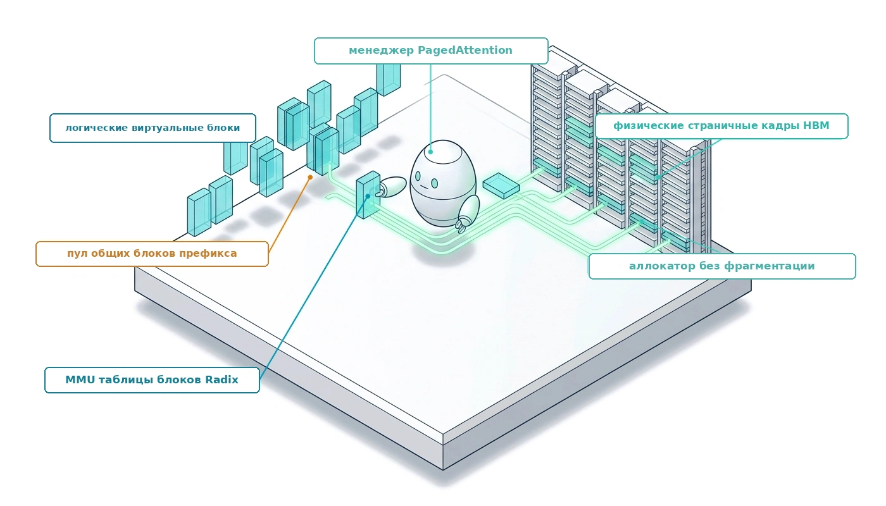

## Назначение

_Почему агент, который ждет ответа инструмента, по-прежнему занимает ускоритель?_

Каждый токен, который агент держит в контексте, оставляет состояние внимания в памяти ускорителя, и по всем траекториям, которые удерживает узел обслуживания, это состояние перерастает собственные веса модели. Запрос к чату удерживает такое состояние несколько секунд, а затем освобождает его. Агент удерживает его через десятки ходов, создает его копию, когда исследует альтернативы, и оставляет простаивать, пока выполняется набор тестов или человек подтверждает действие. Система обслуживания, которая считает каждую траекторию непрозрачным резервированием по худшему случаю, исчерпывает память при том, что большая ее часть не используется, пересчитывает одни и те же общие инструкции на каждом ходу и обделяет активные траектории ради того, чтобы держать приостановленные «теплыми». Решения известны. Состояние внимания нужно хранить страницами, которые могут разделять ветви, переиспользовать общий префикс между ходами и для каждой паузы решать, сохранить, перенести или сбросить состояние. Эти решения окупаются только при согласованной работе обвязки, потому что именно обвязка определяет, как быстро растут контексты, остается ли префикс стабильным и сколько, как ожидается, будет выполняться каждый инструмент. В терминах H·S·A длинный горизонт превращается в состояние, которое система обслуживания обязана физически удерживать, поэтому стоимость этого состояния задается совместно движком, который его хранит, и обвязкой, которая его формирует.

> **Цели обучения**
>
> - Вычислять объем KV-состояния траектории по геометрии модели, длине контекста и точности хранения.
> - Объяснять, почему неизвестная длина траектории, ветвления и паузы на инструментах запирают память при резервировании по худшему случаю.
> - Объяснять, как страничные блоки и копирование при записи позволяют ветвям разделять один префикс без его копирования.
> - Диагностировать, какие решения обвязки повышают или ломают долю попаданий в кеш префиксов между ходами.
> - Выбирать удержание, выгрузку или пересчет для приостановленной траектории по ожидаемому времени ожидания инструмента.
> - Оценивать, сколько параллельных траекторий выдерживает пул обслуживания при заданной длине контекста, общих префиксах и времени ожидания инструментов.

<a id="sec-vol3-kvcache-geometry"></a>

## От токенов контекста к KV-состоянию

Вернемся к агенту-программисту, раскладка контекста которого была оценена в [«Стоимость раскладки контекста на протяжении одной траектории»](04_context_engineering.md#nbk-04-quantitative-impact-of-prefix-layout), теперь на его двадцатом ходу. Его контекст содержит системное сообщение и определения инструментов, состояние задачи и рабочие файлы, а также последние результаты инструментов, включая трассировку стека, которую выдал последний запуск тестов, — всего около тридцати двух тысяч токенов. Агент только что попросил обвязку запустить набор интеграционных тестов, на что уйдет три четверти минуты. Все это время модель ничего не выводит, но состояние внимания, вычисленное для всех тридцати двух тысяч токенов, остается в памяти ускорителя и ждет журнала тестов. [«Инженерия контекста»](04_context_engineering.md#sec-vol3-context-engineering) решала, какие токены должен видеть этот вызов. Эта глава проводит эти токены через систему обслуживания, где они становятся главным потребителем памяти ускорителя, и спрашивает, чего стоит хранить, разделять и освобождать это состояние.


*Эта глава охватывает ту часть состояния, которую хранит система обслуживания: состояние внимания, которое можно разбивать на страницы, разделять, перемещать и восстанавливать.*

[«Базовая модель»](02_foundation_model.md#sec-vol3-foundation-model) определила KV-кеш (key-value cache) одним предложением. Для каждого токена в контексте каждый слой хранит векторы ключей и значений, к которым обращаются последующие токены, поэтому декодированию не нужно пересчитывать их заново. Размер кеша определяется одной только геометрией модели. Модель с $L$ слоями, $H_{\text{kv}}$ головами ключей и значений размерности $d_{\text{head}}$ и $b$ байтами на один сохраняемый элемент хранит

<a id="eq-mem-token"></a>

$$m_{\text{token}} = 2 \cdot L \cdot H_{\text{kv}} \cdot d_{\text{head}} \cdot b$$

байт на каждый токен, где множитель два учитывает ключ и значение. Умножив [формулу памяти на токен](05_kv_cache.md#eq-mem-token) на длину контекста, получаем, что траектория из $S$ токенов занимает $M_{\text{KV}} = S \cdot m_{\text{token}}$ байт, и этот объем растет линейно с каждым ходом, который траектория сохраняет.

Формула превращается в бюджет, как только модель фиксирована. Возьмем 70-миллиардную модель с групповым вниманием запросов, в котором несколько голов запроса разделяют одну голову ключа и значения (Ainslie et al., 2023): 80 слоев, 8 голов ключей и значений размерности 128 и 16-битное хранение. [«Задержка обслуживания на ускорителе»](02_foundation_model.md#sec-vol3-foundation-model-cost) оценивала отдельные вызовы этой модели с 8-битными весами на одном ускорителе — наименьшем развертывании, в котором она помещается. Сервис, который одновременно выполняет множество траекторий агентов, вместо этого распределяет 16-битные веса по узлу из восьми ускорителей, так что основная часть памяти узла свободна для состояния внимания, и именно такое развертывание рассчитывает эта глава. [«От контекста агента к KV-состоянию»](05_kv_cache.md#fig-vol3-context-window-anatomy) проводит один контекст агента через эту геометрию, а приведенная ниже оценка превращает ее в потолок параллелизма.

<a id="fig-vol3-context-window-anatomy"></a>

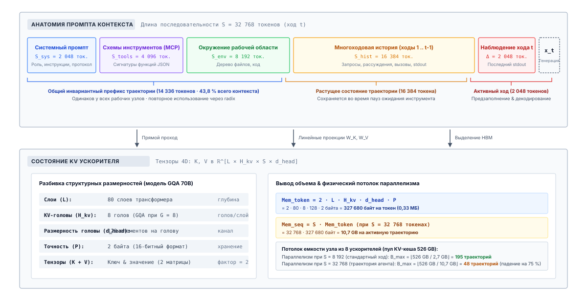
***От контекста агента к KV-состоянию**: Контекст агента из 32 768 токенов (системный промпт, определения инструментов, рабочая область, история ходов и последнее наблюдение) превращается в тензоры ключей и значений для каждого слоя. Объем памяти на токен у 70B-модели с групповым вниманием определяет, сколько таких траекторий помещается в KV-пул одного узла.*

<a id="nbk-05-sizing-the-attention-state-for"></a>

> **Оценка состояния внимания траектории агента**
>
> **Задача**: Узел обслуживания имеет 8 ускорителей с общим объемом памяти 687,2 ГБ и обслуживает описанную выше 70B-модель с групповым вниманием. Сколько траекторий он может держать одновременно, если контекст каждой траектории составляет 8 192, 32 768 или 131 072 токена?
>
> **Математика**:
>
> На один токен $m_{\text{token}} =$ 2 $\times$ 80 $\times$ 8 $\times$ 128 $\times$ 2 байта $=$ 327 680 байт, то есть около 0,33 МБ.
>
> На траекторию объем составляет 2,7 ГБ, 10,7 ГБ и 42,9 ГБ при этих трех длинах.
>
> 16-битные веса занимают 141,2 ГБ, а среда выполнения резервирует 20 ГБ под активации и буферы, что оставляет KV-пул объемом 687,2 ГБ $-$ 141,2 ГБ $-$ 20 ГБ $=$ 526,0 ГБ.
>
> Деление пула на каждый объем дает 195, 48 и 12 параллельных траекторий.
>
> **Системный вывод**: Тот же узел, который держит 195 коротких диалогов, держит лишь 12 траекторий масштаба репозитория. Длина контекста, а не арифметика, определяет, сколько агентов может обслужить узел, поэтому каждый токен, который обвязка сохраняет в контексте, — это требование к общему фиксированному пулу.

Эта количественная реальность задает жесткую границу емкости системы обслуживания вывода. Рассмотрим корпоративный узел вывода с 8 отдельными ускорителями, в каждом из которых 80 ГБ памяти с высокой пропускной способностью, что дает совокупный пул $\text{HBM}_{\text{total}} = 640 \text{ ГиБ}$. 70-миллиардная модель в 16-битной точности занимает по кластеру примерно $\text{Mem}_{\text{weights}} \approx 140 \text{ ГиБ}$. Если отвести еще $\text{Mem}_{\text{runtime}} \approx 20 \text{ ГиБ}$ под буферы обмена, служебную память NCCL и рабочие области активаций во время прямого прохода предзаполнения, примерно $\text{Mem}_{\text{kv\_available}} = 480 \text{ ГиБ}$ остаются под динамический кеш внимания. Теоретический предел параллелизма $B_{\max}$ активных траекторий агентов, работающих одновременно при длине контекста $S$, строго определяется целочисленным частным:

$$B_{\max} = \left\lfloor \frac{\text{HBM}_{\text{total}} - \text{Mem}_{\text{weights}} - \text{Mem}_{\text{runtime}}}{\text{Mem}_{\text{seq}}} \right\rfloor = \left\lfloor \frac{480 \text{ ГиБ}}{S \cdot 320 \text{ КиБ}} \right\rfloor$$

Когда последовательности агентов короткие ($S = 8\,192$), кластер спокойно держит $B_{\max} = \lfloor 480 / 2{,}5 \rfloor = 192$ параллельные траектории. Но как только агенты начинают загружать сложные кодовые базы и выполнять многошаговые трассы выполнения, которые доводят контекст до $S = 131\,072$, параллелизм кластера падает до $B_{\max} = \lfloor 480 / 40 \rfloor = 12$ активных траекторий. Тринадцатый одновременный запрос невозможно поставить в расписание: он либо сразу попадает в очередь, либо приводит к тому, что движок обслуживания аварийно завершается из-за нехватки памяти ускорителя. Среда выполнения, которая держит рабочий набор каждой траектории близко к его эффективному размеру (принцип «Контекст — это выбранный рабочий набор»), остается гораздо ближе к режиму коротких контекстов. Случай в 131 072 токена — это то, что движок обслуживания должен пережить, когда управление контекстом отказывает или отсутствует.

Ожидание инструментов ухудшает узкое место. [«Простаивание памяти как трение»](01_introduction.md#sec-vol3-intro-memory-stranding) оценивало это давление, налог памяти на ожидание инструмента, для одной приостановленной сессии на том же узле. Пока инструмент работает, состояние внимания траектории простаивает в памяти ускорителя, и система обслуживания должна выбирать между удержанием десятков гигабайт, которые нужны другим траекториям, и их переносом или сбросом ценой перезагрузки или полного предзаполнения, когда придет наблюдение. Модель не может сделать этот выбор. Память — это ограничение ресурса, а [«Принцип замыкания инвариантов»](01_introduction.md#pri-invariant-closure) помещает ограничения ресурсов в среду выполнения под моделью, поэтому решение принадлежит системе обслуживания. Оно вернется в разделе [«Удержание, вытеснение, пересчет или выгрузка»](05_kv_cache.md#sec-vol3-kvcache-swapping), когда страничная организация будет на месте.

Физический масштаб этой дилеммы показан в [«Стена памяти KV-кеша»](05_kv_cache.md#fig-vol3-kv-cache-memory-wall). Как видно на левой панели [«Стена памяти KV-кеша»](05_kv_cache.md#fig-vol3-kv-cache-memory-wall), окна контекста передовых языковых моделей выросли более чем в 4 000 раз между 2018 и 2026 годами: от 512 токенов у GPT-1 до 2 097 152 токенов у Gemini 1.5 и 2.0. Это расширение позволяет агентам загружать целые кодовые базы и удерживать обширные истории взаимодействий с инструментами, но оно упирается прямо в физические пределы памяти аппаратных ускорителей, показанные на правой панели. При объеме $320\text{ КиБ}$ на токен в 16-битной точности с групповым вниманием (Ainslie et al., 2023) одна траектория 70B-модели ($B=1$) длиной 128 000 токенов занимает 40 ГБ памяти с высокой пропускной способностью (половину ускорителя NVIDIA H100). При 1 000 000 токенов эта одна траектория требует 320 ГБ KV-кеша: это в 4,0 раза больше емкости одного GPU H100 (80 ГБ) и в 1,7 раза больше, чем у ускорителя следующего поколения B200 (192 ГБ). Когда четыре параллельных агента работают на таком горизонте ($B=4$), совокупный спрос на KV-память превышает 1,28 ТБ и перегружает целые многопроцессорные кластеры. Эта **стена памяти KV-кеша** превращает выделение памяти из второстепенной детали реализации в главный фактор, определяющий масштабируемость агентов, и требует абстракций виртуальной памяти, динамической страничной организации блоков (Kwon et al., 2023) и иерархической выгрузки.

<a id="fig-vol3-kv-cache-memory-wall"></a>

![Двухпанельная схема стены памяти KV-кеша. Левая панель показывает максимальную длину окна контекста в логарифмической шкале с 2018 по 2026 год: восходящая граница от GPT-1 (512 токенов) через GPT-3, GPT-4, Claude 2 и Claude 3 до Gemini 1.5 и 2.0 (2 097 152 токена). Правая панель показывает объем KV-кеша в гигабайтах в логарифмическом масштабе по обеим осям в зависимости от длины контекста от 1 000 до двух миллионов токенов для моделей 70B и 8B. Горизонтальные пунктирные линии обозначают физические пределы памяти V100, H100, H200, B200 и кластера из 8 GPU H100. Красная зона выделяет физическую стену памяти выше 80 ГБ; выноски указывают 40 ГБ при 128 000 токенах и 320 ГБ при одном миллионе токенов для одной последовательности 70B.](images/05_kv_cache/svg/kv_cache_memory_wall.svg)

***Стена памяти KV-кеша**: Рост окон контекста у передовых языковых моделей (2018–2026) и возникающая физическая стена памяти относительно пределов аппаратных ускорителей. Левая панель показывает 4 000-кратное расширение емкости окна контекста от GPT-1 (512 токенов) до Gemini 1.5 и 2.0 (2 097 152 токена). Правая панель показывает рост объема KV-кеша для 70B-модели с групповым вниманием (Ainslie et al., 2023) и 8B-модели с плотной архитектурой в зависимости от горизонта контекста, сопоставленный с пределами аппаратной памяти (V100 32 ГБ, A100/H100 80 ГБ, H200 141 ГБ, B200 192 ГБ и узел из восьми ускорителей H100 с динамическим пулом 480 ГБ). При одном миллионе токенов одна траектория 70B требует 320 ГБ состояния KV, что превышает емкость отдельных устройств и делает необходимыми PagedAttention (Kwon et al., 2023) и иерархическую выгрузку.*

Основной вывод из пересечения этих двух тенденций состоит в том, почему физическая емкость памяти заменила арифметическую пропускную способность в роли главного фактора, определяющего системы агентов с длинным горизонтом. Как показано на правой панели [«Стена памяти KV-кеша»](05_kv_cache.md#fig-vol3-kv-cache-memory-wall), масштабирование длины контекста до одного миллиона токенов требует 320 ГБ памяти KV-кеша на каждую последовательность 70B, что в четыре раза превышает емкость одного GPU NVIDIA H100 (80 ГБ). Даже при масштабировании на узел из восьми ускорителей с динамическим пулом 480 ГБ обслуживание всего двух параллельных агентов на таком горизонте ($B = 2$, 640 ГБ) полностью исчерпывает память кластера. Это узкое место вызвало двустороннюю архитектурную реакцию в инженерии систем машинного обучения: виртуальную страничную организацию памяти во время выполнения через PagedAttention (Kwon et al., 2023), которая устраняет внутреннюю и внешнюю физическую фрагментацию, и алгоритмические новшества, такие как многоголовое латентное внимание (Multi-Head Latent Attention, MLA) (DeepSeek, 2024), которое сжимает проекции ключей и значений в векторы низкого ранга и уменьшает объем памяти до 5,7 раза. Без этих системных абстракций поддержка производственных рабочих процессов агентов с многоходовыми окнами контекста оставалась бы физически и экономически неосуществимой.

Если бы каждая траектория агента имела инвариантную, статически предсказуемую длину последовательности, выделение и разбиение этой памяти свелось бы к тривиальной статической задаче. Среда выполнения могла бы разбить свои 480 ГБ доступной памяти с высокой пропускной способностью (HBM) на двенадцать фиксированных непрерывных буферов по 40 ГБ, назначив по одному буферу каждому слоту выполнения. На практике, однако, траектории агентов радикально недетерминированы: одна может успешно завершиться на 1 200 токенах, другая может столкнуться с синтаксической ошибкой компилятора и итерировать 45 000 токенов, а третья может зациклиться в рекурсии и занять все окно в 131 072 токена. Когда движок заранее выделяет непрерывные физические буферы, рассчитанные на контексты худшей длины, подавляющая часть выделенной памяти ускорителя остается незаполненной и простаивает, а входящие запросы отклоняются из-за мнимого исчерпания емкости. Как же динамическая изменчивость длины траекторий вызывает катастрофическую физическую фрагментацию памяти в непрерывных аллокаторах и какие архитектурные механизмы должна ввести система обслуживания, чтобы устранить возникающие потери?

<a id="sec-vol3-kvcache-fragmentation"></a>

## Фрагментация памяти


*Страничное внимание снижает потери памяти с 87,5 процента до 0,12 процента, устраняя внешнюю фрагментацию.*

Непрерывные аллокаторы памяти в средах выполнения ускорителей вынуждают выбирать между катастрофической нехваткой памяти и повсеместным дефицитом емкости, и ни один из вариантов не приемлем. Когда движок вывода выделяет память под кеш ключей и значений (KV-кеш), он должен вместить последовательности, конечная длина которых заранее непредсказуема. Модель, генерирующая авторегрессионную последовательность, не может заявить точку своего завершения заранее: оно зависит целиком от сэмплированных выходных токенов, появления токена конца последовательности или внешнего критерия остановки, который накладывает обвязка агента. Тем не менее обычные библиотеки тензоров на GPU требуют плотного непрерывного выделения памяти, чтобы эффективно выполнять умножения матрицы на вектор. Это несоответствие между динамическим, непредсказуемым логическим ростом и жестким непрерывным физическим выделением составляет центральную дилемму управления памятью в современных системах обслуживания машинного обучения.

**Переменные длины последовательностей превращают наивное непрерывное выделение KV-кеша в источник тяжелых потерь памяти: от 60 до 80 процентов HBM ускорителя простаивает в невостребованных резервированиях и недоступных физических разрывах.** В многоходовых рабочих нагрузках агентов, где жизненный цикл последовательностей прерывается внешними вызовами среды и сильно меняющимися бюджетами генерации, аллокаторы с фиксированным резервированием и непрерывными фрагментами быстро обрушивают эффективную пропускную способность обслуживания. Среда выполнения отклоняет входящие запросы из-за мнимого исчерпания емкости, в то время как физическая шина памяти показывает десятки гигабайт формально незаписанного пространства. Чтобы понять структурные истоки этих потерь, нужно разобрать, как память выделяется, делится и простаивает на протяжении динамического жизненного цикла вывода.

### Пределы статического избыточного выделения

Самая ранняя и самая простая стратегия управления памятью KV-кеша — статическое резервирование по худшему случаю. В этом режиме движок обслуживания выделяет один непрерывный физический буфер для каждой принятой последовательности, рассчитанный на максимальную возможную длину последовательности $S_{\max}$, которую поддерживает архитектура модели или конфигурация развертывания. Если ускоритель обслуживает модель, настроенную на окно контекста $S_{\max} = 32\,768$ токена, движок резервирует память ровно под $32\,768$ векторов ключей и значений сразу по приходе запроса, задолго до выполнения первого шага декодирования.

**Парадокс выделения**
В архитектурах с непрерывной памятью аллокатор должен либо заранее избыточно выделить память под худший случай длины последовательности, простаивающую в неиспользуемых резервированиях, либо динамически менять размер буферов во время работы, неся разрушительные копирования памяти и остановки синхронизации на шине ускорителя.

Статическое резервирование устраняет динамическое управление памятью во время генерации. Поскольку каждый запрос владеет неизменяемым, заранее выделенным участком памяти, среда выполнения не делает вызовов выделения памяти GPU, синхронизаций потоков и корректировок указателей по ходу декодирования. Физический адрес слотов ключей и значений для позиции токена $t$ вычисляется напрямую через равномерную арифметику шага. С операционной точки зрения статическое резервирование гарантирует, что принятый запрос никогда не столкнется с ошибкой нехватки памяти (OOM) на середине генерации.

Системная цена этой операционной простоты — катастрофическая недозагрузка. В реальных рабочих нагрузках длины последовательностей неравномерны и подчиняются сильно асимметричным распределениям. Пусть случайная величина $S \in [1, S_{\max}]$ обозначает полную длину последовательности принятого запроса, включающую как токены промпта $S_{\text{prompt}}$, так и сгенерированные выходные токены $S_{\text{gen}}$, и задается эмпирической функцией вероятности $P(S = s)$. Физическая память, выделенная запросу, фиксирована и равна $M(S_{\max}) = S_{\max} \cdot m_{\text{token}}$ байт, где $m_{\text{token}}$ — суммарный объем памяти под состояния ключей и значений на один токен во всех слоях. Ожидаемая полезная память, которую потребляет завершенная последовательность, равна:

$$\mathbb{E}[M_{\text{useful}}] = m_{\text{token}} \sum_{s=1}^{S_{\max}} s \cdot P(S = s)$$

Ожидаемая эффективность выделения памяти $\eta_{\text{static}}$ при статическом резервировании задается отношением ожидаемой полезной памяти к памяти, зарезервированной по худшему случаю:

$$\eta_{\text{static}} = \frac{\mathbb{E}[M_{\text{useful}}]}{M(S_{\max})} = \frac{1}{S_{\max}} \mathbb{E}[S]$$

Когда среда выполнения агентов обслуживает смесь задач, например дополнение кода, чередование реплик в диалоге и вызовы инструментов, медианная длина последовательности $\text{Med}(S)$ обычно составляет малую долю от $S_{\max}$. Для приложения, настроенного на $S_{\max} = 32\,768$ токена, где средняя завершенная траектория потребляет $\mathbb{E}[S] = 2\,048$ токенов, ожидаемая эффективность выделения составляет менее $6{,}25\%$. Оставшиеся $93{,}75\%$ выделенной физической памяти полностью не записаны и удерживаются под залог для токенов, которые никогда не будут сэмплированы. Поскольку память ускорителя строго ограничена, такое искусственное раздувание объема на запрос ограничивает параллелизм несколькими потоками и сдерживает совокупную пропускную способность запросов.

Альтернативный инженерный подход — динамическое непрерывное перевыделение, повторяющее поведение структур массивов переменной емкости, таких как `std::vector` в C++. Среда выполнения начинает с выделения небольшого непрерывного буфера, соответствующего длине промпта $S_{\text{prompt}}$. Когда авторегрессионный цикл порождает токены, которые превышают текущую емкость, движок выделяет больший непрерывный участок, копирует накопленные записи KV-кеша из старого буфера в новый и освобождает исходное выделение.

Временная шкала динамического изменения размера и накладные расходы памяти показаны на [«Накладные расходы динамического непрерывного перевыделения»](05_kv_cache.md#fig-vol3-contiguous-realloc) на трех дискретных этапах выполнения. На шаге 1, как только исходный буфер емкостью $N$ исчерпан, среда выполнения вызывает `cudaMalloc`, чтобы выделить расширенный буфер на $2N$ слотов, что вводит задержку синхронизации плоскости управления и останавливает запуск ядер. На шаге 2 среда выполнения выполняет копирование памяти «устройство — устройство» по внутренней шине HBM, чтобы перенести исторические проекции ключей и значений в новый участок; на время этого переноса оба буфера, на $N$ и на $2N$ слотов, должны одновременно находиться в памяти устройства, что вызывает временный скачок в $3{,}0\times$ относительно исходного базового уровня использования. Наконец, на шаге 3 вызов `cudaFree` освобождает устаревший буфер на $N$ слотов, оставляя изолированный разрыв внешней фрагментации, который нельзя объединить без полного уплотнения памяти.

<a id="fig-vol3-contiguous-realloc"></a>

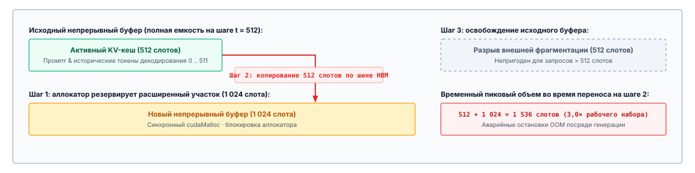
***Накладные расходы динамического непрерывного перевыделения**: Патология изменения размера по образцу `std::vector` на ускорителях. Шаг 1 выделяет расширенный непрерывный буфер, что вносит задержку плоскости управления; шаг 2 копирует исторические записи KV по шине HBM; шаг 3 освобождает устаревший буфер, оставляя несвязанные разрывы внешней фрагментации и вызывая временный скачок памяти в 3,0 раза.*

Эта парадигма динамического изменения размера порождает серьезные системные патологии при выполнении на массово-параллельных ускорителях. Во-первых, вызовы процедур управления памятью, таких как `cudaMalloc` и `cudaFree`, влекут существенную задержку плоскости управления. Эти процедуры тяжеловесны: они сериализуют потоки устройства, вызывают синхронизации хоста и устройства и нарушают конвейеры асинхронного запуска ядер. Во-вторых, копирование многомерного тензорного состояния через высокоскоростную память (High Bandwidth Memory, HBM) расходует пропускную способность шины памяти, которая иначе обслуживала бы матрично-векторные умножения фазы декодирования, ограниченные пропускной способностью памяти. В-третьих, на время перевыделения сервер обслуживания обязан одновременно сохранять и старый, и новый буфер памяти, создавая временный всплеск потребления памяти, который часто и приводит к тем самым ошибкам нехватки памяти, которых стратегия стремилась избежать.

### Потери непрерывной памяти

Провал как статического резервирования, так и динамического непрерывного выделения проистекает из классических патологий управления памятью операционных систем, проявляющихся при крайних ограничениях ускорителя. Потери памяти в KV-кеше четко делятся на две архитектурные категории: внутреннюю фрагментацию и внешнюю фрагментацию ([«Таксономия фрагментации памяти KV-кеша»](05_kv_cache.md#tbl-vol3-kv-fragmentation-taxonomies)).

| Измерение фрагментации     | Первопричина на уровне архитектуры                                      | Проявление в средах KV с непрерывной памятью                                                               | Сбой смягчения в наивных аллокаторах                                                               |
|:---------------------------|:------------------------------------------------------------------------|:-----------------------------------------------------------------------------------------------------------|:---------------------------------------------------------------------------------------------------|
| **Внутренняя фрагментация** | Грубое избыточное выделение и буферы резервирования по худшему случаю.  | Зарезервированные слоты между текущим шагом генерации $t$ и максимальной емкостью последовательности $S_{\max}$. | Уменьшение размера резервирования увеличивает частоту прерываний из-за нехватки памяти на середине генерации. |
| **Внешняя фрагментация**   | Шахматная раскладка памяти, вызванная непрерывными участками с переменным временем жизни. | Куски свободной физической памяти, разбросанные между активными буферами, которые не вмещают новые непрерывные запросы. | Уплотнение памяти требует синхронных копирований всего кеша тензоров на GPU, что останавливает активную генерацию. |
| **Временное дублирование** | Политики непрерывного перевыделения и геометрического роста.           | Перекрывающееся потребление физической памяти во время копирования и изменения размера динамического буфера. | Амортизированное удвоение снижает частоту копирований, но повышает мгновенный пиковый объем резервирования. |
<a id="tbl-vol3-kv-fragmentation-taxonomies"></a>

***Таксономия фрагментации памяти KV-кеша**: Первопричины, проявления в аллокаторах и режимы отказа наивных способов смягчения в средах с непрерывной памятью.*

Внутренняя фрагментация возникает, когда аллокатор хранилища выдает память сущности фиксированными порциями, которые превышают ее немедленную операционную потребность. В архитектурах KV-кеша с непрерывной памятью внутренняя фрагментация проявляется в двух различных формах: *потери на резервировании* и *геометрический запас*.

Потери на резервировании — это разрыв между текущей записанной длиной последовательности $t$ и зарезервированной границей $S_{\text{alloc}}$. Даже если аллокатор определяет размер буферов динамически, по прогнозирующей эвристике, а не по $S_{\max}$, любое выделение с $S_{\text{alloc}} > t$ оставляет $S_{\text{alloc}} - t$ слотов непригодными для любого другого параллельного запроса. Поскольку стандартные тензорные ядра требуют физической непрерывности адресов, незаписанные слоты за активной последовательностью не могут быть отданы независимой последовательности.

Геометрический запас возникает, когда среда выполнения пытается снизить частоту перевыделений, геометрически расширяя буферы, например удваивая емкость каждый раз, когда достигается граница. Запрос, который завершается на $1\,025$ токенах в буфере на $2\,048$ токенов, оставляет $1\,023$ токена внутреннего запаса. По пакету из десятков параллельных запросов геометрический запас стабильно оставляет без использования от $25\%$ до $33\%$ выделенной емкости пула.

Внешняя фрагментация возникает со временем, по мере того как запросы с разным моментом прихода и разной длиной завершения выделяют и освобождают непрерывные блоки памяти. Представим пространство памяти ускорителя, инициализированное как единый непрерывный пул.

Пространственное проявление этой патологии фрагментации показано на [«Фрагментация непрерывной памяти и сбой выделения»](05_kv_cache.md#fig-vol3-kv-fragmentation). Сначала среда выполнения удовлетворяет непрерывные выделения разного размера: запрос $A$ занимает $4\text{ ГиБ}$, запрос $B$ занимает $1\text{ ГиБ}$, а запрос $C$ занимает $6\text{ ГиБ}$. Обратите внимание, что внутри активных буферов потери на резервировании уже велики: запрос $A$ использует лишь $1{,}8\text{ ГиБ}$ из зарезервированных $4\text{ ГиБ}$, а запрос $C$ использует лишь $2{,}4\text{ ГиБ}$ из своих $6\text{ ГиБ}$. Когда запрос $B$ уходит, его блок в $1\text{ ГиБ}$ возвращается в список свободных. Однако когда приходит входящий запрос $D$, которому нужен непрерывный участок в $2\text{ ГиБ}$, он не может занять разрыв в $1\text{ ГиБ}$, оставшийся после $B$. Хотя общий свободный пул содержит $5\text{ ГиБ}$ доступной памяти ($1\text{ ГиБ}$ в промежуточном разрыве плюс $4\text{ ГиБ}$ в невыделенном хвосте), запрос $D$ сразу же останавливается в ожидании выделения, потому что ни один непрерывный сегмент не достаточно велик, чтобы удовлетворить его запрос на резервирование.

<a id="fig-vol3-kv-fragmentation"></a>

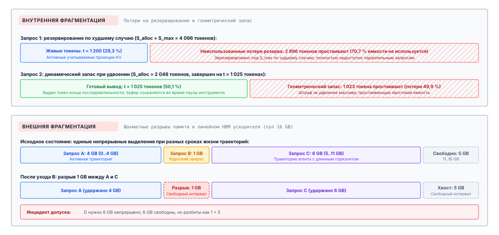
***Фрагментация непрерывной памяти и сбой выделения**: Разбивка выделения при непрерывных тензорных раскладках: внутренние потери на резервировании внутри буферов активных последовательностей наряду с разрывами внешней фрагментации, из-за которых входящие запросы не проходят допуск, несмотря на достаточный совокупный объем свободной памяти.*

По мере того как сотни запросов проходят через движок обслуживания, физическое адресное пространство распадается на чередующуюся шахматную доску из выделенных участков и несмежных свободных интервалов. В конце концов система попадает в патологическое состояние: совокупный объем свободной физической памяти по всем разрывам может составлять $20$ ГБ, однако входящий запрос, которому нужен непрерывный буфер в $4$ ГБ, отклоняется, потому что самый большой непрерывный блок составляет лишь $1{,}5$ ГБ.

В традиционных операционных системах центральных процессоров (CPU) внешняя фрагментация в пользовательском пространстве скрыта аппаратным блоком управления памятью (MMU). Операционная система отображает несмежные физические кадры страниц по $4$ КБ в непрерывное виртуальное адресное пространство, позволяя процессам видеть память непрерывно, не требуя физической непрерывности. Архитектуры ускорителей исторически не имели сопоставимых аппаратно управляемых механизмов подкачки страниц для тензорных вычислений. Ядра CUDA, выполняющие масштабированное скалярное произведение внимания, вычисляют смещения указателей, предполагая регулярные шаги по непрерывным измерениям памяти:

$$\text{Offset}(l, h, t, d) = l \cdot \text{stride}_L + h \cdot \text{stride}_H + t \cdot \text{stride}_T + d \cdot \text{stride}_D$$

Если измерение токенов $t$ разорвано по несмежным участкам физической памяти, арифметика шагов рушится и возникают некорректные ссылки на указатели, если только базовое ядро внимания явно не переписано так, чтобы проходить по таблице трансляции адресов.

Решение внешней фрагментации в непрерывном режиме требует уплотнения памяти: остановки конвейера вывода, перемещения активных тензоров KV по физической HBM, чтобы объединить соседние свободные разрывы в один непрерывный участок, и обновления всех внутренних указателей тензоров. На высокопроизводительных ускорителях уплотнение непомерно дорого. Перенос десятков гигабайт данных KV по шине памяти занимает миллисекунды, что нарушает целевые показатели качества обслуживания в реальном времени (SLO) и останавливает параллельные варпы вычислений. Поэтому наивные движки обслуживания вовсе избегают уплотнения, позволяя внешней фрагментации расти без контроля, пока движок не будет вынужден ограничить допуск запросов.

### Круговорот памяти траекторий

Хотя статичные диалоговые запросы демонстрируют умеренную изменчивость длины последовательности, агентные рабочие нагрузки усиливают фрагментацию памяти до крайней степени. Автономные агенты не выполняют непрерывную линейную генерацию без перерывов; они работают в циклах итеративного рассуждения, выполнения и проверки. Траектория агента характеризуется быстрым круговоротом выделений, непредсказуемыми горизонтами завершения и длительными интервалами приостановки вычислений ([«Рост многоходового контекста и временная шкала выделения памяти»](05_kv_cache.md#tbl-vol3-trajectory-turn-memory-growth)).

| Ход траектории | Операция          | Токены хода (промпт / генерация) | Накопленный контекст | Ожидание среды и состояние                   |
|:---------------|:------------------|:---------------------------------|:---------------------|:---------------------------------------------|
| **Ход 1**      | Генерация плана   | 400 / 150                        | 550 токенов          | Вызван компилятор; процесс простаивает 4,2 с |
| **Ход 2**      | Диагностика ошибки | +1 200 (stderr) / 80            | 1 830 токенов        | Вызвано средство запуска тестов; процесс простаивает 12,0 с |
| **Ход 3**      | Рефакторинг патча | +3 500 (кодовая база) / 850      | 6 180 токенов        | Активная проверка многофайловой правки       |
<a id="tbl-vol3-trajectory-turn-memory-growth"></a>

***Рост многоходового контекста и временная шкала выделения памяти**: Добавления токенов, накопленные рабочие наборы и паузы среды на протяжении интерактивной траектории.*

Рассмотрим объем памяти агента, занятого автоматическим исправлением программного обеспечения. На первом ходу агент генерирует простую команду патча на основе промпта из $1\,000$ токенов, порождая $120$ токенов. Затем он вызывает внешний инструмент-компилятор внутри изолированного контейнера. В течение четырех секунд, нужных компилятору, чтобы выполниться и вернуть вывод, процесс агента не производит ни одного токена.

В системе с непрерывной памятью среда выполнения сталкивается с острой дилеммой в отношении этой приостановленной траектории. Если движок сохраняет непрерывный KV-кеш агента в HBM на протяжении всего окна выполнения инструмента, он закрепляет физическую память, которую не может использовать ни один другой активный запрос. Хуже того, если движок выделил щедрый непрерывный буфер в расчете на будущие ходы, весь этот резерв остается простаивающим и заблокированным. Если же движок вместо этого освобождает непрерывный буфер, чтобы высвободить место для других запросов, он обязан полностью отбросить накопленное состояние, и тогда, когда компилятор вернет журнал ошибок, придется проводить дорогостоящую фазу полного пересчета предзаполнения.

Рабочие нагрузки агентов по природе демонстрируют мультимодальные распределения длин завершения. Простые запросы завершаются почти сразу, когда инструмент подтверждает выполнение предусловия ($S < 500$). Сложные запросы натыкаются на рекурсивные сбои, порождая трассировки стека, повторно запрашивая модель и накапливая контекст, пока последовательность не приблизится к физической границе окна ($S > 30\,000$).

Когда короткоживущие и долгоживущие траектории выполняются одновременно в одном и том же пуле физической памяти, частота круговорота выделений растет. Короткоживущие запросы быстро выделяют и освобождают небольшие участки памяти, пронизывая пространство памяти локальными разрывами. Тем временем долгоживущие запросы агентов большой емкости удерживают крупные непрерывные блоки по нескольку минут. Получившаяся топология памяти представляет собой наихудшую рабочую среду для непрерывного аллокатора: непредсказуемая последовательность размеров выделений, перемежающаяся с недетерминированными сроками освобождения, в адресном пространстве, которое не допускает ни физической разрывности, ни дешевого уплотнения.

### Количественная оценка полезной емкости: метрика эффективности выделения KV

Чтобы строго диагностировать и сравнивать производительность аллокаторов в средах обслуживания, нужно формализовать связь между физическим выделением памяти и эффективной емкостью по токенам. Пусть $M_{\text{pool}}$ обозначает совокупную физическую емкость памяти, выделенную подсистеме KV-кеша на ускорителе, измеряемую в байтах. Этот пул обычно получают вычитанием статических весов параметров модели $M_{\text{weights}}$ и временной памяти активаций $M_{\text{act}}$, необходимой для матричных умножений предзаполнения, из общей физической памяти устройства $M_{\text{device}}$:
$$M_{\text{pool}} = M_{\text{device}} - M_{\text{weights}} - M_{\text{act}}$$

В любой дискретный момент времени $t$ работы движка обслуживания пусть $\mathcal{R}(t)$ обозначает множество всех активных запросов, принятых в систему. Для каждого запроса $i \in \mathcal{R}(t)$ пусть $s_i(t)$ обозначает число действительных токенов, обработанных или сгенерированных к этому моменту. Совокупная *полезная память* $M_{\text{useful}}(t)$, которая хранит живые, учитываемые представления ключей и значений, определяется как:

$$M_{\text{useful}}(t) = m_{\text{token}} \sum_{i \in \mathcal{R}(t)} s_i(t)$$

И наоборот, пусть $A_i(t)$ обозначает физический участок памяти, измеряемый в слотах токенов, который аллокатор фактически зарезервировал для запроса $i$ в момент $t$. Совокупная *выделенная память* $M_{\text{allocated}}(t)$, закрепленная за активными запросами, равна:

$$M_{\text{allocated}}(t) = m_{\text{token}} \sum_{i \in \mathcal{R}(t)} A_i(t)$$

Остальная память пула составляет невыделенную физическую емкость, которую обозначим как $M_{\text{free}}(t) = M_{\text{pool}} - M_{\text{allocated}}(t)$. В непрерывном аллокаторе эта свободная емкость разбита на набор из $K$ дискретных несмежных свободных участков памяти:

$$M_{\text{free}}(t) = \sum_{k=1}^{K} H_k(t)$$

где $H_k(t)$ — размер в байтах $k$-го непрерывного свободного участка.

Состояние памяти системы оценивается тремя нормированными безразмерными метриками. Во-первых, *эффективность выделения* $\eta_{\text{alloc}}(t)$ измеряет долю закрепленной в данный момент памяти, которая хранит настоящее состояние токенов, а не внутренний резервный запас:

$$\eta_{\text{alloc}}(t) = \frac{M_{\text{useful}}(t)}{M_{\text{allocated}}(t)} = \frac{\sum_{i \in \mathcal{R}(t)} s_i(t)}{\sum_{i \in \mathcal{R}(t)} A_i(t)}$$

Во-вторых, *коэффициент внешней фрагментации* $\Phi_{\text{ext}}(t)$ оценивает, какая доля невыделенной физической памяти заперта во фрагментах, слишком малых для удовлетворения входящего запроса, которому нужен непрерывный буфер размером $R_{\text{req}}$ байт:

$$\Phi_{\text{ext}}(t) = 1 - \frac{\sum_{k: H_k(t) \ge R_{\text{req}}} H_k(t)}{M_{\text{free}}(t)}$$

Когда вся свободная память находится в едином непрерывном участке, $\Phi_{\text{ext}}(t) = 0$. Когда свободная память раздроблена так, что ни один отдельный разрыв не вмещает $R_{\text{req}}$, $\Phi_{\text{ext}}(t) = 1$, что означает полную внешнюю фрагментацию: аллокатор обязан отказать в новой работе, несмотря на $M_{\text{free}}(t) > 0$.

Наконец, *эффективная заполненность KV-кеша* $\eta_{\text{effective}}(t)$ задает абсолютную долю всего физического пула памяти KV, которая выполняет полезную работу:

$$\eta_{\text{effective}}(t) = \frac{M_{\text{useful}}(t)}{M_{\text{pool}}}$$

<a id="nbk-05-quantifying-contiguous-kv-cache-fragmentation"></a>

> **Оценка фрагментации непрерывного KV-кеша на NVIDIA H100**
>
> **Исходные данные:** Рассмотрим ускоритель NVIDIA H100 SXM5 с $M_{\text{device}} = 80 \text{ ГиБ}$ ($85\,899\,345\,920 \text{ байт}$) памяти с высокой пропускной способностью (HBM3), обеспечивающей $3{,}35 \text{ ТБ/с}$ пропускной способности памяти. Система обслуживает модель Llama-3-70B с 16-битными весами половинной точности (BF16, $P = 2 \text{ байт}$). Модель имеет $L = 80$ слоев трансформера, скрытую размерность $d_{\text{model}} = 8\,192$ и использует групповое внимание (Grouped-Query Attention, GQA) с $H_{\text{kv}} = 8$ головами ключей и значений, каждая размерности $d_{\text{head}} = 128$. Максимальная поддерживаемая длина контекста составляет $S_{\max} = 16\,384$ токена.
>
> **Параметры и объем KV:**
> Параметры модели занимают:
> $$M_{\text{weights}} \approx 70 \times 10^9 \times 2 \text{ байт} \approx 140 \times 10^9 \text{ байт} \approx 130{,}38 \text{ ГиБ}$$
> Поскольку веса не помещаются в один GPU, модель разбивается по тензорам на два GPU H100 ($TP=2$). На каждом GPU:
> $$M_{\text{weights, per-GPU}} = \frac{130{,}38 \text{ ГиБ}}{2} = 65{,}19 \text{ ГиБ}$$
> Резервирование $4{,}81 \text{ ГиБ}$ под рабочую память активаций ($M_{\text{act}}$) и служебные расходы среды выполнения CUDA оставляет:
> $$M_{\text{pool}} = 80{,}00 - 65{,}19 - 4{,}81 = 10{,}00 \text{ ГиБ} \quad (10\,737\,418\,240 \text{ байт})$$
>
> Объем состояния ключей и значений на токен по локальным шардам одного GPU ($H_{\text{kv, local}} = 8 / 2 = 4$ головы) составляет:
> $$m_{\text{token}} = 2 \times L \times H_{\text{kv, local}} \times d_{\text{head}} \times P = 2 \times 80 \times 4 \times 128 \times 2 = 163\,840 \text{ байт/токен} \approx 160 \text{ КиБ/токен}$$
>
> **Сценарий A: статическое резервирование по худшему случаю:**
> Среда выполнения настраивает непрерывные буферы, рассчитанные на $S_{\max} = 16\,384$ токена.
> Память, необходимая для резервирования одного запроса, равна:
> $$A_{\text{static}} = 16\,384 \times 160 \text{ КиБ} = 2\,684\,354\,560 \text{ байт} = 2{,}50 \text{ ГиБ}$$
> Максимальный размер одновременного пакета, который GPU может принять, равен:
> $$B_{\max} = \left\lfloor \frac{M_{\text{pool}}}{A_{\text{static}}} \right\rfloor = \left\lfloor \frac{10{,}00 \text{ ГиБ}}{2{,}50 \text{ ГиБ}} \right\rfloor = 4 \text{ запросов}$$
>
> Допустим, активная рабочая нагрузка агентов имеет эмпирическое распределение длин последовательностей со средней длиной $\mathbb{E}[S] = 2\,048$ токенов. Когда четыре запроса выполняются с их средними длинами:
> $$M_{\text{useful}} = 4 \times (2\,048 \times 160 \text{ КиБ}) = 1{,}25 \text{ ГиБ}$$
> $$M_{\text{allocated}} = 4 \times 2{,}50 \text{ ГиБ} = 10{,}00 \text{ ГиБ}$$
> $$\eta_{\text{alloc}} = \frac{1{,}25 \text{ ГиБ}}{10{,}00 \text{ ГиБ}} = 12{,}5\%$$
> $$\eta_{\text{effective}} = \frac{1{,}25 \text{ ГиБ}}{10{,}00 \text{ ГиБ}} = 12{,}5\%$$
> Ошеломляющие $8{,}75 \text{ ГиБ}$ ($87{,}5\%$) доступной емкости KV-кеша полностью простаивают, запертые во внутренней фрагментации резервирования. Параллелизм ограничен четырьмя запросами, и пропускная способность обслуживания падает.
>
> **Сценарий B: динамическое непрерывное выделение с внешней фрагментацией:**
> Чтобы бороться со статическими потерями, среда выполнения переходит на динамическое непрерывное выделение по схеме двоичных «двойников» (power-of-two buddy allocation). Принимаются десять запросов с переменными длинами последовательностей, взятыми из эмпирического распределения, которые занимают в сумме $M_{\text{useful}} = 4{,}20 \text{ ГиБ}$ при выделенных буферах общим объемом $M_{\text{allocated}} = 6{,}40 \text{ ГиБ}$ ($\eta_{\text{alloc}} = 65{,}6\%$).
>
> Остаток свободной памяти пула составляет $M_{\text{free}} = 10{,}00 - 6{,}40 = 3{,}60 \text{ ГиБ}$. Однако из-за прошлых прибытий и завершений запросов эти $3{,}60 \text{ ГиБ}$ разбиты на пять изолированных несмежных участков памяти:
> $$\{H_k\} = \{512 \text{ МиБ}, \ 256 \text{ МиБ}, \ 1024 \text{ МиБ}, \ 768 \text{ МиБ}, \ 1024 \text{ МиБ}\}$$
>
> Приходит одиннадцатый запрос с промптом в $4\,096$ токенов, которому нужно начальное резервирование $1\,536 \text{ МиБ}$ ($1{,}50 \text{ ГиБ}$).
>
> Хотя в системе есть $3{,}60 \text{ ГиБ}$ свободной физической памяти, наибольший непрерывный участок составляет $\max(H_k) = 1\,024 \text{ МиБ} < 1\,536 \text{ МиБ}$.
> Коэффициент внешней фрагментации для этого запроса равен:
> $$\Phi_{\text{ext}} = 1 - \frac{0}{3{,}60 \text{ ГиБ}} = 100\%$$
> Запрос отклоняется или блокируется в очереди допуска. Несмотря на то что физически свободно более чем вдвое больше нужного объема памяти в HBM, аллокатор не может удовлетворить непрерывное резервирование.

Эмпирические измерения производственных сервисов вывода подтверждают эти аналитические пределы. В своем основополагающем описании систем обслуживания больших языковых моделей (LLM) Kwon et al. (2023) показали, что на производственных нагрузках, обслуживающих диалоговые модели и модели генерации кода, обычные среды обслуживания достигали эффективной заполненности памяти $\eta_{\text{effective}}$ лишь в диапазоне от $20\%$ до $40\%$. Остальные $60\%$—$80\%$ памяти ускорителя полностью терялись во внутреннем резервном запасе и разрывах внешней фрагментации.

<a id="chk-05-memory-fragmentation"></a>

> **Проверка: фрагментация памяти в кешах внимания**
>
> Прежде чем разбирать абстракции страничной виртуальной памяти для KV-кешей, проверьте понимание пределов выделения физической памяти:
>
> - [ ] **Внутренняя фрагментация**: почему резервирование максимальной емкости последовательности $S_{\max}$ заранее оставляет неиспользованными до 80 процентов HBM ускорителя?
> - [ ] **Внешняя фрагментация**: как динамическое непрерывное выделение вызывает сбои выделения памяти, даже когда общий объем свободной HBM превышает размер запрошенного тензора?
> - [ ] **Эффективность выделения**: при каких условиях метрика эффективности выделения KV $\eta_{\text{alloc}}$ обрушивается во время многоходовых рассуждений агента?
> - [ ] **Связь физического и логического**: какое архитектурное узкое место делает непрерывные тензоры KV неспособными поддерживать ветвящееся выполнение без глубоких копирований тензоров?
<a id="sec-vol3-kvcache-pagedattention"></a>

## Страничное выделение KV

Любой динамический аллокатор памяти, сталкивающийся с непредсказуемыми сроками жизни запросов, упирается в классическую дилемму виртуальной памяти, описанную в ранних операционных системах с разделением времени: если заставить динамически растущие структуры данных занимать непрерывные физические адреса, неизбежно возникает неприемлемый выбор между упреждающим избыточным резервированием и внешней фрагментацией памяти. Когда среда вывода обслуживает десятки параллельных запросов генерации, выделение непрерывных участков памяти под проекции ключей и значений (KV) каждой последовательности превращает высокоскоростную память (HBM) ускорителя в разорванную сетку непригодных разрывов. Поскольку авторегрессионное декодирование выдает по одному токену за раз до появления непредсказуемого терминального токена, среда выполнения не может предсказать, завершится ли траектория после двенадцати токенов или разрастется до восьми тысяч. Непрерывный аллокатор, который пытается наращивать последовательность на месте, должен либо заранее зарезервировать окно контекста по худшему случаю, оставив до 80 процентов памяти ускорителя простаивающей, либо периодически перевыделять память и физически копировать гигабайты состояния тензоров по внутренним шинам, чтобы объединить непрерывные участки.

**Страничное выделение KV** решает эту физическую дилемму, перенося базовую абстракцию виртуальной страничной организации из операционных систем непосредственно в иерархию памяти ускорителя (Kwon et al., 2023). Отделяя логическую последовательность токенов от их физической раскладки, движок обслуживания делит KV-кеш на однородные физические блоки фиксированного размера, разбросанные по несмежным кадрам HBM. Таблица блоков для каждой последовательности динамически переводит логические позиции последовательности в адреса физических блоков на каждом шаге генерации; это полностью устраняет внешнюю фрагментацию, а внутренние потери ограничиваются неиспользованными слотами хвоста последнего блока. Важно, что такой уровень косвенной адресации превращает ветвящиеся траектории, например исследование дерева рассуждений, параллельную генерацию кандидатов и обдумывание с помощью инструментов, из дорогостоящих глубоких копий тензоров в манипуляцию указателями со счетчиком ссылок за постоянное время, то есть в копирование при записи (copy-on-write).

<a id="dfn-paged-kv-cache"></a>

> **Таблица блоков страничного KV-кеша**
>
> ***Таблица блоков страничного KV-кеша*** — это аппаратно-абстрагированная структура страничного отображения $T: l \mapsto p$, которая переводит логические индексы последовательности токенов $l = \lfloor t/B \rfloor$ в несмежные физические кадры тензоров $p \in [0, N_{\text{pool}}-1]$, размещенные в высокоскоростной памяти (HBM) ускорителя.
>
> 1.  **Значение**: Отделяет динамическое, недетерминированное расширение токенов траекторий агентов от жестких физических выделений памяти, устраняет внешнюю фрагментацию и позволяет ветвить дерево без копирования через копирование при записи (CoW).
> 2.  **Различие**: В отличие от непрерывного выделения тензоров, которое заранее резервирует длины последовательностей по худшему случаю $S_{\max}$ и оставляет до 80 процентов памяти ускорителя простаивающими в незаписанных резервах, таблица блоков выделяет физические блоки фиксированного размера ($B$ токенов) по требованию и строго ограничивает потери памяти внутренней фрагментацией последнего блока $\mathbb{E}[\Delta_{\text{tail}}] = (B-1)/2$.
> 3.  **Частая ошибка**: Выбор размера блока $B$ слишком малым ($B < 8$), что раздувает служебные метаданные косвенной адресации таблицы блоков и вызывает расхождение варпов при объединении обращений в памяти в GEMV, либо слишком большим ($B > 64$), что усиливает внутреннюю фрагментацию и снижает гранулярность разделения между ветвями прогонов.

**Аналогия с виртуальной памятью:**

В классических операционных системах таблицы страниц отображают непрерывные виртуальные адреса на несмежные физические кадры DRAM. В PagedAttention таблицы блоков отображают непрерывные позиции последовательности токенов $t \in [0, S-1]$ на несмежные физические тензорные буферы, выделенные из пула блоков HBM на устройстве.

### Модель виртуальной памяти PagedAttention

Основная абстракция PagedAttention — физическое разделение между логической последовательностью генерируемых токенов и физическим хранением соответствующих проекций ключей и значений. В обычном движке вывода KV-кеш запроса представлен монолитным непрерывным тензором формы $[2, L, H_{\text{kv}}, S_{\max}, d_{\text{head}}]$, где $L$ — число слоев трансформера, $H_{\text{kv}}$ — число голов ключей и значений, $S_{\max}$ — максимальная длина последовательности, а $d_{\text{head}}$ — размерность скрытого пространства на одну голову. При PagedAttention пул физической памяти вместо этого предварительно выделяется при инициализации среды выполнения в виде массива однородных несмежных физических блоков.

Каждый физический блок хранит векторы ключей и значений для фиксированного числа токенов $B$, которое называется размером блока. Формально физический блок $p$ резервирует место ровно под $B$ токенов во всех слоях и головах:

$$M_{\text{block}} = 2 \cdot L \cdot H_{\text{kv}} \cdot B \cdot d_{\text{head}} \cdot b_{\text{elem}}$$

где $b_{\text{elem}}$ — точность в байтах каждого элемента тензора (обычно 2 байта для FP16 или BF16 и 1 байт для FP8). Приложение «Размер состояния внимания» выводит лежащую в основе геометрию тензора $m_{\text{token}} = 2 L H_{\text{kv}} d_{\text{head}} b$ и сравнивает объемы кешей внимания для архитектур с множественными головами и с групповым вниманием. Когда входящий запрос начинает выполняться с длиной промпта $S_{\text{prompt}}$, среда обслуживания не выделяет место под теоретический предел $S_{\max}$. Вместо этого она обращается к централизованному менеджеру физических блоков и выделяет только минимальное число блоков, необходимое для хранения исходного промпта:

$$N_{\text{blocks}} = \left\lceil \frac{S_{\text{prompt}}}{B} \right\rceil$$

Логические позиции токенов в последовательности отображаются на физические адреса памяти через структуру косвенной адресации, которая называется *таблицей блоков*. Для любого логического индекса токена $t \in [0, S-1]$ его положение однозначно раскладывается на номер логического блока $l$ и смещение токена внутри блока $o$:

$$l = \left\lfloor \frac{t}{B} \right\rfloor, \qquad o = t \pmod B$$

Среда выполнения ведет таблицу блоков $T: l \mapsto p$ для каждой последовательности; она сопоставляет индекс логического блока $l$ с идентификатором физического блока $p$ в памяти ускорителя. На фазе декодирования, когда модель генерирует токен $x_t$ на шаге $t$, среда обслуживания вычисляет $l$ и $o$. Если $o \neq 0$, проекции ключа и значения этого токена записываются прямо в уже выделенный физический блок $T[l]$ со смещением $o$. Если $o = 0$, предыдущий физический блок полностью заполнен; среда выполнения перехватывает ошибку выделения, извлекает идентификатор свободного физического блока $p_{\text{new}}$ из кольцевого буфера списка свободных, дописывает $p_{\text{new}}$ в таблицу блоков так, что $T[l] = p_{\text{new}}$, и записывает проекции со смещением 0.

Механика этой трансляции виртуальных адресов и ветвления с копированием при записи (CoW) подробно показана на [«Трансляция виртуальной таблицы блоков PagedAttention и ветвление с копированием при записи»](05_kv_cache.md#fig-vol3-pagedattention-mapping). Логический поток токенов разбит на однородные блоки по $B=4$ токена каждый. Среда выполнения ведет независимые таблицы блоков для последовательности A и последовательности B; они отображают индексы логических блоков на разбросанные несмежные физические блоки в пуле HBM ускорителя. Когда последовательность B ответвляется от последовательности A, чтобы исследовать альтернативный вызов инструмента агентом, обе последовательности сначала указывают на одни и те же физические выделения: логический блок 0 отображается на физический блок 7, а логический блок 1 — на физический блок 3, и их счетчики ссылок увеличены до $\text{ref\_count} = 2$. Когда последовательность B затем порождает расходящийся токен в логическом блоке 2, менеджер памяти перехватывает запись и выделяет новый физический блок (физический блок 12) исключительно для последовательности B, а логический блок 2 последовательности A остается отображенным на физический блок 1. Такое совместное использование без копирования позволяет мгновенно ветвить исследование дерева рассуждений (tree-of-thought) и многоходовые промпты без дублирования исторического состояния внимания.

<a id="fig-vol3-pagedattention-mapping"></a>

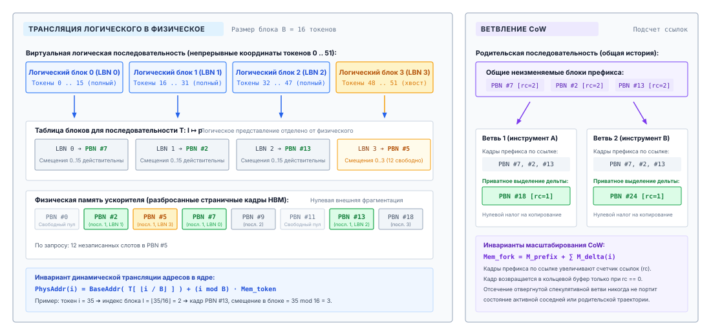
***Трансляция виртуальной таблицы блоков PagedAttention и ветвление с копированием при записи**: Отображение логических блоков последовательности на несмежные физические кадры HBM через таблицы страниц для каждой последовательности; демонстрируются совместное использование префиксов без копирования и выделение блоков с копированием при записи при ветвлении траектории агента.*

Вычисление масштабированного скалярного произведения внимания по несмежным физическим блокам требует специализированных ядер декодирования на GPU. В стандартных ядрах внимания, таких как FlashAttention, варпы потоков вычисляют скалярные произведения, линейно проходя по непрерывным адресам памяти. В PagedAttention ядро декодирования принимает таблицу блоков последовательности как вспомогательный входной параметр. На фазе сбора ключей и значений варпы потоков загружают указатели физических блоков из таблицы блоков в разделяемую память на кристалле или в регистры. Варпы проходят по логическим блокам $0 \le l \le \lfloor (S-1)/B \rfloor$, извлекают соответствующие физические блоки из несмежных мест HBM и вычисляют веса внимания относительно текущего вектора запроса $q_t$. [«Иерархия абстракций виртуальной памяти PagedAttention»](05_kv_cache.md#tbl-vol3-pagedattention-hierarchy) формализует отображение логических измерений последовательности на физические структуры памяти и управляющего оборудования.

| Компонент              | Логическое измерение                    | Физическое представление                                                                | Расположение в оборудовании   |
|:-----------------------|:----------------------------------------|:----------------------------------------------------------------------------------------|:------------------------------|
| **Последовательность токенов** | Индексы $t \in [0, S-1]$        | Поток дискретных целочисленных токенов BPE                                              | DRAM хоста / контекст агента  |
| **Хранилище KV**       | Логический блок $l = \lfloor t/B \rfloor$ | Идентификатор физического блока $p \in [0, N_{\text{pool}}-1]$                          | Пул блоков в HBM ускорителя   |
| **Карта адресов**      | Индекс массива $l$                      | Массив таблицы блоков $T[l] = p$                                                        | Управляющая плоскость хоста и SRAM GPU |
| **Смещение внутри блока** | Смещение $o = t \pmod B$             | Смещение в байтах $o \cdot 2 \cdot H_{\text{kv}} \cdot d_{\text{head}} \cdot b_{\text{elem}}$ | Объединенная строка кеша GPU  |
| **Свободная память**   | Невыделенная емкость                    | Стек / FIFO-очередь идентификаторов блоков                                              | Менеджер памяти среды выполнения на хосте |
<a id="tbl-vol3-pagedattention-hierarchy"></a>

***Иерархия абстракций виртуальной памяти PagedAttention**: Отображение логических измерений последовательности на физическую память ускорителя и управляющие структуры.*

Благодаря организации доступа к памяти через таблицы блоков физическому аллокатору никогда не нужно искать непрерывное физическое пространство больше $M_{\text{block}}$. Поскольку все блоки глобального пула имеют одинаковый размер, любой свободный физический блок может удовлетворить запрос на выделение для любой активной последовательности, полностью устраняя внешнюю фрагментацию памяти.

### Количественные компромиссы при выборе размера блока

Хотя страничное выделение устраняет внешнюю фрагментацию, оно вводит два конкурирующих системных накладных расхода: внутреннюю фрагментацию в последнем блоке каждой последовательности и неэффективность доступа к памяти, вызванную косвенной адресацией через указатели. Выбор физического размера блока $B$ — классическая задача системной оптимизации, в которой нужно уравновесить использование памяти и пропускную способность шины памяти.

Внутренняя фрагментация возникает потому, что длины последовательностей не кратны размеру блока $B$. Для последовательности длины $S$ число выделенных физических блоков равно $\lceil S / B \rceil$, но последний физический блок содержит неиспользованные слоты токенов:

$$\Delta_{\text{tail}} = (B - (S \pmod B)) \pmod B$$

Если предположить, что длины завершения последовательностей по модулю $B$ равномерно распределены по $\{0, 1, \dots, B-1\}$, ожидаемое число потерянных слотов токенов на активную последовательность точно равно:

$$\mathbb{E}[\Delta_{\text{tail}}] = \frac{B - 1}{2}$$

Для того же иллюстративного распределения длин блоки по 16 токенов теряют 0,4 % выделенной памяти, а блоки по 64 токена — 1,5 %. Узел, который принимал 48 резервирований по худшему случаю, теперь держит 780 траекторий средней длины, то есть примерно в шестнадцать раз больше.

Однако уменьшение $B$ ухудшает аппаратную эффективность подсистемы памяти ускорителя. Современные архитектуры ускорителей, такие как GPU NVIDIA Hopper или Blackwell, организуют доступ к высокоскоростной памяти вокруг широких шин памяти с минимальной гранулярностью транзакций 32 или 64 байта, кешируя строки в секторах по 128 байт. Внутри ядра декодирующего внимания (GEMV) потоки варпа совместно передают векторы ключей и значений из HBM в векторные регистры с помощью 128-битных инструкций памяти (`LDG.E.128`). Если $B$ задан слишком малым, физические блоки перестают совпадать с границами аппаратных транзакций. Кроме того, меньший размер блока раздувает таблицу блоков в $1/B$ раз. Для длины контекста 32 768 токенов при $B = 4$ на каждую последовательность приходится 8 192 записи таблицы блоков, что расходует чрезмерный объем регистрового файла GPU и разделяемой памяти на кристалле только на хранение адресных указателей и одновременно вызывает частое расхождение варпов на границах блоков.

```python
# Эмпирическая проверка хвостовой фрагментации в зависимости от размера блока B
def calculate_cache_utilization(batch_size, avg_seq_len, b_size, m_token):
    total_tokens = batch_size * avg_seq_len
    allocated_blocks = sum((s + b_size - 1) // b_size for s in seq_lens)
    allocated_bytes = allocated_blocks * b_size * m_token
    used_bytes = total_tokens * m_token
    return used_bytes / allocated_bytes  # Эффективность использования памяти eta
```

Эмпирическое профилирование показывает, что $B = 16$ и $B = 32$ занимают оптимальную точку для современных микроархитектур GPU. При $B = 16$ непрерывная полезная нагрузка тензора внутри каждого блока ($16 \times d_{\text{head}} \times b_{\text{elem}}$ байт на голову) достаточно велика, чтобы насытить 128-байтные транзакции шины памяти, достигая свыше $95\%$ теоретической пропускной способности чтения HBM в ядрах декодирующего внимания. При этом хвостовые потери остаются ограниченными в среднем $7{,}5$ токена на поток, что дает пренебрежимо малую потерю емкости в больших производственных пакетах.

<a id="nbk-05-sizing-physical-blocks-for-a"></a>

> **Выбор размера физических блоков для 70B-модели**
>
> Рассмотрим обслуживание открытой 70B-модели с групповым вниманием (Grouped-Query Attention, GQA). Архитектура имеет $L =$ 80 слоев, $H_Q =$ 64 головы запроса, $H_{\text{kv}} =$ 8 голов ключей и значений, размерность головы $d_{\text{head}} =$ 128 и работает в точности BF16 ($b_{\text{elem}} =$ 2 байта). Движок обслуживания распределяет модель по узлу из 8 GPU со степенью тензорного параллелизма $TP =$ 8.
>
> Сначала вычислим объем памяти на токен на одном GPU. При $TP =$ 8 восемь голов ключей и значений 8 делятся поровну между восемью GPU, и на каждом GPU приходится $H_{\text{kv, GPU}} =$ 1 голова ключей и значений на слой:
>
> $$m_{\text{token, GPU}} = 2 \cdot L \cdot H_{\text{kv, GPU}} \cdot d_{\text{head}} \cdot b_{\text{elem}} = 2 \cdot 80 \cdot 1 \cdot 128 \cdot 2\text{ байт} = 40\,960\text{ байт} = 40\text{ КиБ}$$
>
> В пересчете на весь узел ($TP=8$) совокупный объем памяти составляет $8 \times 40\text{ КиБ} = 320\text{ КиБ}$ на токен.
>
> Теперь оценим параметры физического блока на одном GPU для размеров блока $B =$ 16 и $B =$ 64:
>
> 1. **Размер физического блока ($B =$ 16):**
>    $$M_{\text{block, GPU}} = 16 \cdot 40\text{ КиБ} = 640\text{ КиБ}$$
>
> 2. **Размер физического блока ($B =$ 64):**
>    $$M_{\text{block, GPU}} = 64 \cdot 40\text{ КиБ} = 2\,560\text{ КиБ} = 2{,}5\text{ МиБ}$$
>
> Пусть каждый GPU предоставляет 80 ГБ физической памяти HBM3. Веса модели занимают $140\text{ ГБ} / 8 = 17{,}5\text{ ГиБ}$ на GPU. Резервирование 2,5 ГБ под буферы активаций оставляет ровно $60\text{ ГиБ}$ ($62\,914\,560\text{ КиБ}$) под пул страничного KV-кеша.
>
> - **Емкость пула при $B =$ 16:**
>   $$N_{\text{blocks}} = \frac{62\,914\,560\text{ КиБ}}{640\text{ КиБ}} = 98\,304\text{ блоков}$$
>   $$\text{Token Capacity} = 98\,304 \cdot 16 = 1\,572\,864\text{ токенов на GPU}$$
>
> - **Хвостовая фрагментация при пакете из $N_{\text{seq}} =$ 256 параллельных последовательностей:**
>   - Для $B =$ 16: ожидаемые потери составляют $(16 - 1)/2 =$ 7,5 токена на последовательность.
>     $$\text{Node Waste} = 256 \cdot 7{,}5 \cdot 40\text{ КиБ} = 76\,800\text{ КиБ} = 75\text{ МиБ}$$
>     $$\text{Fragmentation Ratio} = \frac{75\text{ МиБ}}{61\,440\text{ МиБ}} \approx 0{,}12\%$$
>
>   - Для $B =$ 64: ожидаемые потери составляют $(64 - 1)/2 =$ 31,5 токена на последовательность.
>     $$\text{Node Waste} = 256 \cdot 31{,}5 \cdot 40\text{ КиБ} = 322\,560\text{ КиБ} = 315\text{ МиБ}$$
>     $$\text{Fragmentation Ratio} = \frac{315\text{ МиБ}}{61\,440\text{ МиБ}} \approx 0{,}51\%$$
>
> Даже при больших пакетах страничное выделение ограничивает внутренние потери памяти менее чем $1\%$ от общей емкости кеша, тогда как для непрерывного статического резервирования типичны потери емкости в $60\%–80\%$.

### Обдумывание без копирования: ветвление с копированием при записи

В агентных архитектурах выполнение редко идет по одной линейной траектории. Обдумывание добывает свидетельства, порождая альтернативы (принцип «Обдумывание, ограниченное свидетельствами»), поэтому поиск по дереву рассуждений, спекулятивный сэмплинг кандидатов, оценка самосогласованности и повторные попытки вызова инструментов разветвляют несколько ветвей от одного общего префикса ([«Вычисления на этапе тестирования»](03_test_time_compute.md#sec-vol3-test-time-compute)). Агент-планировщик может принять контекст из восьми тысяч токенов, содержащий системные промпты, спецификации среды и документацию инструментов, а затем породить четыре спекулятивные дочерние траектории для исследования различных стратегий выполнения.

При модели непрерывного выделения памяти ветвление — дорогостоящая операция с высокой задержкой. Поскольку каждая дочерняя последовательность должна дописывать новые токены в собственный непрерывный участок памяти, движок обслуживания обязан физически дублировать весь тензор KV-кеша родителя. Для 70B-модели, разобранной выше, глубокое копирование префикса в $8\,192$ токена на четыре дочерние ветви требует физического дублирования:

$$\text{Data Duplicated} = 4 \cdot (8\,192\text{ токенов} \cdot 320\text{ КиБ/токен}) = 4 \cdot 2{,}56\text{ ГиБ} = 10{,}24\text{ ГиБ}$$

Запись $10{,}24\text{ ГиБ}$ по шине памяти ускорителя останавливает конвейер вывода, расточает дефицитную емкость HBM и резко сокращает число параллельных агентов, которое может обслуживать система.

Страничное выделение KV устраняет эти накладные расходы, обеспечивая ветвление без копирования через подсчет ссылок и копирование при записи (CoW). Каждый физический блок $p$ в глобальном пуле имеет связанный целочисленный счетчик ссылок $\text{ref\_count}[p]$, который ведет менеджер памяти среды выполнения на хосте. Когда родительская последовательность ответвляется на одну или несколько дочерних, среда обслуживания выполняет три операции за постоянное время:

1. **Дублирование таблицы:** она создает новую логическую таблицу блоков для каждой дочерней последовательности и копирует идентификаторы физических блоков из таблицы блоков родителя в таблицу потомка:
   $$T_{\text{child}}[l] \leftarrow T_{\text{parent}}[l] \quad \forall l \in \left[0, \left\lfloor \frac{S_{\text{prefix}}-1}{B} \right\rfloor \right]$$

2. **Увеличение счетчика ссылок:** для каждого физического блока, отображенного в таблице потомка, среда выполнения увеличивает его счетчик ссылок:
   $$\text{ref\_count}[T_{\text{child}}[l]] \leftarrow \text{ref\_count}[T_{\text{child}}[l]] + 1$$

3. **Регистрация метаданных:** дочерняя последовательность регистрируется в планировщике как активный независимый запрос с начальной длиной последовательности $S_{\text{child}} = S_{\text{prefix}}$.

Важно, что при этой операции ветвления по шине памяти ускорителя не копируется ни одного байта тензорных данных. Родитель и все дочерние ветви указывают на одни и те же физические блоки HBM для своего общего префикса.

```python
# Освобождение блоков со счетчиком ссылок на стороне хоста
def release_sequence_blocks(block_table, ref_counts, free_list):
    for phys_block in block_table:
        ref_counts[phys_block] -= 1
        if ref_counts[phys_block] == 0:
            free_list.append(phys_block)  # Возврат в пул за константное время O(1)
    block_table.clear()
```

Физическое расхождение памяти происходит лениво, во время генерации токенов, через копирование при записи. Когда дочерняя ветвь $A$ генерирует свой первый самостоятельный токен, она записывает его в свой последний блок $l_{\text{tail}} = \lfloor S_{\text{prefix}} / B \rfloor$. Если записываемый блок имеет счетчик ссылок строго больше единицы ($\text{ref\_count}[T_A[l_{\text{tail}}]] > 1$), запись прямо в него испортила бы контекст внимания родителя и соседних ветвей. Менеджер памяти перехватывает эту запись, выделяет чистый физический блок $p_{\text{new}}$ из списка свободных, копирует $B$ токенов из общего блока в $p_{\text{new}}$, уменьшает счетчик ссылок исходного блока и обновляет $T_A[l_{\text{tail}}] \leftarrow p_{\text{new}}$. Последующие шаги генерации ветви $A$ продолжаются в $p_{\text{new}}$ с $\text{ref\_count} = 1$ без запуска новых копирований.

Когда ветвь агентного планирования отсекается, например если инструмент проверки компилятора возвращает неустранимую синтаксическую ошибку для фрагмента кода-кандидата, среда выполнения уничтожает последовательность. Менеджер памяти обходит таблицу блоков отсеченной последовательности и уменьшает счетчик ссылок каждого отображенного физического блока. Любой блок, счетчик ссылок которого падает до нуля, немедленно возвращается в кольцевой буфер списка свободных. Если соседние ветви все еще активно исследуют альтернативные гипотезы из того же префикса, общие блоки префикса остаются действительными в HBM, а их счетчики ссылок просто отражают сниженную степень совместного использования.

Отображая логические последовательности токенов на несмежные физические блоки со счетчиками ссылок, PagedAttention создает базовый слой виртуализации, необходимый для обслуживания динамических ветвящихся рабочих нагрузок агентов. Однако этот механизм работает целиком в пределах активного выполняющегося запроса или явного ветвления «родитель — потомок». Что происходит, когда в кластер обслуживания приходит совершенно новый пользовательский запрос с длинным, но одинаковым системным промптом или когда два не связанных между собой экземпляра агента случайно разделяют одинаковое вступление с определениями инструментов? Чтобы не пересчитывать одинаковые проекции ключей и значений для независимых запросов, которые не имеют явного родства, система обслуживания должна выйти за пределы страничных таблиц внутри одного запроса и перейти к глобальной индексации префиксов.

<a id="sec-vol3-kvcache-radix-tree"></a>

## Кеширование префиксов между ходами

Когда среда вывода получает запрос, последовательность токенов которого начинается с того же префикса, что и ранее выполнявшиеся нагрузки, повторное вычисление состояний ключей и значений для этих начальных токенов означает чистые вычислительные потери и потери памяти. В архитектурах автономных агентов эти потери — не маргинальная неэффективность, а операционное узкое место. Каждый вызов агента для редактирования кода или планирования задач предваряет короткий динамический запрос пользователя тысячами токенов статического каркаса: системными инструкциями, операционными границами, демонстрационными траекториями с малым числом примеров и подробными схемами инструментов OpenAPI. Если кластер обслуживания рассматривает каждый входящий запрос как изолированную транзакцию, матричные движки ускорителя должны снова и снова проецировать одинаковые последовательности токенов в тензоры ключей и значений по десяткам тысяч запросов в час. Для большой языковой модели предзаполнение системного вступления из 4 096 токенов требует сотен терафлоп вычислений и монополизирует пропускную способность шины памяти, раздувая время до первого токена (TTFT) и обрушивая пропускную способность запросов.

**Кеширование префиксов** виртуализирует выделение KV-кеша между независимыми запросами обслуживания, организуя сохраненные физические блоки памяти в глобально индексированную структуру поиска префиксов. Индексируя физические блоки KV по префиксам последовательностей токенов, движок вывода превращает избыточные операции предзаполнения промпта из ограниченных вычислительной мощностью матричных умножений в поиск в кеше за постоянное время и освобождает емкость ускорителя для активной авторегрессионной генерации.

Структурная иерархия префиксного дерева Radix и его взаимодействие с очередью возврата памяти показаны на [«Архитектура префиксного кеша на дереве Radix и вытеснение LRU от листьев»](05_kv_cache.md#fig-vol3-radix-tree-cache). Каждый узел дерева связывает непрерывную последовательность токенов (`prefix_tokens`) непосредственно с упорядоченным списком идентификаторов физических блоков PagedAttention (`block_ids`). Узлы делятся на два рабочих состояния в зависимости от активного совместного использования: узел 1 (инструкции системного промпта) и узел 2 (рабочая область кода на Python) поддерживают активные потоки выполнения ($\text{ref\_count} \ge 1$) и закреплены в HBM. Напротив, завершенные ветви выполнения, такие как узел 3 (оболочка Bash) и узел 4 (статус Git), опустились до $\text{ref\_count} = 0$ и находятся в спящем состоянии. Планировщик на хосте связывает эти спящие листья в двусвязную очередь вытеснения по давности использования (LRU), упорядоченную по меткам времени обращения. При нехватке памяти физический аллокатор безопасно возвращает память с головы LRU (узел 4, возвращая блок 31 в список свободных), предотвращая преждевременное вытеснение общих родительских префиксов и распространяя право на вытеснение на узел 3 только тогда, когда его дочерние указатели отсечены.

<a id="fig-vol3-radix-tree-cache"></a>

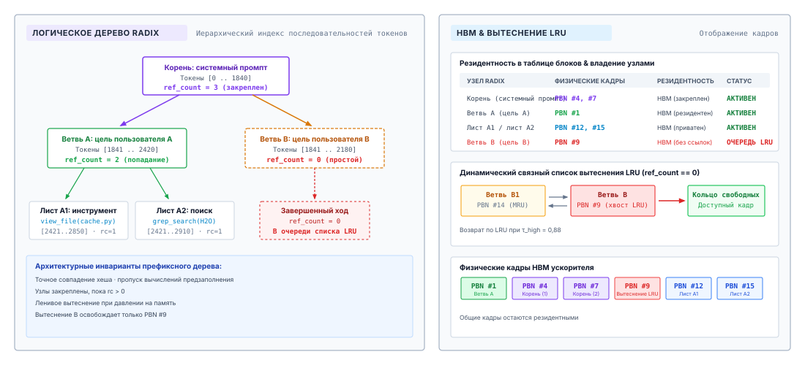
***Архитектура префиксного кеша на дереве Radix и вытеснение LRU от листьев**: Структурная иерархия узлов префиксов, сопоставляющих фрагменты токенов с идентификаторами физических блоков. Закрепленные узлы с активными ссылками (ref_count ≥ 1) защищены, а спящие листовые узлы (ref_count = 0) связаны в очередь вытеснения LRU, которая гарантирует возврат блоков от потомков к предкам при нехватке памяти.*

### Избыточность префиксного дерева

В одноходовом диалоговом обслуживании временная локальность в основном ограничена авторегрессионным циклом декодирования изолированной последовательности. Многоходовые архитектуры агентов нарушают это допущение. Автономный агент программной инженерии, который работает в итеративном цикле «правка — компиляция — тест», порождает последовательность отдельных запросов вывода, которые имеют огромное совпадение токенов: базовые инструкции репозитория, отформатированное дерево файлов, сигнатуры активных инструментов и накопленную историю диалога до текущего хода. Кроме того, параллельные рабочие агенты, созданные из одного системного промпта, разделяют одинаковые начальные блоки контекста, хотя решают разные задачи. Если физические блоки памяти, выделенные через PagedAttention, освобождаются сразу по завершении запроса, система обслуживания выбрасывает тензоры ключей и значений, которые почти наверняка понадобятся снова в течение миллисекунд.

**Сжатие дерева Radix**

Стандартное префиксное дерево (trie) хранит один токен на ребро, создавая глубокие, перегруженные указателями древовидные структуры. Дерево Radix сжимает линейные неветвящиеся последовательности в одиночные ребра, минимизируя накладные расходы на обход памяти хоста, и сопоставляет массивы токенов BPE непосредственно с непрерывными массивами идентификаторов физических блоков (Zheng et al., 2024).

Сохранение этих физических блоков требует механизма индексации, который распознает общие последовательности токенов между запросами без явного родства «родитель — потомок». Наивная хеш-таблица, ключом которой служит полная строка промпта, не работает, потому что находит только точные совпадения целого промпта; любое изменение последнего токена запроса делает всю запись кеша недействительной. Движку обслуживания нужен индекс поиска по префиксам, способный находить самый длинный общий префикс, начинающийся с токена с индексом ноль.

Естественной структурой данных для индексации префиксов служит префиксное дерево (trie), в котором каждый путь от корня представляет последовательность токенов. В стандартном префиксном дереве на уровне токенов каждое ребро соответствует одному идентификатору токена, а каждый узел — уникальному префиксу. Однако хранение отдельного узла для каждого токена в окне контекста из 32 768 токенов создает неприемлемые накладные расходы памяти центрального процессора хоста и патологический обход указателей при поиске. Поскольку рабочие нагрузки агентов состоят из длинных, неизменяемых отрезков непрерывного текста (например, определений инструментов), перемежаемых редкими точками ветвления (например, переменными выводами инструментов), индекс префиксов преимущественно состоит из неветвящихся линейных цепочек.

Чтобы свести к минимуму глубину дерева и задержку обхода на центральном процессоре, современные среды выполнения вывода, такие как SGLang (Zheng et al., 2024), реализуют индекс префиксов в виде дерева Radix (или компактного дерева переходов). В дереве Radix ребра без промежуточных точек ветвления сжимаются в одно ребро, которое хранит непрерывный массив идентификаторов токенов. Каждый узел дерева Radix непосредственно связывает этот фрагмент токенов с упорядоченным массивом идентификаторов физических блоков KV-кеша, которые ведутся в пуле памяти PagedAttention ускорителя.

| Поле узла       | Тип / представление   | Архитектурная функция                                                           |
|:----------------|:----------------------|:--------------------------------------------------------------------------------|
| `prefix_tokens` | `int32[]`             | Сжатый непрерывный фрагмент идентификаторов токенов BPE вдоль ребра.            |
| `block_ids`     | `int32[]`             | Упорядоченные указатели физических блоков PagedAttention, на которые опирается фрагмент токенов. |
| `children`      | `Map<int32, Node*>`   | Указатели на нисходящие ветви, ключом служит следующий токен ветвления.          |
| `parent`        | `Node*`               | Указатель на вышестоящий узел префикса (null для корня).                        |
| `ref_count`     | `uint32`              | Число активных запросов декодирования, которые в данный момент читают этот узел или дописывают в него. |
| `last_access`   | `uint64`              | Монотонная метка времени последнего попадания в кеш или обхода.                 |

<a id="tbl-radix-node-schema"></a>

***Макет узла префиксного кеша на дереве Radix**: Структура данных узла префиксного кеша на дереве Radix.*

Как показано в [«Макет узла префиксного кеша на дереве Radix»](05_kv_cache.md#tbl-radix-node-schema), дерево Radix служит авторитетным индексом над пулом физических блоков. Когда запрос завершает цикл генерации, среда обслуживания не возвращает его физические блоки в глобальный список свободных. Вместо этого она переводит счетчик ссылок соответствующего листового узла в ноль, помечая физические блоки как спящие. Блоки остаются отображенными в HBM ускорителя и готовы к немедленному повторному подключению, если последующий запрос пройдет по тому же пути префикса.

<a id="dfn-radix-prefix-cache"></a>

> **Префиксный кеш на дереве Radix**
>
> Иерархическая древовидная структура, которая индексирует физические блоки KV-кеша по последовательностям токенов, сжимая неветвящиеся пути токенов, чтобы обеспечить поиск префикса за постоянное время, повторное использование кеша между запросами и возврат памяти по схеме LRU, начиная с листьев.

### Поиск самого длинного префикса

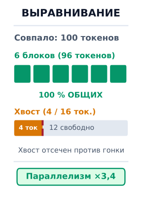

*Общими между запросами делятся только полностью заполненные блоки; хвосты неполных блоков отсекаются, чтобы предотвратить состояния гонки.*

Когда приходит входящий запрос с токенизированным промптом $\mathbf{t} = [t_0, t_1, \dots, t_{S-1}]$, среда обслуживания ищет в дереве Radix максимальную длину префикса $S_{\text{match}}$, которую можно получить из кеша. Планировщик на хосте начинает с корневого узла и итеративно сопоставляет фрагменты $\mathbf{t}$ с метками ребер. Если ребро совпадает с подстрокой промпта, движок потребляет эти токены, запоминает связанные физические `block_ids` и проверяет карту потомков, используя следующий токен $t_{i}$ как ключ поиска. Обход завершается при несовпадении токена или при исчерпании промпта и дает самый длинный совпавший путь.

Хотя поиск самого длинного префикса на центральном процессоре хоста вычислительно прост, перевод $S_{\text{match}}$ в пригодные физические блоки выявляет аппаратно обусловленную дилемму квантования — проблему выравнивания по границам блоков. PagedAttention группирует состояния ключей и значений в физические блоки однородного размера $B$ (обычно $B = 16$ или $B = 32$ токена), чтобы свести к минимуму внешнюю фрагментацию и оптимизировать выравнивание шины памяти при тензорных операциях. Блок можно безопасно разделять между независимыми запросами, только если его внутренние слоты токенов полностью заполнены и зафиксированы.

Рассмотрим сценарий, в котором входящий запрос совпадает с $S_{\text{match}} = 100$ токенами закешированного системного промпта, а движок обслуживания работает с размером блока $B = 16$. Сто совпавших токенов занимают:

$$\lfloor 100 / 16 \rfloor = 6 \text{ полных блоков (токенов } 0 \dots 95 \text{)}$$

с неполным хвостом из:

$$100 \pmod{16} = 4 \text{ tokens (tokens } 96 \dots 99 \text{)}$$

Эти 4 хвостовых токена занимают первые четыре слота физического блока, остальные 12 слотов которого пусты. Если среда обслуживания наивно передаст этот неполный блок новому запросу, немедленно возникает состояние гонки. Если новый запрос начнет генерировать или дописывать новые токены запроса, он запишет последующие проекции ключей и значений в слоты $4 \dots 15$. Если другой параллельный или будущий запрос совпадет с тем же 100-токенным префиксом, но разойдется на токене 100, оба запроса попытаются записать конфликтующие тензоры ключей и значений в одни и те же слоты физического блока и испортят состояние внимания.

Среда выполнения должна разрешить эту дилемму неполного блока одной из двух архитектурных политик:

1. *Копирование при записи (CoW) для хвоста:* среда выполнения выделяет новый физический блок из списка свободных, копирует проекции ключей и значений 4 хвостовых токенов из закешированного блока в новый блок по шине PCIe или высокоскоростной шине памяти и отображает новый блок в приватную таблицу страниц запроса.
2. *Выравнивание по блоку с отсечением:* среда выполнения округляет полезное попадание в кеш вниз до ближайшей границы полного блока:
   $$S_{\text{usable}} = \left\lfloor \frac{S_{\text{match}}}{B} \right\rfloor \times B$$
   Оставшиеся $S_{\text{match}} \pmod B$ токенов считаются промахом кеша. Среда выполнения включает эти хвостовые токены в предзаполнение новой части запроса, вычисляя их проекции ключей и значений вместе с уникальными токенами запроса.

В производственных средах выполнения выравнивание с отсечением стабильно превосходит выделение с копированием при записи. На современных архитектурах ускорителей (таких как NVIDIA H100 или AMD MI300X) накладные расходы хоста на запуск ядра копирования памяти для дублирования нескольких токенов вместе с барьерами синхронизации шины памяти превышают время, необходимое для вычисления тех же токенов в высокопроизводительном слитом ядре предзаполнения GEMM. Поэтому производственные аллокаторы Radix навязывают строгий инвариант границы блока: между запросами наследуются только полностью заполненные блоки размера $B$, а хвосты, не дотягивающие до блока, пересчитываются на начальной фазе предзаполнения.

<a id="nbk-05-ttft-and-compute-savings-from"></a>

> **TTFT и экономия вычислений при повторном использовании префикса Radix**
>
> Рассмотрим автономного агента программирования на узле из 8 GPU с тензорным параллелизмом, на котором развернута плотная модель с 70 миллиардами параметров ($N = 70 \times 10^9$). Модель использует групповое внимание (GQA) с $L = 80$ слоями, $H_Q = 64$ головами запроса, $H_{\text{kv}} = 8$ головами ключей и значений и размерностью головы $d_{\text{head}} = 128$, представленными в 16-битном формате brain floating point ($b_{\text{elem}} = 2$ байта).
>
> Стандартная системная инструкция агента, правила форматирования и схема определения инструментов составляют инвариантный префикс длиной $S_{\text{prefix}} = 4\,096$ токенов.
>
> **1. Физический объем KV-памяти:**
> Применяя физический объем тензора GQA, установленный в [«Дискретное представление токенов»](02_foundation_model.md#sec-vol3-foundation-model-tokenization) ($m_{\text{token}} = 320\text{ КиБ/токен}$):
> $$M_{\text{KV}} = S_{\text{prefix}} \cdot m_{\text{token}} = 4\,096 \times 320\text{ КиБ} = 1\,310\,720\text{ КиБ} = 1{,}25\text{ ГиБ}$$
> При распределении по 8 GPU через тензорный параллелизм этот объем требует всего $160\text{ МиБ}$ HBM на ускоритель.
>
> **2. Экономия на вычислениях предзаполнения:**
> Применяя модель Roofline движка базовой модели из [«Задержка обслуживания на ускорителе»](02_foundation_model.md#sec-vol3-foundation-model-cost), оценка контекста промпта требует $2N$ FLOP на токен для линейных проекций плюс квадратичную компоненту самовнимания ($4 \cdot L \cdot d_{\text{model}} \cdot S_{\text{prefix}}^2$):
> $$\text{FLOPs}_{\text{linear}} = 2 \cdot (70 \times 10^9) \cdot 4\,096 \approx 5{,}734 \times 10^{14}\text{ FLOPs} = 573{,}4\text{ TFLOPs}$$
> $$\text{FLOPs}_{\text{attn}} = 4 \cdot 80 \cdot 8\,192 \cdot (4\,096)^2 \approx 4{,}40 \times 10^{13}\text{ FLOPs} = 44{,}0\text{ TFLOPs}$$
> $$\text{FLOPs}_{\text{total}} = \text{FLOPs}_{\text{linear}} + \text{FLOPs}_{\text{attn}} = 573{,}4 + 44{,}0 = 617{,}4\text{ TFLOPs}$$
>
> **3. Влияние на задержку:**
> Узел из 8 GPU H100 дает совокупный теоретический плотный пик BF16 $8 \times 989 = 7\,912 \text{ TFLOPS}$. При реалистичной утилизации модели (Model Flops Utilization, MFU) $45\%$ для предзаполнения с тензорным параллелизмом при размере пакета 1 устойчивая вычислительная пропускная способность кластера равна:
> $$\text{Throughput}_{\text{sustained}} = 0{,}45 \times 7\,912 \text{ TFLOPS} \approx 3\,560 \text{ TFLOPS}$$
> Без кеширования префиксов вычисление состояния KV для системного промпта задерживает время до первого токена (TTFT) на:
> $$T_{\text{prefill}} = \frac{617{,}4 \text{ TFLOPs}}{3\,560 \text{ TFLOPS}} \approx 0{,}1734 \text{ с} \approx 173{,}4 \text{ мс}$$
> При попадании в префиксное дерево Radix все предзаполнение на 4 096 токенов обходится. Центральный процессор хоста разрешает таблицу блоков менее чем за $50 \text{ мкс}$. Если входящий запрос вносит 32 новых токена, ускоритель выполняет предзаполнение только для этих 32 токенов, которые обращаются к 4 096 закешированным токенам, и завершает его менее чем за $6 \text{ мс}$. Кеширование префиксов устраняет $167{,}4 \text{ мс}$ задержки — снижение TTFT в $28\times$ — и экономит более $600 \text{ TFLOPs}$ работы ускорителя.

При обслуживании парков автономных агентов в кластерах из нескольких узлов ускорителей эту локальность префиксов нужно координировать глобально. Вместо того чтобы поддерживать изолированные, некоординированные деревья Radix на каждом рабочем узле, маршрутизирующая сеть кластера снимает отпечатки входящих промптов и направляет запросы на узлы, хранящие совпадающие блоки префиксов.

Трехэтапный распределенный конвейер маршрутизации подробно описан на [«Маршрутизация префиксного дерева в масштабе кластера и диспетчеризация с учетом кеша»](05_kv_cache.md#fig-vol3-cluster-prefix-routing). На первом этапе входящий промпт агента ($S = 40\,000$ токенов) сегментируется на фрагменты по 16 токенов и преобразуется в скользящую цепочку хешей Меркла $h_k = \text{Hash}(h_{k-1} \parallel c_k)$, что создает криптографический отпечаток префикса. На втором этапе централизованный каталог префиксов кластера оценивает кандидатные рабочие узлы по совместной целевой функции «сродство — нагрузка» $w^* = \arg\max [\mu \cdot (\text{Match}/S) - (1-\mu) \cdot (L_j / L_{\max})^\gamma]$, балансируя долю попаданий промпта против глубины очереди выполнения на рабочем узле. На третьем этапе промпт направляется выигравшему узлу (Worker 1), который уже хранит 32 000 закешированных токенов префикса (попадание в префикс $80\%$). Worker 1 пропускает начальные 2 000 выделений фрагментов и выполняет предзаполнение исключительно для оставшихся 8 000 новых токенов суффикса, резко сокращая TTFT и сохраняя балансировку нагрузки кластера.

<a id="fig-vol3-cluster-prefix-routing"></a>

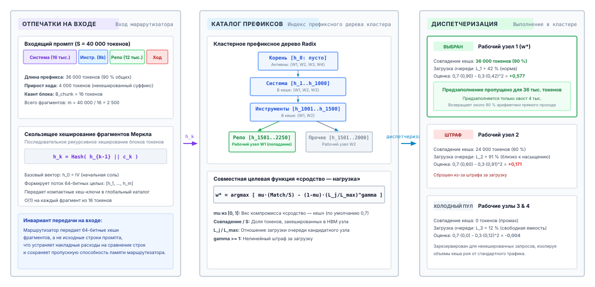
***Маршрутизация префиксного дерева в масштабе кластера и диспетчеризация с учетом кеша**: Распределенное кеширование префиксов в кластерах ускорителей из нескольких узлов. Промпты получают отпечатки в виде скользящих хеш-фрагментов Меркла, оцениваются по централизованному каталогу префиксов с помощью совместной целевой функции «сродство — нагрузка» и направляются на рабочие узлы, которые выполняют предзаполнение только новых токенов суффикса.*

### Динамическое вытеснение из дерева Radix

Высокоскоростная память (HBM) ускорителя строго ограничена. Движок вывода не может бесконечно удерживать спящие блоки префиксов, не лишая активные запросы памяти, необходимой для выделений на фазе декодирования. Когда совокупная загрузка памяти приближается к пределу, среда выполнения обязана вернуть физические блоки, на которых держатся закешированные префиксы.

Управление вытеснением в дереве Radix структурно отличается от управления вытеснением в плоском кеше «ключ — значение». В плоском кеше любую пару «ключ — значение» можно удалить независимо. В дереве Radix узлы связаны жесткими структурными зависимостями: внутренний узел нельзя вытеснить, пока в памяти остается хотя бы один из его дочерних узлов. Поскольку представления ключей и значений в слоях внимания зависят от накопленной последовательности от корня, вытеснение внутреннего узла уничтожает физический контекст префикса, необходимый всем нисходящим потомкам.

Чтобы обеспечить этот инвариант зависимостей, среда выполнения реализует политику вытеснения от листьев, управляемую счетчиками ссылок и метками времени обращения:

1. *Классификация состояний:* каждый узел дерева Radix находится в одном из двух рабочих состояний в зависимости от своего `ref_count`. Узел с $\text{ref\_count} \ge 1$ *закреплен*: на него активно ссылаются один или несколько выполняющихся запросов вывода, и его ни при каких обстоятельствах нельзя вытеснить. Узел с $\text{ref\_count} = 0$ *спящий*: он представляет завершенный запрос, сохраненный исключительно для возможного повторного использования, и является допустимым кандидатом на вытеснение.
2. *Отслеживание кандидатов на вытеснение:* планировщик на хосте ведет приоритетную очередь вытеснения, содержащую все спящие листовые узлы. Очередь упорядочена по политике «давно не использовавшийся» (LRU) с использованием метки времени `last_access` узла.
3. *Итеративная обрезка:* когда аллокатор физических блоков опускается ниже порога низкого уровня свободной памяти $\tau_{\text{low}}$, он запускает цикл вытеснения. Аллокатор извлекает из очереди вытеснения наименее недавно использованный листовой узел, возвращает назначенные ему физические `block_ids` в глобальный пул свободных блоков и удаляет лист из карты `children` его родителя.
4. *Каскадное право на вытеснение:* если карта потомков родительского узла становится пустой в результате обрезки, а собственный `ref_count` родителя равен нулю, родитель превращается в листовой узел. Планировщик помещает родителя в приоритетную очередь вытеснения, делая его пригодным для возврата памяти на последующих итерациях.

```python
def evict_radix_blocks(free_blocks: List[int], target_free: int) -> None:
    while len(free_blocks) < target_free and lru_leaf_queue:
        leaf = lru_leaf_queue.pop_oldest()
        if leaf.ref_count > 0:
            continue
        for block_id in leaf.block_ids:
            free_blocks.append(block_id)
        parent = leaf.parent
        del parent.children[leaf.prefix_tokens[0]]
        if len(parent.children) == 0 and parent.ref_count == 0:
            lru_leaf_queue.insert(parent)
```

Такой обход от листьев гарантирует, что корень и узлы верхних ветвей, которые представляют самый широко разделяемый каркас префиксов (например, системные промпты), остаются в памяти дольше всего. Динамические листовые ветви, отвечающие эфемерным разовым ходам диалога, отсекаются первыми, сохраняя базовые слои иерархии префиксов, где вероятность попадания в кеш наибольшая.

### Что ломает долю попаданий

Состояние внимания для токена зависит от каждого предшествующего токена, поэтому кеш может переиспользовать состояние только до первого отличающегося токена (принцип «Состояние внимания выводится из префикса токенов»). Кеширование префиксов работает по принципу «все или ничего» слева направо. Движок не может навязать раскладку, дружественную к кешу; он может лишь вознаградить такую раскладку, а все входные данные, которые определяют исход, контролирует обвязка. [«Подготовка следующего вызова»](04_context_engineering.md#sec-vol3-context-engineering-staging) уже назвала изменения, которые ломают префикс: поле, специфичное для вызова, в начале контекста, список инструментов, который меняется по ходу траектории, недетерминированная сериализация и каждое сжатие. С точки зрения кеша у них общий признак. Каждое из них сдвигает первый отличающийся токен к началу контекста, и движок заново предзаполняет каждый блок после него. Первые три можно избежать раскладкой. Сжатие избежать нельзя, поэтому обвязка сжимает редко и большими пакетами ([«Сжатие контекста»](04_context_engineering.md#sec-vol3-context-engineering-compaction)), принимая один дорогой ход на пакет.

Мерой всего этого служит доля попаданий в префикс, то есть доля токенов промпта, обслуженных из кеша, а не предзаполненных заново:

<a id="eq-hprefix"></a>

$$H_{\text{prefix}} = \frac{\sum_{i} S_{\text{match}}^{(i)}}{\sum_{i} S_{\text{prompt}}^{(i)}}$$

где у запроса $i$ длина промпта равна $S_{\text{prompt}}^{(i)}$, а совпавший префикс — $S_{\text{match}}^{(i)}$. Обвязка должна фиксировать эту долю для каждой траектории так же, как она фиксирует токены и стоимость. Падение доли попаданий после изменения обвязки обычно становится первым признаком того, что изменение сдвинуло нестабильный токен к началу контекста.

### Кеширование промптов у провайдера

Большинство разработчиков агентов обращаются к модели через размещенный API, а не запускают движок сами, и встречают тот же механизм как функцию тарификации. Провайдер кеширует состояние KV для префикса промпта и оплачивает закешированные входные токены по доле от обычной ставки. Некоторые интерфейсы автоматически переиспользуют любой достаточно длинный совпавший префикс. Другие просят вызывающую сторону отмечать точки кеширования, то есть позиции, до которых префикс должен сохраняться, и могут брать дополнительную плату за токены, записанные в кеш. Закешированные записи истекают после времени жизни при простое, обычно в пределах минут, потому что провайдер использует ту же политику вытеснения от листьев, что и кеш Radix, на общем парке ускорителей.

Из этого следуют три последствия для обвязки. Точки кеширования должны стоять на границах стабильных зон в раскладке из [«Подготовка следующего вызова»](04_context_engineering.md#sec-vol3-context-engineering-staging): после определений инструментов и после долгоживущей истории, чтобы каждая зона кешировалась один раз и переиспользовалась. Время жизни связывает кеширование с ожиданием инструментов. Инструмент, который работает дольше времени жизни, возвращает холодный кеш, и следующий ход оплачивает полную входную ставку за весь контекст; это версия на стороне провайдера решения «удержать или вытеснить» из раздела [«Удержание, вытеснение, пересчет или выгрузка»](05_kv_cache.md#sec-vol3-kvcache-swapping). Наконец, доля попаданий становится прямо видна в счете: это отношение закешированных входных токенов к незакешированным, которое сообщает API, и поэтому она служит самой дешевой метрикой здоровья кеша, которую может отслеживать обвязка.

Кеширование префиксов снимает предзаполнение всего, что траектория уже отправила. Оно не может снять предзаполнение нового, а в агенте новые токены приходят крупными порциями, по одному наблюдению инструмента за раз.

<a id="sec-vol3-kvcache-chunked-prefill"></a>

## Планирование порционного предзаполнения

Движок вывода, обслуживающий авторегрессионные языковые модели, сталкивается с двумя принципиально несовместимыми вычислительными профилями, которые работают на одном и том же кремнии ускорителя. Фаза предзаполнения принимает промпты из сотен или тысяч токенов одновременно и выполняет плотные матрично-матричные умножения (GEMM), которые дают высокую вычислительную эффективность на тензорных ядрах. Фаза декодирования, напротив, генерирует ровно один токен на последовательность за итерацию и выполняет ограниченные памятью матрично-векторные умножения (GEMV), скорость которых строго ограничена скоростью передачи высокоскоростной памяти (HBM), а не пиковой арифметической пропускной способностью. Когда длинный промпт агента, например сложное определение инструмента, системный промпт из 8 192 токенов или трасса многоходового диалога, поступает в движок, который сейчас обслуживает двадцать активных потоков декодирования, наивный планировщик «выполнить до конца» порождает катастрофическую блокировку начала очереди. Ускоритель должен отдать все тензорные блоки массивным матричным операциям нового промпта, замораживая ограниченные памятью циклы декодирования на сотни миллисекунд и вызывая всплески хвоста межтокенной задержки (ITL), которые нарушают соглашения об уровне обслуживания.

Порционное предзаполнение разрешает это физическое столкновение: монолитные промпты нарезаются на однородные блоки токенов, которые планируются вместе с активными запросами декодирования в одном пакете выполнения. Вместо того чтобы считать предзаполнение и декодирование взаимно исключающими режимами работы, порционное планирование использует их взаимодополняющие аппаратные требования: вычислительно плотный фрагмент предзаполнения поднимает арифметическую интенсивность пакета к точке перегиба roofline ускорителя, а активные токены декодирования амортизируют пропускную способность памяти, необходимую для потоковой передачи матриц весов модели из HBM в SRAM.

### Дилемма интерференции предзаполнения и декодирования

Предзаполнение и декодирование конфликтуют, потому что насыщают разные ресурсы. Декодирование ограничено пропускной способностью памяти (принцип «Задержка, ограниченная выводом»), тогда как предзаполнение ограничено вычислениями, как показано в [«Задержка обслуживания на ускорителе»](02_foundation_model.md#sec-vol3-foundation-model-cost). По модели roofline операционная интенсивность $\mathcal{I}$ нагрузки измеряет отношение выполненных операций с плавающей точкой к объему байтов, переданных по шине памяти ускорителя:

$$\mathcal{I} = \frac{\text{Floating Point Operations (FLOPs)}}{\text{Memory Traffic (Bytes)}}$$

Рассмотрим ускоритель с плотной пропускной способностью тензорных ядер $T_{\text{peak}}$, равной $1\,000\text{ TFLOPS}$ ($10^{15}\text{ FLOPs/s}$), для 16-битных операций с плавающей точкой, и пропускной способностью HBM $B_{\text{mem}}$, равной $3{,}35\text{ ТБ/с}$ ($3{,}35 \times 10^{12}\text{ байт/с}$). Точка перегиба аппаратуры $\mathcal{I}^*$ задает минимальную арифметическую интенсивность, необходимую для достижения пиковой вычислительной пропускной способности:

$$\mathcal{I}^* = \frac{T_{\text{peak}}}{B_{\text{mem}}} = \frac{1\,000 \times 10^{12}\text{ FLOPs/s}}{3{,}35 \times 10^{12}\text{ байт/с}} \approx 298{,}5\text{ FLOPs/байт}$$

Любое вычисление с операционной интенсивностью $\mathcal{I} < \mathcal{I}^*$ ограничено пропускной способностью памяти: тензорные ядра простаивают, дожидаясь операндов из HBM. Любое вычисление с $\mathcal{I} \ge \mathcal{I}^*$ ограничено вычислениями и полностью загружает тензорные ядра.

**Точка перегиба roofline**
Операционная интенсивность $\mathcal{I}^* = T_{\text{peak}} / B_{\text{mem}}$ задает точную границу, в которой ускоритель переходит из режима ограничения пропускной способностью памяти в режим ограничения вычислениями. Для современных ускорителей этот порог регулярно превышает 200–300 FLOPs/Byte.

На фазе декодирования активной последовательности генерация одного токена требует вычисления всей модели трансформера для одной позиции токена ($S=1$). Для модели с числом параметров $P$ вычисление одного токена требует передать из HBM в SRAM на кристалле весь набор параметров объемом $2P$ байт (по 16 бит на параметр), выполняя при этом примерно $2P$ FLOP матричных умножений. Для пакета из $B_{\text{decode}}$ параллельных последовательностей декодирования суммарные вычисления составляют $2 \cdot P \cdot B_{\text{decode}}$ FLOP, тогда как трафик весов остается фиксированным и равным $2P$ байтам (пока пренебрегаем трафиком KV-кеша). Поэтому операционная интенсивность декодирования равна:

$$\mathcal{I}_{\text{decode}} \approx \frac{2 \cdot P \cdot B_{\text{decode}}}{2 \cdot P} = B_{\text{decode}}\text{ FLOPs/байт}$$

Даже при значительном размере пакета $B_{\text{decode}} = 64$ операционная интенсивность достигает лишь $64\text{ FLOPs/байт}$, что меньше четверти аппаратной точки перегиба $\mathcal{I}^* \approx 298{,}5$. Ускоритель остается сильно ограниченным памятью и тратит более $75\%$ своих рабочих тактов на ожидание, пока матрицы весов передаются по шине памяти.

Напротив, фаза предзаполнения обрабатывает промпт длиной $S_{\text{prompt}}$ целиком. Те же $2P$ байт весов передаются один раз, но переиспользуются для всех $S_{\text{prompt}}$ токенов, давая операционную интенсивность:

$$\mathcal{I}_{\text{prefill}} \approx \frac{2 \cdot P \cdot S_{\text{prompt}}}{2 \cdot P} = S_{\text{prompt}}\text{ FLOPs/байт}$$

Когда среда выполнения агента отправляет промпт из $S_{\text{prompt}} = 4\,096$ токенов, $\mathcal{I}_{\text{prefill}} \approx 4\,096\text{ FLOPs/байт}$, что намного превышает точку перегиба $\mathcal{I}^*$. Предзаполнение насыщает блоки матричных умножений ускорителя и работает на пике вычислительной утилизации.

Системная дилемма возникает, когда движок вывода обрабатывает эти две фазы последовательно. При планировании «выполнить до конца» поступающий запрос предзаполнения вытесняет цикл декодирования или встает в очередь перед ним. Обработка промпта из 8 192 токенов для 70-миллиардной модели может монополизировать ускоритель на 800–1 500 миллисекунд. В это время каждая активная последовательность декодирования в движке простаивает. Токены, которые передаются нижестоящим пользователям или циклам надзора агентов, полностью останавливаются, внося крайний разброс в распределение межтокенной задержки (ITL). Человек-пользователь воспринимает это как «заикающийся» вывод, а циклы управления автономных агентов — как временный отказ подсистемы вывода, который может вызвать таймауты RPC-клиентов или ухудшить отзывчивость обратной связи.

### Механика порционного предзаполнения

Чтобы устранить блокировку начала очереди, не жертвуя высокой арифметической интенсивностью обработки промптов, планировщик вывода должен разбить монолитное предзаполнение на управляемые части. Порционное предзаполнение раскладывает входящий промпт из $S_{\text{prompt}}$ токенов на последовательность более мелких однородных фрагментов размером $C_{\text{chunk}}$ (обычно 256, 512 или 1 024 токена).

Пусть промпт занимает $S_{\text{prompt}}$ токенов, проиндексированных от $0$ до $S_{\text{prompt}} - 1$. При размере фрагмента $C_{\text{chunk}}$ планировщик делит промпт на $K = \lceil S_{\text{prompt}} / C_{\text{chunk}} \rceil$ непрерывных отрезков. $k$-й фрагмент (где $1 \le k \le K$) покрывает диапазон токенов:

$$I_k = \left[ (k - 1) C_{\text{chunk}}, \, \min(k \cdot C_{\text{chunk}}, S_{\text{prompt}}) - 1 \right]$$

Движок обслуживания вычисляет фрагмент $I_k$ за одну итерацию прямого прохода вместе с другими активными запросами. Физическая сложность состоит в том, чтобы вычислить многоголовое внимание через границы фрагментов, сохраняя математическую эквивалентность монолитному прямому проходу.

Внутренний поток выполнения порционного внимания подробно показан на [«Нарезка внимания при порционном предзаполнении»](05_kv_cache.md#fig-vol3-chunked-attention) для промпта из 2 048 токенов, нарезанного на однородные фрагменты по $C_{\text{chunk}} = 512$ токенов. При вычислении итерации $k=3$ (покрывающей токены с 1024 по 1535) ускоритель генерирует запросы $\mathbf{Q}_3$, ключи $\mathbf{K}_3$ и значения $\mathbf{V}_3$ исключительно для 512 активных токенов. Чтобы вычислить внимание, не запуская заново линейные проекции для всего промпта, ядро внимания загружает исторические проекции ключей и значений $\mathbf{K}_{1:2}$ и $\mathbf{V}_{1:2}$ прямо из ранее заполненных блоков PagedAttention в HBM и объединяет их в расширенную последовательность $\mathbf{K}_{\le 3} \in \mathbb{R}^{1536 \times D_{\text{kv}}}$. Блоки потоков (thread blocks) пропускают эти блоки через SRAM на кристалле, чтобы вычислить каузальное внимание: применяя полную двунаправленную видимость для фрагментов 1 и 2 и нижнетреугольную каузальную маску по фрагменту 3, — и только затем дописывают $\mathbf{K}_3$ и $\mathbf{V}_3$ в новые страничные блоки в глобальной памяти.

<a id="fig-vol3-chunked-attention"></a>

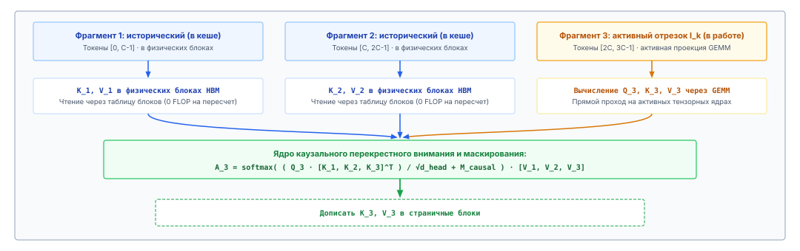
***Нарезка внимания при порционном предзаполнении**: Нарезка активного промпта на фрагменты токенов. На итерации $k$ запросы $\mathbf{Q}_k$ активного отрезка обращаются к историческим проекциям $\mathbf{K}, \mathbf{V}$, которые извлекаются прямо из страничной памяти ускорителя, наряду со свежими активациями. Это гарантирует математическую эквивалентность монолитному прямому проходу без накладных расходов на пересчет.*

На итерации $k$ модель генерирует проекции запросов, ключей и значений только для токенов текущего фрагмента $I_k$:

$$\mathbf{Q}_k = \mathbf{X}_k \mathbf{W}_Q, \quad \mathbf{K}_k = \mathbf{X}_k \mathbf{W}_K, \quad \mathbf{V}_k = \mathbf{X}_k \mathbf{W}_V$$

где $\mathbf{X}_k \in \mathbb{R}^{|I_k| \times D}$ — активации фрагмента $k$. Поскольку авторегрессионные языковые модели используют каузальную маску, токены фрагмента $k$ должны обращать внимание на все предыдущие токены фрагментов с $1$ по $k-1$, а также на предшествующие токены внутри самого фрагмента $k$. Ключи и значения для фрагментов с $1$ по $k-1$ уже вычислены на предыдущих итерациях и сохранены в несмежных физических страницах страничного KV-кеша.

Поэтому вычисление внимания для фрагмента $k$ строит свои матрицы ключей и значений, объединяя исторические закешированные проекции с только что вычисленными:

$$\mathbf{K}_{\le k} = \left[ \mathbf{K}_{\text{cached}, 1:k-1} \,\|\, \mathbf{K}_k \right] \in \mathbb{R}^{\left(\sum_{j=1}^k |I_j|\right) \times D_{\text{kv}}}$$

$$\mathbf{V}_{\le k} = \left[ \mathbf{V}_{\text{cached}, 1:k-1} \,\|\, \mathbf{V}_k \right] \in \mathbb{R}^{\left(\sum_{j=1}^k |I_j|\right) \times D_{\text{kv}}}$$

Выход внимания для активного фрагмента вычисляется как:

$$\mathbf{O}_k = \text{Softmax}\left( \frac{\mathbf{Q}_k \mathbf{K}_{\le k}^\top}{\sqrt{d_{\text{head}}}} + \mathbf{M}_k \right) \mathbf{V}_{\le k}$$

Маска внимания $\mathbf{M}_k$ обеспечивает каузальность. Для исторических токенов ($j < (k-1) C_{\text{chunk}}$) маска разрешает полное двунаправленное внимание, поскольку все исторические токены предшествуют каждому токену фрагмента $k$. Для активных токенов внутри фрагмента $k$ маска применяет стандартную каузальную маскировку, не позволяя токену $t \in I_k$ обращать внимание на токены $t' > t$.

В современных архитектурах ядер GPU (таких как FlashDecoding и FlashAttention-3) эта операция не материализует промежуточную матрицу внимания в глобальной памяти ускорителя. Ядро передает исторические блоки KV из HBM напрямую в тайлы SRAM, поддерживая накопленные онлайн-статистики softmax, то есть текущий максимум строки $m_i$ и нормировочный множитель $l_i$, по блокам:

$$m_{\text{new}} = \max(m_{\text{prev}}, m_{\text{block}}), \quad l_{\text{new}} = l_{\text{prev}} e^{m_{\text{prev}} - m_{\text{new}}} + l_{\text{block}} e^{m_{\text{block}} - m_{\text{new}}}$$

Частичный накопитель внимания на лету перемасштабируется по формуле $\mathbf{O}_{\text{new}} = \mathbf{O}_{\text{prev}} e^{m_{\text{prev}} - m_{\text{new}}} + \mathbf{O}_{\text{block}} e^{m_{\text{block}} - m_{\text{new}}}$, полностью устраняя трафик пропускной способности памяти для промежуточных логитов внимания.

Когда $\mathbf{O}_k$ вычислен, движок записывает $\mathbf{K}_k$ и $\mathbf{V}_k$ в новые страничные блоки глобального KV-кеша. Важно, что промежуточные скрытые активации фрагмента $k$ отбрасываются в конце итерации, точно так же, как в стандартном прямом проходе. Модель не выводит выходной токен, пока не завершится фрагмент $K$ (последний фрагмент промпта); лишь тогда из распределения логитов для позиции $S_{\text{prompt}} - 1$ выбирается первый сгенерированный токен.

Нарезка обменивает небольшой объем избыточных вычислений на ограниченную задержку итерации. Механизм внимания вычисляет запросы длины $C_{\text{chunk}}$ против ключей, которые с каждым фрагментом становятся длиннее ($C_{\text{chunk}}, 2C_{\text{chunk}}, \dots, K C_{\text{chunk}}$). Однако поскольку проекции ключей и значений для исторических токенов извлекаются из памяти, а не пересчитываются по весам, общее число матричных умножений с параметрами остается неизменным.

### Планирование по бюджету токенов


*Нарезка предзаполнения на 4k токенов на восемь частей ограничивает P99 межтокенной задержки уровнем около 50 мс.*

Порционное предзаполнение позволяет движку вывода формировать гибридные пакеты, которые содержат одновременно фрагменты предзаполнения и запросы декодирования по одному токену. В таких системах, как Sarathi-Serve и современные реализации vLLM, это планирование подчиняется строгому бюджету токенов $C_{\text{budget}}$.

На каждом цикле планирования движок просматривает очередь ожидающих фрагментов предзаполнения и набор выполняющихся последовательностей декодирования. Планировщик выбирает сочетание фрагментов предзаполнения и токенов декодирования так, чтобы общее число обработанных токенов за итерацию не превышало $C_{\text{budget}}$:

$$\sum_{i \in \mathcal{P}_{\text{admitted}}} M_{\text{chunk}, i} + \sum_{j \in \mathcal{D}_{\text{admitted}}} 1 \le C_{\text{budget}}$$

где $\mathcal{P}_{\text{admitted}}$ — множество допущенных фрагментов предзаполнения, $M_{\text{chunk}, i} \le C_{\text{chunk}}$ — число токенов фрагмента предзаполнения $i$, а $\mathcal{D}_{\text{admitted}}$ — множество допущенных последовательностей декодирования. [«Политики планирования вывода»](05_kv_cache.md#tbl-vol3-scheduling-policies) сравнивает операционные компромиссы между этими режимами планирования.

| Политика планирования     | Состав итерации                                           | Аппаратное ограничение                                  | Влияние на задержку декодирования                 | Влияние на TTFT                           |
|:--------------------------|:----------------------------------------------------------|:--------------------------------------------------------|:--------------------------------------------------|:------------------------------------------|
| **Монолитное предзаполнение** | $S_{\text{prompt}}$ токенов исключительно             | Ограничено вычислениями ($\mathcal{I} \gg \mathcal{I}^*$) | Высокие всплески ITL ($500\text{--}1\,500\text{ мс}$) | Минимальный TTFT (один проход)            |
| **Декодирование без пакетирования** | $B_{\text{decode}}$ токенов исключительно        | Ограничено памятью ($\mathcal{I} \ll \mathcal{I}^*$)      | Низкий ITL, но вычислительные блоки простаивают   | Не применимо (предзаполнения не допускаются) |
| **Порционное совместное планирование** | $C_{\text{chunk}}$ предзаполнения $+$ $B_{\text{decode}}$ токенов | Сбалансировано по roofline ($\mathcal{I} \approx \mathcal{I}^*$) | Предсказуемый ITL (хвост $30\text{--}60\text{ мс}$) | Незначительное увеличение TTFT ($5\text{--}15\%$) |

<a id="tbl-vol3-scheduling-policies"></a>

***Политики планирования вывода**: Сравнение операционных компромиссов монолитного предзаполнения, декодирования без пакетирования и порционного совместного планирования.*

Абстракция бюджета токенов уравновешивает два критических соглашения об уровне обслуживания (SLA): время до первого токена (TTFT) и межтокенную задержку (ITL).

Время до первого токена — это задержка между отправкой запроса клиентом и получением первого сгенерированного токена:

$$\text{TTFT} = t_{\text{queue}} + \sum_{k=1}^K t_{\text{iter}}(k)$$

При монолитном предзаполнении $K=1$, поэтому промпт выполняется за одну высокооптимизированную итерацию. При порционном предзаполнении $K > 1$. Промпту приходится ждать $K$ итераций планирования, прежде чем будет выведен токен. Кроме того, каждая итерация несет накладные расходы на запуски ядер, поиск в таблице блоков и внимание по ранее сохраненным страницам KV. В результате порционное предзаполнение увеличивает изолированный TTFT на 5–15 процентов.

Межтокенная задержка — это время между выводом последовательных токенов $t$ и $t+1$ для активной последовательности:

$$\text{ITL} = t_{\text{emit}}(t+1) - t_{\text{emit}}(t)$$

При монолитном обслуживании, если принимается предзаполнение на 4 096 токенов, пока активны десять последовательностей декодирования, ITL для этих десяти последовательностей взлетает с базового значения $35\text{ мс}$ до более чем $800\text{ мс}$. Это ухудшение задержки на хвосте (P99) в $22\times$. При порционном предзаполнении с $C_{\text{chunk}} = 512$ работа предзаполнения распределяется по восьми сбалансированным итерациям. Каждая итерация выполняется примерно за $50\text{ мс}$. На каждой итерации все активные последовательности декодирования продвигаются на один токен вместе с 512 токенами предзаполнения. P99 ITL остается жестко ограниченным уровнем около $50\text{ мс}$, полностью устраняя всплеск задержки.

Динамика во времени и контраст планирования между монолитным выполнением и порционным совместным планированием показаны на [«Временная шкала планирования: монолитное предзаполнение против порционного совместного планирования»](05_kv_cache.md#fig-vol3-chunked-timeline): панель (a) показывает простой декодирования из-за блокировки начала очереди, а панель (b) — итерации, ограниченные бюджетом токенов, которые этот простой устраняют. На монолитной временной шкале допуск одного предзаполнения на 4 096 токенов монополизирует тензорные ядра на непрерывный блок в 800 мс, лишая ресурсов десять выполняющихся потоков декодирования и вызывая резкий всплеск P99 межтокенной задержки. При порционном совместном планировании планировщик разбивает предзаполнение на восемь фрагментов по 512 токенов и сочетает каждый фрагмент с активными токенами декодирования в пределах ограниченного бюджета токенов ($C_{\text{budget}}$). Каждая гибридная итерация завершается примерно за 50 мс, позволяя всем выполняющимся потокам декодирования продвигаться на один токен в каждом цикле, сглаживая загрузку ускорителя и устраняя простои из-за блокировки начала очереди.

<a id="fig-vol3-chunked-timeline"></a>

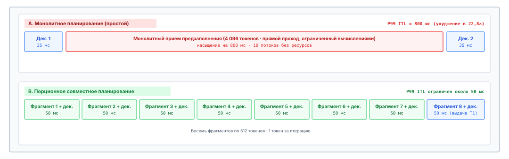
***Временная шкала планирования: монолитное предзаполнение против порционного совместного планирования**: Устранение блокировки начала очереди и всплесков хвоста ITL. Монолитное планирование останавливает выполняющиеся потоки декодирования на 800 мс во время приема промпта, вызывая всплеск хвостовой задержки в 22×. Порционное совместное планирование распределяет прием промпта по восьми сбалансированным итерациям по 50 мс вместе с активным декодированием, поддерживая ровный темп на протяжении всей работы.*

<a id="nbk-05-quantitative-interference-and-chunk-budgeting"></a>

> **Количественная оценка интерференции и бюджетирование фрагментов**
>
> Движок вывода работает на ускорителе, который обеспечивает $T_{\text{peak}} = 800\text{ TFLOPS}$ ($8 \times 10^{14}\text{ FLOPs/s}$) плотных матричных вычислений в 16-битной точности и пропускную способность HBM $B_{\text{mem}} = 3{,}0\text{ ТБ/с}$ ($3 \times 10^{12}\text{ байт/с}$). Обслуживаемая модель имеет $P = 70\text{ млрд}$ параметров в 16-битной точности, занимающих $2P = 140\text{ ГБ}$ памяти. Движок в данный момент обслуживает $B_{\text{decode}} = 32$ потока декодирования. Агент отправляет новый промпт из $S_{\text{prompt}} = 4\,096$ токенов.
>
> **Вопрос 1: Какова задержка выполнения и всплеск ITL при монолитном планировании «выполнить до конца»?**
>
> Итерация декодирования с 32 последовательностями требует передачи всех $140\text{ ГБ}$ весов модели для выполнения $2 \cdot P \cdot B_{\text{decode}} = 2 \times (70 \times 10^9) \times 32 = 4{,}48 \times 10^{12}\text{ FLOPs} = 4{,}48\text{ TFLOPs}$.
> Время чтения памяти равно:
> $$t_{\text{mem, decode}} = \frac{140 \times 10^9\text{ байт}}{3{,}0 \times 10^{12}\text{ байт/с}} \approx 46{,}7\text{ мс}$$
> Время вычислений на тензорных ядрах при достигнутой утилизации FLOPs модели 50 процентов (MFU, эффективная пропускная способность $400\text{ TFLOPS}$) равно:
> $$t_{\text{comp, decode}} = \frac{4{,}48 \times 10^{12}\text{ FLOPs}}{400 \times 10^{12}\text{ FLOPs/s}} \approx 11{,}2\text{ мс}$$
> Поскольку $t_{\text{mem}} > t_{\text{comp}}$, итерация декодирования ограничена памятью и занимает $\max(46{,}7, 11{,}2) = 46{,}7\text{ мс}$. Базовый ITL равен $46{,}7\text{ мс}$.
>
> Когда выполняется монолитное предзаполнение на $4\,096$ токенов, его вычислительная нагрузка равна:
> $$\text{FLOPs}_{\text{prefill}} = 2 \cdot P \cdot S_{\text{prompt}} = 2 \times (70 \times 10^9) \times 4\,096 = 5{,}7344 \times 10^{14}\text{ FLOPs} = 573{,}44\text{ TFLOPs}$$
> Если принять достигнутую MFU для плотных GEMM на уровне $60\%$ ($480\text{ TFLOPS}$ эффективных):
> $$t_{\text{comp, prefill}} = \frac{573{,}44 \times 10^{12}\text{ FLOPs}}{480 \times 10^{12}\text{ FLOPs/s}} \approx 1\,194{,}7\text{ мс} \approx 1{,}195\text{ с}$$
> 32 активных потока декодирования простаивают $1{,}195\text{ с}$. ITL взлетает с $46{,}7\text{ мс}$ до $1\,195\text{ мс}$, то есть задержка ухудшается в $25{,}6\times$.
>
> **Вопрос 2: Какова задержка итерации при нарезке предзаполнения с $C_{\text{chunk}} = 512$?**
>
> Промпт делится на $K = 4\,096 / 512 = 8$ фрагментов. На каждой итерации планировщик совместно планирует один фрагмент предзаполнения на 512 токенов с 32 токенами декодирования, что дает $512 + 32 = 544$ токена всего.
>
> Время передачи весов остается фиксированным и равным $t_{\text{mem}} = 46{,}7\text{ мс}$ (поскольку все 544 токена используют одни и те же параметры модели).
> Вычисления, необходимые для 544 токенов, равны:
> $$\text{FLOPs}_{\text{iter}} = 2 \times (70 \times 10^9) \times 544 = 7{,}616 \times 10^{13}\text{ FLOPs} = 76{,}16\text{ TFLOPs}$$
> При эффективной пропускной способности $480\text{ TFLOPS}$:
> $$t_{\text{comp, iter}} = \frac{76{,}16 \times 10^{12}\text{ FLOPs}}{480 \times 10^{12}\text{ FLOPs/s}} \approx 158{,}7\text{ мс}$$
> Поскольку теперь время вычислений доминирует над потоковой передачей памяти ($158{,}7\text{ мс} > 46{,}7\text{ мс}$), выполнение пакета занимает примерно $158{,}7\text{ мс}$.
>
> Вместо катастрофической заморозки на 1 195 мс с последующим быстрым декодированием все 32 активных потока декодирования продвигаются на один токен каждые $158{,}7\text{ мс}$ в течение 8 последовательных циклов. Максимальный ITL снижается с $1\,195\text{ мс}$ до $158{,}7\text{ мс}$, сохраняя предсказуемую потоковую производительность и держа вычислительные ядра ускорителя загруженными.

Порционное предзаполнение показывает, что нагрузки, ограниченные памятью, и нагрузки, ограниченные вычислениями, можно сочетать, чтобы оптимизировать общую утилизацию ресурсов ускорителя. Подбирая размер фрагмента токенов $C_{\text{chunk}}$ так, чтобы $t_{\text{comp}} \approx t_{\text{mem}}$, планировщик достигает точки баланса, в которой шина памяти и тензорные ядра завершают свою работу одновременно, максимизируя общее число токенов, генерируемых в секунду по всему кластеру.

<a id="chk-05-paged-attention"></a>

> **Проверка: страничное выделение и порционное предзаполнение**
>
> Прежде чем разбирать политики выгрузки, удержания и подкачки памяти, проверьте понимание механики страничного внимания:
>
> - [ ] **Виртуальное отображение блоков**: как таблица блоков PagedAttention переводит несмежные физические страницы в непрерывную логическую последовательность во время самовнимания?
> - [ ] **Ветвление с копированием при записи**: почему совместное использование блоков со счетчиком ссылок позволяет вести поиск ветвящегося обдумывания с накладными расходами выделения памяти $O(1)$?
> - [ ] **Кеширование префиксов**: как индексация деревом Radix устраняет избыточные вычисления предзаполнения промптов в многоходовых взаимодействиях агентов?
> - [ ] **Совместное планирование порционного предзаполнения**: как чередование фрагментов предзаполнения промпта с активными пакетами декодирования предотвращает всплески межтокенной задержки (ITL)?

<a id="sec-vol3-kvcache-swapping"></a>

## Удержание, вытеснение, пересчет или выгрузка

Когда страничная организация на месте, можно разрешить паузу, отложенную в [«От токенов контекста к KV-состоянию»](05_kv_cache.md#sec-vol3-kvcache-geometry). Когда цикл авторегрессионного декодирования выдает последовательность токенов вызова инструмента, которая требует запуска компиляции, выполнения набора тестов длительностью в несколько секунд внутри изолированного контейнера или интерактивного подтверждения от оператора-человека, прямой вывод модели мгновенно останавливается. Пока агент ждет результатов внешнего выполнения, физические блоки KV-кеша, выделенные этой траектории, остаются закрепленными в высокоскоростной памяти устройства (HBM). Если движок обслуживания бесконечно сохраняет эти физические блоки через паузы в несколько секунд или минут, простаивающие траектории монополизируют емкость ускорителя, создавая искусственное давление на память, которое тормозит активное декодирование и загоняет входящие запросы в очереди допуска. Напротив, если среда выполнения преждевременно вытесняет эти блоки, чтобы освободить HBM, возвращающимся траекториям приходится выполнять избыточное предзаполнение по десяткам тысяч исторических токенов контекста, сжигая тысячи терафлопс вычислений и раздувая время до первого токена после возобновления.

Когда траектория агента приостанавливается ради выполнения инструмента или человеческого обдумывания, система обслуживания должна выбрать одну из четырех физических политик памяти: резидентное удержание, полное вытеснение с последующим пересчетом, выгрузку в оперативную память хоста (DRAM) через асинхронную потоковую передачу по PCIe и многоуровневое хранение на вторичных носителях. Оптимальная граница решения задается аналитическим временем безубыточности ожидания, которое уравновешивает альтернативную стоимость зарезервированной емкости памяти ускорителя с пропускной способностью передачи через межсоединение и вычислительной задержкой повторного выполнения фазы предзаполнения.

### Политики возврата памяти

В диалоговом обслуживании выполнение запроса непрерывно: сначала фаза предзаполнения обрабатывает промпт, а сразу за ней идет непрерывная фаза авторегрессионного декодирования, которая выдает токены до достижения разделителя остановки или ограничения длины последовательности. Рабочие нагрузки агентов разрушают это допущение. Траектория агента — это прерывистая последовательность коротких генераций токенов, между которыми лежат внешние интервалы выполнения с тяжелым правым хвостом. Агент, редактирующий код, может за двести миллисекунд сгенерировать команду оболочки из пятидесяти токенов, а затем сорок пять секунд простаивать, пока система сборки компилирует зависимости и запускает модульные тесты. Исследовательский агент может выдать поисковый запрос и приостановиться, пока браузерный рабочий загружает, разбирает и извлекает данные из нескольких веб-документов.

В многоарендном кластере обслуживания, где HBM ускорителя — лимитирующее узкое место, определяющее максимальный размер параллельного пакета $B$, закрепление $M_{\text{KV}}$ гигабайт неактивного состояния внимания на время простоя $T_{\text{wait}}$ налагает налог памяти на ожидание инструмента, который [«Простаивание памяти как трение»](01_introduction.md#sec-vol3-intro-memory-stranding) оценило для одной сессии. Здесь он записан как произведение памяти и времени:

$$\mathcal{C}_{\text{hold}} = M_{\text{KV}} \cdot T_{\text{wait}}$$

Это произведение гигабайт на секунды представляет собой емкость, изъятую из активного пула планирования. Если экземпляр вывода резервирует $6\text{ ГБ}$ физического KV-кеша для агента, простаивающего на шестидесятисекундном наборе тестов, он расходует $360\text{ ГБ}\cdot\text{с}$ резидентности в HBM, не выполнив ни одной операции с плавающей точкой. При устойчивых потоках поступления накопленные налоги памяти-времени насыщают аллокаторы физических блоков и вынуждают планировщик среды выполнения вытеснять активные потоки декодирования или отклонять входящие шаги агентов.

Налог памяти на ожидание инструмента $\mathcal{C}_{\text{hold}} = M_{\text{KV}} \cdot T_{\text{wait}}$ раскрывает фундаментальную асимметрию обслуживания агентов: емкость памяти расходуется непрерывно на протяжении физического времени, тогда как вычислительные блоки ускорителя используются только во время активных прямых проходов.

Чтобы справиться с этим ограничением, супервизор вывода может применить четыре различные политики управления памятью, которые сопоставлены по аппаратным уровням в [«Политики возврата KV-кеша»](05_kv_cache.md#tbl-vol3-reclamation-policies):

1. **Резидентное удержание:** среда обслуживания держит все физические блоки KV резидентными в HBM ускорителя на протяжении всего окна выполнения инструмента. Эта политика оптимизирует исключительно задержку возобновления: когда внешняя среда возвращает результат выполнения, движок дописывает новые токены наблюдения в существующую таблицу блоков и возобновляет предзаполнение без задержки восстановления ($T_{\text{resume}} = 0$). Однако альтернативная стоимость этой политики растет линейно с $T_{\text{wait}}$, что делает ее губительной при давлении на память или при длительном ожидании.
2. **Вытеснение и пересчет:** среда обслуживания немедленно освобождает физические блоки KV траектории, как только отправляет вызов инструмента, возвращая страницы в общий пул аллокатора. Когда инструмент возвращает наблюдение, среда выполнения восстанавливает полную историю промпта, объединяя прежний системный промпт, историческую реплику, токены вызова инструмента и вновь полученное наблюдение, и заново выполняет прямой проход предзаполнения с нуля. Эта политика не несет налога на удержание в HBM ($\mathcal{C}_{\text{hold}} = 0$), но превращает физическую дилемму памяти в квадратичный вычислительный налог, расходуя ценные тензорные ядра и раздувая задержку возобновления на всю длительность длинного прохода предзаполнения ($T_{\text{resume}} = T_{\text{prefill}}$).
3. **Выгрузка в DRAM хоста (подкачка по PCIe):** движок обслуживания запускает асинхронную передачу прямого доступа к памяти (DMA) по периферийному межсоединению (например, PCIe Gen5 или NVLink-C2C), переводя физические блоки KV траектории из HBM в закрепленную (pinned) системную память хоста. По завершении передачи физические блоки GPU возвращаются. Когда инструмент сообщает о завершении, среда выполнения выделяет новые физические блоки GPU и возвращает сохраненное состояние внимания в HBM. Эта политика отделяет потребление памяти ускорителя от времени простоя и обходит дорогостоящие затраты FLOP на пересчет, ограничиваясь вместо этого пропускной способностью передачи $B_{\text{xfer}}$ шины хоста.
4. **Многоуровневое вторичное хранилище (NVMe и удаленная память):** для операций с человеком в контуре, асинхронных проверок безопасности или плановых пакетных заданий, где $T_{\text{wait}}$ длится минуты, часы или дни, системная DRAM хоста тоже слишком дефицитна, чтобы служить бессрочной стоянкой. Среда выполнения переносит сериализованные блоки KV из DRAM хоста на локальные твердотельные накопители (NVMe через PCIe) или на разнесенные пулы сетевой памяти (например, удаленные кластеры хранения через RDMA). Задержка возобновления возрастает до сотен миллисекунд или секунд, зато активный объем памяти и в HBM ускорителя, и в DRAM хоста падает до нуля.

| Политика                 | Физический уровень хранения | Эффективная пропускная способность ($B_{\text{xfer}}$) | Задержка возобновления ($T_{\text{resume}}$) | Вычислительный налог ускорителя | Режим отказа                     |
|:-------------------------|:----------------------------|:-------------------------------------------------------|:---------------------------------------------|:--------------------------------|:---------------------------------|
| **Резидентное удержание** | HBM ускорителя            | $\sim 3{,}0\text{--}4{,}8\text{ ТБ/с}$                      | $0\text{ мс}$                                | $0\text{ FLOPs}$                | Исчерпание HBM; голодание пакета |
| **Вытеснение и пересчет** | Отбрасывается (нет)       | Не применимо                                           | $T_{\text{prefill}}(S)$                      | $2 P S\text{ FLOPs}$            | Насыщение вычислений; высокий TTFT |
| **Выгрузка в DRAM хоста** | Системная память хоста    | $32\text{--}64\text{ ГБ/с}$ (PCIe)                      | $M_{\text{KV}} / B_{\text{pcie}}$            | $0\text{ FLOPs}$                | Конкуренция за шину межсоединения |
| **Многоуровневое хранение** | Локальный NVMe / RDMA   | $7\text{--}14\text{ ГБ/с}$ (NVMe)                       | $M_{\text{KV}} / B_{\text{nvme}}$            | $0\text{ FLOPs}$                | Простои очереди I/O; износ диска |
<a id="tbl-vol3-reclamation-policies"></a>

***Политики возврата KV-кеша**: Архитектурное сравнение четырех политик возврата KV-кеша по уровням хранения, задержкам и режимам отказа.*

### Аналитическая механика: граница решения о безубыточности

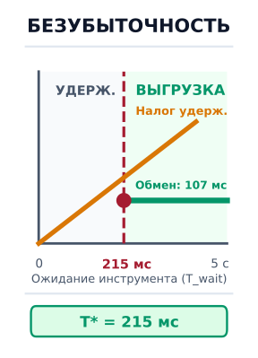

*При паузах инструмента свыше 215 мс выгрузка по PCIe освобождает HBM и обходит пересчет предзаполнения в 53,6 раза.*

Статический выбор одной из этих четырех политик порождает серьезное патологическое поведение. Движок, который всегда удерживает состояние KV, будет падать при ошибках нехватки памяти (OOM), когда агент натыкается на долгий шаг сборки. И наоборот, движок, который всегда пересчитывает, потратит более половины своей эксплуатационной энергии на повторное вычисление статических системных промптов и буферов файлов. Среда выполнения должна вычислять аналитическую границу решения, определяемую длиной последовательности $S$, ожидаемым временем ожидания $T_{\text{wait}}$, вычислительной пропускной способностью ускорителя и пропускной способностью передачи межсоединения.

Рассмотрим авторегрессионную трансформерную модель с $P$ параметрами, $L$ слоями, $H_{\text{kv}}$ головами ключей и значений и размерностью головы $d_{\text{head}}$, работающую с размером элемента $b_{\text{elem}}$ байт (где $b_{\text{elem}} = 2$ для 16-битной половинной точности и $b_{\text{elem}} = 1$ для 8-битного квантования). Объем памяти, который занимает проекция ключа и значения каждого токена, равен:

$$m_{\text{token}} = 2 \cdot L \cdot H_{\text{kv}} \cdot d_{\text{head}} \cdot b_{\text{elem}}$$

Для траектории, приостановленной при длине последовательности $S$, полный объем памяти ее физического состояния внимания равен $M_{\text{KV}} = S \cdot m_{\text{token}}$.

Теперь оценим время, которое нужно, чтобы восстановить это состояние пересчетом или передачей по межсоединению. При вытеснении и пересчете ускоритель должен выполнить прямой проход предзаполнения по $S$ токенам. В современных декодер-архитектурах вычислительная стоимость фазы предзаполнения определяется матричными умножениями в линейных проекциях и сетях прямого распространения и требует примерно $2 P$ операций с плавающей точкой на токен плюс квадратичную стоимость внимания $4 L S^2 d_{\text{model}}$. Для типичных длин контекста до тридцати двух тысяч токенов доминирует линейный член по параметрам. Если кластер ускорителей выполняет предзаполнение с эффективной устойчивой вычислительной пропускной способностью $R_{\text{prefill}}$ (в FLOP в секунду с учетом утилизации FLOP модели, или MFU), задержка пересчета равна:

$$T_{\text{recomp}}(S) \approx \frac{2 P \cdot S}{R_{\text{prefill}}}$$

Напротив, выгрузка физического состояния KV через межсоединение хоста (например, PCIe Gen5 x16) с эффективной устойчивой односторонней пропускной способностью передачи $B_{\text{pcie}}$ требует времени перезагрузки:

$$T_{\text{reload}}(S) = \frac{M_{\text{KV}}}{B_{\text{pcie}}} = \frac{S \cdot m_{\text{token}}}{B_{\text{pcie}}}$$

Поскольку состояние внимания всегда можно пересобрать из его токенов (принцип «Состояние внимания выводится из префикса токенов»), вытеснение — это решение о стоимости, и его разрешает сравнение $T_{\text{recomp}}(S)$ с $T_{\text{reload}}(S)$. Обе величины растут линейно с длиной последовательности $S$. Следовательно, отношение задержки перезагрузки к задержке пересчета не зависит от длины последовательности:

$$\frac{T_{\text{reload}}}{T_{\text{recomp}}} = \frac{S \cdot m_{\text{token}} / B_{\text{pcie}}}{2 P \cdot S / R_{\text{prefill}}} = \frac{m_{\text{token}} \cdot R_{\text{prefill}}}{2 P \cdot B_{\text{pcie}}}$$

Если это отношение меньше единицы, потоковая передача состояния внимания по периферийной шине строго быстрее, чем его пересчет на тензорных ядрах.

Количественная динамика этого компромисса описана на [«Граница безубыточности по задержке и режимы принятия решений для подкачки KV»](05_kv_cache.md#fig-vol3-swapping-tradeoff). Левая панель показывает задержку выполнения как функцию длительности паузы внешнего инструмента для 70B-модели при $S = 16\,384$ токенах ($5{,}0\text{ ГиБ}$ состояния KV). Тогда как полный пересчет промпта несет неизменную плату $5{,}735\text{ с}$ на тензорных ядрах, двунаправленные передачи PCIe Gen5 x16 прокачивают состояние туда и обратно за $T_{\text{round-trip}} = 215\text{ мс}$. Это задает точку пересечения безубыточности $T^* = 215\text{ мс}$. Правая панель отображает получившиеся двумерные режимы решений по длине последовательности и длительности ожидания: паузы инструмента короче $215\text{ мс}$ относятся к режиму резидентного удержания в HBM, чтобы избежать пузырей конвейера DMA; паузы от $215\text{ мс}$ до десятков секунд попадают в режим подкачки в DRAM хоста по PCIe (с преимуществом по задержке над пересчетом до $53{,}6\times$); а растянутые паузы в несколько минут переходят к выгрузке на вторичное хранилище.

Величина этого преимущества решающим образом зависит от архитектуры физического межсоединения:

- **Межсоединение PCIe Gen5 x16:** стандартные узлы с дискретными ускорителями дают $B_{\text{pcie}} \approx 64\text{ ГБ/с}$ теоретически (устойчивая эффективная пропускная способность DMA после протокольного кадрирования — $52\text{--}54\text{ ГБ/с}$).
- **Когерентные межсоединения чип-чип (NVLink-C2C):** современные плотно связанные гетерогенные платформы (такие как NVIDIA GH200 Grace Hopper и GB200 Grace Blackwell) заменяют периферийные слоты PCIe когерентными соединениями чип-чип с пропускной способностью $B_{\text{c2c}} \approx 900\text{ ГБ/с}$, то есть более чем в $16\times$ выше устойчивой пропускной способности. При NVLink-C2C потоковая передача физических блоков KV между DRAM CPU и HBM GPU завершается за миллисекунды, снижая минимальный жизнеспособный порог выгрузки $T_{\text{wait}}^*$ с сотен миллисекунд до области ниже 20 миллисекунд.

Точка пересечения между подкачкой и пересчетом зависит от баланса между арифметической плотностью и пропускной способностью межсоединения. Когда $\frac{m_{\text{token}}}{2P} < \frac{B_{\text{pcie}}}{R_{\text{prefill}}}$, передача проекций внимания по PCIe быстрее, чем их генерация умножением матриц. На NVLink-C2C этот порог снижается в 16 раз.

<a id="fig-vol3-swapping-tradeoff"></a>

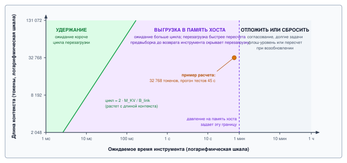
***Граница безубыточности по задержке и режимы принятия решений для подкачки KV**: Количественное сравнение задержки резидентного удержания, DMA-выгрузки по PCIe Gen5 и пересчета на тензорных ядрах по длительностям паузы инструмента (слева) и получившиеся двумерные режимы решений по длине последовательности и длительности ожидания (справа).*

Чтобы учесть время простоя $T_{\text{wait}}$, среда выполнения должна сравнить стоимость удержания памяти со стоимостью подкачки. Пусть $\mu_{\text{HBM}}$ обозначает теневую цену (альтернативную стоимость байт-секунды) памяти GPU при дефиците емкости, а $\mu_{\text{DRAM}}$ — теневую цену памяти хоста ($\mu_{\text{DRAM}} \ll \mu_{\text{HBM}}$). Выгрузка траектории требует времени выгрузки $T_{\text{egress}} = M_{\text{KV}} / B_{\text{pcie}}$ и времени обратной загрузки $T_{\text{ingress}} = M_{\text{KV}} / B_{\text{pcie}}$. Физическое состояние можно освободить только в интервале $(T_{\text{wait}} - T_{\text{ingress}})$. Поэтому выгрузка физически осуществима, только если время ожидания строго превышает задержку передачи туда и обратно:

$$T_{\text{wait}} > \frac{2 \cdot M_{\text{KV}}}{B_{\text{pcie}}}$$

Если $T_{\text{wait}} \le \frac{2 M_{\text{KV}}}{B_{\text{pcie}}}$, движок не успевает завершить передачу туда и обратно до возврата инструмента; попытка выгрузки в этом окне вызывает искусственный простой конвейера, когда модель бездействует, просто ожидая перезагрузки собственного состояния. Для времени ожидания, превышающего этот минимальный физический порог, резидентное удержание несет стоимость удержания $\mu_{\text{HBM}} \cdot M_{\text{KV}} \cdot T_{\text{wait}}$, тогда как подкачка несет накладные расходы передачи плюс стоимость пребывания в хосте $\mu_{\text{DRAM}} \cdot M_{\text{KV}} \cdot T_{\text{wait}}$. Приравнивание этих стоимостей выявляет время безубыточности $T_{\text{wait}}^*$:

$$T_{\text{wait}}^* \approx \frac{2 \cdot M_{\text{KV}}}{B_{\text{pcie}}} \cdot \left( \frac{\mu_{\text{HBM}}}{\mu_{\text{HBM}} - \mu_{\text{DRAM}}} \right) + \Delta T_{\text{stall}}$$

где $\Delta T_{\text{stall}}$ — штраф по задержке, который планировщик готов терпеть на возобновленном шаге. Когда емкость памяти ограничена ($\mu_{\text{HBM}} \gg \mu_{\text{DRAM}}$), $T_{\text{wait}}^*$ приближается ко времени передачи туда и обратно.

<a id="psp-05-the-tyranny-of-the-idle-agent"></a>

> **Тирания простаивающего агента и налог на резидентность KV**
>
> В традиционном обслуживании вывода по схеме «запрос — ответ» резидентность памяти GPU кратковременна и детерминирована: запросы поступают, токены декодируются последовательно, а выделения освобождаются сразу после выдачи завершающего разделителя. Агентные циклы полностью ломают эту операционную модель, вводя длительные асинхронные паузы ввода-вывода. Когда агент вызывает инструмент, меняющий состояние, например запускает тестовый контейнер, выполняет многофайловую компиляцию или ждет подтверждения от человека, прямая генерация токенов останавливается на секунды или минуты.
>
> Во время этих пауз удержание гигабайтов состояния ключей и значений в высокоскоростной памяти налагает непомерный налог на простаивающую резидентность. GPU H100 на 80 ГБ, на котором размещены шестнадцать параллельных приостановленных агентов, может обнаружить всю свою емкость памяти занятой спящими траекториями, которые не выдают ни одного токена, что лишает активное декодирование ресурсов и вызывает блокировку начала очереди. Однако простое вытеснение этих блоков накладывает столь же карательный налог на пересчет: повторное вычисление тысяч токенов префикса при возобновлении тратит ценные такты тензорных ядер и взвинчивает время до первого токена.
>
> **Системный вывод**: высокоскоростная память — это эфемерная стадия выполнения, а не архивный носитель данных. Надежные среды выполнения агентов побеждают налог на резидентность, отделяя выполнение от удержания. Память ускорителя хранит состояние внимания траекторий, которые генерируют токены, а среда выполнения переносит состояние траектории в DRAM хоста или NVMe асинхронным DMA, как только ожидаемое время простоя превышает время безубыточности.

<a id="nbk-05-sizing-the-break-even-frontier-for"></a>

> **Стоимость сорокапятисекундного ожидания инструмента**
>
> **Задача**: Агент-программист приостанавливается при 32 768 токенах на время 45 с прогона тестов на узле из восьми ускорителей из [«От токенов контекста к KV-состоянию»](05_kv_cache.md#sec-vol3-kvcache-geometry). Должен ли движок сохранить состояние внимания, выгрузить его в память хоста или отбросить и пересчитать?

>
> **Переменные**:
>
> * Состояние для удержания: $M_{\text{KV}} =$ 10,7 ГБ (из оценки размера).
> * Каналы хоста: каждый ускоритель держит одну восьмую состояния и имеет собственный канал 64 ГБ/с, так что узел переносит состояние со скоростью до $B_{\text{link}} =$ 512 ГБ/с.
> * Предзаполнение: 45 % пиковой скорости узла, $R_{\text{prefill}} \approx$ 3 560 TFLOP/s (принятая устойчивая утилизация).
>
> **Математика**:
>
> Перезагрузка: 10,7 ГБ / 512 ГБ/с $\approx$ 21 мс, то есть путь туда и обратно занимает 42 мс.
>
> Пересчет: $2 N S =$ 2 $\times$ 70,6 миллиарда $\times$ 32 768 $\approx$ 4,63 $\times 10^{15}$ операций, на что при устойчивой скорости уходит 1,3 с.
>
> Удержание состояния в резиденции на все время ожидания отнимает 10,7 ГБ $\times$ 45 с $\approx$ 483 ГБ·с памяти ускорителя.
>
> **Результат**: Перезагрузка примерно в 62× быстрее пересчета, а путь туда и обратно длительностью 42 мс составляет намного меньше одной десятой процента от времени ожидания. Даже если каналы поддерживают лишь четверть номинальной пропускной способности, перезагрузка все равно выигрывает примерно в 15×.
>
> **Системный вывод**: для любого инструмента, который работает дольше нескольких десятков миллисекунд, выгрузка освобождает память ускорителя почти на все время ожидания почти без затрат на возобновление. Удержание уместно только для инструментов, которые быстрее пути туда и обратно, а пересчет уместен только тогда, когда дефицитным уровнем становится память хоста, а не память ускорителя.

### Асинхронная страничная подкачка

Реализация физической подкачки блоков в среде вывода требует глубокой интеграции со страничным менеджером памяти. Абстракция виртуальной памяти, заложенная в PagedAttention, отображает инвариантные логические блоки последовательности на несмежные физические страничные выделения. Чтобы поддержать многоуровневую подкачку, таблица страниц должна быть расширена до структуры с двойной резидентностью.

Физическая архитектура и механика асинхронной предвыборки этой многоуровневой иерархии показаны на [«Иерархическая топология подкачки KV по физическим уровням памяти»](05_kv_cache.md#fig-vol3-hierarchical-paging). Система обслуживания разделяет физическую память на три уровня: уровень 1 (HBM ускорителя, с пропускной способностью 3,0 ТБ/с для генерации активных токенов), уровень 2 (закрепленная DRAM хоста, подключенная через DMA PCIe Gen5 со скоростью 54 ГБ/с для пауз инструментов длительностью в секунды) и уровень 3 (массивы корпоративных NVMe-накопителей, дающие терабайты хранения для длительных взаимодействий с человеком). Менеджер памяти отслеживает кадры на этих уровнях с помощью расширенной таблицы блоков, снабженной метками резидентности (`TIER_HBM`, `TIER_HOST`, `TIER_NVME`). Как показано на нижней временной шкале выполнения, остановки при возобновлении маскируются конвейерной предвыборкой: пока тензорные ядра ускорителя выполняют предзаполнение первого фрагмента поступившего наблюдения инструмента, независимый движок копирования DMA параллельно переносит исторические блоки из DRAM хоста обратно в HBM, полностью скрывая задержку перезагрузки за активными арифметическими вычислениями.

<a id="fig-vol3-hierarchical-paging"></a>

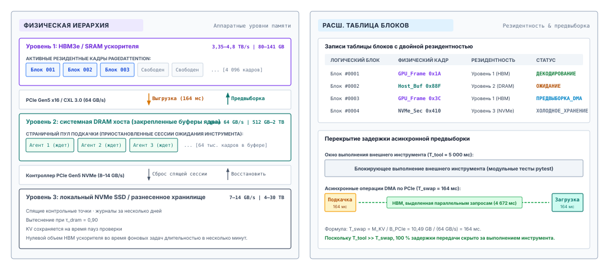
***Иерархическая топология подкачки KV по физическим уровням памяти**: Многоуровневая архитектура виртуальной памяти, охватывающая HBM ускорителя, закрепленную DRAM хоста и локальное хранилище NVMe. Расширенная таблица блоков отслеживает резидентность по уровням, позволяя движкам асинхронного DMA совмещать перезагрузку исторических блоков с вычислением предзаполнения активного наблюдения.*

Когда траектория агента переходит от активной генерации к ожиданию внешнего инструмента, супервизор обслуживания запускает миграцию блоков:

1. **Планирование вытеснения и закрепление:** планировщик выбирает кандидатные траектории, у которых прогнозируемое время ожидания удовлетворяет $T_{\text{wait}} > T_{\text{wait}}^*$. Движок выделяет непрерывный набор физических кадров блоков внутри заранее выделенного пула закрепленных (pinned) буферов DRAM хоста. Закрепление памяти хоста через POSIX `mlock` или регистрацию памяти хоста в CUDA (`cudaHostAlloc`) обязательно: обычная выгружаемая память операционной системы вызывала бы страничные ошибки ОС хоста при прямом доступе к памяти и обрушивала бы пропускную способность передачи по PCIe.
2. **Асинхронная отправка DMA:** среда выполнения выдает неблокирующие вызовы копирования (`cudaMemcpyAsync`), направленные в выделенный двунаправленный поток копирования CUDA. Поскольку современные архитектуры ускорителей предоставляют независимые движки копирования, которые работают параллельно с основными движками тензорных вычислений, эта передача идет в фоне, не отнимая такты у активных пакетов декодирования на соседних потоках.
3. **Переназначение таблицы блоков:** когда передача DMA завершается, асинхронный обратный вызов хоста обновляет записи таблицы блоков траектории, переключая их метку размещения с `TIER_GPU` на `TIER_HOST` и записывая индексы кадров хоста. Освободившиеся номера физических кадров GPU немедленно помещаются в очередь FIFO свободных блоков аллокатора, делая их доступными для немедленного резервирования параллельными запросами.

```python
# Эмпирический интерфейс миграции таблицы блоков
def swap_out_trajectory(seq_id: int, block_table: BlockTable,
                        gpu_alloc: PageAllocator, host_alloc: PageAllocator,
                        copy_stream: Stream) -> None:
    gpu_frames = block_table.get_physical_frames(seq_id, Tier.GPU)
    host_frames = host_alloc.allocate_blocks(count=len(gpu_frames))

    # Асинхронная передача блоков по копирующему потоку PCIe
    copy_stream.issue_dma(src=gpu_frames, dst=host_frames,
                          bytes_per_block=BLOCK_BYTE_SIZE)

    # Переназначение логических указателей и освобождение кадров HBM устройства
    copy_stream.record_callback(
        lambda: (block_table.remap(seq_id, Tier.HOST, host_frames),
                 gpu_alloc.free_blocks(gpu_frames))
    )
```

Главная инженерная задача на обратном пути — скрыть задержку перезагрузки. Если движок дожидается, пока инструмент вернет окончательный результат, прежде чем запрашивать подкачку обратно, модель переживает пузырь конвейера длительностью $M_{\text{KV}} / B_{\text{pcie}}$. Современные среды выполнения агентов применяют два системных приема, чтобы устранить этот простой:

*Ранняя спекулятивная предвыборка:* выполнение инструмента редко бывает черным ящиком полностью неизвестной длительности. Профилирование прогонов непрерывной интеграции, обращений к веб-API или терминальных запусков дает предсказуемые нижние границы задержки. Если у вызова инструмента эмпирическое медианное время выполнения составляет три секунды при минимуме в две секунды, таймер, запланированный на $t = 1{,}8\text{ с}$, может запустить асинхронную перезагрузку KV-блоков траектории обратно в HBM GPU еще до того, как внешний процесс сообщит о завершении. Если инструмент закончит работу за три секунды, его историческое состояние внимания уже будет резидентным в памяти ускорителя, и воспринимаемая задержка возобновления сведется к нулю.

*Конвейерная порционная перезагрузка и предзаполнение наблюдения:* когда выполнение инструмента завершается, оно возвращает строку наблюдения (например, стандартный вывод команды оболочки) длины $S_{\text{obs}}$. Чтобы продолжить траекторию, движок должен выполнить предзаполнение этих $S_{\text{obs}}$ токенов. При порционном планировании предзаполнения движок разбивает входящее наблюдение на отдельные фрагменты (например, по 512 токенов). Пока фрагмент 0 выполняет свой прямой проход GEMM на тензорных ядрах, движок копирования параллельно передает по шине PCIe исторические KV-блоки для фрагментов с 1 по $N$. Чередуя передачи DMA с матричными вычислениями, задержку передачи полностью перекрывают обязательной фазой предзаполнения самого наблюдения.

### Многоуровневое вторичное хранилище

Хотя системная DRAM хоста служит эффективной промежуточной площадкой для выполнения инструментов длительностью в несколько секунд, она не решает проблему масштабирования взаимодействий агентов с человеком в контуре. В современных средах развертывания автономный агент часто приостанавливается, чтобы запросить подтверждение деструктивного действия, ревью запроса на слияние или уточняющую обратную связь от человека. Время реакции человека подчиняется логнормальным распределениям, которые охватывают минуты и часы. Удержание гигабайтов состояния внимания в DRAM хоста для тысяч приостановленных сессий агентов исчерпывает системную память, лишая буферы операционной системы хоста ресурсов и ограничивая плотность кластера.

Чтобы масштабироваться на широкие окна простоя, протокол многоуровневого размещения в среде выполнения опускается ниже — на энергонезависимое вторичное хранилище (локальные массивы твердотельных накопителей NVMe) и разнесенные узлы удаленной памяти (уровень 3 на [«Иерархическая топология подкачки KV по физическим уровням памяти»](05_kv_cache.md#fig-vol3-hierarchical-paging)).

Когда агент переходит в интерактивное состояние ожидания человека, супервизор хоста переносит его блоки внимания из закрепленной DRAM хоста в асинхронный дисковый движок, используя прямой ввод-вывод (`O_DIRECT` или Linux `io_uring`) или GPUDirect Storage (GDS). Обходя кеши страниц ОС, движок передает сериализованные тензорные блоки напрямую между контроллерами NVMe и буферами памяти почти на линейной скорости ($7\text{--}14\text{ ГБ/с}$ на накопитель).

Для состояния внимания объемом $5\text{ ГБ}$ чтение сериализованного кеша из корпоративного массива NVMe занимает примерно от четырехсот до семисот миллисекунд. В контексте человека-супервизора, которому понадобились три минуты, чтобы прочитать терминальный дифф и одобрить развертывание, холодная перезагрузка за полсекунды совершенно незаметна. Таким образом, многоуровневое вторичное хранилище дает снижение стоимости обслуживания на порядок: активные траектории занимают дефицитную HBM; короткие паузы инструментов находятся в DRAM хоста; а спящие траектории, ожидающие решения человека, надежно сохраняются на дешевых флеш-носителях, сохраняя повторное использование префиксов без потерь и не расходуя энергозависимую память кластера.

---

Способность динамически удерживать, вытеснять, пересчитывать или выгружать состояние внимания гарантирует, что движок вывода не рухнет под беспорядочными ритмами простоя внешних вызовов инструментов. Однако умение подкачать отдельную траекторию не отвечает на макроархитектурный вопрос, стоящий перед оператором инфраструктуры: сколько совокупной физической памяти нужно предоставить кластеру, чтобы поддерживать заданный поток поступления параллельных ветвящихся агентов и не скатиться в пробуксовку? Ответ требует моделирования границ емкости кеша внимания при совокупных многоходовых нагрузках.

<a id="sec-vol3-kvcache-capacity-planning"></a>

## Емкость для рабочих нагрузок агентов

Выделение высокоскоростной памяти для развертывания автономных агентов на основе стандартных моделей диалогового трафика ведет прямо к катастрофическому сбою в эксплуатации: пробуксовке из-за нехватки памяти, аварийным вытеснениям страниц и всплескам хвостовой задержки длительностью в секунды. В обычном диалоговом обслуживании входящие запросы имеют короткие промпты, порождают умеренные ответы длиной в несколько сотен токенов и окончательно завершаются по выполнении. Инженеры инфраструктуры, которые рассчитывают кластеры для такой чат-нагрузки, могут безопасно предполагать стационарные распределения длин последовательностей и резервировать умеренный фиксированный объем физической памяти ключей и значений на каждый активный поток. Траектории автономных агентов нарушают все статистические допущения, лежащие в основе этой диалоговой модели. Агент, выполняющий многоходовой рабочий процесс программной инженерии, верификации или исследования, монотонно накапливает контекст на протяжении десятков или сотен шагов рассуждения, многократно загружая огромные выводы инструментов, диагностику компилятора и снимки файлов, пока длина промпта регулярно не превысит десятки тысяч токенов ($M \gg 10^4$). Кроме того, траектории агентов демонстрируют длительные, крайне нерегулярные интервалы простоя, пока супервизор хоста выполняет компиляторы в песочнице или ждет сетевых RPC, перемежаемые спекулятивными ветвями, которые ответвляют несколько путей поиска от одного предкового состояния.

**Емкость обслуживания в агентной инфраструктуре нельзя рассчитывать как скалярное кратное параллельности активных запросов; ее нужно проектировать как динамическую физическую оболочку, которую определяют накопление токенов за несколько ходов, топология совместного использования префиксов и перцентили хвостовой задержки при сильном давлении на память.** Когда совокупный спрос на токены по параллельным траекториям превышает физическую высокоскоростную память ($C_{\text{HBM}}$), страничный менеджер памяти вынужден либо приостанавливать активное декодирование, либо переносить страничные блоки по шине PCIe в память хоста, либо полностью отбрасывать несмежные блоки. Возникающий штраф по задержке ложится не на среднюю пропускную способность модели, а на хвостовые перцентили времени до первого токена (TTFT) и межтокенной задержки (ITL). Поэтому проектирование кластера вывода под агентные нагрузки требует перевода структурной геометрии нейросетевой архитектуры и стохастического поведения многоходовых траекторий в строгие границы емкости.

<a id="sec-vol3-kv-workload-dynamics"></a>

### Динамика нагрузки: расхождение многоходовых агентов

Физический объем памяти движка вывода определяется расхождением между диалоговыми запросами и агентными графами выполнения. В стандартной диалоговой системе распределение длин последовательностей унимодально и жестко ограничено, что позволяет оператору сервиса предусмотреть предсказуемое соотношение активных слотов вычислительного пакета и блоков высокоскоростной памяти. Каждый запрос освобождает свои блоки, когда выдает токен конца последовательности — границу запроса из [«Граница пассивного запроса»](01_introduction.md#sec-vol3-intro-passive-boundary-ceiling), поэтому возврат памяти частый, детерминированный и жестко связан с выдачей токенов.

Групповое внимание (Grouped-Query Attention, GQA) снижает давление на физический кеш, назначая нескольким головам запроса общую пару голов ключа и значения ($H_{\text{kv}} \ll H_q$). Для модели с отношением голов запроса к головам KV $8:1$ физический объем на токен уменьшается на порядок, что дает пропорциональное увеличение параллелизма при тех же физических пулах HBM.

Рабочие нагрузки агентов разрушают эту операционную регулярность по трем физическим измерениям: скорости накопления контекста, временной природе выполнения и топологии графа. Во-первых, накопление контекста в сессии агента монотонно и прерывается крупными ступенчатыми вливаниями. Вместо обмена короткими фразами естественного языка среда выполнения на хосте передает языковой модели обширную обратную связь от окружения на каждом ходу. Один вызов инструмента поиска по рабочему пространству или запуска набора тестов может втолкнуть в буфер промпта двадцать тысяч токенов сырого терминального вывода. За десятиходовую траекторию контекст промпта $M$ растет не просто линейно: он нарастает по принципу сложного процента, потому что агент сохраняет историю диалога, манифесты выполнения инструментов и промежуточные наблюдения из черновика. Выделение памяти по первому ходу гарантирует голодание или пробуксовку на последующих ходах.

Во-вторых, временной жизненный цикл запроса агента по сути асинхронен и бимодален. В отличие от пользователя-человека, который читает и отвечает в течение десятков секунд, среда выполнения агента чередует всплески интенсивного авторегрессионного декодирования с длительными паузами, когда модель полностью простаивает. Пока среда хоста компилирует код, запускает контейнеры в песочнице или ждет медленных ответов внешних API, накопленное состояние ключей и значений траектории остается закрепленным в памяти ускорителя. Если среда обслуживания удерживает эти физические страницы в HBM, чтобы обеспечить почти нулевую задержку возобновления на следующем ходу, эти выделенные блоки простаивают совершенно непродуктивно и лишают активное декодирование в конкурирующих потоках ресурсов. И наоборот, если среда выполнения преждевременно вытесняет или выгружает эти страницы, последующей фазе предзаполнения придется платить налог задержки за передачи PCIe от хоста к устройству ($B_{\text{xfer}}$) или за полный квадратичный пересчет токенов ($2P$).

В-третьих, графы агентного выполнения часто нелинейны. Автономное решение задач регулярно опирается на спекулятивное выполнение, поиск лучом или исследование дерева рассуждений, при котором агент ответвляет двух и более подагентов от одной и той же контрольной точки, чтобы параллельно оценить альтернативные вызовы инструментов. В архитектуре страничной памяти с семантикой копирования при записи эти дочерние траектории разделяют блоки общего предкового префикса без дублирования физического состояния. Однако в тот момент, когда эти ветвящиеся потоки расходятся и выдают конфликтующие токены-кандидаты, их таблицы страниц разделяются. Совокупное физическое выделение переходит от компактного общего ствола к разветвленному дереву независимых листовых выделений, резко увеличивая совокупную скорость потребления блоков за единицу реального времени. Проектирование инфраструктурного кластера без явного учета коэффициентов совместного использования префиксов и факторов расхождения ветвей ведет к серьезной недооценке емкости.

<a id="sec-vol3-kv-capacity-formulations"></a>

### Аналитические формулировки емкости

Выбор размеров физической памяти ускорителя узла вывода начинается со структурных параметров базовой модели и бюджета выделения среды обслуживания. Полная доступная высокоскоростная память на узле ускорителя, обозначаемая $C_{\text{HBM}}$, должна вместить четырех взаимно исключающих потребителей физической памяти: статические веса параметров модели ($M_{\text{weights}}$), динамические рабочие буферы, необходимые для промежуточных активаций слоев при матричных операциях предзаполнения и декодирования ($M_{\text{activations}}$), системный запас среды выполнения, зарезервированный под служебные расходы контекста CUDA и выравнивание аллокатора ($M_{\text{runtime}}$), и физический страничный пул, выделенный под тензоры ключей и значений ($M_{\text{KV}}$). Глобальное ограничение емкости выражено в [уравнении разбиения HBM](05_kv_cache.md#eq-hbm-partition):

<a id="eq-hbm-partition"></a>

$$C_{\text{HBM}} = M_{\text{weights}} + M_{\text{activations}} + M_{\text{runtime}} + M_{\text{KV}}$$

Объем памяти весов модели не зависит от параллелизма нагрузки. Для модели с $N_{\text{params}}$ параметрами, хранящимися с числовой точностью $b_{\text{weight}}$ байт на параметр и распределенными по степени тензорного параллелизма $TP$ и степени конвейерного параллелизма $PP$, статический объем весов на одно устройство ускорителя задается [уравнением для объема весов](05_kv_cache.md#eq-weight-footprint):

<a id="eq-weight-footprint"></a>

$$M_{\text{weights}} = \frac{N_{\text{params}} \cdot b_{\text{weight}}}{TP \cdot PP}$$

Память активаций $M_{\text{activations}}$ масштабируется с максимальным размером порции предзаполнения $C_{\text{chunk}}$, скрытой размерностью и числом голов внимания, но остается ограниченной статическими порогами планирования. Оставшаяся емкость представляет собой физический бюджет, полностью отданный блокам страничного внимания ([пул $M_{\text{KV}}$](05_kv_cache.md#eq-mkv-pool)):

<a id="eq-mkv-pool"></a>

$$M_{\text{KV}} = C_{\text{HBM}} - \left( M_{\text{weights}} + M_{\text{activations}} + M_{\text{runtime}} \right)$$

Размер состояния физического KV-кеша, которое занимает один токен, обозначаемый $m_{\text{token}}$, полностью определяется архитектурой нижележащего трансформера: числом слоев $L$, числом голов ключей и значений $H_{\text{kv}}$, размерностью каждой головы $d_{\text{head}}$ и числовой точностью хранимых состояний в байтах $b_{\text{elem}}$ (обычно два байта для 16-битного числа с плавающей точкой или один байт для представлений FP8). Поскольку каждый блок внимания сохраняет и вектор проекции ключа, и вектор проекции значения во всех слоях, физическая стоимость одного токена для всей модели задается [уравнением памяти на токен](05_kv_cache.md#eq-mem-token):

$$m_{\text{token}} = 2 \cdot L \cdot H_{\text{kv}} \cdot d_{\text{head}} \cdot b_{\text{elem}}$$

При распараллеливании по $TP$ устройствам объем на одно устройство составляет $m_{\text{token}} / TP$. Для целевого параллелизма $B$ одновременно активных траекторий, у каждой из которых средняя длина контекста промпта равна $M_{\text{avg}}$, а средняя длина выданного ответа — $K_{\text{avg}}$, совокупный спрос на физическую память KV при полном отсутствии совместного использования префиксов задается [уравнением спроса на KV](05_kv_cache.md#eq-kv-demand):

<a id="eq-kv-demand"></a>

$$M_{\text{KV}}^{\text{demand}} = B \cdot (M_{\text{avg}} + K_{\text{avg}}) \cdot m_{\text{token}}$$

В производственных развертываниях агентов точное совместное использование префиксов меняет эту формулировку. Если кластер агентов выполняет задачи, опирающиеся на общие базовые системные инструкции, карты репозиториев или определения инструментов, средняя доля токенов промпта $S_{\text{shared}}$ дедуплицируется между параллельными траекториями в дереве Radix. Кроме того, внутри ветвящихся траекторий дочерние потоки ссылаются на общие таблицы блоков родителя. Вводя эффективный коэффициент эффективности совместного использования префиксов $\sigma \in [0, 1)$, где $\sigma = 0$ означает полностью различные последовательности, а $\sigma \to 1$ — идеальную структурную дедупликацию, получаем эффективный требуемый объем памяти ([«спрос на KV с совместным использованием»](05_kv_cache.md#eq-kv-demand-shared)):

<a id="eq-kv-demand-shared"></a>

$$M_{\text{KV}}^{\text{demand}} = \left( S_{\text{shared}} + B \cdot \left( (1 - \sigma) M_{\text{avg}} + K_{\text{avg}} \right) \right) \cdot m_{\text{token}} + \text{Pool}_{\text{headroom}}$$

где $\text{Pool}_{\text{headroom}}$ — обязательный запас свободных физических блоков, который аллокатор поддерживает, чтобы предотвратить сбой выделения во время пиковых шагов декодирования.

Применим [«спрос на KV с совместным использованием»](05_kv_cache.md#eq-kv-demand-shared) к узлу из [«От токенов контекста к KV-состоянию»](05_kv_cache.md#sec-vol3-kvcache-geometry) с запасом 10 %, который оставляет 473,4 ГБ пригодными к использованию. Если каждая траектория несет 32 768 токена контекста и порождает 2 048, без совместного использования узел держит 41 траекторию. Если 24 576 из этих токенов контекста — общий системный промпт, набор инструментов и карта репозитория, которые хранятся один раз (8,1 ГБ), приватное состояние каждой траектории сокращается до 8 192 токенов контекста плюс ее вывод, и тот же узел держит 138 траекторий, то есть в 3,4 раза больше.

<a id="nbk-05-sizing-hbm-for-multi-turn-agent"></a>

> **Оценка HBM для роев многоходовых агентов на узле из 8 GPU**
>
> Рассмотрим корпоративный кластер агентов, развернутый для непрерывного рефакторинга кода с использованием 70-миллиардной модели ($N_{\text{params}} = 70 \times 10^9$) с групповым вниманием (Grouped-Query Attention). Архитектурные параметры: $L = 80$ слоев, $H_q = 64$ головы запроса, $H_{\text{kv}} = 8$ голов ключей и значений и $d_{\text{head}} = 128$. Все веса модели и состояния KV хранятся в 16-битном формате bfloat16 ($b_{\text{weight}} = b_{\text{elem}} = 2\text{ байт}$). Узел обслуживания состоит из сервера NVIDIA H100 SXM5 с 8 GPU по 80 ГБ HBM3 на каждый GPU ($C_{\text{HBM}} = 80\text{ ГБ} = 80 \times 10^9\text{ байт}$, что дает $640\text{ ГБ}$ совокупной памяти узла). Тензорный параллелизм настроен на все восемь GPU ($TP = 8, PP = 1$).
>
> **Шаг 1: вычисление статического выделения памяти на GPU**
> Веса модели занимают:
> $$M_{\text{weights}} = \frac{70 \times 10^9 \times 2}{8} = 17{,}5 \times 10^9\text{ байт} = 17{,}5\text{ ГБ}$$
> Среда выполнения, контекст CUDA и буферы промежуточных активаций резервируют статическое выделение $M_{\text{activations}} + M_{\text{runtime}} = 4{,}5\text{ ГБ}$ на GPU. Совокупный резерв вне KV составляет $17{,}5 + 4{,}5 = 22{,}0\text{ ГБ}$ на устройство ($176\text{ ГБ}$ по всему узлу).
>
> **Шаг 2: определение пригодного к использованию пула страничного KV-кеша**
> Физическая память, оставшаяся для пула страничных блоков KV на каждом GPU, равна:
> $$M_{\text{KV}}^{\text{device}} = 80{,}0\text{ ГБ} - 22{,}0\text{ ГБ} = 58{,}0\text{ ГБ}$$
> По узлу из 8 GPU совокупный пул памяти KV-кеша составляет $M_{\text{KV}} = 8 \times 58{,}0 = 464{,}0\text{ ГБ}$.
>
> **Шаг 3: вычисление объема памяти на токен**
> По всем слоям совокупные проекции ключей и значений одного токена занимают:
> $$m_{\text{token}} = 2 \cdot 80 \cdot 8 \cdot 128 \cdot 2 = 327\,680\text{ байт} \approx 320\text{ КиБ}$$
> Каждый отдельный GPU в группе тензорного параллелизма $TP=8$ хранит ровно:
> $$m_{\text{token}}^{\text{device}} = \frac{327\,680}{8} = 40\,960\text{ байт} = 40\text{ КиБ/токен}$$
> Полная емкость по токенам узла из 8 GPU равна:
> $$N_{\text{capacity}} = \frac{464{,}0 \times 10^9\text{ байт}}{327\,680\text{ байт/токен}} \approx 1\,416\,015\text{ токенов}$$
>
> **Шаг 4: расчет параллелизма для нагрузок агентов без совместного использования**
> Пусть агенты работают в контекстах репозиториев со средним накопленным контекстом $M_{\text{avg}} = 32\,768$ токена ($32\text{k}$) и средним ответом декодирования $K_{\text{avg}} = 2\,048$ токена при полном отсутствии совместного использования префиксов ($\sigma = 0$). Расчет с запасом безопасности $\text{Pool}_{\text{headroom}} = 10\%$ дает пригодную к использованию емкость по токенам $0{,}90 \times 1\,416\,015 = 1\,274\,413\text{ токенов}$.
> Максимальное устойчиво поддерживаемое число параллельных траекторий агентов равно:
> $$B = \left\lfloor \frac{1\,274\,413}{32\,768 + 2\,048} \right\rfloor = \left\lfloor \frac{1\,274\,413}{34\,816} \right\rfloor = 36\text{ параллельных траекторий}$$
>
> **Шаг 5: расчет параллелизма при структурированном совместном использовании префиксов**
> Теперь рассмотрим ту же нагрузку агентов при общем стандартизованном базовом системном промпте и совместно используемом индексе AST репозитория объемом $S_{\text{shared}} = 24\,576$ токенов, общих для всех агентов; у каждого агента остается лишь $8\,192$ уникальных токена хода ($M_{\text{unique}} = 8\,192, K_{\text{avg}} = 2\,048$).
> Статический общий префикс занимает:
> $$M_{\text{shared}} = 24\,576 \times 327\,680\text{ байт} \approx 8{,}05\text{ ГБ}$$
> Оставшийся пригодный пул токенов ($464{,}0 \times 0{,}90 - 8{,}05 = 409{,}55\text{ ГБ}$) отдан уникальному состоянию каждого агента:
> $$B_{\text{shared}} = \left\lfloor \frac{409{,}55 \times 10^9}{(8\,192 + 2\,048) \times 327\,680} \right\rfloor = \left\lfloor \frac{409{,}55 \times 10^9}{3{,}355 \times 10^9} \right\rfloor = 122\text{ параллельных траекторий}$$
> Структурно изолируя и разделяя инвариантный контекст рабочего пространства в страничном дереве Radix, то же физическое оборудование поддерживает рост плотности параллельных агентов в 3,38 раза без изменения весов модели и их точности.

Чтобы понять, как аппаратный прогресс меняет эти потолки емкости, рассмотрим сравнительные рабочие оболочки современных поколений ускорителей. [«Сравнение оболочек емкости KV-кеша»](05_kv_cache.md#tbl-vol3-kv-capacity-envelope) сопоставляет узел NVIDIA H100 из 8 GPU с узлом NVIDIA B200 из 8 GPU, на которых развернута 70-миллиардная модель. Переход от HBM3 к высокоплотной HBM3e увеличивает память на устройство с 80 ГБ до 192 ГБ, что принципиально меняет соотношение между хранением статических весов и емкостью динамического KV-кеша.

| Архитектура узла    | Совокупная HBM узла ($C_{\text{HBM}}$) | Веса модели и накладные расходы | Чистый пул KV ($M_{\text{KV}}$) | Длина контекста ($M + K$) | Параллелизм: холодный ($B_{\text{cold}}$) | Параллелизм: 60 % общих ($B_{\text{shared}}$) | Максимальная пропускная способность памяти |
|:--------------------|:----------------------------------|:-------------------------|:------------------------------|:-------------------------|:--------------------------------------|:----------------------------------------------|:---------------------|
| **8× H100 SXM5**    | 640 ГБ                            | 176 ГБ                   | 464 ГБ                        | 8 192 (8k)               | 155                                   | 298                                           | 26,8 ТБ/с            |
| **8× H100 SXM5**    | 640 ГБ                            | 176 ГБ                   | 464 ГБ                        | 32 768 (32k)             | 38                                    | 84                                            | 26,8 ТБ/с            |
| **8× H100 SXM5**    | 640 ГБ                            | 176 ГБ                   | 464 ГБ                        | 65 536 (64k)             | 19                                    | 44                                            | 26,8 ТБ/с            |
| **8× H100 SXM5**    | 640 ГБ                            | 176 ГБ                   | 464 ГБ                        | 131 072 (128k)           | 9                                     | 22                                            | 26,8 ТБ/с            |
| **8× B200 SXM**     | 1 536 ГБ                          | 200 ГБ                   | 1 336 ГБ                      | 8 192 (8k)               | 448                                   | 861                                           | 64,0 ТБ/с            |
| **8× B200 SXM**     | 1 536 ГБ                          | 200 ГБ                   | 1 336 ГБ                      | 32 768 (32k)             | 112                                   | 244                                           | 64,0 ТБ/с            |
| **8× B200 SXM**     | 1 536 ГБ                          | 200 ГБ                   | 1 336 ГБ                      | 65 536 (64k)             | 56                                    | 127                                           | 64,0 ТБ/с            |
| **8× B200 SXM**     | 1 536 ГБ                          | 200 ГБ                   | 1 336 ГБ                      | 131 072 (128k)           | 28                                    | 65                                            | 64,0 ТБ/с            |
<a id="tbl-vol3-kv-capacity-envelope"></a>

***Сравнение оболочек емкости KV-кеша**: Сравнение оболочек емкости для 70B-модели с групповым вниманием ($m_{\text{token}} = 320\text{ КиБ}$) на узлах из 8 GPU H100 и B200 при различных длинах контекста и допущениях о совместном использовании с сохранением запаса памяти 10 %.*

Данные из [«Сравнение оболочек емкости KV-кеша»](05_kv_cache.md#tbl-vol3-kv-capacity-envelope) показывают физические пределы, которые накладывает масштабирование контекста. На узле H100 оператор, который пытается поддерживать глубокие агентные траектории длиной 128k токенов, может одновременно держать менее десяти независимых потоков. Если нагрузка подскочит до двенадцати параллельных запросов, система переходит от вычислений, ограниченных памятью, к исчерпанию физических страниц. Узлу придется либо перейти к синхронной подкачке по PCIe, либо полностью отказать во входящих ходах. И наоборот, на узле B200 почти трехкратное расширение доступного пула памяти KV-кеша ($M_{\text{KV}}$) смещает узкое место обратно к насыщению пропускной способности шины памяти при параллельных проходах декодирования.

<a id="sec-vol3-kv-telemetry-metrics"></a>

### Динамика телеметрии обслуживания

Выделение ресурсов кластера вывода не может опираться только на статические автономные уравнения; нужна наблюдаемость телеметрии памяти в реальном времени, чтобы заметить начало фазовых переходов между устойчивым обслуживанием и пробуксовкой. Среда выполнения страничного внимания должна выдавать инструментирование с низкими накладными расходами, которое детализирует распределение памяти, повторное использование кеша и конкуренцию аллокатора. Главная метрика, определяющая состояние узла, — физическая утилизация KV-кеша, обозначаемая $U_{\text{KV}} \in [0, 1]$ ([«ukv»](05_kv_cache.md#eq-ukv)):

<a id="eq-ukv"></a>

$$U_{\text{KV}} = \frac{N_{\text{allocated\_blocks}}}{N_{\text{total\_blocks}}}$$

где $N_{\text{total\_blocks}} = \lfloor M_{\text{KV}} / \text{BlockSize} \rfloor$. Тогда как обычный вычислительный кластер без состояния стремится к загрузке серверов выше 90 процентов для максимальной эффективности оборудования, движок вывода, который держит траектории агентов, испытывает сильную нелинейную неустойчивость, когда $U_{\text{KV}}$ приближается к единице. Поскольку авторегрессионная генерация динамически выделяет новые физические блоки по мере того, как каждый поток выдает токены, работа при высоком $U_{\text{KV}}$ оставляет недостаточный запас, чтобы поглотить одновременные декодирования. Когда все физические блоки исчерпаны, среда выполнения не может бесконечно приостанавливать шаги декодирования, не нарушая цели уровня обслуживания.

Доля попаданий в кеш префиксов $H_{\text{prefix}}$ напрямую определяет требуемые эффективные вычисления предзаполнения. Когда $H_{\text{prefix}} \to 1$, входящие ходы полностью обходят квадратичный расчет внимания, превращая то, что было бы фазой предзаполнения, ограниченной вычислениями, в поиск в памяти без вычислений.

Когда $U_{\text{KV}}$ пересекает критический порог (обычно $\tau_{\text{high}} \approx 0{,}85$–$0{,}90$), страничный аллокатор памяти переходит в режим аварийного возврата. Чтобы зафиксировать эффективность повторного использования памяти до достижения этого порога, операторы отслеживают долю попаданий в кеш префиксов $H_{\text{prefix}}$ ([«hprefix»](05_kv_cache.md#eq-hprefix)):

$$H_{\text{prefix}} = \frac{\sum_{i=1}^{R} S_{\text{match}}^{(i)}}{\sum_{i=1}^{R} S_{\text{prompt}}^{(i)}}$$

Этот срыв запускает катастрофическую петлю обратной связи: утраченные попадания в префикс вынуждают полный пересчет предзаполнения на каждом ходу, что повышает утилизацию вычислений GPU и раздувает время до первого токена (TTFT).

Нелинейная связь между загрузкой памяти и производительностью обслуживания описывается «стеной вытеснения» на [«Стена вытеснения и прерываний: задержка против заполненности KV-кеша»](05_kv_cache.md#fig-vol3-latency-wall). В устойчивом рабочем режиме ($U_{\text{KV}} < 0{,}70$) медианные показатели остаются ровными: межтокенная задержка $p50$ держится около $30\text{ мс}$, а TTFT $p50$ — около $120\text{ мс}$, потому что поиски в памяти выполняются напрямую по резидентной HBM без конкуренции аллокатора. Однако как только заполненность переходит в полосу предупреждения и пересекает потолок допуска $\tau_{\text{high}} = 0{,}88$, хвостовая задержка резко расходится. Медианная задержка выглядит неизменной, но хвост $p99$ экспоненциально взлетает с $45\text{ мс}$ до более чем $3\,000\text{ мс}$ из-за синхронных пауз подкачки по PCIe, аварийных вытеснений листьев в префиксном дереве Radix и прерываний потоков посреди генерации. Планировщики, которые отслеживают только метрики $p50$, остаются слепыми к этой деградации, пока активные циклы агентов не начнут получать таймауты.

<a id="fig-vol3-latency-wall"></a>

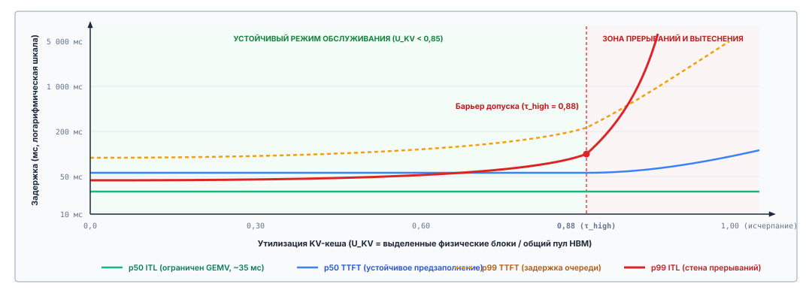
***Стена вытеснения и прерываний: задержка против заполненности KV-кеша**: Деградация задержки по режимам утилизации KV-кеша. Пока $p50$ ITL и $p50$ TTFT остаются ровными в нормальных рабочих полосах ($U_{\text{KV}} < 0{,}85$), переход через барьер допуска ($\tau_{\text{high}} = 0{,}88$) вызывает синхронные остановки подкачки и каскады прерываний, резко увеличивая хвостовую задержку $p99$ за стеной прерываний.*

Как показано на профиле производительности, межтокенная задержка активного потока определяется временем, которое требуется, чтобы передать веса модели и блоки KV из HBM во время матрично-векторного умножения (GEMV); пока физические блоки резидентны в памяти ускорителя, $p50$ ITL не зависит от общего числа выделенных блоков.

Хвостовые метрики резко расходятся, когда утилизация входит в зону прерываний. Когда всплеск одновременных выдач токенов пытается выделить блоки из исчерпанного пула ($U_{\text{KV}} \to 1{,}0$), движок вынужден выполнить синхронное смягчение. При политике выгрузки среда выполнения выбирает траектории-жертвы, приостанавливает их выполнение и переносит их физические страничные блоки по шине PCIe в DRAM хоста. Хотя это предотвращает аварийные остановки из-за нехватки памяти, задержка передачи от хоста к устройству вносит простои и в активный, и в приостановленный поток. Если же движок использует политику пересчета, вытесненные блоки отбрасываются; когда приостановленная траектория возобновляется, движку приходится заново выполнить фазу предзаполнения по всей накопленной длине последовательности, превращая шаг декодирования длительностью двадцать миллисекунд в многосекундную остановку предзаполнения. В результате, пока $p50$ ITL остается ограниченным тридцатью миллисекундами, $p99$ ITL взлетает за несколько секунд, прямо нарушая гарантии отзывчивости, которых требуют интерактивные супервизорные циклы агентов.

Чтобы предотвратить этот коллапс задержки, устойчивые архитектуры обслуживания агентов внедряют многоуровневое управление допуском, связанное с телеметрией памяти. Система обслуживания отслеживает и мгновенную утилизацию $U_{\text{KV}}$, и скорость роста контекста по всем активным потокам. Вместо того чтобы допускать полное насыщение пула физических блоков, планировщик задает потолок допуска на уровне $\tau_{\text{high}}$. Когда утилизация превышает этот барьер, новые ходы агентов ставятся во внешнюю очередь планирования, а спекулятивное ветвление внутри активных траекторий временно блокируется. Обменивая задержку постановки в очередь новых запросов на катастрофическую деградацию хвостовой задержки выполняющихся операций, инфраструктура сохраняет целостность физической памяти и не дает активным траекториям агентов скатиться в пропасть подкачки памяти.

---

Умение точно выделять физическую память и управлять динамическим выделением кеша гарантирует, что отдельный узел обслуживания способен поддерживать плотные траектории агентов, не поддаваясь исчерпанию памяти. Однако даже когда оператор инфраструктуры рассчитывает оборудование с математической точностью и задает строгие границы допуска, производственные развертывания нередко страдают от системной деградации, коренящейся не в физических ограничениях оборудования, а в ошибочных операционных допущениях. Инженеры регулярно попадают в ловушки архитектурных заблуждений о том, как память внимания ведет себя при производственном масштабе: предполагая, что линейное расширение контекста подразумевает линейный рост памяти, что дедупликация префиксов универсально полезна независимо от политики замещения в кеше или что виртуализация устраняет необходимость сквозного планирования емкости. Развенчание этих базовых заблуждений необходимо, чтобы перекинуть мост между теоретической виртуализацией памяти и надежными производственными системами.

<a id="sec-vol3-kv-cache-fallacies"></a>

## Заблуждения и ловушки

Проектирование систем виртуализированной памяти внимания требует согласовать детерминированную механику аллокаторов высокоскоростной памяти со стохастическими, немонотонными паттернами выполнения сред выполнения автономных агентов. Поскольку физический KV-кеш абстрагирует сырые тензоры оператора авторегрессионного внимания в несмежные таблицы блоков и общие деревья Radix, архитекторы систем часто переносят привычные абстракции баз данных или виртуальной памяти на структуры, которые подчиняются совершенно иным физическим и математическим ограничениям.

Когда эти концептуальные проекции ломаются под производственной нагрузкой, сбои проявляются не в виде чистых исключений на этапе компиляции или локальных паник времени выполнения. Вместо этого они порождают катастрофическую пробуксовку системы, незаметную эпистемическую порчу и тяжелый коллапс хвостовой задержки в многоарендной среде. Этот раздел разбирает четыре повсеместных заблуждения и ловушки, которые возникают при соединении низкоуровневого кеширования внимания с высокоуровневым выполнением агентов.

> **Заблуждение и ловушка**
>
> **Заблуждение:** *KV-кеш — это второй слой семантической памяти агента.*
>
> Распространенное архитектурное заблуждение рассматривает физический KV-кеш движка вывода как промежуточный слой семантического хранения, расположенный иерархически между временным логическим окном контекста и долговечными внешними базами данных. С этой точки зрения, поскольку кеш сохраняет вычисленные математические представления ранее обработанных токенов через несколько диалоговых ходов, инженеры предполагают, что он функционирует как запрашиваемая, изменяемая или проверяемая эпизодическая память о фактах задачи. Системы, построенные на этом допущении, пытаются проверять кешированные состояния внимания на наличие фактических утверждений, выполнять точечную хирургию кеша, чтобы обновить устаревшие состояния мира, или полагаться на присутствие данных в кеше, чтобы гарантировать семантическую непрерывность в распределенных задачах агентов.
>
> Эта посылка смешивает математическое ускорение инвариантного оператора с сохранением семантического состояния. Векторы ключей и значений, которые хранятся в высокоскоростной памяти ускорителя, — это промежуточные линейные проекции, порожденные в прямом проходе каждого слоя трансформера. Для траектории агента в позиции токена $i$, при входе слоя $\mathbf{x}_i^{(l)} \in \mathbb{R}^{d_{\text{model}}}$, кешированные записи равны $\mathbf{k}_i^{(l)} = \mathbf{x}_i^{(l)} \mathbf{W}_K^{(l)}$ и $\mathbf{v}_i^{(l)} = \mathbf{x}_i^{(l)} \mathbf{W}_V^{(l)}$. Когда применяются ротационные позиционные эмбеддинги (Rotary Position Embeddings, RoPE), каждый вектор ключа $\mathbf{k}_i^{(l)}$ поворачивается в двумерных координатных срезах ортогональной матрицей $\mathbf{R}_{\Theta, i}^d$, неразрывно связывая активацию с ее абсолютным индексом последовательности $i$.
>
> Эти кешированные тензоры не имеют независимой семантической адресуемости. Сохраненный вектор ключа $\mathbf{k}_i^{(l)}$ нельзя запросить, чтобы проверить, остается ли действительным присваивание переменной, и вектор значения $\mathbf{v}_i^{(l)}$ нельзя выделить, чтобы обновить истекшие учетные данные API или изменить факт окружения. Представление имеет операционный смысл только тогда, когда оно объединено в совокупности в вычислении масштабированного скалярного произведения внимания:
>
> $$\mathbf{a}_t^{(l)} = \text{Softmax}\left(\frac{\mathbf{q}_t^{(l)} (\mathbf{K}_{1:t}^{(l)})^T}{\sqrt{d_{\text{head}}}}\right) \mathbf{V}_{1:t}^{(l)}$$
>
> Поскольку внимание — это коллективный оператор по всему историческому префиксу $1 \dots t$, вырывание изолированного блока активаций KV из одного контекста и вставка его в другой разрушает фазовые позиционные соотношения и ломает межтокенные контекстные зависимости.
>
> Более того, KV-кеш не обеспечивает никакой эпистемической проверки. Он добросовестно материализует и сохраняет промежуточные активации любой строки токенов, которая была подана модели, придавая одинаковый физический статус проверенным выводам инструментов, устаревшим наблюдениям окружения, галлюцинациям модели и враждебным инъекциям в промпт. Рассмотрение KV-кеша как семантической памяти принимает производную величину за хранилище. Состояние внимания — это функция точного префикса токенов (принцип «Состояние внимания выводится из префикса токенов»), поэтому оно не содержит ничего, чего не содержат сами токены, включая их ошибки.
>
> Долговечное семантическое состояние строго относится к детерминированной архитектуре хранения супервизора хоста: внешним реляционным базам данных, журналам упреждающей записи и деревьям артефактов с проверкой схемы. KV-кеш движка вывода — это непривилегированный физический черновик, единственное архитектурное назначение которого — устранить избыточные обобщенные матрично-векторные умножения при авторегрессионном декодировании.

> **Заблуждение и ловушка**
>
> **Ловушка:** *удержание приостановленного состояния в резиденции независимо от времени ожидания.*
>
> Когда траектория автономного агента приостанавливает авторегрессионную генерацию, чтобы вызвать внешний инструмент, запустить подагента или дождаться разрешения человека, супервизор хоста должен решить физическую судьбу KV-кеша этой последовательности. Повсеместная ловушка в развертываниях обслуживания агентов — держать эти физические KV-блоки закрепленными в высокоскоростной памяти (HBM) ускорителя на неопределенный срок в предположении, что сохранение резидентности избавляет от штрафа задержки за пересчет промпта, когда внешний вызов вернется.
>
> Режим отказа этой политики — застрявшая емкость. Рассмотрим нашу каноническую базовую модель с 70 миллиардами параметров и групповым вниманием ($m_{\text{token}} \approx 320\text{ КиБ/токен}$, как сформулировано в [«Дискретное представление токенов»](02_foundation_model.md#sec-vol3-foundation-model-tokenization)). Агент, занятый сложным рефакторингом репозитория с активной длиной контекста $S = 32\,768$ токена, иммобилизует:
>
> $$M_{\text{KV}} = S \cdot m_{\text{token}} = 32\,768 \times 320\text{ КиБ} = 10\,485\,760\text{ КиБ} = 10\text{ ГиБ}$$
>
> Если этот агент запускает асинхронный набор интеграционных тестов в изолированном контейнере песочницы, которому нужно $T_{\text{wait}} = 45\text{ с}$ на завершение, удержание этого выделения в резиденции замораживает 10 ГБ дефицитной емкости ускорителя на три четверти минуты: это налог памяти на ожидание инструмента из [«Простаивание памяти как трение»](01_introduction.md#sec-vol3-intro-memory-stranding) при меньшем контексте. На ускорителе с 80 ГБ HBM эта одна спящая траектория монополизирует 12,5 процента всей физической памяти, не выполнив ни одной операции с плавающей точкой.
>
> При многоарендных нагрузках эта застрявшая емкость лишает активные запросы блоков выделения. Страничный менеджер памяти PagedAttention испытывает искусственное давление на память, что вынуждает планировщик обслуживания откладывать входящие запросы предзаполнения, уменьшать размеры активных пакетов декодирования и запускать непроизвольную превентивную подкачку других выполняющихся запросов.
>
> Экономический и эксплуатационный компромисс глубоко асимметричен. При устойчивой пропускной способности предзаполнения узла из примера о безубыточности в [«Удержание, вытеснение, пересчет или выгрузка»](05_kv_cache.md#sec-vol3-kvcache-swapping) ($R_{\text{prefill}} = 4{,}0 \times 10^{14}\text{ FLOPs/s}$) полный пересчет префикса длиной $32\text{k}$ токенов при возобновлении траектории требует примерно:
>
> $$T_{\text{recomp}} \approx \frac{2 \cdot (70 \times 10^9) \cdot 32\,768}{4{,}0 \times 10^{14}\text{ FLOPs/s}} \approx 11{,}5\text{ с}$$
>
> Выгрузка этих блоков по шине PCIe Gen5 $\times 16$ при эффективной пропускной способности $B_{\text{pcie}} \approx 50\text{ ГБ/с}$ вместо этого потребляет:
>
> $$T_{\text{reload}} = \frac{10\text{ ГиБ}}{50\text{ ГБ/с}} \approx 215\text{ мс}$$
>
> в каждую сторону, поэтому то же преимущество в $53\times$ над пересчетом сохраняется здесь, что и при $16\text{k}$ токенах, потому что отношение не зависит от длины последовательности. Иммобилизация 10 ГБ HBM ускорителя на 45 секунд ради того, чтобы избежать обмена туда и обратно длительностью 430 миллисекунд, — это серьезное неправильное распределение аппаратных ресурсов. Системы должны внедрять политики удержания на основе аренды. Как только ожидаемое время ожидания инструмента превышает время безубыточности $T_{\text{wait}}^*$, выведенное в [«Удержание, вытеснение, пересчет или выгрузка»](05_kv_cache.md#sec-vol3-kvcache-swapping), которое при давлении на память приближается ко времени передачи туда и обратно, среда выполнения обязана снять закрепление с блоков и перенести их в DRAM хоста.

> **Заблуждение и ловушка**
>
> **Заблуждение:** *повторное использование кеша префиксов гарантирует, что контекст актуален.*
>
> В системах с кешированием префиксов на основе дерева Radix инженеры часто предполагают, что раз входящий промпт совпадает с установленным ключом префикса с 100-процентной посимвольной точностью токенов, соответствующие активации внимания представляют собой корректную свежую оценку состояния задачи. Это заблуждение предполагает, что синтаксическая эквивалентность в области токенов гарантирует семантическую актуальность в операционной области.
>
> Кеш префиксов индексирует последовательности по точным векторам идентификаторов токенов $\mathbf{t}_{1:k} = (t_1, t_2, \dots, t_k)$. Он не видит окружение вне полосы, из которого эти токены были первоначально сэмплированы. Рассмотрим агентный процесс, в котором системный промпт включает метаданные рабочей области, переменные окружения или определения схем:
>
> ```yaml
> Система: Ты автоматизированный агент рефакторинга.
> Статус рабочей области: branch=main; clean; HEAD=a1c4f9.
> Активный файл: src/runtime/allocator.c (hash: e4b2...8f).
> ```
>
> Если внешний демон непрерывной интеграции, вторичный рабочий агент или пользователь изменяет `src/runtime/allocator.c` на диске, физическая реальность рабочей области мгновенно расходится с текстовым представлением. Если среда выполнения на хосте подготовит следующий промпт, не аннулировав текст, описывавший старый файл, или ошибочно повторно отправит структуру промпта предыдущего хода, движок обслуживания обнаружит полное совпадение префикса в своем дереве Radix.
>
> Движок мгновенно связывает таблицу физических блоков входящего запроса с историческими узлами KV, полностью обходя вычисление предзаполнения. Головы внимания сопоставляют вновь сгенерированные токены запроса с закешированными промежуточными активациями, которые кодируют устаревшее содержимое файла. Модель генерирует ответы с высокой уверенностью и низкой задержкой, однако ее рассуждение структурно оторвано от текущей фактической истины.
>
> Этот режим отказа возникает также на границах токенизации. Если процедуры сборки промпта динамически конкатенируют строки, не обеспечивая канонического выравнивания границ токенов, одинаковые строки символов могут токенизироваться в расходящиеся последовательности целочисленных токенов в зависимости от завершающих пробелов или знаков препинания. И наоборот, различные промпты могут давать одинаковые подпоследовательности токенов, которые сталкиваются в наивных хеш-таблицах.
>
> Защитой является аннулирование [«Инвалидация контекста»](04_context_engineering.md#sec-vol3-context-engineering-context-rot), примененное там, где живет устаревание. Авторитетен только файл, а каждое производное от него представление (подготовленный текст и состояние внимания, вычисленное из этого текста) устаревает при записи файла (принцип «Авторитет остается у источника»). Среда выполнения помечает устаревшее наблюдение надгробием или обновляет его до следующего вызова. Эта правка меняет токены в позиции наблюдения, поэтому кеш по-прежнему обслуживает стабильный префикс перед ним. Связывание дайджеста рабочей области с началом префикса также сломало бы устаревшее совпадение, но поставило бы самый изменчивый токен первым, против раскладки по возрастанию изменчивости из [«Подготовка следующего вызова»](04_context_engineering.md#sec-vol3-context-engineering-staging), и каждая запись файла аннулировала бы всю закешированную ветвь.

> **Заблуждение и ловушка**
>
> **Ловушка:** *планирование емкости по изолированным средним запросам.*
>
> Инженеры инфраструктуры, рассчитывающие кластеры ускорителей для агентного обслуживания, регулярно вычисляют требования к оборудованию по классической теории очередей, параметризованной средними длинами последовательностей и независимыми пуассоновскими поступлениями. Они вычисляют средний объем промпта $\bar{S}_{\text{prompt}}$, среднюю длину генерации $\bar{S}_{\text{gen}}$, умножают сумму на средний объем памяти на токен $\bar{m}_{\text{token}}$ и делят доступную HBM ускорителя на это статическое среднее, чтобы определить пределы параллелизма для многоарендной среды.
>
> Эта методика расчета терпит катастрофический провал, когда ее применяют к агентным нагрузкам. Агентные взаимодействия нарушают все стандартные допущения о процессах поступления без памяти и одинаково распределенных. Они обладают двумя структурными явлениями, которые заставляют физическую заполненность KV-кеша резко отклоняться от гауссовых распределений:
>
> 1. **Коррелированное ветвление траекторий:** при таких стратегиях поиска, как исследование дерева рассуждений, спекулятивное выполнение или дебаты нескольких агентов, один корневой запрос динамически порождает $B$ параллельных ветвей. Хотя PagedAttention разделяет общие корневые блоки префикса между всеми $B$ траекториями через подсчет ссылок, приватные листовые выделения для каждой ветви растут одновременно:
>    $$M_{\text{branching}} = M_{\text{root}} + \sum_{b=1}^{B} S_{\text{gen}, b} \cdot m_{\text{token}}$$
>    Одна задача может внезапно увеличить потребление памяти на порядок за десятки шагов декодирования, создавая массивные коррелированные ступенчатые всплески спроса на память, которые выходят далеко за пределы запаса для среднего случая.
>
> 2. **Раздувание параллелизма из-за ожидания инструментов:** по закону Литтла среднее число одновременно активных запросов в стабильной системе равно $N = \lambda W$, где $\lambda$ — интенсивность поступления, а $W$ — полное время пребывания. В обычном выводе без состояния $W$ строго равно длительности генерации ($S_{\text{gen}} / \text{decode\_throughput} \approx 2\text{--}8\text{ с}$). В агентной системе, где циклы выполнения включают вызовы компиляторов, проходы линтеров, опрос API и транзакции баз данных, время пребывания расширяется, включая состояния ожидания внешних систем:
>    $$W_{\text{agent}} = T_{\text{generation}} + T_{\text{tool\_wait}}$$
>    Где $T_{\text{tool\_wait}}$ обычно лежит в диапазоне от 15 до 120 секунд. Если среда обслуживания удерживает KV-кеши в резиденции через эти паузы, эффективный параллелизм $N$ растет в 5–20 раз при точно той же интенсивности поступления входящих запросов $\lambda$.
>
> Когда динамическая заполненность памяти приближается к физической границе HBM ускорителя (порог насыщения $\mu \to 1$), дисперсия этого распределения с тяжелым хвостом вызывает нелинейные очередные задержки. Движок обслуживания исчерпывает пул свободных физических блоков. Входящие запросы предзаполнения не могут получить начальные таблицы блоков и останавливаются на границе допуска. Одновременно активные циклы авторегрессионного декодирования останавливаются на середине генерации, потому что аллокатор не может отобразить физические блоки для вновь сгенерированных токенов.
>
> Этот коллапс в насыщение памяти иллюстрирует профиль временного ряда на [«Насыщение памяти и граница пробуксовки кеша»](05_kv_cache.md#fig-vol3-thrashing-curve). При стандартных независимых потоках запросов заполненность памяти устойчиво держится ниже безопасного рабочего потолка $80\%$. Напротив, агентная нагрузка, испытывающая коррелированное ветвление (например, исследование дерева рассуждений) и раздувание параллелизма из-за ожидания инструментов, демонстрирует быстрый рост заполненности ступенчатого типа. Спрос на память пробивает рабочий потолок $80\%$ при $t \approx 55\text{ с}$ и сталкивается с физической границей пробуксовки $100\%$ при $t \approx 72\text{ с}$. В этот момент движок обслуживания вынужден перейти к каскадным аварийным превентивным вытеснениям, вытесняя активные потоки декодирования и обрезая спящие блоки префиксов. Это обрушивает долю попаданий в кеш префиксов и запускает бесконечную волну полных пересчетов промптов, которые постоянно насыщают тензорные ядра ускорителя.
>
> <a id="fig-vol3-thrashing-curve"></a>
>
> 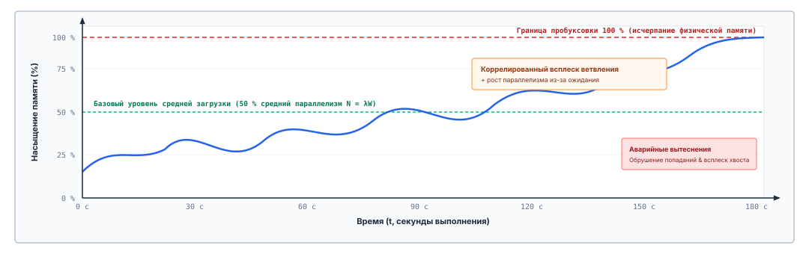
> ***Насыщение памяти и граница пробуксовки кеша**: Динамическая заполненность памяти во времени при сравнении стационарного диалогового трафика с агентными нагрузками, подверженными коррелированному ветвлению и раздуванию параллелизма из-за ожидания инструментов. Пересечение физической границы 100 процентов запускает каскадные вытеснения и катастрофическую пробуксовку.*
>
> Чтобы устранить голодание памяти, среда выполнения должна выполнить аварийное вытеснение, принудительно вытесняя или подкачивая активные последовательности. Вытеснение общих узлов префикса разрушает долю попаданий в кеш для последующих ходов, а приостановка активных декодирований вынуждает впоследствии дорогостоящие полные пересчеты. Система входит в состояние устойчивой пробуксовки: утилизация вычислений ускорителя обрушивается, потому что тензорные ядра тратят свои такты на пересчет вытесненных промежуточных состояний вместо обработки новых токенов.
>
> Хотя средние метрики задержки в непиковые периоды могут выглядеть приемлемо, 99-й и 99,9-й перцентили времени до первого токена (TTFT) и межтокенной задержки (ITL) взлетают на несколько порядков. Надежное выделение емкости должно моделировать агентные нагрузки бимодальными распределениями с тяжелым хвостом, рассчитывать пулы памяти на пиковый параллелизм ветвления и задавать строгий сброс допуска задолго до того, как физическая HBM достигнет насыщения.

---

Заблуждения и ловушки, разобранные выше, подчеркивают фундаментальную системную истину: физический KV-кеш — это ни автономная база знаний, ни эластичный ресурс, которым можно управлять наивными эвристиками. Устранение этих режимов отказа требует выхода за пределы разрозненных оптимизаций и объединения всей иерархии памяти в единую архитектурную структуру. Чтобы показать, как виртуализация памяти, дедупликация префиксов, порционное планирование и динамическое вытеснение складываются в надежный слой выполнения, перейдем далее к итогам главы.

<a id="sec-vol3-kv-cache-summary"></a>

## Итоги

Система обслуживания выделяет и повторно использует физическое состояние внимания активных траекторий, отделяя логическую последовательность токенов от физической раскладки высокоскоростной памяти (HBM), виртуализируя выделение тензоров через несмежные страничные блоки и распределяя выполнение между асимметричными арифметическими требованиями фаз предзаполнения и декодирования. Управление KV-кешем — по сути задача распределения ресурсов ускорителя, архитектурно отделенная как от выбора логического контекста средой выполнения, так и от долговечных слоев хранения хост-приложения. Физический KV-кеш — это промежуточный производный тензор активаций, порожденный проецированием токенов контекста через статические весовые проекции ($W_K, W_V$). Он существует ради одной эксплуатационной цели: обменять емкость HBM ускорителя на арифметическую пропускную способность в авторегрессионном цикле декодирования, заменив на каждом шаге пересчет внимания $\mathcal{O}(S^2)$ матрично-векторным произведением $\mathcal{O}(S)$, ограниченным памятью.

Из физической геометрии современных трансформерных архитектур следует, что состояние внимания каждого токена потребляет фиксированный объем памяти ускорителя, $m_{\text{token}} = 2 \cdot L \cdot H_{\text{kv}} \cdot d_{\text{head}} \cdot b_{\text{elem}}$ байт, где $L$ — число слоев трансформера, $H_{\text{kv}}$ — число голов ключей и значений при групповом или многозапросном (multi-query) внимании, $d_{\text{head}}$ — размерность проекции на одну голову, а $b_{\text{elem}}$ — формат числовой точности в байтах. Поскольку агентные нагрузки вносят динамическое, немонотонное расширение последовательностей через рекурсивные вызовы инструментов, многоходовые диалоговые циклы и спекулятивные прогоны траекторий, статическое выделение памяти под наихудшую длину последовательности ($S_{\max}$) растрачивает до 80 процентов памяти ускорителя на внутреннюю и внешнюю фрагментацию. Виртуализация этого пространства через страничное выделение отображает логические смещения токенов на произвольные физические страничные кадры через таблицы блоков для каждого запроса, ограничивая внутреннюю фрагментацию хвостом последнего блока и полностью устраняя внешнюю фрагментацию. Распространение этой виртуализации блоков на кеширование префиксов через деревья Radix позволяет совместно использовать физические страницы между ветвящимися траекториями и общими каркасами промптов, давая системе обслуживания обходить избыточные вычисления предзаполнения без дублирования базовых выделений тензоров.

Балансировка этих страничных структур при высоком многоарендном параллелизме порождает дополняющую задачу планирования. Поскольку предзаполнение контекста работает как вычислительно ограниченное матричное умножение (GEMM), а декодирование токенов как матрично-векторное умножение (GEMV), ограниченное пропускной способностью памяти, неограниченные предзаполнения вызывают тяжелую блокировку начала очереди, ухудшающую задержку декодирования. Порционное планирование предзаполнения смягчает эту интерференцию, нарезая поступающие последовательности на ограниченные вычислительные фрагменты и совмещая их с пакетными шагами декодирования, чтобы стабилизировать межтокенные задержки. Когда насыщение памяти вынуждает к вытеснению, система должна оценить, сохранять ли резидентность, записывать ли страницы в DRAM хоста по PCIe, пересчитывать ли состояния по требованию или вытеснить окончательно. Поскольку состояния KV полностью производны от своих токенов промпта, вытеснение влечет вычислительную стоимость пересчета, а не потерю долговечного состояния, что задает предсказуемый компромисс между пропускной способностью шины ускорителя, емкостью памяти и задержкой обработки.

> **Виртуализируйте активацию, освободите ускоритель**
>
> 1. **Объем KV определяется геометрией модели, длинами последовательностей и текущим параллелизмом.** Физическая стоимость хранения на токен $m_{\text{token}} = 2 L H_{\text{kv}} d_{\text{head}} b_{\text{elem}}$ строго определяется архитектурой модели и точностью. В средах обслуживания агентов большое число токенов и многоходовые траектории быстро переводят выполнение из вычислительно ограниченного матричного умножения (GEMM) на предзаполнении в матрично-векторные операции (GEMV), ограниченные пропускной способностью памяти, на декодировании, делая емкость HBM ускорителя основным потолком общего параллелизма системы.
> 2. **Страничное выделение и совместное использование точных префиксов устраняют искусственную фрагментацию и избыточные вычисления.** Отображение логических последовательностей токенов переменной длины на несмежные физические блоки памяти устраняет внешнюю фрагментацию и ограничивает внутреннюю фрагментацию хвостовым блоком. Организация переиспользуемых физических блоков в префиксные деревья (такие как деревья Radix) позволяет совместное использование с копированием при записи между ветвящимися траекториями и общими системными промптами, существенно сокращая время до первого токена ($TTFT$) без изменения выходов модели.
> 3. **Политики планирования и вытеснения — это решения о задержке, управляемые нагрузкой.** Фазы предзаполнения и декодирования напрямую конкурируют за пропускную способность шины памяти ускорителя и вычислительные блоки. Нарезка оценок промптов на порционные бюджеты предзаполнения уравновешивает пропускную способность предзаполнения с хвостовыми задержками декодирования ($ITL$). Когда давление на память достигает пика, выбор между удержанием, выгрузкой по PCIe или вытеснением с последующим пересчетом кешированных блоков зависит от распределений поступлений, стоимости передач памяти и эмпирической вероятности возобновления траектории.
> 4. **Вытеснение состояния KV влияет на стоимость пересчета, а не на долговечное знание задачи.** KV-кеш — это энергозависимая, переходная оптимизация ускорителя, а не авторитетный слой хранения. Вытеснение или подкачка физических таблиц страниц под давлением памяти вносит штраф задержки, если траектория агента возобновляется, но не приводит к потере корректности системы; любое вытесненное состояние внимания может быть порождено заново, с точностью до бита, из исходной последовательности токенов.

Страничная организация, совместное использование префиксов и выгрузка опираются на одно свойство состояния внимания (принцип «Состояние внимания выводится из префикса токенов»). Оно является функцией точного префикса токенов, поэтому его можно разделять только между идентичными префиксами и в любой момент пересобрать из токенов. Это свойство объясняет, почему вытеснение влечет пересчет и никогда не влечет потерю знания задачи, и почему отношение времени перезагрузки к времени пересчета не зависит от длины последовательности, что позволило главе свести решение о паузе к одному времени безубыточности. Оно же объясняет, почему среда выполнения на хосте может рассуждать шагами, вызовами инструментов и траекториями, тогда как движок обслуживания трактует их состояние внимания как байты, которые страничная организация, совместное использование или сброс выбирают по стоимости.

> **От состояния обслуживания к долговечной информации**
>
> Физическое состояние внимания по определению энергозависимо и локально: оно привязано ко времени жизни активного запроса обслуживания вывода, связано с конкретным кластером GPU или TPU и уничтожается всякий раз, когда процесс завершается или контекст сессии вытесняется. Однако реальным автономным агентам нужно сохранять устойчивую идентичность на протяжении дней, переживать сбои системы, координировать переходы состояний между распределенными подагентами и рассуждать над кодовыми базами объемом в несколько гигабайт, которые намного превышают физическую емкость любой подсистемы памяти ускорителя.
>
> Разрешение этого противоречия требует разделения преходящего ускорения на ускорителе и авторитетного долгосрочного хранения. Если эта глава решила физическое выделение и повторное использование энергозависимых активаций KV внутри движка вывода, то глава [«Долговременная память»](06_long_term_memory.md#sec-vol3-long-term-memory) исследует долговечный информационный слой: постоянные векторные хранилища, реляционные базы данных, инвертированные поисковые индексы и динамические конвейеры извлечения. KV-кеш хранит производное состояние внимания, которое движок может отбросить в любой момент. Долговечное хранилище хранит исходные записи, и его задача — фиксировать, упорядочивать и предоставлять их агентам на неограниченных операционных горизонтах.
