<a id="sec-vol3-tool-calling"></a>

# Вызов инструментов

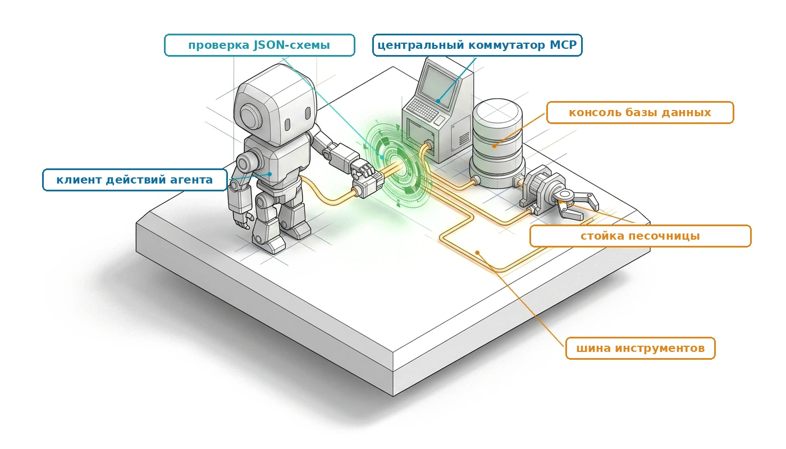

## Назначение

_Почему вызов инструмента, который разбирается без ошибок, все равно нуждается в среде выполнения между собой и внешним миром?_

Вызов инструмента со стороны модели — это несколько десятков токенов, которые называют функцию и ее аргументы, и ничто в этих токенах не решает, должна ли функция выполняться, выполнялась ли она уже и что модель увидит по завершении. Агент, который перезапускает сервер, списывает деньги с карты или запускает набор тестов через такой вызов, отказывает так, как не может отказать один вызов модели. Таймаут оставляет исход эффекта неизвестным, а слепой повтор его дублирует; сервер инструментов объявляет операции, которых сессия не должна была получить; одна многословная команда заливает следующий ход мегабайтами вывода, и они вытесняют саму задачу. Модель не видит всего этого напрямую, только текст, который ей вернули, поэтому защита должна жить в среде выполнения, которая стоит между вызовом и следующим ходом. Вызов инструментов — место, где впервые становится реальной экспозиция полномочий H·S·A, и требуемое замыкание растет вместе с полномочиями: от операций чтения, которые все еще могут утечь данные, через мутации, повторы которых должны быть урегулированы, до необратимых действий, которые ждут одобрения.

> **Цели обучения**
>
> - Проследить вызов инструмента от вывода модели через проверку, авторизацию, диспетчеризацию и наблюдение до следующего хода.
> - Спроектировать дескриптор инструмента, чьи типы, описания, класс побочных эффектов и сообщения об ошибках позволяют модели вызвать его правильно и исправить собственную ошибку.
> - Объяснить, почему обнаружение инструментов устанавливает, что инструмент существует, но никогда не то, что сессии разрешено его вызывать, и применять выдачу полномочий на каждый вызов против отравленных описаний.
> - Применять ключи идемпотентности и зонды сверки состояния, чтобы определить исход мутирующего вызова, по которому истек таймаут, до любого повтора.
> - Вычислять стоимость необработанного наблюдения в токенах и долларах и проектировать усечение, пагинацию и структурированные ошибки, которые ее ограничивают.
> - Выбирать между блокирующими вызовами и дескрипторами заданий для долго работающих инструментов, сравнивая опрос с возобновлением по событиям.
> - Оценивать каталог инструментов по размеру, глубине и формату вызова относительно ошибок выбора, токенов схем и полномочий, которые несет каждый инструмент.

<a id="sec-vol3-tool-calling-unix-analogy"></a>

## Архитектура подсистемы инструментов

Агенту поручено перезапустить контейнер на промежуточном сервере (staging). Он выдает короткий вызов инструмента. Среда выполнения на стороне хоста сверяет вызов со схемой инструмента, убеждается, что эта сессия вправе перезапускать именно этот контейнер, и отправляет `POST /containers/srv-stage-04/restart`. Через две секунды сокет истекает по таймауту. Контейнер мог вовсе не получить запроса, мог упасть на полпути во время перезапуска или перезапуститься чисто и потерять только ответ. Повтор безвреден в первом случае и перезапускает исправных рабочих в третьем, а из таймаута не видно, какой случай имел место.


*Ось полномочий, замкнутая на границе инструмента: каждый предложенный вызов проходит посредничество.*

Каждый шаг этой последовательности происходит на границе инструмента, и ни один из них не может произойти внутри модели. Модель не держит никаких неявных полномочий ([«Момент агентных систем»](01_introduction.md#sec-vol3-intro-operational-incident)), поэтому каждый шаг выполняет среда выполнения, а шестифазный жизненный цикл ([«Шесть фаз жизненного цикла исполнения»](01_introduction.md#sec-vol3-intro-execution-lifecycle)) фиксирует, где эти шаги стоят в ходе: от авторизации действия через диспетчеризацию средой выполнения до фиксации свидетельств. В терминах [«Экспозиций H·S·A»](01_introduction.md#sec-vol3-intro-hsa) эта граница — место, где среда выполнения замыкает экспозицию полномочий, потому что каждое право, которым располагает задача, от чтения до необратимого действия, проверяется здесь до того, как что-либо будет запущено. Эта глава добавляет то, что жизненный цикл оставил абстрактным, когда предложение называет реальный инструмент на реальной конечной точке. Она дает каждому инструменту типизированный дескриптор, сохраняет авторизацию на стороне хоста, чтобы сервер инструментов не мог выдать себе доступ, объявив его, урегулирует каждую диспетчеризацию до любого повтора и возвращает каждое наблюдение ограниченным и типизированным, сколько бы инструмент ни печатал.

У задачи среды выполнения есть известный прецедент: система разделения времени UNIX Дениса Ритчи и Кена Томпсона (1974), которая объединила разнородное физическое оборудование под одной полиморфной абстракцией операционной системы. Объявив, что «все является файлом», UNIX отделил прикладные программы в пользовательском пространстве от своеобразных карт регистров и временных ограничений аппаратуры дисковых пластин, последовательных терминалов и магнитных лент. Приложения взаимодействуют исключительно с абстрактными целочисленными дескрипторами, которые называются файловыми дескрипторами и открывают единый операционный контракт (`open`, `read`, `write`, `close`, `ioctl`). Ядро операционной системы ведет собственную таблицу файловых дескрипторов для каждого процесса, проверяет полномочия вызывающей стороны и направляет единые запросы специализированным драйверам устройств.

В агентной архитектуре мы видим современный прецедент проектирования: «все является диспетчеризацией инструмента через RPC». Разнородные внешние ресурсы, такие как компиляторы, движки баз данных, конечные точки веб-поиска, локальные файловые системы и удаленные микросервисы, абстрагируются в единый каталог типизированных дескрипторов инструментов, которым управляет среда выполнения агента. Однако не следует принимать этот прецедент за буквальное аппаратное соответствие. Процесс операционной системы исполняет машинные инструкции напрямую, с прямым доступом к памяти, и попадает в кольцо 0 через аппаратно обеспеченные кольца привилегий процессора. Авторегрессионная языковая модель, напротив, лишь выдает кандидатную последовательность токенов в буфер памяти, которым управляет хост. Роль надзорного ядра и драйвера устройства играет среда выполнения на стороне хоста: она интерпретирует строки кандидатных токенов, проверяет их структурную целостность, переводит их в конкретные удаленные процедурные вызовы и возвращает структурированные наблюдения обратно через границу памяти.

Среда выполнения, которая пропустила бы эту интерпретацию и проверку и передала бы сгенерированные строки интерпретатору `eval()` или оболочке POSIX, унаследовала бы и лексические дефекты свободного текста (неэкранированные метасимволы оболочки, некорректные списки аргументов, галлюцинированные флаги командной строки), и потолок надежности разомкнутого контура из раздела [«Растяжение времени»](01_introduction.md#sec-vol3-intro-temporal-stretching). Вместо этого среда выполнения обеспечивает *полное посредничество* — требование, сформулированное в 1975 году: каждый доступ к каждому объекту должен проверяться на полномочия (Saltzer and Schroeder, 1975). На границе инструмента полное посредничество уточняет фазы с 3 по 5 жизненного цикла, превращая их в четыре стадии.

Первая стадия — *проверка предложения по схеме*. Среда выполнения на стороне хоста перехватывает поток кандидатных токенов, который выдала модель, разбирает сериализованную полезную нагрузку на границе памяти и строго проверяет предложенные аргументы по заранее зарегистрированной схеме интерфейса. Синтаксические искажения, отсутствующие обязательные поля и значения вне допустимых границ отклоняются на границе памяти, до того как открыт сетевой сокет или запущен внешний процесс. Вторая стадия — *выдача полномочий и проверка возможностей*. Среда выполнения выступает авторитетным монитором ссылок для модели, которая не держит никаких неявных полномочий. Даже если модель предлагает синтаксически безупречную команду, среда выполнения проверяет, есть ли у активной агентной сессии явные выданные возможности на целевую операцию, и обеспечивает ограничения только на чтение, политики изоляции путей и ограничения частоты. Третья стадия — *диспетчеризованное исполнение*. Проверенная и авторизованная операция передается изолированному внешнему драйверу или конечной точке RPC. Среда выполнения управляет сетевыми таймаутами, отслеживает задержки исполнения и ведет дескрипторы процессов, не останавливая основной надзорный цикл. Четвертая стадия — *нормализация наблюдения и подготовка контекста*. Среда выполнения захватывает сырую разнородную телеметрию внешней среды: потоки стандартного вывода, коды возврата, диагностические трассы или структурированные ответы JSON. Она очищает управляющие символы, накладывает противодавление и строгие границы усечения токенов, чтобы не допустить исчерпания контекста ускорителя, и заворачивает результат в авторитетный конверт наблюдения, который возвращается в рабочую память модели. [«Схемы интерфейса инструментов»](07_tool_calling.md#sec-vol3-tool-calling-schemas) и [«Совместимое обнаружение инструментов»](07_tool_calling.md#sec-vol3-tool-calling-mcp) развивают первые две стадии, [«Выполнение идемпотентных действий»](07_tool_calling.md#sec-vol3-tool-calling-idempotency) и [«Асинхронная диспетчеризация инструментов»](07_tool_calling.md#sec-vol3-tool-calling-async) — третью, а [«Усечение потока наблюдений»](07_tool_calling.md#sec-vol3-tool-calling-streaming) и [«Санитизация вывода терминала»](07_tool_calling.md#sec-vol3-tool-calling-observation-parsing) — четвертую.

<a id="dfn-complete-mediation"></a>

> **Определение: полное посредничество**
>
> ***Полное посредничество*** — это архитектурный инвариант безопасности, который требует, чтобы каждый кандидатный токенный выход, предлагающий изменение среды, проходил через непреодолимый надзорный конвейер проверки до физического исполнения.
>
> 1.  **Значение**: гарантирует, что стохастические выходы непривилегированной модели не могут обойти проверки возможностей, подменить процессы хоста или выполнить непроверенные побочные эффекты, так что нулевые неявные полномочия модели сохраняются на каждой границе среды.
> 2.  **Отличие**: в отличие от классического посредничества системных вызовов ОС (которое проверяет статические биты UID/GID при синхронных переключениях контекста), агентное полное посредничество проверяет динамическое соответствие схеме, криптографические аренды возможностей и токены повторного воспроизведения идемпотентности до диспетчеризации в изолированные песочницы исполнения.
> 3.  **Типичная ловушка**: опора на управление промптом («Ты не должен выполнять опасные команды оболочки») или на непосредственные скрипты-обертки, которые позволяют инъекции промпта или галлюцинации инструментов напрямую компрометировать ресурсы хоста.

Полная архитектура посредничества, которая управляет исполнением инструментов, систематизирована по кольцам защиты в [«Граница привилегий системных вызовов ИИ»](07_tool_calling.md#fig-vol3-ai-system-call-boundary). В кольце 3 (пользовательское пространство) непривилегированная базовая модель, которая не держит никаких неявных полномочий, порождает кандидатные токены вызова инструментов, которые удерживаются в регистре эскроу, а не выполняются напрямую над интерфейсами операционной системы хоста. Когда полная последовательность вызова выдана, регистр инициирует программную ловушку системного вызова ИИ (`SYS_TOOL_CALL`) и передает управление через границу привилегий в кольцо 0 (надзорное пространство). Надзорный компонент хоста направляет кандидатную полезную нагрузку через четыре последовательных шлюза проверки: (1) фильтр DFA грамматики, который навязывает маскирование логитов с ограничением по схеме ($P(\text{syntax\_err}) = 0$, [«Декодирование с грамматическими ограничениями»](02_foundation_model.md#sec-vol3-foundation-model-grammar-constrained)); (2) строгий десериализатор ABI, который наполняет типизированные структуры, проверяя границы памяти; (3) проверяющий возможностей и аренд, который валидирует криптографические токены HMAC и списки допустимых путей, чтобы парировать эксплуатацию обхода каталогов; и (4) движок идемпотентности и повторов, который сверяет нонс траектории $k_{\text{idem}}$ с журналом упреждающей записи. Эти шлюзы — более мелкие шаги внутри трех первых стадий, описанных выше, а не второй жизненный цикл. Только после прохождения всех четырех шлюзов надзорный компонент диспетчеризует авторизованные вызовы в изолированные домены исполнения (например, микро-ВМ Firecracker, контейнеры gVisor или корпоративные API-шлюзы). Когда физическое исполнение завершено, поток наблюдений и код возврата поднимаются обратно переходом `SYSRET`, возобновляя работу непривилегированной модели с авторитетным конвертом наблюдения, подготовленным в рабочей памяти. Параллельно [«Дескрипторы файлов UNIX против дескрипторов инструментов агента»](07_tool_calling.md#tbl-vol3-tool-descriptors) систематизирует эту структурную двойственность, сравнивая классическую архитектуру файловых дескрипторов UNIX с таблицей дескрипторов инструментов агента.

<a id="fig-vol3-ai-system-call-boundary"></a>

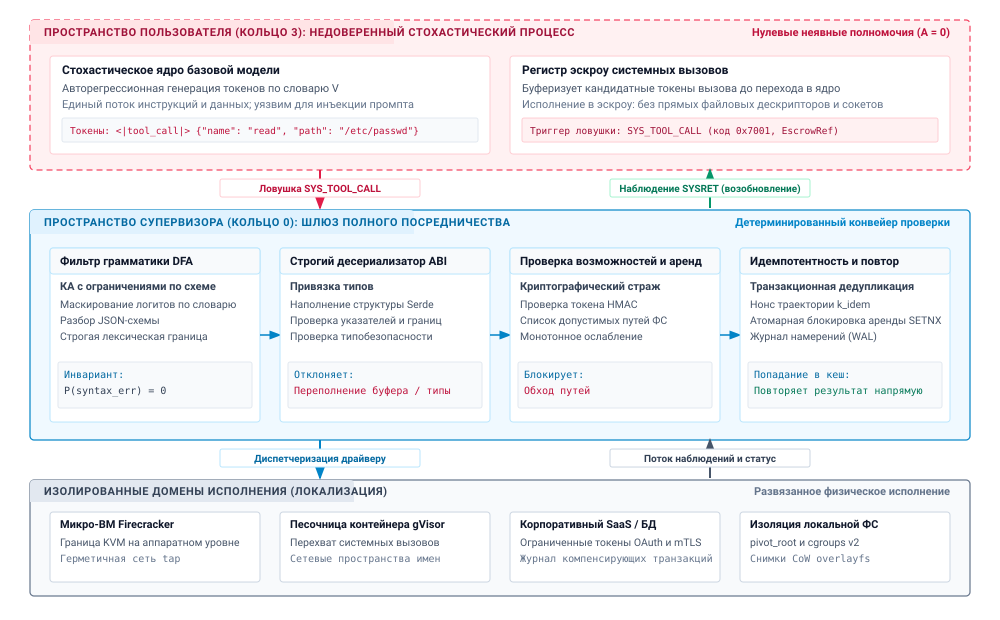
***Граница привилегий системных вызовов ИИ**: архитектурная топология опосредованного исполнения инструментов по кольцам защиты. Непривилегированная модель, которая не держит никаких неявных полномочий, работает в пользовательском пространстве (кольцо 3) и выдает кандидатные вызовы инструментов, удерживаемые в эскроу памяти до передачи управления через ловушку `SYS_TOOL_CALL`. Привилегированный надзорный компонент хоста обеспечивает полное посредничество в пространстве ядра (кольцо 0): он проверяет полезную нагрузку через четыре последовательных шлюза (фильтр DFA грамматики, строгий десериализатор ABI, проверяющий возможностей и аренд и движок идемпотентного повтора), прежде чем диспетчеризовать авторизованные операции в изолированные домены исполнения и вернуть очищенные наблюдения через `SYSRET`.*

| Архитектурное измерение | Таблица файловых дескрипторов UNIX (Ritchie & Thompson 1974) | Таблица дескрипторов инструментов агента (надзорный компонент хоста) |
|:-------------------------|:---------------------------------------------------------------------------------|:---------------------------------------------------------------------------------------------------------|
| **Дескриптор пространства имен** | Монотонный целочисленный индекс (`int fd`), адресующий закрытую таблицу ядра для каждого процесса. | Структурированный идентификатор инструмента в виде строки или перечисления, связанный с активным каталогом контекста. |
| **Полиморфный контракт** | Единые операции с байтовым потоком (`open`, `read`, `write`, `close`, `ioctl`). | Типизированная схема параметров, которая проверяет структурированные аргументы и возвращает конверты наблюдений. |
| **Модель полномочий** | Разрешения POSIX (`rwxrwxrwx`), UID/GID процесса и наборы возможностей ОС. | Явные токены возможностей, декларативные политики контроля доступа и нулевые неявные полномочия модели. |
| **Канал вызова** | Аппаратное прерывание или программная ловушка (`int 0x80`, `syscall`), переводящая выполнение в кольцо 0. | Авторегрессионная генерация токенов, разобранная через границу памяти надзорного компонента в локальный или удаленный RPC. |
| **Состояние исполнения** | Управляемые ядром указатели смещения в байтах, vnode и буферные кеши операционной системы. | Дескрипторы исполнения без состояния или с отслеживанием аренды, ключи идемпотентности и окна буфера вывода. |
| **Телеметрия и статус** | Знаковые целочисленные счетчики байтов или отрицательные коды errno (`ENOENT`, `EACCES`). | Типизированный конверт наблюдения, инкапсулирующий коды возврата, потоки stdout/stderr или кадры ошибок. |

<a id="tbl-vol3-tool-descriptors"></a>

***Дескрипторы файлов UNIX против дескрипторов инструментов агента**: концептуальное сравнение таблицы файловых дескрипторов UNIX и таблицы дескрипторов инструментов агента.*

Это архитектурное разделение переносит основную инженерную задачу на синтаксическую границу между моделью и средой выполнения. Если главный эксплуатационный инвариант надзорного компонента состоит в том, чтобы на первой стадии проверять кандидатные токены по строгим эксплуатационным контрактам, то как эти контракты должны задаваться, чтобы авторегрессионная модель параметризовала их с максимальной точностью? Как соглашения об именовании параметров, явные границы типов, структурные строки документации и ограничения перечислений влияют на распределения логитов при декодировании, и каковы количественные компромиссы между выразительностью схемы и потреблением токенов контекста? Ответ на эти вопросы требует разобрать формальное построение схем интерфейса инструментов.

### Один ход цикла

Модельная половина обмена уже задана. [«Контракт вызова»](02_foundation_model.md#sec-vol3-foundation-model-contract) определил поверхность вызова. Вызов модели может завершиться одним или несколькими структурированными блоками вызова инструмента, каждый из которых несет идентификатор, имя инструмента и аргументы, а также причину остановки, которая говорит, что модель ждет инструментов, а не закончила работу. Дальше начинается половина среды выполнения. [«Ход вызова инструмента»](07_tool_calling.md#lst-vol3-tool-call-turn) показывает три сообщения, из которых состоит один ход цикла, записанные в нейтральной к провайдеру форме.

<a id="lst-vol3-tool-call-turn"></a>

**Один ход цикла вызова инструментов**: вызов модели и результат среды выполнения, сопоставленные по идентификатору вызова, становятся частью истории, которую читает следующий вызов модели.

```json
[
  {"role": "user",
   "content": "Stage-04 is serving a stale config. Restart it."},
  {"role": "assistant", "stop_reason": "tool_use",
   "content": [
     {"type": "text", "text": "Restarting the staging container."},
     {"type": "tool_call", "id": "call_1", "name": "restart_container",
      "arguments": {"container_id": "srv-stage-04"}}]},
  {"role": "tool",
   "content": [
     {"type": "tool_result", "call_id": "call_1",
      "content": {"status": "restarted", "uptime_s": 3}}]}
]
```

Два свойства этого обмена определяют все последующее. Результат сопоставляется с вызовом по идентификатору, а не по позиции, поэтому среда выполнения может возвращать результаты в любом порядке и вернуть ошибку по одному вызову, не проваливая весь ход. Вызов и его результат также остаются в истории. Каждый последующий вызов модели в траектории читает их снова, поэтому наблюдение оплачивается один раз, когда входит в контекст, и еще раз по ставке кешированного префикса на каждом последующем ходе ([«Задержка обслуживания на ускорителе»](02_foundation_model.md#sec-vol3-foundation-model-cost)).

Когда серверный интерфейс возвращает вызовы инструментов как структурированные блоки, среда выполнения читает поля. Когда модель выдает вызовы внутри свободного текста, среда выполнения должна найти и разобрать их, обычно останавливая генерацию на разделителе, и некорректные вызовы становятся обычным сбоем, а не исключением. Декодирование с грамматическими ограничениями ([«Декодирование с грамматическими ограничениями»](02_foundation_model.md#sec-vol3-foundation-model-grammar-constrained)) устраняет сбои разбора в обоих случаях. Оно не устраняет неверное значение, путь за пределами рабочей области или вызов, который сессии не разрешено делать, поэтому проверки среды выполнения стоят после декодирования, а не внутри него.

### Параллельные и принудительные вызовы

Один ход может содержать несколько вызовов. Модель, которой нужны три файла и результат поиска, может запросить все четыре сразу, и среда выполнения может выполнить независимые чтения одновременно и вернуть по одному результату на каждый идентификатор вызова. Параллельные вызовы переносят на среду выполнения два решения. Она не должна считать, что модель упорядочила вызовы, поэтому вызовы, которые трогают один и тот же ресурс, например две записи в один файл, сериализуются или отклоняются, а не выполняются наперегонки. Она также сообщает о сбое по каждому вызову, чтобы один истекший по таймауту чтение не отбрасывал три хороших результата.

Среда выполнения может также ограничивать, вызывает ли модель инструмент вообще. Серверные интерфейсы предоставляют настройку выбора инструмента, которая позволяет модели решать самой, требует какой-либо вызов, требует один названный инструмент или запрещает вызовы. Среда выполнения использует принудительный вызов, чтобы выполнить фиксированный шаг рабочего процесса, то есть детерминированный путь из [«Матрицы архитектурных решений: рабочие процессы против циклов, которыми управляет модель»](01_introduction.md#sec-vol3-intro-workflow-vs-loop), и запрещает вызовы, когда ей нужен окончательный ответ, например после исчерпания бюджета. Принуждение определяет то, что выдает модель. Оно ничего не авторизует, и принудительный вызов проходит через те же проверки, что и любой другой.

### Полное посредничество

Между выходом вызова из модели и поступлением его результата в следующий ход среда выполнения выполняет четыре шага, показанные на [«Цикле вызова инструментов»](07_tool_calling.md#fig-vol3-tool-call-loop). Она проверяет вызов по дескриптору инструмента, авторизует его по полномочиям, которыми владеет сессия, диспетчеризует его и урегулирует исход, а сырой результат формирует в ограниченное типизированное наблюдение. Вызов, который не проходит одну из первых двух проверок, никогда не доходит до инструмента. Он возвращается модели как структурированная ошибка, которая сама является наблюдением, с которым модель может работать. Эти четыре шага уточняют фазы авторизации, диспетчеризации и фиксации свидетельств из [«Шести фаз жизненного цикла исполнения»](01_introduction.md#sec-vol3-intro-execution-lifecycle) для случая, когда предложение называет реальный инструмент на реальной конечной точке.

<a id="fig-vol3-tool-call-loop"></a>

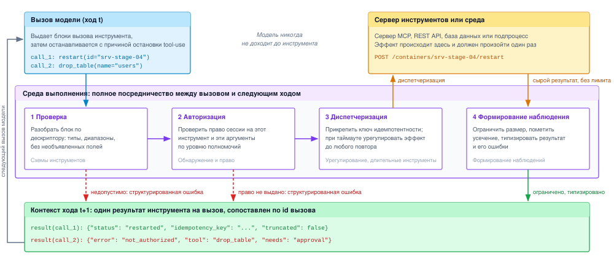
***Цикл вызова инструментов**: вызовы модели проходят четыре шага среды выполнения, прежде чем какой-либо результат попадает в следующий ход. Проверка и авторизация могут отклонить вызов, вернув структурированную ошибку вместо диспетчеризации. Диспетчеризация доходит до сервера инструментов или среды, а сырой результат, который может быть произвольно большим, формируется в ограниченное типизированное наблюдение, сопоставленное с идентификатором вызова.*

Свойство, которым эти шаги должны обладать, — *полное посредничество*, требование, сформулированное в 1975 году: каждый доступ к каждому объекту должен проверяться на полномочия (Saltzer and Schroeder, 1975). Для агента объектами являются инструменты, а доступами — вызовы, и у требования есть вторая половина, которая классическому контролю доступа редко была нужна. Возвращающийся результат — это недоверенный вход для следующего вызова модели, поэтому он тоже проходит через среду выполнения.

<a id="dfn-complete-mediation"></a>

> **Определение: полное посредничество**
>
> ***Полное посредничество*** — это инвариант, согласно которому каждый вызов инструмента, который предлагает модель, проходит проверку и авторизацию среды выполнения при каждом вызове, до того как какой-либо эффект достигнет окружения, а каждый результат возвращается через среду выполнения, прежде чем попасть в контекст модели.
>
> 1.  **Значение**: именно это делает отсутствие полномочий у модели действительным на практике. Один путь в обход проверок, например инструмент, который запускает произвольные команды оболочки, или сервер, который вызывает другие серверы от имени модели, передает модели те полномочия, которые несет этот путь.
> 2.  **Отличие**: проверка схемы спрашивает, корректно ли оформлен вызов. Полное посредничество дополнительно спрашивает, вправе ли эта сессия совершить этот вызов сейчас, и применяется к возвращающемуся наблюдению так же, как к исходящему вызову.
> 3.  **Типичная ловушка**: принимать инструкцию в системном промпте, например «никогда не удаляй производственные данные», за проверку. Инструкция снижает вероятность плохого предложения. Только проверка в среде выполнения, ниже модели, предотвращает эффект.

Остальная часть главы строит четыре шага по порядку. [«Схемы интерфейса инструментов»](07_tool_calling.md#sec-vol3-tool-calling-schemas) и [«Совместимое обнаружение инструментов»](07_tool_calling.md#sec-vol3-tool-calling-mcp) разрабатывают проверку и авторизацию, [«Выполнение идемпотентных действий»](07_tool_calling.md#sec-vol3-tool-calling-idempotency) и [«Асинхронная диспетчеризация инструментов»](07_tool_calling.md#sec-vol3-tool-calling-async) разрабатывают диспетчеризацию коротких и длинных вызовов, а [«Усечение потока наблюдений»](07_tool_calling.md#sec-vol3-tool-calling-streaming) — наблюдение. Первому шагу нужно то, относительно чего можно проверять, то есть контракт для каждого инструмента, который могут прочитать и модель, и среда выполнения.

<a id="sec-vol3-tool-calling-schemas"></a>

## Схемы интерфейса инструментов

Когда авторегрессионный трансформер декодирует вызов инструмента, каждый генерируемый токен — это непривилегированное предсказание, полностью обусловленное префиксными токенами в его окне контекста. Если среда выполнения на стороне хоста представляет неоднозначное, нетипизированное или недоопределенное описание интерфейса, механизм внимания модели распределяет вероятностную массу по неограниченному распределению выходов, порождая некорректные имена параметров, галлюцинированные типы данных и искаженные структуры полезной нагрузки, которые роняют последующие обработчики исполнения. В промышленных агентных средах выполнения ошибки синтаксиса и схемы составляют значительную долю первоначальных сбоев диспетчеризации инструментов и превращают детерминированную интеграцию систем в стохастическую лотерею.

**Схема интерфейса инструмента** — это одновременно структурная грамматика для десериализации на стороне хоста и эпистемический априор для авторегрессионного декодирования. Строго типизированные контракты, которые содержат явные границы свойств, смысловые описания и перечисляемые ограничения, минимизируют галлюцинации параметров, но несут измеримые накладные расходы на предзаполнение контекста и память.

Чтобы строить надежные агентные архитектуры, системные инженеры должны рассматривать схемы интерфейса не как декоративную документацию, а как контракты операционной системы, которые обеспечивает машина. Схема инструмента задает точную синтаксическую границу между непривилегированной генерацией токенов и привилегированным исполнением на стороне хоста и устанавливает инварианты, которые среда выполнения должна проверить, прежде чем разрешить любое изменение состояния в реальном мире.

### Анатомия объявления инструмента

Схема интерфейса инструмента связывает смысловое понимание языковой модели и жесткие механические требования удаленных процедурных вызовов (RPC) на стороне хоста. Современные агентные среды выполнения стандартизируют эту границу, используя диалекты JSON Schema (в частности, редакции 2020-12 и draft-07) и спецификации OpenAPI 3.1. Если инженеры-программисты рассматривают схемы в первую очередь как правила проверки постфактум, то авторегрессионная языковая модель обрабатывает сериализованную схему непосредственно внутри входного промпта как спецификацию допустимого поведения, заданную в контексте.

Формально схема инструмента $S$, зарегистрированная в таблице дескрипторов инструментов среды выполнения, определяется как упорядоченный пятикортеж:
$$S = \langle N, D, P, R, \chi \rangle$$
где $N \in \Sigma^*$ — уникальный идентификатор инструмента (например, `fs_read_bytes`), $D \in \Sigma^*$ — операционная строка документации верхнего уровня, $P = \{p_1, p_2, \dots, p_k\}$ — конечное множество формальных параметров, $R \subseteq \{p_1, \dots, p_k\}$ обозначает множество обязательных параметров, а $\chi \in \{\text{open}, \text{closed}\}$ задает политику структурной границы, которая регулирует необъявленные поля.

**Допущение замкнутого мира ($\chi = \text{closed}$)**
Установка `additionalProperties: false` в JSON Schema задает допущение замкнутого мира. Без этого инварианта авторегрессионные модели часто галлюцинируют несуществующие удобные флаги (например, `verbose=True`, `force=True`), заимствованные из общих корпусов предобучения.

Каждый дескриптор параметра $p_i \in P$ задается подкортежем $p_i = \langle n_i, \tau_i, d_i, \mathcal{D}_i, v_{\text{default}} \rangle$, где $n_i$ — ключ свойства, $\tau_i \in \{\text{string}, \text{integer}, \text{number}, \text{boolean}, \text{array}, \text{object}\}$ — базовый или составной тип данных, $d_i$ — смысловая строка документации параметра, $\mathcal{D}_i \subseteq \operatorname{dom}(\tau_i)$ — ограниченная область допустимых значений, а $v_{\text{default}}$ — запасное значение, которое используется, когда генератор опускает необязательный параметр.

Политика структурной границы $\chi$ определяет, допускает ли среда выполнения лишние поля. При открытой политике ($\chi = \text{open}$) модель может выдать произвольные вспомогательные пары «ключ — значение», не вызывая ошибок проверки; при замкнутой политике ($\chi = \text{closed}$, объявляемой через `additionalProperties: false` в JSON Schema) любой ключ вне $P$ немедленно отклоняется проверкой. Типизированный контракт действия (принцип «Типизированный контракт действия») проверяет каждое предложение по замкнутой схеме, потому что открытая политика позволяет модели передать непроверенные аргументы, которые могут незаметно изменить семантику исполнения или обойти журналы аудита.

<a id="lst-vol3-tool-schema"></a>

**Строгий контракт параметров инструмента**: границы параметров на стороне хоста, типизация и запрет лишних полей при замкнутом мире.

```python
class FileReadParameters(BaseModel):
    model_config = ConfigDict(extra="forbid")
    path: str = Field(..., description="Absolute canonical filesystem path.")
    offset_bytes: int = Field(0, ge=0, description="Starting byte offset.")
    max_bytes: int = Field(65536, ge=1, le=1048576, description="Chunk size in bytes.")
    encoding: Literal["utf-8", "ascii"] = Field("utf-8", description="Character encoding.")
```

Как показано в [«Схеме инструмента»](07_tool_calling.md#lst-vol3-tool-schema), определение на стороне хоста использует аннотации типов высокого уровня, чтобы обеспечивать границы среды выполнения. При сериализации в OpenAPI 3.1 для внедрения в системный промпт модели определение класса компилируется в канонический объект JSON Schema. Каждое программное ограничение в Python напрямую отображается в явное ключевое слово проверки JSON Schema, как подробно описано в [«Программных объявлениях типов и соответствиях JSON Schema»](07_tool_calling.md#tbl-vol3-schema-contract).

| Поле параметра | Тип Python на стороне хоста | Представление JSON Schema | Эксплуатационный инвариант среды выполнения |
|:----------------|:-------------------------------------|:--------------------------------------------------------|:--------------------------------------------------------------------------|
| `path` | `str` | `{"type": "string"}` | Путь не должен быть пустым; разрешается относительно корня песочницы. |
| `offset_bytes` | `int = Field(0, ge=0)` | `{"type": "integer", "minimum": 0, "default": 0}` | Отклонять отрицательные смещения чтения до системного вызова файловой системы хоста. |
| `max_bytes` | `int = Field(..., ge=1, le=1048576)` | `{"type": "integer", "minimum": 1, "maximum": 1048576}` | Жестко ограничивать верхнюю границу ($1\text{ МиБ}$), чтобы предотвратить исчерпание памяти. |
| `encoding` | `Literal["utf-8", "ascii"]` | `{"type": "string", "enum": ["utf-8", "ascii"]}` | Сводит пространство строкового поиска к двум дискретным последовательностям токенов. |
| `model_config` | `extra="forbid"` | `{"additionalProperties": false}` | Обеспечивать $\chi = \text{closed}$; отклонять галлюцинированные параметры. |

<a id="tbl-vol3-schema-contract"></a>

***Программные объявления типов и соответствия JSON Schema**: соответствие программных объявлений типов ключевым словам JSON Schema и инвариантам среды выполнения на стороне хоста.*

### Эффект качества схемы

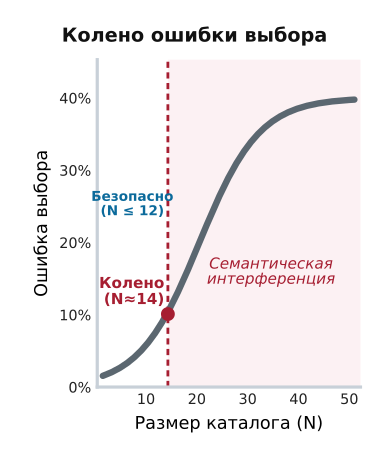

*За порогом размера каталога семантическая интерференция вызывает резкий перегиб в числе неверно направленных вызовов инструментов.*

Во время фаз предзаполнения и авторегрессионного декодирования базовая модель не компилирует схемы в физическую таблицу диспетчеризации; вместо этого головы внимания распределяют внимание по токенам схемы, чтобы направлять вероятности выходов. В основополагающей работе об API-синтезе Patil et al. (2023) показали, что базовые модели заметно теряют в качестве, когда интерфейсы опираются на лаконичные или неоднозначные соглашения об именовании. Это явление — *эффект качества схемы* — определяет эмпирическую связь между смысловой точностью спецификации схемы и частотой последующих сбоев вызовов.

**Бенчмарк Gorilla**
Patil et al. (2023) представили модель Gorilla и показали, что сочетание строгих сигнатур JSON с богатой документацией снижало галлюцинации аргументов API более чем на $50\%$ по сравнению со стандартным промптингом без примеров (zero-shot) на тысячах облачных конечных точек.

Когда описание параметра сводится к голому объявлению типа (например, `"path": {"type": "string"}`), механизм внимания модели не получает никаких указаний относительно формата, относительных путей или граничных условий. В терминах теории информации префикс обусловливания не сосредоточивает условное распределение вероятностей $P(y_t \mid y_{<t}, x)$ на допустимых эксплуатационных параметрах. Головы внимания промежуточных слоев не могут решить, должна ли строка представлять относительный путь (`./data/log.txt`), URI в формате POSIX (`file:///var/log.txt`) или абсолютный путь (`/Users/VJ/log.txt`). По мере роста энтропии распределения по словарю генератор часто выбирает токены на основе ассоциаций из предобучения, а не требований среды хоста.

И наоборот, семантическое обусловливание задает целевые ограничения, которые меняют траекторию декодирования:

1. *Явные единицы измерения и размерность:* объявление `"timeout_seconds": {"type": "integer", "description": "Connection timeout in seconds; must not exceed 60"}` предотвращает катастрофическую неоднозначность единиц, когда модель передает миллисекунды ($5000$) интерфейсу, который ожидает секунды, и тем самым не допускает голодания пула потоков.
2. *Ограниченные перечисления:* задание явного набора перечисления ($\mathcal{D} = \{ \text{json}, \text{csv}, \text{parquet} \}$) заменяет бесконечную строковую область замкнутым набором токенов-аттракторов. При декодировании головы внимания направляют вероятностную массу исключительно на кандидатные токены, которые соответствуют значениям перечисления, и доводят вероятность недопустимых вариантов почти до нуля.
3. *Разрешение противоречий через документацию:* когда взаимодействия параметров содержат тонкие эксплуатационные конфликты, например взаимно исключающие опции, в которых параметр $A$ нельзя задать при наличии параметра $B$, явная запись такого инварианта в документации верхнего уровня $D$ позволяет слоям перекрестного внимания связать появление токена $A$ в сгенерированном префиксе с подавлением токена $B$.

Различие между расплывчатыми и строгими эксплуатационными контрактами не стилистическое: это граница между сбоем среды выполнения и детерминированной диспетчеризацией. [«Режимы отказа схем инструментов и меры смягчения»](07_tool_calling.md#tbl-vol3-schema-failures) сопоставляет типичные режимы сбоев, которые возникают из недоопределенных схем, с корректирующими механизмами, которые вводит строгая типизация.

| Целевой параметр | Недоопределенная схема | Наблюдаемый след сбоя модели | Строгая спецификация схемы | Обеспечиваемый инвариант |
|:--------------------|:----------------------|:-----------------------------------------------------------------------|:--------------------------------------------------------------------|:-------------------------------------------------------------------|
| Размер фрагмента файла | `"size": "integer"` | `{"size": -1}` (попытка выразить «прочитать все») | `"size_bytes": {"type": "integer", "minimum": 1, "maximum": 65536}` | Отклоняет неположительные значения; предотвращает переполнение буфера хоста. |
| Завершение процесса | `"signal": "string"` | `{"signal": "SIGKILL"}` (привязка POSIX на C ожидает целое число) | `"signal_num": {"type": "integer", "enum": [1, 2, 9, 15]}` | Ограничивает токены допустимыми целочисленными номерами сигналов POSIX. |
| Тело HTTP-запроса | `"data": "object"` | `{"data": "<xml>payload</xml>"}` (строка передана там, где ожидается объект) | `"data": {"type": "object", "additionalProperties": true}` | Парсер JSON на хосте гарантирует ассоциативное отображение до диспетчеризации. |
| Цель коммита Git | `"target": "string"` | `{"target": "HEAD~"}` (неоднозначный refspec вызывает сбой оболочки) | `"commit_hash": {"type": "string", "pattern": "^[0-9a-f]{40}$"}` | Шаблон регулярного выражения предотвращает инъекцию в оболочку и некорректные refspec. |

<a id="tbl-vol3-schema-failures"></a>

***Режимы отказа схем инструментов и меры смягчения**: эмпирические режимы сбоев параметров при расплывчатых схемах в сравнении с инвариантами, которые обеспечивают строгие схемы.*

### Строгая проверка на стороне хоста

Надзорный компонент хоста никогда не предполагает, что кандидатные токены, которые выдала модель, соответствуют объявленной схеме. Вместо этого среда выполнения перехватывает сырой поток сгенерированных токенов, буферизует его в эскроу памяти и пропускает десериализованную полезную нагрузку через строгий конвейер проверки на стороне хоста, прежде чем разрешить диспетчеризацию к локальным или удаленным конечным точкам.

Конвейер проверки выполняется в три последовательные стадии:

Во-первых, среда выполнения пропускает буферизованную последовательность символов через потоковый лексический парсер, чтобы подтвердить корректный синтаксис JSON. Если генерация завершилась преждевременно из-за исчерпания контекста (достигнут $T_{\max}$) или закрытия сетевого сокета, парсер обнаруживает незавершенную строку или дисбаланс скобок и отклоняет полезную нагрузку до начала семантического анализа.

Во-вторых, разобранное абстрактное синтаксическое дерево (AST) сверяется со скомпилированной JSON Schema с помощью движка вроде Pydantic V2 или `jsonschema`. Валидатор проверяет три структурных инварианта:
$$\forall r \in R, \quad r \in \operatorname{keys}(Y)$$
$$\forall k \in \operatorname{keys}(Y), \quad k \in P \quad (\text{if } \chi = \text{closed})$$
$$\forall k \in \operatorname{keys}(Y), \quad Y[k] \in \mathcal{D}_k \land \operatorname{type}(Y[k]) = \tau_k$$
где $Y$ — кандидатный словарь, который выдала модель.

В-третьих, если полезная нагрузка нарушает какой-либо инвариант схемы, надзорный компонент хоста перехватывает сбой и подавляет исполнение. В ранних агентных архитектурах среды выполнения часто отвечали на ошибки проверки необработанными исключениями или общими строками вида `Invalid parameters`. Такая обратная связь оставляет языковую модель слепой к механической причине сбоя. Модель знает лишь, что ее вызов не прошел, и вынуждена угадывать, какой ключ, тип или граничное условие было нарушено.

```json
{
  "status": "validation_error",
  "tool_name": "fs_read_bytes",
  "error_count": 1,
  "errors": [
    {
      "loc": ["max_bytes"],
      "input_value": 2097152,
      "error_type": "less_than_equal",
      "message": "Input should be less than or equal to 1048576",
      "expected_domain": "integer in range [1, 1048576]"
    }
  ]
}
```

Современные среды выполнения формируют структурированный диагностический конверт ошибки, как показано в трассе выше. Этот конверт превращает необработанное исключение в авторитетное наблюдение, которое возвращается через стандартный контур обратной связи. Когда диагностическая полезная нагрузка вставляется обратно в диалоговый префикс, механизм самовнимания модели связывает поле с ошибкой (`loc: ["max_bytes"]`) и значение, выходящее за границу (`input_value: 2097152`), с явной верхней границей (`maximum: 1048576`). На следующем авторегрессионном проходе модель обусловливается этой эмпирической трассой ошибки и выдает исправленную параметризацию без вмешательства человека.

### Компромиссы бюджета контекста: статическая подготовка против внедрения схем по мере необходимости

Хотя богатые схемы интерфейса резко подавляют галлюцинации параметров, они вводят серьезное системное узкое место: потребление токенов контекста. В корпоративной агентной среде выполнения, которая управляет сложной инфраструктурой, каталог инструментов легко может насчитывать десятки или сотни отдельных операций, включая манипуляции с файлами, запуск процессов, запросы к базам данных и управление облачными API. Размещение этих схем непосредственно в системном промпте налагает значительные штрафы по памяти и вычислениям на движок вывода.

Рассмотрим среду выполнения, которая управляет каталогом из $M = 50$ различных инструментов. Если каждая схема инструмента — вместе с эксплуатационными строками документации, вложенными свойствами, ограничениями перечислений и границами типов — требует в среднем $S = 300$ токенов, статический префикс схем потребляет:
$$T_{\text{catalog}} = M \times S = 50 \times 300 = 15\,000\text{ токенов}$$
Эти $15\,000$ токенов должны быть предзаполнены до того, как модель сможет обработать первоначальный запрос пользователя, и они должны оставаться в памяти ускорителя на протяжении каждого хода агентного взаимодействия.

<a id="nbk-07-memory-footprint-and-prefill-latency"></a>

> **Объем памяти и задержка предзаполнения статических каталогов инструментов**
>
> Рассмотрим корпоративную агентную среду выполнения, которая организует задачи с помощью статического каталога из $M = 50$ инструментов ($15\,000$ токенов всего), обслуживаемого моделью с открытыми весами и $P = 70{,}6 \times 10^9$ параметров (например, Llama-3-70B), развернутой на узле из 8 GPU NVIDIA H100 SXM5.
>
> Модель использует групповое внимание с запросами (Grouped-Query Attention, GQA) с $L = 80$ слоями трансформера, $H_q = 64$ головами запросов, $H_{kv} = 8$ головами ключей и значений и размерностью головы $D_h = 128$. Вычисления и активации KV-кеша используют 16-битную точность ($b = 2\text{ байт на элемент}$).
>
> **1. Объем KV-кеша на сессию:**
> Память для ключей и значений, которую потребляет каждый токен во всех слоях, вычисляется как:
> $$\text{Memory}_{\text{token}} = 2 \times b \times L \times H_{kv} \times D_h = 2 \times 2 \times 80 \times 8 \times 128 = 327\,680\text{ байт} \approx 320\text{ КиБ}$$
> Для статического каталога $T_{\text{catalog}} = 15\,000\text{ токенов}$ выделение KV-кеша на каждую активную агентную сессию составляет:
> $$\text{KV}_{\text{session}} = 15\,000 \times 327\,680\text{ байт} = 4\,915\,200\,000\text{ байт} \approx 4{,}915\text{ ГБ}$$
> Если узел из 8 GPU обслуживает $K = 16$ одновременных агентных сессий, одни только статические схемы инструментов потребляют:
> $$\text{KV}_{\text{total}} = 16 \times 4{,}915\text{ ГБ} = 78{,}64\text{ ГБ}$$
> На узле из 8 GPU H100 с $8 \times 80\text{ ГБ} = 640\text{ ГБ}$ суммарной памяти HBM3 веса модели в FP16 занимают $70{,}6 \times 10^9 \times 2 \approx 141{,}2\text{ ГБ}$. Из оставшейся памяти, доступной для активаций и динамического контекста, почти $80\text{ ГБ}$ постоянно занято хранением спящих определений инструментов, которые в конкретном ходе могут так и не понадобиться.
>
> **2. Задержка вычислений предзаполнения при промахе кеша:**
> Если сессия запускается с холодного старта или инвалидирует свой кеш префикса, движок вывода должен выполнить проход предзаполнения по $15\,000$ токенам схем. Теоретически необходимые операции с плавающей запятой для предзаполнения составляют:
> $$\text{FLOPs}_{\text{prefill}} \approx 2 \times P \times T_{\text{catalog}} = 2 \times (70{,}6 \times 10^9) \times 15\,000 \approx 2{,}118 \times 10^{15}\text{ FLOPs} = 2{,}118\text{ PFLOPs}$$
> Система из 8 GPU H100 SXM5 дает пиковую плотную тензорную производительность FP16/BF16 $8 \times 989{,}5\text{ TFLOPs} = 7{,}916\text{ PFLOPs/s}$. При эмпирической утилизации FLOPs модели (MFU) $\mu = 40\%$ для фазы предзаполнения, ограниченной вычислениями:
> $$\text{Throughput}_{\text{effective}} = 7{,}916\text{ PFLOPs/s} \times 0{,}40 \approx 3{,}166\text{ PFLOPs/s}$$
> Задержка, которую вызывает одна только обработка префикса схем инструментов до выдачи первого сгенерированного токена, составляет:
> $$t_{\text{prefill}} = \frac{2{,}118\text{ PFLOPs}}{3{,}166\text{ PFLOPs/s}} \approx 0{,}669\text{ с} = 669\text{ мс}$$
> Налог на предзаполнение в $669\text{ мс}$ при каждом промахе кеша вносит серьезный джиттер задержки в многоходовые взаимодействия.

Чтобы выйти за пределы масштабируемости статической подготовки схем, высокопроизводительные среды выполнения реализуют *внедрение схем по мере необходимости* (Just-in-Time, JIT). Вместо того чтобы подготавливать весь каталог $\mathcal{M} = \{T_1, T_2, \dots, T_M\}$ ($M > 3\,000$) в каждый промпт взаимодействия, среда выполнения на стороне хоста рассматривает каталог инструментов как индексированную базу данных.

<a id="fig-vol3-two-stage-tool-retrieval"></a>

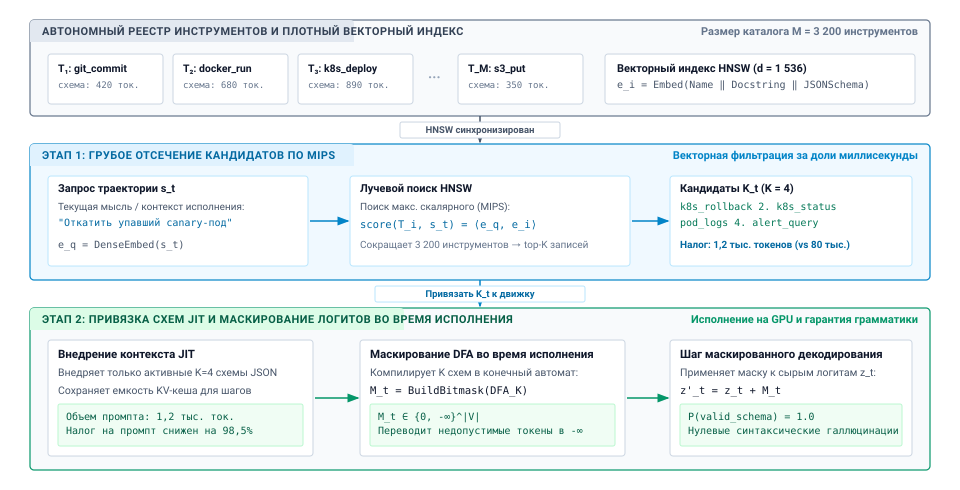
***Двухэтапный поиск инструментов и привязка схемы по мере необходимости**: архитектура внедрения схем инструментов по мере необходимости (JIT). Офлайн-каталог из $M > 3\,000$ инструментов индексируется в пространстве плотных эмбеддингов ($e_i = \text{Embed}(T_i)$). На ходе $t$ грубый поиск MIPS (поиск по максимальному скалярному произведению) сокращает каталог до активного подмножества $\mathcal{K}_t \ll \mathcal{M}$ ($K \approx 4$), после чего следуют компиляция грамматики DFA на стороне среды выполнения и маскирование логитов токенов ($z_t' = z_t + M_t$). Это снижает налог на промпт схем более чем на $98\%$, сохраняя бюджеты KV-кеша ускорителя и гарантируя синтаксическое соответствие.*

Конвейер многоступенчатого поиска и привязки схем подробно описан в [«Двухэтапном поиске инструментов и привязке схемы по мере необходимости»](07_tool_calling.md#fig-vol3-two-stage-tool-retrieval), который раскладывает управление каталогом на три дискретных архитектурных слоя:

1. *Офлайн-каталог и плотный векторный индекс:* при инициализации среда выполнения регистрирует все $M = 3\,200$ дескрипторов инструментов во вспомогательном графе HNSW. Каждая запись $T_i$ отображается в эмбеддинг размерностью 1 536 $e_i = \text{Embed}(\text{Name} \mathbin{\Vert} \text{Docstring} \mathbin{\Vert} \text{JSONSchema})$, что отделяет хранение метаданных инструментов от памяти GPU с высокой пропускной способностью.
2. *Этап 1 (грубое отсечение кандидатов по MIPS):* на ходе $t$ надзорный компонент хоста извлекает текущее состояние траектории агента $s_t$ («откатить упавший canary-под») и вычисляет плотный эмбеддинг запроса $e_q = \text{DenseEmbed}(s_t)$. Лучевой поиск HNSW вычисляет скалярные произведения $\text{score}(T_i, s_t) = \langle e_q, e_i \rangle$ и сокращает каталог из 3 200 инструментов до активного подмножества кандидатов $\mathcal{K}_t$ размером $K \ll M$ ($K=4$, например `k8s_rollback`, `k8s_status`, `pod_logs` и `alert_query`). Это снижает объем промпта с 80 000 токенов до 1 200 токенов — снижение налога на промпт на $98{,}5\%$, достигнутое менее чем за $1{,}2\text{ мс}$.
3. *Этап 2 (привязка схем по мере необходимости и маскирование DFA во время исполнения):* применяя декодирование с грамматическими ограничениями из [«Декодирования с грамматическими ограничениями»](02_foundation_model.md#sec-vol3-foundation-model-grammar-constrained), среда выполнения динамически компилирует $K=4$ схемы в детерминированный конечный автомат (DFA), который порождает на GPU тензор битовой маски на уровне токенов $M_t \in \{0, -\infty\}^{|V|}$. Применяя $z_t' = z_t + M_t$ во время авторегрессионной генерации, среда переводит недопустимые переходы токенов в $-\infty$, гарантируя $100\%$ синтаксического соответствия схеме и предотвращая галлюцинации инструментов, которых нет в каталоге.

**Компромисс кеширования префикса**
Внедрение схем по мере необходимости вступает в противоречие с кешированием в дереве Radix движка вывода. Если набор внедренных инструментов меняется на каждом ходе, префикс промпта расходится и инвалидирует KV-кеш. Среды выполнения решают эту проблему, закрепляя минимальный «базовый» набор инструментов в неизменяемом префиксе и добавляя динамические инструменты во вторичный слот.

Внедрение схем по мере необходимости вводит архитектурный компромисс между эффективностью контекста и полнотой поиска. Если поисковик среды выполнения не выдаст нужную схему инструмента (ложноотрицательный результат), модель не сможет вызвать необходимую возможность, и задача завершится неустранимым сбоем. Смена набора инструментов на каждом ходе также меняет префикс промпта, а поскольку состояние внимания выводится из префикса токенов (принцип «Состояние внимания выводится из префикса токенов»), движок обслуживания больше не может совпасть с закешированным префиксом в своем дереве Radix и должен заново вычислять кадры KV-кеша, начиная с первого измененного токена. Продвинутые системы обслуживания смягчают это, разбивая раскладку промпта: небольшой неизменяемый набор базовых примитивов (например, диспетчеризация bash и чтение файлов) закрепляется в основном префиксе, чтобы максимизировать попадания в кеш, а специализированные инструменты динамически внедряются во вторичный переходный блок контекста.

Хотя строгая инженерия схем гарантирует, что отдельная среда выполнения может разбирать, проверять и ограничивать кандидатные вызовы инструментов, она предполагает, что все определения инструментов статически скомпилированы в приложение хоста или управляются им локально. Однако современные корпоративные среды принципиально децентрализованы: среды разработки, облачная инфраструктура, локальные базы данных и веб-сервисы предоставляют собственные интерфейсы с различными жизненными циклами исполнения. Как разнородные внешние сервисы могут предоставлять свои инструменты, схемы и динамические ресурсы агентным средам выполнения по открытому стандартизированному протоколу, не требуя индивидуальных прослоек интеграции для каждой конечной точки? Ответ на этот вопрос переносит внимание от изолированного определения схем к совместимому обнаружению инструментов.

<a id="sec-vol3-tool-calling-mcp"></a>

## Совместимое обнаружение инструментов

Прямое встраивание реализаций инструментов в процесс среды выполнения агента ведет в архитектурный тупик. Когда подпрограммы инструментов разделяют виртуальное адресное пространство среды выполнения хоста и пул потоков интерпретатора, каждая внешняя библиотека — от нативных драйверов баз данных и утилит системного администрирования до сторонних клиентов REST — конкурирует за одно и то же адресное пространство, разделяемые библиотеки и блокировки исполнения. Одна утечка памяти, необработанная ошибка сегментации или блокирующий системный вызов внутри сторонней библиотеки инструмента внезапно завершает или замораживает весь цикл оркестрации агента на хосте. И наоборот, создание индивидуальных оберток межпроцессного взаимодействия и проприетарных прослоек REST для каждого корпоративного сервиса воспроизводит классический кризис интеграции $O(N \times M)$, при котором $N$ различных агентных сред выполнения должны реализовывать, тестировать и поддерживать уникальные адаптеры перевода для $M$ разнородных бэкендов исполнения.

**Открытый протокол инструментов** раскладывает эту дилемму интеграции $N \times M$ на клиент-серверную архитектуру $O(N + M)$, стандартизируя то, как внешние сервисы объявляют возможности, предоставляют структурированные ресурсы и принимают вызовы по единым транспортным каналам. Однако эта граница протокола устанавливает только обнаруживаемость, но не полномочия. Сервер объявляет, какие операции существуют, и определяет их синтаксические интерфейсы, а по типизированному контракту действия (принцип «Типизированный контракт действия») среда выполнения на стороне хоста сохраняет за собой ответственность за проверку параметров, обеспечение разрешений, изоляцию процессов и согласованность состояния.

<a id="fig-vol3-mcp-architecture"></a>

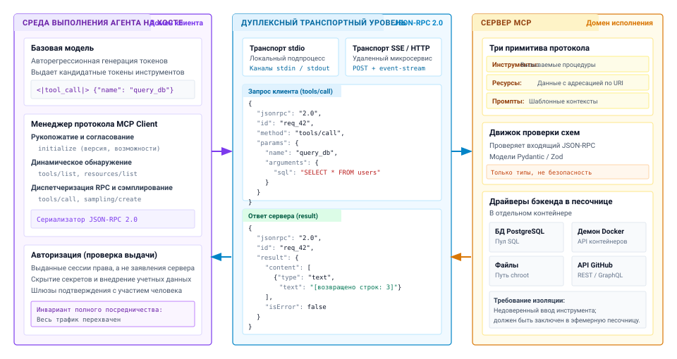
***Архитектура Model Context Protocol**: архитектурная топология Model Context Protocol (MCP). Непривилегированная базовая модель работает в домене клиента на хосте под управлением менеджера протокола MCP Client и надзорного компонента безопасности. Связь идет через дуплексный транспортный уровень: кадры JSON-RPC 2.0 передаются по локальным POSIX-каналам (`stdio`) или потокам HTTP/SSE и диспетчеризуются к автономным серверам MCP, которые инкапсулируют движки схем и изолированные драйверы исполнения.*

### Декомпозиция «клиент–сервер»

Архитектурное разделение исполнения инструментов структурировано по трем различным системным доменам на рисунке [«Архитектура Model Context Protocol»](07_tool_calling.md#fig-vol3-mcp-architecture):

1. *Среда выполнения агента на хосте (домен клиента):* непривилегированная базовая модель генерирует кандидатные токены в памяти контекста без каких-либо неявных полномочий. Менеджер протокола MCP Client перехватывает кандидатные вызовы, согласует возможности протокола через `client/initialize`, динамически запрашивает зарегистрированные возможности (`tools/list`, `resources/list`) и упаковывает структурированные вызовы в полезные нагрузки JSON-RPC 2.0. Важно, что надзорный компонент безопасности хоста обеспечивает полное посредничество: он применяет списки допустимых путей, скрывает секреты, внедряет авторизованные учетные данные и проверяет шлюзы одобрения с участием человека (human-in-the-loop), прежде чем какая-либо полезная нагрузка попадает в сеть.
2. *Дуплексный транспортный уровень (домен проводной связи):* связь между клиентом и сервером разделена на двунаправленные транспорты байтового потока: либо локальные однонаправленные POSIX-каналы (`stdio`), подключенные к изолированным дочерним подпроцессам, либо Server-Sent Events (`SSE`) в сочетании с конечными точками HTTP POST для удаленных микросервисов. Полезные нагрузки соответствуют кадрам JSON-RPC 2.0 по стандарту RFC и сопоставляют исходящие запросы клиента (`tools/call` с уникальным ID `req_42`) с входящими результатами сервера или конвертами ошибок.
3. *Сервер MCP (домен исполнения):* сервер работает как независимый процесс ОС и предоставляет три примитива протокола (`Tools` с побочными эффектами, `Resources` для вложений данных по URI и `Prompts` для шаблонов контекста). Внутренний движок схем синтезирует валидаторы Pydantic/Zod, чтобы проверить входящие типы до диспетчеризации вызовов в изолированные драйверы бэкенда (например, пулы подключений PostgreSQL, рабочие процессы демона Docker или файловые системы, ограниченные chroot). Важно, что граница сервера изолирует недоверенное исполнение: даже если инструмент падает или утекает память, среда выполнения агента на хосте остается совершенно невозмущенной.

Model Context Protocol принимает JSON-RPC 2.0 как стандарт кадрирования сообщений. Допустимый запрос должен содержать строку версии `"jsonrpc": "2.0"`, уникальный числовой или строковый `"id"` для мультиплексирования запросов и ответов, строку `"method"`, которая идентифицирует операцию, и структурированный словарь `"params"`.

Чтобы обеспечить совместимость между языками программирования и операционными средами, канал связи опирается на кадрирование JSON-RPC 2.0. Поскольку JSON-RPC отделяет механику транспорта от семантики сообщений, клиент и сервер могут согласовывать возможности и обмениваться полезными нагрузками через любую абстракцию байтового потока, не меняя лежащую в основе логику приложения. Сообщения делятся на три дискретные категории: запросы, которые требуют явного коррелированного ответа; ответы, которые возвращают либо структурированную полезную нагрузку результата, либо стандартизированный объект ошибки, связанный с идентификатором исходного запроса; и уведомления, которые полностью опускают идентификатор и передают телеметрию в одном направлении без блокировки, например прогресс исполнения, события журналирования или сигналы инвалидации кеша.

Model Context Protocol организует возможности инструментов в четыре базовых примитива:

1. **`tools/list` (динамическое согласование возможностей):** сервер возвращает массив вызываемых примитивов, сопровождаемых декларативными контрактами JSON Schema. Каждая запись задает каноническое имя, описание на естественном языке, настроенное на максимизацию точности выбора моделью, и строгую формальную схему, которая определяет допустимые имена параметров, типы и ограничения проверки. Такое обнаружение во время выполнения отделяет эволюцию инструментов от развертывания модели: администратор может развернуть новые аналитические подпрограммы или изменить лежащие в основе реализации сервисов без переобучения модели и без повторного развертывания агента на хосте.
2. **`tools/call` (императивное изменение состояния и диспетчеризация):** клиент передает императивный запрос исполнения с указанием целевого имени инструмента и словаря аргументов, соответствующего объявленной схеме. Сервер выполняет операцию и возвращает структурированный конверт ответа, содержащий массив `content` из текстовых блоков, двоичных объектов (blobs) или встроенных кадров ошибок, а также авторитетный логический флаг `isError`, который отличает сбои предметной области операции от аварийных сбоев протокола.
3. **`resources/read` (декларативный пассивный прием контекста):** в отличие от инструментов, которые представляют активные конечные точки исполнения, изменяющие состояние, ресурсы предоставляют доступные только для чтения источники данных, адресуемые через стандартные унифицированные идентификаторы ресурсов (URI, например `file:///var/log/syslog` или `postgres://analytics/schema`). Ресурсы позволяют среде выполнения на стороне хоста наполнять окна контекста модели пассивным справочным материалом, например исходными файлами, системными метриками или схемами баз данных, без запуска произвольных чужих двоичных файлов и без предоставления серверу неявных привилегий исполнения.
4. **`prompts/get` (шаблоны контекста, управляемые сервером):** серверы предметной области предоставляют параметризованные шаблоны промптов, которые подсказывают модели, как составлять последовательности вызовов инструментов для решения задач предметной области. Этот механизм переносит примеры few-shot и эксплуатационные инструкции из жестко заданных промптов клиента в специализированные подсистемы, которые поддерживают соответствующие инструменты.

Как обобщено в [«Примитивах Model Context Protocol»](07_tool_calling.md#tbl-mcp-primitives), эти четыре примитива разделяют поверхность исполнения на различные эксплуатационные семантики и профили риска.

| Примитив MCP | Эксплуатационная семантика | Схема основной полезной нагрузки | Риск изменения состояния | Типичный профиль задержки |
|:-----------------|:---------------------|:----------------------------------|:-----------------------|:---------------------------|
| `tools/list` | Интроспекция | `tools: Tool[]` | Нет (интроспекция) | $1\text{--}10\text{ мс}$ |
| `tools/call` | Императивное исполнение | `name: string, arguments: object` | Высокий (изменяет систему) | $5\text{--}5000\text{ мс}$ |
| `resources/read` | Пассивное наполнение контекста | `uri: string` | Нет (только чтение) | $1\text{--}50\text{ мс}$ |
| `prompts/get` | Шаблонизация контекста | `name: string, arguments: object` | Нет (только чтение) | $< 5\text{ мс}$ |

<a id="tbl-mcp-primitives"></a>

***Примитивы Model Context Protocol**: системные контракты и эксплуатационные профили основных примитивов Model Context Protocol.*

Стандартизация этих примитивов задает ясный эксплуатационный жизненный цикл. Когда сессия инициализируется, клиент на хосте устанавливает связь по согласованному транспорту, выполняет рукопожатие `initialize` для обмена версиями протокола и возможностями реализации и запрашивает `tools/list`, чтобы заполнить свой динамический каталог инструментов. Когда модель выбирает инструмент, среда выполнения проверяет предложение по кешированной схеме и направляет запрос `tools/call` по проводу, обеспечивая, что ни модель, ни сервер не могут обойти надзор клиента.

### Топологии транспорта


*Удаленные транспорты HTTP увеличивают задержку в 97–5 600 раз по сравнению с локальными сокетами домена UNIX для IPC между инструментами.*

Физический канал, соединяющий клиента агента на хосте с сервером исполнения, определяет эксплуатационную задержку системы, изоляцию сбоев и топологию развертывания. Абстракция протокола отделяет сериализацию сообщений от лежащего в основе транспорта, что позволяет средам выполнения работать в трех различных эксплуатационных режимах: локальные каналы стандартного ввода/вывода, локальные сокеты домена UNIX и удаленная потоковая передача по HTTP с Server-Sent Events (SSE). [«Топологии транспорта Model Context Protocol»](07_tool_calling.md#tbl-vol3-mcp-transports) сопоставляет архитектурные профили этих топологий транспорта.

| Топология транспорта | Лежащие в основе примитивы IPC | Типичная задержка кругового обхода | Связность жизненного цикла процесса | Граница безопасности и изоляции | Основной режим сбоя |
|:-------------------------------|:-------------------------------------------------------|:----------------------------------------:|:-----------------------------------------------------|:-----------------------------------------------|:--------------------------------------------------------|
| **Стандартный ввод/вывод (`stdio`)** | Анонимные каналы POSIX (`pipe(2)`) через `stdin`/`stdout` | $< 0{,}5\text{ мс}$ (копирование в памяти) | Прямой дочерний процесс (`fork`/`exec`); завершается вместе с хостом | Пространство имен процесса / песочница контейнера | Взаимная блокировка из-за заполнения буфера канала (`F_SETPIPE_SZ`) |
| **Сокет домена UNIX (`UDS`)** | Инод сокета файловой системы (`AF_UNIX`, `SOCK_STREAM`) | $< 0{,}1\text{ мс}$ (ядро с нулевым копированием) | Отделенный фоновый демон; мультиплексированные клиенты | Права файловой системы POSIX (`chmod`/`chown`) | Устаревшие файлы блокировки сокета (`/tmp/mcp.sock`); падение демона |
| **Удаленный HTTP с SSE** | TCP/IP, TLS, HTTP POST + SSE `text/event-stream` | $15\text{--}150\text{ мс}$ (сетевая задержка RTT) | Полностью распределенный; облачные кластеры / удаленные анклавы | Сетевой mTLS, bearer-токены, CIDR-правила межсетевого экрана | Потеря пакетов, обрывы соединения, таймауты буферизации прокси |

<a id="tbl-vol3-mcp-transports"></a>

***Топологии транспорта Model Context Protocol**: архитектурное сравнение механизмов IPC по задержке, жизненному циклу и границам изоляции.*

Локальные каналы стандартного ввода/вывода (`stdio`) представляют собой механизм транспорта с наименьшей задержкой для инструментов, работающих на одной машине. В этой топологии среда выполнения запускает сервер инструментов как прямой дочерний процесс с помощью стандартной последовательности системных вызовов POSIX `fork(2)` и `execve(2)`. Хост подключает свои файловые дескрипторы к потокам стандартного ввода и стандартного вывода дочернего процесса через однонаправленные каналы ядра, созданные с помощью `pipe(2)`. Сообщения JSON-RPC пересекают границу процесса в виде строк JSON, разделенных переводами строк. Поскольку связь проходит только через буферы памяти ядра с копированием, не затрагивая сетевые интерфейсные контроллеры и стеки протоколов, задержка запроса и ответа остается меньше миллисекунды ($< 0{,}5\text{ мс}$).

Однако транспорты `stdio` накладывают жесткие физические ограничения на управление потоком. Каналы ядра Linux имеют емкость буфера по умолчанию $64\text{ КБ}$ (настраивается через `F_SETPIPE_SZ`). Если сервер инструментов выдает громоздкую полезную нагрузку наблюдения, например большой журнал сборки или подробную трассу выполнения тестов, которая превышает объем непрочитанных данных в буфере канала, пока среда выполнения на хосте занята вычислениями, процесс сервера инструментов принудительно переходит в непрерываемое состояние сна (`TASK_UNINTERRUPTIBLE`) на системном вызове `write(2)`. Если хост одновременно ждет завершения процесса инструмента, прежде чем опустошить свой выходной буфер, система заходит во взаимную блокировку. Поэтому среды выполнения, которые используют `stdio`, должны реализовывать неблокирующие асинхронные циклы чтения, которые непрерывно опустошают буферы каналов ядра в промежуточные кольцевые буферы памяти хоста.

Сокеты домена UNIX (UDS) сохраняют скорости передачи данных на уровне микросекунд, характерные для копирования в памяти ядра, и одновременно освобождают сервер от строгого жизненного цикла родительского и дочернего процессов. Работая через инод сокета, привязанный к файловой системе (`AF_UNIX`, `SOCK_STREAM`), сервер UDS выполняется как независимый постоянный фоновый демон. Несколько одновременных сессий среды выполнения агента могут мультиплексировать вызовы инструментов через один постоянный сокет, избегая накладных расходов на запуск процесса при каждом повторном запуске среды и повторной инициализации общих зависимостей. Кроме того, стандартные права файловой системы POSIX (`chmod` и `chown`) на иноде сокета задают конкретную границу контроля доступа на уровне хоста, которая не позволяет неавторизованным локальным пользователям отправлять действия привилегированным демонам инструментов.

Для распределенных корпоративных сред протокол поддерживает удаленные сетевые транспорты через HTTP и Server-Sent Events (SSE). В этой асимметричной архитектуре клиент на хосте отправляет запросы JSON-RPC стандартными HTTP-запросами `POST`, а удаленный сервер передает потоком ответы JSON-RPC, уведомления о прогрессе исполнения и обновления динамических возможностей через долгоживущее HTTP-соединение с типом MIME `text/event-stream`. Эта топология полностью отделяет физическое оборудование: серверы инструментов могут работать внутри специализированных облачных кластеров, изолированных сетевых анклавов или многотенантных сред баз данных, расположенных за тысячи миль от среды выполнения на хосте.

Такое физическое разделение вносит существенный системный налог. Задержки кругового обхода по сети (RTT), рукопожатия TCP, согласование сессий TLS, фрагментация пакетов по максимальным блокам передачи (MTU) и буферизация обратного прокси добавляют десятки и сотни миллисекунд накладных расходов задержки на каждый вызов инструмента. В итеративном агентном цикле, которому нужны десятки последовательных диспетчеризаций инструментов для решения сложной задачи, эти накладные расходы задержки быстро превосходят задержку генерации токенов у лежащего в основе движка вывода.

<a id="nbk-07-latency-and-cpu-overhead-across"></a>

> **Задержка и накладные расходы процессора на транспортах MCP**
>
> Рассмотрим среду выполнения агента, которая выполняет задачу анализа кода. Модель выдает кандидатный вызов инструмента для поиска по репозиторию, в результате чего возникает структурированная полезная нагрузка наблюдения JSON-RPC размером ровно $64\text{ КБ}$ ($65\,536\text{ байт}$). Мы оцениваем физическую задержку передачи и накладные расходы процессора хоста для двух различных топологий транспорта: локального сокета домена UNIX и HTTP/SSE внутри дата-центра, защищенного TLS 1.3.
>
> **Системные параметры:**
>

> - Процессор хоста: современное серверное ядро, работающее на $3{,}0\text{ ГГц}$; пропускная способность копирования в памяти $B_{\text{mem}} = 40\text{ ГБ/с} = 40 \times 10^9\text{ Б/с}$.
> - Накладные расходы переключения контекста ОС: $t_{\text{ctx}} = 1{,}5\text{ мкс}$ ($4\,500\text{ тактов ЦП}$).
> - Механика локального UDS: два переключения контекста (запись клиента → чтение сервера, запись сервера → чтение клиента) плюс два копирования в памяти ядра (из пространства пользователя в буфер ядра и из буфера ядра в пространство пользователя).
> - Механика сети: сетевая задержка кругового обхода внутри дата-центра $t_{\text{RTT}} = 0{,}5\text{ мс} = 500\text{ мкс}$; пропускная способность сети $B_{\text{net}} = 10\text{ Гбит/с} = 1{,}25\text{ ГБ/с}$.
> - Предел полезной нагрузки MTU: $1\,448\text{ байт}$ на сегмент TCP (стандартный MTU в $1\,500\text{ байт}$ минус $52\text{ байт}$ заголовков TCP/IP и временных меток).
> - Криптографическая пропускная способность TLS: аппаратно ускоренная обработка AES-128-GCM со скоростью $4\text{ ГБ/с} = 4 \times 10^9\text{ Б/с}$.
>
> **1. Расчет для локального сокета домена UNIX:**
> Задержка складывается из задержек переключения контекста и физических копирований в памяти через границу ядра:
> $$t_{\text{copy}} = 2 \times \left( \frac{65\,536\text{ Б}}{40 \times 10^9\text{ Б/с}} \right) = 2 \times 1{,}64\text{ мкс} = 3{,}28\text{ мкс}$$
> $$t_{\text{total, UDS}} = (2 \times t_{\text{ctx}}) + t_{\text{copy}} = (2 \times 1{,}5\text{ мкс}) + 3{,}28\text{ мкс} = 6{,}28\text{ мкс} \approx 0{,}0063\text{ мс}$$
> Всего тактов процессора хоста потреблено:
> $$\text{Cycles}_{\text{UDS}} \approx (2 \times 4\,500) + (3{,}28\text{ мкс} \times 3{,}0\text{ ГГц}) \approx 9\,000 + 9\,840 \approx 18\,840\text{ тактов}$$
>
> **2. Расчет для удаленного HTTP/SSE поверх TLS внутри дата-центра:**
> Полезной нагрузке $64\text{ КБ}$ требуется пакетизация в несколько сегментов TCP:
> $$N_{\text{packets}} = \left\lceil \frac{65\,536\text{ Б}}{1\,448\text{ Б/пакет}} \right\rceil = 46\text{ пакетов}$$
> Время сериализации и передачи по интерфейсу $10\text{ Гбит/с}$ составляет:
> $$t_{\text{wire}} = \frac{65\,536\text{ Б}}{1{,}25 \times 10^9\text{ Б/с}} = 52{,}43\text{ мкс}$$
> Накладные расходы на шифрование и расшифровку на обоих концах составляют:
> $$t_{\text{crypto}} = 2 \times \left( \frac{65\,536\text{ Б}}{4 \times 10^9\text{ Б/с}} \right) = 32{,}77\text{ мкс}$$
> С учетом базовой сетевой задержки RTT, прохождения стека TCP/IP и обработки сокета ядра ($t_{\text{stack}} \approx 25\text{ мкс}$):
> $$t_{\text{total, SSE}} = t_{\text{RTT}} + t_{\text{wire}} + t_{\text{crypto}} + t_{\text{stack}} = 500\text{ мкс} + 52{,}43\text{ мкс} + 32{,}77\text{ мкс} + 25\text{ мкс} = 610{,}2\text{ мкс} \approx 0{,}61\text{ мс}$$
> Всего тактов процессора хоста, потребленных стеком сети, обработкой пакетов и TLS:
> $$\text{Cycles}_{\text{SSE}} \approx (52{,}43\text{ мкс} + 32{,}77\text{ мкс} + 25\text{ мкс}) \times 3{,}0\text{ ГГц} \approx 330\,600\text{ тактов}$$
>
> **Системный вывод:** даже в оптимизированной среде дата-центра с низкой задержкой ($0{,}5\text{ мс}$ RTT) переход от локального сокета домена UNIX к удаленному транспорту HTTP/SSE налагает **штраф по задержке в $97\times$** ($0{,}61\text{ мс}$ против $0{,}0063\text{ мс}$) и **штраф по тактам процессора в $18\times$** на хосте. Если удаленный сервис находится за глобальной сетью (WAN) с типичной межрегиональной задержкой RTT в $35\text{ мс}$, штраф по задержке возрастает до **$5\,600\times$**. Поэтому распределенные архитектуры инструментов должны резервировать удаленные сетевые транспорты для операций, длительность исполнения которых намного превышает время сетевого переноса.

### Обнаружение протокола против суверенной авторизации хоста

Критический режим отказа в распределенном проектировании агентов — смешение объявления возможности с авторизацией возможности. Поскольку Model Context Protocol предоставляет чистую стандартизированную абстракцию для запроса доступных инструментов через `tools/list`, наивные реализации часто передают объявленные схемы прямо в префикс промпта модели и пересылают кандидатные вызовы инструментов напрямую через транспорт без проверки. Такой проект нарушает принцип наименьших привилегий и разрушает границу безопасности среды выполнения на хосте.

Объявление инструмента не дает полномочий его вызывать. Объявленная сервером схема строго говоря является непроверенным заявлением о том, какую функциональность сервер *может* выполнить; она не дает никаких свидетельств того, что текущая агентная сессия *должна* ее выполнять. Непроверенный сервер инструментов стороннего разработчика или скомпрометированный внутренний микросервис может объявить разрушительные примитивы, такие как произвольное исполнение оболочки, неограниченное удаление файлов или конечные точки для утечки данных (exfiltration). Если хост-агент слепо принимает эти инструменты, злоумышленник, способный манипулировать контекстом модели через косвенную инъекцию промпта, может захватить эксплуатационные возможности системы.

Чтобы сохранить целостность системы, среда выполнения агента на хосте должна обеспечивать суверенный конвейер авторизации между генерацией кандидатных токенов моделью и уровнем диспетчеризации транспорта:

1. **Динамическая фильтрация схем:** среда выполнения на хосте сопоставляет входящие объявления `tools/list` с административной матрицей политик, прежде чем показать любой инструмент движку вывода. Найденные инструменты, которые запрашивают полномочия сверх потолка безопасности текущей сессии, исключаются из каталога. Окно контекста модели никогда не показывает схемы, которые агенту не разрешено вызывать.
2. **Синтаксическая и семантическая проверка аргументов:** когда модель предлагает вызов инструмента, среда выполнения разбирает кандидатную структуру JSON и проверяет все параметры на строгую типизацию, числовой диапазон, соответствие строковому шаблону и ограничения обхода путей. Если инструмент ожидает путь к файлу внутри песочницы репозитория, проверка параметров активно отклоняет входные данные, содержащие последовательности обхода каталогов (`../../etc/passwd`), до того как полезная нагрузка попадет в сеть.
3. **Выдача возможностей и многоуровневое согласие:** каждая операция ограничивается уровнем полномочий, который она требует, с использованием уровней $A_0$–$A_3$ из [«Экспозиций H·S·A»](01_introduction.md#sec-vol3-intro-hsa), и каждый уровень несет собственное условие диспетчеризации:
   - **$A_0$ (чтение):** операции, которые наблюдают состояние среды, не изменяя его (например, `resources/read`, листинги каталогов). Они выполняются без одобрения каждого вызова, но только над ресурсами, которые называют выданные сессии права, потому что чтение, возвращающее учетные данные или личные записи в контекст, может утечь их через последующий вызов.
   - **$A_1$ (изменение в песочнице):** операции, которые меняют состояние, ограниченное песочницей, которую среда выполнения может отбросить (например, фиксация в изолированной ветке git в рабочем дереве-черновике или запись временных файлов кеша). Они требуют локального журналирования транзакций среды выполнения, чтобы среда могла сбросить песочницу.
   - **$A_2$ (повторно безопасное или компенсируемое внешнее действие):** операции, которые меняют внешнюю систему так, что их можно безопасно повторить или отменить компенсирующим действием (например, выделение облачного экземпляра, который позже можно освободить). Они требуют, чтобы каждый таймаут был урегулирован до любого повтора; об этом говорится в разделе [«Выполнение идемпотентных действий»](07_tool_calling.md#sec-vol3-tool-calling-idempotency).
   - **$A_3$ (необратимое внешнее действие):** операции, которые необратимо меняют внешние системы (например, удаление таблиц базы данных, отправка финансовых транзакций). Перед диспетчеризацией они требуют криптографической авторизации токеном, подписывающих ключей, привязанных к аппаратному обеспечению, или интерактивного одобрения с участием человека (human-in-the-loop).
4. **Санитизация наблюдений и защита от инъекций:** граница авторизации работает симметрично. Когда сервер инструментов завершает операцию и возвращает полезную нагрузку через транспортный канал, среда выполнения проверяет возвращаемые байты, прежде чем внедрить их в KV-кеш модели. Внешние выходы инструментов представляют собой недоверенные потоки данных: если инструмент поиска извлекает веб-страницу или файл журнала с враждебной полезной нагрузкой инъекции промпта, некритическое поглощение в рабочий контекст может захватить последующие циклы вывода. Среда выполнения удаляет известное обрамление инъекций, накладывает жесткие границы по байтам и экранирует сырые токены, чтобы поток наблюдений не мог выдавать себя за инструкции системного уровня.

Такое разделение применяет сквозной аргумент, лежащий в основе [«принципа замыкания инвариантов»](01_introduction.md#pri-invariant-closure), на границе инструмента. Протокол связи (MCP) предоставляет единообразный механизм для переноса битов и структурирования RPC-запросов между конечными точками. Критические функции системы (корректность, безопасность, соблюдение разрешений и проверка инвариантов задачи) могут быть реализованы полностью и корректно только конечной точкой, которая понимает полную семантику приложения, то есть средой выполнения на хосте. Внешний сервер не может проверить, согласуется ли действие с общей целью задачи пользователя, а транспортный канал не может проверить, нарушает ли действие принцип наименьших привилегий. Среда выполнения на хосте сохраняет исключительную ответственность за посредничество в каждом переходе от кандидатного токена к внешнему эффекту.

<a id="psp-07-the-illusion-of-schema-enforcement"></a>

> **Иллюзия соблюдения схемы и сквозная проблема исполнения**
>
> Современные фреймворки использования инструментов часто рассматривают структурную проверку схемы как границу безопасности: если сгенерированный вызов инструмента проходит проверку по своей спецификации JSON Schema, среда выполнения считает действие безопасным для диспетчеризации. Это смешивает синтаксическую структуру с эксплуатационной авторизацией — ту же путаницу, которую [«Декодирование с грамматическими ограничениями»](02_foundation_model.md#sec-vol3-foundation-model-grammar-constrained) исключило для декодирования с грамматическими ограничениями. Схема, которую передает протокол, гарантирует не больше, чем грамматика, которую обеспечивает декодирование.
>
> Непривилегированная базовая модель генерирует текст; она не понимает границ системной безопасности. JSON-схема может гарантировать, что аргумент с именем `target_path` является строкой, но она не может проверить, раскрывается ли эта строка в `../../etc/shadow` через обход пути, защищена ли целевая ветка в команде git или нарушает ли удаление в базе данных политики хранения организации. Передача синтаксически корректной полезной нагрузки подпроцессу без посредничества хоста лишь автоматизирует эксплуатацию неявных системных привилегий.
>
> Кроме того, безопасность исполнения строго двусторонняя. Когда внешний инструмент завершает выполнение, его выходной поток возвращается в окно контекста модели как недоверенные данные. Непроверенная полезная нагрузка наблюдения, содержащая косвенные инъекции промпта, может перепрограммировать цикл рассуждения агента на следующем ходу, превращая безобидное чтение инструментом во враждебный захват управления.
>
> **Системный вывод:** схемы инструментов определяют грамматику сериализации, а не безопасность исполнения. Полное посредничество требует, чтобы среда выполнения на хосте действовала как суверенный эталонный монитор: проверяла выданные аренды возможностей на выходе, прежде чем обращаться к ОС, и санитизировала потоки наблюдений на входе, прежде чем открыть токены модели.

<a id="chk-07-complete-mediation"></a>

> **Проверка схем инструментов и полного посредничества**
>
> Прежде чем разбирать механику идемпотентного исполнения, проверьте свое понимание контрактов инструментов и авторизации на стороне хоста:
>
> - [ ] **Проверка схемы**: почему проверка параметров (типов, диапазонов, обходов путей) должна строго выполняться надзорным компонентом на хосте до того, как запрос дойдет до дочерних процессов?
> - [ ] **Уровни полномочий**: как ограничение действий по уровню полномочий, от чтения ($A_0$) до необратимого внешнего действия ($A_3$), предотвращает невосстановимые побочные эффекты, и почему чтение все равно требует выданного права?
> - [ ] **Границы транспорта**: почему протокол RPC вроде MCP не выполняет требование полного посредничества без авторизации на уровне хоста?
> - [ ] **Инъекция через наблюдения**: какие шаги санитизации предотвращают внедрение враждебных инструкций промпта из недоверенных выходов инструментов в последующие ходы?

<a id="sec-vol3-tool-calling-idempotency"></a>

## Выполнение идемпотентных действий

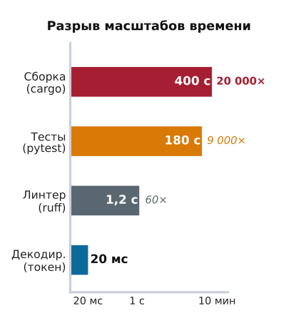

*Внешнее исполнение инструментов превосходит генерацию нейросетевых токенов по времени на пять порядков величины, определяя общую длительность сквозного выполнения.*

Когда надзорный компонент хоста диспетчеризует запрос на изменение через границу процесса или сети, таймер диспетчеризации начинает отсчет до предельного срока исполнения $\tau_{\text{timeout}}$. В момент $t = \tau_{\text{timeout}}$, если сокет транспорта молчит, среда выполнения сталкивается с фундаментальной дилеммой распределенных систем, сформулированной Флавиу Кристианом: необработанный таймаут не дает никакой информации о физическом состоянии целевой системы. Клиентская среда выполнения не может различить три взаимно исключающие физические реальности: пакет запроса был потерян на исходящем пути до того, как достиг сервера инструментов; сервер инструментов упал посреди исполнения, частично изменив внешнее состояние; либо сервер инструментов успешно выполнил мутацию и зафиксировал ее побочные эффекты, но пакет ответа был прерван на обратном пути промежуточным коммутатором или посредником (middlebox).

**Необработанный сетевой таймаут превращает детерминированный план агента в неопределенное физическое состояние.** В агентной архитектуре, которая работает с непривилегированными моделями, слепой повтор исполнения в предположении, что таймаут означает отсутствие исполнения, вызывает катастрофические дублирующие побочные эффекты, такие как повторные списания платежей, поврежденная история git или повторные вставки в базу данных. И наоборот, обработка таймаута как окончательного сбоя ломает цикл рассуждений и оставляет внутреннее представление агента о состоянии рассинхронизированным с физической реальностью. Безопасное исполнение требует превращать каждый вызов инструмента, который изменяет состояние, в алгебраически идемпотентную операцию с помощью криптографических ключей исполнения, взаимно исключающих арендов или зондов сверки состояния в замкнутом контуре, как показано на [«Потоке выполнения с нонсом идемпотентности и шлюзе дедупликации»](07_tool_calling.md#fig-vol3-idempotency-flow).


**Алгебраическая идемпотентность**
Операция $f: S \to S$, которая действует на состояние системы $S$, алгебраически идемпотентна тогда и только тогда, когда:
$$f(f(s)) = f(s) \quad \forall s \in S$$
В распределенных системах интерфейс RPC идемпотентен, если побочные эффекты $N > 1$ одинаковых запросов совпадают с побочными эффектами одного запроса ($N = 1$).

<a id="dfn-idempotent-action"></a>

> **Идемпотентное действие**
>
> Внешнее воздействие, повторное применение которого дает точно то же состояние системы, что и однократное исполнение ($f(f(s)) = f(s)$). Это гарантирует, что повторы транспорта при неоднозначности таймаута не могут вызвать дублирующие мутации.

### Неопределенное состояние при сетевом сбое

Вернемся к перезапуску контейнера, с которого началась эта глава, и разберем его подробно. Во время развертывания патча на удаленном промежуточном сервере автономный агент для работы с кодом вызывает инструмент управления контейнерами по HTTP с запросом `POST /containers/srv-stage-04/restart`. Среда выполнения на хосте назначает вызову предельный срок таймаута $\tau_{\text{timeout}} = 2000\text{ мс}$. В момент $t = 2001\text{ мс}$ TCP-сокет выдает ошибку `ETIMEDOUT`. Если среда выполнения наивно повторно отправляет HTTP-запрос, а первоначальный запрос на самом деле успел остановить контейнер, но истек по таймауту во время инициализации сервиса, вторичная диспетчеризация запускает избыточный цикл перезапуска контейнера. Этот второй цикл инвалидирует существующие привязки процессов, завершает исправных рабочих и повреждает внутреннюю модель отслеживания состояния среды выполнения на хосте.

Чтобы формализовать этот сбой, представим диспетчеризацию действия кортежем $A = \langle \text{tool}, \theta, t_0 \rangle$, где $\theta$ обозначает привязанную полезную нагрузку параметров, а $t_0$ — метку времени диспетчеризации. Действие проходит по сетевому каналу $\mathcal{C}$ и исполняется над внешним состоянием среды $S_{\text{env}}$. По истечении $\tau_{\text{timeout}}$ среда выполнения должна оценить распределение вероятностей по трем потенциальным эксплуатационным состояниям:

$$\Sigma = \{\sigma_{\text{drop}}, \sigma_{\text{crash}}, \sigma_{\text{sever}}\}$$

При $\sigma_{\text{drop}}$ запрос был отброшен сетью до того, как попал на интерфейс инструмента; внешняя среда не изменилась ($S_{\text{env}}' = S_{\text{env}}$), и повторная отправка физически безопасна. При $\sigma_{\text{crash}}$ интерфейс инструмента получил $A$ и начал исполнение, но процесс упал посреди мутации; среда осталась в незафиксированном частично измененном промежуточном состоянии ($S_{\text{env}}' = S_{\text{env}} \oplus \delta_{\text{partial}}$). При $\sigma_{\text{sever}}$ интерфейс инструмента полностью выполнил мутацию ($S_{\text{env}}' = S_{\text{env}} \oplus \delta_{\text{complete}}$), но ответ, содержащий кадр наблюдения $\mathcal{O}$, был потерян на обратном пути.

Стандартные наивные политики повторов реализуют повторную стратегию разомкнутого контура:

```python
# АНТИПАТТЕРН: наивный повтор в разомкнутом контуре в предположении sigma_drop
for attempt in range(max_retries):
    try:
        return client.dispatch(tool="charge_card", args={"amount": 5000})
    except TimeoutError:
        time.sleep(backoff(attempt))
```

Эта реализация допускает ошибку, предполагая, что $\Pr(\sigma_{\text{drop}}) = 1{,}0$. Если сбой определялся $\sigma_{\text{sever}}$, каждая итерация цикла заново выполняет лежащий в основе побочный эффект. В промышленных агентных архитектурах, где базовые модели порождают десятки автономных вызовов инструментов на задачу без прямого подтверждения человеком, повторная отправка в разомкнутом контуре превращает мелкие сетевые сбои в каскадные повреждения состояния.

### Алгебраическая классификация побочных эффектов инструментов

Чтобы построить безопасную среду исполнения, надзорный компонент должен вести явную таксономию побочных эффектов инструментов. Опираясь на формализацию Роем Филдингом сетевых архитектурных стилей и семантики методов HTTP, инструменты, предоставляемые агентной системе, распадаются на три различные алгебраические категории, как формализовано в [«Таксономии семантики исполнения инструментов и инварианты отказов»](07_tool_calling.md#tbl-vol3-tool-idempotency).

| Класс побочного эффекта | Алгебраическое определение | Конкретные примеры инструментов | Безопасность повторной диспетчеризации | Требуемая мера надзорного компонента |
|:--------------------------------|:---------------------|:----------------------------------------------------------|:------------------------------------|:---------------------------------------------------------------------------|
| **Нуллипотентный** (только чтение) | $f(s) = s$ | `read_file`, `grep`, `get_weather`, `sql_select` | Гарантированно безопасно ($\forall N \ge 1$) | Безусловный повтор с усеченной экспоненциальной задержкой. |
| **Естественно идемпотентный** | $f(f(s)) = f(s)$ | `write_file` (перезапись), `mkdir -p`, `rm -f`, `set_config` | Безопасно при последовательной повторной диспетчеризации | Управление параллелизмом; нумерация последовательности, чтобы предотвратить исполнение не по порядку. |
| **Неидемпотентный** (накопительный) | $f(f(s)) \neq f(s)$ | `append_file`, `git_commit`, `send_email`, `exec_bash` | Разрушительно при повторной диспетчеризации | Обязательные ключи идемпотентности, аренды исполнения или зонды сверки состояния. |

<a id="tbl-vol3-tool-idempotency"></a>

***Таксономия семантики исполнения инструментов и инварианты отказов**: таксономия семантики исполнения инструментов и инвариантов отказов при сетевом сбое.*

Нуллипотентные операции не изменяют состояние целевой системы. Наблюдение, которое возвращает нуллипотентный инструмент, отражает среду на момент наблюдения $t$, то есть повторы изменяют только внутренний токенный контекст агента, но не внешнюю реальность. Естественно идемпотентные инструменты меняют состояние, но повторные применения дают точно то же конечное состояние, что и однократный вызов. Например, отправка `PUT /files/config.json` с абсолютной полезной нагрузкой одинаково перезаписывает путь назначения, независимо от того, выполнена ли она один раз или десять раз. Среда выполнения может безопасно повторно отправлять естественно идемпотентные вызовы, при условии что она соблюдает строгий последовательный порядок, чтобы устаревший запаздывающий пакет не перезаписал более новую мутацию.

**Семантика файловой системы POSIX**
Разница между идемпотентным и неидемпотентным исполнением видна в базовых операциях с файлами POSIX. Открытие файла с `O_TRUNC | O_WRONLY` (`write_file`) идемпотентно: повторный запуск дает точно то же содержимое файла. Открытие файла с `O_APPEND` (`append_file`) строго неидемпотентно: повторный запуск дублирует добавленный буфер.

Неидемпотентные операции представляют главную опасность в инженерии агентов. Эти операции добавляют записи, проводят денежные транзакции, увеличивают счетчики или отправляют внешние сообщения. Если среда выполнения не может проверить, выполнил ли неидемпотентный инструмент свое действие до таймаута, урегулирование до повтора (принцип «Урегулирование до повтора») запрещает повторно вызывать инструмент. Среда выполнения должна либо получить от конечной точки обслуживания криптографическую гарантию, что повторные запросы будут перехвачены, либо сверить внешнее состояние с помощью зонда. Классификация побочных эффектов из [«Таксономии семантики исполнения инструментов и инварианты отказов»](07_tool_calling.md#tbl-vol3-tool-idempotency) отвечает на иной вопрос, чем уровни полномочий из [«Совместимого обнаружения инструментов»](07_tool_calling.md#sec-vol3-tool-calling-mcp). Уровень полномочий решает, может ли действие выполняться без одобрения, а класс побочного эффекта решает, безопасно ли оно выполняется дважды. Урегулирование каждого таймаута одним из этих двух путей и делает действие уровня $A_2$ безопасным для повтора.

<a id="nbk-07-settlement-budget"></a>

> **Дублирующие эффекты при слепом повторе и блокировка, которая им препятствует**
>
> **Задача:** парк из 50 агентов-исполнителей каждый день отправляет по 4 000 мутирующих вызовов к API подготовки инфраструктуры. Запросы и ответы теряются независимо друг от друга с вероятностью 2 %, а таймаут клиента равен 1 200 мс. Исполнение на сервере занимает в среднем 450 мс при стандартном отклонении 80 мс, поэтому само время исполнения почти никогда не вызывает таймаута, а часы могут расходиться на 25 мс. Сколько дублирующих эффектов ежедневно порождает политика слепого повтора и как долго должна действовать блокировка в полете на конечной точке, прежде чем истечь?
>
> **Таймауты.** Вызов истекает по таймауту, когда теряется любое из двух сообщений, с вероятностью $1 - (1 - p)^2 =$ 3,96 %. За 200 000 вызовов в день это составляет 7 920 таймаутов.
>
> **Дубликаты.** Только потерянный ответ, $\sigma_{\text{sever}}$, означает, что эффект уже произошел. Его вероятность составляет $(1 - p)\,p =$ 1,96 %, поэтому политика, которая повторно отправляет каждый вызов с таймаутом, дублирует 3 920 эффектов в день. Каждый из них — двойное списание, второй экземпляр или повторный перезапуск.
>
> **Истечение блокировки.** Ограничение исполнения 6 стандартными отклонениями дает $\tau_{\text{proc\_max}} =$ 930 мс, поэтому блокировка не должна истекать раньше 2 155 мс.
>
> **Системный вывод:** дубликаты растут вместе с объемом вызовов, а не с тем, насколько редкой кажется потеря ответа в каждом отдельном вызове. Уровень потерь 2 % незаметен при тестировании и в эксплуатации порождает тысячи дублирующих эффектов в день, а ключи превращают каждый из них в попадание в кеш.

### Механика дедупликации по ключу

Стандартный системный механизм принуждения к идемпотентности через границы RPC с потерями пакетов — внедрение *ключа идемпотентности* ($k_{\text{idem}}$). Ключ идемпотентности — это уникальный токен, который синтезирует клиент и прикрепляет к полезной нагрузке вызова инструмента или заголовку метаданных ([«Поток выполнения с нонсом идемпотентности и шлюз дедупликации»](07_tool_calling.md#fig-vol3-idempotency-flow)). Удаленный сервер инструментов отслеживает эти ключи в быстром транзакционном слое хранения, чтобы дедуплицировать входящие диспетчеризации.

Вместо полностью случайных идентификаторов UUIDv4 современные среды выполнения агентов генерируют упорядоченные по времени идентификаторы UUIDv7. UUIDv7 сочетает 48-битную метку времени Unix в миллисекундах с монотонной случайностью, полученной из криптографически стойкого генератора псевдослучайных чисел или хеша кортежа операции:

$$k_{\text{idem}} = \text{UUIDv7}\Big(t_{\text{epoch}}, \mathcal{H}\big(\text{agent\_id} \,\|\, \text{turn\_idx} \,\|\, \text{call\_idx} \,\|\, \text{payload\_hash}\big)\Big)$$

Ключи, упорядоченные по времени, гарантируют, что база данных дедупликации на сервере инструментов может индексировать записи с помощью кластеризованных B-деревьев или LSM-деревьев, не испытывая фрагментации из-за случайной записи.

<a id="fig-vol3-idempotency-flow"></a>

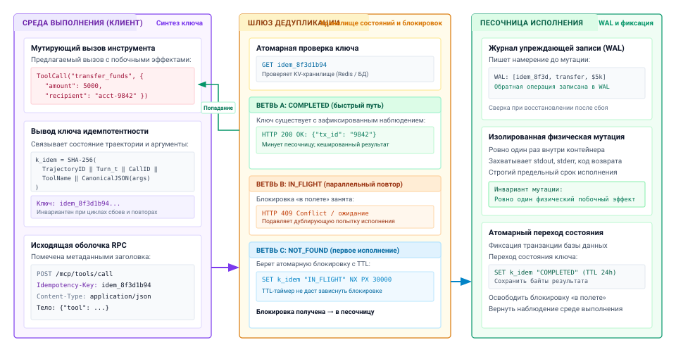
***Поток выполнения с нонсом идемпотентности и шлюз дедупликации**: архитектурный протокол идемпотентности распределенного исполнения инструментов. Надзорный компонент клиента синтезирует детерминированный 128-битный ключ идемпотентности ($k_{\text{idem}}$), связывающий идентификатор сессии, ход траектории и каноническое хеш-значение аргументов. Удаленный шлюз дедупликации проверяет свое транзакционное хранилище «ключ — значение» и ветвится по трем путям исполнения: возвращает кешированные байты наблюдения при статусе `COMPLETED` (ветвь A), отклоняет или ожидает параллельного повтора при статусе `IN_FLIGHT` (ветвь B), либо получает атомарную распределенную аренду через `SETNX` при статусе `NOT_FOUND` (ветвь C), чтобы выполнить мутацию один раз в изолированной песочнице и добавить запись в журнал упреждающей записи.*

Полный сквозной поток исполнения подробно описан в [«Потоке выполнения с нонсом идемпотентности и шлюзе дедупликации»](07_tool_calling.md#fig-vol3-idempotency-flow) и прослеживает жизненный цикл диспетчеризации мутирующего инструмента через три согласованные подсистемы:

1. *Синтез нонса надзорным компонентом клиента:* когда модель выдает мутирующий вызов инструмента (например, `transfer_funds`), надзорный компонент хоста вычисляет детерминированный 128-битный ключ идемпотентности $k_{\text{idem}} = \text{SHA-256}(\text{SessionID} \mathbin{\Vert} \text{Turn}_t \mathbin{\Vert} \text{ToolName} \mathbin{\Vert} \text{CanonicalJSON}(\text{args}))$. Прикрепление этого ключа как заголовка HTTP `Idempotency-Key` гарантирует, что идентичность диспетчеризации переживет циклы сбоев и повторные отправки.

2. *Инспекция шлюза дедупликации:* получив полезную нагрузку из сети, шлюз запрашивает свое транзакционное хранилище состояния (`GET k_idem`) и запускает одну из трех взаимно исключающих ветвей исполнения:
   - *Ветвь A (`COMPLETED`, попадание в кеш быстрого пути):* мутация уже выполнена успешно. Шлюз немедленно возвращает сохраненную полезную нагрузку наблюдения (`HTTP 200 OK`), полностью обходя исполнение в контейнере песочницы и предотвращая дублирующие физические операции.
   - *Ветвь B (`IN_FLIGHT`, параллельный повтор):* активная аренда исполнения уже удерживается параллельным рабочим. Шлюз отвечает `HTTP 409 Conflict` или уступает исполнение, подавляя избыточное исполнение, пока основная задача урегулируется.
   - *Ветвь C (`NOT_FOUND`, первое исполнение):* ключ не встречался. Шлюз получает атомарную распределенную блокировку-аренду через `SET k_idem "IN_FLIGHT" NX PX 30000` и пересылает запрос подсистеме исполнения.
3. *Песочница исполнения и атомарная фиксация:* изолированная песочница контейнера записывает намерение транзакции в журнал упреждающей записи только для добавления (WAL), выполняет физическую мутацию ровно один раз и переводит состояние ключа в хранилище в `COMPLETED` с сериализованными выходными байтами, прежде чем освободить распределенную блокировку-аренду.

```python
def dispatch_with_idempotency(client, tool_name: str, args: dict) -> dict:
    """Отправляет изменяющий вызов инструмента с детерминированным ключом идемпотентности."""
    key = client.generate_key(tool_name, args)
    for attempt in range(client.max_retries):
        try:
            return client.transport.post(
                f"/tools/{tool_name}",
                json=args,
                headers={"Idempotency-Key": key},
                timeout=client.timeout_sec
            )
        except (TimeoutError, ConnectionError):
            time.sleep(client.backoff_factor * (2 ** attempt))
    raise ActuationTimeoutError(f"Tool {tool_name} failed settlement after retries.")
```

Длительность аренды исполнения $T_{\text{lease}}$ должна выбираться осознанно. Если $T_{\text{lease}} \le \tau_{\text{timeout}}$, преждевременное истечение аренды позволяет вторичному рабочему запуститься, пока основной рабочий еще активно исполняет операцию, и возникает исполнение типа «раздвоение мозга» (split-brain). Поэтому система должна обеспечивать инвариант длительности аренды:

$$T_{\text{lease}} > \tau_{\text{timeout}} + \delta_{\text{drift}} + \tau_{\text{proc\_max}}$$

где $\delta_{\text{drift}}$ учитывает максимально допустимое расхождение часов между узлами, а $\tau_{\text{proc\_max}}$ представляет верхнюю границу задержки обработки на стороне сервера до прерывания исполнения.

<a id="nbk-07-quantifying-actuation-blast-radius-and"></a>

> **Оценка радиуса поражения действий и границ аренды**
>
> **Сценарий:** среда выполнения агентов управляет кластером из 50 автономных рабочих, которые взаимодействуют с внешним API подготовки инфраструктуры.
>
> **Эмпирические параметры:**
>
> * Таймаут вызова на клиенте: $\tau_{\text{timeout}} = 1200\text{ мс}$
> * Задержка исполнения микросервиса: $T_{\text{exec}} \sim \mathcal{N}(\mu = 450\text{ мс}, \sigma = 80\text{ мс})$
> * Задержка кругового обхода сети: $\text{RTT}_{99} = 150\text{ мс}$
> * Вероятность потери сетевого пакета: $p_{\text{drop}} = 0{,}02$ (независимо на исходящем и входящем каналах)
> * Максимальный сдвиг часов между клиентом и шлюзом: $\delta_{\text{drift}} = 25\text{ мс}$
> * Ежедневные мутирующие диспетчеризации на рабочего: $N_{\text{daily}} = 4000$ операций
>
> **Расчеты:**
>
> 1. *Вероятность неопределенного таймаута:*
> Таймаут возникает, если время кругового обхода сети плюс время исполнения на сервере превышает $\tau_{\text{timeout}}$, или если теряется пакет запроса или ответа.
> $$\Pr(\text{drop}) = 1 - (1 - p_{\text{drop}})^2 = 1 - (0{,}98)^2 = 1 - 0{,}9604 = 0{,}0396 \quad (3{,}96\%)$$
>
> Хвостовая задержка, превышающая $\tau_{\text{timeout}}$ (при допущении детерминированной сетевой задержки $\text{RTT} = 150\text{ мс}$):
> $$\tau_{\text{avail}} = \tau_{\text{timeout}} - \text{RTT} = 1200 - 150 = 1050\text{ мс}$$
> $$Z = \frac{1050 - 450}{80} = \frac{600}{80} = 7{,}5$$
> Поскольку $Z = 7{,}5$, вероятность таймаута из-за хвостовой задержки при нормальной работе пренебрежимо мала ($< 10^{-12}$). Поэтому частоту таймаутов определяют потери сетевых пакетов:
> $$\Pr(\text{timeout}) \approx \Pr(\text{drop}) \approx 0{,}0396$$
>
> 2. *Ежедневные дублирующие мутации при наивных повторах:*
> Общее число мутирующих диспетчеризаций по кластеру:
> $$N_{\text{total}} = 50 \times 4000 = 200\,000 \text{ операций/сут}$$
> Общее число встреченных событий таймаута:
> $$N_{\text{timeout}} = 200\,000 \times 0{,}0396 = 7\,920 \text{ таймаутов/сут}$$
> Критическое условие возникает, когда таймаут вызван именно потерей входящего ответа ($\sigma_{\text{sever}}$):
> $$\Pr(\sigma_{\text{sever}}) = (1 - p_{\text{drop}}) \times p_{\text{drop}} = 0{,}98 \times 0{,}02 = 0{,}0196 \quad (1{,}96\%)$$
> Ожидаемое число дублирующих побочных эффектов в день при стратегии повтора в разомкнутом контуре:
> $$N_{\text{duplicates}} = 200\,000 \times 0{,}0196 = 3\,920 \text{ catastrophic duplicate executions/day}$$
>
> 3. *Минимальная безопасная длительность аренды ($T_{\text{lease}}$):*
> Чтобы гарантировать, что блокировка на стороне сервера не истечет во время исполнения, оцениваем максимальный порог обработки на уровне $6\sigma$:
> $$\tau_{\text{proc\_max}} = \mu + 6\sigma = 450 + 6(80) = 930\text{ мс}$$
> Проверяем системный инвариант:
> $$T_{\text{lease}} > \tau_{\text{timeout}} + \delta_{\text{drift}} + \tau_{\text{proc\_max}} = 1200\text{ мс} + 25\text{ мс} + 930\text{ мс} = 2155\text{ мс}$$
> Архитектор системы должен настроить таблицу дедупликации на стороне сервера так, чтобы длительность аренды составляла $T_{\text{lease}} \ge 2{,}2\text{ с}$.

Помимо предотвращения дублирующих мутаций, кеширование результатов детерминированных инструментов с адресацией по содержимому открывает мощную синергию между подсистемами: возвращая побайтово идентичные строки наблюдений, шлюз исполнения сохраняет выравнивание префикса промпта в дереве Radix кеша движка вывода. Эта синергия между кешированием исполнения и повторным использованием кадров памяти GPU показана на [«Мемоизации результатов инструментов с адресацией по содержимому и синергии с кешем префиксов»](07_tool_calling.md#fig-vol3-tool-result-prefix-cache-synergy).

<a id="fig-vol3-tool-result-prefix-cache-synergy"></a>

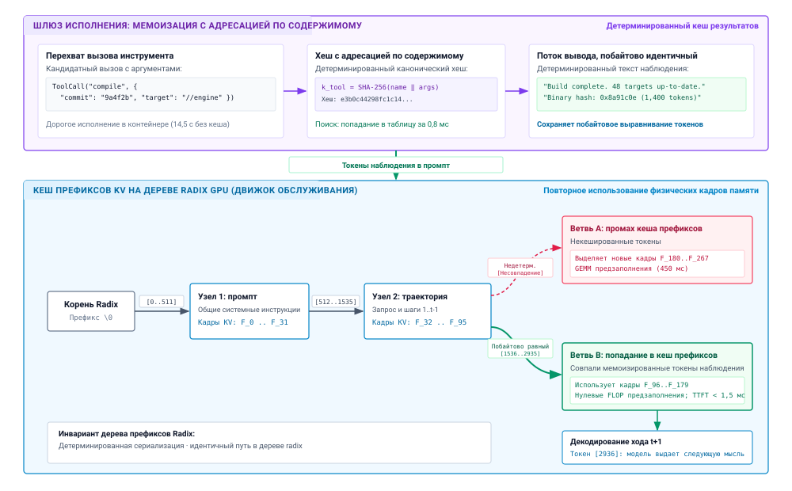
***Мемоизация результатов инструментов с адресацией по содержимому и синергия с кешем префиксов**: сквозная интеграция между шлюзом исполнения и движком обслуживания вывода на GPU. Шлюз перехватывает дорогие или детерминированные вызовы инструментов (`compile`), вычисляя канонический хеш SHA-256 ($k_{\text{tool}}$), чтобы возвращать побайтово идентичный текст наблюдения за $0{,}8\text{ мс}$ вместо сборки контейнера за $14{,}5\text{ с}$. Добавление идентичных байтов наблюдения позволяет дереву Radix GPU напрямую совпасть с узлом 3b, что дает полное попадание в кеш префикса, нулевой пересчет операций предзаполнения и время до первого токена (TTFT) менее миллисекунды.*

Как показано на иерархии дерева Radix в [«Мемоизации результатов инструментов с адресацией по содержимому и синергии с кешем префиксов»](07_tool_calling.md#fig-vol3-tool-result-prefix-cache-synergy), движок обслуживания вывода (например, vLLM или SGLang) организует активные блоки KV-кеша как дерево с корнем в $\varnothing$. Общие системные инструкции образуют общий префикс (узел 1, токены $0\text{--}511$, опирающийся на физические кадры HBM $F_0\dots F_{31}$), за которым следует история траектории (узел 2, токены $512\text{--}1535$, кадры $F_{32}\dots F_{95}$). Когда агент диспетчеризует дорогой инструмент (например, `ToolCall("compile", ...)`), незакешированный запуск занимает $14{,}5\text{ с}$ в песочнице контейнера. С мемоизацией с адресацией по содержимому ($k_{\text{tool}} = \text{SHA-256}(\dots)$) шлюз извлекает сохраненные байты наблюдения за $0{,}8\text{ мс}$. Если выход инструмента недетерминирован (ветвь A, выдающая случайные метки времени или идентификаторы процессов), полученная последовательность токенов расходится с существующими ребрами дерева и вызывает промах кеша префикса. Движок должен выделить новые физические кадры ($F_{180}\dots F_{267}$) и вычислить ограниченный вычислениями GEMM внимания предзаполнения ($450\text{ мс}$). И наоборот, когда шлюз гарантирует побайтово идентичную сериализацию (ветвь B), токены наблюдения ($1536\text{--}2935$) точно совпадают с узлом 3b. Движок повторно использует существующие физические кадры ($F_{96}\dots F_{179}$) через перестановку указателей, полностью исключая пересчет предзаполнения и сокращая время до первого токена (TTFT) для хода $t+1$ до менее чем $1{,}5\text{ мс}$.

### Зонды сверки состояния для неподатливых конечных точек

В реальных вычислительных средах среды выполнения агентов часто взаимодействуют с *неподатливыми конечными точками* — внешними сервисами, средами оболочки POSIX, устаревшими инструментами командной строки и сторонними REST API, которые не поддерживают заголовки идемпотентности. Когда инструмент оболочки выполняет `git commit -m "update"` или `curl -X POST https://api.legacy.org/orders` внутри изолированной песочницы контейнера, среда выполнения не может передать ключ идемпотентности, чтобы предотвратить двойное исполнение.

Когда неподатливый вызов инструмента сталкивается с неоднозначным таймаутом $\tau_{\text{timeout}}$, среда выполнения переходит от дедупликации ключей на уровне транспорта к замкнутым *зондам сверки состояния*, формальная логика решения которых отображена в [«Архитектуре зонда сверки состояния для неподатливых конечных точек»](07_tool_calling.md#fig-vol3-state-reconciliation-flow). Вместо немедленной повторной отправки надзорный компонент перехватывает неоднозначный таймаут, подавляет слепую повторную диспетчеризацию и запускает зонд-запрос, чтобы проверить, завершилась ли целевая мутация.

<a id="fig-vol3-state-reconciliation-flow"></a>

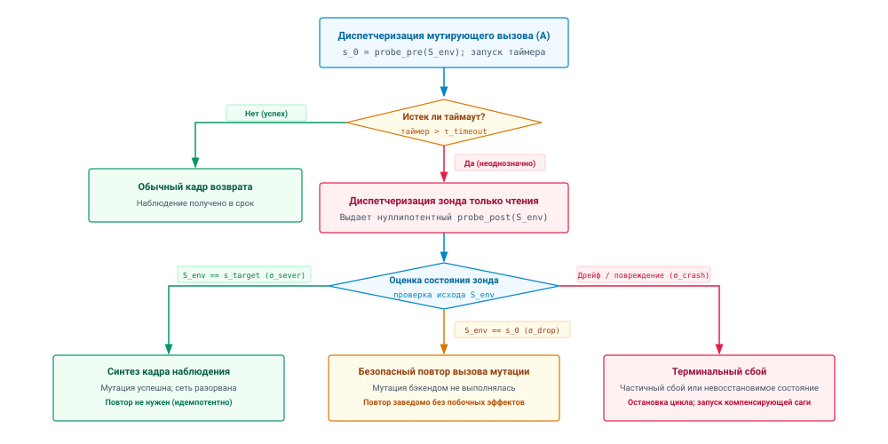
***Архитектура зонда сверки состояния для неподатливых конечных точек**: протокол сверки состояния в замкнутом контуре при неоднозначных таймаутах RPC. Если мутирующая диспетчеризация инструмента вызывает таймаут ($\tau_{\text{timeout}}$), надзорный компонент подавляет автоматическую повторную отправку и выдает легковесный нуллипотентный зонд-запрос ($\text{probe}_{\text{post}}$). Протокол ветвится на три взаимно исключающих исхода: синтезирует кадр успеха, если постусловие выполнено ($\sigma_{\text{sever}}$), безопасно повторно диспетчеризует, если среда осталась в исходном состоянии $s_0$ ($\sigma_{\text{drop}}$), или вызывает терминальный сбой, если состояние сместилось или повреждено ($\sigma_{\text{crash}}$).*

Как показано на [«Архитектуре зонда сверки состояния для неподатливых конечных точек»](07_tool_calling.md#fig-vol3-state-reconciliation-flow), машина состояний сверки проходит четыре синхронизированные фазы решения:

1. **Фиксация предусловия:** перед диспетчеризацией неидемпотентного действия $A$ среда выполнения запрашивает у целевой среды текущий параметр состояния $s_0 = \text{probe}_{\text{pre}}(S_{\text{env}})$. Например, перед добавлением блока текста конфигурации в файл надзорный компонент фиксирует текущий хеш содержимого файла SHA-256 и смещение в байтах.
2. **Фиксация неоднозначного таймаута:** если инструмент исполнения вызывает сетевой таймаут, среда выполнения перехватывает сбой, блокирует цикл планирования рассуждений агента и переходит в машину состояний сверки.

3. **Запрос постусловия:** среда выполнения выдает легковесный строго нуллипотентный зонд $\text{probe}_{\text{post}}(S_{\text{env}})$, предназначенный для проверки того, выполняется ли ожидаемое постусловие.
   * Если постусловие выполняется (например, хеш целевого файла совпадает с ожидаемым состоянием после мутации или `git log -1` показывает целевой хеш коммита), среда выполнения распознает, что произошел сценарий $\sigma_{\text{sever}}$. Мутация прошла успешно; повторное исполнение запрещено. Надзорный компонент формирует синтетический кадр наблюдения $\mathcal{O}_{\text{synthetic}}$, который сообщает об успешном исполнении, и внедряет его обратно в поток контекста модели.
   * Если среда остается в состоянии $s_0$ (смещение в байтах и хеш файла идентичны снимку до исполнения), среда выполнения подтверждает сценарий $\sigma_{\text{drop}}$. Мутация не исполнялась. Надзорный компонент теперь может повторно диспетчеризовать исходное действие без риска дублирующих побочных эффектов.
   * Если среда отражает неизвестное промежуточное состояние $s_{\text{corrupt}} \notin \{s_0, s_{\text{target}}\}$ (сценарий $\sigma_{\text{crash}}$), надзорный компонент немедленно останавливает исполнение. Он изолирует среду и поднимает структурированный системный сбой в цикл рассуждений агента, не допуская дальнейших автономных действий, пока согласованность не будет восстановлена.

Обеспечивая дедупликацию по ключам на современных конечных точках и структурированные зонды сверки на устаревших интерфейсах, среда выполнения агента изолирует лежащую в основе систему от недетерминированных сетевых сбоев.

Как только эти примитивы исполнения гарантируют, что действие урегулировано в авторитетном неповрежденном состоянии, среда выполнения сталкивается со следующей системной задачей: захватить данные, которые выдает внешний процесс. Когда команда завершается успешно, она часто возвращает не чистое однострочное подтверждение, а тысячи строк подробных журналов сборки, дампов памяти или сырых потоков терминала. Как среда выполнения захватывает, буферизует и усекает эти огромные потоки наблюдений, не переполняя физическое окно контекста модели, — предмет следующего раздела.

<a id="sec-vol3-tool-calling-streaming"></a>

## Усечение потока наблюдений

Один вызов инструмента длиной всего в двадцать символов, например запуск `pytest tests/` или выполнение `find / -name "*.py"`, может породить внешний процесс, который выдает восемьдесят мегабайт сырого текста в более чем миллионе строк журналов исполнения. Если среда выполнения агента на хосте наивно захватывает этот поток и дописывает его прямо в рабочий контекст модели, система сталкивается с немедленным и катастрофическим сбоем ресурсов. Емкость контекста модели ($S_{\max}$), какой бы большой она ни была в современных архитектурах, — это строго ограниченный бюджетом и дорогой физический ресурс. Прием неограниченного потока наблюдений не только угрожает немедленным переполнением окна контекста, но и потребляет гигабайты высокоскоростной памяти (HBM) ускорителя для хранения KV-кеша на фазе предзаполнения, увеличивает задержки времени до первого токена (TTFT) на порядки и вытесняет параллельные пакеты запросов в движке обслуживания вывода.

**Среда выполнения должна рассматривать каждый внешний поток наблюдений как недоверенного и неограниченного поставщика данных.** Между сырым транспортом операционной системы и буфером подготовки контекста среда выполнения вставляет многоступенчатый конвейер наблюдений, показанный на [«Приеме потока наблюдений и архитектуре усечения „сэндвичем“»](07_tool_calling.md#fig-vol3-stream-ingestion).

<a id="fig-vol3-stream-ingestion"></a>

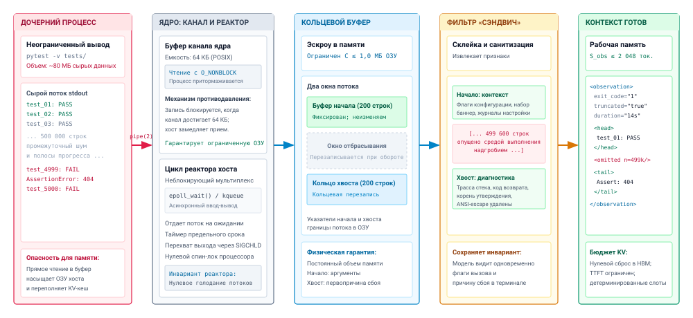
***Прием потока наблюдений и архитектура усечения «сэндвичем»**: сквозной тракт наблюдений, который отделяет неограниченную эмиссию дочернего процесса от рабочей памяти ускорителя. Сырой stdout непривилегированного дочернего процесса проходит через буфер ядра `pipe(2)` (64 КБ) с противодавлением `O_NONBLOCK` в асинхронный реакторный цикл хоста. Поток попадает в ограниченный кольцевой буфер ($C \le 1{,}0\text{ МБ}$) в эскроу памяти хоста, где фильтр «сэндвич» соединяет начальные строки и хвостовые диагностические трассы, вставляя между ними надгробие пропуска, и формирует ограниченный кадр наблюдения ($S_{\text{obs}} \le 2\,048\text{ токенов}$) для подготовки контекста.*

Как подробно показано на [«Приеме потока наблюдений и архитектуре усечения „сэндвичем“»](07_tool_calling.md#fig-vol3-stream-ingestion), этот тракт отделяет эмиссию внешнего процесса от подготовки контекста нейросети через пять согласованных стадий:

1. *Неограниченный производитель (дочерний процесс):* непривилегированный дочерний процесс (например, средство запуска тестов, выполняющее `pytest -v tests/`) генерирует до $80\text{ МБ}$ сырых потоковых данных в 500 000 строках. Прямой прием переполнил бы оперативную память хоста и исчерпал бы выделения KV-кеша ускорителя.
2. *Канал ядра ОС и цикл реактора:* межпроцессная передача опосредована POSIX-каналом `pipe(2)` с фиксированным буфером ядра 64 КБ. Надзорный компонент хоста читает порции с помощью `O_NONBLOCK` через асинхронный цикл событий (`epoll_wait(2)` или `kqueue`). Когда канал заполняется, ядро снимает с исполнения пишущий дочерний процесс, применяя физическое противодавление, которое ограничивает потребление памяти.
3. *Кольцевой буфер (эскроу памяти):* в памяти хоста входящие байты удерживаются в эскроу, ограниченном $C \le 1{,}0\text{ МБ}$. Двойные указатели потока отслеживают первые $N_{\text{head}} = 200$ строк в неизменяемом буфере начала и последние $N_{\text{tail}} = 200$ строк в скользящем кольцевом буфере, отбрасывая шумные промежуточные части потока на месте.
4. *Фильтр «сэндвич»:* фильтр соединяет часть с настройкой вызова из начала и итоговые утверждения и трассы стека из хвоста, заменяя отброшенные строки явным надгробием (`[... 499,600 lines omitted by runtime ...]`).
5. *Рабочая память, подготовленная для контекста:* получившийся текст сериализуется в структурированный кадр наблюдения ($S_{\text{obs}} \le 2\,048\text{ токенов}$), помеченный кодами возврата POSIX и метриками длительности исполнения, что гарантирует детерминированное выделение KV-кеша без вытеснения в HBM.

### Асимметрия исполнения

Взаимодействие между средой выполнения агента и ее внешними инструментами демонстрирует фундаментальную энтропийную асимметрию. Исходящая команда исполнения, которую выдает модель, компактна и сильно структурирована, редко превышая несколько десятков токенов, оформленных как диспетчеризация JSON-RPC или вызов командной строки. Напротив, входящий поток наблюдений, который выдает внешняя среда хоста, имеет неограниченную кардинальность. Неоптимизированный компилятор, выдающий подробные предупреждения о создании шаблонов, менеджер пакетов, загружающий глубокие деревья зависимостей, или рекурсивный поиск по каталогам легко могут создавать мегабайты текста в секунду.

Когда среда выполнения агента слепо принимает неограниченный поток наблюдений в массив контекста, цена платится прямо в памяти и вычислениях ускорителя. В современных трансформерных средах выполнения потребление контекста — это не просто абстрактный предел длины последовательности; оно определяет физическое выделение блоков памяти внутри пула PagedAttention системы обслуживания. Каждый допущенный токен наблюдения должен быть спроецирован в тензоры ключей и значений и храниться в HBM ускорителя на протяжении всей многоходовой траектории агента.

<a id="nbk-07-physical-memory-and-compute-overhead"></a>

> **Физический объем памяти и вычислительные накладные расходы без усечения**
>
> Рассмотрим автономного агента, который выполняет задачу программной верификации, используя непривилегированный надзорный компонент среды выполнения. Модель выдает компактную команду: `pytest -v tests/unit/`. Эта команда запускает набор регрессионных тестов, который выполняет $4\,500$ модульных тестов и выдает $24\text{ МБ}$ stdout в $520\,000$ строках.
>
> Допустим, стандартное кодирование парами байтов (Byte-Pair Encoding, BPE) дает примерно $4\text{ байт}$ на токен, и тогда поток $24\text{ МБ}$ превращается в:
> $$N_{\text{obs}} = \frac{24 \times 10^6\text{ байт}}{4\text{ байт/токен}} = 6{,}0 \times 10^6\text{ токенов}$$
>
> Теперь рассмотрим движок обслуживания, на котором работает базовая модель с 70 миллиардами параметров, использующая групповое внимание с запросами (Grouped-Query Attention, GQA) со следующими архитектурными параметрами:
>
> - Слои трансформера: $L = 80$
> - Головы ключей и значений: $H_{\text{kv}} = 8$
> - Размерность головы: $D_{\text{head}} = 128$
> - Точность: 16-битное число с плавающей запятой ($\text{bytes\_per\_element} = 2$)
>
> Физический объем памяти KV-кеша, который требуется на токен:
> $$M_{\text{token}} = 2 \times L \times H_{\text{kv}} \times D_{\text{head}} \times \text{bytes\_per\_element}$$
> $$M_{\text{token}} = 2 \times 80 \times 8 \times 128 \times 2 = 327\,680\text{ байт} \approx 320\text{ KB/токен}$$
>
> Если среда выполнения принимает весь неусеченный поток ($N_{\text{obs}} = 6{,}0 \times 10^6\text{ токенов}$), физический объем памяти, необходимый для хранения одного только KV-кеша наблюдения, составляет:
> $$M_{\text{total}} = 6{,}0 \times 10^6 \times 320\text{ КБ} \approx 1{,}92\text{ ТБ HBM}$$
>
> Это превышает общую физическую память узла из восьми GPU NVIDIA H100 ($8 \times 80\text{ ГБ} = 640\text{ ГБ}$). Даже если модель использует расширенное логическое окно контекста ($S_{\max} = 128\text{K}\text{ tokens}$), сырое наблюдение превышает границу окна в $46{,}8\times$. Прием вплоть до жесткой границы в $128\text{K}\text{ tokens}$ все равно монополизировал бы:
> $$M_{128\text{K}} = 131\,072 \times 320\text{ КБ} = 40{,}96\text{ ГБ HBM}$$
> Кроме того, обработка $128\text{K}$ токенов наблюдения на фазе предзаполнения требует примерно $2 \times N_{\text{tokens}} \times P_{\text{model}} \approx 2 \times 1{,}31 \times 10^5 \times 7{,}0 \times 10^{10} \approx 1{,}83 \times 10^{16}\text{ FLOPs}$, что блокирует GPU H100 (работающий с пропускной способностью $989\text{ TFLOPs}$ плотного FP16) в простое вычислений предзаполнения более чем на $18{,}5\text{ с}$ до генерации первого выходного токена.
>
> Напротив, активный конвейер наблюдений, который обеспечивает строгий потолок байтов $B_{\text{ceiling}} = 32\text{ КБ}$ ($\approx 8\,000\text{ токенов}$), ограничивает выделение KV-кеша $2{,}56\text{ ГБ}$ и держит задержку предзаполнения ниже $1{,}2\text{ с}$, сохраняя память ускорителя и параллелизм пакетов для нескольких арендаторов.

Физическая реальность движков обслуживания на ускорителях означает, что неусеченный поток наблюдений — это атака на доступность самого агента. Убежавший подпроцесс может вызвать физические сбои нехватки памяти (`CUDA OOM`), вытеснить параллельные траектории рассуждения или раздуть задержку вывода за пределы порогов живости среды выполнения.

<a id="nbk-07-observation-budget"></a>

> **Цена переноса одного наблюдения через траекторию**
>
> **Задача:** прогон тестов выдает 24 МБ вывода. Текст журнала, полный путей, хешей и escape-последовательностей, токенизируется плотнее, чем проза ([«Дискретное представление токенов»](02_foundation_model.md#sec-vol3-foundation-model-tokenization)), примерно по 3 байта на токен вместо четырех. У модели окно контекста 128 000 токенов, а траектория сделает еще 30 вызовов модели после этого. Некешированный ввод стоит \$3 за миллион токенов, а кешированный ввод стоит 10 % от этой цены. Во что обходится возврат вывода обратно: в исходном виде и сформированным до бюджета в 4 000 токенов?
>
> **В исходном виде.** Журнал занимает около 8 M токенов, что в 62,5× превышает все окно. Его вообще нельзя вернуть обратно. Среда выполнения, которая просто заполняет окно его первой частью, не оставляет места для задачи и переносит полное окно через каждый последующий вызов, примерно \$1,15 кешированного ввода за оставшиеся вызовы, в то время как упавший тест в конце журнала так и не попадает к модели.
>
> **Сформированный вариант.** Наблюдение объемом 4 000 токенов занимает 3,1 % окна. Перенесенное через оставшиеся вызовы, оно добавляет 120 000 входных токенов: \$0,36, если префикс никогда не кешировался, и \$0,036, когда он кешируется.
>
> **Системный вывод:** стоимость наблюдения равна его размеру, умноженному на число последующих вызовов, которые его читают. Формировать вывод в момент захвата — единственная точка, где это произведение дешево сократить, потому что после того как наблюдение попало в историю, его удаление ломает закешированный префикс каждого последующего вызова ([«Сжатие контекста»](04_context_engineering.md#sec-vol3-context-engineering-compaction)).

### Механика хвостового чтения без терминала

Чтобы потоки наблюдений не исчерпывали бюджеты контекста, среды выполнения должны реализовать автоматическое усечение потока. Конструкция политики усечения зависит от пространственного распределения диагностической информации в выходах инструментов. В разработке программного обеспечения, анализе данных и системном администрировании выходы инструментов редко информативны равномерно. Компиляторы, системы сборки, средства запуска тестов и утилиты поиска в командной строке демонстрируют асимметричную диагностическую топологию в своих потоках исполнения:

1. **Заголовок вызова (префикс потока):** первые $10$–$50$ строк обычно содержат конфигурацию среды, флаги оптимизации компилятора, активный рабочий каталог, найденные цели тестов или графы зависимостей. Этот префикс задает детерминированный контекст исполнения.
2. **Промежуточная трасса исполнения (тело потока):** последующие тысячи, а иногда и миллионы строк состоят из индикаторов хода с низкой энтропией, таких как непрерывные уведомления компилятора, повторяющиеся строки статуса или успешные проверки тестов (`test_0001 ... ok`). Информационная плотность этого раздела близка к нулю.
3. **Диагностический итог (хвост потока):** последние $50$–$200$ строк содержат критический диагностический сигнал, который привел к завершению процесса: синтаксическую ошибку компилятора, сообщение о провалившейся проверке, трассу стека с состояниями регистров и строками исходного кода, а также итоговую строку статуса (`FAILED (failures=1, errors=0)`).

```bash
[Line 000001] $ cargo test --all
[Line 000002] Compiling kernel v0.1.0 (/workspace/core)
[Line 000003] Running 48219 tests across 14 modules
... [48,200 lines of passing tests: "test engine::... ok"] ...
[Line 48205] test memory::paging::test_allocator ... FAILED
[Line 48206]
[Line 48207] failures:
[Line 48208] ---- memory::paging::test_allocator stdout ----
[Line 48209] thread 'test_allocator' panicked at 'assertion failed: `(left == right)`', src/memory.rs:142:9
[Line 48210]   left: `0x00007fff`, right: `0x00000000`
[Line 48211] stack backtrace:
[Line 48212]    0: std::panicking::begin_panic
[Line 48213]    1: kernel::memory::paging::allocate_frame
[Line 48214]
[Line 48215] test result: FAILED. 48218 passed; 1 failed; 0 ignored
```

Применение наивного усечения головы, то есть сохранение первых $N$ байт выхода и отбрасывание остального, губительно. Наблюдение, усеченное с головы, захватывает начальный баннер сборки и первые десяток успешных тестов, но полностью отбрасывает ошибку компилятора или трассу стека. Модель получает наблюдение, которое говорит, что тесты запускались, видит ненулевой код возврата, но не располагает ни одним токеном, объясняющим, *почему* процесс завершился неудачей. Это порождает эпистемическую слепоту и толкает модель в вырожденные петли галлюцинаций, в которых она пытается случайным образом менять код без обратной связи.

Среда выполнения должна вместо этого реализовать *хвостовое чтение без терминала* по схеме усечения «Сэндвич» (начало и хвост). Среда выполнения резервирует бюджет наблюдения $B_{\text{max}}$ байт, распределяя этот объем между префиксом и суффиксом потока:

$$B_{\text{max}} = B_{\text{head}} + B_{\text{tombstone}} + B_{\text{tail}}$$

Буфер начала непосредственно захватывает первые $B_{\text{head}}$ байт выхода. Для хвоста среда выполнения выделяет в памяти кольцевой буфер фиксированного размера, который содержит не менее $B_{\text{tail}}$ байт. Когда подпроцесс выдает данные, байты непрерывно записываются в кольцевой буфер, естественным образом перезаписывая самые старые промежуточные строки трассы, как только емкость исчерпана.

Когда дочерний процесс завершается, среда выполнения извлекает непрерывный префикс из буфера начала, добавляет синтетическую *запись-надгробие*, которая подробно описывает точный физический объем отброшенных данных, и дописывает итоговое содержимое кольцевого буфера:

```bash
[... 48,195 lines and 4,182,041 bytes truncated by runtime supervisor ...]
```

Маркер-надгробие сохраняет семантическую целостность, явно уведомляя модель об отсутствующей информации и указывая и число строк, и объем байтов, которые опущены. Это отличает намеренное усечение от аварийного завершения процесса.

**Бюджеты в байтах и количество строк**
Границы усечения всегда должны задаваться по *сырому числу байтов*, а не только по числу строк. Вырожденный процесс, который выдает одну строку неминифицированного JSON или дамп двоичных данных в base64 объемом $50\text{ МБ}$, обходит фильтры по строкам (`tail -n 100`) и вызывает немедленное переполнение памяти.

Политики усечения должны строго соблюдать физические бюджеты в байтах, прежде чем пытаться делить текст на строки или токены. Разбиение по строкам или токенам без предварительного фильтра подвергает среду выполнения риску исчерпания памяти на входных данных, не содержащих разделителей строк. Среда выполнения потребляет поток как ограниченную последовательность сырых байтов, режет окно по допустимым границам кодовых точек UTF-8, чтобы не допустить порчи декодирования, и только затем выполняет форматирование по строкам и токенизацию для подготовки контекста.

### Контракты структурированной пагинации

Командные утилиты опираются на терминальные потоки, которые требуют пассивного хвостового чтения, а структурированные инструменты, такие как клиенты баз данных, поисковые сервисы, векторные индексы и инспекторы файловых систем, не должны выдавать сырые, неограниченные коллекции выходных данных. Интерфейс инструмента, который допускает неограниченный запрос (например, `SELECT * FROM audit_logs` или `list_files(directory="/")`), нарушает принцип наименьших привилегий и ограничение контекста на уровне контракта API.

Для поставщиков структурированных данных среда выполнения агента должна обеспечивать *контракт пагинированного запроса*. Этот контракт задает два обязательных архитектурных инварианта:

1. **Фиксированные потолки страниц ($K \le K_{\max}$):** интерфейс инструмента отклоняет неограниченные запросы и задает строгую верхнюю границу числа возвращаемых записей за одну диспетчеризацию (обычно $K_{\max} \le 50$). Если модель запрашивает размер пакета, превышающий $K_{\max}$, среда выполнения ограничивает параметр этим потолком.
2. **Непрозрачные токены продолжения (`cursor`):** если запрос соответствует коллекции сущностей, большей, чем потолок страницы, инструмент возвращает текущую страницу результатов вместе с непрозрачным токеном продолжения (`next_cursor`). Курсор инкапсулирует детерминированное состояние, необходимое для возобновления обхода при последующем исполнении.

Порождение и жизненный цикл токенов продолжения вводят конкретный системный компромисс между использованием памяти хоста и согласованностью запросов ([«Серверные курсоры с состоянием против клиентских курсоров без состояния с подписью»](07_tool_calling.md#tbl-vol3-cursor-architecture-comparison)). Среда выполнения может реализовать состояние пагинации либо через серверные аренды сессий, либо через клиентские зашифрованные токены без состояния.

| Архитектурное измерение | Серверные курсоры с состоянием | Клиентские курсоры без состояния с подписью |
|:---------------------------|:-------------------------------------------------------|:---------------------------------------------------------|
| **Место хранения состояния** | Память среды выполнения хоста / движок базы данных | Сериализуется в полезную нагрузку контекста |
| **Влияние на память хоста** | $O(S \times M)$ утечек активных соединений | $O(1)$, нулевые накладные расходы памяти среды выполнения на хосте |
| **Гарантия согласованности** | Транзакционная изоляция снимков | Чтение зафиксированных данных (read-committed) или грязный обход |
| **Устойчивость к брошенным запросам** | Требует явных демонов очистки по TTL | Невосприимчивы к брошенным траекториям агента |
| **Накладные расходы контекста** | Минимальные (короткая строка UUID, $\approx 8\text{ токенов}$) | Умеренные (токен base64 HMAC, $\approx 45\text{ токенов}$) |
| **Уязвимость к повтору** | Управляется отзывом аренд на сервере | Требует встроенной проверки метки времени |

<a id="tbl-vol3-cursor-architecture-comparison"></a>

***Серверные курсоры с состоянием против клиентских курсоров без состояния с подписью**: архитектурные компромиссы между памятью сервера, накладными расходами токенов на клиенте и уязвимостью к повтору.*

В агентной архитектуре серверные курсоры с состоянием создают значительные эксплуатационные риски. Если агент инициирует глубокий запрос к базе данных, получает первую страницу и на основании этих результатов меняет план и бросает поиск, серверный курсор остается выделенным. Во время тысяч автономных циклов исполнения брошенные итераторы исчерпывают пулы соединений с базой данных и память хоста, если не развертываются агрессивные демоны очистки по времени жизни (time-to-live, TTL).

Поэтому надежные подсистемы инструментов отдают предпочтение *курсорам без состояния с подписью*. Среда выполнения инструмента сериализует параметры обхода (детерминированный ключ сортировки, последний наблюдаемый идентификатор первичного ключа ($ID_{\text{last}}$), метку времени выдачи ($\tau$) и подпись запроса) в компактную двоичную полезную нагрузку. Эта полезная нагрузка шифруется и аутентифицируется с помощью ключа HMAC, закрытого для надзорного компонента хоста:
$$\text{Cursor} = \text{Base64Encode}\Big(\text{Data} \parallel \text{HMAC}_{K_{\text{runtime}}}(\text{Data})\Big)$$
$$\text{where} \quad \text{Data} = \big(\text{QueryHash} \parallel ID_{\text{last}} \parallel \tau\big)$$

Когда агент предъявляет токен продолжения в последующей диспетчеризации (`query_logs(cursor="eyJhbGci...")`), инструмент проверяет криптографическую подпись, убеждается, что $\tau$ не истекло, и возобновляет обход строго после $ID_{\text{last}}$. Это гарантирует, что среда выполнения на хосте не хранит никакого долговечного состояния сессии и защищена от утечек памяти, вызванных брошенными траекториями исследования.

### Динамика буферизации в ядре

Описанные ранее механизмы управляют тем, как среда выполнения режет и сегментирует данные после того, как они попадают в память хоста. Однако среда выполнения также должна не допускать, чтобы убегающие внешние процессы исчерпали ресурсы операционной системы *во время* генерации. Если неверно сконфигурированный или злонамеренный подпроцесс выполняет бесконечный цикл, генерируя текст со скоростью насыщения шины памяти, например `yes "memory exhaustion"`, среда выполнения не может просто передавать эти данные в неограниченный буфер памяти, пока ожидает завершения процесса. Это исчерпает оперативную память хоста и запустит механизм Linux Out-Of-Memory (OOM) killer, который завершит критические службы среды выполнения.


Как показано на [«Приеме потока наблюдений и архитектуре усечения „сэндвичем“»](07_tool_calling.md#fig-vol3-stream-ingestion), передача данных наблюдения между изолированным дочерним процессом и надзорным компонентом среды выполнения на хосте опосредована каналом межпроцессного взаимодействия (IPC): стандартным однонаправленным каналом данных UNIX, созданным через `pipe(2)`.

Стандартный анонимный канал представляет собой FIFO в памяти, которым управляет ядро. В Linux емкость этого кольцевого буфера по умолчанию ограничена $65\,536\text{ байт}$ ($64\text{ КБ}$, что равно 16 страницам памяти по $4\text{ КБ}$). Емкость можно проверить и увеличить до системного предела, заданного в `/proc/sys/fs/pipe-max-size`, с помощью системного вызова `fcntl(2)` с флагом команды `F_SETPIPE_SZ`.

Конечная емкость буфера канала ядра составляет физическую основу *противодавления операционной системы*. Надзорный компонент среды выполнения управляет исполнением процесса с помощью асинхронного цикла событий, основанного на примитивах мультиплексирования, таких как `epoll(7)` в Linux или `kqueue(2)` в BSD и macOS. Среда выполнения переводит дескриптор чтения потоков stdout и stderr дочернего процесса в неблокирующий режим (`O_NONBLOCK`).

Когда дочерний процесс пишет вывод быстрее, чем среда выполнения его читает, или когда среда намеренно замедляет потребление, буфер канала ядра заполняется. Как только внутренний буфер $64\text{ КБ}$ насыщен, уровень виртуальной файловой системы (VFS) ядра приостанавливает последующий системный вызов `write(2)` дочернего процесса. Операционная система переводит дочерний процесс из очереди исполнения в очередь ожидания (`TASK_INTERRUPTIBLE`), снимая его с физического ядра процессора. Дочерний процесс не может выполнить ни одной дополнительной инструкции, пока надзорный компонент среды выполнения не прочитает данные из канала и не освободит место в буфере ядра.

```c
// Цикл опустошения на стороне супервизора, управляемый событиями, с применением противодавления
struct epoll_event ev, events[MAX_EVENTS];
int epoll_fd = epoll_create1(EPOLL_CLOEXEC);
ev.events = EPOLLIN | EPOLLPRI;
ev.data.fd = pipe_read_fd;
epoll_ctl(epoll_fd, EPOLL_CTL_ADD, pipe_read_fd, &ev);

size_t total_bytes_read = 0;
while (process_is_running) {
    int nfds = epoll_wait(epoll_fd, events, MAX_EVENTS, TIMEOUT_MS);
    for (int i = 0; i < nfds; i++) {
        if (events[i].events & EPOLLIN) {
            ssize_t bytes = read(pipe_read_fd, staging_buf, CHUNK_SIZE);
            if (bytes > 0) {
                total_bytes_read += bytes;
                ring_buffer_write(&tail_ring_buf, staging_buf, bytes);

                // Жесткий потолок: упреждающее завершение процесса
                if (total_bytes_read > HARD_ABORT_CEILING_BYTES) {
                    close(pipe_read_fd); // SIGPIPE придет дочернему процессу при его следующей записи
                    kill(child_pid, SIGKILL);
                    process_is_running = false;
                    break;
                }
            }
        }
    }
}
```

Среда выполнения устанавливает абсолютный потолок общего объема генерации ($B_{\text{abort}}$). Хотя скользящее кольцевое буферное окно поддерживает ограниченный размер наблюдения для подготовки контекста, среда выполнения не может позволить убегающему процессу бесконечно потреблять такты процессора хоста. Надзорный компонент ведет накопительный счетчик байтов:

$$B_{\text{cumulative}} = \sum_{i} \text{read}(fd, \text{chunk}_i)$$

Если $B_{\text{cumulative}}$ пересекает $B_{\text{abort}}$ (например, $100\text{ МБ}$), надзорный компонент немедленно запускает активное завершение. Он закрывает конец чтения канала через `close(2)`. При последующем вызове `write(2)` дочерним процессом ядро обнаруживает, что ни один дескриптор чтения не ссылается на FIFO канала. Ядро прерывает запись, возбуждает ошибку `EPIPE` и автоматически доставляет дочернему процессу сигнал `SIGPIPE`. Если дочерний процесс явно не установил собственный обработчик сигнала, действие по умолчанию для `SIGPIPE` мгновенно завершает процесс. Чтобы неподатливые процессы не задерживались, надзорный компонент следует за этой последовательностью завершения явной доставкой `SIGKILL`.

Благодаря сочетанию неблокирующего опустошения каналов ядра, строгого накопительного учета и принуждения через `SIGPIPE` среда выполнения обеспечивает полную структурную защиту системных ресурсов хоста. Неограниченные потоки-производители превращаются в строго ограниченные срезы памяти до нейросетевого приема, что гарантирует: ни оперативная память хоста, ни HBM ускорителя не могут быть скомпрометированы внешним исполнением.

Когда поток наблюдений механически ограничен, сглажен противодавлением и сведен к срезу байтов в пределах бюджета, среда выполнения сталкивается с более тонкой проблемой целостности данных. Уцелевший байтовый поток часто загрязнен escape-последовательностями ANSI, командами позиционирования курсора в терминале, перезаписями прогресса через возврат каретки и перемешанными чередованиями стандартного вывода и ошибок. Чтобы превратить этот сырой вывод терминала в авторитетную чистую запись наблюдения, требуется детерминированная санитизация терминала, которую мы рассмотрим далее.

<a id="sec-vol3-tool-calling-observation-parsing"></a>

## Санитизация вывода терминала

Подпроцесс, который запускает средство сборки, менеджер пакетов или средство запуска тестов, выдает мегабайты сырых байтовых последовательностей прямо в свои стандартные потоки. Для человека-разработчика, наблюдающего за интерактивным эмулятором терминала, этот поток выглядит как лаконичный и отполированный визуальный интерфейс: анимированные индикаторы сообщают о продолжающейся работе, цветные значки подсвечивают предупреждения компилятора, а команды перемещения курсора плавно обновляют строку прогресса на месте. Однако когда среда выполнения агента направляет эти неопосредованные байтовые потоки прямо в окно контекста базовой модели, этот интерактивный слой представления становится эксплуатационной обузой. Одна полоса загрузки или индикатор теста многократно выдает возврат каретки в сопровождении многобайтовых escape-последовательностей, генерируя десятки тысяч избыточных символов, которые перезаписывают визуальную строку на физическом растровом экране. Если принять эти артефакты форматирования без нормализации, они съедают огромные куски бюджета токенов, дробят таблицы субсловной токенизации, искажают распределения весов внимания по всему промпту и рискуют запустить инъекцию промпта, когда неэкранированные управляющие разделители имитируют собственные границы инструментов.

**ECMA-48 и ANSI X3.64**
Стандартизированный Европейской ассоциацией производителей компьютеров в 1976 году, ECMA-48 определяет управляющие функции, escape-последовательности и состояния сдвига, которые используются для позиционирования курсора, изменения цветов отображения и манипуляции атрибутами символов на физических видеотерминалах.

Между читателем потока POSIX и сборщиком контекста среда выполнения на хосте должна вставить детерминированный конвейер нормализации. Этот конвейер удаляет артефакты escape-последовательностей уровня представления, разрешает перезаписи строк на месте, сохраняет авторитетные коды завершения ядра, извлекает структурированные диагностические кадры и оборачивает усеченные потоки машиночитаемыми метаданными.

Архитектурный тракт этого конвейера санитизации показан на [«Конвейере нормализации терминального потока и разрешения escape-последовательностей»](07_tool_calling.md#fig-vol3-terminal-normalization), который прослеживает байтовый поток через три дискретные фазы обработки:

<a id="fig-vol3-terminal-normalization"></a>

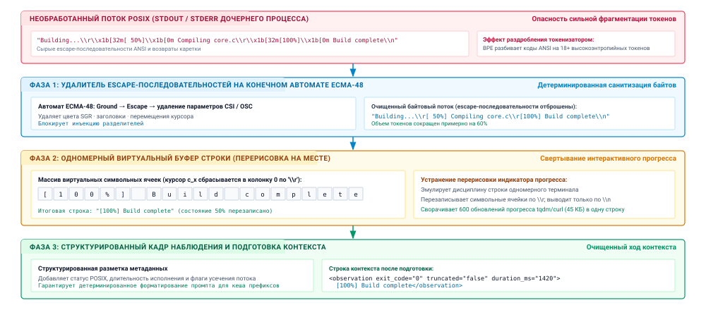
***Конвейер нормализации терминального потока и разрешения escape-последовательностей**: архитектура детерминированной нормализации терминального потока. Сырые байты от дочерних процессов разбираются конечным автоматом ECMA-48, который удаляет escape-последовательности отображения и цвета (фаза 1), после чего одномерный виртуальный буфер строк разрешает перезаписи возвратом каретки (`\r`), сворачивая повторяющиеся строки прогресса в одно терминальное состояние (фаза 2). Очищенные потоки затем заключаются в структурированные кадры наблюдения с кодами возврата и метаданными об усечении (фаза 3).*

Как подробно описано в [«Конвейере нормализации терминального потока и разрешения escape-последовательностей»](07_tool_calling.md#fig-vol3-terminal-normalization), конвейер санитизации выполняет три согласованные фазы преобразования:

1. *Этап 0 (сырой поток POSIX):* дочерние процессы выдают смешанные байтовые последовательности, содержащие печатаемый текст, коды ANSI (`\x1b[32m`) и возвраты каретки (`\r`). Без нормализации стандартные токенизаторы на основе кодирования пар байтов (BPE) раздробляют эти управляющие байты на 18 и более высокоэнтропийных токенов на каждый визуальный кадр статуса, размывая веса внимания и раздувая вычисления предзаполнения.
2. *Фаза 1 (удалитель escape-последовательностей на конечном автомате ECMA-48):* конечный автомат переходит между состояниями `GROUND`, `ESCAPE` и `CSI_ENTRY`, чтобы перехватывать и отбрасывать цвета шрифта Select Graphic Rendition (SGR), определения TrueColor, сдвиги курсора и заголовки терминала. Эта детерминированная санитизация байтов устраняет атаки инъекцией разделителей промпта и сокращает объем токенов примерно на $60\%$.
3. *Фаза 2 (одномерный виртуальный буфер строк):* чтобы разрешать перезаписи строк на месте, которые создают индикаторы прогресса (`tqdm`, `curl`, `wget`), среда выполнения ведет одномерный массив символьных ячеек с активным скалярным курсором $c_x$. Когда возврат каретки (`\r`) встречается без перевода строки (`\n`), $c_x$ сбрасывается в колонку 0, и последующие символы перезаписывают предыдущие ячейки на месте. Сотни промежуточных обновлений прогресса (например, $45\text{ КБ}$ избыточных кадров) таким образом сворачиваются в одну авторитетную терминальную строку (`[100%] Build complete`).
4. *Фаза 3 (структурированный кадр наблюдения):* очищенная строка заключается в авторитетную запись наблюдения с пометками POSIX-кодов возврата, длительности исполнения и метаданных об усечении, перед тем как подготовиться в рабочей памяти контекста.

Для авторегрессионной базовой модели встроенные escape-последовательности — это токсичный шум. Токенизаторы на основе кодирования пар байтов (BPE) обучаются на естественном человеческом языке и исходном коде, а не на сырых захватах терминальных потоков. Поскольку длинные escape-последовательности ANSI, такие как спецификации 24-битного TrueColor (`\x1b[38;2;255;128;0m`), редко встречаются в обучающих корпусах как единые токены, токенизатор дробит восемнадцатибайтовую последовательность на восемь–двенадцать различных субсловных токенов. Компилятор, который выдает пятьдесят цветных строк, может внести в последовательность более тысячи фрагментированных токенов, не передавая никакого семантического различия сверх обычного текста. Хуже того, если враждебный инструмент или недоверенное имя файла содержит неэкранированные команды OSC или пользовательские разделители, совпадающие с протоколом обрамления инструментов среды выполнения агента, неразобранный терминальный поток может захватить управление потоком модели.

Среда выполнения должна обрабатывать сырой байтовый поток через детерминированный конечный автомат (FSM), выведенный из спецификации ECMA-48. Наивная замена строк через регулярные выражения не работает, потому что последовательности ANSI зависят от состояния и контекста: неприкрепленное регулярное выражение может разорвать escape-последовательность, которая протягивается через два соседних фрагмента чтения, и испортить поток. Конечный автомат поддерживает явные состояния разбора: `GROUND`, `ESCAPE`, `CSI_ENTRY`, `CSI_PARAM`, `CSI_INTERMEDIATE` и `OSC_STRING`. Любая последовательность байтов, распознанная как директива цвета SGR, перемещение курсора или команда OSC, отбрасывается до токенизации.

**Возврат каретки на телетайпе**
На механических телетайпах возврат каретки (`\r`, ASCII `0x0D`) физически возвращал каретку к левому полю, не подавая бумагу вверх. Для продвижения бумаги требовался отдельный перевод строки (`\n`, ASCII `0x0A`). Современные командные утилиты используют это разделение, выдавая один `\r`, чтобы перерисовать индикаторы прогресса в той же визуальной строке.


Второй, более серьезный источник раздувания потока — перезаписи возвратом каретки (`\r`). Командные утилиты вроде `tqdm`, `curl` и менеджеров пакетов рисуют интерактивные полосы прогресса: печатают строку текста, выдают `\r`, чтобы сбросить курсор в нулевую колонку, и сразу печатают обновленный процент в той же строке буфера. В интерактивном TTY пользователь видит, как одна строка динамически меняется во времени. В сыром потоке POSIX-канала, однако, каждый промежуточный рендер сохраняется последовательно. За тридцатисекундную операцию полоса прогресса, обновляющаяся с частотой десять герц, записывает триста итераций, давая десятки килобайт одинакового текста статуса.

Чтобы свести эту визуальную избыточность к чистым текстовым наблюдениям, конвейер санитизации моделирует виртуальный одномерный буфер строки. Когда парсер встречает печатаемые символы, он записывает их в буфер в текущую виртуальную позицию курсора, продвигая скалярный курсор. Когда парсер встречает `\r` без немедленного `\n`, он сбрасывает виртуальную позицию курсора в нулевую колонку, не очищая буфер строки. Последующие символы перезаписывают содержимое буфера по соответствующим смещениям колонок. Только когда происходит настоящий перевод строки (`\n`) или конец потока (EOF), среда выполнения фиксирует содержимое буфера строки в очищенную запись наблюдения. Это сворачивает сотни переходных визуальных кадров в единственное конечное состояние строки, устраняя до 99 % сырого объема байтов и сохраняя авторитетное состояние терминала.

<a id="nbk-07-token-inflation-and-prefill-overhead"></a>

> **Раздувание токенов и накладные расходы предзаполнения от неочищенных потоков прогресса**
>
> Рассмотрим инструмент агента, который выполняет загрузку удаленного артефакта. За 30 секунд процесс выдает обновляемую полосу прогресса с частотой 20 Гц, порождая 600 циклов обновления. Каждое обновление состоит из управляющего кода позиционирования курсора ANSI (6 байт), маркера зеленого цвета SGR (5 байт), строки полосы прогресса длиной 60 символов (`[=========> ] 45% 450MB/1000MB`), кода сброса SGR (4 байта) и возврата каретки `\r` (1 байт), что в сумме дает 76 байт на кадр.
>
> **Сырой объем байтов канала:**
> $$\text{Total Bytes} = 600 \times 76\text{ байт} = 45\,600\text{ байт}$$
>
> **Потребление токенов при кодировании пар байтов:**
> Поскольку словарь BPE дробит escape-последовательности и заключенные в скобки интервалы прогресса в среднем на 1 токен на 3,2 байта, каждый кадр в 76 байт разлагается примерно на 24 токена:
> $$\text{Total Tokens} = 600 \times 24 = 14\,400\text{ токенов}$$
>
> **Влияние на обслуживание ускорителем и задержку:**
> Допустим, среда выполнения агента вызывает базовую модель, размещенную на узле ускорителей из 8 GPU с тензорным параллелизмом и совокупной пропускной способностью предзаполнения $32\,000\text{ токенов/с}$. Размещение этих 14 400 несемантических токенов в окне контекста налагает прямую задержку предзаполнения:
> $$\Delta t_{\text{prefill}} = \frac{14\,400\text{ токенов}}{32\,000\text{ токенов/с}} = 0{,}450\text{ с } (450\text{ мс})$$
>
> Кроме того, при 16-битной точности ($\text{FP16}$) каждый токен требует выделения KV-кеша на $L = 32$ слоя трансформера, $N = 32$ головы внимания и размерность головы $D = 128$:
> $$\text{Cache Footprint} = 14\,400 \times 32 \times 2 \times (32 \times 128) \times 2\text{ байт} \approx 754{,}97\text{ МБ}$$
> Обработка этой единственной неочищенной полосы загрузки потребляет более $750\text{ МБ}$ памяти с высокой пропускной способностью (HBM) и добавляет почти полсекунды задержки к каждому последующему шагу авторегрессионного декодирования на протяжении траектории.
>
> **Разрешение очищенной строки буфера:**
> Пропуск потока через удалитель ECMA-48 и одномерный буфер строки сворачивает 600 кадров в одну полностью разрешенную терминальную строку:
> `[==============================] 100% 1000MB/1000MB Complete` (60 байт, 15 токенов).
>
> - **Сжатие данных:** $45\,600\text{ байт} \to 60\text{ байт}$ (снижение в $760\times$).
> - **Сокращение токенов:** $14\,400\text{ токенов} \to 15\text{ токенов}$ (снижение в $960\times$, экономия $99{,}89\%$).
> - **Задержка предзаполнения:** $\frac{15}{32\,000} \approx 0{,}47\text{ мс}$ (ускорение в $957\times$).
> - **Выделение KV-кеша:** $755\text{ МБ} \to 0{,}78\text{ МБ}$.

### Семантика завершения процессов

Удаление артефактов представления решает задачу синтаксиса наблюдения, но среда выполнения также должна привязать исполнение к физической истине операционной системы. Когда процесс инструмента завершается, родительская среда выполнения вызывает системный вызов POSIX `waitpid()`, чтобы забрать статус завершения дочернего процесса. Ядро операционной системы упаковывает состояние процесса в 16-битное целочисленное слово состояния, доступное через стандартные макросы POSIX.

**Состояние завершения процесса POSIX**
Определенные в IEEE Std 1003.1-2017, `WIFEXITED` принимает истинное значение, если дочерний процесс завершился нормально через `exit()` или `_exit()`. `WEXITSTATUS` извлекает младшие 8 бит, переданные дочерним процессом. Если процесс убит необработанным сигналом, `WIFSIGNALED` принимает истинное значение, а `WTERMSIG` возвращает числовой код сигнала.

Слово состояния ядра различает нормальное завершение процесса и внезапное завершение по сигналу. Если `WIFEXITED(wstatus)` ненулевое, дочерний процесс выполнил свой поток управления до конца и вызвал `exit()`, передав 8-битное беззнаковое целое (`0`–`255`), которое возвращает `WEXITSTATUS(wstatus)`. По стандартному соглашению POSIX код выхода `0` означает успех, а любое ненулевое значение (`1`–`255`) указывает на эксплуатационную ошибку. И наоборот, если `WIFSIGNALED(wstatus)` ненулевое, процесс был асинхронно убит необработанным сигналом ядра, таким как `SIGSEGV` (ошибка сегментации, сигнал 11), `SIGFPE` (исключение плавающей запятой, сигнал 8) или `SIGKILL` (механизм нехватки памяти или вытеснение средой выполнения, сигнал 9). Структура битовых полей этого слова состояния подробно описана в [«Структуре слова статуса завершения процесса POSIX»](07_tool_calling.md#tbl-vol3-posix-status).

| Биты | Поле | Макрос | Семантическое описание |
|:--------|:---------------------|:-----------------|:----------------------------------------------------------------------------|
| `15..8` | Код выхода (`0..255`) | `WEXITSTATUS(s)` | Код состояния, переданный в `exit(N)` (действителен, когда `WIFEXITED(s)` истинно) |
| `7` | Флаг дампа ядра (`C`) | `WCOREDUMP(s)` | Устанавливается, если процесс завершился и создал образ дампа ядра |
| `6..0` | Завершающий сигнал | `WTERMSIG(s)` | Номер сигнала, который завершил процесс (действителен, когда `WIFSIGNALED(s)` истинно) |

<a id="tbl-vol3-posix-status"></a>

***Структура слова статуса завершения процесса POSIX**: структура битовых полей 16-битного целого, которое возвращает `waitpid(2)`.*

Хотя код выхода ядра дает неизменяемую квитанцию на уровне аппаратуры и операционной системы о том, как завершилось исполнение, инженер среды выполнения должен защищаться от фундаментального архитектурного заблуждения: **код выхода ноль не доказывает, что инструмент достиг своей цели.**

Статус выхода отражает только то, что точка входа двоичного файла вернула ядру. Программа, которая падает, выбрасывает необработанное исключение или страдает от повреждения памяти, надежно возвращает ненулевой код выхода или вызывает сигнал. Однако код выхода 0 эпистемически узок: он доказывает лишь, что процесс завершил свой основной поток управления без необработанной паники. Модель отказа «правдоподобный сбой» из раздела [«Модель правдоподобного отказа»](01_introduction.md#sec-vol3-intro-fail-plausible) поэтому применима как к инструментам, которые вызывает модель, так и к самой модели. В реальных программных системах инструменты регулярно завершаются с кодом 0 при серьезном семантическом сбое:

1. *Молчаливо проходящие заглушки и пустые совпадения:* средство запуска тестов вроде `pytest` или `jest`, если оно неверно настроено или направлено на несуществующий путь каталога, найдет ноль файлов тестов, выполнит ноль проверок и чисто завершится со статусом `0`. Набор тестов «прошел» с точки зрения операционной системы, но полностью не смог проверить кодовую базу.
2. *Проглоченные ошибки вложенной оболочки:* сложный скрипт оболочки, который связывает команды без `set -e` или `set -o pipefail`, может столкнуться с катастрофической ошибкой компилятора на середине исполнения; если последняя команда скрипта — безобидная операция очистки или оператор `echo`, оболочка возвращает код выхода `0`.
3. *Мягкие ошибки приложения:* клиенты баз данных, интерфейсы языковых серверов и веб-скраперы часто внутренне перехватывают ошибки уровня приложения, форматируют полезную нагрузку ошибки как JSON в `stdout` и завершаются с `0`, потому что сам протокол запроса выполнился без сбоя на уровне операционной системы.

Поэтому среда выполнения агента должна рассматривать статус POSIX как необходимое, но недостаточное свидетельство завершения задачи, поскольку принцип замыкания инвариантов ([«Принцип замыкания инвариантов»](01_introduction.md#pri-invariant-closure)) принимает корректность задачи только на основании свидетельств, собранных на сквозной границе, а не по сообщению процесса, который выполнялся. Целочисленный код статуса должен явно захватываться и передаваться как неизменяемое поле метаданных в полезной нагрузке наблюдения инструмента, но нижестоящие оркестраторы никогда не должны приравнивать `exit_code == 0` к эмпирическому выполнению инварианта. Сквозную корректность исполнения инструмента можно подтвердить только независимыми проверками, например разбором структурированных выводов компилятора или оценкой предметных утверждений относительно файловой системы.

### Извлечение структурированных кадров

Когда инструмент сталкивается с ошибкой, передача сотен строк смешанного стандартного вывода и стандартного потока ошибок заставляет базовую модель тратить драгоценные токены рассуждения на поиск первопричин. Чтобы максимизировать диагностическую эффективность модели, нормализатор среды выполнения должен разделять физические потоки и извлекать структурированные диагностические кадры.

Стандартные инструменты POSIX строго разделяют первичные функциональные данные, которые выводятся в дескриптор файла 1 (`stdout`), и эксплуатационную диагностику, которая выводится в дескриптор файла 2 (`stderr`). Среды выполнения, которые без разбора объединяют эти два потока в одну строку наблюдения, отбрасывают важные семантические метаданные. Компилятор выдает листинги скомпилированных объектов или ассемблер в `stdout`, а синтаксические ошибки и предупреждения о путях включения направляет в `stderr`. Скрипт может выводить корректные данные JSON в `stdout`, в то время как библиотека журналирования пишет информационные уведомления об инициализации в `stderr`. Сохраняя разделение потоков, среда выполнения позволяет сборщику контекста агента представить функциональный результат отдельно от окружающего шума.

Для распространенных сред выполнения разработки слой санитизации применяет извлечение структурированных кадров к потоку `stderr`. Стандартные движки исполнения выдают трассировки и диагностические сообщения, которые подчиняются детерминированным грамматикам, специфичным для языка:

- *Трассировки Python:* стандартные трассировки следуют жесткой многострочной структуре, начинающейся с `Traceback (most recent call last):`, за которой идут пары пути к файлу, номера строки и области функций, а завершается все неквалифицированным классом исключения и сообщением об ошибке (например, `AssertionError: Expected 200 OK, got 404`).
- *Сообщения об ошибках компилятора:* компиляторы, совместимые с GCC и Clang, выдают диагностику в стандартном формате POSIX `<filename>:<line>:<col>: error: <message>`, после которой идут проблемная строка исходного кода и каретка (`^`), указывающая лексическое смещение.
- *Стеки паники:* компилируемые системные языки (такие как Rust и Go) выводят баннеры паники, объявляющие нарушенный инвариант (`thread 'main' panicked at 'index out of bounds: the len is 4 but the index is 4'`), за которыми следуют искаженные кадры символов.

Слой нормализации разбирает эти стандартные потоки ошибок в типизированные диагностические записи. Вместо того чтобы заставлять модель авторегрессионно просматривать двести строк промежуточных кадров библиотек, среда выполнения извлекает корневой класс исключения, сообщение об ошибке и точный конечный кадр, расположенный в рабочем репозитории пользователя.

<a id="lst-vol3-observation-sanitization"></a>
**Нормализованный конверт наблюдения**: структурированные диагностические кадры с машиночитаемыми метаданными об усечении.

```json
{
  "exit_code": 1,
  "signal": null,
  "truncated": true,
  "stdout": "Running test suite: test_auth.py\n[32 passed, 1 failed]",
  "stderr_frame": {
    "exception": "AssertionError",
    "message": "assert authenticate('admin', 'wrong_pass') is False",
    "location": {"file": "services/auth.py", "line": 84}
  },
  "truncation_notice": "Output exceeded 2,000 tokens; preserved tail 50 lines. Full trace: /tmp/trace_78a.log"
}
```

Наконец, когда поток наблюдений превышает физический или логический бюджет $B_{\max}$, установленный политиками усечения среды выполнения, конвейер санитизации должен обрамлять оставшийся текст явными машиночитаемыми метаданными. Как установлено в системной литературе по отказоустойчивости, незаявленные сбои порождают более тяжелые каскады, чем явные ошибки. Если поток наблюдений усекается простым обрывом строки на байте $B_{\max}$, базовая модель сталкивается с резким синтаксическим обрывом: незакрытая кавычка, неполный объект JSON или оборванная трассировка. Модель часто истолковывает такой внезапный обрыв как синтаксическую ошибку в базовом программном обеспечении и порождает бесполезные действия по починке кода, который на самом деле полностью цел на томе хранения.

Чтобы предотвратить эти эпистемические сбои, конвейер нормализации заключает усеченные наблюдения в детерминированные стандартизированные заголовки и подвалы. Заголовок явно объявляет, что усечение произошло, указывает точные границы токенов и строк, которые были применены, уточняет, представляет ли сохраненное окно начало или хвост потока, и направляет модель к неочищенному файлу журнала, сохраненному на диске (как показано в [«Санитизации наблюдения»](07_tool_calling.md#lst-vol3-observation-sanitization)). Получив этот структурированный конверт, модель понимает, что недостающий контекст — результат управления ресурсами среды выполнения, а не сбой целевой среды, и может целенаправленно выдавать команды пагинации или изучать конкретные срезы журнала.

<a id="chk-07-idempotency-recovery"></a>

> **Проверка идемпотентности и санитизации наблюдений**
>
> Прежде чем разбирать асинхронную диспетчеризацию и управление фоновыми процессами, проверьте свое понимание восстановления после сбоев инструментов:
>
> - [ ] **Неоднозначность таймаута**: почему сетевой таймаут во время мутирующей RPC-диспетчеризации не дает никакой информации о выполнении на удаленном сервере?
> - [ ] **Ключи идемпотентности**: как криптографически уникальные токены исполнения предотвращают дублирующие мутации при автоматических повторах клиента?
> - [ ] **Зонды сверки**: когда внешний API не поддерживает идемпотентность нативно, какая последовательность зондов проверяет удаленное состояние перед повтором?
> - [ ] **Конверты усечения**: почему усечение потока наблюдений должно добавлять структурированные заголовки метаданных, а не молча обрезать сырой текст?

<a id="sec-vol3-tool-calling-async"></a>

## Асинхронная диспетчеризация инструментов

Выполнение внешнего инструмента вносит неизбежную временную линию разлома в среду выполнения агента: авторегрессионное декодирование токенов идет со скоростью $10\text{ to }40\text{ мс}$ на токен, тогда как внешние программные операции занимают от сотен миллисекунд до десятков минут. Когда базовая модель выдает вызов инструмента, который запускает проход компилятора, полный набор модульных тестов, распределенный запрос к хранилищу данных или сборку контейнера, длительность исполнения расходится с задержкой нейросетевой генерации на три–пять порядков величины. Если среда выполнения агента опосредует это взаимодействие через синхронный блокирующий системный вызов, поток хоста останавливается, траектория стопорится, и весь вычислительный цикл замирает, пока дочерний процесс не завершится или не достигнет таймаута по настенным часам.

Вызов инструмента — это не мгновенное вычисление функции; это внешний, отделенный жизненный цикл процесса, который часто переживает ход модели, его вызвавший. Среда выполнения агента должна рассматривать длительные вызовы инструментов как асинхронные фоновые задания: возвращать траектории непрозрачный дескриптор задания, освобождать поток исполнения на хосте и отделять совещательный цикл модели от задержки физического исполнения, оставляя политики удержания памяти ускорителя движку вывода.

<a id="sec-vol3-tool-calling-async-mismatch"></a>

### Несоответствие масштабов времени

Физическое узкое место, которое управляет синхронной диспетчеризацией инструментов, — это блокировка головы очереди на разнородных системных временных масштабах. При стандартном выводе на современном аппаратном обеспечении ускорителя шаг авторегрессионного декодирования для модели с 70 миллиардами параметров выполняет обобщенное умножение матрицы на вектор ($\text{GEMV}$) по памяти с высокой пропускной способностью ($\text{HBM}$) примерно за $20\text{ мс}$, выдавая токены с устойчивой скоростью $25\text{ to }50\text{ токенов/с}$. Напротив, программные артефакты, которыми командует агент, работают по расписаниям операционной системы, механическим сетевым задержкам и шинам ввода-вывода ($\text{I/O}$). Проход линтера по репозиторию требует $1{,}2\text{ с}$; запуск набора тестов через `pytest` требует $180\text{ с}$; автоматическая компиляция через `cargo build --release` требует $400\text{ с}$; а рабочий процесс внешнего API или конвейер непрерывной интеграции может длиться часами.

Когда архитектура агента связывает эти два домена синхронно, надзорный компонент хоста вызывает инструмент через блокирующий системный вызов, такой как POSIX `waitpid(2)` или блокирующее чтение сокета, приостанавливая поток надзорного компонента до завершения дочернего процесса. Эта синхронная связка запускает три каскадных системных сбоя:

1. *Голодание рабочих на хосте:* в промышленных средах выполнения, которые обслуживают несколько одновременных рабочих процессов агентов, рабочие потоки или асинхронные циклы событий — это конечные ресурсы операционной системы. Закрепленные за хостом рабочие, которые ждут внешнего $\text{I/O}$, не могут обслуживать другие активные траектории агентов, исчерпывая пулы потоков и снижая пропускную способность кластера.
2. *Разрыв управляющего канала:* заблокированный надзорный компонент хоста не может обрабатывать асинхронные внеполосные управляющие сигналы. Если оператор-человек отправляет команду отмены, если коррекция направления приходит по интерактивному сокету или если сторожевой таймер помечает аномальный цикл, надзорный компонент остается не в состоянии действовать, пока вызов инструмента не вернет управление.
3. *Альтернативная стоимость рассуждений:* заблокированная траектория не может выполнять параллельные ортогональные задачи. Пока выполняется десятиминутная сборка контейнера, агент мог бы изучать статическую документацию, готовить конфигурации тестов или проверять независимые исходные файлы. Синхронная блокировка сериализует независимые пути работы и умножает общую задержку выполнения задачи по настенным часам.

**Разделение уровней:**
Среда выполнения агента управляет *параллелизмом исполнения* (процессами хоста и дескрипторами заданий); движок вывода управляет *памятью ускорителя* (блоками KV-кеша и таблицами префиксов). Разделение этих систем не позволяет блокировке на хосте испортить планирование вывода.

Важно, чтобы системные инженеры не путали приостановку потока хоста с управлением памятью ускорителя. В ранних реализациях агентов разработчики опасались, что отдача исполнения во время долгого вызова инструмента вытеснит KV-кеш модели из GPU, и потому держали открытыми активные HTTP-соединения к конечным точкам вывода. Как установлено в принципах иерархии памяти в [«Управлении KV-кешем»](05_kv_cache.md#sec-vol3-kv-cache), физическое выделение KV-кеша в современных движках вывода (таких как vLLM или SGLang) строго управляется политикой вытеснения движка обслуживания, таблицами кадров памяти и кешированием префиксов в дереве Radix. Удержание простаивающего соединения на уровне приложения не предотвращает вытеснения из кеша GPU при давлении памяти со стороны множества арендаторов; оно лишь занимает слот рабочего процесса вывода. Среда выполнения исполнения агента должна аккуратно управлять собственным жизненным циклом процессов, рассматривая диспетчеризацию инструмента как асинхронную передачу управления, и позволять серверу вывода самостоятельно управлять присутствием токенов в кеше.

<a id="sec-vol3-tool-calling-async-escrow"></a>

### Асинхронная диспетчеризация

Чтобы разрешить несоответствие масштабов времени, не дестабилизируя надзорный компонент хоста, среда выполнения реализует асинхронную диспетчеризацию инструментов, управляемую *эскроу дескрипторов заданий*. Когда базовая модель выдает кандидатный вызов инструмента, предназначенный для асинхронного исполнения, или когда политика авторизации среды выполнения перехватывает команду, классифицированную как не мгновенную, среда выполнения разделяет вызов на две различные фазы: передачу исполнения и разрешение наблюдения.

Структурная бифуркация между блокирующим и отделенным исполнением подробно показана на [«Диспетчеризации асинхронных заданий с эскроу»](07_tool_calling.md#fig-vol3-async-tool-dispatch), где панель (a) закрепляет поток надзорного компонента на время вызова, а панель (b) помещает задание в эскроу и немедленно отдает управление. При синхронной блокирующей диспетчеризации ([«Диспетчеризация асинхронных заданий с эскроу»](07_tool_calling.md#fig-vol3-async-tool-dispatch) a) траектория модели на ходе $t$ выдает длительную команду (например, `cargo build --release`), и надзорный компонент хоста вызывает блокирующий системный вызов операционной системы (`waitpid`). Рабочий поток хоста приостанавливается на всю длительность исполнения ($T_{\text{exec}} \sim 400\text{ с}$), исчерпывая пул потоков хоста (не остается ни одного свободного рабочего) и разрывая управляющий канал, так что внеполосные сигналы отмены или прерывания сторожевым таймером теряются. Напротив, при асинхронной диспетчеризации с эскроу заданий ([«Диспетчеризация асинхронных заданий с эскроу»](07_tool_calling.md#fig-vol3-async-tool-dispatch) b) надзорный компонент порождает дочерний процесс в фоновой песочнице, создает неподделываемый дескриптор эскроу $H$ и немедленно возвращает квитанцию исполнения в пределах хода $t$. Это позволяет рабочему потоку хоста вернуться в пул, сохраняет активные управляющие каналы для интерактивной коррекции и дает траектории модели возможность либо продолжить ортогональные рассуждения, либо ждать, пока ее не разбудят уведомления о завершении, управляемые событиями.

<a id="fig-vol3-async-tool-dispatch"></a>

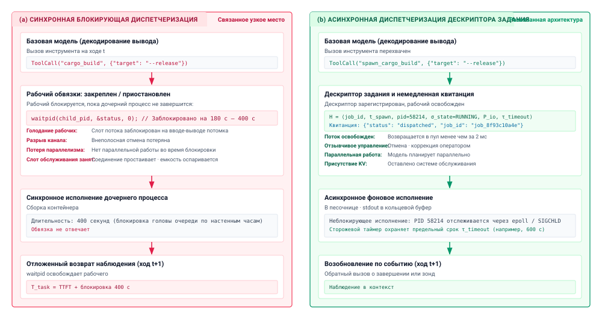
***Диспетчеризация асинхронных заданий с эскроу**: архитектурное сравнение синхронной блокирующей диспетчеризации и асинхронной диспетчеризации заданий с эскроу. При синхронной диспетчеризации (слева) рабочий поток блокируется на `waitpid` на протяжении всего исполнения дочернего процесса ($T_{\text{exec}} \sim 400\text{ с}$), лишая пул рабочих ресурсов и разрывая интерактивные управляющие каналы. При асинхронной диспетчеризации (справа) надзорный компонент запускает задачу в фоновой песочнице, записывает кортеж эскроу $H$ и возвращает немедленную квитанцию исполнения, освобождая рабочий поток и допуская возобновление по событиям.*

Вместо ожидания завершения процесса надзорный компонент среды выполнения инициализирует контекст исполнения внутри изолированной песочницы, порождает дочерний процесс или диспетчеризует удаленную задачу рабочего и назначает ей неподделываемый дескриптор задания. Формально среда выполнения записывает это состояние в управляемый реестр эскроу как кортеж:

$$H = \langle \text{job\_id}, t_{\text{spawn}}, \text{pid}, \sigma_{\text{state}}, \mathcal{P}_{\text{io}}, \tau_{\text{timeout}} \rangle$$

где $\text{job\_id} \in \{0, 1\}^{128}$ — криптографически уникальный идентификатор, который открывается модели, $t_{\text{spawn}}$ обозначает метку времени создания, $\text{pid}$ представляет идентификатор процесса операционной системы (или идентификатор задачи контейнера), $\sigma_{\text{state}}$ отслеживает фазу исполнения, $\mathcal{P}_{\text{io}}$ инкапсулирует подкрепляющие кольцевые буферы или дескрипторы файлов, захватывающие потоки стандартного ввода-вывода, а $\tau_{\text{timeout}}$ задает абсолютный предельный срок исполнения.

Эксплуатационный жизненный цикл $\sigma_{\text{state}}$ проходит через строго управляемый конечный автомат:

$$\sigma_{\text{state}} \in \{\texttt{SPAWNED}, \texttt{RUNNING}, \texttt{STREAMING}, \texttt{SUSPENDED}, \texttt{COMPLETED}, \texttt{FAILED}, \texttt{KILLED}, \texttt{TIMED\_OUT}\}$$


После регистрации $H$ в таблице эскроу среда выполнения немедленно синтезирует квитанцию исполнения и возвращает ее модели в пределах текущего хода вывода:

```json
{
  "status": "dispatched",
  "job_id": "job_8f93c10a4e",
  "pid": 58214,
  "execution_mode": "background",
  "log_stream": "/var/log/agent/jobs/job_8f93c10a4e.log"
}
```

Эта немедленная квитанция корректно закрывает ход генерации модели. Получив квитанцию, модель понимает, что запрошенная мутация зафиксирована в подсистеме исполнения и продолжается вне основного канала.

**Дескрипторы возможностей:**
Модель никогда не получает сырого идентификатора процесса операционной системы $\text{pid}$. Раскрытие только непрозрачного $\text{job\_id}$ сохраняет нулевые неявные полномочия модели, поэтому она не может посылать сигналы произвольным процессам на хосте.

Архитектура агента теперь получает существенную эксплуатационную гибкость. Модель может решить выполнять параллельные локальные задачи (например, настраивать вспомогательные скрипты или разбирать статические кодовые базы) или сообщить надзорному компоненту хоста, что у нее нет дальнейших немедленных рассуждений и она хочет приостановить исполнение. Если траектория приостанавливается, надзорный компонент возвращает свой активный рабочий поток в пул среды выполнения. Кластер обслуживания вывода свободен вытеснять неактивные блоки KV-кеша траектории по своему глобальному расписанию «давно не использовавшееся» ($\text{LRU}$) или приоритетному, зная, что когда фоновое задание завершится, траекторию можно будет возобновить, загрузив историю контекста через сопоставление префиксов.

<a id="sec-vol3-tool-calling-async-resumption"></a>

### Возобновление по событиям

Как только задача выполняется асинхронно в фоне, среде выполнения нужен архитектурный механизм, который определяет, когда исполнение завершилось, и как возобновить совещательный цикл агента. Проектировщики систем часто сталкиваются с четырьмя конкурирующими архитектурными парадигмами возобновления; каждая накладывает свои компромиссы по задержке, загрузке вычислений и накладным расходам токенов, как сравнено в [«Сравнении архитектур возобновления асинхронных инструментов»](07_tool_calling.md#tbl-vol3-resumption-mechanisms).

| Архитектура возобновления | Механизм определения состояния | Запас задержки ($\Delta t$) | Накладные расходы токенов модели | Загрузка CPU хоста | Граница системы и масштаб |
|:-------------------------------|:------------------------------------------|:---------------------------------------------------------|:---------------------------------------------|:------------------------------------------|:-----------------------------------------------------------|
| **Опрос занятым ожиданием, управляемый моделью** | Авторегрессионный вызов инструмента (`check_job`) | $\sim \text{Polling Interval}$ ($1\text{--}30\text{ с}$) | Чрезмерные ($O(N \cdot S_{\text{ctx}})$ токенов) | Пренебрежимая | Локальное прототипирование на стороне клиента; токсична в эксплуатации |
| **Опрос по таймеру среды выполнения** | Периодический `waitpid` / `sleep` в потоке хоста | $\frac{1}{2} \times \text{Sleep Interval}$ | Ноль во время сна | Низкая или умеренная (прерывания таймера) | Одноузловая среда выполнения агента; простые фоновые задачи |
| **Цикл событий ядра** | `epoll` / `kqueue` на `pidfd` или конце канала (EOF) | Минимальная ($< 1\text{ мс}$) | Ноль во время исполнения | Минимальная (реактивный сон, управляемый прерываниями) | Контейнерный надзор высокой производительности на хосте |
| **Асинхронный вебхук / шина** | Обратный вызов HTTP POST или событие AMQP/Kafka | Сетевой перенос ($\sim 5\text{--}50\text{ мс}$) | Ноль во время исполнения | Минимальная (асинхронный слушатель сообщений) | Распределенные многоагентные системы и облачные кластеры песочниц |

<a id="tbl-vol3-resumption-mechanisms"></a>

***Сравнение архитектур возобновления асинхронных инструментов**: архитектурное сравнение механизмов возобновления асинхронных инструментов: опрос занятым ожиданием, опрос по таймеру, циклы событий ядра и шины вебхуков.*

Первая парадигма, *опрос занятым ожиданием, управляемый моделью*, представляет собой антипаттерн, который возникает, когда разработчики открывают инструмент опроса (например, `get_job_status(job_id)`) и подсказывают базовой модели проверять его снова и снова, пока задача не завершится. При этом шаблоне каждая отдельная проверка статуса запускает полный авторегрессионный ход вывода. Движок обслуживания должен обработать всю накопленную историю траектории ($S_{\text{ctx}}$ токенов) на фазе предзаполнения, а модель должна декодировать десятки токенов, чтобы сгенерировать вызов инструмента опроса и подтвердить ожидающее состояние. В длительных задачах это сжигает миллионы токенов исключительно ради запроса неизменного булевого состояния.

<a id="nbk-07-token-cost-and-inference-overhead"></a>

> **Опрос и возобновление по событиям**
>
> **Задача:** агент запускает набор интеграционных тестов, который выполняется 300 с при 32 768 токенах контекста. При опросе модель проверяет статус каждые 5 с, выдавая вызов статуса на 40 токенов и подтверждение на 30 токенов вокруг результата статуса на 50 токенов. Предыдущий контекст попадает в кеш префикса в 95 % случаев. Ввод стоит \$3, а вывод \$15 за миллион токенов; кешированный ввод оплачивается по 10 % от цены ввода, а декодирование идет по нижней границе одного потока из [«Задержки обслуживания на ускорителе»](02_foundation_model.md#sec-vol3-foundation-model-cost), около 21,1 мс на токен. Как сравниваются опрос и одно возобновление по событию?
>
> **Опрос.** Задание занимает 60 опросов. Они декодируют 4 200 токенов, примерно 89 с генерации, потраченной на проверки статуса. Каждый опрос заново читает растущий контекст, примерно 1 865 некешированных входных токенов за опрос, или 111 924 всего, плюс 2 069 556 кешированных токенов по сниженной ставке. Итого \$1,02.
>
> **Событийный.** Среда выполнения получает уведомление, когда задание завершается, и делает один вызов модели с результатом на 200 токенов, оплачивая 1 838 некешированных входных токенов плюс одно кешированное чтение контекста, что стоит \$0,0149.
>
> **Системный вывод:** опрос стоит в 68,6× больше для одного задания длиной 300 с, а разрыв растет с длиной задания и размером контекста. Он также оставляет 60 обменов статусами в истории для каждого последующего вызова, которые нужно перечитывать, — издержка, которую цифра на задание не учитывает.

Чтобы добиться надежной эффективности, промышленные среды выполнения реализуют *возобновление по событиям*. В современных POSIX-системах надзорный компонент среды выполнения не спит в цикле потока; он регистрирует дескрипторы дочерних процессов в демультиплексоре событий, таком как `epoll(7)` в Linux или `kqueue(2)` в BSD/macOS. В современных ядрах Linux надзорный компонент получает дескриптор файла процесса через `pidfd_open(2)` при порождении инструмента:

$$\text{pfd} = \text{pidfd\_open}(\text{pid}, 0)$$

Этот дескриптор файла регистрируется в `epoll` с целевым событием `EPOLLIN`. Ядро уведомляет реактор среды выполнения в тот момент, когда дочерний процесс меняет состояние или завершается, полностью обходя периодические прерывания по часам и гонки обработчиков сигналов. Когда реактор обнаруживает завершение процесса, он переводит $\sigma_{\text{state}}$ в $\texttt{COMPLETED}$ или $\texttt{FAILED}$, захватывает итоговый целочисленный код выхода, извлекает очищенную полезную нагрузку наблюдения из дискового буфера $\mathcal{P}_{\text{io}}$ и помещает синтетическое событие возобновления во входную очередь приоритетов надзорного компонента агента. Затем надзорный компонент формирует структурированное наблюдение инструмента, добавляет его в историю траектории и планирует следующий ход вывода с моделью.

В распределенных облачных средах песочниц, где инструменты выполняются внутри удаленных микро-ВМ (например, AWS Firecracker) или отсоединенных подов Kubernetes, модель событий ядра обобщается до асинхронных вебхуков или долговечных потоков событий. Удаленный исполнитель запускает демон инициализации, который передает потоки вывода в объектное хранилище. По завершении задачи демон отправляет аутентифицированный вебхук HTTP POST или публикует сообщение AMQP с дескриптором задания, кодом статуса и URI журналов в шину сообщений агента, запуская возобновление траектории через сетевые границы без удержания открытого синхронного HTTP-транспортного соединения.

<a id="sec-vol3-tool-calling-async-governance"></a>

### Управление фоновыми процессами

Отделение исполнения инструментов от вывода переносит существенную эксплуатационную ответственность на подсистему управления процессами среды выполнения. Длительную фоновую задачу нельзя оставлять без проверки. Среда выполнения агента должна активно поддерживать три эксплуатационных инварианта на протяжении всего жизненного цикла фонового задания: неблокирующую проверку телеметрии, опосредованное двунаправленное взаимодействие и агрессивное завершение группы процессов.

#### Неблокирующая проверка телеметрии

Пока задача выполняется асинхронно, модели или оператору-человеку может понадобиться информация о ходе работы, не дожидаясь завершения. Выгрузка активного высокообъемного терминального потока прямо в окно контекста нарушает инварианты ограниченного наблюдения, установленные в [«Усечении потока наблюдений»](07_tool_calling.md#sec-vol3-tool-calling-streaming). Вместо этого фоновый менеджер среды выполнения непрерывно выводит дескрипторы вывода процесса в приватный кольцевой буфер на локальном диске.

Среда выполнения предоставляет агенту инструмент телеметрии только для чтения и без блокировки:

$$\text{inspect\_job}(\text{job\_id}, \text{tail\_lines}=50)$$

При вызове `inspect_job` не обращается к дочернему процессу напрямую; он читает последние $N$ строк из дискового кольцевого буфера, пропускает срез через конвейер санитизации ANSI ([«Санитизация вывода терминала»](07_tool_calling.md#sec-vol3-tool-calling-observation-parsing)), заключает строки в структурированный заголовок метаданных (фиксируя прошедшее процессорное время, резидентный размер набора ($\text{RSS}$) и текущее число потоков) и возвращает ограниченный снимок. Модель безопасно проверяет скорость исполнения, сохраняя бюджет контекста и подтверждая, что задача не зашла в тупик.

#### Опосредованное двунаправленное взаимодействие

Некоторые командные утилиты останавливают исполнение, чтобы запросить интерактивный ввод через стандартный ввод (`stdin`), например миграция базы данных, которая выводит `Apply changes [y/N]?`, или интерактивный скрипт, ожидающий параметров подтверждения. В синхронной архитектуре это вызывает постоянную взаимную блокировку: процесс блокируется в ожидании ввода, а надзорный компонент блокируется в ожидании завершения процесса.

Асинхронная среда выполнения разрешает этот тупик, отслеживая переходы состояния дочернего процесса через `/proc/[pid]/stat` или дескрипторы главной стороны псевдотерминала ($\text{pty}$). Когда процесс входит в прерываемое состояние сна в ожидании ввода с терминала, среда выполнения помечает $\sigma_{\text{state}} \leftarrow \texttt{SUSPENDED}$ и поднимает к надзорному компоненту событие «запрошен ввод». Модель отвечает, выдавая специальный вызов инструмента опосредования:

```text
send_input(job_id, data='yes\n')
```

Среда выполнения проверяет, что $\text{job\_id}$ находится в активном состоянии, готовом принять ввод, проверяет, что `data` соответствует белым спискам символов (удаляя сырые управляющие символы, такие как `\x03`, или escape-последовательности терминала), записывает байтовую полезную нагрузку непосредственно в канал стандартного ввода процесса и сбрасывает буфер.

#### Завершение группы процессов

Самая важная обязанность подсистемы фонового управления — предотвращать утечки ресурсов, вызванные осиротевшими дочерними процессами. Когда агент определяет, что траектория исполнения провалилась, когда пользователь подает команду прерывания или когда задание превышает свой жесткий предельный срок по настенным часам ($\tau_{\text{timeout}}$), среда выполнения должна гарантировать полное, детерминированное завершение процесса.

Стандартного системного вызова POSIX `kill(pid, SIGTERM)` в реальном исполнении инструментов принципиально недостаточно. Командные утилиты часто запускаются через промежуточные обертки оболочки:

```bash
bash -c "make -j8 && pytest"
```

Если надзорный компонент посылает `SIGTERM` только родительскому процессу оболочки ($\text{pid}$), оболочка может немедленно завершиться, тогда как порожденные ею дочерние процессы (`make`, вложенные компиляторы или средства запуска `pytest`) переподчиняются системному процессу init (`PID 1`). Эти осиротевшие процессы продолжают выполняться в фоне бесконечно, занимая 100 процентов доступных ядер процессора, блокируя каталоги сборки и исчерпывая файловые дескрипторы.

Чтобы обеспечить атомарное завершение процесса, среда выполнения должна при создании инстанцировать каждое фоновое задание в отдельной *группе процессов* с помощью `setpgid(0, 0)` внутри дочернего процесса до вызова `execve(2)`. Когда инициируется завершение, надзорный компонент посылает сигналы всей группе процессов, адресуя отрицательный идентификатор группы процессов ($-\text{pgid}$).

<a id="lst-vol3-process-group-teardown"></a>

**Надежное завершение группы процессов**: неблокирующий опрос с обязательной эскалацией до `SIGKILL` для устранения утечек осиротевших процессов.

```python
def terminate_job_group(pgid: int, grace_period_sec: float = 3.0) -> None:
    """Эскалирует завершение по группе процессов, чтобы устранить утечки осиротевших процессов."""
    os.killpg(pgid, signal.SIGTERM)
    deadline = time.monotonic() + grace_period_sec
    while time.monotonic() < deadline:
        pid, status = os.waitpid(-pgid, os.WNOHANG)
        if pid == 0 or (pid == -1 and errno.errorcode.get(errno.errno) == "ECHILD"):
            return  # Чистое завершение группы процессов подтверждено
        time.sleep(0.05)
    os.killpg(pgid, signal.SIGKILL)
    os.waitpid(-pgid, 0)
```

Как реализовано в [«Завершении группы процессов»](07_tool_calling.md#lst-vol3-process-group-teardown), надзорный компонент следует строгому двухстадийному протоколу эскалации:

1. *Мягкое завершение (`SIGTERM`):* среда выполнения посылает `SIGTERM` всей группе процессов ($-\text{pgid}$), позволяя работающим процессам сбросить буферизованные журналы, освободить файловые блокировки и выполнить обработчики выхода на уровне языка.
2. *Неблокирующее ожидание с таймаутом:* надзорный компонент следит за группой процессов через неблокирующий `waitpid(-pgid, WNOHANG)` в ограниченном окне отсрочки (обычно $3{,}0\text{ с}$).
3. *Безусловное вытеснение (`SIGKILL`):* если какой-либо процесс внутри группы остается активным по истечении отсрочки, надзорный компонент эскалирует до `SIGKILL` для $-\text{pgid}$. Поскольку `SIGKILL` нельзя перехватить, заблокировать или проигнорировать программным обеспечением пользовательского пространства, ядро операционной системы мгновенно возвращает все фреймы памяти, закрывает открытые файловые дескрипторы и удаляет дерево процессов из очереди запуска ядра (runqueue).

Сочетая дескрипторы заданий с защищенными возможностями, циклы событий, управляемые прерываниями, и строгое управление жизненным циклом группы процессов, среда выполнения агента создает надежную высококонкурентную подложку исполнения. Внешние команды могут переживать отдельные ходы вывода, не угрожая стабильности хоста, не расходуя бюджеты токенов модели и не оставляя осиротевших артефактов исполнения в вычислительной среде.

Однако, выстроив механику исполнения инструментов (от типизированных интерфейсов, протоколов обнаружения и идемпотентных аренд до усечения потоков, санитизации терминала и асинхронной диспетчеризации), архитекторы систем сталкиваются с общей проектной дилеммой: *как следует разделять функциональность внутри самого каталога инструментов?* Нужно ли снабдить агента неограниченной универсальной командной оболочкой, способной синтезировать произвольные программы, или следует разбить границу его возможностей на десятки узкоспециализированных мелкозернистых микроинструментов? Далее мы рассмотрим системные компромиссы разбиения набора инструментов по гранулярности.

<a id="sec-vol3-tool-calling-toolkit-design"></a>

## Разбиение набора инструментов по гранулярности

Каждая схема инструмента, внедренная в промпт выполнения агента, представляет собой постоянный структурный налог на физическую память движка вывода и внимательный налог на всем протяжении его авторегрессионного цикла декодирования. Архитекторы систем, сталкивающиеся с границей исполнения, стоят перед фундаментальным проектным компромиссом между глубиной каталога и его шириной: должна ли среда выполнения агента выставлять небольшой набор выразительных, открытых примитивов исполнения, таких как неограниченная оболочка POSIX или средство запуска интерпретируемых скриптов, или же ее пространство возможностей следует разделить на десятки или сотни мелкозернистых микроинструментов, управляемых жесткими схемами JSON? Неограниченная оболочка дает максимальную функциональную гибкость и сворачивает многошаговые рабочие процессы в одну диспетчеризацию, но расширяет границу полномочий на всю операционную систему и требует всеобъемлющей песочницы. И наоборот, разросшийся каталог узких микроинструментов ограничивает каждый вызов жестко проверяемой мутацией, но заливает окно контекста модели определениями схем, снижает точность категориального выбора и вынуждает сложные задачи в многоходовые каскады взаимодействия с высокой задержкой.

Гранулярность инструментов обменивает неоднозначность выбора и накладные расходы схем на выразительность, безопасность и соответствие задаче; оптимальный размер каталога нужно оценивать эмпирически, исходя из динамики нагрузки и возможностей модели, а не выводить из догматических архитектурных крайностей.

### Эффекты мощности каталога

Когда среда выполнения агента выставляет каталог инструментов $T = \{t_1, t_2, \dots, t_N\}$, полное синтаксическое и семантическое определение каждого инструмента должно сериализоваться в префикс системного промпта модели. Для каждого инструмента $t_i$ схема включает его идентификатор $n_i$, описание в прозе $d_i$, которое подробно раскрывает его функциональные инварианты, и формальную JSON-схему, объявляющую типизированные параметры, перечисляемые значения и граничные ограничения. Совокупный статический объем контекста $S_{\text{schema}}$ — это сумма токенизированных представлений всех определений инструментов:

$$S_{\text{schema}} = \sum_{i=1}^{N} \big( |n_i| + |d_i| + |\text{Schema}(t_i)| \big)$$

Этот накладной расход токенов сразу обходится физической ценой на уровне аппаратуры. В архитектуре обслуживания, использующей PagedAttention или непрерывный кеш ключей и значений (KV), каждый токен в $S_{\text{schema}}$ должен быть обработан на начальной фазе предзаполнения плотными ядрами обобщенного матричного умножения (GEMM). Важно, что получающиеся тензоры ключей и значений должны оставаться закрепленными в памяти с высокой пропускной способностью (HBM) на протяжении каждого последующего шага авторегрессионного декодирования (GEMV) в течение всего срока жизни траектории агента.

По мере роста мощности каталога $N$ статический префикс схем $S_{\text{schema}}$ вытесняет рабочий контекст, сокращая пространство, доступное для итеративных наблюдений среды и длинных извлеченных документов в фиксированном физическом окне контекста.

Помимо потребления физической памяти, расширение мощности каталога $N$ вносит серьезную дисперсию выбора во время вывода модели. Когда агент решает действовать, модель порождает структурированный кадр вызова, семплируя из своего категориального распределения по токенам. Вероятностная масса, выделенная на идентификатор целевого инструмента, должна преодолеть семантическую интерференцию всех остальных инструментов, присутствующих в префиксе. Если каталог содержит несколько инструментов с перекрывающимися лексическими описаниями или смежными функциональными ролями, распределение вероятностей по именам кандидатных инструментов обладает высокой энтропией Шеннона:

$$H(P_{\text{tool}}) = -\sum_{i=1}^{N} P(t_i \mid \mathcal{C}) \log_2 P(t_i \mid \mathcal{C})$$

Высокая энтропия распределения маршрутизации инструментов эмпирически проявляется как ошибка выбора инструмента $\epsilon_{\text{select}}$: модель галлюцинирует несуществующие имена инструментов, выдумывает фантомные аргументы, смешивая сигнатуры разных инструментов, или выбирает субоптимальную конечную точку, которая не решает задачу. Хотя крупные плотные модели класса frontier обладают достаточной репрезентативной емкостью, чтобы различать более крупные каталоги, чем меньшие квантованные модели, производительность не масштабируется бесконечно. Выше порога насыщения, зависящего от нагрузки, расширение каталога снижает долю выполненных задач: модель перегружается конкурирующими описаниями схем, а задержка стадии предзаполнения растет пропорционально $S_{\text{schema}}$.

<a id="nbk-07-quantifying-kv-cache-memory-and"></a>

> **Количественная оценка памяти KV-кеша и налога на пропускную способность для каталогов инструментов**
>
> Рассмотрим агентную систему, развернутую на узле из 8 GPU и работающую с базовой моделью с 70 миллиардами параметров, которая использует групповое внимание с запросами (Grouped-Query Attention, GQA). Архитектура задает $L = 80$ слоев трансформера, скрытую размерность $d_{\text{model}} = 8192$ и $n_{\text{kv}} = 8$ головы ключей и значений на слой с размерностью головы $d_{\text{head}} = 128$. Все активации хранятся в 16-битной точности ($\text{FP16}$, 2 байта на элемент).
>
> Память, выделяемая для хранения KV-кеша одного токена во всех слоях, составляет:
> $$\text{Memory}_{\text{token}} = 2 \times (\text{bytes per element}) \times L \times n_{\text{kv}} \times d_{\text{head}}$$
> $$\text{Memory}_{\text{token}} = 2 \times 2 \times 80 \times 8 \times 128 = 327\,680\text{ байт} \approx 320\text{ KB/токен}$$
>
> Теперь сравним две альтернативные архитектуры инструментов, обслуживающие нагрузку параллелизма $B = 32$ активных агентных сессий:
>
> 1. **Крупнозернистый каталог:** 4 выразительных глубоких примитива (редактор файлов, исполнитель bash, семантический поиск, монитор терминала). Сериализованный накладной расход схем составляет $S_{\text{schema}} = 450\text{ токенов}$.
> 2. **Мелкозернистый каталог:** 75 микроинструментов (специализированные обертки для отдельных команд POSIX, строковых утилит и подкоманд git). Сериализованный накладной расход схем составляет $S_{\text{schema}} = 6\,400\text{ токенов}$.
>
> Для крупнозернистого каталога базовый объем памяти, потребляемый по всей партии исключительно для хранения определений инструментов в HBM, составляет:
> $$\text{Memory}_{\text{coarse}} = 32 \times 450 \times 320\text{ КБ} \approx 4{,}61\text{ ГБ}$$
>
> Для мелкозернистого каталога базовый объем памяти расширяется до:
> $$\text{Memory}_{\text{fine}} = 32 \times 6\,400 \times 320\text{ КБ} \approx 65{,}54\text{ ГБ}$$
>
> В мелкозернистой конфигурации более $65\text{ ГБ}$ высокоскоростной памяти ускорителя постоянно потребляется определениями инструментов еще до загрузки одного пользовательского запроса, файлового контекста или трассы компилятора. На ускорителе с 80 ГБ этот структурный налог на память уменьшает бюджет памяти, доступный для динамического батчинга, заставляя среду обслуживания понижать пороги параллелизма, увеличивать подкачку памяти в ОЗУ хоста или ограничивать пределы контекста.

### Ортогональные абстракции инструментов

Чтобы предотвратить раздувание каталога, не отказываясь от необходимых возможностей, проектировщики систем применяют классические принципы модульности: высокую связность, слабую связанность и ортогональные границы интерфейсов. В книге *A Philosophy of Software Design* (2018) Джон Устерхаут определяет *глубокий интерфейс* как интерфейс, который предоставляет мощную функциональность через простой компактный контракт, тогда как *поверхностный интерфейс* вносит существенную сложность интерфейса, при этом давая относительно небольшой эффект от лежащей под ним функциональности.

Применительно к исполнению агентов глубокий инструмент инкапсулирует многошаговую эксплуатационную сложность за лаконичной схемой, тогда как поверхностный инструмент выставляет модели сырые промежуточные системные вызовы напрямую. Возьмем работу с файлами. Поверхностный проект выставляет отдельные RPC-конечные точки для `open_file`, `seek_cursor`, `read_line`, `write_bytes` и `close_file`. Такой подход превращает базовую модель в мучительно медленный, недетерминированный мультиплексор ввода-вывода: изменение одного файла с исходным кодом требует десятков циклов авторегрессионного декодирования, и любая ошибка промежуточного токена портит целевой файл. И наоборот, глубокий инструмент редактирования файлов принимает путь к целевому файлу, строку-якорь и блок строки замены. Хост-среда выполнения берет на себя открытие файла, проверку его существования, поиск точной границы замены, атомарную запись и выдачу структурированного унифицированного диффа.

Системные последствия этого разбиения интерфейса показаны на [«Поверхностных и глубоких интерфейсах инструментов»](07_tool_calling.md#fig-vol3-deep-vs-shallow-interface), который сопоставляет мелкозернистый поверхностный интерфейс на панели (a) с высокосвязным удаленным вызовом процедуры на панели (b). В многоходовом поверхностном интерфейсе ([«Поверхностные и глубокие интерфейсы инструментов»](07_tool_calling.md#fig-vol3-deep-vs-shallow-interface) a) непривилегированная модель должна оркестрировать низкоуровневые примитивы операционной системы на четырех различных авторегрессионных ходах ($t$ — $t+3$), отслеживая эфемерные файловые дескрипторы операционной системы (`fd: 3`) через циклы генерации. Эта архитектура воспроизводит внутри одной правки файла накапливающийся распад из [«Растяжения времени»](01_introduction.md#sec-vol3-intro-temporal-stretching). Если каждый шаг успешно выполняется независимо с вероятностью $1 - \epsilon_i$, составная вероятность завершить мутацию файла падает до $P(\text{success}) = \prod_{i=1}^M (1 - \epsilon_i)$. Любой сбой на промежуточных ходах оставляет целевой файловый дескриптор незакрытым или частично перезаписанным, порождая поврежденное состояние на диске и одновременно прогоняя $M \times \text{tokens}$ через физический KV-кеш движка вывода.

В отличие от этого глубокий высокосвязный интерфейс ([«Поверхностные и глубокие интерфейсы инструментов»](07_tool_calling.md#fig-vol3-deep-vs-shallow-interface) b) выставляет атомарную конечную точку RPC (`apply_patch`). Базовая модель формирует свое эксплуатационное намерение за один ход вывода ($t$). Надзорный компонент среды выполнения на хосте берет на себя четыре физических шага исполнения (проверку пути, поиск строки-якоря, выполнение атомарной замены в памяти и синтез унифицированного диффа) нативно, в скомпилированном коде хоста. Эта архитектура устраняет раздувание KV-кеша на многих ходах, изолирует модель от эфемерного состояния операционной системы и гарантирует атомарное исполнение: либо весь патч применяется чисто, либо транзакция прерывается без изменения постоянного хранилища.

<a id="fig-vol3-deep-vs-shallow-interface"></a>

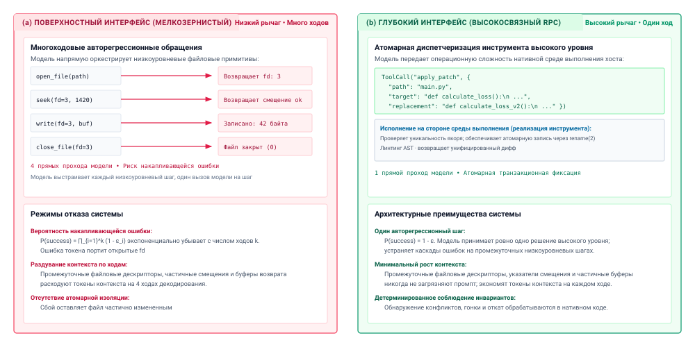
***Поверхностные и глубокие интерфейсы инструментов**: сравнение гранулярности интерфейсов для исполнения агентов на основе принципа глубины Устерхаута. В поверхностном интерфейсе (слева) базовая модель должна оркестрировать низкоуровневые примитивы операционной системы на нескольких ходах авторегрессионного декодирования (`open`, `seek`, `write`, `close`), выставляя промежуточное состояние ядра, накапливая вероятность сбоя $P(\text{success}) = \prod (1 - \epsilon_i)$ и прогоняя через KV-кеш. В глубоком интерфейсе (справа) модель выдает один высокосвязный атомарный RPC (`apply_patch`), передавая проверку и файловый ввод-вывод нативному коду хоста и гарантируя безопасность транзакции по принципу «все или ничего».*

Ортогональность требует, чтобы каждый инструмент в каталоге управлял отдельной, непересекающейся эксплуатационной областью. Когда агенту предоставлены перекрывающиеся инструменты, например одновременно `bash`, `python_repl`, `read_file` и `run_grep_search`, инструменты конкурируют за один и тот же семантический замысел. Если пользователь просит подсчитать число совпадающих шаблонов ошибок в каталоге журналов, внутренние представления модели активируют несколько допустимых путей исполнения:

1. Вызов `bash` с `grep -c "ERROR" /var/log/*.log`.
2. Вызов `python_repl` с открытым скриптом, который перебирает `pathlib.Path`.
3. Вызов `read_file` последовательно по каждому файлу журнала с последующим подсчетом в контексте.
4. Вызов `run_grep_search` со структурированной полезной нагрузкой регулярного выражения.

Такая функциональная избыточность делит распределение внимания между несколькими кандидатными головами, порождая ненужные ошибки маршрутизации и несогласованные траектории. Ортогональный проект системы устраняет эту неоднозначность, задавая строгие эксплуатационные границы: если выставлен открытый инструмент оболочки, специализированные микроинструменты чтения и поиска опускаются; или наоборот, если предоставлены мелкозернистые инструменты для файлов и поиска, сырое исполнение оболочки полностью исключается. Каждый инструмент должен иметь изолированную, четко определенную область отказа, чтобы ошибка исполнения локализовала диагностику в одной предсказуемой подсистеме. Компромиссы между этими подходами сведены в [«Крупнозернистых и мелкозернистых каталогах инструментов»](07_tool_calling.md#tbl-vol3-toolkit-granularity).

| Архитектурное измерение | Крупнозернистый каталог инструментов | Мелкозернистый каталог инструментов |
|:-------------------------------------------|:-----------------------------------------------|:-----------------------------------------------------|
| **Представительные примитивы** | `bash_exec`, `apply_patch`, `fetch_web_page` | `git_status`, `git_diff`, `read_line`, `append_file` |
| **Объем схемы ($S_{\text{schema}}$)** | Минимальный ($< 600\text{ токенов}$) | Массивный ($3\,000 - 10\,000+\text{ tokens}$) |
| **Статическое выделение KV-кеша** | Пренебрежимое ($\sim 1\text{--}5\%$ от общей HBM) | Серьезное ($\sim 20\text{--}40\%$ от общей HBM) |
| **Неоднозначность выбора инструмента** | Минимальная (ортогональные примитивы) | Высокая (перекрывающиеся семантические бассейны) |
| **Полномочия ($A$)** | Широкие (требуется песочница на уровне ядра) | Ограниченные (обеспечиваются статической схемой) |
| **Задержка хода до завершения** | Низкая (сложные операции за один ход) | Высокая (итеративные вызовы в несколько ходов) |
| **Аудит и управление** | Непрозрачное (требуется проверка команд) | Прозрачное (явные типизированные полезные нагрузки RPC) |

<a id="tbl-vol3-toolkit-granularity"></a>

***Крупнозернистые и мелкозернистые каталоги инструментов**: матрица сравнения крупнозернистых и мелкозернистых каталогов инструментов по эксплуатационным и системным метрикам.*

### Спектр «выразительность–безопасность»

Выбор гранулярности набора инструментов закрепляет агента на спектре «выразительность–безопасность». На крайнем полюсе выразительности находятся универсальные примитивы исполнения. Инструмент POSIX-оболочки обладает почти бесконечной выразительностью: он может проверять процессы, компилировать двоичные файлы, манипулировать файловыми системами, оркестрировать сетевые запросы и динамически пропускать вывод через произвольные фильтры преобразования данных. Однако эта гибкость разрушает принцип наименьших привилегий. Поскольку оболочка действует как открытая труба к лежащему в основе ядру, среда выполнения не может предсказать побочные эффекты команды по одной лишь сигнатуре инструмента. Граница безопасности не может обеспечиваться на уровне проверки схемы. Она переходит к локализации под моделью (принцип «Локализация под моделью»), построенной из гипервизоров, пространств имен и фильтров системных вызовов («Песочницы агентов»).

На противоположном полюсе спектра находятся ограниченные структурированные инструменты, например переименовщик символов с учетом AST (`ast_rename_variable`). Такой инструмент обеспечивает математическую определенность в вопросах безопасности: он не может удалить таблицы базы данных, запустить постоянные сетевые слушатели или утечь переменные окружения. Среда выполнения статически проверяет все параметры по строгой JSON-схеме перед диспетчеризацией запроса. Однако эта безопасность достигается ценой хрупкого покрытия предметной области. Если модель сталкивается с языком, AST которого не поддерживает парсер на хосте, или если задача рефакторинга требует одновременного изменения комментариев документации, структурированный инструмент полностью отказывает и останавливает цикл агента.

Чтобы перекинуть мост через этот разрыв без жертвования архитектурной устойчивостью, инженеры среды выполнения применяют *оборонительный проект параметров*. Инструменты должны проектироваться так, чтобы непреднамеренные ошибки модели или частичные последовательности токенов безопасно отказывали. Оборонительный проект параметров опирается на три основные техники:

1. **Безопасная по умолчанию семантика:** параметры, управляющие масштабом мутации, по умолчанию должны выбирать неразрушающие действия. Например, инструмент записи файлов должен требовать явного логического параметра `overwrite: true`, чтобы обрезать существующий файл; при отсутствии этого параметра среда выполнения на хосте прерывает исполнение или переходит к неразрушающему дополнению.
2. **Флаги симуляции прогона без записи (dry-run):** мутирующие инструменты должны выставлять явный параметр `dry_run: true`. Когда он задан, инструмент проходит через логику проверки, авторизации и планирования, возвращая точный дифф или переход состояния, которые *произошли бы*, не применяя побочных эффектов к базовой системе. Это позволяет модели проверить собственные предлагаемые изменения до их фиксации.
3. **Инварианты атомарной пакетной обработки:** инструменты, которые изменяют внешнее состояние, должны принимать массивы однородных мутаций, которые фиксируются в рамках одной транзакции на стороне хоста. Если какая-либо отдельная мутация не проходит проверку, весь пакет откатывается, не давая агенту оставить среду хоста в неопределенном, частично мутированном состоянии.

```python
# Эмпирический пример: защитная проверка параметров в инструменте глубокого редактирования
def execute_file_patch(target: str, find_str: str, replace_str: str, dry_run: bool = True) -> str:
    path = validate_sandboxed_path(target)
    content = path.read_text(encoding="utf-8")
    if content.count(find_str) != 1:
        raise ValueError(f"Target pattern found {content.count(find_str)} times; must match exactly once.")
    new_content = content.replace(find_str, replace_str, 1)
    diff = generate_unified_diff(content, new_content, str(path))
    if not dry_run:
        path.write_text(new_content, encoding="utf-8")
    return f"Status: {'SIMULATED' if dry_run else 'APPLIED'}\n{diff}"
```

Оборонительная реализация выше показывает, как среды выполнения на хосте поглощают эксплуатационные опасности. Вместо того чтобы требовать от агента вручную проверять смещения файлов, инструмент на хосте обеспечивает, что целевая строка-якорь `find_str` совпадает ровно один раз. Если модель предоставляет неоднозначный якорь, который совпадает в нескольких местах, инструмент немедленно останавливается, сохраняя исходный файл и возвращая информативный кадр ошибки. Кроме того, установка `dry_run = True` по умолчанию заставляет модель активно подтверждать свое намерение перед применением постоянных изменений состояния, изолируя физическую среду от недетерминированных выходов токенов.

Разобрав структурную механику проектирования подсистемы инструментов (типизированные интерфейсы, протоколы обнаружения, идемпотентные аренды состояния, санитизацию потоков наблюдений, асинхронные циклы событий и разбиение каталога по гранулярности), мы собрали полный архитектурный базис для связи кандидатных токенов с внешним исполнением. Однако перенос этих теоретических основ в надежные промышленные развертывания подвергает инженеров тонким режимам отказа, в которых программные допущения сталкиваются с реальностью вывода базовой модели. Теперь перейдем к типичным заблуждениям и ловушкам, которые возникают при проектировании сред выполнения исполнения инструментов.

<a id="sec-vol3-tool-calling-fallacies"></a>

## Заблуждения и ловушки

Архитектурные абстракции часто скрывают физические эксплуатационные ограничения. В системах исполнения инструментов архитекторы сред выполнения регулярно попадаются на интуитивные допущения, заимствованные из привычных детерминированных конвейеров RPC или наивных неограниченных сред промптинга. Когда недетерминированные декодеры токенов взаимодействуют с операционными средами, хранящими состояние, и распределенными сетями, стандартные эвристики программной инженерии перестают работать. Чтобы избежать этих режимов отказа, нужно распознавать физические границы памяти контекста, недетерминированную природу авторегрессионного сэмплирования и строгую необходимость инвариантов, обеспеченных средой выполнения.

> **Заблуждение и ловушка**
>
> **Заблуждение:** *предоставление большего числа инструментов в контексте всегда повышает возможности агента.*
>
> Распространенная интуиция в проектировании агентов состоит в том, что расширение каталога инструментов модели монотонно расширяет ее универсальность в решении задач. Если у агента есть отдельные инструменты для каждого мыслимого преобразования файла, каждого запроса к базе данных и каждой сетевой операции, теоретически он должен решать более широкий спектр задач.
>
> При физическом исполнении каждая схема инструмента, внедренная в системный промпт, налагает статический налог токенов $S_{\text{schema}}$ на окно контекста. Для каталога из $N$ инструментов, где каждое определение инструмента в среднем занимает $d_i$ токенов спецификаций JSON Schema, типов аргументов и строк документации, статический префиксный объем масштабируется линейно:
>
> $$S_{\text{catalog}} = \sum_{i=1}^{N} d_i$$
>
> В современных движках обслуживания, использующих PagedAttention, эти статические токены схем занимают блоки физического кеша «ключ–значение» (KV), которые должны оставаться резидентными в памяти с высокой пропускной способностью (HBM) на протяжении каждого хода авторегрессионного цикла декодирования. Огромный каталог напрямую уменьшает запас памяти, доступный для динамической истории диалога и рабочих черновиков, снижая пропускную способность батчей обслуживания и повышая время до первого токена (TTFT) на фазе предзаполнения.
>
> Более критично то, что расширение каталога вызывает серьезную статистическую деградацию маршрутизации модели. По мере роста мощности $N$ семантическое перекрытие между описаниями инструментов неизбежно возрастает. Категориальное распределение вероятностей модели по кандидатным токенам выбора инструмента выравнивается, резко повышая частоту ошибок выбора инструмента $\epsilon_{\text{select}}$. По результатам эмпирической оценки агент, которому предложили пятьдесят мелкозернистых инструментов, часто галлюцинирует несуществующие гибридные аргументы, направляет изменения файлов в специализированные скрипты с несовместимыми флагами или парализуется из-за отвлекающих схем. Вместо того чтобы максимизировать размер каталога, надежные среды выполнения максимизируют отдачу от инструментов: они выставляют компактный набор ортогональных крупнозернистых примитивов, таких как изолированная оболочка POSIX или универсальный интерпретатор Python, либо используют протоколы динамического обнаружения, чтобы подгружать специализированные схемы в контекст только тогда, когда того требует достоверное намерение.

> **Заблуждение и ловушка**
>
> **Ловушка:** *повторная отправка неудавшихся неидемпотентных вызовов инструментов без ключа идемпотентности.*
>
> Когда вызов инструмента не возвращается в пределах настроенного сетевого предельного срока $\tau_{\text{timeout}}$, надзорный компонент среды выполнения или цикл автономного агента сталкивается с неоднозначным исходом распределенной системы. Наивный надзорный компонент рассматривает непризнанный HTTP-запрос, оборванное сетевое соединение или падение субагента как эксплуатационный сбой и немедленно повторно проигрывает тот же вызов инструмента.
>

> В любой распределенной архитектуре сетевые разделы отделяют передачу от исполнения. Отсутствие кадра ответа не доказывает отсутствия побочного эффекта. Если вызов инструмента выполняет неизолированную мутацию, например списывает платеж через шлюз оплаты, выделяет облачные виртуальные машины, выполняет внешнюю транзакцию в базе данных или дописывает записи в общий реестр, запрос мог успешно завершиться на целевом хосте непосредственно перед тем, как сеть разорвала пакет ответа.
>
> Повторное проигрывание исходного запроса превращает временный сетевой раздел в постоянное повреждение состояния:
>
> $$S_{\text{env}}(t_1) \neq S_{\text{env}}(t_0) + \Delta_{\text{action}}$$
>
> Внешняя система выполняет мутацию дважды, что дает дублирующие списания, осиротевшую инфраструктуру или нарушенные инварианты базы данных. Усугубляет эту опасность то, что непривилегированная модель в агентном цикле часто видит кадр ошибки таймаута и самостоятельно синтезирует альтернативный план повтора с измененными параметрами, обходя простую серверную дедупликацию по подписи.
>
> Чтобы смягчить эту ловушку, надзорный компонент среды выполнения урегулирует каждую мутирующую диспетчеризацию до повтора (принцип «Урегулирование до повтора»). Каждый мутирующий вызов инструмента должен быть привязан к уникальному криптографически выведенному ключу идемпотентности $K_{\text{idem}}$, который генерирует надзорный компонент и который связан с конкретным логическим шагом траектории. Нижестоящие сервисы должны регистрировать $K_{\text{idem}}$ в журнале атомарной фиксации или транзакционном кеше. Если происходит таймаут, любая последующая диспетчеризация с тем же ключом возвращает исходный закешированный результат, не выполняя переход состояния повторно. Операции, которые нельзя сделать идемпотентными через токены, должны защищаться явными транзакционными арендами или двухфазной сверкой состояния.

> **Заблуждение и ловушка**
>
> **Заблуждение:** *считать успех инструмента выводом из генерации модели или только из текста stdout.*
>
> Поскольку базовые модели обучаются выдавать читаемые человеком рассказы, инженеры часто полагаются на самостоятельно сообщаемую моделью сводку или наличие оптимистичных подстрок в стандартном выводе (таких как `"Success"`, `"Build complete"` или `"200 OK"`), чтобы решить, успешно ли выполнился инструмент.
>
> Такой подход принимает самоотчет, самый слабый уровень свидетельств замыкания, который не несет никакого доказательного веса ([«Уровни свидетельств замыкания»](01_introduction.md#sec-vol3-intro-closure-evidence)). У модели нет доступа к среде помимо токенов, которые ей передали, и по модели правдоподобного отказа ([«Модель правдоподобного отказа»](01_introduction.md#sec-vol3-intro-fail-plausible)) она регулярно рационализирует тихий сбой, необработанное исключение или неоднозначную трассу стека как успех, в то время как состояние операционной системы остается неизменным.
>
> Кроме того, потоки стандартного вывода командных утилит и сторонних двоичных файлов совершенно не стандартизированы. Многие компиляторы, системы сборки и CLI-скрипты записывают фатальные диагностические ошибки в `stdout`, а не в `stderr`, или выводят информационные баннеры статуса со строкой `"Success"` перед тем, как завершиться на необработанной ошибке сегментации.
>
> Надзорный компонент среды выполнения никогда не должен делегировать проверку инвариантов лингвистическому разбору. Успех инструмента должен опираться на авторитетные, неподделываемые физические примитивы:
>
> 1. Точный код статуса выхода операционной системы ($WEXITSTATUS = 0$).
> 2. Явные проверки состояния файловой системы и ядра (например, проверка обновленных временных меток inode, криптографических контрольных сумм файлов или ненулевой длины в байтах).
> 3. Детерминированные внешние наборы тестов, выполненные в изолированных средах.
>
> Языковые модели предлагают кандидатные действия; только детерминированная программная проверка доказывает, что инварианты системы выполняются.

> **Заблуждение и ловушка**
>
> **Ловушка:** *выгрузка неусеченных выходов инструментов прямо в окно контекста.*
>
> Когда агент выполняет команду операционной системы, например запускает компилятор по большому монорепозиторию, выполняет неиндексированный запрос к базе данных, запускает `git log` или выгружает сетевые диагностические пакеты, буфер стандартного вывода процесса может выдать десятки мегабайт сырого текста за миллисекунды. Наивная среда выполнения захватывает этот поток и передает его прямо в кадр наблюдения следующего хода диалога.
>
> Вставка неусеченного текста действует как немедленная атака типа «отказ в обслуживании» на иерархию памяти агента. Неограниченный процесс, выдающий $10^6$ символов, порождает сотни тысяч токенов и мгновенно нарушает границу окна контекста $S_{\max}$.
>
> В подсистеме памяти ускорителя выделение физических страниц KV-кеша для миллионов несжатых символов с низкой информативностью фрагментирует HBM GPU. При PagedAttention такое быстрое выделение запускает экстренное вытеснение параллельных запросов обслуживания, вынуждает дорогую подкачку страниц в системную оперативную память хоста или приводит к тому, что движок обслуживания полностью падает с прерыванием из-за нехватки памяти (OOM).
>
> Даже если архитектура модели поддерживает расширенное окно контекста, способное принять буфер, квадратичная вычислительная сложность плотного внимания на фазе предзаполнения и линейные накладные расходы пропускной способности памяти на шагах авторегрессионного декодирования (до $O(N)$ на каждый сгенерированный токен) резко раздувают задержку. Подавляющее большинство выданных токенов состоит из повторяющихся полос прогресса сборки или избыточных строк журнала. Этот поток размывает веса внимания модели, фактически закапывая пригодную к действию диагностическую трассу, единственную строку с синтаксической ошибкой или отсутствующим символом, под тысячами токенов нерелевантности.
>
> Среды выполнения должны применять строгие физические бюджеты наблюдений ($B_{\max}$) непосредственно на уровне канала ядра, используя неблокирующий ввод-вывод и ограниченные кольцевые буферы. Надзорный компонент среды выполнения обязан применять структурные политики усечения до токенизации: сохранять фиксированный префикс начала ($B_{\text{head}}$) для захвата параметров вызова, отбрасывать промежуточный повторяющийся вывод через фильтрацию с учетом содержимого и сохранять ограниченный хвост ($B_{\text{tail}}$), где находятся диагностика завершения терминала, ошибки утверждений и трассы стека. Объемы вывода, превышающие физический порог контекста, должны выгружаться в постоянное хранилище с адресацией по содержимому, а в контекст модели возвращается только сводный кадр, смещение в байтах и дескриптор для последующего извлечения.

Освоение физических границ исполнения инструментов (защита памяти контекста от неограниченных потоков наблюдений, обеспечение криптографической идемпотентности на границах сетевых разделов, опора на авторитетные примитивы ядра вместо повествовательного текста модели и подбор компактных, выразительных каталогов инструментов) превращает непривилегированную генерацию языковой модели в надежное системное исполнение. Рассмотрев конкретные режимы отказа, угрожающие промышленным средам исполнения, мы теперь синтезируем основные архитектурные принципы, которые управляют подсистемой инструментов, прежде чем перейти к изолированным средам выполнения, которые отделяют эти операции.

<a id="sec-vol3-tool-calling-summary"></a>

## Итоги

Последовательность кандидатных токенов, порожденная авторегрессионной нейросетью, превращается в управляемый внешний эффект только тогда, когда авторитетный надзорный компонент среды выполнения перехватывает, проверяет и диспетчеризует предложение через явную границу защиты. Непривилегированный механизм вывода производит статистические предсказания по словарю; он не держит никаких неявных полномочий и не имеет прямого доступа к системным вызовам, сетевым сокетам или постоянному хранилищу. Чтобы перекинуть мост через этот эпистемический разрыв, инструменты нужно рассматривать не как предложения на естественном языке или свободные разговорные расширения, а как строго типизированные конечные точки удаленного вызова процедур, которыми управляют жесткие системные контракты. Посредничая на каждой фазе исполнения (проверяя схемы параметров, согласуя возможности через стандартизированные протоколы обнаружения, прикрепляя уникальные идемпотентные аренды, чтобы пережить сетевые разделы, и ограничивая неограниченные потоки наблюдений до того, как они насытят память ускорителя), среда выполнения на хосте превращает недетерминированную генерацию модели в проверяемые, отказоустойчивые переходы состояния.

> **Схемы — это контракты, а не разговорные советы**
>
> 1. **Инструменты — это внешние конечные точки исполнения, контракты интерфейсов которых должны быть строго типизированы.** Языковая модель никогда не меняет физическое состояние напрямую; она выдает символические аргументы по выставленной схеме. Жесткая проверка параметров, явная структурная типизация и ограниченные перечисления минимизируют эпистемическую неоднозначность, обрезают недопустимые пространства действий и гарантируют, что некорректные кандидатные предложения безопасно отказывают до пересечения границы исполнения.
> 2. **Model Context Protocol стандартизирует обнаружение и связность между разнородными сервисами.** Отделяя определения инструментов и ресурсы данных от монолитных архитектур хоста, клиент-серверные протоколы обнаружения задают единый сетевой стандарт для запроса возможностей, управления транспортами вне процесса и изоляции внешних сред, оставляя при этом окончательную авторизацию и принудительное соблюдение политик под суверенным контролем среды выполнения на хосте.
> 3. **Ключи идемпотентности и транзакционные аренды обязательны для всех мутирующих действий.** Сетевые таймауты, падения процессов и кратковременные обрывы неизбежно оставляют распределенные исполнения в неопределенных состояниях. Надзорный компонент среды выполнения должен присваивать детерминированные ключи идемпотентности ($K_{\text{idem}}$) и обеспечивать транзакционную сверку состояния, чтобы гарантировать, что автоматические повторы не могут породить дублирующие мутации, призрачное повреждение состояния или катастрофическую утечку ресурсов.
> 4. **Неограниченным потокам наблюдений нужна буферизация в кольцевых буферах без терминала и пагинация до подготовки контекста.** Исполняемые инструменты выдают произвольные объемы диагностических данных, которые легко насыщают конечные физические пределы контекста модели и высокоскоростной памяти ускорителя. Среды выполнения должны применять противодавление на уровне ядра, резать потоки вывода на кадры с фиксированным началом и ограниченным хвостом и переносить громоздкие полезные нагрузки во вспомогательные хранилища с адресацией по содержимому.
> 5. **Асинхронная диспетчеризация отделяет занятость рабочего хоста от удержания состояния движком обслуживания.** Поскольку внешние инструменты работают с задержками по настенным часам, на порядки более медленными, чем генерация токенов, среды выполнения должны реализовывать явные контракты ожидания и возобновления. Приостановка длительных операций освобождает потоки надзорного компонента, а контрольные точки или вытеснение кадров KV-кеша не дают простаивающим внешним задержкам снижать пропускную способность движка вывода.

Исполнение инструментов показало, что требует типизированный контракт действия (принцип «Типизированный контракт действия»), как только он встречается с реальными конечными точками. Схема делает предложение разбираемым, но только проверка полномочий на хосте решает, будет ли оно выполнено, а объявление сервера не дает ничего. Типизированный и авторизованный вызов все еще не безопасен, потому что таймаут оставляет его эффект неизвестным, а урегулирование до повтора (принцип «Урегулирование до повтора») превращает эту неизвестность либо в повтор, который конечная точка дедуплицирует, либо в зонд, который его оправдывает. Оба результата применяют [принцип замыкания инвариантов](01_introduction.md#pri-invariant-closure) на границе инструмента, где код возврата ноль показывает, что процесс завершился, а не что задача выполнена.

> **От интерфейсов инструментов к изоляции исполнения**
>
> Подключение агента к внешним инструментам дает ему возможность действовать в мире, но также подвергает среду хоста катастрофическому сбою. Когда модель диспетчеризует произвольные команды оболочки, компилирует незнакомый исходный код или выполняет динамически сгенерированные скрипты, одна только синтаксическая проверка схемы не может предотвратить злонамеренные эксплойты, разрушительные побочные эффекты или атаки инъекцией промпта, которые скомпрометируют лежащую в основе операционную систему. Установление типизированного RPC-интерфейса — лишь половина уравнения защиты; код, вызываемый этим интерфейсом, должен выполняться в среде, где домены отказа строго локализованы. В разделе «Песочницы агентов» (*Изоляция среды*) мы переходим от интерфейса связи к подложке локализации и анализируем, как аппаратно изолированные микро-ВМ, среды WebAssembly, пространства имен Linux и политики безопасности на основе возможностей изолируют недоверенное исполнение, не отказываясь от низкой задержки, которую требуют интерактивные циклы агентов.
