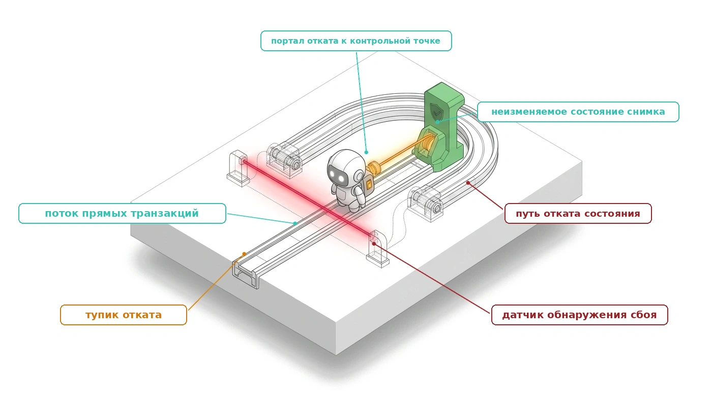
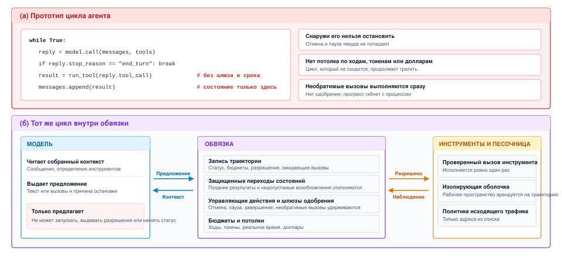
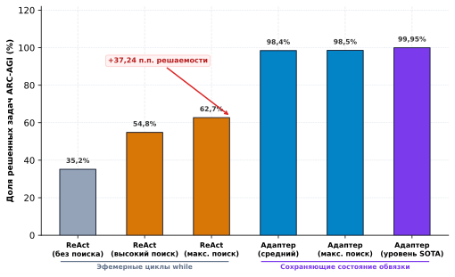
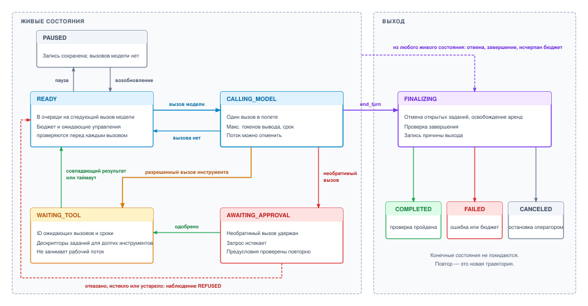
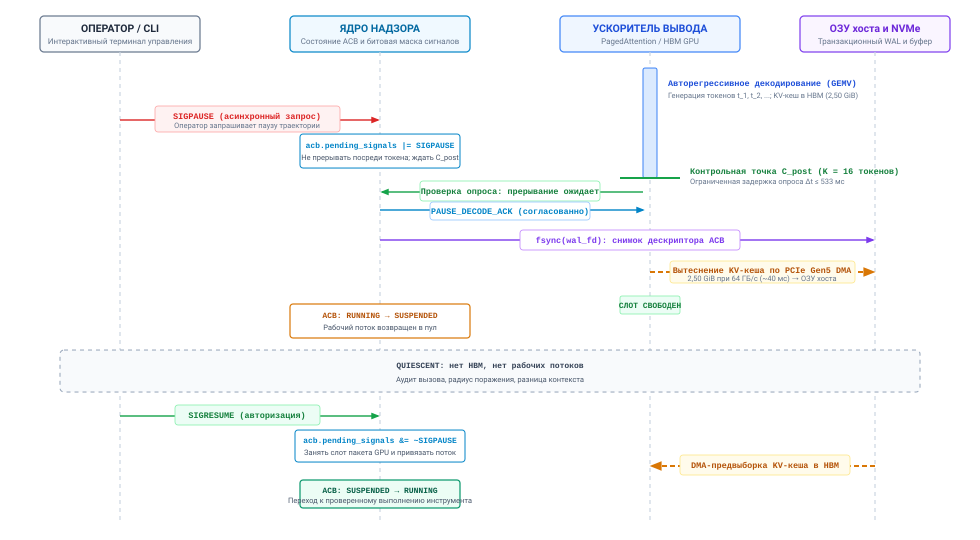
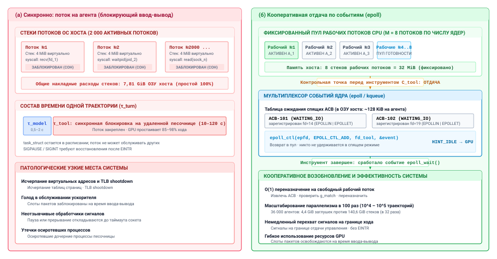
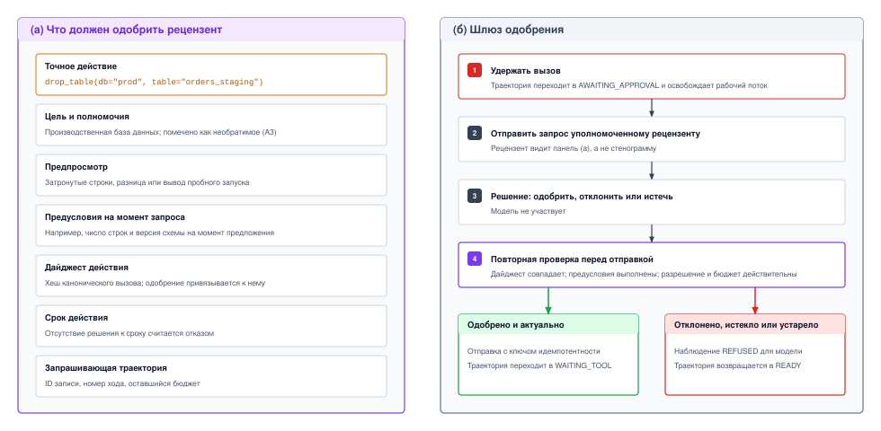
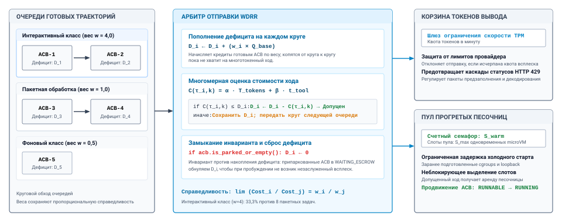
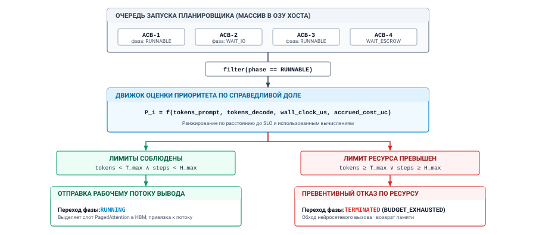
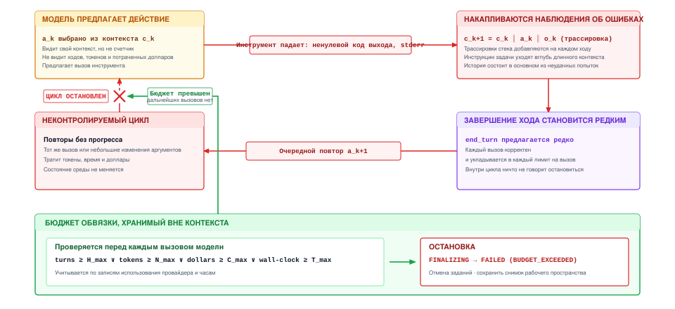

<a id="sec-vol3-agent-harness"></a>

# Обвязка агента



## Назначение

_Почему цикл агента, который работает пять ходов, ломается, когда его оставляют работать пятьсот?_

Прототип агента — это цикл вокруг вызова модели, и для короткой задачи такого цикла достаточно. Но если оставить тот же цикл работать часами, он столкнется с событиями, которых не умеет обрабатывать. Инструмент может зависнуть и удерживать вместе с собой всю траекторию. Модель продолжает предлагать повторы, каждый из которых корректен по форме и ничего не меняет, поэтому счет растет, а задача стоит на месте. Оператору нужно остановить запуск, но цикл слушает только собственный сигнал модели о завершении. Предложение удалить производственные данные приходит и выполняется сразу, потому что между предложением и действием ничего нет. У всех четырех сбоев одна причина. Единственная запись о том, что делает траектория, сколько она потратила и чего ждет, живет внутри цикла и контекста модели, где снаружи ее нельзя ни прочитать, ни изменить. Обвязка выносит эту запись за пределы модели и использует ее, чтобы приостанавливать, одобрять, ограничивать и останавливать траекторию, не прося модель о сотрудничестве. Это первое замыкание среды выполнения для экспозиции горизонта в H·S·A: каждый добавленный ход — это новая возможность зациклиться, застрять или перерасходовать. Здесь же экспозиция полномочий сталкивается с самым трудным случаем — необратимым действием, которое никакая песочница не может отменить.

> **Цели обучения**
>
> - Объяснить, почему прототип цикла агента не может приостановить, ограничить или остановить траекторию без сотрудничества модели.
> - Спроектировать запись траектории, которая хранит статус, бюджеты, разрешения и отложенную работу вне контекста модели.
> - Построить замкнутый конечный автомат траектории, защитные условия которого отклоняют поздние результаты инструментов и недопустимые возобновления.
> - Применить отмену, паузу, возобновление и завершение на границах ходов, используя причины остановки и отмену потокового вывода.
> - Спроектировать шлюз одобрения для необратимых вызовов инструментов с истечением срока, повторной проверкой предусловий и наблюдением об отказе.
> - Рассчитать расход траектории по многомерному бюджету и выбрать лестницу «корректировка, ограничение, остановка».
> - Оценить потолки бюджета по измеренным кривым «стоимость — успех», а не по фиксированным эмпирическим правилам.

<a id="sec-vol3-controlplane-need"></a>

## От цикла while к обвязке


*Экспозиция горизонта, закрытая обвязкой, которая держит управление вне модели.*

Рассмотрим одну траекторию на общем узле, на сороковом ходу задачи, которую ожидали закончить за пять. За одну минуту приходят четыре события. Оператор хочет приостановить ее для проверки; интерактивная задача другого арендатора ждет того же лимита частоты запросов к модели; следующее предложение траектории удалит производственную таблицу; и она уже израсходовала большую часть бюджета, не пройдя ни одного теста. Цикл агента из [«Замкнутой траектории»](01_introduction.md#sec-vol3-intro-trajectory-engine), написанный как цикл `while` вокруг вызова модели, не может реагировать ни на одно из этих событий. Его единственный выход — причина остановки, с которой модель завершает ответ ([«Контракт вызова»](02_foundation_model.md#sec-vol3-foundation-model-contract)). Фаза траектории, расход, ожидающие вызовы инструментов и разрешения нигде не существуют, кроме списка сообщений и стека интерпретатора. Если процесс падает, траектория умирает вместе с ним, а любой процесс, который она запустила в своей песочнице, продолжает работать, и никто его не собирает.

Каждое из четырех событий требует того, чего модель предоставить не может. Пауза требует места вне модели, куда может прийти запрос на остановку и где его выполнят в безопасный момент. Уступка интерактивному арендатору требует планировщика, который видит, какие траектории ждут, а какие работают. Блокировка удаления таблицы требует шлюза между предложением и инструментом. Остановка непродуктивных затрат требует счетчика, который модель не может ни прочитать, ни сбросить. [«Принцип замыкания инвариантов»](01_introduction.md#pri-invariant-closure) уже говорит, где должны жить такие границы: в среде выполнения, ниже модели, и исполняться независимо от того, что предлагает модель. Часть II применила это правило к тому, что видит следующий вызов, а часть III — к тому, что может затронуть одно действие ([«Вызов инструментов»](07_tool_calling.md#sec-vol3-tool-calling), [«Песочницы агентов»](08_sandboxes.md#sec-vol3-sandboxes)). Часть IV применяет его к самому циклу, и компонент, который несет это правило, — обвязка.

<a id="dfn-agent-harness"></a>

> **Определение: обвязка агента**
>
> ***Обвязка агента*** — это компонент среды выполнения, который владеет циклом агента для одной траектории: собирает каждый вызов модели, интерпретирует ответ, решает, нужно ли и когда отправлять каждый предложенный вызов инструмента, и ведет запись, через которую все, что находится вне цикла, может проверить, приостановить, ограничить или остановить траекторию.
>
> 1.  **Значение**: каждая гарантия, которая должна выполняться между ходами (потолок ходов, лимит в долларах, одобрение перед необратимым вызовом, чистая остановка по запросу), обеспечивается здесь или нигде, потому что модель видит только свой контекст и на нее нельзя положиться в подсчете, уступке или остановке.
> 2.  **Отличие**: слой инструментов решает, допустим ли один вызов, авторизован ли он и закрыт ли он; песочница ограничивает, до чего этот вызов может дотянуться; обвязка решает, происходят ли вызовы вообще, в каком порядке и продолжается ли траектория.
> 3.  **Типичная ошибка**: считать обвязку склеивающим кодом вокруг модели, из-за которого статус, расход и отложенная работа живут в локальных переменных и тексте промпта, которые не может прочитать ни один планировщик, оператор или путь восстановления.

[«Прототип цикла против обвязки агента»](09_agent_harness.md#fig-vol3-controlplane-arch) сравнивает два проекта. На панели (а) прототип вызывает модель, выполняет любой пришедший вызов инструмента и добавляет результат, поэтому ничто снаружи не может вмешаться, и ничто не переживает процесс. На панели (б) тот же цикл работает внутри обвязки. Модель по-прежнему читает контекст и возвращает предложение, но предложение уходит в обвязку, которая сверяется со своей записью, прежде чем что-либо произойдет. Разрешенные вызовы переходят в слои инструментов и песочниц, построенные в части III, а наблюдения возвращаются через обвязку, прежде чем попасть в следующий контекст.

<a id="fig-vol3-controlplane-arch"></a>


***Прототип цикла против обвязки агента**: панель (а) показывает прототип цикла агента, в котором ответ модели выполняется напрямую, а все состояние траектории хранится в списке сообщений; поэтому цикл нельзя остановить снаружи, у расхода нет потолка, а необратимые вызовы отправляются сразу. Панель (б) оборачивает тот же цикл в обвязку, которая ведет запись траектории, защищает переходы состояний, применяет управляющие действия и шлюзы одобрения и соблюдает бюджеты; модель предлагает, а слои инструментов и песочницы выполняют только разрешенные вызовы.*

Один ход обвязки делает разделение труда конкретным. [«Один ход обвязки»](09_agent_harness.md#lst-vol3-harness-turn) показывает решения, которые обвязка принимает вокруг одного вызова модели. Перед вызовом модели она проверяет, нет ли ожидающих управляющих запросов и не исчерпан ли бюджет. Она вызывает модель с потолком выходных токенов и сроком. Расход она записывает по отчету провайдера об использовании, а не по собственному учету модели. Затем она ветвится по причине остановки. Ответ, который завершает ход, отправляется на проверку завершения; усеченный ответ никогда не отправляется дальше; а ответ с вызовами инструментов либо ждет на шлюзе одобрения, либо отправляется через слой инструментов.

<a id="lst-vol3-harness-turn"></a>

**Один ход обвязки**: обвязка проверяет управляющие запросы и бюджеты, вызывает модель с потолками на каждый вызов, учитывает измеренное использование и ветвится по причине остановки до того, как будет отправлен какой-либо вызов инструмента.

```python
def run_turn(rec: TrajectoryRecord) -> None:
    if rec.pending_control:                  # отмена, пауза, завершение
        return apply_control(rec)            # применяется на границе хода
    if budget_exhausted(rec):
        return finalize(rec, reason="BUDGET_EXCEEDED")

    transition(rec, "CALLING_MODEL")
    reply = call_model(rec.context(),
                       max_tokens=rec.limits.max_output_tokens,
                       deadline=rec.limits.call_deadline)
    charge(rec, reply.usage)                 # учитывается по факту, а не по самоотчету

    if reply.stop_reason == "end_turn":
        return finalize(rec, reason="MODEL_ENDED")   # проверка завершения
    if reply.stop_reason == "max_tokens":
        return observe(rec, truncation_notice(reply))  # никогда не отправляется
    calls = reply.tool_calls
    if not calls:                            # отказ, стоп-последовательность, текст
        return observe(rec, reply)           # обрабатывается политикой, затем READY
    if any(needs_approval(c, rec) for c in calls):
        return hold_for_approval(rec, calls)
    for c in calls:
        dispatch(rec, c)                     # проверен, разрешен, с ключом
    transition(rec, "WAITING_TOOL")
```

Каждая строка листинга читает или пишет `rec`, и остальная часть главы следует за этими чтениями и записями по порядку. Запись сама по себе идет первой, потому что обвязка не может обеспечить ничего для траектории, которую не может описать. Далее идут состояния и защищенная функция `transition`, затем управляющие действия и причины остановки, которые ими управляют, ожидания инструментов и людей, планировщик, который выбирает, какая готовая траектория работает, и наконец бюджеты, стоящие за `charge` и `budget_exhausted`.

Разрыв в производительности между голым циклом while, который склеивает строки, и спроектированной обвязкой агента не является чисто теоретическим: его можно измерить на сложных задачах рассуждения. Как показано в [«Границе чувствительности обвязки»](09_agent_harness.md#fig-vol3-harness-sensitivity), на интерактивном бенчмарке рассуждений ARC-AGI (Chollet, 2019) одна и та же политика базовой модели демонстрирует **закон чувствительности обвязки**. При стандартном каркасе ReAct в виде цикла while (Yao et al., 2023), который передает неструктурированные текстовые фреймы и неуправляемые заметки в блокноте, модель решает от 35,2 до 62,7 процента задач в зависимости от бюджета поиска. Напротив, оборачивание тех же нейронных весов в сохраняющую состояние адаптерную обвязку провайдера, которая ведет нативные деревья префиксов KV-кеша, проверяет по схеме кадры состояния и отделяет выполнение инструментов от потери памяти (Yang et al., 2024), поднимает точность до 99,95 процента. Этот скачок в 37,24 процентного пункта показывает, что реальная компетентность агента и его операционная эффективность ограничены архитектурной точностью автомата состояний обвязки, а не одним лишь масштабированием параметров модели.

<a id="fig-vol3-harness-sensitivity"></a>


***Граница чувствительности обвязки**: эмпирическая доля решенных задач для одинаковых весов базовой модели по архитектурам обвязки на интерактивном бенчмарке рассуждений ARC-AGI (Chollet, 2019). Переход от эфемерного каркаса ReAct в виде цикла while (Yao et al., 2023) к нативной сохраняющей состояние адаптерной обвязке дает прирост возможностей на 37,24 процентного пункта (с 62,7 до 99,95 процента), что показывает: автоматы состояний среды выполнения важнее сырого масштабирования параметров.*

Этот эмпирический разрыв показывает, почему автомат состояний обвязки — примитив системного уровня первого класса. Неуправляемый цикл while деградирует на сложных задачах рассуждения из-за трех усиливающих друг друга режимов отказа: раздувание расшифровки (повторная передача токенов, которая растет как O(T²) и вытесняет префиксные кеши), дрейф схемы без проверки (галлюцинированные аргументы выполняются молча) и отсутствие отката транзакций (временные сбои окружения навсегда отравляют контекст траектории). Архитектурная обвязка, напротив, обеспечивает замыкание инвариантов ниже политики модели.

Архитектурные механизмы, стоящие за этим разрывом в производительности и стоимости, сведены в таблице [«Сравнение систем каркаса и обвязки агента»](09_agent_harness.md#tbl-vol3-harness-scaffold-comparison). Голый каркас из цикла while заново передает растущие строки контекста и ведет неуправляемые выполнения инструментов, а архитектурная обвязка управляет памятью, представлением состояния и инвариантами выполнения через детерминированные примитивы системного уровня.

| Измерение системы        | Эфемерный каркас из цикла while                              | Сохраняющая состояние адаптерная обвязка провайдера        |
|:-------------------------|:-------------------------------------------------------------|:-----------------------------------------------------------|
| **Управление контекстом** | Наивная повторная отправка строки ($O(T^2)$ раздувание токенов) | Нативное повторное использование префиксов KV-кеша (общие блоки промпта) |
| **Представление состояния** | Неструктурированный свободный текст блокнота               | Типизированная запись траектории (блок управления агентом, ACB) |
| **Приостановка инструментов** | Синхронный блокирующий удаленный вызов (память ускорителя закреплена) | Кооперативная асинхронная отдача управления и вытеснение |
| **Восстановление после ошибок** | Прерывание процесса при фатальном сбое выполнения        | Детерминированный откат к контрольной точке и починка       |
| **Инварианты действий**  | Отправка непроверенного предложения инструмента              | Предполетная проверка возможностей и схемы                 |

<a id="tbl-vol3-harness-scaffold-comparison"></a>

***Сравнение систем каркаса и обвязки агента**: архитектурные механизмы, отличающие эфемерные циклы while от сохраняющих состояние обвязок агента.*

<a id="sec-vol3-controlplane-acb"></a>

## Запись траектории

Узел выполняет пятьсот траекторий, и оператору нужно знать, какие из них ждут человека, какие израсходовали больше 90 процентов бюджета и какие еще держат песочницу. Расшифровки не могут ответить на этот вопрос быстро, потому что расшифровка фиксирует сказанное, а не то, что траектория держит, должна или чего ждет. Тот же разрыв возникает внутри обвязки на каждом ходу. Когда приходит результат инструмента, обвязка должна знать, какие вызовы еще открыты, прежде чем его принять, а когда приходит отмена, она должна знать, какие задания и аренды освободить. Поэтому обвязка ведет одну небольшую структурированную запись на каждую траекторию, и каждый механизм этой главы работает через нее.

<a id="dfn-trajectory-record"></a>

> **Определение: запись траектории**
>
> ***Запись траектории*** — это управляющее состояние траектории, которым владеет обвязка и которое модель никогда не записывает: идентичность траектории, текущее состояние, лимиты на каждый вызов, бюджеты и измеренный расход, разрешения и аренды, отложенная работа, а также указатели на ее контекст, план, журнал и рабочее пространство.
>
> 1.  **Значение**: она делает единицей планирования, бюджетирования, паузы, одобрения и остановки всю траекторию, а не отдельный вызов модели, и позволяет выполнять эти операции за время, пропорциональное числу траекторий, а не длине их расшифровок.
> 2.  **Отличие**: расшифровка — это то, что читает модель; запись — то, что читает обвязка. Долговечный журнал, описанный в главе [«Долговечное выполнение»](10_durable_execution.md#sec-vol3-durable-execution), — это история, по которой запись можно восстановить; сама запись — живая проекция, к которой обвязка обращается на каждом ходу.
> 3.  **Типичная ошибка**: хранить управляющее состояние в промпте (например, «ты использовал 40 из 50 ходов») или позволять утверждениям модели обновлять его, что превращает каждое ограничение в просьбу, которую модель может проигнорировать.

[«Поля записи траектории»](09_agent_harness.md#tbl-vol3-acb-schema) группирует поля записи по задаче, которую каждая группа позволяет обвязке решать. Большинство групп относятся к механизмам, которыми владеют другие части книги; запись нужна обвязке, чтобы держать свой дескриптор на них.

| Группа полей | Содержимое | Что позволяет обвязке делать |
|:---------------------|:------------------------------------------------------------------------------------------------------------------------|:----------------------------------------------------------------------------------------|
| **Идентичность** | ID траектории, ID родителя, арендатор, контракт задачи ([«Контракт спецификации задачи»](01_introduction.md#sec-vol3-intro-task-contract)) | Направлять управляющие запросы, списывать расход с нужного арендатора, связывать повтор или субагента с его источником |
| **Статус** | Текущее состояние, причина выхода, число ходов | Отвечать на вопрос «что делает эта траектория» без чтения ее расшифровки |
| **Лимиты на вызов** | Версия модели, параметры сэмплирования, максимум выходных токенов, срок вызова ([«Контракт вызова»](02_foundation_model.md#sec-vol3-foundation-model-contract)) | Ограничивать и воспроизводить каждый вызов модели |
| **Бюджеты и расход** | Потолки по ходам, токенам, астрономическому времени и долларам; измеренное использование каждого | Соблюдать потолки, которые модель не видит и не может сбросить |
| **Разрешения и аренды** | Разрешения на инструменты ([«Совместимое обнаружение инструментов»](07_tool_calling.md#sec-vol3-tool-calling-mcp)), аренда рабочего пространства ([«Рабочее пространство агента»](08_sandboxes.md#sec-vol3-sandboxes-cow)), дескриптор учетных данных | Сужать полномочия посреди траектории и освобождать все при выходе |
| **Отложенная работа** | ID ожидающих вызовов инструментов и сроки, дескрипторы заданий ([«Асинхронная диспетчеризация инструментов»](07_tool_calling.md#sec-vol3-tool-calling-async)), удержанное одобрение, ожидающий управляющий запрос | Принимать только совпадающие результаты и отменять именно то, что еще открыто |
| **Указатели** | Хранилище контекста ([«Инженерия контекста»](04_context_engineering.md#sec-vol3-context-engineering)), план ([«Планы как пересматриваемое состояние»](03_test_time_compute.md#sec-vol3-test-time-compute-planning-revision)), позиция в журнале, снимок рабочего пространства | Обращаться к громоздкому состоянию, не копируя его в запись |

<a id="tbl-vol3-acb-schema"></a>

***Поля записи траектории**: запись группирует управляющее состояние, которое обвязке нужно на каждом ходу, с указателями на контекст, план, журнал и рабочее пространство, которыми владеют другие части среды выполнения.*

Группа указателей объясняет, почему запись остается небольшой. Она ссылается на расшифровку, план и рабочее пространство, а не содержит их, поэтому запрос статуса, проверка бюджета или решение о планировании затрагивают несколько сотен байт, а не сотни тысяч токенов. Та же дисциплина действует и на стороне обслуживания. Состояние внимания траектории в системе обслуживания ([«Управление KV-кешем»](05_kv_cache.md#sec-vol3-kv-cache)) дорого держать и дешево адресовать, а то, останется ли оно в памяти, пока траектория ждет, — решение об обслуживании, принимаемое в разделе [«Удержание, вытеснение, пересчет или выгрузка»](05_kv_cache.md#sec-vol3-kvcache-swapping). Запись хранит ссылку, а обвязка задает ожидаемое время ожидания, но запись никогда не становится местом, где живет это состояние.

Вторая дисциплина касается того, кто пишет. У модели нет никаких неявных полномочий, поэтому ничто из того, что она выдает, не меняет запись напрямую. Утверждение в выводе модели о том, что задача выполнена, что бюджета осталось мало или что вызов безопасен, — это наблюдение, которое обвязка должна оценить, а не обновление, которое нужно применить. Поля расхода берутся из использования, которое провайдер сообщает по каждому вызову, статус меняется только через переходы, которые проверяет обвязка, а разрешения сужаются только по решению обвязки. Это инкапсуляция на уровне траектории (принцип «Инкапсуляция на уровне траектории») в конкретной форме. Вся траектория — это единица, которую среда выполнения планирует, бюджетирует и защищает, а ее управляющее состояние находится там, куда модель не может дотянуться.

Запись теперь содержит все, что нужно обвязке, чтобы описать траекторию. Однако описание заслуживает доверия лишь настолько, насколько надежны правила, которые его меняют: поле статуса, которое может перезаписать любой путь кода, воспроизводит сбои прототипа цикла с дополнительным слоем косвенности. Следующий раздел закрепляет поле статуса за небольшим набором защищенных переходов.

### Отделение управляющих метаданных от памяти внимания

Чтобы поддерживать тысячи одновременных сессий агентов без исчерпания ресурсов хоста, обвязка отделяет легковесные управляющие метаданные траектории от тяжелых буферов вывода трансформера. Для траектории агента длиной $L = 32\,768$ токенов на модели с $H = 64$ слоями, $N_{\text{kv}} = 8$ головами «ключ — значение» и размерностью $D = 128$:
$$
M_{\text{KV}} = 2 \times H \times N_{\text{kv}} \times D \times L \times \text{sizeof(fp16)} = 2 \times 64 \times 8 \times 128 \times 32\,768 \times 2 \approx 8{,}59 \text{ ГБ}
$$
Буфер токенов контекста занимает:
$$
M_{\text{tokens}} = L \times 4 \text{ байт} = 32\,768 \times 4 = 131\,072 \text{ байт} \approx 128 \text{ КБ}
$$
Резко контрастирует с этим структура метаданных блока управления агентом (ACB), которая требует компактного фиксированного объема:
$$
\text{SizeOf}(\text{ACB}) = 256 \text{ байт}
$$
Хранение 10 000 одновременных траекторий агентов в памяти требует всего:
$$
M_{\text{control}} = 10\,000 \times 256 \text{ байт} = 2{,}56 \times 10^6 \text{ байт} \approx 2{,}44 \text{ МБ}
$$

Блок ACB достигает этой радикальной развязки памяти, работая как дескриптор с указателями косвенной адресации на внешние физические ресурсы, как описано в [«Архитектуре косвенной адресации памяти блока управления агентом»](09_agent_harness.md#tbl-vol3-acb-pointers).

| Ссылка | Целевая подсистема / уровень памяти | Физическое место хранения | Инвариант косвенной адресации и ослабления |
|:--------------------|:-------------------------------|:--------------------------------|:------------------------------------------------------------------------------------------------|
| `context_buf_ref` | Логический буфер токенов | ОЗУ хоста | Монотонно растущая последовательность ID токенов и границ ролей; общая для пакетов предзаполнения. |
| `kv_lease_id` | Физические таблицы PagedAttention | Высокоскоростная память GPU (HBM) | Привязана к аренде памяти движка вывода; может мигрировать в DRAM хоста или вытесняться при конкуренции. |
| `wal_stream_offset` | Журнал упреждающей записи, только для добавления (WAL) | Локальная флеш-память NVMe | Монотонно растущее байтовое смещение, обеспечивающее восстановление долговечного состояния до отправки хода. |
| `cap_token_ref` | Ослабленные токены возможностей | Защищенная память супервизора | Криптографически подписанные токены Ed25519, обеспечивающие нулевые неявные полномочия между песочницами. |

<a id="tbl-vol3-acb-pointers"></a>

***Архитектура косвенной адресации памяти блока управления агентом**: уровни памяти, физические границы оборудования и инварианты изоляции супервизора для полей-указателей дескриптора ACB.*

Компромиссы архитектуры между потоком на агента, асинхронными корутинами и таблицами процессов ACB сравниваются в [«Синхронной и кооперативной архитектуре исполнения»](09_agent_harness.md#tbl-vol3-concurrency-models).

| Измерение системы | Синхронно: поток на агента | Кооперативная отдача управления по событиям |
|:------------------------------|:-----------------------------------------------------------------------------|:------------------------------------------------------------------------|
| **Параллелизм рабочих** | Ограничен лимитами потоков ОС ($10^2\text{--}10^3$ потоков) | Ограничен только дескрипторами памяти хоста ($10^4\text{--}10^5$ ACB) |
| **Объем памяти в простое** | $2\text{--}8\text{ МиБ}$ на простаивающую траекторию (стек потока и структуры ядра) | $64\text{--}128\text{ КиБ}$ на простаивающую траекторию (сериализованный ACB в ОЗУ) |
| **Перехват сигналов** | Блокируется в системных вызовах ядра; требует обработки повторов `EINTR` | Немедленный; биты сигналов проверяются на контрольной точке до освобождения потока |
| **Слоты ускорителя для обслуживания** | Закреплены или теряются во время выполнения инструмента; низкая загрузка GPU | Освобождаются сразу; ресурсы GPU обслуживают активные очереди декодирования |
| **Радиус поражения при сбое** | Сбой рабочего потока уничтожает стек потока и оставляет песочницу осиротевшей | ACB переживает рабочий поток; восстановление после сбоя требует долговечного журнала |

<a id="tbl-vol3-concurrency-models"></a>

***Синхронная и кооперативная архитектура исполнения**: количественное сравнение пределов параллелизма, объема памяти, отзывчивости на сигналы и восстановления после сбоев для моделей исполнения агентов.*

<a id="sec-vol3-controlplane-statemachine"></a>

## Состояния траектории

Два сбоя показывают, что позволяет незащищенное поле статуса. В первом траектория запускает набор тестов со сроком в десять минут. Срок истекает, обвязка добавляет наблюдение о таймауте, и модель предлагает другой подход. Минуту спустя исходный запуск завершается, и приходит его результат. Если обвязка его добавит, следующий вызов увидит два противоречивых наблюдения об одном и том же вызове: одно говорит о таймауте, другое — что тесты прошли. Эта гонка, когда поздний результат пересекает более новое решение, и есть **пересечение наблюдений**. Во втором сбое траектория ждет, пока человек одобрит удаление базы данных, а путь повтора в другой части обвязки, увидев простаивающую траекторию, снова вызывает модель и отправляет все, что она предложит. Оба сбоя происходят из-за кода, который задает статус, вместо того чтобы спросить, законно ли это изменение.

Обвязка предотвращает оба сбоя, давая траектории замкнутый набор состояний и разрешая только те переходы между ними, которые задает проект. [«Состояния траектории»](09_agent_harness.md#tbl-vol3-lifecycle-states) перечисляет состояния по тому, что каждое из них держит, и по тому, куда оно может перейти дальше. Шесть из них живые, три — конечные.

| Состояние | Значение | Что держит траектория | Допустимые следующие состояния |
|:----------------------------------|:-------------------------------------------|:----------------------------------------------------|:-----------------------------------------------------------|
| `READY` | В очереди на следующий вызов модели | Только запись | `CALLING_MODEL`, `PAUSED`, `FINALIZING` |
| `CALLING_MODEL` | Один вызов модели в полете | Открытый запрос с потолком выхода и сроком | `READY`, `WAITING_TOOL`, `AWAITING_APPROVAL`, `FINALIZING` |
| `WAITING_TOOL` | Вызовы инструментов отправлены, результаты ожидаются | ID ожидающих вызовов, сроки, дескрипторы заданий | `READY`, `FINALIZING` |
| `AWAITING_APPROVAL` | Необратимый вызов удержан до решения | Удержанный вызов, его запрос на одобрение, срок действия | `WAITING_TOOL`, `READY`, `FINALIZING` |
| `PAUSED` | Удержана на границе хода ради человека | Только запись | `READY`, `FINALIZING` |
| `FINALIZING` | Очистка перед выходом | Открытые задания для отмены, аренды для освобождения | `COMPLETED`, `FAILED`, `CANCELED` |
| `COMPLETED`, `FAILED`, `CANCELED` | Конечные | Ничего | Нет |

<a id="tbl-vol3-lifecycle-states"></a>

***Состояния траектории**: замкнутый набор состояний обвязки, то, что траектория держит в каждом состоянии, и переходы, которые каждое состояние разрешает.*

[«Конечный автомат траектории»](09_agent_harness.md#fig-vol3-acb-lifecycle) рисует ту же машину. Основной цикл идет от `READY` через `CALLING_MODEL` к `WAITING_TOOL` и обратно. Ответ, которому нечего выполнить, например простой текст или усеченный ответ, возвращается прямо в `READY` с наблюдением для следующего вызова. Необратимый вызов отклоняется в `AWAITING_APPROVAL`, откуда он уходит либо в `WAITING_TOOL`, если вызов одобрен и все еще действителен, либо обратно в `READY` с наблюдением об отказе. Каждый выход, будь то завершение хода моделью или остановка оператором, принудительное завершение или исчерпание бюджета, проходит через `FINALIZING`.

`PAUSED` достижимо только из `READY`, и это верно даже тогда, когда пауза навязана, а не запрошена. Когда автоматическое восстановление не может продолжаться, например потому что действие, которое должно отменить предыдущий шаг, окончательно провалилось, сбой может проявиться в любом живом состоянии, чаще всего в `WAITING_TOOL`. Тогда обвязка эскалирует оператору в два шага. Сначала она улаживает все, что в полете: отменяет открытый вызов модели, отзывает удержанное одобрение и отменяет каждый ожидающий вызов инструмента или помечает его как сомнительный, если отмену подтвердить нельзя; это возвращает траекторию в `READY` без незавершенной работы. Только после этого она приостанавливает траекторию обычным защищенным переходом и отзывает ее разрешения. Эскалация, таким образом, не добавляет в машину ни одного пути, а оператор получает траекторию без наполовину законченной работы. раздел [«Необратимость поворотного действия»](11_failure_recovery.md#sec-vol3-sagas-pivot) описывает сбои, которые к этому приводят.

<a id="fig-vol3-acb-lifecycle"></a>


***Конечный автомат траектории**: шесть живых состояний и три конечных. Траектория циклически проходит через READY, CALLING_MODEL и WAITING_TOOL, отклоняет необратимые вызовы в AWAITING_APPROVAL и приостанавливается только из READY, в том числе когда неудачное восстановление эскалирует траекторию оператору. Каждый выход проходит через FINALIZING, который отменяет открытую работу, освобождает аренды и выполняет проверку завершения, прежде чем траектория окончательно оседает в поглощающем конечном состоянии.*

Путь завершения требует внимания. Причина остановки `end_turn` — это заявление модели о том, что она закончила, и обвязка трактует его как запрос на выполнение проверки завершения задачи, а не как успех. `FINALIZING` выполняет ту проверку, которую задает контракт задачи, на том уровне доказательств замыкания, который она требует ([«Уровни свидетельств замыкания»](01_introduction.md#sec-vol3-intro-closure-evidence)), и записывает `COMPLETED` только если проверка прошла. Будет ли завершенная траектория еще и принятой задачей и как часто агент до нее доходит — это проблема измерения, описанная в главе [«Оценка агентов»](12_evaluation.md#sec-vol3-evaluation).

Четыре инварианта превращают машину в защиту, а не в диаграмму:

1. Результат инструмента принимается только в `WAITING_TOOL` и только если его ID вызова еще ожидает ответа. Когда срок проходит, обвязка удаляет ID вызова из набора ожидающих до того, как добавит наблюдение о таймауте, поэтому поздний результат из первого сбоя выше не находит совпадающего ID, отбрасывается и записывается в журнал. Так закрывается пересечение наблюдений.
2. Удержанный вызов покидает `AWAITING_APPROVAL` для отправки только через одобрение, которое проходит повторную проверку шлюза. Никакой другой путь, в том числе путь повтора, который находит траекторию простаивающей, не может его отправить, поэтому закрывается второй сбой.
3. Каждый выход проходит через `FINALIZING`. Это барьер очистки. Он отменяет незавершенные задания, освобождает аренду рабочего пространства и учетные данные, записывает причину выхода и выполняет проверку завершения. Траектория, которая прыгает прямо в конечное состояние, оставляет после себя осиротевшие процессы и живые учетные данные.
4. Конечные состояния поглощающие. Ни поздний результат, ни действие оператора, ни повтор не могут оживить завершенную траекторию. Повтор — это новая траектория с новым ID, в записи которой старая траектория указана родителем, поэтому история каждой попытки остается целой для оценки и отладки.

[«Защищенные переходы»](09_agent_harness.md#lst-vol3-guarded-transition) реализует защиту. Каждое изменение состояния в обвязке проходит через одну функцию, которая проверяет переход по набору допустимых, вычисляет привязанное к нему защитное условие и записывает изменение. Все это выполняется под блокировкой записи, чтобы два одновременных события не могли оба добиться успеха.

<a id="lst-vol3-guarded-transition"></a>

**Защищенные переходы**: каждое изменение состояния проходит через одну функцию, которая проверяет набор допустимых переходов и защитное условие перехода под блокировкой записи; результаты инструментов принимаются только для ожидающих ID вызовов.

```python
LIVE = {"READY", "CALLING_MODEL", "WAITING_TOOL",
        "AWAITING_APPROVAL", "PAUSED"}
LEGAL = {("READY", "CALLING_MODEL"), ("READY", "PAUSED"),
         ("CALLING_MODEL", "READY"), ("CALLING_MODEL", "WAITING_TOOL"),
         ("CALLING_MODEL", "AWAITING_APPROVAL"),
         ("WAITING_TOOL", "READY"), ("AWAITING_APPROVAL", "WAITING_TOOL"),
         ("AWAITING_APPROVAL", "READY"), ("PAUSED", "READY")}
LEGAL |= {(s, "FINALIZING") for s in LIVE}
LEGAL |= {("FINALIZING", t) for t in ("COMPLETED", "FAILED", "CANCELED")}

def transition(rec, new_state, event):
    with rec.lock:
        key = (rec.state, new_state)
        guard = GUARDS.get(key, lambda rec, event: True)
        if key not in LEGAL or not guard(rec, event):
            raise IllegalTransition(rec.state, new_state, event)
        rec.history.append((rec.state, new_state, event.id))
        rec.state = new_state

def on_tool_result(rec, result):
    with rec.lock:
        if rec.state != "WAITING_TOOL" or result.call_id not in rec.pending:
            audit(rec, "late_or_unknown_result", result.call_id)
            return                                  # отброшен, наблюдение не добавляется
        rec.pending.remove(result.call_id)
        append_observation(rec, result)
```

Защита стоит одной блокировки, поиска в наборе и добавления, что незначительно по сравнению с вызовом модели, измеряемым в секундах, поэтому нет доводов в пользу производительности, чтобы ее пропускать. Конечный автомат теперь говорит, какие переходы допустимы. Он еще не говорит, кто может запросить переход извне цикла или когда такой запрос вступает в силу, если он приходит во время потоковой передачи вызова модели.

<a id="chk-09-agent-control-block"></a>

> **Контрольная точка: запись траектории и состояния**
>
> - [ ] **Запись против расшифровки**: почему ID ожидающих вызовов и измеренный расход должны жить в записи, а не в расшифровке, которую читает модель?
> - [ ] **Пересечение наблюдений**: какой инвариант отклоняет результат инструмента, пришедший после своего срока, и в каком порядке обвязка должна обновить запись, чтобы это работало?
> - [ ] **Барьер очистки**: что утекло бы, если бы отмененная траектория перешла прямо из `WAITING_TOOL` в `CANCELED`?
> - [ ] **Идентичность повтора**: почему повтор — это новая траектория, а не завершенная траектория, возвращенная в `READY`?

### Формальные инварианты переходов состояний

Формально пространство состояний траектории задается конечным множеством:
$$
\mathcal{S} = \{\text{INIT}, \text{RUNNABLE}, \text{RUNNING}, \text{WAIT\_IO}, \text{WAIT\_ESCROW}, \text{PREEMPTED}, \text{COMPLETED}, \text{FAILED}, \text{TERMINATED}\}
$$
Переходы состояний происходят по явной функции перехода:
$$
s' = \delta(s, e, g) \quad \text{где} \quad g(\text{ACB}, e) = \mathbf{true}
$$
где $e$ — входящее событие жизненного цикла, а $g$ — предикат защиты, проверяющий инварианты ACB. [«Проверка защитного условия перехода состояния»](09_agent_harness.md#lst-vol3-acb-transition) реализует строгие проверки защиты, которые не допускают недопустимых скачков состояния.

<a id="lst-vol3-acb-transition"></a>

**Проверка защитного условия перехода состояния**: переход блока управления агентом между состояниями жизненного цикла с проверкой перехода.

```python
def transition_acb(acb: AgentControlBlock, new_state: State, event: Event) -> None:
    """Проверить и применить переход состояния блока управления агентом (ACB)."""
    valid_transitions = {
        State.INIT: {State.RUNNABLE},
        State.RUNNABLE: {State.RUNNING},
        State.RUNNING: {State.WAIT_IO, State.WAIT_ESCROW, State.PREEMPTED, State.COMPLETED, State.FAILED},
        State.WAIT_IO: {State.RUNNABLE, State.FAILED, State.TERMINATED},
        State.WAIT_ESCROW: {State.RUNNABLE, State.FAILED, State.TERMINATED},
        State.PREEMPTED: {State.RUNNABLE, State.TERMINATED},
    }
    if new_state not in valid_transitions.get(acb.state, set()):
        raise InvalidStateTransitionError(f"Illegal transition from {acb.state} to {new_state} via {event}")
    acb.state = new_state
    acb.last_event = event
    acb.transition_epoch_ms = current_epoch_ms()
```

<a id="sec-vol3-controlplane-signals"></a>

## Управляющие действия

Оператор нажимает остановку, пока модель передает потоком вызов инструмента, аргументы которого на данный момент читаются как `{"action": "drop_table", "target": "cust`. Немедленная остановка оставит фрагмент, который не является корректным вызовом; если обвязка запишет его в журнал как последнее предложение траектории, путь восстановления, который позже разберет журнал, может попытаться его достроить. Ожидание окончания вызова означает ожидание, пока модель выдаст остаток деструктивного запроса, который оператор пытается предотвратить. Управляющие запросы приходят тогда, когда их отправляют люди и политики, тогда как траекторию безопасно менять лишь в определенные моменты, и обвязке нужно правило, которое согласует одно с другим.

Правило разделяет поступление и действие. Когда приходит управляющий запрос, обвязка записывает его в поле ожидающих управлений записи и возвращается. Она применяет запрос на следующей **границе хода** — в момент, когда ни один вызов модели не в полете и ни один вызов инструмента не отправлен наполовину. Траектория достигает границы хода перед каждым вызовом модели, после разбора ответа модели, но до отправки чего-либо, после принятия результата инструмента и при входе в ожидание одобрения. Поскольку на траекторию нельзя рассчитывать, что она сама уступит или остановится, это управление должно находиться вне модели (принцип «Внеполосное вытеснение и сторожевые таймеры прогресса»), а граница хода — то место, где обвязка его применяет. [«Управляющие действия»](09_agent_harness.md#tbl-vol3-signal-vocabulary) перечисляет запросы, которые нужны обвязке.

| Действие | Обычно подает | Вступает в силу | Итоговое состояние |
|:--------------------|:----------------------------------|:-------------------------------------------------|:-------------------------------------|
| **Отмена** | Пользователь, оператор, родительская траектория | На следующей границе хода; вызов в полете прерывается | `FINALIZING`, затем `CANCELED` |
| **Прерывание** | Пользователь | На следующей границе хода, как новое сообщение пользователя | `READY`, с сообщением в контексте |
| **Пауза** | Оператор, планировщик | На следующей границе хода | `PAUSED` |
| **Возобновление** | Оператор | Немедленно | `READY` |
| **Завершение** | Оператор, политика безопасности | Немедленно, даже посреди хода | `FINALIZING`, затем `FAILED` |
| **Превышение бюджета** | Собственный счетчик обвязки | На следующей границе хода | `FINALIZING`, затем `FAILED` |

<a id="tbl-vol3-signal-vocabulary"></a>

***Управляющие действия**: запросы, которые обвязка принимает извне цикла, кто обычно их подает, когда каждый вступает в силу и какое получается состояние.*

Большинство запросов ждут границы хода, и возникает вопрос, сколько времени вызов модели может до нее добираться. Ответ не может завершиться, пока не выдан последний токен, а время декодирования растет с числом выходных токенов ([«Задержка обслуживания на ускорителе»](02_foundation_model.md#sec-vol3-foundation-model-cost)). Наихудшее ожидание, таким образом, равно потолку выходных токенов, умноженному на время одного выходного токена. Для вызова, которому разрешены тысячи выходных токенов, это может составить минуту и больше — слишком долго для оператора, который останавливает деструктивное действие. Два механизма сокращают ожидание. Первый — сам потолок выходных токенов, который ограничивает и ожидание, и стоимость. Второй — **отмена потоковой передачи**: обвязка передает потоком каждый вызов модели и, когда есть ожидающая отмена, пауза или завершение, прерывает поток, отбрасывает частичный ответ и записывает событие отмены вместо предложения. Частичный ответ никогда не разбирается в вызов инструмента. Усеченное или прерванное завершение не может пройти проверку и потому не может быть отправлено (принцип [«Инвариант карантина»](02_foundation_model.md#pri-02-quarantining-invariant)). Токены, выданные до прерывания, все равно оплачиваются, и обвязка списывает их, как и любые другие.

Каждый ответ модели также сообщает, почему он завершился. Конверт статуса из [«Нормализованного конверта статуса вызова»](02_foundation_model.md#tbl-vol3-invocation-status) уже фиксирует, что цикл может делать с каждым исходом вызова; обвязка добавляет только то, куда каждый исход переводит траекторию. Ответ, завершающий ход, переводит ее в `FINALIZING` для проверки завершения. Ответ с вызовами инструментов переводит ее в `AWAITING_APPROVAL`, если какой-либо вызов необратим, и в `WAITING_TOOL` в остальных случаях. Ответ, обрезанный по лимиту выхода, остановленный стоп-последовательностью или отказанный, возвращает ее в `READY` с наблюдением для следующего вызова, если только политика задачи не эскалирует или не завершает отказ. Неудачный или просроченный вызов возвращает ее в `READY` для повтора, пока хватает бюджета, и переводит в `FINALIZING`, когда бюджет исчерпан.

Завершение — единственный запрос, который не ждет. Он нужен для случаев, когда само доведение хода до конца и есть опасность, например при попытке выйти из песочницы или при неуправляемом инструменте, который пишет в общее хранилище. Обвязка прерывает любой вызов модели, завершает каждый процесс в песочнице траектории через снос группы процессов из [«Управления фоновыми процессами»](07_tool_calling.md#sec-vol3-tool-calling-async-governance) и переходит в `FINALIZING` с записанной причиной. У прерывания хода есть цена. Вызов инструмента, отправленный непосредственно перед завершением, мог подействовать, а мог и не подействовать, и его исход теперь под вопросом. Обвязка помечает такие вызовы как сомнительные, а не как неудачные, и передает их механизму расчетов из [«Выполнения идемпотентных действий»](07_tool_calling.md#sec-vol3-tool-calling-idempotency), который по ключу идемпотентности вызова выясняет, произошел ли эффект. Когда у траектории есть порожденные субагенты, отмена и завершение должны дойти и до них; [«Каскады отмены»](16_multi_agent.md#sec-vol3-multiagent-backpressure) распространяют то же правило на все агенты.

Управляющие действия открывают людям и политикам путь в цикл в точно определенные моменты. Однако большую часть времени траектории уходит не на вызовы модели, а на ожидание ответов инструментов, и запрос, который приходит во время этого ожидания, должен застать траекторию в состоянии, где его можно применить.

### Безопасные контрольные точки для осмотра и оценка сигналов

Асинхронные сигналы не должны прерывать выполнение произвольно. Завершение агента посреди неатомарной операции с файловой системой портит состояние рабочего пространства. Обвязка задает детерминированные контрольные точки, в которых ожидающие сигналы можно безопасно оценить, как описано в [«Безопасных контрольных точках для осмотра»](09_agent_harness.md#tbl-vol3-safe-checkpoints).

| Символ контрольной точки | Граница цикла | Состояние покоя и гарантия инварианта | Механика перехвата супервизором |
|:------------------|:------------------|:-------------------------------------------------------------------------------------------|:--------------------------------------------------------------------------------------------|
| $C_{\text{obs}}$ | После наблюдения | Выполнение в песочнице завершено; конверт наблюдения проверен по дескриптору ожидающего ввода-вывода. | Перехватывает сигналы паузы и завершения до добавления в контекст; отбрасывает недопустимую полезную нагрузку наблюдения. |
| $C_{\text{pre}}$ | Перед выводом | Контекст собран и сериализован; на движке вывода нет ожидающих тензорных операций. | Перехватывает сигналы до отправки дорогого пакета предзаполнения; вытесняет аренду KV при паузе. |
| $C_{\text{post}}$ | После декодирования | Авторегрессивное декодирование завершено; грамматика проверена; предложенное действие не разобрано. | Фиксирует отмену или паузу до изменения состояния хоста или проверки параметров инструмента. |
| $C_{\text{tool}}$ | Перед отправкой инструмента | Аргументы инструмента проверены; возможность безопасности проверена; RPC не отправлен. | Финальный шлюз безопасности; предотвращает незафиксированные побочные эффекты в песочницах или внешних системах. |

<a id="tbl-vol3-safe-checkpoints"></a>

***Безопасные контрольные точки для осмотра**: границы цикла хода, гарантии покоя и действия перехвата супервизора, обеспечивающие атомарную доставку сигналов.*

Жизненный цикл доставки сигналов и оценка контрольных точек показаны на схеме в [«Перехвате асинхронных сигналов и возобновлении состояния»](09_agent_harness.md#fig-vol3-signal-handling).

<a id="fig-vol3-signal-handling"></a>


***Перехват асинхронных сигналов и возобновление состояния**: сквозная последовательность протокола, которая управляет перехватом асинхронных сигналов, синхронизацией на границе хода и возобновлением состояния. Оператор `SIGPAUSE` буферизуется в битовой маске сигналов ACB во время активного авторегрессивного декодирования. На ограниченной подконтрольной точке $C_{\text{post}}$ ($K=16$ токенов, задержка $\le 533\text{ мс}$) супервизор перехватывает выполнение, сохраняет ACB в долговечном хранилище, вытесняет 2,50 ГБ KV-кеша по PCIe Gen5 в DRAM хоста и переводит агента в приостановленное состояние покоя. Получив `SIGRESUME`, супервизор заново размещает память и возобновляет отправку инструментов без разрыва контекста.*

[«Оценка управляющих сигналов в контрольных точках»](09_agent_harness.md#lst-vol3-signal-eval) реализует оценку контрольных точек, позволяя траекториям чисто приостанавливаться или завершаться.

<a id="lst-vol3-signal-eval"></a>

**Оценка управляющих сигналов в контрольных точках**: проверка ожидающих асинхронных сигналов на безопасных границах траектории.

```python
def evaluate_signal_checkpoint(acb: AgentControlBlock, checkpoint: Checkpoint) -> bool:
    """Оценить ожидающие сигналы на детерминированных контрольных точках траектории."""
    if not acb.pending_signals:
        return True
    sig = acb.pending_signals.popleft()
    if sig == Signal.SIGPAUSE:
        acb.state = State.PREEMPTED
        persist_trajectory_checkpoint(acb)
        return False
    elif sig == Signal.SIGKILL:
        acb.state = State.TERMINATED
        release_sandbox_lease(acb.sandbox_id)
        return False
    return True
```

<a id="sec-vol3-controlplane-yielding"></a>

## Ожидание инструментов

Ход агента, который пишет код, обычно сочетает вызов модели длиной в несколько секунд с набором тестов, сборкой или поиском, которые занимают заметно дольше. Учет длительности траектории из [«Учета длительности траектории»](01_introduction.md#sec-vol3-intro-duration-accounting) делит каждый ход на время модели, время инструмента и ожидание, и для задач, насыщенных инструментами, доминирует слагаемое инструмента. Обвязка, которая дает каждой траектории собственного рабочего и позволяет ему блокироваться до ответа инструмента, почти все свое время тратит на ожидание. При тысяче одновременных траекторий она удерживает тысячу заблокированных рабочих, а заблокированный рабочий не может заметить, что пришла отмена, пока вызов инструмента не вернется или не истечет по сроку.

Решение в том, чтобы представлять ожидающую траекторию записью, а не заблокированным рабочим. При отправке обвязка записывает ID и срок каждого вызова в набор ожидающих, переводит траекторию в `WAITING_TOOL` и освобождает рабочего для обслуживания другой траектории. Завершение инструмента приходит позже как событие. Обвязка применяет защиту из [«Защищенных переходов»](09_agent_harness.md#lst-vol3-guarded-transition), добавляет наблюдение и переводит траекторию в `READY`, как только ничего не осталось ожидающим. Любая управляемая событиями среда ввода-вывода делает это дешевым. Дело не в выборе цикла событий, а в том, что ожидающая траектория стоит одной записи и больше ничего, поэтому отмена, пришедшая во время ожидания, застает траекторию в состоянии, где обвязка может действовать немедленно: отменить открытые вызовы и перейти в `FINALIZING`.

Три уточнения завершают ожидание. Инструменты, которые работают минуты или часы, возвращают дескриптор задания вместо результата ([«Асинхронная диспетчеризация инструментов»](07_tool_calling.md#sec-vol3-tool-calling-async)). Обвязка хранит дескриптор в наборе ожидающих, опрашивает его или подписывается на его завершение и использует, чтобы отменить задание при отмене траектории. Ответ с несколькими параллельными вызовами инструментов оставляет траекторию в `WAITING_TOOL`, пока каждый вызов не вернется или не пройдет свой срок, так что следующий вызов модели видит полный набор наблюдений. Каждый отправленный вызов также несет срок. Когда срок проходит, обвязка удаляет ID вызова из набора ожидающих, просит слой инструментов отменить вызов и добавляет структурированное наблюдение о таймауте. Если у вызова были побочные эффекты, его исход под вопросом так же, как у вызова, прерванного завершением, и разрешает его та же машинерия расчетов.

Пока траектория ждет, закешированное состояние ее контекста в системе обслуживания находится не в ведении обвязки. Удерживать его, вытеснять, пересчитывать или выгружать — это компромисс между занятой памятью и оплаченным пересчетом, и решается он в [«Удержании, вытеснении, пересчете или выгрузке»](05_kv_cache.md#sec-vol3-kvcache-swapping) исходя из того, сколько, по ожиданиям, продлится ожидание. Обвязка вносит единственный вход, который знает только она сама: ожидаемое время ожидания, выводимое из срока вызова и истории инструмента. Короткий вызов линтера предполагает держать состояние теплым. Длинный набор тестов, пауза или ожидание одобрения предполагают его освободить.

Ожидание инструмента заканчивается, когда инструмент отвечает или проходит срок. Следующий вид ожидания не имеет такой границы со стороны машины, потому что сторона, которую ждет траектория, — это человек, решающий, вообще ли должен выполниться необратимый вызов.

### Механика кооперативной отдачи управления

Генерация токенов моделью идет в масштабе миллисекунд ($10 - 50\ \text{мс}$ на токен), тогда как внешние вызовы инструментов — задания компиляции, запросы к базе данных и веб-выборки — часто занимают секунды и минуты. Если поток агента синхронно блокируется, ожидая завершения внешнего инструмента, он занимает ценные слоты параллелизма хоста и мощность рабочих GPU.

Кооперативная отдача управления развязывает выполнение: траектория переходит в `WAIT_IO` сразу после отправки запроса инструменту, освобождая потоки выполнения для других активных траекторий. Динамика выполнения показана на схеме в [«Синхронной блокировке против кооперативной отдачи управления»](09_agent_harness.md#fig-vol3-cooperative-yielding).

<a id="fig-vol3-cooperative-yielding"></a>


***Синхронная блокировка против кооперативной отдачи управления**: архитектурное сравнение синхронного выполнения по потоку на агента и кооперативной отдачи управления через события. Панель (а) иллюстрирует синхронную модель блокировки, где 2 000 потоков POSIX удерживают более 8 ГБ спящей памяти стеков и закрепляют слоты пакетов GPU, ожидая выполнения инструмента с высокой задержкой ($\tau_{\text{tool}} \gg \tau_{\text{model}}$). Панель (б) иллюстрирует путь данных супервизора на `epoll`, где фиксированный пул рабочих потоков немедленно освобождается на контрольной точке $C_{\text{tool}}$, регистрирует неблокирующие файловые дескрипторы в мультиплексоре событий ядра и масштабирует параллелизм до $10^4\text{--}10^5$ траекторий при ничтожных накладных расходах памяти.*

Механика пробуждения по событиям, которая связывает сетевой опрос ОС (`epoll`) с диспетчеризацией ACB, сведена в таблице [«Конвейер реактивации по событиям»](09_agent_harness.md#tbl-vol3-event-wakeup-pipeline).

| Этап | Компонент подсистемы | Операционный механизм и инварианты переходов |
|:-------------------------------|:--------------------------------------|:--------------------------------------------------------------------------------------------------------------------|
| **1. Уведомление о событии** | Мультиплексор ядра (`epoll`/`kqueue`) | Пробуждение по фронту срабатывает, когда процесс песочницы записывает завершение JSON-RPC в дескриптор сокета. |
| **2. Извлечение наблюдения** | Цикл событий супервизора | Читает буфер наблюдения $\mathbf{o}_k$, привязывает полезную нагрузку к ACB на контрольной точке $C_{\text{obs}}$ и записывает длительность. |
| **3. Проверка жизнеспособности и сигналов** | Валидатор сигналов ACB | Оценивает битовую маску ожидающих сигналов; направляет в `TERMINATING`, если траектория отменена во время ожидания, иначе переводит в `RUNNABLE`. |
| **4. Возврат в очередь выполнения** | Приоритетная очередь планировщика | Помещает дескриптор ACB в активную приоритетную очередь; готовит контекст к следующему пакету предзаполнения. |

<a id="tbl-vol3-event-wakeup-pipeline"></a>

***Конвейер реактивации по событиям**: четырехэтапный конвейер реактивации по событиям, переводящий траекторию из `WAITING_IO` в `RUNNABLE` без опроса потоков и голодания вычислений.*

[«Ограниченная генерация токенов с кооперативной отдачей управления»](09_agent_harness.md#lst-vol3-bounded-decode) реализует ограниченную генерацию токенов с кооперативной отдачей управления.

<a id="lst-vol3-bounded-decode"></a>

**Ограниченная генерация токенов с кооперативной отдачей управления**: передача выполнения циклу событий сразу после выдачи разделителя вызова инструмента.

```python
async def execute_bounded_decode(acb: AgentControlBlock, client: LLMClient) -> GenerationResult:
    """Выполнить декодирование токенов, ограниченное кооперативными квотами шагов."""
    tokens_generated = 0
    while tokens_generated < acb.step_token_quota:
        token = await client.decode_next_token(acb.trajectory_id)
        tokens_generated += 1
        acb.tokens_total += 1
        if token.is_tool_call_delimiter:
            acb.state = State.WAIT_IO
            return GenerationResult(status=Status.TOOL_PENDING, tokens=tokens_generated)
    return GenerationResult(status=Status.QUOTA_EXHAUSTED, tokens=tokens_generated)
```

<a id="sec-vol3-controlplane-hitl"></a>

## Шлюзы одобрения

Агент очистки предлагает `drop_table(db="prod", table="orders_staging")`. Инструмент есть в его каталоге, аргументы проходят проверку, а разрешение из [«Совместимого обнаружения инструментов»](07_tool_calling.md#sec-vol3-tool-calling-mcp) позволяет менять схемы промежуточных таблиц staging. [Песочница из «Песочниц агентов»](08_sandboxes.md#sec-vol3-sandboxes) ограничивает то, до чего может дотянуться код агента, но этот вызов действует на общую внешнюю систему, состояние которой никакой снимок песочницы не восстановит. В терминах [«Экспозиций H·S·A»](01_introduction.md#sec-vol3-intro-hsa) это действие класса $A_3$. По границе поворота (принцип «Граница поворотного действия и компенсирующие саги») необратимое действие можно только довести до конца вперед, поэтому единственный момент остановить ошибочное — до отправки. Обвязке нужен способ удержать такой вызов, пока кто-то с полномочиями его одобрить не примет решение, и при этом не удерживать ничего другого на время ожидания.

<a id="dfn-escrow"></a>

> **Определение: эскроу**
>
> ***Эскроу*** — это удержание обвязкой необратимого предложенного вызова инструмента до отправки, пока уполномоченный рецензент его не одобрит. Удерживаемый вызов несет срок действия, перед отправкой заново проверяется по записанным предусловиям, а если он отклонен, истек или устарел, модели возвращается наблюдение об отказе.
>
> 1.  **Значение**: это единственное замыкание, доступное для действия, которое нельзя отменить, потому что любой другой механизм среды выполнения либо ограничивает то, до чего действие может дотянуться, либо после исправляет его последствия.

> 2.  **Отличие**: выдача полномочий решает, разрешен ли вызов вообще; эскроу решает, может ли разрешенный необратимый вызов выполниться сейчас, над этим состоянием мира и с явного согласия человека.
> 3.  **Типичная ошибка**: решать, что ставить на шлюз, по собственному описанию вызова моделью либо одобрить вызов и отправить его позже, не проверив заново, что мир по-прежнему соответствует тому, что видел рецензент.

Обвязка решает, какие вызовы идут на шлюз, исходя из фактов, которыми управляет сама. Аннотация о побочных эффектах инструмента ([«Схемы интерфейса инструментов»](07_tool_calling.md#sec-vol3-tool-calling-schemas)) помечает вызов как деструктивный или необратимый, уровень полномочий траектории задает, сколько она может сделать без присмотра, а политика называет цели, которые всегда требуют проверки, например производственные данные или платежи выше порога. Собственное утверждение модели о том, что вызов безопасен, в этом решении не участвует. Шлюз также должен оставаться узким. Рецензент, которого просят одобрить десятки рутинных вызовов в час, учится одобрять не читая, а шлюз, который всегда одобряют, не дает замыкания. Выдача полномочий и песочницы обрабатывают обратимые вызовы и вызовы с низкими полномочиями, а шлюз оставлен для тех, которые они не могут сделать безопасными.

[«Шлюз одобрения»](09_agent_harness.md#fig-vol3-human-escrow) показывает, что получает рецензент и как шлюз работает. Панель (а) — это запрос на одобрение. Она показывает точный вызов в каноническом виде, а не расшифровку, которая к нему привела; цель и ее уровень полномочий; предпросмотр, например результат пробного запуска или число затронутых строк; предусловия, которые обвязка наблюдала на момент предложения вызова; дайджест канонического вызова; срок действия и идентичность запрашивающей траектории с оставшимся бюджетом. Одобрение привязывается к дайджесту, так что рецензент одобряет одно конкретное действие. Если на более позднем ходу изменится хотя бы один аргумент, одобрение перестает действовать.

<a id="fig-vol3-human-escrow"></a>


***Шлюз одобрения**: панель (а) перечисляет то, что рецензента просят одобрить: точный канонический вызов, его цель и уровень полномочий, предпросмотр, предусловия, записанные на момент запроса, дайджест, который привязывает одобрение к этому вызову, срок действия и запрашивающую траекторию. Панель (б) показывает шлюз: обвязка удерживает вызов, отправляет запрос, получает решение, в котором модель не участвует, и заново проверяет дайджест, предусловия, разрешение и бюджет, прежде чем отправить вызов с ключом идемпотентности или вернуть наблюдение об отказе.*

Панель (б) — это протокол. Обвязка удерживает вызов и переводит траекторию в `AWAITING_APPROVAL`, где та держит только свою запись. Ожидание долго по меркам машины: минуты или часы против секунд на ход. По закону Литтла ([«Аналитические формулировки емкости»](05_kv_cache.md#sec-vol3-kv-capacity-formulations)) число траекторий, ожидающих одновременно, равно частоте запросов на одобрение, умноженной на среднее время рассмотрения. Медленная очередь рассмотрения, таким образом, умножает число ожидающих траекторий, поэтому ожидающая траектория должна стоить только своей записи. Ожидание засчитывается против срока действия запроса, а не против бюджета вычислений траектории, потому что время рассмотрения человеком ничего не говорит о том, продвигается ли траектория. Долгое ожидание также делает вероятным перезапуск хоста во время ожидания, поэтому удержанный вызов и его запрос должны пережить процесс; эту долговечность обеспечивает глава [«Долговечное выполнение»](10_durable_execution.md#sec-vol3-durable-execution).

Одобрение — это решение о мире таким, каким он был в момент написания запроса, а к моменту его прихода мир мог измениться. В промежуточной таблице могут появиться новые строки, другой процесс мог изменить ее схему или разрешение могло быть отозвано. Поэтому перед отправкой обвязка заново читает предусловия, записанные в запросе, подтверждает, что дайджест по-прежнему совпадает с удержанным вызовом, и проверяет, что разрешение и бюджет все еще действительны. Только когда все это выполнено, она отправляет вызов с ключом идемпотентности, который делает повторную отправку безопасной (принцип «Урегулирование до повтора»). Политика, которая требует двух рецензентов из разных ролей, меняет только шаг решения: он ждет обоих одобрений, и только потом идет повторная проверка.

Отказ, истечение срока и устаревшие предусловия заканчиваются одинаково. Обвязка отбрасывает удержанный вызов, возвращает модели структурированный отказ как наблюдение для этого вызова и переводит траекторию в `READY`, чтобы следующий ход мог спланировать с учетом отказа, запросить новое одобрение против текущего состояния или завершиться без этого действия:

```json
{
  "status": "REFUSED",
  "reason": "APPROVAL_EXPIRED",
  "call": "drop_table(db=\"prod\", table=\"orders_staging\")",
  "message": "No approval was recorded before the request expired."
}
```

Молчание считается отказом. Шлюз, который по умолчанию отправляет вызов, когда ответ не приходит, превращает каждое потерянное уведомление в неконтролируемое необратимое действие. Шлюз одобрения ограничивает один шаг одной траектории. Траектории на узле все еще конкурируют друг с другом за одни и те же ограничения частоты модели и песочницы, и обвязке нужно решить, какая готовая траектория пойдет следующей.

<a id="chk-09-supervisory-state-machine"></a>

> **Контрольная точка: управляющие действия и шлюзы одобрения**
>
> - [ ] **Границы хода**: почему пауза ждет границы хода, а завершение нет, и что завершение оставляет под вопросом?
> - [ ] **Причины остановки**: что обвязка должна делать с ответом, который остановился на лимите выхода посреди вызова инструмента?
> - [ ] **Входы шлюза**: какие факты решают, пойдет ли вызов на шлюз одобрения, и почему описание вызова моделью исключено?
> - [ ] **Устаревшие одобрения**: что обвязка должна проверить заново между получением одобрения и отправкой вызова?

### Криптографические манифесты эскроу и инварианты кворума

Когда агент предлагает необратимое внешнее действие ($A_3$), обвязка замораживает выполнение и сериализует неизменяемый манифест эскроу. [«Проверка криптографического манифеста эскроу»](09_agent_harness.md#lst-vol3-verify-escrow) демонстрирует криптографическую проверку манифеста по токенам авторизации оператора.

<a id="lst-vol3-verify-escrow"></a>

**Проверка криптографического манифеста эскроу**: проверка криптографических токенов авторизации до расчета необратимых действий.

```python
def verify_escrow_payload(manifest: EscrowManifest, auth_token: AuthToken) -> bool:
    """Проверить криптографическую подпись и действительность политики манифеста эскроу."""
    if not crypto_verify(auth_token.signature, manifest.payload_hash, auth_token.public_key):
        return False
    if auth_token.expiration_epoch_ms < current_epoch_ms():
        return False
    return manifest.action_type in auth_token.permitted_actions
```

Переходы жизненного цикла манифеста эскроу подробно описаны в [«Переходах состояний человеческого эскроу и побочных эффектах»](09_agent_harness.md#tbl-vol3-escrow-transitions).

| Текущее состояние | Событие / условие защиты | Следующее состояние | Действие / побочный эффект перехода |
|:-----------------|:------------------------------------------------------------------------------------------------|:-----------------|:------------------------------------------------------------------------------------------------------------------|
| `RUNNING` | Предложение действия превышает порог радиуса поражения ($\mathbf{a}_k \in \mathcal{A}_{\text{escrow}}$) | `WAITING_ESCROW` | Остановить отправку, отвязать рабочий поток ОС, сохранить контрольную точку KV-кеша в DRAM хоста, сохранить ACB в хранилище NVMe. |
| `WAITING_ESCROW` | Настенные часы $\tau_{\text{current}} > \tau_{\text{expire}}$ (истечение аренды) | `READY` | Аннулировать манифест $\mathcal{M}$, синтезировать наблюдение `REFUSED` $\mathbf{o}_k^{\text{synth}}$, вернуть ACB в очередь. |
| `WAITING_ESCROW` | Набор действительных криптографических подписей удовлетворяет политике $\mathcal{P}_{\text{quorum}}$ | `READY` | Проверить дайджесты, восстановить ACB из NVMe, привязать рабочий поток ОС, отправить $\mathbf{a}_k$ драйверу песочницы. |

<a id="tbl-vol3-escrow-transitions"></a>

***Переходы состояний человеческого эскроу и побочные эффекты**: операционные переходы состояний, условия защиты и побочные эффекты ресурсов, которые управляют эскроу человеческого одобрения.*

Для корпоративных процессов с высокими ставками требуется несколько разных подписантов в соответствии с инвариантами кворума из [«Инвариантов контрольной точки кворума и формальных ограничений»](09_agent_harness.md#tbl-vol3-quorum-checkpoint-invariants).

| Инвариант | Формальное ограничение | Правило проверки системы |
|:-----------------------|:------------------------------------------------------------------------|:------------------------------------------------------------------------------------------------------------------------------------------------------------------------------------------------------------|
| **Уникальность подписантов** | $\forall j \neq k,\; u_j \neq u_k$ | Каждая записанная подпись должна исходить от отдельной криптографической личности. Один оператор не может выполнить кворум $m=2$, подписав дважды разными подключами учетных данных. |
| **Ортогональность ролей** | $\bigcup_{i=1}^m \text{Role}(u_i) \supseteq \mathcal{C}_{\text{roles}}$ | Подписи должны охватывать разные организационные области. Например, развертывание изменений инфраструктуры в производстве требует независимых подписей от `role:secops` и `role:site-reliability`. |
| **Временная действительность** | $\forall i,\; \tau_{\text{issued}} \le \tau_i \le \tau_{\text{expire}}$ | Все $m$ подписей должны быть зарегистрированы в пределах действующего окна аренды. Если требуемые подписи приходят после истечения срока, весь манифест аннулируется; частичные одобрения не переживают продления аренды. |

<a id="tbl-vol3-quorum-checkpoint-invariants"></a>

***Инварианты контрольной точки кворума и формальные ограничения**: формальные выражения и правила проверки, которые управляют манифестами атомарной фиксации с несколькими подписями.*

<a id="sec-vol3-controlplane-scheduling"></a>

## Планирование параллельных траекторий

Узел выполняет сорок пакетных траекторий, которые делают ночное обслуживание репозитория, и горстку интерактивных, у каждой из которых ждет человек. Все они делят одно ограничение провайдера по токенам и запросам в минуту и один пул песочниц ([«Пулы песочниц и сброс»](08_sandboxes.md#sec-vol3-sandboxes-pooling)). Если обслуживать их по принципу «кто первый, тот и получает», интерактивный ход ждет в очереди пакетных ходов. Если обслуживать жадно, узел превышает ограничение провайдера, провайдер отклоняет запросы, а траектории, которые откатываются по одному и тому же графику, повторяют попытки вместе и вместе же получают отказ.

Обвязка планирует ходы, а не потоки. Единица, которую она выдает, — следующий вызов модели готовой траектории `READY`, и три правила решают большую часть задачи. Во-первых, она делит ходы между классами приоритета пропорционально их весам, списывая за каждый ход оценку его токенов, чтобы один крупный пакетный ход не мог заморить голодом маленький интерактивный; схемы взвешенной справедливой очереди, такие как дефицитный круговой обход, делают это с постоянным объемом работы на каждое решение. Во-вторых, она допускает ходы через локальную корзину токенов, настроенную ниже ограничения провайдера, так что обвязка сама решает, кто ждет, а не узнает о лимите по отклоненным запросам. В-третьих, она занимает песочницу только при отправке вызова инструмента и освобождает ее, когда вызов возвращается, поэтому никакая песочница не простаивает во время вызова модели.

Траектории в `WAITING_TOOL`, `AWAITING_APPROVAL` или `PAUSED` не получают ходов, а траектория, возвращающаяся после долгого ожидания, не приходит с накопленным кредитом, который позволил бы ей монополизировать узел. Оставшаяся опасность — инверсия приоритетов, когда интерактивная траектория ждет песочницу, которую держит длинная сборка пакетной траектории. Резервирование доли пула песочниц для интерактивного класса устраняет ее ценой части простаивающей емкости. Расчет ограничений частоты, пулов и полос приоритета для парка узлов — это вопрос емкости, который рассматривается в разделе «Емкость для траекторий».

Справедливое планирование ограничивает, сколько узла занимает траектория в любом окне времени. Оно не ограничивает общий объем, который траектория забирает, потому что траектория может вести себя безупречно на каждом ходу сотни ходов и так и не завершить свою задачу.

### Векторы конкуренции за ресурсы в нескольких измерениях

Параллельные траектории агентов конкурируют по четырем различным физическим аппаратным векторам, которые сведены в таблице [«Векторы многомерной конкуренции за ресурсы»](09_agent_harness.md#tbl-vol3-contention-vectors).

| Вектор конкуренции | Физическая / виртуальная подсистема | Метрика узкого места | Режим отказа системы при насыщении | Механизм надзорного принуждения |
|:------------------------|:-----------------------------|:------------------------------------------|:------------------------------------------------------|:----------------------------------------------------|
| **Память песочниц** | Физическая ОЗУ хоста | Резидентный набор ($\text{RSS}$) | Срабатывание OOM-killer Linux; трешинг ядра хоста | Жесткий семафор емкости на пуле активных контейнеров |
| **Выполнение инструментов** | Планировщики CPU хоста | Загрузка потоков CPU ($\%$) | Голодание цикла событий супервизора; таймауты сторожевого таймера | Квоты CPU cgroup и ограниченные пулы рабочих потоков |
| **Пропускная способность вывода** | Квота шлюза модели | Токенов в минуту ($\text{TPM}$) | Каскады HTTP 429; простои из-за конвоя экспоненциальной задержки | Шлюз допуска с локальной корзиной токенов (rate shaping) |
| **Пропускная способность диска** | Хранилище хоста (NVMe/SSD) | Операций ввода-вывода в секунду ($\text{IOPS}$) | Задержки снимков SQLite/WAL; задержки блокировки файловой системы | Ограничение прямого ввода-вывода и эфемерные монтирования tmpfs |

<a id="tbl-vol3-contention-vectors"></a>

***Векторы многомерной конкуренции за ресурсы**: физические и виртуальные узкие места, режимы отказа и стратегии надзорного арбитража по подсистемам среды выполнения хоста.*

### Архитектура отправки по дефицитному круговому обходу

Чтобы траектории с большим контекстом не монополизировали пропускную способность памяти GPU и пулы потоков хоста, обвязка использует планирование по дефицитному круговому обходу (Deficit Round-Robin, DRR). Иерархия планирования узла показана на схеме в [«Архитектуре узлового планировщика WDRR (взвешенный дефицитный круговой обход)»](09_agent_harness.md#fig-vol3-node-scheduler).

<a id="fig-vol3-node-scheduler"></a>


***Архитектура узлового планировщика WDRR (взвешенный дефицитный круговой обход)**: конвейер арбитража по нескольким ресурсам, который мультиплексирует разнородные рабочие нагрузки агентов по общим ресурсам хоста. Активные траектории очередей Interactive ($w=4$), Standard ($w=2$) и Batch ($w=1$) арбитрируются центральным движком WDRR. На каждом круге арбитр пополняет дефициты по формуле $D_i \leftarrow D_i + (w_i \times Q_{\text{base}})$, допускает ходы, удовлетворяющие $D_i \ge C(\tau_{i,k})$, уменьшает счетчик при отправке и сбрасывает пустые очереди ($D_i \leftarrow 0$), чтобы предотвратить накопление всплесков. Отправленные ходы далее проходят через глобальный ограничитель скорости токенов и счетный семафор теплых песочниц ($S \le S_{\max}$) перед привязкой к рабочим потокам.*

Механика отправки за круг с квантом показана на схеме в [«Очереди запуска планировщика и движке оценки приоритета»](09_agent_harness.md#fig-vol3-scheduler-dispatch).

<a id="fig-vol3-scheduler-dispatch"></a>


***Очередь запуска планировщика и движок оценки приоритета**: трехуровневый путь данных супервизора, который отбирает кандидатов ACB в ОЗУ хоста. Уровень 1 фильтрует массив активных ACB, выделяя готовые к запуску траектории и обходя заблокированные состояния ввода-вывода и эскроу. Уровень 2 ранжирует кандидатов по многоатрибутному движку оценки приоритета справедливой доли $P_i$. Уровень 3 проверяет жесткие потолки токенов и шагов, допуская соответствующие задачи в слоты пакетов вывода и превентивно завершая исчерпанные траектории.*

[«Отправка траекторий по дефицитному круговому обходу»](09_agent_harness.md#lst-vol3-drr-dispatch) реализует дефицитный круговой обход по активным траекториям.

<a id="lst-vol3-drr-dispatch"></a>

**Отправка траекторий по дефицитному круговому обходу**: справедливое планирование активных траекторий с учетом дефицита по схеме корзины токенов.

```python
def dispatch_round(active_acbs: list[AgentControlBlock], q_base: int, bucket: TokenBucket) -> None:
    """Отправить активные траектории по планированию дефицитного кругового обхода."""
    for acb in active_acbs:
        if acb.state != State.RUNNABLE:
            continue
        acb.deficit += q_base
        cost = acb.estimated_step_cost
        if acb.deficit >= cost and bucket.consume(cost):
            acb.deficit -= cost
            acb.state = State.RUNNING
            schedule_vcpus(acb)
```

<a id="sec-vol3-controlplane-accounting"></a>

## Бюджеты и потолки

Агента просят диагностировать сбойный конвейер данных. Он выполняет запрос, который уходит по таймауту. Модель предполагает, что запрос был сформирован неверно, и пробует вариант, потом еще один, потом более широкую диагностику, которая тоже падает. Каждый сбой добавляет трассировку стека в контекст, и каждое новое предложение — корректный вызов инструмента в пределах каждого лимита на вызов. Траектория уступает управление на каждом вызове инструмента, остается в пределах своей доли лимита частоты и освобождает песочницу между вызовами, поэтому для планировщика она образцовый гражданин. Часы и сотни ходов спустя она потратила настоящие деньги и ничего не изменила в среде. [«Неконтролируемый цикл и бюджет, который его останавливает»](09_agent_harness.md#fig-vol3-epistemic-attractor-cycle) показывает цикл и единственный механизм, который его останавливает.

<a id="fig-vol3-epistemic-attractor-cycle"></a>


***Неконтролируемый цикл и бюджет, который его останавливает**: сбой инструмента добавляет наблюдения об ошибках в контекст, модель редко предлагает завершить ход, а каждый повтор корректен по форме и укладывается в лимиты на вызов, поэтому цикл продолжается без прогресса. Бюджет, который обвязка хранит вне контекста и проверяет перед каждым вызовом модели по ходам, токенам, долларам и астрономическому времени, останавливает цикл и переводит траекторию в FAILED.*

Модель не может остановить этот цикл сама. Она видит свой контекст, а не счетчик, поэтому число ходов, число токенов и цены не входят в ее входные данные; а по мере накопления наблюдений об ошибках они вытесняют инструкции, которые задавали рамку задачи ([«Динамика отравления контекста»](01_introduction.md#sec-vol3-intro-context-poisoning)). Инструкция вроде «уложись в пять долларов» снижает вероятность перерасхода, но не ограничивает его, и она ослабевает по мере того, как контекст заполняется сбоями. Зацикливающаяся модель остается живой, корректной по форме и в пределах каждого лимита на вызов, ничего при этом не продвигая, поэтому ограничение всей траектории должно находиться вне модели вместе с остальными управлениями (принцип «Внеполосное вытеснение и сторожевые таймеры прогресса»).

Обвязка применяет два слоя потолков. Потолки на каждый вызов, то есть максимум выходных токенов и срок вызова, которые задаются в каждом запросе ([«Контракт вызова»](02_foundation_model.md#sec-vol3-foundation-model-contract)), ограничивают один вызов. Бюджет траектории (**бюджет**) ограничивает весь запуск вектором потолков

$$
\mathbf{B} = \langle H_{\max},\ N_{\max},\ T_{\max},\ C_{\max} \rangle
$$

по ходам, токенам, астрономическому времени и долларам. Потолок ходов $H_{\max}$ самый простой и самый распространенный, и он считает те же ходы, что и горизонт $H$ из [«Экспозиций H·S·A»](01_introduction.md#sec-vol3-intro-hsa). Одного его недостаточно. Траектория, уложившаяся в потолок ходов, все равно может исчерпать большой долларовый бюджет, если каждый ход заново отправляет очень длинный контекст. Потолок астрономического времени сам по себе убивает медленную, но дешевую работу, например траекторию, которая ждет долгой сборки, а потолок в долларах сам по себе пропускает неконтролируемый цикл на дешевой модели, который держит песочницы часами. Каждое измерение ловит сбой, который пропускают остальные, и развертывание может добавить измерения, например часы песочниц, там, где они становятся связывающими.

Расход измеряется, а не оценивается. После каждого вызова обвязка считывает использование, которое сообщает провайдер, разделенное на некешированные входные токены, кешированные входные токены и выходные токены, и обновляет стоимость траектории:

$$
C^{(k)} = C^{(k-1)} + p_{\text{in}}\, n_{\text{in}}^{(k)} + p_{\text{cache}}\, n_{\text{cache}}^{(k)} + p_{\text{out}}\, n_{\text{out}}^{(k)} + \sum_{j} c_{\text{tool}}(t_{k,j})
$$

где $n_{\text{in}}^{(k)}$, $n_{\text{cache}}^{(k)}$ и $n_{\text{out}}^{(k)}$ — некешированные входные, кешированные входные и выходные токены хода $k$, члены $p$ — их цены за единицу, а $c_{\text{tool}}$ — любой прямой сбор за вызов инструмента, например за платный поиск. Структура цен взята из [«Задержки обслуживания на ускорителе»](02_foundation_model.md#sec-vol3-foundation-model-cost). Выходные токены стоят в несколько раз дороже входных, но траектория заново отправляет растущий контекст на каждом ходу, поэтому входные токены обычно доминируют в счете траектории, а префиксное кеширование этого повторно отправляемого контекста (подготовленного для повторного использования в [«Подготовке следующего вызова»](04_context_engineering.md#sec-vol3-context-engineering-staging) и обслуживаемого механизмом из [«Кеширования префиксов между ходами»](05_kv_cache.md#sec-vol3-kvcache-radix-tree)) — самый большой отдельный рычаг. Разбор на примере ниже показывает, что этот рычаг делает с бюджетом.

<a id="nbk-09-multi-dimensional-accounting-and-prefix-cache"></a>

> **Пример: учет траектории по бюджету**
>
> **Задача**: кодирующий агент из [«Задержки обслуживания на ускорителе»](02_foundation_model.md#sec-vol3-foundation-model-cost) выполнил свою траекторию из 30 ходов при бюджете 40 ходов, 2 миллиона токенов, 900 с астрономического времени и 3,50 доллара, а часы обвязки показывают 460 с. Его счетчики токенов уже подсчитаны в [«Цене траектории из тридцати ходов»](02_foundation_model.md#nbk-02-price-of-a-trajectory). При иллюстративных ценах 3 доллара за миллион некешированных входных токенов, 0,30 доллара за миллион кешированных входных токенов и 15 долларов за миллион выходных токенов: какой потолок срабатывает с рабочим префиксным кешем и без него?
>
> **Расчет**: траектория обработала 898 500 токенов, почти все из них — повторно отправленный контекст. При контексте только для добавления по некешированной цене оплачиваются только первый промпт и новые токены каждого следующего хода, и траектория стоит 0,50 доллара. Если кеш промахивается на каждом ходу, те же токены стоят 2,77 доллара.
>
> **Использованный бюджет**: с кешированием траектория израсходовала 75 процентов своих ходов, 44,9 процента токенов, 51,1 процента астрономического времени и 14,2 процента долларов, поэтому срабатывает потолок ходов. Без кеширования доля долларов подскакивает до 79,1 процента, и именно доллары становятся связывающим измерением. Доля токенов в обоих случаях одинакова, потому что кеш меняет стоимость токена, а не число обработанных токенов.
>
> **Системный вывод**: одна и та же траектория спокойно укладывается в бюджет или подходит к потолку по долларам в зависимости от того, попадает ли ее префиксный кеш. Изменение, которое ломает кеш, например перестановка списка инструментов на каждом ходу ([«Подготовка следующего вызова»](04_context_engineering.md#sec-vol3-context-engineering-staging)), сначала проявляется как ранний подход к потолку по долларам, и это одна из причин, по которой бюджет считает доллары отдельно от токенов. [«Кеширование и бюджеты на рассуждения»](17_agent_economics.md#sec-vol3-agent-economics-caching) оценивает саму экономию.

Обвязка сводит бюджет к одному числу на ход: доле уже использованного самого жесткого потолка:

$$
\rho_k = \max_{d} \frac{u_{k,d}}{B_d}
$$

где $u_{k,d}$ — измеренное использование измерения $d$ после хода $k$. Жесткая остановка только при $\rho_k = 1$ сама по себе расточительна, потому что траектория, резко остановленная у потолка, выбрасывает работу, которую еще несколько ходов могли бы упаковать в пригодный результат. Поэтому обвязка эскалирует поэтапно, что сведено в [«Поэтапной эскалации бюджета»](09_agent_harness.md#tbl-vol3-budget-triggers) и на поле.


*Иллюстративные пороги поэтапной эскалации; правильные значения задаются по измеренным кривым «стоимость — успех».*

| Доля использованного бюджета ($\rho_k$) | Этап | Действие обвязки | Что гарантирует |
|:--------------------------------|:-------------|:------------------------------------------------------------------------------------------|:--------------------------------------------------|
| Ниже 0,70 | **Номинальный** | Нет | Только обычные потолки на каждый вызов |
| 0,70–0,90 | **Корректировка** | Добавить уведомление о бюджете к следующему вызову; сжать контекст | Ничего; снижает вероятность дальнейшего исследования |
| 0,90–1,00 | **Ограничение** | Сузить разрешение до инструментов только для чтения; запретить создание субагентов; запросить итоговый результат | Никаких новых эффектов на среду |
| 1,00 и более | **Остановка** | Перейти в `FINALIZING`; записать `BUDGET_EXCEEDED` и связывающее измерение; сохранить частичную работу | Никаких дальнейших расходов |

<a id="tbl-vol3-budget-triggers"></a>

***Поэтапная эскалация бюджета**: что обвязка делает, когда траектория приближается к самому жесткому потолку, и какие этапы являются гарантиями, а какие — просьбами.*

Каждый этап использует механизм из предыдущих глав. Этап корректировки добавляет уведомление с указанием связывающего измерения и остатка лимита и запускает сжатие контекста ([«Сжатие контекста»](04_context_engineering.md#sec-vol3-context-engineering-compaction)), поскольку длинный повторно отправляемый контекст обычно является главным драйвером расходов. Уведомление — это просьба, поэтому оно снижает вероятность дальнейшего исследования, но ничего не гарантирует. Этап ограничения — гарантия, потому что он меняет разрешение, а не промпт. Сужение траектории до инструментов только для чтения переводит ее на уровень $A_0$, а запрет создания субагентов не дает ей выйти за бюджет, делегируя работу. Смена списка инструментов один раз инвалидирует закешированный префикс ([«Подготовка следующего вызова»](04_context_engineering.md#sec-vol3-context-engineering-staging)) — издержка, которую на этом этапе стоит заплатить. Этап остановки переводит траекторию в `FINALIZING`, который отменяет открытые задания, сохраняет снимок рабочего пространства и частичные артефакты для вызывающей стороны и записывает, какое измерение исчерпалось, чтобы запись траектории показывала не только то, что она провалилась, но и почему.

Пороги в [«Поэтапной эскалации бюджета»](09_agent_harness.md#tbl-vol3-budget-triggers) иллюстративны, а сами потолки следует измерять, а не угадывать. Метод такой: прогнать репрезентативный набор задач с щедрыми бюджетами, для каждой принятой задачи записать число ходов и долларов, которые понадобились, чтобы ее закончить, и построить график доли задач, принятых в пределах бюджета $b$, как функции от $b$. Кривая сначала резко растет, а потом выравнивается. Потолок, далеко ушедший за это колено, покупает мало дополнительного успеха и много расходов на траектории, которые все равно не завершились бы. Поскольку кривая различается по классам задач, потолки тоже должны различаться. раздел [«Статистическая строгость оценки»](12_evaluation.md#sec-vol3-evaluation-rigor) дает статистику для чтения таких кривых по конечному числу испытаний, а раздел [«Стоимость на принятую задачу»](17_agent_economics.md#sec-vol3-agent-economics-accounting) оценивает результат как стоимость на принятую задачу.

Бюджет знает, сколько траектория израсходовала, но не знает, продвигается ли она куда-нибудь, поэтому зацикливающуюся траекторию ловит лишь тот момент, когда она упирается в потолок. Поймать ее раньше, распознавая повторяющиеся одинаковые вызовы или результаты тестов, которые перестали меняться, можно только оценивая прогресс по состоянию среды; это обнаружение разрабатывает [«Семантические сторожевые таймеры»](11_failure_recovery.md#sec-vol3-sagas-watchdogs) как часть восстановления после сбоев. Деньги, которые нужно резервировать между родителем и его субагентами, и ограничения скорости расходов на весь парк регулируются в разделе [«Управление расходами»](17_agent_economics.md#sec-vol3-agent-economics-governance). Внутри одной траектории бюджет завершает обвязку. Запись описывает траекторию, конечный автомат ограничивает ее изменения, управляющие действия и шлюзы одобрения позволяют людям вмешиваться в безопасные моменты, планировщик делит узел, а бюджет гарантирует, что цикл завершится.

<a id="sec-vol3-agent-harness-fallacies"></a>

## Заблуждения и ловушки

Ошибки при построении обвязки возникают, когда ее считают сантехникой вокруг модели, а не местом, где принудительно выполняется каждая гарантия между ходами.

> **Заблуждение и ловушка**
>
> **Заблуждение:** *если запускать цикл агента как асинхронные корутины, он становится обвязкой.*
>
> Перенос прототипного цикла на цикл событий исправляет один дефект: корутина, ожидающая инструмент, больше не занимает рабочий поток. Больше он ничего не исправляет. Состояние траектории, ожидающие вызовы, расход и разрешения по-прежнему живут в локальных переменных корутины, где ни один планировщик и ни один оператор не могут их прочитать, не возобновив корутину, и ни одна защита не проверяет переход до того, как он произойдет. Поздний ответ инструмента возобновляет ту корутину, которая его ждала, — именно то пересечение наблюдений, которое отклоняет защита по ожидающим ID. Отмена задачи вызывает исключение там, где в данный момент находится вызов модели, и это может разорвать потоковый вызов инструмента пополам. Корутина также умирает вместе со своим процессом и не записывает ничего о том, что собиралась сделать. Асинхронный ввод-вывод — это способ обвязки эффективно ждать; запись траектории, защищенный конечный автомат и управление на границе хода — то, что делает его обвязкой.

> **Заблуждение и ловушка**
>
> **Заблуждение:** *бюджет, записанный в системном промпте, ограничивает расход траектории.*
>
> Инструкция вроде «не тратить больше пяти долларов» делает ограничение зависимым от того, выполнит ли модель ее, а это исключает замыкание инвариантов ([«Принцип замыкания инвариантов»](01_introduction.md#pri-invariant-closure)). Модель не видит собственных счетчиков токенов и цен провайдера, поэтому не может подсчитать расход, даже если инструкция стоит близко к концу ее контекста. Чаще всего бюджет перерасходуют траектории в цикле восстановления после ошибок: их контекст заполняется сбоями, которые отодвигают инструкцию от текущего хода. Неконтролируемый цикл из [«Неконтролируемого цикла и бюджета, который его останавливает»](09_agent_harness.md#fig-vol3-epistemic-attractor-cycle) корректен по форме на каждом ходу, и ничто в его контексте не велит ему остановиться. Бюджет — это потолок, который обвязка измеряет по отчетам об использовании и принудительно соблюдает, меняя разрешение или завершая траекторию, а не предложение, которое модель читает.

> **Заблуждение и ловушка**
>
> **Ловушка:** *отправка вызова инструмента из усеченного или отмененного ответа модели.*
>
> Ответ, остановившийся на лимите выхода, или поток, прерванный отменой, может оборваться посреди вызова инструмента. Некоторые парсеры чинят фрагмент, закрывая скобки и подставляя значения по умолчанию, и тогда недописанный `drop_table` превращается в полный вызов с аргументами, которых модель не выдавала. Инвариант карантина (принцип [«Инвариант карантина»](02_foundation_model.md#pri-02-quarantining-invariant)) запрещает отправку любого вывода, который не закончился чисто. Обвязка возвращает уведомление об усечении как наблюдение, учитывает повторные усечения в бюджете и, если усечение повторяется, поднимает потолок выхода для данного типа вызова или просит модель разделить вывод между ходами.

> **Заблуждение и ловушка**
>
> **Ловушка:** *одобрение необратимого вызова без срока действия или повторной проверки предусловий.*
>
> Запрос на одобрение без срока действия оставляет свою траекторию припаркованной навсегда, когда теряется уведомление или у рецензента меняется смена, и брошенные запросы накапливаются вместе с удерживаемыми арендами рабочих пространств и учетными данными. Одобрение без повторной проверки еще хуже. Рецензент, который в понедельник одобрил удаление таблицы, одобряет таблицу такой, какой она была в понедельник; если обвязка отправит вызов в среду, после того как другие процессы записали новые строки, выполнится действие, которое никто не рассматривал. Каждому запросу нужен срок действия, который по умолчанию означает отказ, дайджест, который привязывает одобрение к одному точному вызову, и повторная проверка записанных предусловий, выдачи полномочий и бюджета непосредственно перед отправкой.

> **Заблуждение и ловушка**
>
> **Ловушка:** *установка потолка ходов по интуиции, а не по кривой «стоимость — успех».*
>
> Потолок ходов, выбранный потому, что «пятьдесят ходов звучат щедро», ошибается в обе стороны. Для простых задач он позволяет провальным траекториям тратить долго после того, как кривая принятых задач уже выровнялась. Для трудных задач он обрывает траектории, которые измеренная кривая показала бы успешно завершающимися на несколько ходов позже. Поскольку кривая различается по классам задач, один глобальный потолок неверен для большинства классов. Потолки следует снимать с колена кривой каждого класса, измеряя статистикой из раздела [«Статистическая строгость оценки»](12_evaluation.md#sec-vol3-evaluation-rigor), и пересматривать всякий раз, когда меняются модель, инструменты или политика контекста.

<a id="sec-vol3-agent-harness-summary"></a>

## Итоги

<a id="sec-vol3-controlplane-summary"></a>

Прототипный цикл агента хранит внутри себя и внутри контекста модели все, что важно для траектории: ее состояние, расход, то, чего она ждет, и то, что ей разрешено делать. Поэтому снаружи ее нельзя ни приостановить, ни ограничить, ни остановить. Обвязка переносит это управляющее состояние в запись траектории, которой владеет сама, и меняет запись только через защищенные переходы по замкнутому набору состояний. Защиты отклоняют поздние результаты инструментов, не дают удержанным вызовам уходить на отправку без одобрения, направляют каждый выход через барьер очистки и делают конечные состояния окончательными.

На этой записи обвязка строит средства управления, которые нужны долго работающей траектории. Управляющие запросы записываются по прибытии и применяются на границах хода; потоковая отмена и потолки выхода ограничивают ожидание, а завершение оставлено для случаев, когда сама доводка хода до конца является опасностью. Причины остановки говорят обвязке, в каком состоянии оставляет траекторию каждый ответ. Ожидающие траектории держат запись, а не рабочего, а необратимые вызовы ждут в эскроу одобрения, которое истекает, привязано к одному точному вызову и повторно проверяется перед отправкой. Планировщик справедливо делит узел между траекториями, а измеряемый многомерный бюджет корректирует, ограничивает и в конце концов останавливает траекторию, которая не завершится, причем потолки считываются с измеренных кривых «стоимость — успех».

> **Управление живет вне модели**
>
> * **Запись, а не расшифровка, и есть траектория**: статус, расход, разрешения и отложенная работа живут в небольшой записи, которой владеет обвязка, поэтому каждое управляющее решение читает несколько полей, а не расшифровку, и ничто, что выдает модель, не меняет их напрямую.
> * **Защищенные переходы придают состояниям смысл**: замкнутый набор состояний с защитами отклоняет поздние результаты инструментов, блокирует отправку из ожидания одобрения, направляет каждый выход через очистку и превращает каждый повтор в новую траекторию.
> * **Запросы приходят в любой момент; действуют они на границах хода**: отмена, пауза и бюджетные действия ждут момента, когда ничто не сделано наполовину; потоковая отмена и потолки выхода держат это ожидание коротким, а прерывать ход может только завершение, оставляя сомнительные вызовы расчету.
> * **Необратимые вызовы ждут в эскроу, привязанные к одному точному действию**: шлюз одобрения удерживает вызов, истекает отказом, повторно проверяет записанные предусловия перед отправкой и возвращает наблюдение об отказе, с которым модель может планировать.
> * **Бюджеты — это измеряемые потолки, считываемые с кривых успеха**: ходы, токены, астрономическое время и доллары измеряются по отчетам об использовании; кеширование может изменить долю траектории в долларах в несколько раз; этапы корректировки, ограничения и остановки переходят от просьб к гарантиям.

Обвязка никогда не просит модель остановиться, уступить управление или посчитать. Запросы управления вступают в силу на границах хода, потолки на каждый вызов ограничивают каждый вызов модели, а бюджет ограничивает всю траекторию. Это и есть внеполосное вытеснение (принцип «Внеполосное вытеснение и сторожевые таймеры прогресса»), превращенное в механизмы, которые может исполнить среда выполнения. Каждый из этих механизмов читает или пишет одну запись, до которой модель не может дотянуться, — конкретная форма инкапсуляции на уровне траектории (принцип «Инкапсуляция на уровне траектории»). Шлюз одобрения добавляет однонаправленный шаг границы поворота (принцип «Граница поворотного действия и компенсирующие саги») в единственный момент, когда его еще можно применить, — до отправки. Вместе они закрывают экспозицию горизонта для траектории, которая работает на одном живом хосте.

> **От живой записи к долговечной**
>
> Что должно быть уже записано, если хост, на котором работает траектория, теряет питание на сороковом ходу? Запись траектории, построенная здесь, живет в памяти, и каждая гарантия этой главы предполагает, что процесс обвязки переживет сбой. Падение стирает ID ожидающих вызовов, которые отклоняют поздние результаты, удержанное одобрение и его записанные предусловия, а также расход, по которому выполняется бюджет; и оставляет без ответа вопрос, подействовал ли вызов инструмента, отправленный непосредственно перед падением. [«Долговечное выполнение»](10_durable_execution.md#sec-vol3-durable-execution) превращает запись в проекцию журнала траектории с дописыванием, записывает каждое намерение до его действия (принцип «Намерение до действия») и показывает, как траектория возобновляется или воспроизводится для отладки, не повторяя побочный эффект, который уже был вызван.
