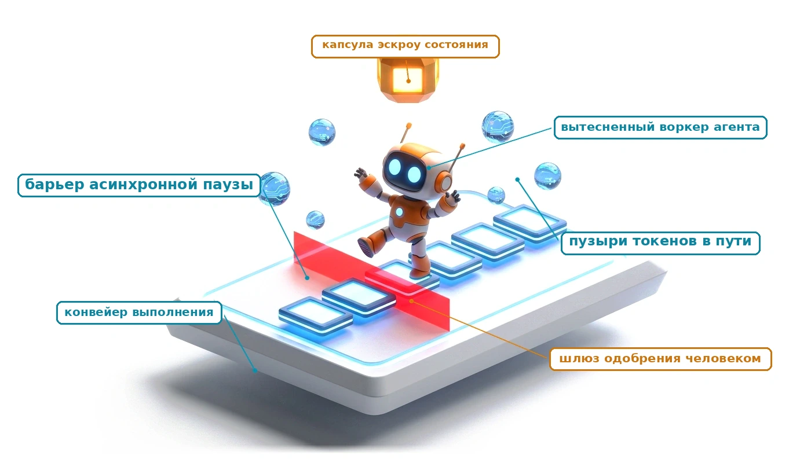
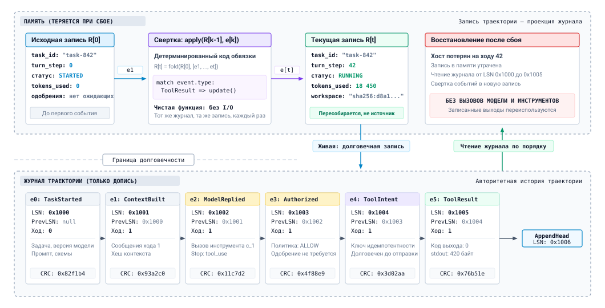
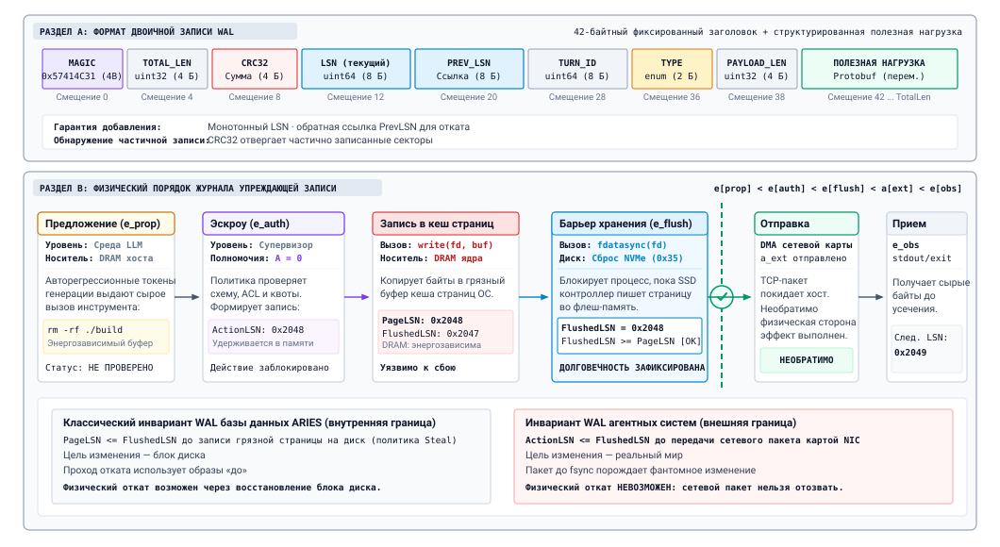
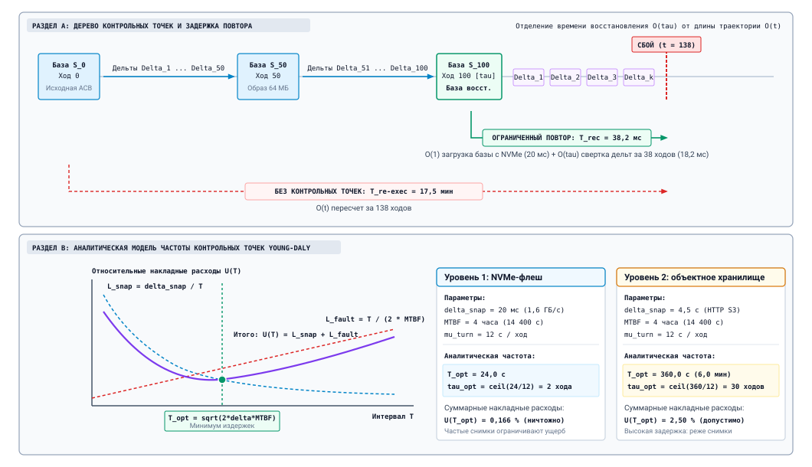
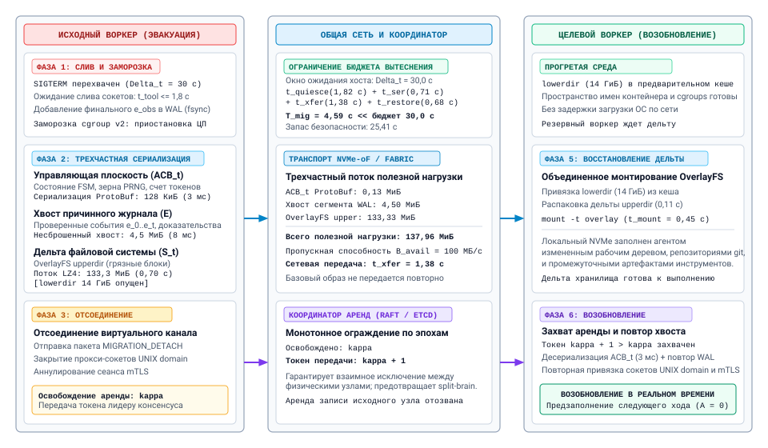
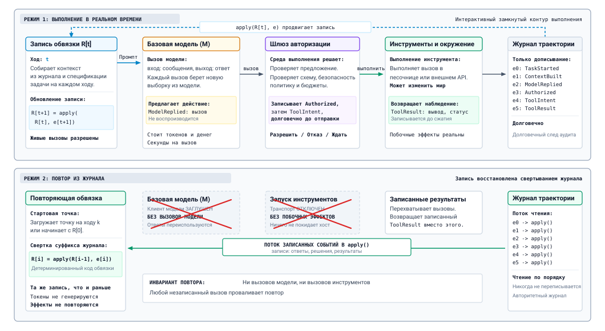
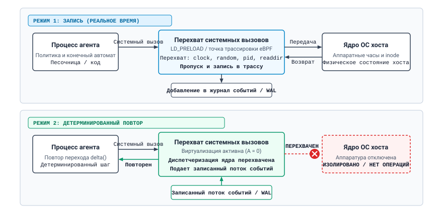
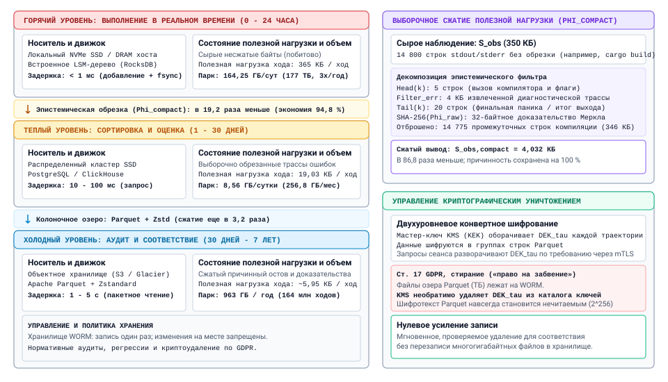

<a id="sec-vol3-durable-execution"></a>

# Долговечное выполнение



## Назначение

_Почему агент должен записать, что он собирается сделать, до того как это сделает?_

Долгоживущий агент переживает машину, на которой запустился. Хосты падают, воркеры вытесняются, развертывания перезапускают процессы, а траектория, приостановленная ради одобрения человеком, может ждать ответа несколько дней. Если это случилось на сороковом ходу, перезапуск с исходного промпта не возвращает задачу: каждый вызов модели дает новую выборку, повторный прогон идет по другому пути, а некоторые из первых сорока ходов уже изменили мир, отправив сообщение, слив ветку или создав сервер, и повторный прогон изменил бы их снова. Выживает только та работа, которую среда выполнения записала в правильном порядке до сбоя. Долговечное выполнение — это дисциплина ведения такой записи, чтобы траекторию можно было возобновить, повторить для отладки или перенести на другую машину, не повторяя эффект, который она уже вызвала. Та же запись позже становится свидетельством, которое читают оценка и обучение. Через призму H·S·A длинный горизонт превращает состояние в проблему долговечности, а уже потраченные полномочия — в долг, который восстановление не должно платить дважды.

> **Цели обучения**
>
> - Спроектировать журнал траектории, события которого (сообщения, идентификаторы вызовов инструментов и их результаты, метаданные модели и сэмплирования, события сжатия, одобрения) достаточны для восстановления записи траектории.
> - Применить порядок «намерение до эффекта», чтобы после сбоя отнести каждое записанное действие к одному из состояний: не отправлено, завершено или под вопросом.
> - Выбрать частоту контрольных точек в ходах по стоимости контрольной точки и частоте сбоев и назвать то, что контрольная точка должна фиксировать, а журнал не может.
> - Объяснить, как возобновленная траектория восстанавливает свой контекст, во что обходится повторное предзаполнение и как при возобновлении учитываются ожидающие одобрения, поздние результаты инструментов и дрейф модели, промпта или схемы инструментов.
> - Построить режим повтора, который подменяет модель и инструменты заглушками, и использовать его для отладки с перемоткой во времени, контрфактических ветвей и регрессионных тестов обвязки.
> - Найти, почему повтор расходится со своей записью, отделив источники на стороне модели от источников на стороне обвязки и окружения.
> - Спроектировать политику хранения, которая сохраняет причинную запись траектории и выносит громоздкий вывод инструментов.

<a id="sec-vol3-persistence-event-sourcing"></a>

## Журнал траектории


*Горизонт растягивает состояние за пределы жизни одного хоста, поэтому эта глава делает запись долговечной.*

Траектория находится на сороковом ходу миграции в облако. Обвязка только что отправила запрос на создание реплики базы данных, и хост теряет питание до прихода ответа. Когда траекторию подхватывает другой хост, от трех вопросов зависит, поможет восстановление или навредит. Что среда выполнения предложила, авторизовала и наблюдала к тридцать девятому ходу? Мог ли запрос на создание ресурса покинуть машину? Если мог, подействовал ли он? Запись траектории из раздела [«Запись траектории»](09_agent_harness.md#sec-vol3-controlplane-acb) ни на один из этих вопросов не отвечает, потому что жила в памяти упавшего хоста. На длинном горизонте состояние, которое несет траектория, становится проблемой долговечности ([«Экспозиции H·S·A»](01_introduction.md#sec-vol3-intro-hsa)), ведь траектории регулярно переживают машины, на которых стартовали ([«Растяжение времени: от наносекундных операций до килосекундных траекторий»](01_introduction.md#sec-vol3-intro-temporal-stretching)).

Очевидное восстановление, при котором исходный промпт отправляют модели заново, не работает. Каждый вызов модели дает выборку, и даже при температуре ноль сервисная система не обещает одинаковых токенов дважды ([«Авторегрессионная генерация»](02_foundation_model.md#sec-vol3-foundation-model-autoregressive)). Поэтому повторный прогон может выбрать другой инструмент на третьем ходу и другой набор файлов на четвертом. Хуже того, повторный прогон не может знать, какие из первых сорока ходов уже изменили мир: второй запрос на создание даст вторую реплику. Значит, восстановлению нужна запись, которую среда выполнения сделала до сбоя и которая фиксирует происходившее ход за ходом.

### Журнал как источник истины

Среда выполнения хранит эту запись как **журнал траектории**, который только дописывается: упорядоченную последовательность типизированных событий, которые она никогда не правит на месте:

$$\mathcal{E} = [e_1, e_2, \dots, e_t]$$

Каждое событие фиксирует один факт о траектории: сборку контекста, ответ модели, авторизацию вызова инструмента средой выполнения или пришедший результат. Живая запись траектории из раздела [«Обвязка агента»](09_agent_harness.md#sec-vol3-agent-harness) (статус, бюджеты, ожидающие одобрения, текущий план) больше не хранится отдельно. Это проекция, которую обвязка вычисляет, сворачивая журнал: начиная с исходной записи $R_0$ она применяет по одной детерминированной функции обновления на каждое событие:

$$R_t = \text{fold}(R_0, \mathcal{E}) = \text{apply}(\dots\text{apply}(\text{apply}(R_0, e_1), e_2)\dots, e_t)$$

<a id="fig-vol3-event-sourcing"></a>


***Запись траектории как проекция журнала**: долговечный журнал траектории (внизу) — это добавляемая только в конец последовательность типизированных событий, у каждого из которых есть порядковый номер записи (LSN) и обратная ссылка. Запись траектории в памяти среды выполнения (вверху) пересчитывается сверткой этих событий детерминированным кодом обвязки. Когда хост теряется на ходу 42, восстановление читает журнал по порядку и воссоздает ту же запись, не вызывая ни модель, ни инструменты.*

На [«Запись траектории как проекция журнала»](10_durable_execution.md#fig-vol3-event-sourcing) видны обе половины. Функция обновления — обычный код обвязки без ввода-вывода, поэтому свертка одного и того же журнала всегда дает одну и ту же запись. После сбоя восстановление читает журнал и сворачивает его снова. Оно не вызывает ни модель, ни инструмент, потому что каждый нужный ответ модели и каждый результат инструмента уже есть в виде события (принцип «Намерение до действия»). Этот шаблон проектирования, **событийное хранение** (event sourcing), давно известен в системах данных (Kleppmann, 2016). Для агентов он подходит особенно хорошо: та часть системы, чей выход нельзя пересчитать, — модель, — как раз и есть та, чей выход журнал сохраняет.

Тот же разрез отделяет журнал от окна контекста. Контекст — это то, что читает следующий вызов модели. Он собирается из журнала и намеренно неполон: сжатие ([«Сжатие контекста»](04_context_engineering.md#sec-vol3-context-engineering-compaction)) сворачивает старые ходы, а усечение ([«Усечение потока наблюдений»](07_tool_calling.md#sec-vol3-tool-calling-streaming)) обрезает длинный вывод инструментов. Журнал сохраняет то, что контекст отбрасывает. Считать контекст записью траектории — самый частый способ ее потерять, потому что улики, которые нужны разбору после инцидента, — это как раз то, что удалило сжатие.

### Что записывает журнал

Журнал полезен для восстановления, только если каждое событие несет то, что понадобится будущему читателю. В [«Схеме журнала траектории»](10_durable_execution.md#tbl-vol3-durable-log-schema) перечислены виды событий, которые нужны одноагентной траектории, и объяснено, зачем нужен каждый из них.

| **Событие**                             | **Когда записывается**                          | **Ключевые поля**                                                                                                                           | **Для чего восстановление или повтор его используют**                                |
|:----------------------------------------|:------------------------------------------------|:--------------------------------------------------------------------------------------------------------------------------------------------|:-------------------------------------------------------------------------------------|
| `TaskStarted`                           | Один раз, до первого хода                       | Спецификация задачи, идентификатор и версия модели, параметры сэмплирования, версия шаблона промпта, версии схем инструментов, идентификатор снимка рабочего пространства | Фиксирует версии, которые должны совпасть при возобновлении или повторе, и задает стартовое рабочее пространство |
| `ContextBuilt`                          | Перед каждым вызовом модели                     | Упорядоченные ссылки на сообщения, извлеченные элементы, хеш собранного контекста                                                            | Позволяет возобновлению заново вывести тот же контекст и обнаружить, когда повторная сборка дала бы другой результат |
| `ModelReplied`                          | После возврата каждого вызова модели            | Ответ дословно, вызовы инструментов с их идентификаторами, причина остановки, счетчики токенов, версия модели, которая фактически обслужила запрос | Единственная копия выборки, которую нельзя сгенерировать заново                       |
| `Authorized`                            | После проверок политики и бюджета               | Идентификатор вызова, решение (разрешить, отклонить, удержать до одобрения), версия политики, оставшийся бюджет                              | Восстанавливает бюджеты и показывает, почему действие было разрешено                 |
| `ApprovalRequested`, `ApprovalResolved` | Когда вызов удержан и когда человек отвечает    | Идентификатор вызова, утверждающий, решение, срок действия                                                                                  | Позволяет приостановленной траектории пережить ожидание и продолжиться с тем же решением |
| `ToolIntent`                            | После авторизации, до отправки, долговечно      | Идентификатор вызова, имя инструмента, аргументы, ключ идемпотентности                                                                      | Отмечает, что эффект мог произойти, поэтому восстановление его урегулирует, а не угадывает |
| `ToolResult`                            | Когда инструмент вернул ответ                   | Идентификатор вызова, статус, вывод (или его хеш и указатель на полное тело), длительность                                                  | Заменяет инструмент при повторе и закрывает намерение                                |
| `Compacted`                             | Когда контекст сворачивается в сводку           | Охваченные ходы, текст сводки в том виде, в каком он был получен                                                                            | Позволяет возобновлению переиспользовать записанную сводку, а не создавать другую    |
| `Checkpoint`                            | После того как контрольная точка стала долговечной | Охваченная позиция в журнале, идентификатор снимка записи, идентификатор снимка рабочего пространства                                    | Ограничивает, сколько журнала должен прочитать перезапуск                            |

<a id="tbl-vol3-durable-log-schema"></a>

***Схема журнала траектории**: виды событий, которые записывает одноагентная траектория, момент записи каждого, важные поля и то, что восстановление или повтор читают из них. Идентификаторы вызовов связывают предложение модели, его авторизацию, намерение и результат в четырех событиях.*

Три проектных решения схемы несут основную ее ценность. Идентификатор вызова связывает одно действие через предложение, авторизацию, намерение и результат, поэтому восстановление может спросить о любом действии, какие из этих четырех событий существуют. Поля версий превращают «модель» и «промпт» из движущихся целей в зафиксированные факты, от которых зависят и возобновление, и повтор. Событие `Compacted` записывает сводку в том виде, в каком она была получена, потому что повторное сжатие тех же ходов — это еще один выбор из распределения, и оно дало бы возобновленной траектории другую память о собственном прошлом.

При замыкании инвариантов (см. [«Принцип замыкания инвариантов»](01_introduction.md#pri-invariant-closure)) среда выполнения больше не полагается ни на что, что модель говорит о собственной истории: произошедшее — это то, что говорит журнал. Но это утверждение верно, только если каждое событие достигает долговечного хранилища до того, как внешний мир может на него отреагировать. Для одного вида событий порядок, в котором среда выполнения пишет и действует, решает, безопасно ли вообще восстановление.

<a id="sec-vol3-persistence-wal"></a>

## Намерение до действия

Вернемся к запросу на создание ресурса на сороковом ходу. Обвязка его авторизовала и теперь должна сделать две вещи: записать, что запрос уходит, и отправить его по сети. Если она сначала отправит запрос, а хост потеряет питание до того, как запись будет долговечно сброшена на энергонезависимый носитель, ресурс в облаке выделен, но журнал о нем ничего не знает. После перезагрузки или переноса восстановленная обвязка изучает журнал, находит авторизованный вызов без следов отправки, делает вывод, что шаг не выполнялся, и отправляет запрос на создание повторно.

**Фантомный эффект**\
Внешнее изменение состояния, которое выполнение инструмента агентом произвело в мире, но которое ни одна долговечная запись журнала не описывает, потому что хост упал после отправки по сети, но до того, как барьер диска закрепил намерение.

Фундаментальный инвариант, который предотвращает этот режим отказа, — **дисциплина журнала упреждающей записи (WAL)**, системная реализация принципа «Намерение до действия». Никакое внешнее изменение не может покинуть границу хоста, пока событие `ToolIntent`, которое авторизует действие и задает его, не будет долговечно зафиксировано на энергонезависимом носителе. Формально для каждого выполнения инструмента, которое меняет внешний мир, среда выполнения соблюдает строгую причинную последовательность:

<a id="eq-vol3-wal-ordering"></a>

$$e_{\text{prop}} \prec e_{\text{auth}} \prec e_{\text{flush}} \prec a_{\text{ext}} \prec e_{\text{obs}}$$

где $e_{\text{prop}}$ — кандидатный вызов инструмента, разобранный из генерации модели, $e_{\text{auth}}$ фиксирует одобрение политики и возможностей со стороны супервизора, $e_{\text{flush}}$ отмечает завершение физического барьера записи, которым подтверждается долговечное закрепление на диске, $a_{\text{ext}}$ — отправка сетевого RPC внешнему инструменту или песочнице, а $e_{\text{obs}}$ фиксирует возвращенное наблюдение.

Физическая последовательность барьеров и причинных переходов показана на [«Последовательности выполнения агента с журналом упреждающей записи»](10_durable_execution.md#fig-vol3-wal-sequence).

<a id="fig-vol3-wal-sequence"></a>


***Последовательность выполнения агента с журналом упреждающей записи**: среда выполнения перехватывает предложение действия-кандидата от модели $e_{\text{prop}}$, оценивает политики авторизации и порождает $e_{\text{auth}}$, а затем обеспечивает строгий барьер долговечной записи $e_{\text{flush}}$ до того, как внешнее действие $a_{\text{ext}}$ будет передано песочнице. Наблюдение инструмента $e_{\text{obs}}$ завершает ход.*

Ключевое ограничение в [порядке операций WAL](10_durable_execution.md#eq-vol3-wal-ordering) — барьер хранения $e_{\text{flush}} \prec a_{\text{ext}}$. В программировании операционных систем вызов `write()` лишь копирует сериализованные байты из пространства пользователя в энергозависимый кеш страниц ядра. Если питание пропадает, пока байты находятся в энергозависимой DRAM, грязные страницы безвозвратно теряются. Долговечность требует явного аппаратного барьера через `fdatasync()` или прямой ввод-вывод, как показано в [«Интерфейсах сохранности данных POSIX и гарантиях долговечности»](10_durable_execution.md#tbl-vol3-io-semantics).

| Интерфейс                  | Семантика кеша           | Условие возврата из ядра | Состояние NVMe при возврате | Безопасно для $e_{\text{flush}} \prec a_{\text{ext}}$? | Типичная задержка ($\text{ мкс}$) |
|:---------------------------|:-------------------------|:------------------------|:--------------------------|:--------------------------------------------------|:--------------------------------|
| `write()`                  | Стандартный кеш страниц  | Скопировано в DRAM ядра | Энергозависимое / не записано | ❌ **Небезопасно** (потеря данных при сбое)       | $1 - 2$                         |
| `write()` + `O_SYNC`       | Синхронный кеш страниц   | Записано в кеш контроллера диска | Кеш контроллера DRAM / неизвестно | ⚠️ **Условно** (зависит от FUA)                  | $150 - 500$                     |
| `write()` + `fdatasync()`  | Явный сброс              | Подтверждено диском     | Зафиксировано в флеш-ячейках | ✅ **Безопасно** (минимальные накладные расходы на метаданные) | $80 - 150$                      |
| `write()` + `fsync()`      | Явная полная синхронизация | Подтверждено диском     | Зафиксировано в флеш-ячейках | ✅ **Безопасно** (обновляет все атрибуты inode)   | $100 - 250$                     |
| Групповая фиксация (`fdatasync`) | Пакетный векторный сброс | Подтверждено для пакета | Зафиксировано в флеш-ячейках | ✅ **Безопасно** (амортизируется на событие)      | $\frac{85}{k} + \frac{W}{2}$    |

<a id="tbl-vol3-io-semantics"></a>

***Интерфейсы сохранности данных POSIX и гарантии долговечности**: сравнение примитивов синхронизации файлов POSIX, семантики возврата из ядра, состояния энергонезависимого носителя и измеренных задержек на современных NVMe-дисках.*

### Три состояния после сбоя

Порядок из [«порядка операций WAL»](10_durable_execution.md#eq-vol3-wal-ordering) ограничивает комбинации записей, которые могут пережить сбой, и гарантирует, что восстановление находит каждое действие, меняющее внешний мир, в одном из трех детерминированных состояний ([«Состояния записанного действия»](10_durable_execution.md#tbl-vol3-durable-recovery-states)).

| **Записи в журнале**              | **Состояние**    | **Что делает восстановление**                                                                                    |
|:----------------------------------|:-------------|:----------------------------------------------------------------------------------------------------------------|
| Нет долговечного `ToolIntent`     | Не отправлено | Вызов не покидал хост. Ход можно выполнить заново, с записанного ответа модели, если он есть.                   |
| `ToolIntent` и `ToolResult`       | Завершено    | Исход известен. Повтор и возобновление используют записанный результат и никогда не отправляют вызов повторно.  |
| `ToolIntent` без `ToolResult`     | **Под вопросом** | Запрос мог не дойти, а мог быть выполнен с потерей только ответа. Урегулируйте до повтора.                  |

<a id="tbl-vol3-durable-recovery-states"></a>

***Состояния записанного действия**: порядок упреждающей записи гарантирует, что каждое действие, меняющее внешний мир, после сбоя находится ровно в одном из трех состояний. Только третье требует активной сверки.*

Порядок упреждающей записи не может сам разрешить третье состояние, **действие под вопросом**. Он гарантирует, что это состояние явно видно. Урегулирование до повтора (принцип «Урегулирование до повтора») разрешает его механизмами, которые описаны в разделе [«Выполнение идемпотентных действий»](07_tool_calling.md#sec-vol3-tool-calling-idempotency):

1. **Ключи идемпотентности**: диспетчер восстановления повторно отправляет запрос инструменту с тем же одноразовым ключом, который записан в событии `ToolIntent`. Если сервер инструмента уже обработал прежний запрос, он возвращает закешированный исход и не повторяет побочный эффект.
2. **Зонды сверки**: когда внешние API не поддерживают идемпотентность, диспетчер восстановления выполняет зонд чтения побочного эффекта (например, спрашивает, существует ли реплика базы данных), чтобы определить, произошло ли изменение.
3. **Эскалация супервизору**: если среда остается неопределенной, супервизор останавливает выполнение и передает его человеку на проверку ([«Шлюзы одобрения»](09_agent_harness.md#sec-vol3-controlplane-hitl)), а не рискует слепым повтором.

### Цена долговечности: амортизация групповой фиксации

Требование синхронного барьера `fdatasync()` на критическом пути каждого выполнения инструмента добавляет задержку энергонезависимого носителя. Один сброс буфера NVMe на локальной флеш-памяти занимает от $80$ до $150\text{ мкс}$, а сетевые блочные тома (например, AWS EBS или Google Persistent Disk) тратят от $2$ до $15\ \text{мс}$ на каждый барьер. В мультиагентных средах, где на общем узле работают десятки или сотни параллельных траекторий, последовательные сбросы создают серьезную очередь.

Стандартный механизм систем, который устраняет это узкое место, — **групповая фиксация** (DeWitt et al., 1984). Она описана в [«Конвейере групповой фиксации»](10_durable_execution.md#tbl-vol3-group-commit-pipeline). Вместо того чтобы каждый рабочий поток выполнял `fdatasync()` сам по себе, параллельные рабочие потоки агентов ставят авторизованные записи событий в кольцевой буфер с несколькими производителями без блокировок и усыпляют себя на futex завершения.

| Этап конвейера          | Принцип работы                                                                                                                                               | Профиль задержки                  | Структуры данных и примитивы ввода-вывода          |
|:------------------------|:-------------------------------------------------------------------------------------------------------------------------------------------------------------|:----------------------------------|:---------------------------------------------------|
| **1. Прием**            | Параллельные потоки агентов сериализуют предложения действий ($e_{\text{prop}}, e_{\text{auth}}$) и помещают их во временный буфер в памяти; потоки ждут промисы завершения. | Почти нулевая ($\le 5\text{ мкс}$) | Кольцевой буфер без блокировок с несколькими производителями (MPMC) |
| **2. Агрегация**        | Выделенный координатор сброса забирает очередь, когда размер пакета достигает $B_{\max}$ (например, 64 записи) или истекает таймаут $W$ (например, 2 мс).     | $0{,}1 - 2{,}0\ \text{мс}$            | Векторный массив памяти для рассеивания-сбора (scatter-gather) |
| **3. Векторная запись** | Агрегированные записи событий пишутся на устройство хранения одним системным вызовом рассеивания-сбора.                                                       | $0{,}2 - 0{,}8\ \text{мс}$            | POSIX `writev()` / отправка через Linux `io_uring` |
| **4. Барьер хранения**  | Ядро хоста заставляет контроллер диска перенести грязные блоки из кеша контроллера на энергонезависимую флеш-память.                                          | $2{,}0 - 15{,}0\ \text{мс}$           | `fdatasync()` / команда сброса NVMe                |
| **5. Освобождение барьера** | Координатор уведомляет все ожидающие промисы завершения; потоки агентов параллельно выходят из ожидания и диспетчеризуют инструменты.                    | Почти нулевая ($\le 10\text{ мкс}$) | Атомарная широковещательная рассылка futex / пробуждение по условной переменной |

<a id="tbl-vol3-group-commit-pipeline"></a>

***Архитектура конвейера групповой фиксации**: амортизация барьеров энергонезависимого хранения между параллельными рабочими потоками агентов через буферизацию без блокировок и векторную синхронизацию.*

Эффективную задержку синхронизации хранилища на ход $t_{\text{eff}}$ мы моделируем при пуассоновском потоке авторизаций с суммарной интенсивностью $\lambda$. Если координатор групповой фиксации использует окно агрегации $W$ и максимальную емкость пакета $K_{\max}$, ожидаемое число событий, амортизируемых на один барьер, задается [формулой](10_durable_execution.md#eq-vol3-group-commit-k):

<a id="eq-vol3-group-commit-k"></a>

$$\bar{k} = \min\left(K_{\max},\, \max\left(1,\, \lambda W\right)\right)$$

Задержка, которую испытывает отдельный поток агента, складывается из ожидаемой задержки в буфере и физической длительности барьера, амортизированной на $\bar{k}$ событий. Эта величина задана [формулой](10_durable_execution.md#eq-vol3-group-commit-latency):

<a id="eq-vol3-group-commit-latency"></a>

$$t_{\text{eff}} = \frac{W}{2} + \frac{t_{\text{writev}}(\bar{k}) + t_{\text{sync}}}{\bar{k}}$$

По мере роста параллелизма траекторий ($\lambda \to \infty$) окно $W$ можно сокращать почти до нуля. Штраф синхронизации $t_{\text{sync}}$ делится на $K_{\max}$ траекторий, и накладные расходы на барьер на ход становятся пренебрежимо малыми, не нарушая причинного инварианта упреждающей записи ни для одного отдельного агента.

<a id="chk-10-wal-invariants"></a>

> **Контрольная точка: порядок упреждающей записи**
>
> - **Порядок**: почему `ToolIntent` должен быть долговечным до отправки и почему запись `ModelReplied` после вызова модели безопасна?
> - **Состояния восстановления**: по журналу вы можете отнести каждое действие, меняющее внешний мир, к состоянию «не отправлено», «завершено» или «под вопросом»?
> - **Урегулирование**: что делает восстановление с вызовом под вопросом, если инструмент не принимает ключа идемпотентности?
> - **Стоимость**: почему групповая фиксация сохраняет причинный порядок каждой траектории и при этом снижает частоту барьеров хранения?

<a id="sec-vol3-persistence-checkpointing"></a>

## Контрольные точки

Программный агент находится на трехсотом ходу. Его журнал фиксирует, что на ходу 212 инструмент правки переписал `parser.py`, а на ходу 250 инструмент оболочки удалил каталог сборки. Свертка журнала восстанавливает запись траектории, но не восстанавливает `parser.py`. Журнал хранит вызовы инструментов и их результаты, а файлы, которые эти вызовы создали, живут в рабочем пространстве песочницы ([«Рабочее пространство агента»](08_sandboxes.md#sec-vol3-sandboxes-cow)). Если хост с этим рабочим пространством сломался аппаратно, оно погибло вместе с ним. Повтор журнала тоже не воссоздаст измененные файлы, потому что повтор намеренно подменяет выполнение инструментов заглушками.

### Что фиксирует контрольная точка: полный снимок и инкрементальное дельта-кодирование

**Контрольная точка** — это долговечный снимок всего, что журнал сам по себе не может дешево восстановить, привязанный к точной позиции в журнале. Она состоит из трех компонентов:

1. **Снимок записи**: сериализованная запись траектории $R_k$ на ходу $k$, чтобы перезапуску не пришлось сворачивать весь журнал с $R_0$.
2. **Снимок рабочего пространства**: файловая система песочницы на ходу $k$, снятая копированием при записи ([«Рабочее пространство агента»](08_sandboxes.md#sec-vol3-sandboxes-cow)).
3. **Событие `Checkpoint`**: добавляется в журнал только после того, как оба снимка стали долговечными на энергонезависимом носителе.

Архитектурный компромисс — в том, снимает ли супервизор *полный снимок состояния* или *инкрементальный дельта-снимок*. В долгих задачах буфер контекста растет монотонно: накапливаются диффы кода и трассы выполнения. Если контекст достигает $128\text{ КиБ}$ структурированных токенов и метаданных, то полный снимок каждые пять ходов на траектории из 500 ходов заставит систему хранения записать:

$$\text{Всего записано байт} = \sum_{k=1}^{100} k \cdot \Delta_{\text{turn}} \approx 50 \cdot 100 \cdot 128\text{ КиБ} \approx 640\text{ МиБ}$$

**Коэффициент усиления записи ($\text{WAF}_{\text{snap}}$):**
$$\text{WAF}_{\text{snap}} = \frac{\text{Байт записано на диск}}{\text{Уникальные изменения состояния}}$$
Для полных снимков на монотонных траекториях $\text{WAF}_{\text{snap}} \propto t$, тогда как для инкрементального дельта-кодирования $\text{WAF}_{\text{snap}} \approx 1$.

Инкрементальное дельта-кодирование смягчает это усиление записи: оно сериализует только дифференциальные изменения, которые произошли с предыдущей контрольной точки, и формализуется [формулой](10_durable_execution.md#eq-vol3-delta-encoding):

<a id="eq-vol3-delta-encoding"></a>

$$\Delta_t = \mathbf{S}_t \ominus \mathbf{S}_{t - \tau}$$

где $\tau$ — шаг контрольных точек. Вместо повторной сериализации всего буфера промпта среда выполнения записывает только вновь добавленные токены сообщений, обновленные регистры бюджета и измененные inode файловой системы ([«Компромиссы архитектуры контрольных точек состояния»](10_durable_execution.md#tbl-vol3-snapshot-models)).

| **Архитектурный аспект**   | **Полный снимок состояния**                                                     | **Инкрементальный дельта-снимок**                                            | **Копирование при записи (CoW)**                                  |
|:---------------------------|:--------------------------------------------------------------------------------|:-----------------------------------------------------------------------------|:------------------------------------------------------------------|
| **Накладные расходы на сериализацию** | Высокие; растут линейно с размером контекста $\mathcal{O}(\Vert \mathbf{S}_t \Vert)$ | Низкие; строго ограничены изменением окна $\mathcal{O}(\Vert \Delta_t \Vert)$ | Почти нулевая пауза; дублирование таблицы страниц $\mathcal{O}(\text{RSS})$ |
| **Усиление хранения**      | Тяжелый квадратичный рост на длинных траекториях                                | Минимальное; хранит уникальные переходы состояний                            | Умеренное; пропорционально объему грязных страниц памяти          |
| **Время восстановления после сбоя** | Минимальное $\mathcal{O}(1)$; одно чтение и мгновенная распаковка памяти | Умеренное $\mathcal{O}(\tau)$; нужно применить цепочку дельт от базы        | Минимальное $\mathcal{O}(1)$; переотображает хранилище или файлы страниц |
| **Влияние уплотнения журнала** | Тривиальное; все исторические снимки до $t$ можно удалить                    | Сложное; нужна периодическая консолидация базы, чтобы обрезать журнал         | Умеренное; нужно фоновое слияние страниц и очистка                |
| **Барьер изоляции**        | Высокий; полная развязка с памятью живого процесса                              | Умеренный; зависит от непрерывной проверки движком повтора                  | Привязан к процессу; связан с семантикой памяти ядра локального хоста |

<a id="tbl-vol3-snapshot-models"></a>

***Компромиссы архитектуры контрольных точек состояния**: сравнение полных снимков состояния, инкрементального дельта-кодирования и форков памяти с копированием при записи.*

Компромисс между накладными расходами на контрольные точки и временем восстановления через повторное выполнение показан на рисунке [«Периодичность контрольных точек и восстановление повтором»](10_durable_execution.md#fig-vol3-checkpoint-cadence).

<a id="fig-vol3-checkpoint-cadence"></a>


***Периодичность контрольных точек и восстановление повтором**: снимки состояния, взятые с частотой $\tau$, ограничивают объем пересчета при восстановлении. Когда сбой происходит на ходу $t_{\text{crash}}$, менеджер восстановления загружает снимок $\mathbf{S}_k$ и повторно применяет только суффикс событий $\langle e_{k+1}, \dots \rangle$ из журнала упреждающей записи, не вызывая модель повторно.*

### Во что обходится сбой и как часто делать контрольные точки

С контрольными точками восстановление загружает последнюю контрольную точку и сворачивает только суффикс журнала после нее. Эффекты внутри песочницы, например правки файлов, диффы которых есть в журнале, можно переиграть по записанным результатам. Эффекты, которые журнал воспроизвести не может, вынуждают выбирать: либо откатиться к контрольной точке и переделать локальные ходы, либо эскалировать.

Эта цена задает частоту. Пусть $\delta$ — время, на которое контрольная точка приостанавливает траекторию, а $M$ — среднее время между сбоями хоста или воркера. Если делать контрольную точку каждые $T$ секунд, доля времени на контрольные точки составит $\delta / T$, а при каждом сбое в среднем теряется $T/2$ работы. Баланс дает классический оптимум первого порядка Янга (Young, 1974):

<a id="eq-vol3-young-formula"></a>

$$T^{\ast} \approx \sqrt{2\,\delta\,M}$$

С учетом накладных расходов второго порядка на перезапуск $\delta_{\text{rec}}$ формулировка Дейли высшего порядка (Daly, 2006) уточняет [формулу Янга](10_durable_execution.md#eq-vol3-young-formula) с помощью [формулы](10_durable_execution.md#eq-vol3-daly-formula):

<a id="eq-vol3-daly-formula"></a>

$$T_{\text{opt}}^{\text{Daly}} = \sqrt{2 \cdot \delta \cdot \left(M + \delta_{\text{rec}}\right)} + \delta \cdot \left(\frac{1}{3}\sqrt{\frac{2\delta}{M}} - 1\right)$$

<a id="nbk-10-checkpoint-cadence"></a>

> **Пример: выбор частоты контрольных точек в ходах**
>
> **Задача**: кодирующий агент работает на пуле прерываемых воркеров, среднее время между сбоями у которых составляет 4 часа. Ход занимает в среднем 12 с, а контрольная точка (сброс записи и снимок рабочего пространства копированием при записи на границе хода) приостанавливает траекторию на 0,5 с. В момент сбоя контекст содержит 40 000 токенов, каждый ответ содержит 350 выходных токенов, и тарифицируется это так же, как в примере бюджета из раздела [«Бюджеты и потолки»](09_agent_harness.md#sec-vol3-controlplane-accounting). Исходные данные условны. Как часто обвязке делать контрольные точки и во что обходится сбой при этой частоте и при гораздо более редкой?
>
> **Частота**: при $\delta$ = 0,5 с и $M$ = 14 400 с [формула Янга](10_durable_execution.md#eq-vol3-young-formula) дает $T^{\ast} = \sqrt{2\,\delta\,M}$ = 120 с, что соответствует 10 ходам.
>
> **Накладные расходы**: доля времени, потраченного на паузы и потерянную работу, равна $\delta/T + T/(2M)$. В оптимуме она составляет 0,83 %. Контрольная точка на каждом ходу поднимает ее до 4,2 %, почти полностью из-за пауз, а контрольная точка каждые 100 ходов тоже дает 4,2 %, почти полностью из-за потерянной работы.
>
> **Цена сбоя**: любое возобновление оплачивает одно холодное предзаполнение восстановленного контекста, примерно в 0,12 доллара. Сверх того сбой в среднем теряет половину интервала. В оптимуме это 5 ходов, около 1 минуты и 0,09 доллара токенов при теплом префиксе. Если же контрольная точка делается каждые 100 ходов, сбой теряет 50 ходов, около 10 минут и 0,86 доллара, а каждый переделанный ход — это новая выборка, которая может уйти с пути, записанного журналом.
>
> **Системный вывод**: кривая накладных расходов плоская у минимума и крутая по краям, поэтому частота должна быть правильной лишь с точностью до множителя около двух. Сдвигает ее отношение стоимости контрольной точки к частоте сбоев. Более медленное хранилище снимков увеличивает $\delta$ и сдвигает оптимум вправо, а более нестабильный пул воркеров сокращает $M$ и сдвигает его влево. Денежная стоимость сбоя мала; более серьезная цена переделанных ходов в том, что они — новые выборки, поэтому журнал хранит каждый ответ, который модель уже выдала.

Четыре момента требуют контрольной точки независимо от формулы, потому что каждый из них — точка, к которой траектория будет возвращаться или которую она не должна потерять:

- **Перед необратимым действием**, чтобы работа до поворота была в безопасности, что бы ни случилось после него ([«Восстановление после сбоев»](11_failure_recovery.md#sec-vol3-failure-recovery) рассматривает поворот).
- **Когда траектория приостанавливается ради одобрения**, потому что ожидание, которое длится часами, делает сбой во время ожидания вероятным.
- **Перед сжатием**, чтобы контекст до сжатия оставался достижимым.
- **Когда обвязка переносит траекторию на другого воркера** ([«Возобновление траектории»](10_durable_execution.md#sec-vol3-persistence-migration)).

<a id="sec-vol3-persistence-migration"></a>

## Возобновление траектории

Траектория из начала главы теперь возобновляется на новом воркере. Предыдущий хост мог упасть, быть вытеснен или выведен из работы ради развертывания, либо траектория могла просто два дня ждать, пока человек одобрит изменение в продакшене ([«Шлюзы одобрения»](09_agent_harness.md#sec-vol3-controlplane-hitl)). Во всех случаях воркер, который продолжает траекторию, начинает только с журналом, последней контрольной точкой и правилом не повторять эффект. **Возобновление** — это протокол, который превращает их в работающую траекторию:

1. **Захват владения.** Получить аренду траектории с токеном ограждения, чтобы никакой другой воркер не мог действовать от ее имени (см. ниже).
2. **Восстановление.** Загрузить снимки записи и рабочего пространства из последней контрольной точки, затем свернуть суффикс журнала в запись.
3. **Урегулирование.** Разрешить каждое намерение под вопросом, как описано в разделе [«Намерение до действия»](10_durable_execution.md#sec-vol3-persistence-wal), до того как будет отправлено что-либо новое.
4. **Восстановление контекста** из журнала и его предзаполнение.
5. **Продолжение** цикла на следующей границе хода в том состоянии, которое записано в записи траектории.

Шаги 2 и 3 используют механизмы двух предыдущих разделов. Шаги 1 и 4, а также ситуации, которые их усложняют, относятся именно к возобновлению.

### Восстановление контекста

Модель между вызовами ничего не хранит, поэтому возобновленный воркер должен передать ей контекст. Он заново выводит контекст из журнала теми же правилами сборки, которыми пользовалась траектория ([«Подготовка следующего вызова»](04_context_engineering.md#sec-vol3-context-engineering-staging)): записанные сообщения, записанные результаты инструментов в том виде, в каком они были доставлены, и записанные сводки `Compacted` вместо ходов, которые они заменили. Хеш `ContextBuilt` позволяет обвязке проверить, что заново собранный контекст совпадает с последним, который модель видела до сбоя. Несовпадение означает, что правила сборки или их входы изменились. Это дрейф (см. ниже), а не восстановление.

Перестроенный контекст нужно предзаполнить заново. KV-состояние, которое держала старая сессия обслуживания, выводилось из префикса токенов и не пережило сбой (принцип «Состояние внимания выводится из префикса токенов»), а новый вызов может попасть на сервер, чей кеш префиксов никогда не видел эту траекторию ([«Кеширование префиксов между ходами»](05_kv_cache.md#sec-vol3-kvcache-radix-tree)). Поэтому возобновление оплачивает одно холодное предзаполнение всего контекста. Для длинного контекста это секунды задержки и центы стоимости входных токенов ([«Задержка обслуживания на ускорителе»](02_foundation_model.md#sec-vol3-foundation-model-cost); «Размер состояния внимания»). Это немного по сравнению с переделкой ходов, которая стоит минут вызовов модели и долларов и ставит под угрозу каждый эффект под вопросом. Два приема помогают сохранить эту цену малой. Маршрутизация возобновленной траектории на сервер, который еще держит ее префикс, превращает холодное предзаполнение в попадание в кеш. Повторная сборка контекста побайтно как прежде сохраняет префикс идентичным, поэтому любая уцелевшая запись кеша остается пригодной.

### Паузы, одобрения и поздние результаты

Пауза ради одобрения — это возобновление, которое запланировала обвязка. Когда вызов удержан ([«Шлюзы одобрения»](09_agent_harness.md#sec-vol3-controlplane-hitl)), обвязка записывает `ApprovalRequested`, делает контрольную точку и полностью освобождает воркер и его состояние обслуживания модели, потому что держать и то и другое часами расточительно. Когда ответ приходит, среда выполнения записывает `ApprovalResolved` и возобновляет траекторию теми же пятью шагами. Собственные правила шлюза одобрения, например срок действия и повторная проверка предусловий действия перед отправкой, выполняются уже после возобновления, против мира в его нынешнем виде, а не в том, каким он был, когда запрос подавали.

Долгие инструменты создают противоположный случай. Задача, запущенная через асинхронный инструмент ([«Возобновление по событиям»](07_tool_calling.md#sec-vol3-tool-calling-async-resumption)), может закончиться после того, как воркер, который ее запустил, уже умер. Поэтому ее результат должен поступать в долговечный входящий буфер с ключом по идентификатору вызова, а не в память воркера. При возобновлении обвязка сопоставляет каждый ожидаемый результат с намерениями в журнале и записывает соответствующий `ToolResult`. Результат, у которого идентификатор вызова не имеет намерения в журнале или который пришел для траектории, уже отмененной, отклоняется защитами состояний записи ([«Состояния траектории»](09_agent_harness.md#sec-vol3-controlplane-statemachine)) и не передается модели.

### Перенос траектории и токены ограждения

Перенос траектории между воркерами — из-за слива узла, теплового ограничения частоты или вытеснения спотового экземпляра — это запланированное возобновление. Уходящий воркер дает текущему ходу завершиться, делает контрольную точку и освобождает свою аренду; приходящий воркер восстанавливает контрольную точку и продолжает работу.

Последовательные фазы передачи живой траектории показаны на [«Архитектуре живого переноса траектории»](10_durable_execution.md#fig-vol3-trajectory-migration).

<a id="fig-vol3-trajectory-migration"></a>


***Архитектура живого переноса траектории**: сквозная последовательность между уходящим узлом, распределенным координатором и приходящим узлом. Чистая приостановка на границе хода гарантирует отсутствие незавершенных действий инструментов во время передачи состояния. Токены ограждения не дают выполняться двум экземплярам одновременно (split-brain).*

Критическая опасность при переносе — **дилемма split-brain**: воркер, испытывающий временный сетевой разрыв или зависание ядра, может не понять, что его аренда истекла, и продолжит выполнять шаги и выпускать мутации инструментов одновременно с только что пришедшим воркером. Среда выполнения предотвращает это через **строго возрастающий токен ограждения** $\gamma$:

1. Когда служба распределенной аренды передает владение траекторией $\tau$ приходящему воркеру $B$, она увеличивает счетчик эпохи: $\gamma_B = \gamma_A + 1$.
2. Каждая полезная нагрузка вызова инструмента, отправленная воркером, должна нести назначенный ему токен ограждения: $a = \langle \text{tool}, \text{args}, \gamma \rangle$.
3. Шлюз исполнения инструментов и внешние прокси ресурсов применяют монотонный барьер: любой вызов с $\gamma < \gamma_{\text{current}}$ безусловно отбрасывается с ошибкой авторизации.

Если устаревший воркер $A$ проснется после временной паузы и попытается выполнить внешний вызов инструмента, шлюз его отвергнет, потому что $\gamma_A < \gamma_B$, предотвращая фантомные мутации и двойное выполнение.

### Возобновление при дрейфе

Между сбоем и возобновлением или во время долгой паузы ради одобрения система вокруг траектории может измениться. Обслуживаемая модель может получить новую версию под тем же именем, шаблон промпта может быть отредактирован, а схема инструмента может получить новое поле или переименовать существующее. Поскольку `TaskStarted` и каждый `ModelReplied` записывают версии, которые использовались, обвязка может обнаружить дрейф, а не выяснять его по странному поведению, и у нее есть три варианта:

- **Закрепить** записанные версии и возобновиться на них, что возможно, только пока эти версии еще доступны.
- **Перейти** на новые версии на следующей границе хода, записав событие дрейфа со старой и новой версиями. Записанные ходы сохраняют свои записанные выходы, контекст пересобирается по новому шаблону, а кеш префиксов промахивается, начиная с первого измененного токена.
- **Отказаться** и эскалировать — правильный ответ, когда измененная схема инструмента переинтерпретировала бы аргументы, уже записанные в намерении под вопросом.

Траектория, которая перешла на новые версии, начиная с хода $k$, — уже другая система. Ее поведение до и после перехода не стоит объединять при оценке ([«Оценка агентов»](12_evaluation.md#sec-vol3-evaluation)), а событие дрейфа как раз и позволяет оценщику разделить их.

Возобновление использует журнал, чтобы продолжить траекторию. Тот же механизм может также восстановить прошлое траектории, не продолжая ее, и именно так инженеры выясняют, что пошло не так.

<a id="sec-vol3-persistence-replay"></a>

## Повтор

Ночью агент удалил релизную ветку на ходу 23 задачи по очистке. Наутро инженеру нужно знать, что видела модель, когда выбирала это действие: какой список ей показали, что говорили инструкции после сжатия и проверялась ли авторизация по правильной политике. Повторный запуск задачи на эти вопросы не отвечает, потому что он сэмплирует новую траекторию и, направленный на настоящий репозиторий, может удалить что-то другое.

**Повтор** отвечает на них. Он запускает обвязку по журналу, при этом оба источника новой информации отключены. Клиент модели подменяется заглушкой, которая возвращает записанные события `ModelReplied` по порядку, а транспорт инструментов отключается и возвращает записанные события `ToolResult`. Код обвязки работает по-настоящему: собирает контексты, проверяет политики и обновляет запись, поэтому инженер видит то, что обвязка действительно сделала. На [«Выполнении в реальном времени и повторе»](10_durable_execution.md#fig-vol3-replay-mode) сопоставлены два режима, а [«Повтор и повторный запуск»](10_durable_execution.md#tbl-vol3-replay-comparison) ставит повтор рядом с повторным запуском, который он заменяет.

<a id="fig-vol3-replay-mode"></a>


***Выполнение в реальном времени и повтор**: при выполнении в реальном времени (вверху) обвязка собирает контекст, модель отвечает вызовом инструмента, шлюз авторизации записывает решение и долговечное намерение, инструмент выполняется, а каждый шаг дописывается в журнал траектории. При повторе (внизу) клиент модели заглушен, а транспорт инструментов отключен. Обвязка сворачивает записанные события, получает записанные результаты вместо вызовов инструментов и воссоздает ту же запись без генерации токенов и без побочных эффектов. Любой вызов, которого журнал не учитывает, проваливает повтор.*

| **Измерение** | **Выполнение в реальном времени** | **Повторный запуск с промпта**     | **Повтор из журнала**               |
|:--------------|:----------------------------------|:-----------------------------------|:------------------------------------|
| **Модель**    | Вызывается                        | Вызывается снова, новые выборки    | Заглушена, записанные ответы        |
| **Инструменты** | Выполняются                     | Выполняются снова, эффекты повторяются | Отключены, записанные результаты |
| **Исход**     | Траектория                        | Другая траектория                  | Та же траектория, шаг за шагом      |
| **Стоимость** | Токены, доллары, эффекты          | Токены, доллары, повторные эффекты | Только вычисления обвязки           |
| **Назначение** | Выполнение задачи                | Исследование альтернатив           | Восстановление, отладка, аудит, тестирование |

<a id="tbl-vol3-replay-comparison"></a>

***Повтор и повторный запуск**: повтор восстанавливает траекторию из ее журнала без вызова модели и инструментов. Повторный запуск с исходного промпта — это новая траектория, которая снова тратит токены и повторяет эффекты.*

Повтор строг. Если обвязка во время повтора пытается вызвать модель или инструмент, которых журнал не учитывает, повтор проваливается. Незаписанный вызов означает либо что код обвязки изменился после записи, либо что какой-то вход попал в живую траекторию, минуя журнал, и то и другое — находка. Идея пришла из детерминированного повтора целых машин, где для воспроизведения выполнения нужно записывать каждый недетерминированный вход (King et al., 2005). Для агента недетерминированных входов немного, и они хорошо определены: ответы модели, результаты инструментов и то, что сама обвязка читает из окружения ([«Почему повторы расходятся»](10_durable_execution.md#sec-vol3-persistence-non-determinism)).

### Перемотка во времени и контрфактические ветви

Поскольку повтор может остановиться на любом ходу, журнал становится временной шкалой, по которой инженер может двигаться.

<a id="dfn-time-travel-replay"></a>

> **Определение: повтор с перемоткой во времени**
>
> ***Повтор с перемоткой во времени*** — это восстановление точного состояния траектории на любом прошлом ходу $t$: загружается ближайшая контрольная точка на ходу $t$ или раньше, затем повторно применяется суффикс журнала до $t$ при заглушенных модели и инструментах.
>
> 1.  **Значение**: инженер может изучить контекст, который модель действительно получила, состояние бюджета и каждое решение авторизации на ходу, где траектория пошла не так, и платить только вычислениями обвязки.
> 2.  **Отличие**: в отличие от повторного запуска с промпта, он воспроизводит записанную траекторию, а не сэмплирует новую; в отличие от чтения сырого журнала, он показывает производное состояние обвязки (собранный контекст и запись) на этом ходу.
> 3.  **Частая ошибка**: позволить повтору дойти до живого инструмента, который повторит прошлый эффект в нынешнем мире.

Для удаленной ветки инженер повторяет до хода 23 и читает контекст, который получила модель. Допустим, список веток, который ей показали, был обрезан до строки, где релизная ветка помечена как защищенная. Тогда дефект в усечении наблюдений, а не в модели. Разделение ошибок модели и ошибок обвязки на множестве инцидентов — тема раздела [«Криминалистический разбор инцидентов»](12_evaluation.md#sec-vol3-evaluation-postmortems), и доказательства для него дает повтор.

**Контрфактическая ветвь** идет дальше. Инженер форкает траекторию на ходу 22, меняет одну вещь (правило усечения, шаблон промпта, схему инструмента или модель) и дает ей продолжиться в реальном времени с этой точки. Все до форка повторяется, поэтому ранние ходы ничего не стоят и остаются идентичными. Все после форка — новая траектория, и она должна работать в песочнице, где внешние инструменты заглушены или направлены на тестовые системы, потому что она живая и ее эффекты настоящие. Сравнение одной ветви с одной записью показывает лишь, что исправление может изменить исход. Чтобы показать, что оно делает это надежно, нужно прогнать много ветвей и измерить их, а этим занимается [«Оценка агентов»](12_evaluation.md#sec-vol3-evaluation).

### Регрессионные тесты для обвязки

Повтор также тестирует саму обвязку. Каждое изменение обвязки, например более строгий парсер аргументов инструмента, новое правило сжатия или пересмотренная проверка политики, рискует сломать поведение, от которого зависят производственные траектории. Проверять такое изменение на живой модели медленно, дорого и нестабильно, потому что тест может упасть лишь из-за того, что модель сэмплировала другую формулировку.

Повтор архивных траекторий через измененную обвязку убирает все три проблемы. Записанные ответы модели служат фиксированными тестовыми входами, поэтому тест измеряет обвязку и ничего больше. Допустим, команда ужесточает парсер, который извлекает правки файлов из вызовов инструментов. Повтор нескольких сотен производственных журналов через новый парсер находит траекторию, где на ходу 14 старый парсер принял патч, обернутый в блок кода markdown, а новый его отвергает, и повтор останавливается на этом ходу, сохранив оба разбора. Тест стоил только вычислений обвязки, прошел за секунды и указал точный ход и полезную нагрузку.

Область этого теста намеренно узкая. Он показывает, что новая обвязка обрабатывает записанные выходы модели так же, как старая, или где она отличается. Он не может показать, что новая обвязка делает агента успешнее, потому что будущие ответы модели будут реагировать на новую обвязку. Для этого нужны свежие траектории и статистика ([«Оценка агентов»](12_evaluation.md#sec-vol3-evaluation)). Те же журналы, проверенные, становятся и сырьем для обучения ([«Курирование траекторий»](13_trajectory_curation.md#sec-vol3-trajectory-curation)).

Повтор работает, потому что никогда ни о чем не спрашивает модель. Как только инженер все же спрашивает — повторным запуском промпта или продолжением контрфактической ветви, — траектория может разойтись со своей записью, и полезно знать почему.

<a id="sec-vol3-persistence-non-determinism"></a>

## Почему повторы расходятся

Инженер, разбирающий сбой агента на ходу 42, перезапускает траекторию той же моделью при температуре ноль на копии репозитория на том же коммите Git. Повтор расходится на ходу 6, выбирает совсем другой вызов инструмента и до сбоя не доходит. Ничего не сломано. Повторный прогон автономного агента имеет несколько независимых векторов расхождения.

### Четыре источника расхождения

В [«Источниках расхождения при повторе»](10_durable_execution.md#tbl-vol3-nondeterminism-mitigation) перечислены четыре архитектурных слоя, на которых недетерминированность попадает в траекторию агента.

| **Источник**        | **Как он попадает**                                                                                      | **Что делает среда выполнения**                                                                     |
|:--------------------|:---------------------------------------------------------------------------------------------------------|:----------------------------------------------------------------------------------------------------|
| **Вызов модели**    | Сэмплирование при ненулевой температуре; неассоциативность сложения с плавающей точкой в параллельных редукционных ядрах при $T=0$ | Записывать каждый ответ; никогда не ожидать, что повторный прогон его воспроизведет                  |
| **Дрейф модели**    | Новая версия модели или конфигурация обслуживания под тем же именем                                      | Записывать обслуживаемую версию на каждом ответе; сравнивать версии, прежде чем сравнивать поведение |
| **Входы обвязки**   | Временные метки, случайные идентификаторы, неупорядоченные списки каталогов и результаты поиска, попавшие в контекст | Пропускать каждый вход через обвязку, записывать его как событие и сортировать все, что не имеет внутреннего порядка |
| **Окружение**       | Внешние сервисы, репозитории и данные, которые изменились после записи                                  | Записывать каждый результат инструмента; повторять из журнала, а для контрфактических ветвей закреплять или снимать среду |

<a id="tbl-vol3-nondeterminism-mitigation"></a>

***Источники расхождения при повторе**: четыре места, где повторный прогон может отклониться от своей записи, и то, что среда выполнения записывает или контролирует для каждого из них. Только первый нельзя устранить: его нужно виртуализировать и записывать.*

Вызов модели сильнее всего удивляет инженеров, потому что обслуживание базовой модели недетерминировано даже при температуре ноль ($T=0$). На GPU умножение плотных матриц (GEMM) и ядра FlashAttention выполняют параллельные редукции на тысячах потоковых мультипроцессоров. Поскольку сложение чисел с плавающей точкой неассоциативно:

$$(a + b) + c \ne a + (b + c)$$

вариации в планировании варпов блоков потоков дают микроколебания в седьмом знаке распределений логитов токенов. Когда два кандидатных токена почти равны у границы argmax, незаметный сдвиг планирования меняет испущенный токен. Поскольку авторегрессионное декодирование подает испущенные токены обратно в контекст, расхождение одного токена на ходу $t$ нарастает экспоненциально на всех последующих ходах.

### Детерминированный повтор через перехват системных вызовов

Для побитово точного повтора в целях диагностической отладки среда выполнения применяет **перехват окружения**: между обвязкой и базовым хостом вставляется прослойка системных вызовов и ввода-вывода ([«Детерминированный повтор через перехват окружения»](10_durable_execution.md#fig-vol3-syscall-shim-replay)).

<a id="fig-vol3-syscall-shim-replay"></a>


***Детерминированный повтор через перехват окружения**: прослойка системных вызовов перехватывает недетерминированные взаимодействия с хостом (часы, случайные зерна, вызовы инструментов) и отдает записанные события из журнала траектории, гарантируя побитово точное повторное выполнение логики супервизора.*

Когда обвязка работает в режиме повтора:

1. **Виртуализация модели**: вызовы API модели перехватываются и удовлетворяются возвратом записанной полезной нагрузки токенов `ModelReplied` из журнала.
2. **Перехват окружения**: системные вызовы, которые запрашивают текущее время по часам (`gettimeofday`), идентификаторы процессов или криптографическую энтропию (`/dev/urandom`), возвращают записанные временные метки и зерна, сохраненные в событии `ContextBuilt`.
3. **Внедрение моков инструментов**: диспетчеризация инструментов перехватывается; вместо выполнения команд оболочки или сетевых запросов прослойка внедряет записанные данные `ToolResult`.

Эта архитектура отделяет код супервизора от физической недетерминированности и позволяет делать воспроизводимые регрессионные тесты и тонкую атрибуцию первопричин.

### Измерение расхождения

Когда инженер намеренно перезапускает модель, чтобы проверить устойчивость, главная диагностическая метрика — **точка расхождения**: самый ранний ход $t_{\text{div}}$, на котором выбранное действие инструмента отклоняется от записанной базы. Сравнение хешей контекста на $t_{\text{div}}$ сразу изолирует первопричину: одинаковые хеши контекста подтверждают стохастичность модели или недетерминированность вычислений с плавающей точкой, тогда как различающиеся хеши указывают на дрейф окружения или неупорядоченные входы каталогов.

<a id="chk-10-time-travel-debugging"></a>

> **Контрольная точка: повтор и расхождение**
>
> - **Повтор против повторного запуска**: почему повтор стоит только вычислений обвязки, тогда как повторный запуск с промпта тратит токены и рискует повторить эффекты?
> - **Дрейф из-за плавающей точки**: почему неассоциативность сложения в ядрах GPU вызывает расхождение декодирования при температуре ноль?
> - **Строгость**: что значит, когда повтор пытается вызвать модель или инструмент, которых журнал не учитывает?
> - **Контрфактические ветви**: почему контрфактическая ветвь должна восстановить рабочее пространство из контрольной точки, прежде чем продолжаться в реальном времени?

<a id="sec-vol3-persistence-compaction"></a>

## Хранение журнала

<a id="sec-vol3-persistence-engine-design"></a>

## Движки хранения траекторий

Эксплуатация корпоративного парка, который производит десятки тысяч длинных траекторий в день, выявляет фундаментальную дилемму хранения: системе нужны синхронные барьеры записи менее миллисекунды для активного WAL на критическом пути выполнения, а также реляционные индексы для текущего мониторинга и плотная колоночная пакетная обработка для последующего дообучения с подкреплением (RL). Одна технология хранения не может удовлетворить эти конфликтующие требования ([«Парадигмы хранения траекторий»](10_durable_execution.md#tbl-vol3-storage-engine-comparison)).

| Архитектура хранения     | Основная структура данных | Задержка добавления (p99)     | Пропускная способность случайного сканирования | Типичное усиление записи   | Оптимальная роль в жизненном цикле агента                                |
|:-------------------------|:--------------------------|:------------------------------|:-----------------------------------------------|:---------------------------|:-------------------------------------------------------------------------|
| **LSM-дерево (встроенное)** | MemTable + SSTables       | $0{,}2 - 0{,}8\ \text{мс}$        | Высокая (для последовательных диапазонов LSN)  | $2 - 5\times$              | **Горячий уровень**: активный WAL, локальные барьеры ходов, мгновенный перезапуск после сбоя |
| **B+ дерево (реляционное)** | Страничные дисковые блоки | $5 - 25\ \text{мс}$           | Высокая (сканирование по индексам нескольких атрибутов) | $10 - 30\times$            | **Теплый уровень**: координация парка в кластере, очереди одобрений HITL  |
| **Колоночное озеро данных** | Блоки Parquet / Zstd      | Пакетный импорт ($>1\ \text{с}$) | Сверхвысокая (векторизованные SIMD-сканы)      | $\approx 1{,}0\times$        | **Холодный уровень**: курирование траекторий, аудит безопасности, обучение SFT и RLVR |

<a id="tbl-vol3-storage-engine-comparison"></a>

***Парадигмы хранения траекторий**: сравнение физических архитектур хранения, паттернов доступа, коэффициентов усиления записи и размещения по жизненному циклу для агентных систем.*

<a id="fig-vol3-storage-pyramid"></a>


***Многоуровневая пирамида хранения траекторий**: организация хранения событий на NVMe-дисках для активных живых траекторий, распределенных хранилищ «ключ — значение» для недавних аналитических запросов и холодного объектного хранилища для долгосрочного аудита и обучающих данных.*

### Многоуровневый конвейер хранения

Производственные архитектуры снимают это напряжение, организуя хранение в трехуровневую пирамиду жизненного цикла ([«Многоуровневая пирамида хранения траекторий»](10_durable_execution.md#fig-vol3-storage-pyramid) и [«Производственный многоуровневый движок хранения траекторий»](10_durable_execution.md#tbl-vol3-hybrid-storage-tiers)):

1. **Горячий уровень (локальный NVMe / встроенная RocksDB)**: работает на воркере. Когда обвязка записывает `ToolIntent` или `ToolResult`, она дописывает его напрямую во встроенное LSM-дерево с `fdatasync()`. Поскольку запись строго последовательна и локальна, долговечная фиксация завершается менее чем за $0{,}5\ \text{мс}$, что соблюдает [порядок WAL](10_durable_execution.md#eq-vol3-wal-ordering) без сетевых переходов.
2. **Теплый уровень (кластерная реляционная база / PostgreSQL)**: асинхронный потоковый демон-сайдкар следит за локальным журналом RocksDB и реплицирует зафиксированные пакеты событий в централизованную реляционную базу. Этот уровень дает индексированные мультиагентные запросы, административную отмену и живой мониторинг, не блокируя путь выполнения.
3. **Холодный уровень (колоночное объектное хранилище / Apache Parquet)**: офлайн-конвейер пакетной обработки сливает завершенные траектории старше 7 дней в сжатые файлы Apache Parquet в объектном хранилище (S3/GCS), разбитые по арендатору, дате и версии модели. Аналитические движки (DuckDB, Trino) и конвейеры обучения передают эти колоночные фрагменты прямо в память GPU для обучения политики ([«Курирование траекторий»](13_trajectory_curation.md#sec-vol3-trajectory-curation)).

| Носитель хранения | Технология хранения                                              | Паттерн запроса и доступа                                       | Эксплуатационная функция                                                   | Диапазон производительности и стоимости                                   |
|:------------------|:-----------------------------------------------------------------|:----------------------------------------------------------------|:---------------------------------------------------------------------------|:--------------------------------------------------------------------------|
| **Горячий уровень** | Локальный NVMe SSD; встроенная RocksDB с журналом упреждающей записи | Последовательное добавление, точечный поиск по монотонному LSN | Журнал WAL в реальном времени, барьер авторизации действий, мгновенное восстановление после сбоя | Задержка $\le 0{,}5\ \text{мс}$, WAF $\approx 1{,}0$                          |
| **Теплый уровень** | Кластерный PostgreSQL с индексами JSONB и секционированными таблицами | Индексированные диапазонные сканы, запросы статуса мультиагентов, реляционные соединения | Мониторинг активных траекторий, проверка с участием человека, координация парка | Задержка $5 - 50\ \text{мс}$, доступность 99,99 %                         |
| **Холодный уровень** | Распределенное облачное объектное хранилище (S3 / GCS, Parquet с Zstd) | Векторизованные пакетные сканы (DuckDB, Trino, загрузчики PyTorch) | Соответствие требованиям к хранению, аудит безопасности, офлайн SFT и RLVR | Сканы $\ge 10\ \text{ГБ/с}$, стоимость $\le \$0{,}02/\text{ГБ}\cdot\text{мес}$ |

<a id="tbl-vol3-hybrid-storage-tiers"></a>

***Производственный многоуровневый движок хранения траекторий**: характеристики трех плоскостей жизненного цикла данных.*

### Идемпотентный прием и дедупликация данных

Чтобы сохранить причинную согласованность через сетевую границу между воркерами и теплым уровнем, схема реляционной базы обеспечивает **семантику идемпотентного upsert** через уникальные составные ключи:

```sql
INSERT INTO trajectory_events (
    trajectory_id, sequence_number, event_type,
    payload, cryptographic_hash, created_at
) VALUES ($1, $2, $3, $4, $5, $6)
ON CONFLICT (trajectory_id, sequence_number) DO NOTHING;
```

Это гарантирует, что если сайдкар-сервис перезапустился после сбоя узла и повторно отправил пакет событий, дубликаты событий молча отбрасываются и не портят историческую последовательность.

<a id="sec-vol3-durable-execution-fallacies"></a>

## Заблуждения и ловушки

Долговечное выполнение чаще всего ломается, когда инженеры переносят предположение, которое справедливо для обычных сервисов или одного вызова модели, но не для длинной траектории, меняющей мир.

> **Заблуждение и ловушка**
>
> **Заблуждение:** *сохранить финальное окно контекста достаточно, чтобы аудировать или восстановить траекторию.*
>
> Окно контекста — это неполная проекция траектории. Сжатие свернуло ее ранние ходы, усечение обрезало вывод инструментов, и в нем нет записи о том, какие действия авторизовала среда выполнения, какие намерения были долговечны и какие результаты пришли. Если инструмент вернул учетные данные на ходу 7, а сводка удалила их к ходу 12, в финальном контексте не остается следа утечки. Восстановлению и аудиту нужен журнал из [«Схемы журнала траектории»](10_durable_execution.md#tbl-vol3-durable-log-schema): по нему контекст можно восстановить, а сам контекст восстановить по нему нельзя.

> **Заблуждение и ловушка**
>
> **Ловушка:** *вызвать меняющий внешний мир вызов до того, как его намерение стало долговечным, чтобы сэкономить задержку.*
>
> Экономия мала, потому что локальный сброс добавляет к ходу меньше 1 процента. Цена — фантомный эффект всякий раз, когда хост падает в окне между отправкой и сбросом. Восстановленная обвязка не находит намерения, делает вывод, что вызов не случился, и повторяет платеж, сообщение или запрос на создание ресурса. Порядок упреждающей записи ([«Намерение до действия»](10_durable_execution.md#sec-vol3-persistence-wal)) закрывает это окно, а групповая фиксация возвращает большую часть задержки.

> **Заблуждение и ловушка**
>
> **Заблуждение:** *повторный прогон модели при температуре ноль воспроизводит траекторию.*
>
> Обслуживание при температуре ноль все равно не побитово точно: состав пакета меняет порядок сумм с плавающей точкой, и почти равные токены переворачиваются. Версии модели меняются под стабильным именем, входы обвязки вроде временных меток попадают в контекст, а окружение меняется. Повторный прогон — это новая траектория. Воспроизведение дает повтор записанных ответов модели и результатов инструментов ([«Повтор»](10_durable_execution.md#sec-vol3-persistence-replay)), а анализ расхождений ([«Почему повторы расходятся»](10_durable_execution.md#sec-vol3-persistence-non-determinism)) объясняет остальное.

> **Заблуждение и ловушка**
>
> **Ловушка:** *пересоздавать сводки и контексты при возобновлении вместо повторного использования записанных.*
>
> Возобновленная обвязка, которая заново суммирует старые ходы или пересобирает контекст по шаблону промпта, отредактированному после сбоя, дает модели другую память о ее собственном прошлом, чем та, по которой модель действовала. Траектория тогда продолжается из состояния, которого никогда не существовало, ее кеш префиксов промахивается, а поздние ходы нельзя сравнить с ранними. При возобновлении используются записанные события `Compacted` и записанная версия шаблона, а любое изменение считается явным дрейфом ([«Возобновление траектории»](10_durable_execution.md#sec-vol3-persistence-migration)).

> **Заблуждение и ловушка**
>
> **Ловушка:** *считать вызов под вопросом неудавшимся, потому что он истек по таймауту.*
>
> Таймаут говорит, что ответ не пришел, а не что запрос ничего не сделал. Повторная отправка вызова под вопросом без ключа идемпотентности или зонда сверки — это тот же дублирующий эффект, от которого защищает упреждающая запись, только теперь его вносит сам путь восстановления. Намерения под вопросом урегулируются до того, как траектория продолжится, а если урегулировать их нельзя, они эскалируются.

> **Заблуждение и ловушка**
>
> **Ловушка:** *вечно хранить каждый байт сырого вывода инструментов в живом журнале.*
>
> Средства запуска тестов и компиляторы могут производить мегабайты за ход, и большую часть из них модель никогда не получала. Если держать все это в живом журнале, замедляются добавления, контрольные точки и переносы между воркерами, а стоимость хранения растет без пользы для повтора. Вынос основной части, которая лежит ниже линии усечения, в адресуемое по содержимому хранилище при сохранении переданного содержимого и хеша в журнале ([«Хранение журнала»](10_durable_execution.md#sec-vol3-persistence-compaction)) сохраняет все, что нужно повтору и аудиту.

<a id="sec-vol3-durable-execution-summary"></a>

## Итоги

<a id="sec-vol3-persistence-summary"></a>

Глава отвечала на вопрос, что среда выполнения должна записать, чтобы траектория пережила сбой, паузу или перенос и не повторила эффект, который уже вызвала. Ответ — журнал траектории, который только дописывается, из которого вычисляется запись траектории и который устроен так, что каждому вызову, меняющему внешний мир, предшествует долговечное намерение. При таком порядке восстановление находит каждое действие как не отправленное, завершенное или под вопросом, а третьи урегулирует, прежде чем продолжить. Контрольные точки фиксируют то, что журнал не может восстановить, прежде всего рабочее пространство, в согласованных границах ходов. Возобновление объединяет оба механизма: восстанавливает контекст из записанных событий, платит за одно холодное предзаполнение и явно обрабатывает одобрения, поздние результаты и дрейф версий. Повтор запускает обвязку по журналу при заглушенных модели и инструментах, что превращает журнал в отладчик, источник контрфактических ветвей и регрессионный набор для обвязки, а также объясняет, почему повторные запуски расходятся.

> **Если этого нет в журнале, восстановление не может этому доверять**
>
> - **Журнал — это траектория, запись — ее представление**: запись траектории пересчитывается сверткой журнала, в котором только дописываются ответы модели, решения, намерения и результаты. Восстановление читает журнал и никогда не вызывает модель, потому что ее выборки нельзя сгенерировать заново.
> - **Записывайте намерение до эффекта**: вызов, меняющий внешний мир, может покинуть хост только после того, как его намерение стало долговечным. Тогда восстановление находит каждое действие как не отправленное, завершенное или под вопросом, а действие под вопросом урегулируется ключом идемпотентности или зондом и никогда не отправляется повторно по предположению.
> - **Контрольные точки существуют для того, что журнал не может восстановить**: журнал не содержит файлов, которые записали инструменты. Контрольная точка снимает запись и рабочее пространство вместе на границе хода, а ее частота уравновешивает время паузы и ходы, которые стоит сбой.
> - **Возобновление — это восстановление плюс перестройка контекста**: возобновленная траектория использует записанные сводки и версии, платит за одно холодное предзаполнение своего контекста и считает изменение модели, промпта или схемы инструмента явным дрейфом, а не продолжает молча.
> - **Воспроизводит траекторию повтор, а не повторный запуск**: заглушка модели и инструментов превращает журнал в отладчик с перемоткой во времени и регрессионный набор для обвязки при стоимости только вычислений обвязки. Повторный запуск расходится через сэмплирование, обслуживание, дрейф модели, входы обвязки и окружение.

В этой главе восстановление никогда не вызывает модель. Запись траектории пересчитывается из журнала, упреждающая запись ставит каждый эффект после его долговечного намерения, а контрольные точки ограничивают то, что перезапуск должен переделать. Это принцип «Намерение до действия» с его издержками: одна долговечная запись на каждый вызов, меняющий внешний мир, и частота контрольных точек, заданная частотой сбоев. Здесь же проходит граница механической половины замыкания инвариантов ([«Принцип замыкания инвариантов»](01_introduction.md#pri-invariant-closure)) для долговечности. Среда выполнения может гарантировать, что ни один эффект не останется незаписанным и что ни один завершенный эффект не повторится, но по одному журналу она не может решить, произошло ли действие под вопросом и был ли записанный эффект правильным.

> **От долговечной истории к исправлению ее ошибок**
>
> Журнал говорит, что произошло. Когда произошедшее было ошибкой и часть его нельзя отменить, как траектория восстанавливается? Этим вопросом занимается [«Восстановление после сбоев»](11_failure_recovery.md#sec-vol3-failure-recovery). Она использует журнал этой главы, чтобы знать, какие эффекты зафиксированы, компенсирует те, на которые можно ответить другим действием, исправляет ход вперед через модель там, где эффект можно оставить, останавливается на единственном действии, которое нельзя отменить, и обнаруживает, когда траектория вообще перестала продвигаться.
