<a id="sec-vol3-failure-recovery"></a>

# Восстановление после сбоев

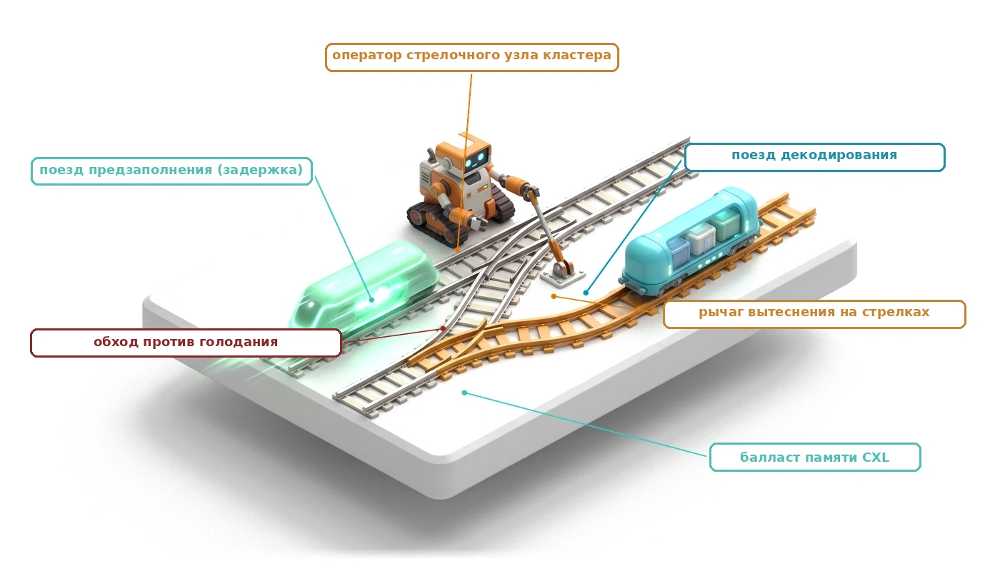

## Назначение

_Почему агент, который записывает каждый сделанный шаг, все равно может оставить мир наполовину измененным?_

Агентная задача из десяти шагов, которая падает на седьмом, уже успела создать ветки, выделить машины и, возможно, поставить холд на карту, и ни одна из систем, хранящих эти эффекты, их не откатит, потому что план агента пошел не так. Долговечный журнал точно фиксирует, какие шаги прошли, но знание о случившемся ничего не исправляет, а очевидные реакции только ухудшают дело. Повторная отправка того же запроса воспроизводит ту же ошибку; попытка модели самостоятельно прибрать за собой порождает вторую ошибку с реальными последствиями; откат всего выбрасывает час работы ради исправления одного неверного аргумента. Восстановление — это политика, которую выполняет среда выполнения, а не надежда, возложенная на модель. Для каждого сбоя она решает, нужно ли повторить попытку, вернуть ошибку модели, чтобы та исправила свое предложение, компенсировать каждый зафиксированный эффект компенсирующим действием или остановиться и передать траекторию человеку; она также ставит в очередь единственное действие, которое нельзя отменить, после всех тех, которые отменить можно. Ей нужно замечать и сбой, который не порождает никакой ошибки: траекторию, которая продолжает действовать, но не продвигается. С точки зрения H·S·A длинный горизонт превращает полномочия в проблему восстановления, потому что каждый шаг тратит часть полномочий еще до того, как станет известно, закончится ли задача успехом.

> **Цели обучения**
>
> - Объяснить, почему траекторию, которая падает на полпути, нельзя откатить как транзакцию, и что делает сага вместо этого.
> - Спроектировать стек компенсаций, который регистрирует каждый компенсатор до отправки и после сбоя идемпотентно выполняет откат.
> - Выбрать между повтором, обратной связью, пересэмплированием и резервной моделью для класса сбоя по наблюдению об ошибке, которое получает модель.
> - Вычислить порог успешной починки, при котором прямое восстановление выгоднее компенсации и повторного запуска траектории.
> - Отнести действия с инструментами к уровням обратимости и упорядочить план так, чтобы его единственное необратимое действие шло после всей компенсируемой работы.
> - Построить детекторы прогресса по повторяющимся действиям, состоянию рабочего пространства и сигналам верификатора и назвать то, что каждый из них пропускает.
> - Применить автоматические выключатели, карантин и внедрение отказов, чтобы локализовать сбойный инструмент или траекторию и проверить каждый путь восстановления.

<a id="sec-vol3-sagas-acid-boundary"></a>

## Крушение транзакционной границы

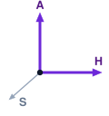

*На длинном горизонте полномочия становятся проблемой восстановления для среды выполнения.*

Журнал событий из раздела [«Долговечное выполнение»](10_durable_execution.md#sec-vol3-durable-execution) сделал каждый шаг траектории долговечным. Поскольку среда выполнения строит свою запись на основе журнала упреждающей записи (WAL) только для добавления и периодических снимков, она переживает падения хостов и обрывы сети и точно знает, какие шаги неудавшегося плана были зафиксированы. Но знание о зафиксированных шагах ничего не исправляет. Как только замыкается контур ([«Момент агентных систем»](01_introduction.md#sec-vol3-intro-operational-incident)), траектория выделяет облачную инфраструктуру, изменяет производственные таблицы, проводит платежи и рассылает уведомления, и каждый из этих эффектов попадает в систему, которой среда выполнения не владеет. На длинном горизонте полномочия, которые использует траектория, превращаются в проблему восстановления ([«Экспозиции H·S·A»](01_introduction.md#sec-vol3-intro-hsa)), потому что каждый шаг расходует часть полномочий до того, как станет известно, что задача будет выполнена успешно. Когда десятишаговое развертывание падает на седьмом шаге, шесть внешних систем уже содержат его эффекты. Ни одна из них не разделяет журнал среды выполнения, ни одна не предоставляет фазу подготовки, и ни одна не откатит свое состояние по запросу. Восстановление здесь носит операционный, а не архивный характер, и эта глава спрашивает, какой контракт среда выполнения обязана соблюдать по отношению к окружению, когда траектория покидает его наполовину измененной. Ответ состоит из трех частей. Среда выполнения компенсирует то, что можно компенсировать, продолжает путь с починкой, когда починка обходится дешевле отката, и упорядочивает единственное действие, которое нельзя отменить, после всех тех шагов, которые отменить можно.

Больше сорока лет классические компьютерные системы решали дилемму частичного сбоя с помощью понятия транзакции, которое Джим Грей формализовал в 1981 году. В рамках классической семантики баз данных две гарантии, атомарность и изолированность, управляют изменением состояния: либо весь пакет модификаций фиксируется успешно, либо среда выполнения инициирует прерывание (abort), опираясь на приватные журналы отката, теневые страницы или блокировки записи, чтобы стереть все промежуточные записи и сделать прерванную попытку полностью невидимой для параллельных наблюдателей. Когда транзакции охватывают несколько независимых узлов хранения, распределенные системы применяют протоколы двухфазной фиксации ($2\text{PC}$): центральный координатор вводит фазу подготовки, которая переводит участников в состояние предварительной фиксации с блокировкой, и только затем выдает окончательную, глобально синхронизированную команду фиксации. В автономной агентной системе, однако, эта классическая транзакционная граница полностью разрушается. Как только хост-супервизор проверяет предложение действия и отправляет его через внешнюю сетевую границу (API хранилища кода, которое открывает запрос на слияние, платежный API, который списывает платеж, облачный API, который запускает вычислительный кластер, или внутренний webhook, который оповещает инженерную команду), среда выполнения утрачивает административный контроль. Эти удаленные конечные точки не разделяют общий журнал упреждающей записи, не предоставляют внутренних механизмов отмены базы данных и отказываются участвовать в распределенной двухфазной фиксации. Каждый отправленный HTTP-запрос фиксируется сразу же по прибытии на удаленный сервер: он мгновенно попадает в долговечное состояние внешнего сервиса и становится глобально видимым для третьих сторон. Никакая последующая команда `ROLLBACK` базы данных не может отозвать сообщение, разосланное в клиентский канал, освободить виртуальную машину, которая уже начала накапливать начисления, или отменить слияние, которое уже запустило конвейер производственного развертывания.

Даже если бы поставщиков внешних сервисов удалось склонить к раскрытию распределенных менеджеров блокировок, классическая семантика транзакций осталась бы физически невозможной из-за математического поведения долгоживущих транзакций (Long-Lived Transactions, LLT). В обычных движках обработки транзакций (Online Transaction Processing, OLTP) транзакции получают эксклюзивные блокировки записи ($X$-блокировки) и разделяемые блокировки чтения ($S$-блокировки) над строками данных на промежутки, измеряемые микросекундами или миллисекундами. При строгой двухфазной блокировке (2PL) сериализуемость сохраняется, потому что длительность удержания блокировки ограничена физическими задержками доступа к DRAM и твердотельным накопителям. Резко контрастирует с этим траектория автономного агента: по природе она имеет высокую задержку, неравномерна и открыта по длительности. Агент, выполняющий сквозную задачу, должен чередовать сетевые вызовы инструментов с циклами авторегрессионного декодирования и может полностью приостанавливать выполнение, ожидая асинхронного одобрения человеком, прогона модульных тестов или прохождения непрерывной интеграции. Если бы среда выполнения пыталась удерживать эксклюзивные распределенные блокировки на внешних ресурсах на протяжении всей жизни траектории агента, вероятность голодания блокировок и катастрофического распределенного взаимного блокирования приближалась бы к единице. Как показал Грей, вероятность взаимной блокировки в системе с $N$ одновременными транзакциями растет как $O(N^2 \cdot L^4)$, где $L$ — число действий, выполняемых в одной транзакции. Увеличение времени удержания транзакции с пяти миллисекунд до десяти минут повышает частоту взаимных блокировок на порядки и вызывает системное голодание блокировок, которое парализует всю хостинговую инфраструктуру. Ошибки также накапливаются на длинном горизонте ([«Растяжение времени: от наносекундных операций до килосекундных траекторий»](01_introduction.md#sec-vol3-intro-temporal-stretching)), поэтому модель, которая неверно прочитала сетевой таймаут на третьем шаге, может выдать неверные мутации на четвертом и еще сильнее испортить внешнее состояние. Как сопоставлено в таблице [«Классические ACID-транзакции и восстановление агентной сагой»](11_failure_recovery.md#tbl-vol3-acid-vs-saga), классические транзакции баз данных опираются на блокировки и журналы отката, тогда как агентные системы требуют семантики распределенной саги. Без строгой транзакционной изоляции эти поврежденные промежуточные состояния немедленно утекают в окружающую среду, загрязняют параллельные рабочие процессы и вызывают каскадные сбои по всему предприятию.

| Измерение                  | Классические ACID-транзакции ($2\text{PC}$)                             | Распределенные контракты саг агента                             |
|:---------------------------|:------------------------------------------------------------------------|:----------------------------------------------------------------|
| **Транзакционная граница** | Однородные, тесно связанные базы данных с общими менеджерами блокировок | Разнородные, автономные внешние API и сервисы                   |
| **Механизм атомарности**   | Прозрачный откат «все или ничего» через приватные журналы отката        | Компенсация на уровне приложения через прямые действия          |
| **Изоляция и видимость**   | Полная сериализуемость ($I=\text{Strict}$); промежуточные записи невидимы | Нулевая изоляция ($I=0$); частичные мутации фиксируются сразу   |
| **Конкурентность ресурсов** | Эксклюзивные блокировки строк хранилища короткой длительности (миллисекунды) | Оптимистичное исполнение без блокировок с компенсирующими сверщиками |
| **Горизонт отказа**        | Восстановление после падения возвращает состояние к последней контрольной точке | Прямое исправление, откат с компенсацией или ручная эскалация   |
| **Граница полномочий**     | Доверенное ядро базы данных с полным неявным доступом к хранилищу      | Привилегированная среда выполнения, опосредующая предложения недоверенной модели |

<a id="tbl-vol3-acid-vs-saga"></a>

***Классические ACID-транзакции и восстановление агентной сагой**: классическая двухфазная фиксация ACID ($2\text{PC}$) в сравнении с контрактами восстановления распределенной сагой агента по системным измерениям.*

Поскольку изоляция и атомарный откат невозможны через эти границы, среда выполнения применяет шаблон саги, который Гектор Гарсиа-Молина и Кеннет Салем предложили в 1987 году для долгоживущих процессов в базах данных. Контракт восстановления задает принцип «Граница поворотного действия и компенсирующие саги». Сага ослабляет требование полной транзакционной изоляции ($I=0$), разлагая долгий распределенный путь траектории на упорядоченный направленный граф дискретных самодостаточных подтранзакций. Каждая прямая подтранзакция фиксирует свои изменения состояния немедленно и освобождает все локальные ресурсные блокировки, делая свои результаты мгновенно видимыми внешнему миру. Чтобы сохранить согласованность системы, когда промежуточный шаг прерывается, каждое прямое действие с внешними побочными эффектами явно связывается с транзакцией компенсации на уровне приложения. Транзакция компенсации не совершает никакого волшебного путешествия во времени и не переписывает историческую реальность; вместо этого она выполняет активную, семантически корректную прямую мутацию, которая уравновешивает, нейтрализует или семантически исправляет частичные побочные эффекты зафиксированного действия. Если траектория агента успешно выделяет изолированную облачную виртуальную машину на первом шаге, компилирует обновленный двоичный файл на втором и получает неустранимый отказ аутентификации на третьем, среда выполнения не выдает бесплодного прерывания базы данных. Вместо этого она проходит выполненную траекторию в обратном порядке и исполняет зарегистрированную транзакцию компенсации для первого шага: отправляет явный RPC на удаление, который завершает выделенный экземпляр. Важно, что эта последовательность восстановления не может опираться на непривилегированную базовую модель, которая сама вспомнит, выведет или придумает исправляющие меры после сбоя. Согласно замыканию инвариантов ([«Принцип замыкания инвариантов»](01_introduction.md#pri-invariant-closure)), восстановление — задача супервизора, находящегося вне модели. Хост-среда выполнения агента должна вести журнал координации саги, отслеживать состояние выполнения каждого прямого действия и каждого обработчика компенсации, обеспечивать идемпотентность токенов на границах сетевых повторов и проверять инварианты окружения детерминированными внешними программными проверками (приложение «Классический фон транзакций» формализует разрушение двухфазной фиксации на внешних исполнителях, математические инварианты транзакций компенсации и адаптацию журнала упреждающей записи ARIES). Как формально построить движок исполнения саги, который сопоставляет прямые действия агента с компенсирующими откатными действиями?

<a id="sec-vol3-sagas-architecture"></a>

## Шаблон саги траектории

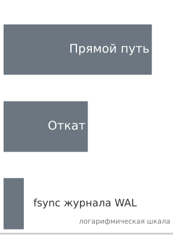

*Компенсирующий откат стоит в 17,6 раза меньше прямого пути, который он обращает.*

Вызовы внешних API и мутации файловой системы нельзя приостановить в незафиксированном состоянии, пока нейросетевая модель обдумывает следующее действие. Как только агент отправляет HTTP-запрос `POST`, чтобы выделить облачную виртуальную машину, этот физический экземпляр загружается, получает IP-адрес и начинает накапливать метрики оплаты независимо от того, какие токены затем сгенерирует цикл авторегрессионного декодирования. Если на пятом шаге восьмишагового рабочего процесса развертывания возникает неустранимая ошибка, например недопустимая регистрация доменного имени или неизменяемый отказ в доступе, среда выполнения не может выполнить атомарный `ROLLBACK` базы данных. Понятие изоляции в базе данных рушится, потому что сторонние конечные точки, внешние сервисы и удаленные файловые системы показывают промежуточное состояние всему остальному миру сразу после завершения команды.

**Шаблон «Сага траектории»** разрешает аномалии частичного исполнения, разлагая долгое агентное исполнение на последовательность дискретных локально зафиксированных подтранзакций, каждая из которых связана с явным прямым компенсирующим действием, зарегистрированным в блоке управления агентом (Agent Control Block, ACB). Когда подтранзакция падает, среда выполнения останавливает прямое продвижение и откатывает выполненную траекторию в обратном порядке, исполняя компенсации, чтобы перевести внешнее окружение в семантически согласованное конечное состояние.

Механика этого контракта координации показана на рисунке [«Поток исполнения саги траектории»](11_failure_recovery.md#fig-vol3-saga-flow). На уровне прямого исполнения каждая дискретная подтранзакция $T_i$ немедленно фиксирует свои внешние мутации: создание ветки рабочего дерева на $T_1$, выделение микровиртуальной машины AWS EC2 на $T_2$ и предавторизационный холд на платежной карте Stripe на $T_3$. Поскольку внешние сторонние конечные точки нельзя держать в незафиксированном состоянии, каждое действие фиксируется немедленно, отказываясь от глобальной изоляции ($I=0$). Одновременно хост-супервизор сериализует соответствующее компенсирующее действие ($C_1, C_2, C_3$) и помещает его в стек восстановления LIFO $\Sigma$ внутри блока управления агентом (ACB). Когда исполнение внезапно прерывается на $T_4$ из-за необработанного падения контейнера (код выхода 137, завершение по нехватке памяти, OOM killed), супервизор перехватывает сбой, замораживает прямое продвижение и не дает непривилегированной модели генерировать дальнейшие действия. Координатор восстановления саги затем проходит стек LIFO в строго обратном порядке: сначала извлекает и исполняет $C_3$, чтобы снять холд авторизации Stripe, затем запускает $C_2$, чтобы завершить вычислительный экземпляр EC2 и отсоединить тома хранения, и наконец исполняет $C_1$, чтобы очистить временную ветку git. Откатывая мутации через заранее скомпилированные детерминированные обработчики, а не через стохастическое повторное обращение к модели, система надежно возвращает окружение в чистое исходное состояние `ABORT_CONSISTENT`.

<a id="fig-vol3-saga-flow"></a>

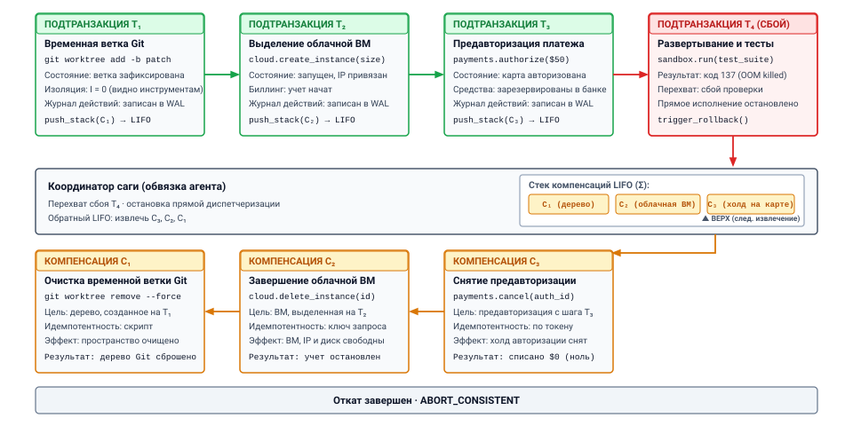
***Поток исполнения саги траектории**: прямое продвижение подтранзакций вместе с обратным компенсирующим откатом. Каждый прямой шаг $T_i$ немедленно фиксирует свои внешние мутации и регистрирует соответствующую компенсирующую транзакцию $C_i$ в стеке восстановления LIFO $\Sigma$. При неустранимом сбое исполнения на $T_4$ хост-супервизор приостанавливает прямое продвижение и исполняет обработчики компенсации в обратном порядке ($C_3 \to C_2 \to C_1$), возвращая внешнюю инфраструктуру в согласованное нейтральное состояние.*

### Формализация траектории как открытой саги

В классической теории транзакций Гектор Гарсиа-Молина и Кеннет Салем (1987) определили сагу как долгоживущую транзакцию, состоящую из последовательности относительно коротких подтранзакций, которые могут перемежаться с другими транзакциями. Применяя этот формализм к агентным системам машинного обучения, определим траекторию агента $\mathcal{T}$ длины $n$ как упорядоченную последовательность дискретных прямых подтранзакций:

$$\mathcal{T} = [T_1, T_2, \dots, T_n]$$

Каждая подтранзакция $T_i$ представляет собой одно неделимое взаимодействие между хост-средой выполнения агента и внешним окружением. Подтранзакция формально выражается четверкой:

$$T_i = \langle \alpha_i, \theta_i, \phi_i, \kappa_i \rangle$$

где $\alpha_i$ — семантический идентификатор действия (например, `provision_vm` или `write_file`), $\theta_i$ — конкретная полезная нагрузка параметров, порожденная непривилегированной базовой моделью, $\phi_i$ обозначает утверждения о предусловиях и постусловиях окружения, которые проверяет среда выполнения, а $\kappa_i$ — глобально уникальный ключ идемпотентности, порожденный супервизором.

<a id="dfn-trajectory-saga"></a>

> **Сага траектории**
>
> Долгоживущая отказоустойчивая последовательность дискретных подтранзакций, которую исполняет среда выполнения агента: каждое прямое действие фиксируется немедленно и регистрирует соответствующее компенсирующее действие в стеке восстановления LIFO, что обеспечивает семантическую согласованность при сбое без удержания распределенных блокировок.

**Саги и распределенная двухфазная фиксация ($2\text{PC}$)**
В $2\text{PC}$ все участвующие менеджеры ресурсов получают эксклюзивные блокировки в фазе подготовки и удерживают их до тех пор, пока координатор не выдаст глобальную фиксацию. В агентных системах вывод модели медленный и недетерминированный ($t_{\text{decode}} \sim 2\text{--}15\,\text{с}$ на шаг). Удерживать физические блокировки на удаленных сервисах, пока ожидается генерация токенов авторегрессией, приводит к катастрофической конкуренции за блокировки, распределенным взаимным блокировкам и каскадам сетевых таймаутов.

Поскольку модель не имеет никаких неявных полномочий, она никогда не исполняет $T_i$ напрямую. Вместо этого среда выполнения проверяет $\theta_i$, порождает $\kappa_i$, выполняет физическую операцию через нижележащую операционную систему или удаленный API и немедленно фиксирует результат локально. Одновременно среда выполнения регистрирует соответствующую компенсирующую транзакцию $C_i$:

$$C_i = \langle \alpha_i^c, \theta_i^c, \kappa_i^c \rangle$$

где $\alpha_i^c$ — нейтрализующее действие, $\theta_i^c$ — параметризованная полезная нагрузка компенсации, а $\kappa_i^c$ — ключ идемпотентности компенсации. Полная компенсирующая траектория $\mathcal{C}$ — это обратная последовательность компенсаторов:

$$\mathcal{C} = [C_n, C_{n-1}, \dots, C_1]$$

При нормальном исполнении система проходит всю последовательность $T_1 \circ T_2 \circ \dots \circ T_n$ и достигает конечного целевого состояния $S_{\text{goal}}$. Однако если произвольная подтранзакция $T_k$ ($1 \le k \le n$) не проходит проверку постусловия, превышает таймаут или возвращает фатальный код состояния вышестоящего сервиса, среда выполнения прекращает прямое исполнение. Чтобы сохранить семантическую согласованность, супервизор должен гарантировать, что окружение проходит через последовательность компенсаций:

$$\mathcal{T}_{\text{exec}} = T_1 \circ \dots \circ T_{k-1} \circ T_k^{\text{failed}} \circ C_{k-1} \circ \dots \circ C_1$$

Если $T_k$ породила частичные побочные эффекты до сбоя, сначала исполняется ее собственный компенсатор $C_k$; если $T_k$ чисто прервалась до мутации состояния, откат начинается строго с $C_{k-1}$. Жизненный цикл каждой подтранзакции внутри среды выполнения отслеживается детерминированным конечным автоматом, подробно описанным в таблице [«Матрица переходов состояний подтранзакций саги траектории»](11_failure_recovery.md#tbl-vol3-saga-state-transitions).

| Состояние      | Инвариант                                                                          | Допустимые переходы          | Действие супервизора                                            |
|:---------------|:-----------------------------------------------------------------------------------|:-----------------------------|:----------------------------------------------------------------|
| `PENDING`      | Шаг предложен моделью; помещен в эскроу в ACB; внешних мутаций нет.                | `EXECUTING`, `ABORTED`       | Проверить схему полезной нагрузки; обеспечить границы возможностей. |
| `EXECUTING`    | Прямой RPC отправлен с ключом идемпотентности $\kappa_i$; ожидается подтверждение конечной точки. | `COMMITTED`, `FAILED`        | Следить за сторожевым таймером; зафиксировать сетевую квитанцию. |
| `COMMITTED`    | Внешняя мутация выполнена; постусловие проверено; компенсатор $C_i$ зарегистрирован. | `COMPENSATING`               | Поместить $C_i$ в долговечный стек LIFO; продвинуть счетчик траектории. |
| `FAILED`       | Прямой шаг прерван, превысил таймаут или нарушил проверки инвариантов.            | `COMPENSATING`, `HALTED`     | Остановить прямой цикл декодирования; запустить обратный откат. |
| `COMPENSATING` | Нейтрализующее действие $C_i$ отправлено с ключом идемпотентности $\kappa_i^c$.    | `COMPENSATED`, `PANIC`       | Исполнить обработчик компенсации; проверить освобождение окружения. |
| `COMPENSATED`  | Побочные эффекты нейтрализованы; состояние возвращено к семантической исходной точке. | `COMPENSATING`, `TERMINATED` | Снять $C_i$ со стека; вызвать предыдущий компенсатор $C_{i-1}$. |
| `PANIC`        | Компенсатор $C_i$ неустранимо сбоил; автоматическое восстановление остановлено.    | `MANUAL_ESCALATION`          | Изолировать радиус поражения траектории; вызвать оператора.     |

<a id="tbl-vol3-saga-state-transitions"></a>

***Матрица переходов состояний подтранзакций саги траектории**: матрица переходов состояний для подтранзакций саги траектории. Каждая прямая мутация должна либо достичь `COMMITTED`, либо перейти в `COMPENSATED` через обратный путь отката.*

### Семантика компенсирующих действий

Компенсирующее действие принципиально отличается от отката базы данных. В реляционной базе данных, работающей с журналом упреждающей записи в стиле ARIES, откат прерванной транзакции восстанавливает точный физический образ страниц диска по историческим записям журнала `BEFORE-IMAGE`. Существование транзакции стирается так, будто ее никогда не было.

В агентной системе, которая взаимодействует с реальными операционными системами и сетями, историческое стирание физически невозможно. Время прошло, ресурсы потреблены, сетевые пакеты прошли через коммутаторы, а внешние наблюдатели могли изучить промежуточное состояние. Поэтому компенсирующая транзакция не совершает никакого волшебного путешествия во времени; это активная прямая мутация, призванная установить *семантическую эквивалентность* с исходным состоянием.

**Видимость промежуточного состояния**
Поскольку саги ослабляют свойство изоляции ($I$) из ACID, внешний наблюдатель (например, человек-оператор или параллельный агент) может увидеть промежуточное состояние, созданное $T_1$, до того как $T_k$ потерпит неудачу. Если агент создает бакет S3 на $T_1$, этот бакет глобально виден до тех пор, пока $C_1$ не уничтожит его при компенсации. Системы, опирающиеся на саги, должны проектироваться так, чтобы выдерживать временные «грязные» чтения состояния окружения.

Пусть $\mathcal{S}$ обозначает пространство состояний внешнего окружения, а $f_{\text{ext}}: \mathcal{S} \times \mathcal{A} \to \mathcal{S}$ — функцию перехода состояния при действии $\alpha$. Если начальное состояние равно $S_0$, исполнение прямой подтранзакции $T_1$ дает состояние $S_1 = f_{\text{ext}}(S_0, T_1)$. Исполнение компенсирующей транзакции $C_1$ из $S_1$ дает состояние $S'_0 = f_{\text{ext}}(S_1, C_1)$. В общем случае:

$$S'_0 \ne S_0$$

Физическое состояние $S'_0$ содержит различные исторические артефакты: счетчики оплаты в облаке выросли, локальные файлы системного журнала содержат записи аудита, добавленные в конец, идентификаторы процессов операционной системы продвинулись, а эфемерные резервирования портов TCP перешли на новый цикл. Однако среде выполнения достаточно, чтобы $S'_0$ удовлетворяло *семантической эквивалентности* относительно основных инвариантов приложения:

$$S'_0 \equiv_{\text{semantic}} S_0 \iff \forall \phi \in \Phi_{\text{invariants}}, \quad \phi(S'_0) = \phi(S_0)$$

где $\Phi_{\text{invariants}}$ — множество системных инвариантов, управляющих распределением ресурсов, целостностью файлов, привилегиями контроля доступа и границами процессов.

<a id="dfn-semantic-compensation"></a>

> **Семантическая компенсация**
>
> ***Семантическая компенсация*** — это прямая мутирующая операция восстановления $C_i$, которая переводит состояние внешнего окружения в новое состояние $\mathbf{S}_{i-1}'$, семантически эквивалентное $\mathbf{S}_{i-1}$ относительно основных системных инвариантов, а не пытается выполнить физический откат.
>
> 1.  **Значение**: позволяет выполнять транзакционное восстановление после сбоев при необратимых распределенных взаимодействиях с инструментами (например, облачное выделение ресурсов, публикация сообщений или биллинговые API), где классические физические откаты невозможны.
> 2.  **Отличие**: в отличие от отката базы данных (который восстанавливает точные битовые страницы диска из журнала отмены), семантическая компенсация исполняет активную прямую компенсирующую транзакцию (например, удаление выделенного пода или начисление кредита на счет), которая восстанавливает равновесие инвариантов, несмотря на то что исторические артефакты аудита остаются.
> 3.  **Типичная ошибка**: написание неидемпотентных компенсирующих операций, которые падают или создают осиротевшие дублирующие побочные эффекты при повторе после кратковременных разрывов сети.

Чтобы проиллюстрировать, рассмотрим три канонических архетипа компенсирующих действий, встречающихся в промышленных средах выполнения агентов:

1. **Обратимые изменения состояния:** действия с хорошо определенными обратными операциями. Если $T_i$ дописывает объявление экспорта в `~/.bashrc`, $C_i$ выполняет точечный скрипт sed или манипуляцию AST, чтобы удалить именно это объявление. Номера физических inode и временные метки модификации файла меняются ($S'_0 \ne S_0$), но среда исполнения оболочки функционально неотличима от $S_0$.
2. **Гашение выделенных ресурсов:** действия, которые выделяют эфемерную инфраструктуру. Если $T_i$ отправляет RPC, чтобы создать под Kubernetes, $C_i$ отправляет RPC `DELETE`, нацеленный на уникальный UID этого пода. Хотя журналы планирования кластера и счетчики метрик фиксируют краткое существование пода, физическая память, ядра ЦП и сетевые конечные точки возвращаются в пул кластера.
3. **Компенсирующие корректировки баланса:** действия, которые меняют финансовое или квотное состояние. Если $T_i$ резервирует $100$ вычислительных кредитов из реестра региональной квоты, $C_i$ выполняет транзакцию зачисления на $100$ единиц. История реестра отражает две различные транзакции, а не ноль, но чистый доступный баланс восстановлен.

Компенсирующие действия должны быть строго *коммутативными* по отношению к не связанной с ними системной активности и *идемпотентными* при сетевом повторе. Если сетевой сбой заставляет среду выполнения сомневаться, успешно ли выполнен $C_i$, повторная отправка $C_i(\kappa_i^c)$ несколько раз должна давать в точности то же состояние окружения, что и однократное исполнение, без порождения осиротевших побочных эффектов.

### Стеки компенсаций саги

Исполнением траектории-саги управляет *оркестратор саги* — авторитетный компонент плоскости управления, работающий внутри супервизора хост-среды выполнения. Оркестратор хранит две основные структуры данных внутри блока управления агентом (ACB): *журнал прямого исполнения* ($\mathcal{L}_{\text{fwd}}$) и *стек компенсаций LIFO* ($\mathcal{S}_{\text{comp}}$), как показано в таблице [«Структуры оркестратора саги блока управления агентом»](11_failure_recovery.md#tbl-vol3-saga-orchestrator-state).

| Уровень подсистемы                                     | Структура данных            | Состояние записи и параметры                     | Оперативная роль                                                         |
|:-------------------------------------------------------|:----------------------------|:-------------------------------------------------|:-------------------------------------------------------------------------|
| **Журнал прямого исполнения ($\mathcal{L}_{\text{fwd}}$)** | Журнал упреждающей записи только для добавления | `Entry 1: T_1 [COMMITTED] (idempotency_key=k_1)` | Фиксирует последовательное прямое продвижение; создает долговечный след аудита. |
| **Журнал прямого исполнения ($\mathcal{L}_{\text{fwd}}$)** | Журнал упреждающей записи только для добавления | `Entry 2: T_2 [COMMITTED] (idempotency_key=k_2)` | Сохраняет промежуточные параметры и выходные данные, нужные для компенсации. |
| **Журнал прямого исполнения ($\mathcal{L}_{\text{fwd}}$)** | Журнал упреждающей записи только для добавления | `Entry 3: T_3 [FAILED] (idempotency_key=k_3)`    | Запускает обработку сбоя; останавливает прямое продвижение до поворотного действия. |
| **Стек компенсаций ($\mathcal{S}_{\text{comp}}$)**   | Стек исполнения LIFO        | `TOP -> C_2: teardown_sandbox(id="sbx-99")`      | Первый извлеченный компенсатор; откатывает самый недавний зафиксированный побочный эффект. |
| **Стек компенсаций ($\mathcal{S}_{\text{comp}}$)**   | Стек исполнения LIFO        | `STACK[0] -> C_1: release_port(port=8080)`       | Второй компенсатор исполняется; восстанавливает исходное состояние сети. |

<a id="tbl-vol3-saga-orchestrator-state"></a>

***Структуры оркестратора саги блока управления агентом**: внутренняя архитектура журнала упреждающей записи прямого исполнения и стека компенсаций LIFO.*

Оркестратор жестко ограничивает то, как инструменты открываются базовой модели. Ни при каких обстоятельствах модели не разрешается синтезировать компенсирующие действия на лету во время сбоя. Когда авторегрессионная модель под давлением галлюцинирует команду компенсации, она часто усугубляет ущерб: например, выполняет `rm -rf /` или удаляет не тот виртуальный сетевой интерфейс. Вместо этого супервизор среды выполнения требует, чтобы разработчики инструментов регистрировали пары «прямое действие — компенсирующее действие» уже на этапе определения инструмента.

Когда агент предлагает прямой вызов инструмента $T_i$, оркестратор регистрирует $T_i$ в $\mathcal{L}_{\text{fwd}}$ со статусом `PENDING`. После успешного исполнения и проверки постусловия оркестратор строит полностью связанный компенсатор $C_i$, используя выходные метаданные, которые вернул $T_i$ (например, идентификаторы выделенных ресурсов, исходное содержимое файлов или дескрипторы процессов). Оркестратор записывает $C_i$ в долговечное хранилище (журнал упреждающей записи) и помещает его указатель в $\mathcal{S}_{\text{comp}}$, прежде чем передать управление базовой модели для шага $i+1$.

Алгоритм отката, который супервизор исполняет при обнаружении окончательного сбоя в подтранзакции $T_k$, следует детерминированному циклу:

```python
def unwind_saga(acb: AgentControlBlock) -> None:
    acb.set_state(TrajectoryState.COMPENSATING)
    while not acb.compensation_stack.is_empty():
        compensator = acb.compensation_stack.peek()
        try:
            # Компенсаторы должны быть идемпотентными и проверять свои постусловия
            compensator.execute(idempotency_key=compensator.key)
            acb.wal.append_record(RecordType.COMPENSATED, compensator.id)
            acb.compensation_stack.pop()
        except RetriableError as err:
            acb.backoff_and_retry(compensator)
        except FatalCompensationError as fatal:
            acb.wal.append_record(RecordType.PANIC, compensator.id, fatal)
            acb.set_state(TrajectoryState.PANIC)
            raise QuarantineEscalationException("Saga compensation halted", fatal)
    acb.set_state(TrajectoryState.TERMINATED_CLEAN)
```

Надежность этой архитектуры зависит от физической обработки сбоев во время самой фазы компенсации. Если процесс хост-агента выходит из строя из-за аппаратного сбоя, потери питания или паники ядра во время исполнения $C_{k-2}$, среда выполнения при перезагрузке читает долговечный журнал упреждающей записи с накопителя NVMe, восстанавливает $\mathcal{S}_{\text{comp}}$ и проверяет последнюю незафиксированную запись. Поскольку компенсаторы гарантированно идемпотентны благодаря уникальным ключам идемпотентности ($\kappa^c$), менеджер восстановления безопасно повторно отправляет $C_{k-2}$. Компенсирующая последовательность продолжается точно с того места, где была прервана, что гарантирует: частичные компенсации не оставят системные ресурсы в подвешенном состоянии.

<a id="nbk-11-latency-cost-and-storage-overheads"></a>

> **Накладные расходы на откат журнала саги**
>
> **Сценарий:** автономный агент, исполняющий рабочий процесс развертывания программного обеспечения, пытается выполнить 6-шаговую траекторию на корпоративном хосте:
>
> 1. `T_1`: выделить изолированную песочницу microVM через сокет локального гипервизора ($120\,\text{мс}$).
> 2. `T_2`: зарезервировать публичный исходящий адрес IPv4 через региональный облачный API ($350\,\text{мс}$).
> 3. `T_3`: скомпилировать целевой двоичный файл внутри песочницы ($4\,200\,\text{мс}$).
> 4. `T_4`: записать правила маршрутизации и привязать порты межсетевого экрана ($80\,\text{мс}$).
> 5. `T_5`: опубликовать DNS-запись на внешнем авторитетном сервере имен ($450\,\text{мс}$).
>
> Во время шага 5 `T_5` падает с неустранимой ошибкой `409 Conflict` (конфликт владения доменом). Оркестратор останавливает прямое исполнение и запускает обратную компенсацию, используя $\mathcal{S}_{\text{comp}} = [C_4, C_3, C_2, C_1]$.
>
> **Параметры:**
>
> - Сетевая задержка двустороннего обмена с региональным облачным API: $t_{\text{api}} = 150\,\text{мс}$.
> - Задержка fsync журнала упреждающей записи на локальном NVMe на каждый переход состояния: $t_{\text{fsync}} = 1{,}2\,\text{мс}$.
> - Время удаления microVM: $t_{\text{teardown}} = 45\,\text{мс}$.
> - Очистка сборки (удаление каталога кеша сборки): $t_{\text{clean}} = 15\,\text{мс}$.
> - Время отвязки межсетевого экрана: $t_{\text{fw}} = 10\,\text{мс}$.
> - Длительность вызова API освобождения исходящего IP-адреса: $t_{\text{release}} = 220\,\text{мс}$.
> - Стоимость вывода LLM: $\$3{,}00$ за $10^6$ входных токенов, $\$15{,}00$ за $10^6$ выходных токенов. Прямая траектория израсходовала $18\,400$ входных и $1\,250$ выходных токенов на шагах $1\text{--}5$.
>
> **Расчеты:**
>
> 1. *Накладные расходы долговечного ввода-вывода:* каждая подтранзакция несет две операции fsync (переход в `COMMITTED` и запись $C_i$ в стек). Прямая фаза понесла:
>    $$N_{\text{fsync, fwd}} = 5 \times 2 = 10 \text{ записей} \implies t_{\text{io, fwd}} = 10 \times 1{,}2\,\text{мс} = 12\,\text{мс}$$
>    Откат компенсации от шага 4 к шагу 1 требует одного fsync на каждое извлечение компенсатора:
>    $$N_{\text{fsync, rev}} = 4 \times 1 = 4 \text{ записей} \implies t_{\text{io, rev}} = 4 \times 1{,}2\,\text{мс} = 4{,}8\,\text{мс}$$
>    Общие накладные расходы на персистентность журнала составляют $16{,}8\,\text{мс}$, то есть менее $0{,}3\%$ от общего времени траектории по часам.
>
> 2. *Задержка исполнения отката:*
>    Общее время по часам, затраченное на активную нейтрализацию побочных эффектов при обратном откате, составляет:
>    $$t_{\text{unwind}} = t_{\text{fw}} + t_{\text{clean}} + t_{\text{release}} + t_{\text{teardown}} + t_{\text{io, rev}}$$
>    $$t_{\text{unwind}} = 10\,\text{мс} + 15\,\text{мс} + 220\,\text{мс} + 45\,\text{мс} + 4{,}8\,\text{мс} = 294{,}8\,\text{мс}$$
>    Обратите внимание, что $t_{\text{clean}}$ для компиляции ($T_3$) тривиален, поскольку выбрасывание эфемерного дискового слоя песочницы полностью нейтрализует $4\,200\,\text{мс}$ прямого процессорного времени компиляции за $15\,\text{мс}$.
>
> 3. *Учет финансовых потерь:*
>    Финансовый капитал, израсходованный на неудавшуюся попытку, складывается из стоимости токенов и резервирования внешних ресурсов:
>    $$\text{Cost}_{\text{tokens}} = \left(18\,400 \times \frac{3{,}00}{10^6}\right) + \left(1\,250 \times \frac{15{,}00}{10^6}\right) = \$0{,}0552 + \$0{,}01875 = \$0{,}07395$$
>    Поскольку оркестратор саги исполнил $C_2$ (освободив статический резерв IPv4 в течение $295\,\text{мс}$ после сбоя), плата за удержание исходящего канала в облаке была прекращена до начисления почасовых округленных тарифов.
>
> **Ключевой архитектурный вывод:** физическое время отката неудавшейся траектории ($294{,}8\,\text{мс}$) на порядок меньше времени прямого исполнения ($5\,200\,\text{мс}$). Накладные расходы журнала упреждающей записи ($16{,}8\,\text{мс}$) пренебрежимо малы по сравнению с задержками сети и компиляции. Однако $\$0{,}074$ сожженных токенов вывода и время прямого исполнения по часам представляют собой невосполнимые потери.

Задержка и финансовые реалии, выделенные в разобранном примере, раскрывают фундаментальный инженерный компромисс в основе проектирования среды выполнения. Откат саги обратной компенсацией гарантирует семантическую чистоту, но жестоко разрушает уже выполненную работу. В нашем сценарии развертывания агент потратил более пяти секунд реального времени и десятки тысяч токенов, успешно поднимая проверенную microVM, выделяя IP-адрес и компилируя сложные двоичные ресурсы, и лишь затем отбросил все это из-за косметической ошибки на последнем шаге именования.

<a id="chk-11-sagas-compensation"></a>

> **Оценка траекторий саг и компенсирующих действий**
>
> Прежде чем разбирать политики прямого самовосстановления и инварианты против зацикливания, проверьте свое понимание транзакций саг:
>
> - [ ] **Схлопывание ACID-границы**: почему мутации инструментов агентов во внешних распределенных системах не имеют встроенной многофазной фиксации и изоляции?
> - [ ] **Семантика компенсации**: чем обратный компенсатор $C_i$ отличается от отката базы данных, если промежуточные побочные эффекты уже наблюдались извне?
> - [ ] **Стек компенсаций**: почему компенсирующие действия должны записываться в долговечное хранилище в обратном топологическом порядке по мере завершения прямых шагов?
> - [ ] **Компромисс невозвратных затрат**: при каких условиях сбоя откат всего стека саги экономически и вычислительно расточителен по сравнению с локализованным прямым исправлением?

<a id="sec-vol3-sagas-forward-vs-backward"></a>

## Прямое восстановление

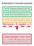

*Переход через необратимые поворотные действия требует долговечного физического эскроу до фиксации необратимых побочных эффектов.*

Агент, исполняющий автоматизированную миграцию в облако, падает на шестом из восьми шагов: сгенерированный манифест конфигурации содержит некорректную escape-последовательность JSON, из-за которой демон оркестрации контейнеров отвергает полезную нагрузку развертывания. Если хост-супервизор ответит безусловным обратным откатом, он запустит зарегистрированную цепочку компенсаторов $C_5, C_4, C_3, C_2, C_1$. При этом среда выполнения уничтожит выделенное виртуальное приватное облако, снимет развернутую реплику реляционной базы данных, отменит регистрацию DNS-записей и выбросит десятки тысяч токенов работы предзаполнения и декодирования по обдумыванию, и все ради исправления одной неэкранированной двойной кавычки. И наоборот, если среда выполнения слепо повторит прямую транзакцию, не разобрав ошибку, непривилегированная языковая модель не получит никакого диагностического сигнала, пересэмплирует то же предсказательное распределение и воспроизведет ту же синтаксическую ошибку.

**Среда выполнения агента должна динамически выбирать между обратным откатом и прямым самовосстановлением, сопоставляя накопленные невозвратные затраты завершенных подтранзакций с вероятностью сходимости и расходом токенов на синтез локализованных корректирующих мутаций.** Безусловный откат отдает приоритет чистым внешним инвариантам ценой крайней задержки и траты ресурсов. Неконтролируемое прямое самовосстановление сохраняет уже выполненную инфраструктурную работу, но рискует загнать агента в незавершающиеся циклы починки, которые усугубляют исходные ошибки. Надежная среда выполнения реализует формальную политику решений, которая измеряет остаточные бюджеты ресурсов, оценивает сигнатуры классификации ошибок и обеспечивает инвариант против зацикливания, ограничивающий попытки прямой починки, прежде чем каскадно перейти к компенсации или эскалации к человеку.

### Спектр восстановления

В своей классической таксономии надежных вычислений Альгирдас Авижнис и его коллеги формализовали восстановление после сбоев как два принципиально различных механизма: обратное восстановление, которое возвращает систему к более раннему безошибочному состоянию до проявления сбоя, и прямое восстановление, которое преобразует текущее ошибочное состояние в новое корректное, позволяя вычислению продолжаться (Avizienis et al., 2004). Распределенные базы данных почти исключительно реализуют обратное восстановление: поскольку движки баз данных полностью контролируют локальные физические кадры и журналы упреждающей записи, восстановление неповрежденного снимка через операции отмены страниц детерминировано и вычислительно дешево.

**Обратное и прямое восстановление**
*Обратное восстановление:* возвращает более раннюю контрольную точку $\mathbf{s}_k$ через компенсаторы $(C_t, \dots, C_1)$, отбрасывая промежуточную работу.
*Прямое восстановление:* синтезирует новую корректирующую мутацию $a_{\text{repair}}$ такую, что $(s_t, a_{\text{repair}}) \to s'_t$, продвигая систему вперед для выполнения постусловий.

В агентной системе машинного обучения физические границы исполнения ломают допущение базы данных. Агент манипулирует внешними окружениями (сторонними REST API, демонами контейнеров, удаленными git-репозиториями и облачными плоскостями управления) через дискретные прямые подтранзакции $T_i \in \mathcal{T}$. Когда подтранзакция $T_t$ падает, среда выполнения оказывается в промежуточном состоянии окружения $s_t$, которое несет нетривиальную задержку создания и прямые финансовые затраты.

При обратном восстановлении среда выполнения рассматривает частичную последовательность исполнения $(T_1, T_2, \dots, T_{t-1})$ как прерванную атомарную единицу. Она проходит журнал траектории в обратном хронологическом порядке, выполняя последовательность компенсирующих транзакций:

$$\mathcal{C}_{t-1 \to 0} = \left( C_{t-1}, C_{t-2}, \dots, C_1 \right)$$

Каждый компенсатор $C_i$ исполняется как отдельный внешний RPC, призванный логически нейтрализовать мутацию состояния, внесенную $T_i$. Обратное восстановление семантически консервативно. Оно гарантирует, что если агент сталкивается с неустранимым сбоем, например с отозванными учетными данными, несовместимыми версиями API или невозможными доменными ограничениями, внешний мир остается в неповрежденной исходной конфигурации. Однако обратная компенсация строго разрушительна для прямого продвижения: каждый успешный промежуточный шаг отбрасывается, заставляя любую последующую попытку исполнения платить полную цену задержки, вычислений и денег за пересборку состояния с нуля.

Прямое восстановление исходит из противоположной операционной посылки: вместо того чтобы считать промежуточное состояние одноразовым, среда выполнения использует стохастический механизм рассуждения, чтобы диагностировать сбой и изменить путь исполнения. Получив наблюдение об ошибке $o_t^{\text{err}}$ от сбойной подтранзакции $T_t$, среда выполнения формирует целевой диагностический контекст и запрашивает у базовой модели корректирующее действие починки:

$$a_{\text{repair}} \sim \pi_\theta\left(a \mid \tau_{<t}, T_t, o_t^{\text{err}}\right)$$

Действие починки $a_{\text{repair}}$ не отматывает предыдущую историю. Вместо этого оно применяет локализованное преобразование состояния, призванное удовлетворить предусловия $T_t$ или подставить альтернативную подтранзакцию $T_t'$, которая выполняет то же самое операционное постусловие. Если шаг шесть упал потому, что сгенерированному манифесту не хватало обязательного тега пространства имен, $a_{\text{repair}}$ исправляет YAML-полезную нагрузку в памяти и повторно вызывает инструмент развертывания. Если шаг шесть упал из-за того, что выделенный IP-адрес столкнулся с временным конфликтом маршрута, $a_{\text{repair}}$ запрашивает вторичный IP-адрес, не разбирая родительские подсети, выделенные на шагах с первого по пятый. Компромиссы между обратной компенсацией и прямым стохастическим самовосстановлением систематически сопоставлены в таблице [«Обратное и прямое восстановление в агентных средах выполнения»](11_failure_recovery.md#tbl-vol3-recovery-comparison).

| Измерение             | Обратное восстановление (компенсация саги)                                                                          | Прямое восстановление (стохастическое самовосстановление)                                                        |
|:----------------------|:-------------------------------------------------------------------------------------------------------------------|:-----------------------------------------------------------------------------------------------------------------|
| **Основной механизм** | Детерминированное исполнение обратных компенсаторов $C_i$                                                          | Стохастический синтез корректирующего действия $a_{\text{repair}}$                                               |
| **Траектория состояния** | $\mathbf{s}_t \xrightarrow{C} \mathbf{s}_{t-1}' \xrightarrow{C} \dots \xrightarrow{C} \mathbf{s}_0'$ (восстановление) | $\mathbf{s}_t \xrightarrow{a_{\text{repair}}} \mathbf{s}_t' \xrightarrow{T_t} \mathbf{s}_{t+1}$ (преобразование) |
| **Стоимость исполнения** | $\sum_{i=1}^{t-1} \text{Cost}(C_i) + \text{Cost}(\text{Re-execution})$                                             | $\text{Cost}(\text{LLM}_{\text{repair}}) + \text{Cost}(a_{\text{repair}})$                                       |
| **Детерминированность** | Высокая (заранее зарегистрированный идемпотентный код компенсации)                                                  | Низкая (вероятностное сэмплирование из политики $\pi_\theta$)                                                    |
| **Режим отказа**      | Сбой компенсатора, ведущий к грязному частичному состоянию                                                         | Незавершающиеся циклы починки («spin loops»)                                                                     |
| **Оптимальная область** | Нарушения инвариантов, нарушения безопасности, жесткие лимиты                                                      | Временные сбои инструментов, синтаксические ошибки, дрейф схемы                                                  |

<a id="tbl-vol3-recovery-comparison"></a>

***Обратное и прямое восстановление в агентных средах выполнения**: систематическое сравнение механизмов восстановления в средах исполнения агентов по эксплуатационным измерениям.*

Прямое восстановление по своей природе оппортунистично и недетерминировано. Поскольку корректирующее действие порождается выборкой из непривилегированной нейросетевой модели, среда выполнения не может гарантировать, что $a_{\text{repair}}$ устранит сбой; действительно, плохо откалиброванный шаг починки может внести вторичные сбои, которые еще сильнее испортят окружение. Центральная инженерная задача поэтому состоит в построении автоматизированного супервизорного контура, который выбирает подходящую стратегию восстановления на основе наблюдаемых параметров среды выполнения.

### Динамический арбитраж: функция политики восстановления

Устойчивая среда выполнения не рассматривает выбор стратегии восстановления как статический переключатель конфигурации. Вместо этого она вычисляет функцию политики восстановления $\mathcal{D}$ сразу же после перехвата сбоя исполнения. Политика выбирает между тремя терминальными директивами: попытаться прямую починку, исполнить обратную компенсацию или остановить исполнение для вмешательства оператора.

Формально состояние среды выполнения в момент сбоя представим кортежем:

$$\Omega_t = \left( s_t, T_t, o_t^{\text{err}}, \mathbf{B}_t, \Sigma_t \right)$$

где $s_t$ — наблюдаемое состояние окружения, $T_t$ — сбойная подтранзакция, $o_t^{\text{err}}$ — структурированная полезная нагрузка ошибки, возвращенная песочницей хоста или внешним API, $\mathbf{B}_{t} = \langle T_{\text{rem}}, H_{\text{rem}}, \$_{\text{rem}} \rangle$ — остаточный бюджет ресурсов (токены, шаги траектории и денежные затраты), а $\Sigma_t = (T_1, \dots, T_{t-1})$ — журнал истории зафиксированных подтранзакций. Политика восстановления $\mathcal{D}(\Omega_t)$ отображает это состояние в пространство действий $\mathcal{A}_{\text{rec}} = \{\text{TRANSIENT\_RETRY}, \text{FORWARD\_REPAIR}, \text{BACKWARD\_ROLLBACK}, \text{OPERATOR\_ESCALATE}\}$.

<a id="fig-vol3-recovery-decision-tree"></a>

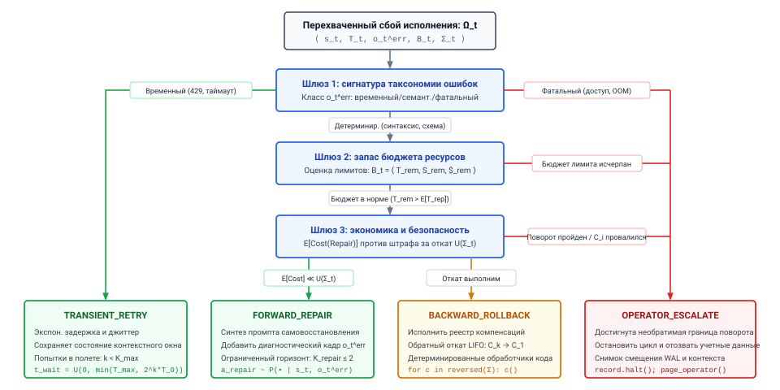
***Архитектура решений о восстановлении в среде выполнения**: многоуровневый супервизорный арбитраж между прямым самовосстановлением, обратной компенсацией саги и эскалацией к оператору. Перехватив сбой исполнения $\Omega_t$, супервизор оценивает таксономию ошибок, запас ресурсов и экономическую амортизацию, чтобы выбрать политику восстановления.*

Как показано на рисунке [«Архитектура решений о восстановлении в среде выполнения»](11_failure_recovery.md#fig-vol3-recovery-decision-tree), супервизор среды выполнения направляет перехваченный сбой $\Omega_t$ через иерархический каскад сортировки, который арбитрирует между четырьмя различными операционными конечными точками. Сначала шлюз 1 (Gate 1) классифицирует сигнатуру полезной нагрузки ошибки: временные сетевые разрывы или ограничения частоты HTTP 429 сразу уходят в `TRANSIENT_RETRY` с рандомизированной экспоненциальной задержкой ($t_{\text{wait}} \sim \mathcal{U}(0, \min(T_{\max}, 2^k T_0))$), тогда как фатальные нарушения инвариантов (например, отозванные учетные данные или обходы песочницы безопасности) немедленно направляются на правую ветку эскалации. Для детерминированных семантических сбоев, таких как ошибки компилятора или несовпадения схемы, исполнение переходит к шлюзу 2, который проверяет, могут ли остаточные бюджеты токенов и денег ($\mathbf{B}_t$) поглотить еще один проход обдумывания починки без риска усечения контекста. Наконец, шлюз 3 проводит экономическую оценку амортизации, сопоставляя ожидаемые затраты на починку с накопленным штрафом за откат $U(\Sigma_t)$: если починка выполнима и невозвратные затраты существенны, движок выбирает `FORWARD_REPAIR`, тогда как непомерная сложность починки или пересечение необратимого поворотного действия запускают `BACKWARD_ROLLBACK` или ручной `OPERATOR_ESCALATE`. Поток решений оценивает три последовательных шлюза:

1. **Таксономия ошибок и диагностируемость:** среда выполнения проверяет сигнатуру классификации $o_t^{\text{err}}$. Ошибки делятся на три различные операционные категории:
   - *Временные сбои среды:* сетевые таймауты, ограничения частоты HTTP 429 и конкуренция за блокировки. Эти сбои не требуют структурного изменения траектории; их устраняют прямым повтором с экспоненциальной задержкой и джиттером.
   - *Детерминированные семантические сбои:* отказы валидации схемы, синтаксические ошибки компиляции, отсутствующие параметры и исключения «файл не найден». Это кандидаты с высокой вероятностью для прямого самовосстановления, так как трасса ошибки содержит явную диагностическую обратную связь, которую модель может усвоить, чтобы синтезировать исправленную полезную нагрузку.
   - *Фатальные нарушения инвариантов:* отзыв аутентификации, исчерпание аппаратных ресурсов, неустранимое повреждение базы данных и нарушения ограничений песочницы безопасности. Прямое исправление не может синтезировать корректный обход для этих сбоев. Среда выполнения немедленно прерывает прямое продвижение и запускает обратную компенсацию.
2. **Запас остаточного бюджета ресурсов:** прямое самовосстановление расходует токены вывода и шаги траектории. Пусть $\mathbb{E}[T_{\text{repair}}]$ и $\mathbb{E}[\$_{\text{repair}}]$ обозначают ожидаемый расход токенов и денежную стоимость прохода вывода, предназначенного для генерации $a_{\text{repair}}$. Если остаточный бюджет $\mathbf{B}_t$ удовлетворяет условию:

   $$T_{\text{rem}} < \mathbb{E}[T_{\text{repair}}] + T_{\text{reserve}} \quad \lor \quad \$_{\text{rem}} < \mathbb{E}[\$_{\text{repair}}] + \$_{\text{reserve}}$$

   среда выполнения отклоняет прямую починку. Попытка починить сбой, когда запас токенов почти исчерпан, рискует вызвать усечение окна контекста во время самого прохода починки, порождая неустранимый режим отказа в супервизоре восстановления.
3. **Экономическая амортизация (невозвратные затраты против стоимости починки):** откат траектории требует исполнения компенсаторов с суммарной стоимостью:

   $$U(\Sigma_t) = \sum_{j=1}^{t-1} \text{Cost}(C_j)$$

   Если $U(\Sigma_t)$ мало (например, если сбой произошел на первой подтранзакции многошагового рабочего процесса), экономический штраф за обратный откат пренебрежимо мал. Среда выполнения предпочитает немедленную компенсацию и чистый перезапуск. И наоборот, если $U(\Sigma_t)$ велико, что означает минуты вычислений, тысячи зафиксированных строк базы данных или необратимые ручные настройки, ожидаемую стоимость прямого исправления необходимо взвесить по сравнению с вероятностью успешного восстановления:

   $$\mathbb{E}[\text{Cost}(\text{Forward})] = \text{Cost}(a_{\text{repair}}) + \left(1 - P(\text{success} \mid o_t^{\text{err}})\right) \cdot U(\Sigma_t)$$

   Когда $P(\text{success} \mid o_t^{\text{err}})$ высока, а $U(\Sigma_t)$ существенно, прямое самовосстановление является математически оптимальным системным выбором.

<a id="nbk-11-repair-vs-unwind"></a>

> **Прямое исправление против компенсации и повторного запуска**
>
> **Задача**: шестишаговая миграция падает на последнем шаге, потому что сгенерированная таблица маршрутизации содержит номер порта в виде строки. Насколько надежной должна быть одна попытка починки, чтобы она оказалась дешевле, чем компенсация первых пяти шагов и их повторный запуск?
>
> **Переменные**:
>
> * Прямые шаги $T_1$–$T_5$ заняли 46 с и потратили 38 500 входных и 3 100 выходных токенов по иллюстративным ценам \$3 и \$15 за миллион.
> * Их компенсаторы занимают в сумме 40,6 с и не тратят токенов модели.
> * Один вызов починки читает 2 390 новых токенов (инструкции восстановления, сбойный вызов и кадр ошибки) и пишет 180 при 50 выходных токенах в секунду; исправленный шаг проходит валидацию менее чем за секунду.
>
> **Вычисления**:
>
> * Откат: $U + R$ = 40,6 с + 46 с = 86,6 с, и \$0,162 токенов на повторный запуск.
> * Одна попытка починки: $c_r$ = 4,1 с и \$0,010.
> * Порог безубыточности: $p^* = c_r / (U + R)$ = 5 процентов по времени и 6 процентов по деньгам.
>
> **Результат**: починка — лучшая ставка, если одна попытка успешна более чем примерно в 6 процентах случаев. Даже при допущении успешности 50 процентов ожидаемая стоимость сначала попробовать починку составляет 47,4 с и \$0,091, против 86,6 с и \$0,162 при немедленном откате.
>
> **Системный вывод**: чем позже приходит сбой, тем больше работы отбрасывает компенсация и тем ниже порог, при котором стоит сначала попробовать починку. Надежность починки для данного класса сбоев — эмпирическая величина, которую измеряют на повторных испытаниях, как описано в разделе [«Статистическая строгость оценки»](12_evaluation.md#sec-vol3-evaluation-rigor), и политика должна использовать это измерение, а не предполагаемую долю.

### Инвариант против зацикливания: ограничение траекторий прямой починки

Хотя прямое восстановление дает значительный выигрыш в эффективности при безобидных синтаксических и конфигурационных ошибках, оно подставляет систему под катастрофический режим отказа, присущий авторегрессионным базовым моделям: *зацикливание починки* (repair spinning). Когда модель пытается исправить ошибку, не понимая по существу состояния окружения, она часто вовлекается в галлюцинированную циклическую смену патчей. Модель меняет поверхностный синтаксис кода, получает вторичную ошибку, меняет другой несущественный параметр и постепенно уходит от исходной цели, расходуя токены и лимиты вызовов API.

```bash
# Observable Trace of an Agent Repair Spin Loop (Pytest Validation Failure)
Iteration 1: ImportError: cannot import name 'AsyncSession' from 'sqlalchemy.orm'
Agent Patch 1: from sqlalchemy.ext.asyncio import AsyncSession  # Fixed import
Iteration 2: AttributeError: 'AsyncSession' object has no attribute 'sync_engine'
Agent Patch 2: engine = session.sync_engine if hasattr(session, 'sync_engine') else None
Iteration 3: TypeError: NoneType object cannot be interpreted as an integer
Agent Patch 3: from sqlalchemy.orm import AsyncSession  # Cyclical regression
Iteration 4: ImportError: cannot import name 'AsyncSession' from 'sqlalchemy.orm'
# Supervisor Intervention: Cycle detected via signature hash H(err_4) == H(err_1)
```

Чтобы устранить зацикливание починки, среда выполнения должна обеспечивать *инвариант против зацикливания* (Anti-Spin Invariant): **никакая отдельная логическая подтранзакция не может проходить больше фиксированного порога $K_{\text{repair}}$ последовательных попыток прямой починки, а последовательность попыток починки не может показывать топологические или сигнатурные циклы.**

Инвариант реализуется через две конкретные структуры данных среды выполнения, которые ведутся в контексте исполнения:

1. **Счетчик последовательных починок ($k_i$):** каждая подтранзакция $T_i$ ведет целочисленный счетчик $k_i \in \mathbb{N}$, начинающийся с нуля. Когда $T_i$ падает и среда выполнения выбирает прямое восстановление, счетчик увеличивается: $k_i \leftarrow k_i + 1$. В промышленных средах выполнения агентов число допустимых прямых починок жестко ограничено:

   $$k_i \le K_{\text{repair}}, \quad \text{где } K_{\text{repair}} \le 3$$

   Если $k_i > K_{\text{repair}}$, среда выполнения отзывает у модели полномочия на самовосстановление. Супервизор заключает, что ошибку нельзя устранить локально политикой $\pi_\theta$ при текущей постановке промпта, прекращает прямое продвижение и немедленно переходит к обратной компенсации саги.

2. **Хеширование семантических ошибок и обнаружение циклов:** модель может исчерпать бюджет починки, колеблясь между двумя взаимно несовместимыми состояниями, как показано в трассе выше, где патч три возвращает изменение импорта из патча первого. Супервизор вычисляет детерминированный семантический хеш каждого наблюдения об ошибке:

   $$\sigma(o_t^{\text{err}}) = \text{SHA-256}\left( \text{Normalize}\left( \text{type}(o_t^{\text{err}}), \text{source}(o_t^{\text{err}}), \text{signature}(o_t^{\text{err}}) \right) \right)$$

   Среда выполнения хранит историю сигнатур ошибок в скользящем буфере FIFO $\mathcal{H}_i = [\sigma_1, \sigma_2, \dots, \sigma_k]$, привязанном к подтранзакции $T_i$. Перед отправкой запроса вывода для $a_{\text{repair}}$ супервизор проверяет повторяемость цикла:

   $$\exists \, j < k \quad \text{такого, что} \quad \sigma_k = \sigma_j$$

   Если одна и та же сигнатура ошибки появляется дважды внутри одной последовательности починки, агент выдал холостой или циклический патч. Среда выполнения мгновенно разрывает цикл, пропуская все оставшиеся приращения $K_{\text{repair}}$, и принудительно запускает обратный откат.

Обеспечивая инвариант против зацикливания, среда выполнения ограничивает наихудший радиус поражения прямого самовосстановления. Если прямая починка успешна в пределах $K_{\text{repair}}$ ходов, система получает выигрыш по задержке и эффективности от сохранения зафиксированного состояния. Если модель не сходится, среда выполнения детерминированно возвращается к проверенным гарантиям журнала компенсаций саги.

Однако эта модель восстановления опирается на неявное архитектурное допущение: что любую зафиксированную подтранзакцию $T_i$ действительно можно компенсировать обратной транзакцией $C_i$. В реальных программных развертываниях это допущение регулярно рушится. Когда агент отправляет незашифрованное письмо, списывает деньги с кредитной карты клиента или резервирует невозвратное оборудование, физическое действие пересекает порог необратимости, за которым никакая обратная компенсация не восстановит прежнее состояние мира. Как среда выполнения агента должна строить исполнение, когда оно пересекает эти точки невозврата?

<a id="sec-vol3-sagas-pivot"></a>

## Необратимость поворотного действия

Некоторые эффекты не может отмотать ни одна среда выполнения. В локальной реляционной базе данных незафиксированная транзакция выполняется в изоляции; если инвариант нарушается, команда `ABORT` использует журнал упреждающей записи, чтобы перезаписать грязные страницы кеша и вернуть блоки диска к точному прежнему битовому состоянию. В автономных архитектурах агентов, однако, инструменты регулярно действуют через суверенные административные границы, отправляют сетевые пакеты по публичным линиям или запускают невозвратные финансовые клиринговые системы. Для таких взаимодействий фундаментальное допущение классического обратного восстановления, что для каждого прямого действия $T_i$ существует обратная операция $C_i$ такая, что $C_i(T_i(S)) = S$, рушится полностью.

Автономные среды выполнения агентов не могут рассматривать все вызовы инструментов как однородные, компенсируемые единицы работы. Внешние операции делятся на строгую трехуровневую иерархию обратимости, опирающуюся на единственное *поворотное действие* (pivot action), которое отмечает структурную точку невозврата. Как только траектория исполнения фиксирует свое поворотное действие, откат через компенсацию становится невозможным, и супервизору среды выполнения приходится перейти от позиции, ориентированной на отмену, к контракту гарантированного завершения вперед или операционной эскалации.

Как отмечал Пат Хеллэнд в работе *Life beyond Distributed Transactions: an Apostate's Opinion* (2007), автономные деловые компоненты не могут удерживать блокировки через независимые границы доверия; вместо этого они должны работать с состояниями в памяти, сообщениями и семантической компенсацией.

### Трехуровневая таксономия обратимости действий

Чтобы управлять побочными эффектами, не рискуя необратимым повреждением, среда выполнения агента должна поддерживать явный контракт со своим брокером исполнения инструментов. Каждая зарегистрированная конечная точка инструмента объявляет свой уровень обратимости в схеме, расширяя типизированный контракт действий (принцип «Типизированный контракт действий») от того, что инструмент принимает, до того, что он может отменить. Среда выполнения классифицирует действия с инструментами по трем различным категориям на основе их семантических и физических инвариантов. Эти категории уточняют уровни полномочий из раздела [«Экспозиции H·S·A»](01_introduction.md#sec-vol3-intro-hsa): обратимое действие, ограниченное песочницей, относится к $A_1$, компенсируемое внешнее действие к $A_2$, а поворотное действие к $A_3$.

*Класс I: полностью обратимые действия.* Действие $T_i$ полностью обратимо, если существует детерминированное обратное действие $C_i = T_i^{-1}$ такое, что составное исполнение дает тождественное преобразование наблюдаемого состояния внешнего окружения:

$$\left(T_i^{-1} \circ T_i\right)(S) = S$$

Обратимые действия характеризуются полной локальной изоляцией. Типичные примеры включают подготовку патча в изолированном эфемерном рабочем пространстве, создание ветки в локальном git-репозитории, запись временных промежуточных файлов на временный диск или выделение буферов памяти внутри песочницы исполнения. Если траектория агента не проходит последующую проверку, среда выполнения вызывает $T_i^{-1}$ (например, исполняет `git branch -D` или удаляет временные файлы), возвращая физическое состояние к точной конфигурации до исполнения, не оставляя видимых извне следов.

*Класс II: компенсируемые действия.* Действие $T_i$ компенсируемо, если существует обратная операция $C_i$, которая может восстановить логические инварианты системы, хотя она и не может стереть исторический факт того, что $T_i$ произошло. Формально:

$$C_i\left(T_i(S)\right) \neq S \quad \text{but} \quad \mathcal{V}_{\text{semantic}}\left(C_i\left(T_i(S)\right)\right) = \mathcal{V}_{\text{semantic}}(S)$$

где $\mathcal{V}_{\text{semantic}}$ — отношение семантической эквивалентности на пространстве состояний домена. Как проанализировали Гектор Гарсиа-Молина и Кеннет Салем в своей основополагающей формулировке саг 1987 года, компенсация не сбрасывает историческое время; она применяет новое прямое действие, которое уравновешивает деловое воздействие исходного действия.

В финансовом учете бухгалтеры никогда не стирают ошибочный дебет физической резинкой; они записывают равное и противоположное по знаку кредитование, сохраняя след аудита, который только дополняется, о человеческой или вычислительной ошибке.

Рассмотрим агента, который управляет облачной инфраструктурой и создает бакет объектного хранилища или выделяет вычислительный узел. Если траектория в целом падает, среда выполнения не может отменить временной факт того, что сервер существовал три минуты; однако вызов конечной точки `DELETE` облачного провайдера удаляет сервер, останавливает начисления за ресурсы и возвращает учетную книгу инфраструктуры к семантически чистому состоянию. Аналогично, агент, который списал деньги с кредитной карты клиента, не может отозвать уже отправленный пакет авторизации платежного шлюза, но он может исполнить транзакцию возврата. Выписка клиента фиксирует обе транзакции, достигая финансовой нейтральности ценой видимой исторической дельты.

*Класс III: необратимые и поворотные действия.* Действие $T_i$ необратимо и обозначается как *поворотное действие* ($T_{\text{pivot}}$), если в целевом домене не существует вычислительной обратной или компенсирующей операции:

$$C_i = \emptyset$$

После исполнения поворотное действие фиксирует неизменяемую мутацию во внешнем пространстве состояний. Примеры включают отправку письма во внешний список рассылки, публикацию скомпилированного программного двоичного файла в публичном реестре, удаление основной таблицы производственной базы данных, резервные копии которой были одновременно очищены, или проведение банковского перевода внешнему банку. Как только RPC поворотного действия завершен, мир необратимо продвинулся вперед. Среда выполнения агента не может ни откатить действие, ни применить автоматическое контрдействие для нейтрализации его последствий.

Операционные контракты, характеристики побочных эффектов и протоколы восстановления, которые управляют этими тремя уровнями, сведены в таблице [«Матрица обратимости действий»](11_failure_recovery.md#tbl-vol3-action-invertibility).

| Уровень обратимости                 | Контракт обратимости                                                    | Типичные вызовы инструментов                                      | Наблюдаемый остаток                               | Стратегия восстановления среды выполнения                               |
|:------------------------------------|:------------------------------------------------------------------------|:------------------------------------------------------------------|:--------------------------------------------------|:------------------------------------------------------------------------|
| **Класс I: обратимое**              | $T_i^{-1} \circ T_i = I$                                                | Подготовка файлов, git checkout, выделение памяти в песочнице     | Нулевой (состояние физически стерто)              | Точный обратный откат прямым исполнением обратной операции              |
| **Класс II: компенсируемое**        | $\mathcal{V}_{\text{sem}}(C_i \circ T_i) = \mathcal{V}_{\text{sem}}(I)$ | Списание и возврат Stripe, выделение облачной ВМ, мягкое удаление записи в базе данных | Неизменяемый след аудита, временные начисления за ресурсы | Семантическая обратная компенсация через зарегистрированные обработчики саги |
| **Класс III: поворотное / необратимое** | $C_i = \emptyset$                                                       | Внешняя доставка письма, переключение производственного DNS, банковский перевод | Постоянный эффект, наблюдаемый вне среды выполнения | Монотонное прямое продвижение, детерминированный повтор или эскалация оператору |

<a id="tbl-vol3-action-invertibility"></a>

***Матрица обратимости действий**: операционные контракты, характеристики побочных эффектов и протоколы восстановления, которые управляют обратимыми, компенсируемыми и поворотными инструментами в средах выполнения агентов.*

### Граница поворотного действия

Поскольку необратимое действие нельзя отменить, среда выполнения агента не может допускать произвольного чередования поворотных операций по всему долгосрочному плану. Если агент исполняет последовательность из трех поворотных действий, перемежаемых непроверенными компенсируемыми действиями, то сбой на четвертом шаге оставляет систему в неустранимом гибридном состоянии: частично опубликованном, частично списанном и структурно неспособном к откату.

Чтобы предотвратить этот взрыв состояний, среда выполнения обеспечивает *инвариант границы поворотного действия*, правило упорядочивания, лежащее в центре границы поворотного действия и компенсирующих саг (принцип «Граница поворотного действия и компенсирующие саги»). В любой допустимой исполняемой траектории $\mathcal{T} = (T_1, T_2, \dots, T_n)$ может существовать не более одной поворотной транзакции, обозначаемой $T_{\text{pivot}} = T_k$. Эта единственная операция делит весь жизненный цикл исполнения на два структурно различных операционных режима:

$$\mathcal{T} = \underbrace{\left(T_1, T_2, \dots, T_{k-1}\right)}_{\text{Preparation Phase (Compensable)}} \;\xrightarrow{\quad T_k = T_{\text{pivot}}\quad}\; \underbrace{\left(T_{k+1}, T_{k+2}, \dots, T_n\right)}_{\text{Finalization Phase (Retriable / Idempotent)}}$$

Архитектурные свойства этих двух фаз определяют движок восстановления после сбоев:

1. *Фаза подготовки ($i < k$):* каждая подтранзакция, предшествующая поворотному действию, должна быть классом I (обратимой) или классом II (компенсируемой). В течение этой фазы среда выполнения ведет активный журнал компенсаций $\mathcal{L}_{\text{comp}} = [C_{i-1}, \dots, C_1]$. Если нарушается любой инвариант, если инструмент возвращает необработанную ошибку или если рассуждения модели нарушают защитные барьеры безопасности, среда выполнения выполняет обратный откат. Супервизор опустошает $\mathcal{L}_{\text{comp}}$ в обратном порядке, систематически нейтрализуя каждое временное изменение, пока система не вернется к своей исходной точке. Никакие постоянные побочные эффекты не просачиваются во внешний домен.
2. *Шаг поворота ($i = k$):* поворотная транзакция представляет собой атомарный порог исполнения. Перед отправкой $T_{\text{pivot}}$ среда выполнения должна убедиться, что выполнены все предусловия, активны все временные аренды и проверены пути исполнения всех операций после поворота. Там, где политика требует подписи человека, поворот также проходит через протокол эскроу из раздела [«Шлюзы одобрения»](09_agent_harness.md#sec-vol3-controlplane-hitl). Отправка $T_{\text{pivot}}$ требует синхронной записи в журнал упреждающей записи (WAL), переводящей состояние траектории из `STATUS_PREPARING` в `STATUS_COMMITTED`.
3. *Фаза финализации ($i > k$):* после успешного возврата $T_{\text{pivot}}$ откат назад отключается. Среда выполнения удаляет или деактивирует журнал компенсаций $\mathcal{L}_{\text{comp}}$. Каждая операция после поворота должна удовлетворять *свойству гарантированного завершения*: она должна быть спроектирована как повторяемая и строго идемпотентная. Если шаг $T_{k+1}$ падает из-за сетевого таймаута или деградации внешнего сервиса, среда выполнения не может сдаться и откатиться; она должна настойчиво повторять попытки, выполнять прямое самовосстановление или переходить на заранее скомпилированные детерминированные резервные процедуры, пока вся траектория не завершится успешно.

<a id="exmp-11-the-dual-commit-trap-and-pivot"></a>

> **Ловушка двойной фиксации и выделение поворотного действия**
>
> Рассмотрим автономного агента по надежности сайта, которому поручено развернуть сервис вывода модели машинного обучения в производстве. Траектория состоит из пяти конкретных подтранзакций:
>
> - $T_1$: выделить 16 $\times$ H100 GPU-инстансов в двух зонах доступности облака (класс II: компенсируется прекращением через облачный API; стоимость \$5,50/мин).
> - $T_2$: выполнить предполетную проверку умножением матриц и прогреть KV-кеши PagedAttention модели (класс I: обратимое; внутренние вычисления).
> - $T_3$: зарегистрировать новые инстансы в глобальной сетке маршрутизации Anycast Border Gateway Protocol (BGP), открыв сервис публичному интернет-трафику (класс III: поворотное действие; внешний трафик немедленно попадает на узлы).
> - $T_4$: выполнить административный скрипт миграции для обновления глобальной базы данных каталога сервисов (класс II: компенсируется откатом базы данных).
> - $T_5$: отправить криптографически подписанный аудиторский webhook во внешний реестр отчетности о соответствии (класс III: необратимая внешняя передача).
>
> **Архитектурный дефект:**
> План содержит два поворотных действия ($T_3$ и $T_5$), разделенных подверженной сбоям операцией ($T_4$). Допустим, агент успешно исполняет $T_3$; публичный производственный трафик уже поступает в новый кластер. Когда агент пытается выполнить $T_4$, миграция базы данных падает из-за взаимной блокировки схемы. Если среда выполнения пытается откатиться назад, она сталкивается с $T_3$. Она не может отменить маршрутизацию публичных клиентских запросов, которые уже были выполнены против кластера: эти транзакции вернули ответы конечным пользователям. И наоборот, если она попытается прекратить траекторию, $T_5$ никогда не будет исполнено, что нарушит регуляторное соответствие и оставит кластер без мониторинга.
>
> **Структурное исправление:**
> Супервизор среды выполнения переупорядочивает граф транзакций до исполнения, отделяя локальную регистрацию от публичной активации:
>
> - Шаг 1: выделить инстансы ($T_1$, компенсируемое).
> - Шаг 2: прогреть KV-кеш и проверить ($T_2$, обратимое).
> - Шаг 3: выполнить миграцию базы данных в режиме предварительного эскроу ($T_4'$, обратимое/компенсируемое).
> - Шаг 4: подготовить полезную нагрузку webhook соответствия в эскроу локальной памяти ($T_{5,\text{stage}}$, обратимое).
> - Шаг 5: активировать публичную маршрутизацию Anycast и отправить подготовленные webhook через шаблон атомарного исходящего буфера (outbox) ($T_{\text{pivot}}$).
>
> Сдвигая истинную точку необратимости на последний шаг, мы минимизируем зону ущерба при сбое. Если миграция базы данных падает на шаге 3, инстансы аккуратно снимаются с учета через $C_1$, ни один публичный запрос не теряется и никакие некорректные записи о соответствии не выдаются.

<a id="psp-11-the-pivot-point-and-irreversible-effects"></a>

> **Точка невозврата и асимметрия необратимого воздействия**
>
> В классических архитектурах баз данных управление транзакциями опирается на допущение, что физические мутации можно чисто откатить через журнал упреждающей записи или многоверсионное управление конкурентностью. В агентной системе машинного обучения, взаимодействующей с внешними окружениями, эта симметрия между прямым исполнением и обратным восстановлением полностью нарушается.
>
> Многие внешние операции строго необратимы. Как только агент отправляет письмо клиентам, переключает производственную запись DNS, переводит криптографические токены или рассылает публичную API-мутацию, никакая компенсирующая транзакция не может отозвать отправленные байты или отменить внешнее наблюдение. Шаблон саги Гарсиа-Молины распознает эту асимметрию через понятие *поворотной транзакции*, единственной атомарной границы, где траектория исполнения переходит от компенсируемой подготовки к необратимой фиксации.
>
> Однако стохастические базовые модели не обладают врожденным осознанием этой физической границы. Обусловленная исключительно генерацией последовательности, модель с готовностью вплетает необратимые мутации в исследовательскую цепочку планирования, выдавая внешние вызовы API до проверки локальных предусловий. Если шаг четыре падает после того, как шаги один и три зафиксировали внешние эффекты, среда выполнения оказывается в невозможном состоянии: она не может откатиться назад, но и продвинуться вперед ей не дают.
>
> **Системный вывод**: обратимость — свойство среды, а не промпта. Надежные среды выполнения агентов должны обеспечивать границу поворотного действия структурной компиляцией супервизора: топологически сортировать предложенные ациклические графы действий (DAG) так, чтобы все обратимые и компенсируемые операции исполнялись первыми, а единственный необратимый поворотный шаг изолировался в абсолютной точке окончательной фиксации.

### Терминальная эскалация

Несмотря на надежные механизмы прямого самовосстановления, автономная система, работающая в открытом мире, в конечном счете столкнется с терминальной расходимостью. Шаг после поворота может столкнуться с неустранимым условием: конечная точка внешнего API меняет схему аутентификации посреди траектории, необходимый нижестоящий сервис страдает от отказа в нескольких регионах или компенсирующее действие $C_j$ при откате до поворота возвращает необработанную ошибку `500 Internal Server Error`, портя саму цепочку компенсаций.

В этих условиях любая автоматическая попытка модели «галлюцинировать» путь восстановления несет неприемлемый риск усугубления разрушения. Среда выполнения агента должна исполнить детерминированный *протокол терминальной эскалации*.

Фундаментальный примитив терминальной эскалации — *заморозка блока управления агентом (Agent Control Block, ACB)*. По аналогии с приостановкой блока управления процессом операционной системы при аппаратном исключении машинной проверки супервизор среды выполнения перехватывает падающий поток исполнения и атомарно останавливает весь дальнейший вывод модели и диспетчеризацию инструментов.

Блок управления агентом содержит замороженное состояние исполнения: контекстное окно токенов, указатели KV-кеша, токены авторизации инструментов, открытые сетевые сокеты и точное смещение в журнале транзакций.

Переход состояния при заморозке ACB регулируется строгим инвариантом: никакая активная возможность или неявное полномочие не может сохраняться, пока исполнение приостановлено в ожидании вмешательства человека. Среда выполнения выполняет четыре обязательных шага изоляции:

1. *Эскроу и отзыв токенов:* среда выполнения немедленно отзывает краткоживущие учетные данные OAuth и сессионные токены IAM агента. Возможности доступа к инструментам блокируются, так что никакие фоновые потоки или асинхронные обратные вызовы не смогут выдать новые внешние мутации.
2. *Сохранение состояния в хранилище карантина инцидентов:* среда выполнения сериализует полный контекст памяти агента. Этот снимок включает сырую последовательность токенов, историю сборки промптов, точные параметры вызова инструмента, вызвавшего исключение, полный стандартный вывод ошибок сбойного RPC и точное смещение в журнале саги $\mathcal{L}_{\text{Saga}}$.
3. *Классификация остаточного состояния:* супервизор оценивает точку сбоя относительно $T_{\text{pivot}}$:
   - Если сбой произошел *до поворота* и был вызван падением компенсатора $C_j$, состояние помечается как `FAIL_COMPENSATION_CORRUPTED`. Система фиксирует оставшиеся нескомпенсированные ресурсы (например, осиротевший облачный диск), чтобы предотвратить утечку ресурсов.
   - Если сбой произошел *после поворота*, состояние помечается как `FAIL_POST_PIVOT_STALLED`. Система фиксирует зафиксированную необратимую мутацию и отмечает все незавершенные нижестоящие шаги.
4. *Вызов оператора по внеполосным каналам:* среда выполнения отправляет структурированную полезную нагрузку инцидента инженерам по системам через внеполосный операционный канал (например, внутреннюю шину оповещений или поток событий PagerDuty).

```python
def freeze_agent_control_block(acb: AgentControlBlock, err: ToolException) -> None:
    # Атомарно остановить траекторию и снять неявные полномочия
    acb.execution_state = State.ESCALATED_FREEZE
    acb.credential_broker.revoke_all_leases(acb.session_id)

    # Классифицировать режим сбоя относительно границы поворота
    failure_mode = (FailureMode.POST_PIVOT_STALLED if acb.wal.has_committed_pivot()
                    else FailureMode.COMPENSATION_CORRUPTED)

    incident_record = IncidentPayload(
        session_id=acb.session_id,
        failure_mode=failure_mode,
        wal_offset=acb.wal.current_offset,
        failed_tool=err.endpoint,
        error_context=err.payload,
        frozen_context_uri=acb.storage_broker.snapshot_context(acb.context)
    )
    acb.alert_router.emit_critical_incident(incident_record)
```

Проектный принцип здесь отражает сквозной аргумент Солтцера и Каашука: когда внутренние контракты восстановления программного супервизора нарушаются, безопасность не должна зависеть от непроверенных вероятностных рассуждений базовой модели. Замораживая ACB, снимая неявные учетные данные и выводя точную транзакционную границу на поверхность для администраторов-людей, среда выполнения агента ограничивает радиус поражения неожиданного сбоя окружения.

Обеспечивая границу поворотного действия, среда выполнения гарантирует, что агент никогда не пытается откатиться назад после пересечения точки невозврата. Но эта конструкция порождает столь же сложную проблему: если агент не может откатиться после поворотного действия, он вынужден самовосстанавливаться и продвигать исполнение вперед. Когда внешняя система начинает сбоить, как среда выполнения отличает модель, которая делает измеримое прямое продвижение к устранению проблемы, от агента, попавшего в семантический бесконечный цикл, который бесконечно сжигает токены, выдает колеблющиеся вызовы инструментов и исчерпывает квоты API, не продвигая фактического состояния системы?

<a id="sec-vol3-sagas-watchdogs"></a>

## Семантические сторожевые таймеры

Вычислительный поток, исполняющий авторегрессионный цикл декодирования, потребляет 100 процентов своих выделенных тензорных ядер GPU, насыщает каналы памяти с высокой пропускной способностью (HBM) в фазе генерации токенов, ограниченной памятью, через регулярные промежутки времени выдает синтаксически корректные вызовы инструментов JSON-RPC по сокетам POSIX и неизменно подтверждает сигналы живости супервизора хоста. Для ядра операционной системы хоста, подсистемы cgroup контейнера и HTTP-проб `/healthz` плоскости оркестрации этот процесс вывода является образцом операционной жизнеспособности. Однако при оценке по цели сходимости состояния более широкой распределенной задачи агент катастрофически заблокирован. Пытаясь без опоры на факты устранить синтаксическую ошибку компилятора, модель меняет строку 42 файла конфигурации, проверяет получившийся сбой теста, возвращает строку 42 в исходное состояние, снова сталкивается с исходным сбоем и повторяет этот цикл на протяжении десятков ходов. Традиционные мониторы живости операционной системы ищут только *отсутствие активности*; агентная система, попавшая в семантический бесконечный цикл, отказывает через *избыток неподвижной активности*, как показано на примере паттерна колебания хешей состояния в [«Обнаружении колебаний семантического сторожевого таймера»](11_failure_recovery.md#fig-vol3-semantic-watchdog).

<a id="fig-vol3-semantic-watchdog"></a>

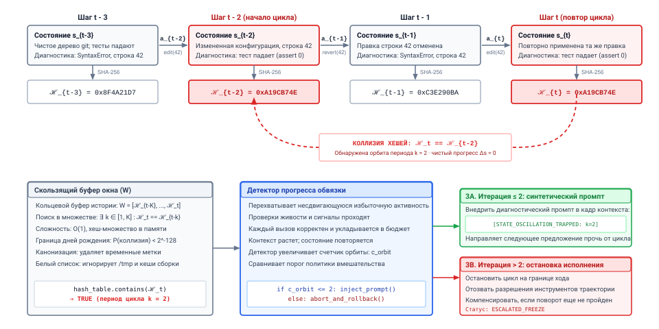
***Обнаружение колебаний семантического сторожевого таймера**: обнаружение циклов по хешам состояния над скользящим окном истории. Супервизор поддерживает скользящие криптографические дайджесты $\mathcal{H}_t = \text{SHA-256}(\text{Canonicalize}(\mathbf{s}_t))$ по буферу истории $W$. Совпадение хешей текущего состояния $\mathbf{s}_t$ и предыдущего состояния $\mathbf{s}_{t-2}$ выявляет замкнутую орбиту периода 2 с нулевым чистым прогрессом окружения, что запускает автоматическое вмешательство супервизора.*

Архитектурный механизм этого детектора циклов прослеживается по двум уровням [«Обнаружение колебаний семантического сторожевого таймера»](11_failure_recovery.md#fig-vol3-semantic-watchdog). На верхней трассе траектории среда выполнения хоста фиксирует детерминированный снимок окружения $\mathbf{s}_i$ на каждом шаге, канонизирует деревья каталогов и файлы конфигурации, чтобы исключить временные метки файловой системы, и проецирует результат в 256-битный криптографический дайджест $\mathcal{H}_i$. На шаге $t-2$ агент меняет строку 42 файла конфигурации, получая дайджест $\texttt{0xA19CB74E}$; столкнувшись с нарушением теста инварианта на шаге $t-1$, он возвращает правку, восстанавливая дайджест $\texttt{0xC3E290BA}$; на шаге $t$ он повторно применяет ту же модификацию строки 42, воспроизводя тот же дайджест состояния $\mathcal{H}_t = \texttt{0xA19CB74E}$. Как показано на нижнем уровне, супервизор поддерживает скользящее окно истории $W = [\mathcal{H}_{t-K}, \dots, \mathcal{H}_t]$ на основе хеш-множества в памяти, что позволяет выполнять проверки коллизий за $O(1)$ и мгновенно блокировать повторяющуюся орбиту ($\mathcal{H}_t == \mathcal{H}_{t-2}$, период $k=2$). Вместо того чтобы позволять авторегрессионному циклу декодирования бесконечно потреблять тензорные ядра GPU, семантический арбитр перехватывает траекторию: при первых циклах ($c_{\text{orbit}} \le 2$) он вставляет синтетическое диагностическое предупреждение (`[STATE_OSCILLATION_TRAPPED: k=2]`) прямо в контекстный кадр модели, чтобы вынудить исследование политики, тогда как устойчивые колебания ($c_{\text{orbit}} > 2$) запускают остановку исполнения, снимают учетные данные песочницы (`ESCALATED_FREEZE`) и, если траектория еще не пересекла свой поворот, активируют обратный откат саги.

**Центральный системный тезис семантического мониторинга:** *классические сигналы живости процесса проверяют только вычислительную и транспортную живость, но не полезность вычислений. Чтобы ограничить финансовый, энергетический и памятный расход несходящихся рассуждений, среда выполнения должна поэтому судить о прогрессе по окружению, а не по сигналам живости (принцип «Внеполосное вытеснение и сторожевые таймеры прогресса»), обеспечивая явные, математически проверяемые инварианты прогресса по хешам состояния окружения, внешним метрикам верификации и энтропии действий.*

### Несостоятельность классических проб живости ОС

В классических операционных системах и распределенных средах выполнения живость моделируется как бинарное свойство потока или процесса. Подсистема жива, если она переходит между состояниями в пределах ограниченного временного интервала $\Delta t$. Системные демоны регистрируют периодические сигналы поддержания активности у системных супервизоров (например, `sd_notify("WATCHDOG=1")` в Linux `systemd`), а распределенные планировщики опрашивают конечные точки состояния контейнеров по TCP. Если процесс входит в бесконечный цикл в пространстве ядра, попадает во взаимную блокировку на мьютексе POSIX или зависает на необслуживаемом чтении из заблокированного сетевого сокета, сигнал прекращается. Аппаратный сторожевой таймер или супервизор хоста срабатывает, инициируя неперехватываемый `SIGKILL`, освобождая дескрипторы файлов и перепланируя контейнер.

Это архитектурное допущение рушится для зацикленной модели. Механизм вывода, выполняющий прямой проход, не останавливается на уровне указателя инструкций. Каждый шаг генерации токена — это регулярное матрично-векторное умножение ($\text{GEMV}$), которое стримит веса из памяти с высокой пропускной способностью с ровным темпом, поэтому зацикленная модель выглядит ровно так же занятой, как продуктивная. Пока сервер вывода (например, vLLM или SGLang) и супервизор агента хоста обмениваются корректно сформированными сообщениями удаленного вызова процедур (RPC), каждый стандартный сторожевой таймер транспортного уровня удовлетворен. Это модель правдоподобного отказа ([«Модель правдоподобного отказа»](01_introduction.md#sec-vol3-intro-fail-plausible)), увиденная глазами супервизора: процесс, здоровый по каждой мере живости и ошибочный по каждой мере задачи.

Расхождение между операционным здоровьем и продвижением задачи отражает ключевую идею работы Мартина Ринарда *Acceptability-Oriented Computing* (2003): классическая программная инженерия предполагает, что системы либо исполняются по идеализированной детерминированной спецификации, либо падают. Однако когда реальные системы сталкиваются с немодельными пространствами состояний, рассмотрение каждого неаварийного исполнения как приемлемого позволяет программам бесконечно расходовать ресурсы в деградировавших, непродуктивных циклах. В агентной архитектуре этот режим отказа проявляется как эпистемический разрыв между внутренним контекстом рассуждения агента и внешним окружением. Поскольку авторегрессионное контекстное окно расширяется с каждым ходом, механизм внимания агента испытывает непрерывную новизну: каждый ход добавляет новые токены рассуждения, свежие трассы исполнения инструментов и обновленные полезные нагрузки ошибок. У агента есть локальная, самоподкрепляющаяся иллюзия прямого импульса, даже когда его внешнее окружение остается запертым в замкнутой круговой орбите.

### Измеримые инварианты семантического прогресса

Чтобы восстановить детерминированные гарантии живости, супервизор должен отслеживать внешнее окружение, а не внутреннее обдумывание модели. Среда выполнения устанавливает *семантический сторожевой таймер* (Semantic Watchdog), который перехватывает каждое предложенное действие и оценивает результирующие переходы состояния по трем измеримым инвариантам прогресса: монотонность хеша состояния, монотонность метрик и энтропию действий.

Пусть траектория агента формализована как дискретная последовательность шагов $t \in \{1, 2, \dots, n\}$. На каждом шаге среда выполнения фиксирует кортеж состояния системы $S_t = \langle \mathbf{s}_t, a_t, o_t \rangle$, где $\mathbf{s}_t$ — детерминированный снимок целевого окружения (рабочий каталог песочницы, состояние базы данных или манифест конфигурации), $a_t$ — предложенное действие с инструментом, а $o_t$ — наблюдение окружения, возвращенное песочницей исполнения.

1. **Монотонность хеша состояния и обнаружение циклов:** среда выполнения ведет ограниченный кольцевой буфер истории $W = [\mathcal{H}_{t-K}, \dots, \mathcal{H}_{t-1}]$ криптографических хешей состояния окружения:
$$\mathcal{H}_t = \text{SHA-256}(\text{Canonicalize}(\mathbf{s}_t))$$
Функция канонизации сортирует деревья файлов, удаляет временные метки файловой системы и форматирует записи базы данных в детерминированные байтовые потоки. На каждом шаге $t$ сторожевой таймер обращается к окну истории $W$. Семантический цикл периода $k$ обнаруживается, если:
$$\exists k \in [1, K] \quad \text{такого, что} \quad \mathcal{H}_t = \mathcal{H}_{t-k}$$
Поскольку SHA-256 обеспечивает устойчивое к коллизиям отображение в 256 бит, вероятность того, что два различных физических состояния окружения дадут одинаковые хеши, ограничена $2^{-128}$ (по оценке парадокса дней рождения), что делает ложное обнаружение цикла математически пренебрежимым. Когда $\mathcal{H}_t = \mathcal{H}_{t-k}$, агент выполнил $k$ изменяющих действий, которые дали нулевое чистое преобразование внешней системы.

2. **Монотонность метрик:** в сложных задачах программной инженерии хеши состояния окружения естественно меняются при редактировании временных файлов, запуске линтеров или обновлении журналов. Поэтому различные хеши состояния не гарантируют сходимости задачи. Среда выполнения отслеживает вектор внешних метрик верификации $\mathbf{m}_t = \langle m_1(\mathbf{s}_t), m_2(\mathbf{s}_t), \dots, m_p(\mathbf{s}_t) \rangle$, выдаваемых детерминированными верификаторами хоста, такими как число проходящих модульных тестов, количество ошибок компилятора или диагностика статического анализа. Прогресс требует, чтобы вектор метрик демонстрировал неотрицательную направленную производную на протяжении эпохи длины $E$:

$$\Delta \mathbf{m}_{t, t-E} = \mathbf{m}_t - \mathbf{m}_{t-E} \not\le \mathbf{0}$$

Если агент выполняет $E$ последовательных изменяющих действий, не давая положительного прироста хотя бы по одной целевой метрике (или, что хуже, колеблется между $m_{\text{pass}} = 4$ и $m_{\text{pass}} = 3$), сторожевой таймер фиксирует застой метрик.

3. **Энтропия действий и синтаксическое повторение:** даже до исполнения действия среда выполнения анализирует синтаксическую и семантическую структуру предложенного действия $a_t$. Среда выполнения вычисляет быстрый 64-битный некриптографический хеш вызова инструмента:
$$h_{\text{tool}}(a_t) = \text{xxHash64}(\text{tool\_identifier} \parallel \text{CanonicalJSON}(\text{arguments}))$$
Если $h_{\text{tool}}(a_t) = h_{\text{tool}}(a_{t-k})$ и промежуточное наблюдение $o_{t-k}$ вернуло необработанную ошибку (например, `ENOENT: File not found` или `HTTP 403 Forbidden`), агент повторно выдает заведомо недопустимый запрос. Кроме того, супервизор отслеживает лексическую энтропию токенов в черновике цепочки рассуждений; резкое падение разнообразия токенов часто указывает на то, что авторегрессионный сэмплер перешел в вырожденный режим коллапса ([«Инварианты против зацикливания семантического сторожевого таймера»](11_failure_recovery.md#tbl-vol3-watchdog-invariants)).

| Тип инварианта                   | Механизм обнаружения                                                                                | Основная цель обнаружения                                                      | Накладные расходы на отслеживание                                    | Смягчение ложных срабатываний                                    |
|:---------------------------------|:----------------------------------------------------------------------------------------------------|:-------------------------------------------------------------------------------|:---------------------------------------------------------------------|:-----------------------------------------------------------------|
| **Монотонность хеша состояния**  | Скользящая таблица SHA-256 по окну ($W$)                                                            | Обратимые колебания ($\mathbf{s}_t \to \mathbf{s}_{t-1} \to \mathbf{s}_t$)     | Поиск за $O(1)$ через хеш-множество; $O(B)$ вычисление хеша по $B$ байтам состояния | Внести в белый список недетерминированные каталоги (`/tmp`, журналы) |
| **Монотонность метрик**          | Строгая дельта по Парето за эпоху $E$ ($\Delta \mathbf{m}$)                                         | Несходящаяся болтанка между тестами и линтерами                                | Возникает только во время исполнения набора тестов                   | Допускать ограниченные исследовательские регрессии ($E_{\text{grace}}$ шагов) |
| **Синтаксическая эквивалентность действий** | Точное сопоставление канонизированного JSON-RPC                                       | Повторный вызов падающих команд                                                | $O(1)$ канонизация строки и целочисленное сравнение                  | Обходить при наличии в аргументах динамических нонсов            |
| **Семантический дрейф эмбеддингов** | Косинусное расстояние $1 - \frac{e(a_t) \cdot e(a_{t-k})}{\lVert e(a_t) \rVert \lVert e(a_{t-k}) \rVert}$ | Перефразированные петли рассуждений и переформулированные промпты              | Малое скалярное произведение матрицы на вектор ($d \le 1536$)        | Задавать консервативные пороги сходства ($\cos \theta \ge 0{,}96$) |
<a id="tbl-vol3-watchdog-invariants"></a>

***Инварианты против зацикливания для семантического сторожевого таймера**: типы инвариантов, механизмы обнаружения, цели обнаружения и накладные расходы зондов сторожевого таймера времени выполнения.*

В следующем листинге показан конкретный детектор циклов на кольцевом буфере, которым супервизор агента обеспечивает монотонность хешей состояния:

```python
def check_state_hash_invariants(history: list[str], current_hash: str, max_period: int) -> int | None:
    # Просматриваем скользящее окно назад, чтобы обнаружить циклические колебания состояния
    window = history[-max_period:] if len(history) >= max_period else history
    for distance, past_hash in enumerate(reversed(window), start=1):
        if past_hash == current_hash:
            return distance  # Возвращает период цикла k (например, 1 для холостой операции, 2 для флип-флопа)
    return None
```

<a id="nbk-11-loop-cost"></a>

> **Во что обходится незамеченный цикл**
>
> **Задача**: траектория попадает в двухсостоянийный цикл. Сколько она тратит, если ее останавливает только потолок числа ходов, в сравнении с детектором, который распознает повторяющееся состояние за несколько ходов?
>
> **Переменные**:
>
> * Первый зацикленный ход отправляет $s_0$ = 1 000 токенов. Каждый ход выдает 300 выходных токенов и добавляет 800-токенную ошибку, поэтому повторно отправляемый контекст растет на $\Delta$ = 1 100 токенов на каждом ходе.
> * Один ход занимает 10 с вызова модели и выполнения инструмента.
> * Потолок ходов в бюджете равен 50, а детектор хеша состояния видит повтор на ходу 4.
> * Цены иллюстративные, как в примере «Прямое исправление против компенсации и повторного запуска» выше, без кеширования префиксов.
>
> **Вычисления**:
>
> * Входные токены за $n$ ходов следуют той же арифметической прогрессии, что и пример бюджета в разделе [«Бюджеты и потолки»](09_agent_harness.md#sec-vol3-controlplane-accounting): $n \cdot s_0 + \Delta \cdot n(n-1)/2$.
> * До потолка: 1 397 500 входных токенов, \$4,42 и около 8 минут.
> * С детектором: 10 600 входных токенов, \$0,05 и 40 с.
>
> **Результат**: остановка цикла на первом повторяющемся состоянии примерно в 89 раз дешевле, чем остановка потолком.
>
> **Системный вывод**: стоимость цикла растет с квадратом его длины, потому что каждый ход повторно отправляет контекст, который цикл продолжает увеличивать. Кеширование префиксов снижает цену за повторно отправленный токен, как показал пример бюджета в разделе [«Бюджеты и потолки»](09_agent_harness.md#sec-vol3-controlplane-accounting), но не количество ходов и минут. Потолок ограничивает наихудший случай, и только сигнал прогресса держит типичный цикл коротким. То, как это влияет на стоимость каждой решенной задачи в масштабе парка, является арифметикой полезной пропускной способности из раздела «Полезная пропускная способность траектории и потери вычислений». Вклад детектора в том, что он переносит раннюю остановку с произвольного хода на первое повторяющееся состояние.

### Протоколы вмешательства сторожевого таймера

Обнаружение нарушения инварианта составляет лишь половину архитектурного требования; среда выполнения также должна определить детерминированную семантику конечного автомата для вмешательства. Молчаливое отбрасывание вызова инструмента агента оставляет авторегрессионный цикл декодирования в неопределенном состоянии. Среда выполнения реализует трехуровневый протокол вмешательства, построенный на компромиссе между стоимостью восстановления и завершением траектории, как подробно описано в таблице [«Трехуровневый протокол эскалации семантического сторожевого таймера»](11_failure_recovery.md#tbl-vol3-watchdog-escalation-protocol).

| Уровень вмешательства            | Условие срабатывания                                                     | Механизм супервизора                                                                                                     | Задержка и стоимость восстановления                               | Следующее действие при сбое                         |
|:---------------------------------|:-------------------------------------------------------------------------|:-------------------------------------------------------------------------------------------------------------------------|:------------------------------------------------------------------|:----------------------------------------------------|
| **Уровень 1: прерывание контекста** | Начальный цикл или обнаружено совпадение хеша состояния ($N_{\text{iter}} \le 2$) | Вставляет синтетическое предупреждающее наблюдение ($o_t^{\text{watchdog}}$) прямо в поток промпта LLM.                  | Субмиллисекунды; нулевая стоимость отката токенов                 | Эскалация на уровень 2, если цикл сохраняется 2 хода |
| **Уровень 2: возврат к контрольной точке** | Устойчивое колебание; сходимость не достигнута после прерывания уровня 1 | Перематывает физическую песочницу к снимку контрольной точки $\mathbf{s}_{t-k}$; отсекает неудачные ходы контекста и применяет маску действий. | $10 - 250\ \text{мс}$; пересчет $k$ ходов от чистой контрольной точки | Эскалация на уровень 3, если восстановление после отката не удалось |
| **Уровень 3: терминальное прерывание** | Неустранимая взаимная блокировка; циклическая регрессия превышает порог бюджета | Останавливает исполнение, поднимает `ERR_SEMANTIC_DEADLOCK`, снимает возможности; компенсирует до поворота, замораживает после него. | Полная заморозка траектории; выдается аудиторское оповещение      | Эскалация человеку в контуре / очередь разбора после инцидента |

<a id="tbl-vol3-watchdog-escalation-protocol"></a>

***Трехуровневый протокол эскалации семантического сторожевого таймера**: лестница эскалации, которая обменивает задержку восстановления и вычислительную стоимость на завершение траектории при нарушении инвариантов.*

1. **Уровень 1: синтетическое прерывание контекста (эпистемический толчок):** когда совпадение хеша состояния ($\mathcal{H}_t = \mathcal{H}_{t-k}$) или синтаксический цикл действий впервые отмечается, супервизор перехватывает конвейер исполнения до отправки действия в физическую песочницу. Супервизор генерирует синтетическую полезную нагрузку наблюдения $o_t^{\text{watchdog}}$ и добавляет ее напрямую в поток контекста модели:
> **`[SYSTEM ALERT: SEMANTIC_WATCHDOG_INTERRUPT]`**
> `Действие отклонено супервизором хоста. Нарушение инварианта: STATE_OSCILLATION_DETECTED.`
> `Ваше предложенное действие вернуло окружение в идентичное состояние, наблюдавшееся на шаге t-2.`
> `Вы попали в непродуктивный цикл. НЕ повторяйте предыдущую команду.`
> `Сформулируйте альтернативную гипотезу или проверьте базовые предположения об окружении.`
   Это синтетическое наблюдение опирается на обусловленность модели контекстом. Вставляя в промпт сообщение об ошибке с высокой заметностью, среда выполнения принудительно меняет веса внимания последующих шагов декодирования, разрывая авторегрессионное самоподкрепление, которое порождает цикл.

2. **Уровень 2: откат траектории и маскирование действий:** если агент не сходится после прерывания уровня 1, выдавая действие, которое вызывает второе нарушение инварианта в пределах эпохи из 3 шагов, супервизор эскалирует. Среда выполнения обращается к журналу упреждающей записи (WAL), находит снимок контрольной точки $\mathbf{s}_{t-k}$, предшествовавший началу цикла, и перематывает файловую систему физической песочницы к этой контрольной точке. Одновременно среда выполнения переписывает логическую историю диалога: она усекает неудачные циклические ходы из контекстного окна и вставляет маркер-надгробие (tombstone), который навсегда маскирует сигнатуру неудачного действия $h_{\text{tool}}(a_t)$ в пространстве действий агента.
3. **Уровень 3: терминальное прерывание и эскалация саги (`ERR_SEMANTIC_DEADLOCK`):** если агент исчерпывает выделенный ему бюджет отката, сторожевой таймер выдает не подлежащее маскированию завершение траектории. Среда выполнения поднимает `ERR_SEMANTIC_DEADLOCK`, отзывает краткоживущие токены возможностей агента, освобождает все захваченные блокировки файлов POSIX и баз данных и передает журнал упреждающей записи траектории человеку-оператору. Судьба внешних побочных эффектов зависит от того, где траектория находится относительно своего поворота. До поворота среда выполнения исполняет зарегистрированные в журнале компенсаций ($\mathcal{L}_{\text{comp}}$) компенсаторы в обратном порядке, возвращая всю распределенную систему в согласованное, приостановленное состояние. После поворота этот журнал выведен из употребления и компенсация уже недоступна, поэтому среда выполнения идет по пути терминальной эскалации из раздела [«Необратимость поворотного действия»](11_failure_recovery.md#sec-vol3-sagas-pivot): замораживает блок управления агентом и передает зафиксированное состояние оператору.

Когда семантические сторожевые таймеры успешно ограничивают локальные циклы рассуждений внутри изолированной песочницы исполнения, на границе внешних сетевых сервисов возникает более широкий режим распределенного отказа. Во многих промышленных сбоях неспособность агента продвинуть состояние вызвана не внутренним алгоритмическим циклом или галлюцинацией модели, а внешней зависимостью, например сторонним платежным шлюзом, репозиторием артефактов или демоном форматирования кода, которые испытывают повышенную задержку, перемежающиеся ошибки HTTP 503 или молчаливые разрывы сети. При наивном прямом восстановлении агент, наблюдая сбойный RPC инструмента, трактует сбой как препятствие среды, которое нужно преодолеть: он немедленно повторно отправляет мутированные запросы или бьет по падающей конечной точке. Умноженные на сотни одновременных траекторий агентов, эти несогласованные автономные повторы запускают катастрофический шторм повторов, который подавляет деградировавшую восходящую инфраструктуру. Как проектировать шлюзы исполнения, которые изолируют падающие зависимости инструментов, гасят давление повторов экспоненциальной задержкой с декоррелированным джиттером и сбрасывают нагрузку до того, как внешний сбой каскадно перейдет в саму среду выполнения агента?

<a id="sec-vol3-sagas-containment"></a>

## Автоматические выключатели инструментов

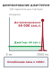

*Автоматические выключатели срабатывают после трех последовательных внешних таймаутов, защищая нижестоящую инфраструктуру от штормов повторов.*

Когда внешняя зависимость инструмента испытывает временную деградацию, неограниченный автономный агент ведет себя как патологический усилитель трафика. В отличие от традиционного клиент-серверного программного обеспечения, которое обычно показывает ошибку человеку-пользователю или исполняет детерминированный ограниченный скрипт повторов, агент, управляемый авторегрессионной моделью, трактует сбой инструмента как головоломку окружения, которую нужно решить. Если API репозитория кода отвергает коммит из-за конкуренции за блокировку или внешний поисковый сервис возвращает статус HTTP 503 Service Unavailable, генеративная политика агента $\pi_\theta$ немедленно потребляет текст сбоя в своем контексте наблюдения $o_t^{\text{err}}$ и синтезирует модифицированный вызов инструмента $a_{t+1}$. Модель может поправить пробелы, переставить токены запроса, изменить порядок параметров или повторить точный вызов в стохастическом расчете на то, что вторая попытка может сработать. Когда сотни одновременных траекторий агентов работают в корпоративном кластере, этот рефлекс автономного решения задач превращает незначительные сбои восходящих сервисов в катастрофические самоинициированные события отказа в обслуживании, известные как штормы повторов.

Среда выполнения не может полагаться на внутреннее суждение модели, чтобы прекратить долбить рушащийся внешний сервис. Поскольку модель не имеет неявных полномочий и не видит напрямую состояний сетевых сокетов, глубин очередей сокетов или состояния удаленного сервера, среда выполнения хоста должна встроить защитный слой формирования трафика между непривилегированным агентом и внешней средой инструментов. Эта защита требует трех взаимодополняющих механизмов: трехсостоянийных автоматических выключателей, которые разрывают соединения с падающими сервисами и быстро отказывают, экспоненциальной задержки с полным джиттером, которая разрушает фазовую синхронизацию между одновременными агентами, и изоляции переборками (bulkhead), которая разделяет ресурсы хоста так, чтобы зависший внешний API не мог заморить голодом критичные локальные потоки исполнения.

### Анатомия штормов повторов, вызванных агентом

Механика шторма повторов, запущенного агентом, напрямую вытекает из несоответствия между авторегрессионным циклом генерации модели и динамикой очередей распределенных сервисов. Рассмотрим восходящий микросервис с пропускной способностью $C$ запросов в секунду и номинальной сквозной задержкой $L_{\text{nom}} = 50\text{ мс}$. В обычных условиях траектория агента вызывает этот инструмент, приостанавливает цикл декодирования на время сетевой передачи удаленного вызова процедуры (RPC), получает структурированный JSON-ответ и добавляет результат в свое контекстное окно.

Теперь предположим, что удаленный сервис испытывает временное замедление, так что задержка подскакивает до $L_{\text{degraded}} = 2000\text{ мс}$, или начинает терять долю $\epsilon$ входящих запросов. В стандартных распределенных архитектурах клиентские SDK используют статическое число повторов, например до трех попыток, прежде чем провалить верхнеуровневый рабочий процесс приложения. В агентной архитектуре, однако, цикл повторов опосредован контекстным окном базовой модели. Когда фреймворк исполнения инструментов возвращает строку ошибки, например `{"error": "Gateway Timeout", "code": 504}`, модель трактует эту строку не как жесткое операционное препятствие, а как обратную связь в диалоге.

```bash
[Trajectory-042] Tool invocation failed: HTTP 504 Gateway Timeout (elapsed: 5002ms)
[Trajectory-042] Agent synthesized alternative: search_index(query="v2 auth patch", retry=True)
[Trajectory-118] Tool invocation failed: HTTP 503 Service Unavailable (elapsed: 5001ms)
[Trajectory-118] Agent synthesized alternative: search_index(query="auth patch v2", timeout=10)
```

Возникающая петля обратной связи математически порочна. Если $N$ активных траекторий агентов каждая наблюдает сбои инструментов, их генеративные политики за несколько прямых проходов декодирования выдают $N$ новых запросов к инструментам. Поскольку генерация LLM происходит с интервалами токенов в десятки миллисекунд, а очереди внешних серверов очищаются за секунды, совокупная частота поступления $\lambda_{\text{in}}$ на шлюзе инструментов резко возрастает:

$$\lambda_{\text{in}} = \sum_{j=1}^{N} \frac{1}{\Delta t_{\text{decode}} + L_{\text{degraded}}}$$

По мере того как задержка $L_{\text{degraded}}$ растет к клиентскому таймауту шлюза $T_{\text{timeout}}$, хост-среда выполнения накапливает заблокированные потоки исполнения. Как только частота поступления превышает пропускную способность ($\lambda_{\text{in}} > C$), длины очередей на удаленном сервисе растут без ограничений, вызывая переполнение внутренних буферов, сбросы соединений и исчерпание пулов потоков в восходящих зависимостях.

Усугубляет кризис то, что стандартные промпты агентов часто прямо предписывают модели «пробовать альтернативные подходы, если инструмент не сработал». Модель послушно выполняет это, перефразируя вызовы инструментов, расширяя строки запроса или обращаясь к соседним конечным точкам, которые попадают в ту же самую серверную базу данных. В результате траектория агента действует как враждебный генератор нагрузки: она обращает семантическую гибкость против простых кешей дедупликации на сопоставлении строк и доводит страдающую зависимость до полного отказа.

**Семантика наблюдения fail-fast**
Когда автоматический выключатель срабатывает в состояние Разомкнут, хост-среда выполнения немедленно синтезирует наблюдение `ERR_CIRCUIT_OPEN`. Эта синтетическая последовательность токенов явно сообщает модели, что физический сетевой доступ разорван, останавливает дальнейшие повторы и направляет траекторию к альтернативному плану или пути компенсации саги.

### Трехсостоянийные автоматические выключатели

Чтобы защитить восходящие зависимости и сберечь вычислительные ресурсы хоста, среда выполнения реализует паттерн автоматического выключателя (circuit breaker), сформулированный Майклом Найгардом и тесно связанный со стохастическим формированием трафика. Шлюз исполнения инструментов оборачивает каждый внешний интерфейс RPC в программный прокси с состоянием, который отслеживает телеметрию результатов по скользящему окну исполнения. Операционная архитектура и математическая динамика проиллюстрированы на рисунке [«Трехсостоянийный выключатель инструментов и задержка с джиттером»](11_failure_recovery.md#fig-vol3-circuit-breaker).

<a id="fig-vol3-circuit-breaker"></a>

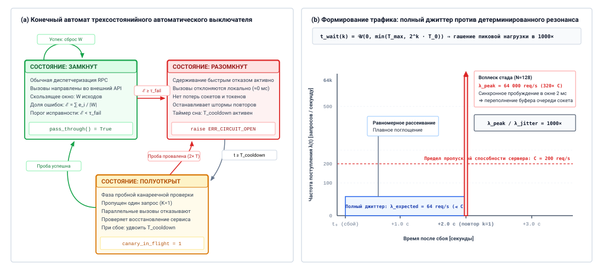
***Трехсостоянийный выключатель инструментов и задержка с джиттером**: переходы операционных состояний и динамика формирования трафика. На панели (a) автоматический выключатель переходит между состояниями «Замкнут», «Разомкнут» и «Полуоткрыт» в зависимости от доли отказов в скользящем окне $\tau_{\text{fail}}$, таймера охлаждения $T_{\text{cooldown}}$ и единичных канареечных зондов. На панели (b) полный джиттер рассеивает моменты повторных обращений равномерно по $[0, \min(T_{\max}, T_0 \cdot 2^k)]$, устраняя разрушительные всплески резонанса стада (thundering herd), которые порождает детерминированная экспоненциальная задержка.*

Двойная защита изоляцией цепи и формированием трафика подробно описана на рисунке [«Трехсостоянийный выключатель инструментов и задержка с джиттером»](11_failure_recovery.md#fig-vol3-circuit-breaker). Панель (a) иллюстрирует конечный автомат, управляющий интерфейсами RPC восходящих инструментов. В состоянии **Замкнут** вызовы инструментов проходят беспрепятственно, а шлюз записывает двоичную телеметрию исполнения по скользящему окну $W$. Когда наблюдаемая доля ошибок $\mathcal{E}$ пересекает критический порог $\tau_{\text{fail}}$, выключатель переходит в **Разомкнут**, немедленно разрывая физические сокет-соединения и синтезируя быстрые локальные отказы (`ERR_CIRCUIT_OPEN` за $\approx 0\text{ мс}$), полностью защищая рабочие потоки от каскадов блокирующих таймаутов. По истечении окна охлаждения $T_{\text{cooldown}}$ выключатель переходит в **Полуоткрыт**, разрешая один канареечный запрос ($K_{\text{canary}} = 1$), чтобы проверить доступность удаленной стороны, тогда как параллельные вызовы продолжают быстро отказывать. Успех канарейки сбрасывает скользящее окно и возвращает контур в Замкнут, а провал канарейки немедленно возвращает его в Разомкнут с экспоненциально удвоенным временем охлаждения ($2 T_{\text{cooldown}}$). Одновременно панель (b) демонстрирует, почему автоматические выключатели надо сочетать со стохастическим формированием трафика: если 128 агентов, повторяя попытки во время сбоя восходящего сервиса, выполняют детерминированную экспоненциальную задержку ($2^k T_0$), их пробуждения синхронизируются в пределах окна отправки 2 миллисекунды и порождают разрушительный всплеск «стада» величиной $64\,000\text{ запр./с}$, который полностью перекрывает ограничение пропускной способности сервера в 200 запр./с. Включая полный джиттер ($t_{\text{wait}} \sim \mathcal{U}(0, \min(T_{\max}, 2^k T_0))$), мы равномерно рассеиваем массу повторов во времени, получая ожидаемую частоту поступления всего $64\text{ запр./с}$, то есть снижение нагрузки в 1000 раз, которое позволяет восходящему сервису плавно восстановиться без переполнения буфера очереди.

В состоянии **Замкнут** прокси пропускает все вызовы инструментов, которые выдают траектории агентов, во внешний сетевой сервис. Шлюз ведет кольцевой буфер последних $W$ результатов исполнения инструментов, где каждая запись фиксирует двоичный успех ($0$) или отказ ($1$). Отказ определяется строго по физическим и транспортным критериям: таймауты TCP-соединений, ошибки сервера HTTP 5xx, отказы из-за ограничения частоты (HTTP 429) или некорректные кадры протокола. Ошибки уровня приложения (например, запрос к базе данных, возвращающий «запись не найдена») не являются транспортными сбоями и с точки зрения автоматического выключателя фиксируются как успехи.

Прокси непрерывно вычисляет скользящую долю ошибок:

$$\mathcal{E} = \frac{1}{|W|} \sum_{i \in W} e_i$$

Если $\mathcal{E}$ превышает настраиваемый порог отказов $\tau_{\text{fail}}$ (обычно задаваемый между $0{,}50$ и $0{,}70$ на окне $W \ge 20$ запросов), прокси мгновенно переходит в состояние **Разомкнут**.

В состоянии **Разомкнут** автоматический выключатель полностью разрывает физическую сетевую связь с удаленной зависимостью. Любой вызов инструмента, направленный к этому интерфейсу, перехватывается на границе посредника хоста. Вместо того чтобы блокировать рабочий поток или ждать таймаута сетевого сокета, прокси немедленно возвращает агентной среде выполнения явное синтетическое наблюдение об ошибке:

$$\mathcal{O}_{\text{synthetic}} = \left\langle \texttt{ERR\_CIRCUIT\_OPEN}, \, \text{dependency\_id}, \, T_{\text{cooldown\_remaining}} \right\rangle$$

Быстрый отказ сохраняет ресурсы хоста. Вместо того чтобы расходовать 30 секунд синхронного ожидания сокета внутри рабочего потока, агент получает немедленный детерминированный сигнал в пределах 1 миллисекунды. Эта ясная операционная граница не дает агенту считать запрос все еще ожидающим, а монитор траектории среды выполнения может остановить исполнение, вызвать компенсирующую транзакцию саги или направить агента к совершенно другому операционному инструменту. Операционная семантика и влияние каждого состояния на ресурсы хоста подробно описаны в таблице [«Операционная семантика трехсостоянийного автоматического выключателя»](11_failure_recovery.md#tbl-vol3-circuit-breaker-states).

| Состояние выключателя | Политика исходящего трафика          | Условие перехода                                        | Наблюдение агента                           | Влияние на ресурсы хоста                              |
|:----------------------|:-------------------------------------|:--------------------------------------------------------|:--------------------------------------------|:------------------------------------------------------|
| **Замкнут**           | Все вызовы отправляются в сеть       | $\mathcal{E} \ge \tau_{\text{fail}}$ на окне $W$        | Реальный вывод инструмента ($o_t$) или ошибка сервера | Линейное использование потоков; полная сетевая задержка |
| **Разомкнут**         | 100% перехватываются на шлюзе хоста  | Прошедшее время $t \ge T_{\text{cooldown}}$             | Немедленный синтетический `ERR_CIRCUIT_OPEN` | Нулевое выделение сокетов; задержка $\approx 0\text{ мс}$ |
| **Полуоткрыт**        | Канареечный зонд разрешен; остальные быстро отказывают | Канарейка успешна $\to$ Замкнут<br>Канарейка провалена $\to$ Разомкнут | Реальный вывод для канарейки; синтетический для остальных | Выделен один поток; зонд изолирован                   |

<a id="tbl-vol3-circuit-breaker-states"></a>

***Операционная семантика трехсостоянийного автоматического выключателя**: операционные политики, условия переходов, наблюдения агента и влияние на ресурсы хоста по состояниям автоматического выключателя.*

Контур остается в состоянии Разомкнут на протяжении окна сна $T_{\text{cooldown}}$ (обычно настраиваемого от 30 до 120 секунд в зависимости от профиля восстановления внешнего сервиса). Когда $T_{\text{cooldown}}$ истекает, прокси переходит в состояние **Полуоткрыт**.

В состоянии **Полуоткрыт** прокси разрешает строго ограниченное число пробных вызовов (часто ровно один канареечный запрос, $K_{\text{canary}} = 1$) пройти к удаленному сервису. Все остальные параллельные вызовы агентов, поступающие в это состояние, продолжают быстро отказывать с `ERR_CIRCUIT_OPEN`. Если канареечный запрос успешен, прокси считает, что нижестоящая зависимость восстановилась, сбрасывает буфер скользящего окна $W$ и возвращается в состояние Замкнут, восстанавливая нормальный поток трафика. Если канареечный запрос проваливается, истекает по таймауту или получает статус HTTP 5xx, прокси считает, что удаленный сервис остается неисправным, сбрасывает таймер охлаждения с экспоненциально увеличенной длительностью отсрочки ($T_{\text{cooldown}} \leftarrow \min(2 \cdot T_{\text{cooldown}}, T_{\text{cooldown\_max}})$) и немедленно возвращается в состояние Разомкнут.

### Протоколы задержки с джиттером

Пока автоматические выключатели защищают инфраструктуру во время затяжных отказов, кратковременные сетевые сбои и короткие перебои сервиса требуют контролируемых повторов. Однако наивные реализации экспоненциальной задержки вносят собственный режим отказа: синхронизацию в такт.

Предположим, что внешний сервис испытывает мгновенный сетевой разрыв длительностью 500 миллисекунд, из-за чего запросы инструментов от $N = 100$ параллельных траекторий агентов одновременно падают в момент $t_0$. Если каждая среда выполнения агента исполняет стандартный детерминированный алгоритм экспоненциальной задержки, где время ожидания после попытки $k$ равно:

$$t_{\text{wait}}(k) = T_0 \cdot 2^k$$

все 100 агентов уснут ровно на $T_0 = 1000\text{ мс}$ и одновременно повторно отправят свои запросы в момент $t_0 + 1000\text{ мс}$. Если восходящий сервис работает вблизи границы своей пропускной способности, этот внезапный синхронизированный всплеск, известный как *проблема стада* (thundering herd), мгновенно переполняет входящий backlog TCP-соединений сервиса. Запросы снова падают, заставляя всех 100 агентов уснуть ровно на $2000\text{ мс}$ и вновь ударить по сервису в унисон в момент $t_0 + 3000\text{ мс}$. Система входит в искусственный резонансный режим, в котором массивные всплески нагрузки чередуются с периодами полного молчания.

**Инвариант резонанса**
Без стохастического фазового рассеивания детерминированные графики повторов сохраняют исходную синхронизацию кластеризованных сбоев. Совокупная частота поступления остается дискретной и периодической, что максимизирует пиковую глубину очереди при минимизации средней пропускной способности.

Чтобы устранить эти разрушительные пики резонанса, шлюз инструментов должен внести случайность, которая десинхронизирует моменты прибытия повторенных вызовов инструментов. Исследование Amazon Web Services по формированию трафика показывает, что среди различных стратегий рандомизации (включая Equal Jitter и Decorrelated Jitter) **полный джиттер** (Full Jitter) дает наибольшую дисперсию межприбытийных интервалов и самое быстрое сокращение общего времени завершения очереди.

При полном джиттере клиентский шлюз вычисляет детерминированную экспоненциальную верхнюю границу и выбирает фактический интервал сна равномерно-случайно между нулем и этой границей:

$$t_{\text{wait}}(k) = \mathcal{U}\left(0, \, \min\left(T_{\max}, \, T_0 \cdot 2^k\right)\right)$$

где $T_0$ — базовый временной слот задержки (например, $100\text{ мс}$), $k$ — номер попытки повтора с нуля, а $T_{\max}$ — жесткий потолок, введенный, чтобы предотвратить бесконечные простои (например, $30\text{ с}$).

```python
# Эмпирический расчет полного джиттера внутри шлюза исполнения инструментов
def compute_jittered_backoff(attempt: int, base_ms: float = 100.0, max_ms: float = 30000.0) -> float:
    ceiling = min(max_ms, base_ms * (2.0 ** attempt))
    return random.uniform(0.0, ceiling)
```

Извлекая $t_{\text{wait}}$ из равномерного непрерывного распределения по всему интервалу $[0, \text{ceiling}]$, мы превращаем распределение моментов прибытия 100 упавших запросов из набора дискретных дельта-функций Дирака в гладкую плотность вероятности, размазанную по времени. Восходящий сервис обрабатывает запросы устойчиво, насколько позволяет его очередь, и разрывает петлю обратной связи, которая порождает штормы повторов.

<a id="nbk-11-sizing-bulkhead-capacity-and-jitter"></a>

> **Переборка, емкость и джиттер при RPC-нагрузке**
>
> **Сценарий:**
> Механизм исполнения агентов размещает $N = 256$ параллельных рабочих процессов. Каждая траектория агента регулярно обращается к внешнему индексу семантических символов через инструмент RPC.
>
> - Внешний индекс имеет номинальную задержку $L_{\text{nom}} = 20\text{ мс}$.
> - Во время сбоя индекс деградирует: ответы зависают до истечения таймаута $T_{\text{timeout}} = 5000\text{ мс}$, при частоте ошибок $100\%$.
> - Сервер хоста выделяет общий пул потоков из $M = 300$ рабочих потоков для обработки всех исполнений инструментов во всех категориях (локальный ввод-вывод файлов, локальные операции git и внешние RPC).
> - Экспоненциальная задержка без джиттера использует $t_{\text{wait}}(k) = 1000 \cdot 2^k\text{ мс}$. Полный джиттер использует $t_{\text{wait}}(k) = \mathcal{U}(0, \min(30000, 1000 \cdot 2^k))\text{ мс}$.
>
> **Задача:**
>
> 1. Вычислите время $t_{\text{exhaust}}$, необходимое для исчерпания всего пула рабочих потоков хоста ($M = 300$), если все 256 агентов обращаются к падающему индексу без автоматического выключателя и изоляции переборкой.
> 2. Если 128 агентов одновременно проваливают первую попытку, вычислите пиковую мгновенную частоту поступления при детерминированной задержке и ожидаемое распределение поступлений во времени при полном джиттере для первого повтора ($k=1$).
>
> **Решение:**
>
> *Шаг 1: время исчерпания потоков*
> Каждый агент выдает вызов RPC, который блокирует рабочий поток на всю длительность $T_{\text{timeout}} = 5000\text{ мс}$.
> Поскольку $N = 256$ агентов работают одновременно, все 256 агентов занимают поток исполнения в пределах первого прямого шага декодирования (менее $100\text{ мс}$).
>
> При $t \approx 100\text{ мс}$ 256 из 300 доступных рабочих потоков полностью заняты ожиданием замороженного сетевого сокета. Остается только:
>
> $$M_{\text{free}} = 300 - 256 = 44\text{ потоков}$$
>
> для всех прочих задач агентов, включая локальную запись файлов и локальное сжатие памяти. Если любой из оставшихся активных агентов порождает подзадачу или вторичный вызов инструмента, оставшиеся 44 потока мгновенно расходуются. Полное исчерпание потоков наступает при:
>
> $$t_{\text{exhaust}} < 200\text{ мс}$$
>
> За оставшиеся $4800\text{ мс}$ до срабатывания таймаута сокета вся среда выполнения агентов замирает. Она не может выполнить тривиальные, не падающие локальные задачи, поскольку общий пул потоков полностью голодает из-за заблокированных сетевых сокетов.
>
> *Шаг 2: распределение поступлений при повторе ($k=1$)*
> Для $k=1$ детерминированный интервал экспоненциальной задержки равен:
>
> $$t_{\text{wait}}(1) = 1000 \cdot 2^1 = 2000\text{ мс}$$
>
> Все 128 агентов просыпаются одновременно ровно в момент $t = t_0 + 5000\text{ мс} + 2000\text{ мс} = t_0 + 7000\text{ мс}$. Если считать, что диспетчеризация потоков ОС вносит джиттер $\Delta t_{\text{dispatch}} \approx 2\text{ мс}$, пиковая мгновенная частота поступления на внешний сервис составляет:
>
> $$\lambda_{\text{peak, deterministic}} \approx \frac{128\text{ запросов}}{0{,}002\text{ с}} = 64\,000\text{ запросов/с}$$
>
> Этот мгновенный всплеск переполняет очередь принятия TCP восходящего сервиса, вызывая немедленные потери пакетов.
>
> При полном джиттере граница задержки равна $\min(30000, 1000 \cdot 2^1) = 2000\text{ мс}$. Каждый агент спит на интервале, выбранном из $\mathcal{U}(0, 2000)\text{ мс}$. Функция плотности вероятности момента поступления:
>
> $$f(t) = \frac{1}{2000\text{ мс}} = 0{,}5\text{ с}^{-1} \quad \text{для } t \in [0, 2]\text{ с}$$
>
> Ожидаемая частота поступления равномерно распределена по двухсекундному окну:
>
> $$\lambda_{\text{expected, jitter}} = \frac{128\text{ запросов}}{2\text{ с}} = 64\text{ запросов/с}$$
>
> Полный джиттер снижает пиковое давление запросов в число раз, равное:
>
> $$\frac{\lambda_{\text{peak, deterministic}}}{\lambda_{\text{expected, jitter}}} = \frac{64\,000}{64} = 1000\times$$
>
> Это удерживает трафик повторов в пределах емкости типичной сетевой инфраструктуры.

### Разделение ресурсов переборками

Даже при автоматических выключателях и полном джиттере падающая внешняя зависимость может парализовать среду выполнения агентов, если все инструменты делят один пул ресурсов исполнения. В морской архитектуре корпус судна делится на водонепроницаемые отсеки, которые называются *переборками*. Если столкновение пробивает один отсек, вода локализуется, и весь корабль не тонет.

В среде выполнения агента вызовы инструментов имеют резко различающиеся профили исполнения и границы доверия:

- **Локальные детерминированные инструменты** (например, чтение файлов POSIX, локальные парсеры AST и форматировщики по регулярным выражениям) выполняются за микросекунды или единицы миллисекунд с детерминированными границами.
- **Внутренние RPC с высокой пропускной способностью** (например, обращения к векторной базе данных или локальные вычисления эмбеддингов) работают поверх внутренних сетей с высокой пропускной способностью, с типичной задержкой от 10 до 50 миллисекунд.
- **Внешние сторонние API** (например, публичные веб-скреперы, трекеры задач SaaS или API хранилищ кода) работают через публичный интернет, где задержки передачи туда и обратно непредсказуемы и подвержены сторонним ограничениям частоты, отказам и сбоям маршрутизации между организациями.

Если среда выполнения хоста диспетчеризует все вызовы инструментов в единый глобальный пул рабочих потоков емкостью $C_{\text{pool}}$, сбой одного внешнего инструмента веб-скрейпинга поглотит все рабочие потоки, поскольку вызовы зависают в ожидании таймаутов TCP-соединений. Если внешние конечные точки испытывают временные задержки длительностью $T_{\text{timeout}} \gg T_{\text{local}}$, поступающие внешние запросы насыщают все рабочие слоты:

$$N_{\text{blocked}} = \min\left(C_{\text{pool}}, \lambda_{\text{ext}} \cdot T_{\text{timeout}}\right) \to C_{\text{pool}}$$

Следовательно, локальные операции со временем выполнения менее миллисекунды ($\tau_{\text{fs}} \le 1\ \text{мс}$) страдают от абсолютного голодания ресурсов:

$$\text{WaitTime}_{\text{local}} \approx T_{\text{timeout}} \gg \tau_{\text{fs}}$$

останавливая весь прогресс агентов в среде выполнения хоста.

<a id="chk-11-pool-exhaustion"></a>

> **Оценка изоляции переборками и исчерпания ресурсов**
>
> Прежде чем оценивать многопуловое планирование и пороги автоматических выключателей, проверьте свое понимание конкуренции за рабочие пулы:
>
> - [ ] **Изоляция переборкой**: почему разбиение рабочих потоков на изолированные пулы не дает падающему внешнему HTTP-инструменту блокировать локальные чтения файловой системы?
> - [ ] **Насыщение очереди**: как неразделенная блокировка головы очереди заставляет быстрые детерминированные инструменты унаследовать задержку таймаута медленных внешних API?
> - [ ] **Семантика быстрого отказа**: при каких условиях насыщенный пул должен немедленно отклонять входящие вызовы инструментов (`ERR_BULKHEAD_FULL`), а не ставить их в неограниченную очередь?
> - [ ] **Определение емкости**: как границы таймаутов и максимальная ожидаемая конкурентность задают лимиты семафоров для внутренних и внешних пулов исполнения?

Чтобы обеспечить сквозной аргумент и поддерживать доступность системы, среда выполнения должна реализовать изоляцию переборками, разделяя потоки исполнения, ограничения частоты и очереди памяти на строго изолированные домены ресурсов, как обобщено в таблице [«Архитектура переборок»](11_failure_recovery.md#tbl-vol3-bulkhead-architecture).

| Домен исполнения       | Целевые подсистемы                                  | Лимит конкурентности | Максимальный таймаут исполнения | Семантика отказа                                | Емкость очереди |
|:-----------------------|:----------------------------------------------------|:--------------------|:---------------------------------|:------------------------------------------------|:----------------|
| **Локальный системный пул** | Ввод-вывод файлов POSIX, локальный git, инспекция в памяти | 64 потока           | 500 мс                           | Быстрый отказ (немедленная ошибка)              | 128 слотов      |
| **Пул внутренних RPC** | Кластерные microVM, векторные базы данных, Redis    | 32 потока           | 2 000 мс                         | Трехсостоянийный автоматический выключатель     | 64 слота        |
| **Пул внешних API**    | Публичные WAN-конечные точки, сторонние веб-скреперы | 16 потоков          | 10 000 мс                        | Автоматический выключатель с экспоненциальной задержкой и полным джиттером | 16 слотов |

<a id="tbl-vol3-bulkhead-architecture"></a>

***Архитектура переборок**: параметры резервирования ресурсов и изоляции конкурентности по пулам исполнения.*

Изоляция переборками обеспечивается тремя конкретными механизмами:

1. **Выделенные пулы рабочих потоков и семафоры:** среда выполнения назначает каждому домену инструментов независимые пулы потоков или ограничения асинхронных семафоров. Если пул внешних API исчерпает лимит в 16 одновременных исполнений, последующие внешние вызовы ставятся в очередь или немедленно отклоняются с `ERR_BULKHEAD_FULL`. Важно, что локальный системный пул сохраняет полный комплект из 64 потоков, так что операции с файлами, проверки линтером и контрольные точки состояния продолжают выполняться без задержки.
2. **Доменно-специфичные бюджеты таймаутов:** локальные инструменты работают с жесткими, не подлежащими обсуждению таймаутами (например, $T_{\text{timeout}} \le 500\text{ мс}$). Если локальный инструмент заходит в тупик, его быстро снимают. Внешние сетевые инструменты получают более длинные начальные таймауты (например, $5000\text{ мс}$), но за ними стоят собственные автоматические выключатели, которые гарантируют, что устойчивые таймауты переводят контур в состояние Разомкнут и сбрасывают нагрузку.
3. **Сброс нагрузки автономным исполнением:** когда очередь конкретной переборки достигает емкости, шлюз отклоняет избыточную работу, не обращаясь к внешней сети. Отказ порождает немедленное наблюдение для агента:

$$o_t = \left\langle \texttt{ERR\_RESOURCE\_EXHAUSTED}, \, \text{'External tool queue saturated; defer execution'} \right\rangle$$

Этот детерминированный обратный поток давления заставляет агента либо уступить исполнение, либо продолжить по альтернативным веткам рассуждения, либо переждать перегрузку с помощью клиентской задержки со случайным джиттером ([«Изоляция отказов и квоты ресурсов переборок»](11_failure_recovery.md#tbl-vol3-bulkhead-fault-isolation)).

| Архитектурное измерение                 | Локальные системные инструменты            | Инструменты внутренних микросервисов            | Внешние SaaS- и веб-инструменты                                        |
|:----------------------------------------|:-------------------------------------------|:------------------------------------------------|:-----------------------------------------------------------------------|
| **Основной интерфейс**                  | Системные вызовы POSIX, локальные каналы, общая память | gRPC кластера, REST внутри VPC                  | Публичный интернет: HTTPS, REST, GraphQL                               |
| **Распределение конкурентности**        | Высокое ($60\%$ общей емкости рабочих потоков) | Среднее ($30\%$ общей емкости рабочих потоков)  | Низкое ($10\%$ общей емкости рабочих потоков)                          |
| **Жесткий таймаут ($T_{\text{timeout}}$)** | $100\text{ мс} - 500\text{ мс}$            | $1000\text{ мс} - 2000\text{ мс}$               | $5000\text{ мс} - 10\,000\text{ мс}$                                  |
| **Политика автоматического выключателя** | Отключена (сбои ядра фатальны)            | Агрессивная ($\tau_{\text{fail}} = 0{,}5$, $W=10$) | Консервативная ($\tau_{\text{fail}} = 0{,}6$, $W=20$)                    |
| **Стратегия задержки**                  | Немедленный повтор (не более 1)            | Экспоненциальная задержка с полным джиттером    | Полный джиттер с длинным охлаждением ($T_{\text{cooldown}} \ge 60\text{ с}$) |
| **Влияние режима отказа**               | Завершение локального процесса             | Деградация семантического поиска или индексации | Частичная потеря функций; откат к кешированным данным                  |
<a id="tbl-vol3-bulkhead-fault-isolation"></a>

***Изоляция отказов и квоты ресурсов переборок**: границы ресурсов, последствия отказов и политики отката по уровням инструментов: локальному, внутреннему и SaaS.*

Сочетая трехсостоянийные автоматические выключатели, экспоненциальную задержку с полным джиттером и разделение переборками, среда выполнения хоста строит устойчивый шлюз исполнения. Непривилегированное стохастическое поведение агента в режиме проб и ошибок надежно сдерживается, предотвращая каскадное превращение локальных ошибочных суждений модели в катастрофические сбои инфраструктуры.

<a id="sec-vol3-sagas-quarantine"></a>

## Карантин радиуса поражения

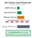

*Клетки chroot для подпроцессов ограничивают радиус поражения файловой системы изолированными каталогами задач.*
Однако изоляция сетевых сбоев и сбоев инструментов решает лишь половину задачи сдерживания. Когда траектория агента сталкивается с неустранимым сбоем или, что хуже, становится жертвой состязательной инъекции промпта, встроенной в ответ внешнего инструмента, опасность смещается с исчерпания инфраструктуры на несанкционированное повреждение состояния. Если отдельная траектория ведет себя аномально, начинает портить внутренние структуры данных или утекает токены возможностей, среда выполнения не может просто полагаться на формирование трафика, чтобы восстановить безопасность. Как архитектура хоста может мгновенно изолировать неисправного или скомпрометированного агента, отозвать его разрешения в окружении, разорвать его каналы связи и поставить неизменяемую границу карантина вокруг его радиуса поражения, прежде чем его испорченное состояние распространится на параллельные рабочие процессы?

Когда траектория агента отклоняется от своей поведенческой спецификации, будь то из-за неустранимого нарушения инварианта состояния, неуправляемого цикла мутаций или полезной нагрузки непрямой инъекции промпта, встроенной в ненадежный ответ инструмента, среда выполнения хоста сталкивается с немедленным архитектурным выбором: попытаться ли мягкое восстановление или немедленно провести неотменимый карантин? В классических распределенных системах проблемному рабочему узлу часто позволяют завершить запросы в полете или опустошить свои очереди перед перезапуском. В агентной архитектуре, однако, исполняющаяся траектория обладает делегированными полномочиями: у нее есть активные токены возможностей, сессии баз данных, виртуальный сетевой доступ и каналы связи с соседними агентами. Позволить скомпрометированной или патологически сбойной модели исполнить хоть один дополнительный шаг авторегрессионного декодирования означает риск катастрофического повреждения данных, эскалации привилегий или утечки внешних учетных данных.

Поэтому супервизор хоста должен ставить системную целостность выше завершения локальной транзакции. Когда граница между безопасным исполнением и неограниченной мутацией рушится, среда выполнения переходит от транзакционной компенсации к активному сдерживанию, создавая герметичный периметр вокруг нарушающей траектории.

Солтцер и Шредер (Saltzer and Schroeder, 1975) сформулировали *принцип безопасных значений по умолчанию* (Principle of Fail-Safe Defaults): базовая конфигурация механизма контроля доступа должна запрещать доступ, а отказ любого инварианта супервизора должен немедленно возвращать исполнение к этой непривилегированной базовой конфигурации. В агентных системах это означает, что траектория под подозрением мгновенно теряет все делегированные полномочия.

### Принцип безопасного сдерживания

Классические методы восстановления предполагают, что логика супервизора, направляющая восстановление, остается неиспорченной. Как установлено для шаблона «Сага траектории», когда подтранзакция $T_i$ падает из-за ошибки окружения, оркестратор отправляет компенсирующую транзакцию $C_{i-1}$, чтобы отменить предыдущие побочные эффекты. Однако этот контракт восстановления опирается на критическое допущение: что агент, предлагающий или ведущий последовательность, по-прежнему действует как добросовестный, согласованный планировщик.

Если сбой траектории вызван инъекцией промпта, например инструкциями, встроенными в найденную страницу документации или тело письма, среда выполнения должна считать модель скомпрометированной. Принцип «Сдерживание ниже модели» уже предполагает именно это, и в таком состоянии починка или компенсация, управляемая моделью, становится опасностью, а не средством лечения. Если среда выполнения попросит скомпрометированную модель синтезировать компенсирующие действия, модель может выдать дальнейшие разрушительные вызовы инструментов под видом уборки, удалив таблицы базы данных или переслав конфиденциальные учетные данные на конечную точку атакующего. Аналогично, агент, попавший в вырожденный цикл генерации токенов, может исчерпать всю квоту частоты запросов или перегрузить нижестоящие сервисы некорректными мутациями.

При этих режимах отказа откат через обычный цикл исполнения агента неприемлем. Среда выполнения должна реализовать фундаментальное правило Джеймса Гамильтона для инфраструктуры интернет-масштаба: *агрессивно разделять домены отказов, чтобы ограничивать радиус поражения*. Хост-среда выполнения должна рассматривать аномальную траекторию не как незафиксированную транзакцию, которую аккуратно разворачивают, а как активный вектор угрозы, требующий немедленного сдерживания, что противопоставлено в таблице [«Транзакционная компенсация саги против карантина радиуса поражения»](11_failure_recovery.md#tbl-vol3-quarantine-vs-saga).

| Измерение                | Компенсация траектории-саги                                                              | Карантин радиуса поражения                                                                                     |
|:-------------------------|:-----------------------------------------------------------------------------------------|:---------------------------------------------------------------------------------------------------------------|
| **Условие срабатывания** | Ожидаемый сбой окружения; детерминированный отказ контракта инструмента; отказ валидации. | Нарушение инварианта; срабатывание семантического сторожевого таймера; подозрение на состязательную инъекцию; запрос несанкционированной возможности. |
| **Модель доверия**       | Политика агента считается добросовестной и согласованной; оркестратор управляет чистым откатом. | Контекст агента считается недоверенным, испорченным или враждебным; все активные возможности отзываются.         |
| **Состояние исполнения** | Траектория остается активной; шаги компенсации ($C_i$) исполняются последовательно.      | Исполнение траектории мгновенно заморожено; дерево процессов остановлено; сетевые интерфейсы разорваны.         |
| **Обработка побочных эффектов** | Компенсирующие действия отменяют зарегистрированные прямые побочные эффекты.      | Последующие мутации блокируются; созданные артефакты помечаются меткой недоверенности; ожидающие RPC отбрасываются. |
| **Взаимодействие с соседями** | Соседние рабочие процессы ждут завершения саги или получают стандартные статусы ошибок. | Соседи получают явные оповещения о метках недоверенности; очереди межагентных сообщений разорваны и очищены.    |

<a id="tbl-vol3-quarantine-vs-saga"></a>

***Транзакционная компенсация саги против карантина радиуса поражения**: архитектурное сравнение транзакционной компенсации саги и экстренного карантина радиуса поражения по системным измерениям.*

### Четырехэтапный протокол карантина

Чтобы обеспечить сдерживание, не вызывая нестабильности на уровне хоста, супервизор исполняет детерминированный четырехэтапный протокол карантина ([«Детерминированный четырехэтапный протокол карантина»](11_failure_recovery.md#tbl-vol3-quarantine-protocol)). Этот конвейер полностью обходит цикл вывода агента и исполняется строго внутри привилегированной плоскости управления хост-среды выполнения.

| Этап карантина                     | Примитив исполнения и системный интерфейс                  | Целевые подсистемы                                     | Гарантия задержки и радиуса поражения                       |
|:-----------------------------------|:-----------------------------------------------------------|:-------------------------------------------------------|:------------------------------------------------------------|
| **Этап 1: приостановка процесса**  | Замораживатель Linux cgroup v2 (`cgroup.freeze`), `SIGSTOP` | Процесс агента, интерпретатор среды выполнения, дочерние деревья рабочих процессов | $\le 1\ \text{мс}$; мгновенная заморозка исполнения         |
| **Этап 2: отзыв учетных данных**   | Аннулирование токенов IAM STS, ротация ключей сессии OAuth | Кеш токенов хоста, конечные точки метаданных облачного провайдера | Монотонное лишение привилегий; ноль новых API-авторизаций   |
| **Этап 3: разрыв сети**            | Сброс фильтра eBPF TC на входе и выходе, разрушение veth   | Виртуальные сетевые интерфейсы песочницы, сокеты хоста | Предотвращает эксфильтрацию данных и связь с управляющим сервером (C2) |
| **Этап 4: распространение меток недоверенности** | Выдача записи-надгробия WAL, обновление центрального реестра меток недоверенности | Соседние агенты-потребители, общее хранилище артефактов | Блокирует потребление испорченных артефактов по всему кластеру |

<a id="tbl-vol3-quarantine-protocol"></a>

***Детерминированный четырехэтапный протокол карантина**: упорядоченная последовательность, которая исполняется внутри привилегированной плоскости управления супервизора при обнаружении аномалии.*

Последовательность начинается с *немедленной приостановки процесса* (Immediate Process Suspension). Супервизор адресует cgroup песочницы хоста и выдает заморозку на уровне ядра (`SIGSTOP` или заморозку контроллера `cgroup.freeze` в cgroup v2). Это мгновенно замораживает процесс среды выполнения агента, его интерпретатор Python/Node и любые порожденные дочерние рабочие процессы. Заморозка дерева исполнения не дает модели инициировать последующие системные вызовы, писать в локальные буферы памяти или потреблять дополнительные циклы вывода на GPU. Контекст исполнения остается нетронутым в физической оперативной памяти и сохраняется как неизменяемый артефакт памяти для автономного посмертного анализа.

```python
# Принудительное обеспечение заморозки cgroup и сброса исходящего трафика на уровне ядра супервизора
def execute_emergency_freeze(sandbox_id: str, cgroup_path: str, veth_iface: str):
    # Этап 1: мгновенно заморозить дерево процессов через контроллер заморозки cgroup v2
    with open(f"{cgroup_path}/cgroup.freeze", "w") as f:
        f.write("1")
    # Этап 3: разорвать сетевой канал, сбросив исходящий трафик и отключив интерфейс
    subprocess.run(["ip", "link", "set", "dev", veth_iface, "down"], check=True)
    subprocess.run(["tc", "qdisc", "replace", "dev", veth_iface, "root", "blackhole"], check=True)
```

Второй этап — *эфемерный отзыв учетных данных* (Ephemeral Credential Revocation). Поскольку модель не имеет неявных полномочий, агент никогда не держит постоянных учетных данных инфраструктуры. Вместо этого супервизор выдает краткоживущие, узко ограниченные аренды возможностей и записывает их в блок управления агентом (ACB) траектории. При срабатывании карантина супервизор отправляет синхронное событие отзыва своему внутреннему брокеру учетных данных и внешним провайдерам идентификации (например, AWS STS, Google Cloud IAM или серверам авторизации OAuth). Аренды аннулируются: инвалидируются сессионные куки, дескрипторы соединений с базами данных и bearer-токены API. Даже если вызов инструмента, находящийся в полете, вырвался из песочницы процесса до приостановки, нижестоящие сервисы отвергают запрос при проверке токена.

Третий этап реализует *разрыв сетевого интерфейса* (Network Interface Severing). Пока заморозка процесса останавливает генерацию новых системных вызовов, буферы TCP-сокетов внутри сетевого пространства имен могут еще пытаться передать данные. Супервизор немедленно разрушает виртуальную пару Ethernet (`veth`), связывающую песочницу с мостом хоста, либо активирует программу eBPF Traffic Control (`tc`), которая заменяет дисциплину очереди фильтром «черной дыры». Все исходящие пакеты отбрасываются на физическом уровне, а входящие соединения в полете получают немедленный сброс TCP (`RST`). Песочница полностью изолирована от локальной сети, конечных точек соседних агентов и публичного интернета.

Четвертый этап выполняет *распространение метки недоверенности* (Taint Propagation). Неисправная траектория редко исполняется в полной изоляции: она могла записать файлы в общий репозиторий, вставить строки в экспериментальную базу данных или отправить уведомления о задачах во входную очередь соседнего агента. Супервизор записывает неизменяемую запись карантина в долговечный журнал упреждающей записи (WAL), порождая криптографически подписанное надгробие. Это надгробие запускает метки недоверенности на всех ресурсах, созданных траекторией в течение ее эпохи исполнения.

**Архитектура распространения меток недоверенности:**
Когда траектория $T_k$ помещается в карантин, супервизор прикрепляет криптографические метки недоверенности $(\tau = \text{TAINTED})$ ко всем созданным артефактам $A_k$. Соседние агенты блокируются на границе эскроу, а ссылки на ветки Git блокируются до тех пор, пока проверка их не снимет.

### Динамическое отслеживание меток недоверенности

Когда агент помещается в карантин, супервизор должен гарантировать, что ни один из его частично вычисленных результатов не испортит более широкий корпоративный рабочий процесс. Артефакт, созданный мятежной или ошибочной траекторией, считается *помеченным* (tainted) до тех пор, пока внешняя обвязка верификации или человек-оператор явно не снимет метку.

Пусть долгоживущая траектория агента $\mathcal{T}_k$ порождает последовательность дискретных побочных эффектов в окружении $\mathcal{E}_k = \{e_1, e_2, \dots, e_m\}$ на шагах исполнения $t \in \{1, \dots, m\}$. Каждый побочный эффект $e_j$ соответствует внешней мутации: записи файла в общую файловую систему, публикации сообщения в брокер событий или созданию коммита кода в ветке функции. Если среда выполнения обнаруживает коллапс инварианта на шаге $t^*$, все побочные эффекты, произведенные при $t \ge t_{\text{taint}}$, должны быть помещены в карантин, где $t_{\text{taint}} \le t^*$ — самый ранний шаг исполнения, на котором произошло расхождение состояния или ввод недоверенных данных.

Для реализации этого супервизор ведет направленный граф происхождения, отслеживающий линию данных (lineage) между траекториями агентов и артефактами системы. Каждый артефакт $a$, созданный агентом, несет неизменяемый конверт, содержащий его криптографический хеш, идентификатор траектории-производителя $\mathcal{T}_k$ и динамический статус метки недоверенности:

$$\tau(a) \in \{\text{UNTAINTED}, \text{SUSPECT}, \text{TAINTED}, \text{CLEARED}\}$$

<a id="dfn-taint-propagation"></a>

> **Динамическое распространение меток недоверенности**
>
> ***Динамическое распространение меток недоверенности*** — это авторитетный протокол отслеживания происхождения, в котором хост-супервизор помечает все промежуточные артефакты и изменения состояния, созданные падающей или скомпрометированной траекторией агента, как помеченные, перехватывая последующий доступ соседних узлов, чтобы поместить каскадные сбои в карантин.
>
> 1.  **Значение**: предотвращает попадание византийских или галлюцинированных результатов, созданных во время скомпрометированных эпох траекторий, в соседних агентов, общие файловые системы или постоянные хранилища данных, где они незаметно их испортят.
> 2.  **Отличие**: в отличие от статического анализа потока данных (который заранее проверяет абстрактные синтаксические деревья кода), динамическое распространение меток недоверенности поддерживает живой направленный граф происхождения во время исполнения, привязывая криптографические хеши артефактов к состояниям жизненного цикла траектории.
> 3.  **Типичная ошибка**: снятие меток недоверенности исключительно на основании самопроверки модели («я проверил вывод, и он чист») вместо независимых внеполосных проверок обвязкой или очистки человеком-оператором.

Когда $\mathcal{T}_k$ помещается в карантин, супервизор помечает все $a \in \mathcal{A}_k$, созданные внутри эпохи метки, как $\text{TAINTED}$ в центральном хранилище состояния среды выполнения. Нижестоящие агенты, работающие внутри многоагентной системы, взаимодействуют с общими ресурсами через непривилегированный шлюз посредничества. Когда соседний агент $\mathcal{T}_{\text{peer}}$ пытается прочитать артефакт $a$, шлюз посредничества перехватывает запрос на чтение, сверяет метаданные артефакта с реестром меток и блокирует доступ, возвращая `ArtifactQuarantinedException`.

<a id="exmp-11-containment-latency-and-blast-radius"></a>

> **Задержка сдерживания и бюджет радиуса поражения**
>
> Рассмотрим автономного агента программной инженерии, работающего внутри контейнеризованной песочницы на рабочем узле хоста. Агент обрабатывает ненадежный запрос на слияние, который содержит непрямую инъекцию промпта, предназначенную для утечки корпоративных ключей API на внешнюю конечную точку `https://attacker.com/leak`.
>
> **Системные параметры:**
>
> - Пропускная способность генерации токенов: 50 токенов в секунду (20 мс на декодирование одного токена).
> - Задержка проверки инвариантов супервизора: вычисляется на каждый запрос вызова инструмента.
> - Пропускная способность сети между песочницей и мостом хоста: 10 Гбит/с ($1{,}25 \times 10^9$ байт/с).
> - Задержка внедрения сброса пакетов eBPF ($L_{\text{net}}$): 0,4 мс.
> - Задержка заморозки cgroup Linux ($L_{\text{freeze}}$): 1,2 мс.
> - Сквозное время API отзыва токенов STS провайдера идентификации ($L_{\text{idp}}$): 42,0 мс.
> - Широковещание реестра меток по внутреннему кластеру Redis ($L_{\text{taint}}$): 3,5 мс.
>
> **Анализ временной шкалы:**
>
> 1. В момент $t = 0$ модель завершает декодирование несанкционированного вызова `curl`, нацеленного на внешнюю конечную точку с токенами возможностей в HTTP-заголовке, и отправляет запрос исполнения супервизору хоста.
> 2. В момент $t = 1{,}1\text{ мс}$ движок политик супервизора до исполнения сверяет команду с белым списком исходящего трафика песочницы. Исходящий домен `attacker.com` нарушает инвариант безопасности. Объявляется триггер карантина.
> 3. Супервизор запускает этапы 1 и 3 одновременно:
>    - В момент $t = 1{,}1 + 0{,}4 = 1{,}5\text{ мс}$ фильтр eBPF TC сбрасывает все исходящие кадры на интерфейсе `veth`. Ни один байт полезной нагрузки не покидает хост.
>    - В момент $t = 1{,}1 + 1{,}2 = 2{,}3\text{ мс}$ ядро переводит процессы песочницы в замороженное состояние. Авторегрессионное исполнение и локальный ввод-вывод полностью прекращаются.
> 4. Одновременно супервизор запускает этапы 2 и 4:
>    - В момент $t = 1{,}1 + 3{,}5 = 4{,}6\text{ мс}$ обновляется реестр меток. Три нижестоящих соседних агента, слушающих очередь задач этого агента, получают блокировку подписок, что препятствует приему помеченного результата задачи.
>    - В момент $t = 1{,}1 + 42{,}0 = 43{,}1\text{ мс}$ провайдер идентификации аннулирует краткоживущий сессионный токен агента.
>
> **Общее время сдерживания радиуса поражения:**
> Локальная физическая граница (сеть и исполнение) герметично запечатана за $2{,}3\text{ мс}$, что намного ниже порога генерации одного токена ($20\text{ мс}$). Распространение среди соседних узлов системы блокируется за $4{,}6\text{ мс}$. Хотя отзыв в облачном IdP требует $43{,}1\text{ мс}$, агент не может использовать токен в течение этого окна, потому что физический сетевой выход и планирование CPU были разорваны менее чем за $2{,}5\text{ мс}$.

Помеченные артефакты, зафиксированные в постоянных хранилищах, должны пройти детерминированное исправление. Для репозиториев с контролем версий среда выполнения выдает автоматический `git revert` или отсоединяет затронутую ветку функции, блокируя ее слияние в основную интеграционную ветку. В реляционных или документных базах данных строки, помеченные идентификатором эпохи карантинной траектории, отмечаются надгробием мягкого удаления, скрываясь от стандартных запросов, но сохраняя сырые данные для административного аудита.

Обеспечивая динамическое отслеживание меток, супервизор гарантирует, что граница отказа остается строго изолированной внутри неправильно работающей траектории. Даже в сложных многоагентных архитектурах, где сотни асинхронных моделей обмениваются промежуточными следами рассуждений, нарушение безопасности или семантический сбой внутри одного исполнения не может незаметно распространить порчу на остальную систему.

Установив отдельные механизмы отказоустойчивости (транзакционную семантику восстановления саг, прямое самовосстановление, выявление поворотных действий, семантические сторожевые таймеры, автоматические выключатели инструментов и карантин радиуса поражения), центральную инженерную задачу смещаем к архитектурной композиции. Как объединить эти дискретные подсистемы в связную, высокопроизводительную, отказоустойчивую обвязку среды выполнения, способную обеспечивать сквозные гарантии исполнения в реальных производственных средах?

<a id="sec-vol3-sagas-case-study"></a>

## Синтез отказоустойчивой системы

Автономный агент, исполняющийся в живой производственной среде, не падает в изолированных лабораторных условиях. Сбои накладываются друг на друга через разнородные границы: кратковременный сетевой разрыв при вызове внешнего API совпадает с семантическим расхождением непривилегированной модели, а сразу за этим следует падение процесса операционной системы, пока ожидающие мутации состояния остаются в буфере в энергозависимом кеше страниц ядра. Если эти режимы отказа обрабатывать фрагментарными, ad hoc процедурами ошибок (оборачивая отдельные вызовы инструментов в стандартные обработчики исключений и рассматривая цикл авторегрессионного вывода как долгий скрипт без контрольных точек), система гарантирует расхождение состояния, осиротевшие внешние ресурсы и невосстановимые взаимные блокировки исполнения.

**Инвариант согласованности при сбое:**
Состояние среды выполнения агента согласовано при сбое тогда и только тогда, когда каждой мутации, видимой внешнему окружению, предшествует долговечная запись журнала упреждающей записи, а каждую траекторию в полете можно однозначно отнести при перезапуске к одному из состояний: зафиксирована, компенсируема или ожидает прямой починки.

Производственная устойчивость требует систематического объединения планировщика плоскости управления, журналирования событий упреждающей записи и движка восстановления саг в интегрированную обвязку среды выполнения. Формализуя каждый переход состояния как запись журнала, допускающего только добавление, и опосредуя все взаимодействия с инструментами через идемпотентные зонды сверки, ограниченное прямое самовосстановление и шлюзы проверки до поворота, супервизор хоста обеспечивает строгие цели точки восстановления ($\text{RPO} = 0$) и ограниченные цели времени восстановления ($\text{RTO} < 5{,}0\text{ с}$), не жертвуя выразительной автономностью базовой модели.

<a id="sec-vol3-synthesis-architecture"></a>

### Синтезированный движок среды выполнения

Архитектурный синтез оркестрации среды выполнения объединяет три опоры этой части: плоскость управления из раздела [«Обвязка агента»](09_agent_harness.md#sec-vol3-agent-harness), журнал событий из [«Долговечного выполнения»](10_durable_execution.md#sec-vol3-durable-execution) и движок саги этой главы:

$$\text{Среда выполнения агента} = \text{Плоскость управления} + \text{Хранилище событий WAL} + \text{Движок восстановления саг}$$

В такой композиции планировщик плоскости управления выступает супервизором непривилегированной модели, управляя приоритетом очереди, бюджетами генерации токенов и распределением контекстного окна. Однако он не исполняет переходы состояния изолированно. Каждое изменение состояния, будь то внутреннее обновление убеждений $\mathbf{s}_t \to \mathbf{s}_{t+1}$ или внешняя диспетчеризация инструмента $a_t$, должно пройти через подложку хранения журнала упреждающей записи (WAL) до исполнения. Согласно принципу «Намерение до действия» никакой внешний эффект не покидает хост, пока его авторизующая запись не стала долговечной. WAL гарантирует долговечность, обеспечивая синхронные сбросы на энергонезависимое хранилище в критических граничных точках. В свою очередь, движок восстановления саг заключает эти журналируемые операции в транзакционный жизненный цикл, ведет компенсирующий реестр $\mathcal{L}_{\text{comp}}$ и динамически арбитрирует между обратной компенсацией, прямым самовосстановлением и принудительным соблюдением границы поворота.

Формально синтезированная обвязка среды выполнения определяется как четверка, действующая над дискретными ходами траектории:

$$\mathcal{H} = \langle \mathcal{K}_{\text{sched}}, \mathcal{L}_{\text{wal}}, \mathcal{S}_{\text{saga}}, \mathcal{G}_{\text{gate}} \rangle$$

где $\mathcal{K}_{\text{sched}}$ — невытесняющий приоритетный планировщик, распределяющий шаги траектории, $\mathcal{L}_{\text{wal}}$ — кольцевой буфер только для добавления, опирающийся на физическое энергонезависимое хранилище с периодическими контрольными точками, $\mathcal{S}_{\text{saga}}$ — координатор компенсации и починки, отслеживающий уровни обратимости действий, а $\mathcal{G}_{\text{gate}}$ — детерминированный шлюз проверки, который обеспечивает замыкание инвариантов до перехода через необратимые границы.

Модульность этой среды выполнения отделяет эксплуатационные задачи друг от друга в подсистемах, описанных в таблице [«Декомпозиция подсистем отказоустойчивой среды выполнения»](11_failure_recovery.md#tbl-vol3-synthesis-layers). Нейросетевая модель предлагает действия без неявных полномочий, полностью не зная о физической разметке диска, повторах сетевых сокетов или протоколах отката базы данных. Обвязка среды выполнения перехватывает каждый выход модели, проверяет структурную схему, записывает намерение в WAL, регистрирует соответствующую компенсирующую транзакцию $C_i$ у координатора саги и исполняет физическую мутацию через опосредованные, изолированные драйверы удаленного вызова процедур (RPC).

| Уровень подсистемы                                  | Основная задача                                                                      | Триггер обнаружения сбоя                                             | Механизм восстановления                                                                              |
|:----------------------------------------------------|:-------------------------------------------------------------------------------------|:---------------------------------------------------------------------|:-----------------------------------------------------------------------------------------------------|
| **Плоскость управления ($\mathcal{K}_{\text{sched}}$)** | Планирование контекста, учет бюджета токенов и координация жизненного цикла.      | Семантический тупик, исчерпание токенов, циклы несдвигающихся хешей состояния. | Вытеснение, сжатие контекстного окна, эскалация задачи.                                              |
| **Хранилище событий ($\mathcal{L}_{\text{wal}}$)**  | Долговечное сохранение состояний $\mathbf{s}_t$, действий $a_t$ и наблюдений $o_t$. | Падение хоста, необработанное завершение процесса, сбои ввода-вывода файловой системы. | Детерминированное воспроизведение журнала от ближайшего базового снимка $S_k$.                       |
| **Движок саги ($\mathcal{S}_{\text{saga}}$)**       | Отслеживание многошаговых транзакций и регистрация компенсирующих действий.          | Сбой инструмента, сетевой разрыв, отказ восходящего сервиса.         | Каскад обратной компенсации ($\mathcal{L}_{\text{comp}}$) или прямая починка ($a_{\text{repair}}$). |
| **Шлюз проверки ($\mathcal{G}_{\text{gate}}$)**     | Детерминированная проверка политики и инвариантов перед необратимыми операциями.     | Провал утверждения, несовпадение схемы, сбой криптографической проверки. | Остановка исполнения, откат к безопасной контрольной точке, эскалация оператору.                     |

<a id="tbl-vol3-synthesis-layers"></a>

***Декомпозиция подсистем отказоустойчивой среды выполнения**: архитектурная декомпозиция синтезированной обвязки отказоустойчивой среды выполнения агентов с описанием обязанностей, триггеров и стратегий восстановления по слоям оркестрации.*

<a id="sec-vol3-synthesis-trace"></a>

### Анатомия отказавшей траектории

Чтобы понять, как эти четыре подсистемы работают как единая многоуровневая защита, рассмотрим конкретную шестиходовую траекторию $\mathcal{T}$, выполняемую автономным агентом системного администрирования, которому поручено мигрировать схему базы данных, обновить конфигурацию приложения и развернуть итоговый сервис в производстве, как показано на рисунке [«Трасса жизненного цикла отказоустойчивой траектории»](11_failure_recovery.md#fig-vol3-fault-tolerant-synthesis). За время этой траектории среда вызывает четыре различных режима сбоя: временный сетевой разрыв, синтаксическую ошибку исполнения в нижестоящем сервисе, катастрофическое падение хоста и попытку преждевременной фиксации через необратимую границу.

<a id="fig-vol3-fault-tolerant-synthesis"></a>

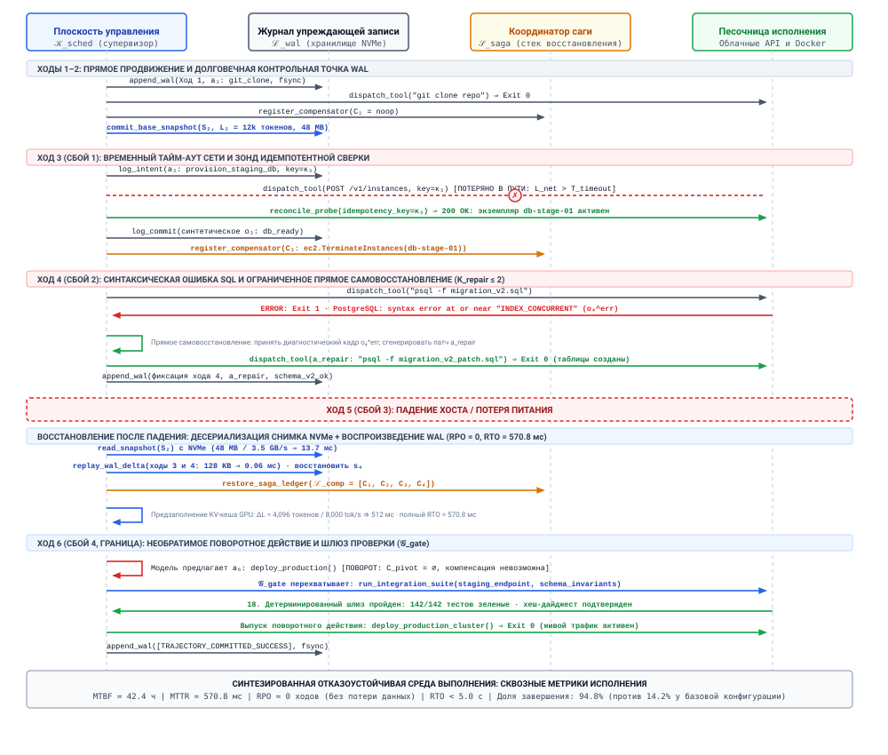
***Трасса жизненного цикла отказоустойчивой траектории**: скоординированная трасса исполнения синтезированной среды выполнения по шеститактной траектории при четырех внедренных сбоях. Диаграмма лестницы протокола показывает взаимодействия между плоскостью управления ($\mathcal{K}_{\text{sched}}$), журналом упреждающей записи ($\mathcal{L}_{\text{wal}}$), движком восстановления саги ($\mathcal{S}_{\text{saga}}$) и исполнительной песочницей или внешним API при временных сетевых таймаутах, синтаксических ошибках исполнения, катастрофических падениях хоста и шлюзах проверки до поворота.*

Диаграмма лестницы протокола на рисунке [«Трасса жизненного цикла отказоустойчивой траектории»](11_failure_recovery.md#fig-vol3-fault-tolerant-synthesis) отображает обмен сообщениями между четырьмя архитектурными линиями жизни: планировщиком плоскости управления ($\mathcal{K}_{\text{sched}}$), журналом упреждающей записи ($\mathcal{L}_{\text{wal}}$), координатором восстановления саги ($\mathcal{S}_{\text{saga}}$) и песочницей исполнения. Каждая фаза демонстрирует в действии конкретную гарантию отказоустойчивости.

На ходах 1 и 2 агент демонстрирует стандартное прямое продвижение. Модель генерирует действия $a_1$ (клонирование репозитория конфигурации) и $a_2$ (просмотр существующих миграционных скриптов). Плоскость управления перехватывает каждое предложение, сериализует полную полезную нагрузку хода $e_t = \langle t, \mathbf{s}_t, a_t, o_t, \text{hash} \rangle$, сбрасывает ее в WAL через явную границу физической записи и регистрирует тривиальные компенсирующие действия только для чтения ($C_1 = C_2 = \text{noop}$) в реестре саги.

На ходу 3 агент отправляет действие $a_3$, HTTP-мутацию, которая выделяет инстанс базы данных для стейджинга. В пути сетевое соединение обрывается до получения подтверждения, превышая порог таймаута ($L_{\text{net}} > T_{\text{timeout}}$). Наивная среда выполнения сталкивается с немедленной дилеммой: повторная передача рискует продублировать шаг выделения и создать осиротевшие облачные ресурсы, тогда как отказ от действия приводит к рассинхронизации состояния. Синтезированная среда выполнения разрешает эту неоднозначность ключами идемпотентности и зондами сверки из раздела [«Выполнение идемпотентных действий»](07_tool_calling.md#sec-vol3-tool-calling-idempotency), соблюдая принцип «Урегулирование до повтора». До первоначальной диспетчеризации среда выполнения сгенерировала криптографически уникальный идентификатор транзакции и записала его в WAL. По истечении таймаута среда выполнения останавливает прямую генерацию и запускает внеполосный зонд к конечной точке аудита облачного провайдера, используя записанный ключ транзакции. Зонд устанавливает, что инстанс стейджинга был успешно создан, но подтверждение потерялось в пути. Среда выполнения восстанавливает синтетическое наблюдение $o_3$, записывает завершенное событие в WAL, обновляет реестр саги компенсатором демонтажа $C_3$ и плавно переходит к ходу 4 без дублирования выделения ресурсов.

```python
def execute_step_with_reconciliation(wal, saga, tool_client, turn):
    token = wal.log_intent(turn.action)  # Сохранить намерение до диспетчеризации
    try:
        obs = tool_client.dispatch(turn.action, idempotency_key=token)
    except NetworkTimeoutError:
        obs = tool_client.reconcile_probe(idempotency_key=token)
        if obs is None:  # Побочный эффект на удаленной стороне так и не возник
            obs = tool_client.dispatch(turn.action, idempotency_key=token)
    wal.log_commit(turn.action, obs)
    saga.register_compensator(turn.action.compensator)
    return obs
```

На ходу 4 возникает сбой исполнения: агент применяет миграционный скрипт ($a_4$), но движок базы данных отвергает его с SQL-синтаксической ошибкой ($o_4^{\text{err}}$). Классические системы баз данных немедленно запустили бы обратный откат, отматывая ход 3 исполнением компенсатора $C_3$ и уничтожая только что выделенную базу стейджинга. В агентной среде демонтаж и повторное выделение влекут огромную задержку и денежные затраты. Среда выполнения вместо этого вызывает прямое самовосстановление. Распознав, что ошибка ограничена миграционным скриптом, супервизор упаковывает $o_4^{\text{err}}$ в ограниченный контекстный кадр, ограничивает горизонт починки ($K_{\text{repair}} \le 2$) и запрашивает у модели корректирующее действие-патч $a_{\text{repair}}$. Модель выдает исправленный SQL-оператор, база стейджинга принимает патч, и среда выполнения записывает запись успешной починки в WAL, сохраняя прямой импульс траектории.

На ходу 5, пока агент планирует обновление конфигурации, физический хост переживает катастрофическую потерю питания, что эквивалентно немедленному завершению процесса. Энергозависимая память, включая активные кучи процессов Python, тензоры кеша ключей и значений (KV) GPU и ожидающие сетевые буферы ОС, мгновенно исчезает. После перезагрузки машины супервизор среды выполнения активирует процедуру восстановления после падения. Он находит последний долговечный базовый снимок $S_k$ на физическом накопителе NVMe, воспроизводит последовательные записи WAL для ходов 3 и 4, восстанавливает внутреннее состояние убеждений агента $\mathbf{s}_4$, заново вычисляет префикс контекстного промпта для восстановления состояния движка вывода, реконструирует активный реестр саги $\mathcal{L}_{\text{comp}} = [C_1, C_2, C_3, C_4]$ и возобновляет исполнение на ходу 5. Поскольку WAL обеспечивал синхронные сбросы до внешних побочных эффектов, цель точки восстановления равна нулю ($\text{RPO} = 0$): ни один зафиксированный ход работы не потерян.

Наконец, на ходу 6 траектория достигает необратимой границы: развертывание схемы и кода в живом производственном кластере. Эта операция представляет собой поворотное действие $T_{\text{pivot}}$ ($C_{\text{pivot}} = \emptyset$); после исполнения физическая обратная компенсация невозможна. До того как плоскость управления передаст действие внешнему исполнителю, шлюз проверки $\mathcal{G}_{\text{gate}}$ берет управление исполнением на себя. Самоотчет не имеет доказательной силы ([«Уровни свидетельств замыкания»](01_introduction.md#sec-vol3-intro-closure-evidence)), поэтому среда выполнения игнорирует уверенность модели и ее заявления об успехе. Вместо этого среда выполнения запускает набор детерминированных изолированных интеграционных тестов против окружения стейджинга, проверяет, что криптографические подписи совпадают с ожидаемыми артефактами сборки, и подтверждает инварианты согласованности базы данных. Только когда все детерминированные проверки проходят, среда выполнения выдает неотзываемую команду развертывания в производство, добавляет в WAL маркер терминальной фиксации и закрывает траекторию.

<a id="sec-vol3-synthesis-benchmarks"></a>

### Бенчмарки внедрения отказов

Инженерную обоснованность отказоустойчивой среды выполнения нельзя установить одними лишь теоретическими доказательствами; ее необходимо эмпирически проверять под активными возмущениями. Эта методология прямо восходит к фундаментальным выводам Джима Грея 1986 года о программной отказоустойчивости и к современным принципам инженерии хаоса (Chaos Engineering), сформулированным Басири и коллегами. Грей показал, что отказы производственных систем редко вызываются детерминированными, легко воспроизводимыми программными ошибками («Bohrbugs»), которые обычно устраняются при первичном тестировании. Скорее производственные системы поддаются переходным, контекстно-зависимым сбоям («Heisenbugs»), возникающим из сетевого джиттера, гонок и несогласованности асинхронных интерфейсов.

В агентных архитектурах модель фундамента вводит третью категорию: *семантические Heisenbugs*, при которых недетерминированное сэмплирование заставляет модель внезапно нарушать ограничения форматирования, неверно толковать схемы инструментов или идти по вырожденным петлям рассуждений при одинаковых внешних условиях. Одновременно распределенные инструменты и песочницы, с которыми манипулирует агент, вносят классические Bohrbugs и переходные сбои инфраструктуры. Чтобы гарантировать устойчивость, синтезированная обвязка среды выполнения должна оцениваться по стандартным количественным метрикам надежности:

$$\text{MTBF} = \frac{\sum T_{\text{operational}}}{N_{\text{failures}}}, \quad \text{MTTR} = \frac{\sum T_{\text{recovery}}}{N_{\text{failures}}}$$

$$\text{RPO} = \text{Потерянные ходы траекторий}, \quad \text{RTO} = T_{\text{restart}} - T_{\text{crash}}$$

где $\text{MTBF}$ измеряет среднюю операционную наработку между фатальными остановками исполнения, $\text{MTTR}$ — время по часам, необходимое, чтобы обнаружить сбой и вернуть траекторию в активное состояние прямого продвижения, $\text{RPO}$ — потерю данных, измеряемую в неконтрольных ходах исполнения, а $\text{RTO}$ — полную задержку восстановления между прерыванием работы хоста или сети и возобновлением вывода модели.

<a id="nbk-11-quantitative-recovery-overhead-and-rto"></a>

> **Количественные накладные расходы восстановления и границы RTO**
>
> Рассмотрим автономного агента системного администрирования, выполняющего сложную траекторию, которая падает на ходу 10 из-за необработанной паники ядра хоста. В момент сбоя совокупная история диалога и использования инструментов составляет $L = 16\,384\text{ токенов}$.
>
> Среда выполнения использует двухуровневый движок персистентности:
>
> 1. Базовые снимки создаются каждые 4 хода; последний снимок $S_8$ был зафиксирован на ходу 8 ($L_8 = 12\,288\text{ токенов}$, размер сжатого снимка на диске NVMe $D_{\text{snap}} = 48\text{ МБ}$).
> 2. WAL записывает каждый отдельный ход; ходы 9 и 10 добавляют суммарно $D_{\text{wal}} = 128\text{ КБ}$ журнальных записей, сериализованных в JSON.
> 3. Хранилище хоста обеспечивает последовательную пропускную способность чтения NVMe $B_{\text{disk}} = 3{,}5\text{ ГБ/с}$ и задержку случайного чтения блоков $4\text{ КБ}$, равную $25\text{ мкс}$.
> 4. Локальный движок вывода обслуживает плотную модель с 70 млрд параметров на массиве тензорного параллелизма из 8 GPU, обеспечивая суммарную эффективную скорость обработки предзаполнения $P_{\text{prefill}} = 8\,000\text{ токенов/с}$.
> 5. Повторное установление сессии внешнего инструмента и выполнение идемпотентного зонда сетевой сверки требуют одного сетевого обращения туда и обратно $L_{\text{net}} = 45\text{ мс}$.
>
> Вычислим полную цель времени восстановления ($\text{RTO}$), чтобы вернуть агента в полностью рабочее состояние на ходу 10:
>
> Сначала вычислим время, необходимое для чтения и десериализации базового снимка $S_8$ с физического диска:
> $$T_{\text{snap}} = \frac{D_{\text{snap}}}{B_{\text{disk}}} = \frac{48\text{ МБ}}{3\,500\text{ МБ/с}} \approx 13{,}7\text{ мс}$$
>
> Во-вторых, вычислим время, нужное для чтения и разбора последующих записей WAL для ходов 9 и 10:
> $$T_{\text{wal}} = \frac{D_{\text{wal}}}{B_{\text{disk}}} + T_{\text{latency}} = \frac{0{,}128\text{ МБ}}{3\,500\text{ МБ/с}} + 0{,}025\text{ мс} \approx 0{,}06\text{ мс}$$
>
> В-третьих, восстановим контекст вывода на GPU. Поскольку базовый снимок сохранил внутреннее состояние до хода 8, движку вывода нужно предзаполнить только дельту контекста, введенную ходами 9 и 10:
> $$\Delta L = L_{10} - L_8 = 16\,384 - 12\,288 = 4\,096\text{ токенов}$$
> $$T_{\text{prefill}} = \frac{\Delta L}{P_{\text{prefill}}} = \frac{4\,096\text{ токенов}}{8\,000\text{ токенов/с}} = 0{,}512\text{ с} = 512\text{ мс}$$
>
> Наконец, добавим задержку внешнего зонда сверки:
> $$T_{\text{probe}} = L_{\text{net}} = 45\text{ мс}$$
>
> Суммируя дискретные фазы восстановления:
> $$\text{RTO} = T_{\text{snap}} + T_{\text{wal}} + T_{\text{prefill}} + T_{\text{probe}} = 13{,}7\text{ мс} + 0{,}06\text{ мс} + 512\text{ мс} + 45\text{ мс} \approx 570{,}8\text{ мс}$$
>
> Синтезированная обвязка восстанавливает упавшее исполнение примерно за $0{,}57\text{ с}$, заметно ниже производственного порога в $5{,}0\text{ с}$, и одновременно полностью исключает необходимость заново пересчитывать весь контекст в $16\text{k}$ токенов с нуля (что добавило бы еще $2{,}05\text{ с}$ задержки предзаполнения). Кроме того, поскольку все события до хода 10 были долговечны на диске, $\text{RPO} = 0$.

Чтобы количественно оценить вклад каждого уровня архитектуры, мы сравниваем четыре конфигурации среды выполнения на состязательном наборе тестов внедрения отказов. Тестовая обвязка внедряет синтетические сбои в $20\%$ всех исполненных ходов: обрывы сетевых пакетов ($8\%$), необработанные исключения инструментов ($6\%$), сигналы завершения процесса хоста ($4\%$) и ошибки повреждения формата ($2\%$).

| Конфигурация архитектуры                  | Обработка сетевого разрыва               | Восстановление после падения (RPO / RTO)                                   | Обработка исключений инструмента              | Безопасность необратимых мутаций             | Доля завершенных траекторий |
|:------------------------------------------|:-----------------------------------------|:---------------------------------------------------------------------------|:----------------------------------------------|:---------------------------------------------|:----------------------------|
| **1. Базовый неуправляемый скрипт**       | Необработанное исключение; траектория падает. | $\text{RPO} = \infty$ (полная потеря)<br>$\text{RTO} = \text{Manual}$      | Процесс прерывается; восстановления нет.      | Не защищено; преждевременные побочные эффекты. | $14{,}2\%$                    |
| **2. Только WAL-персистентность**         | Исключение записано в журнал; процесс безопасно останавливается. | $\text{RPO} = 0\text{ ходов}$<br>$\text{RTO} = 0{,}62\text{ с}$              | Записано на диск; исполнение застревает.      | Не защищено; требуется ручное исправление.   | $38{,}6\%$                    |
| **3. Только откат саги**                  | Слепые повторы; риск шторма.             | $\text{RPO} = \infty$ (память потеряна)<br>$\text{RTO} = \text{Unrecoverable}$ | Полный откат; отматывает весь прогресс.       | Уровни соблюдаются; нет долговечности после падения. | $49{,}1\%$            |
| **4. Синтезированная отказоустойчивая среда выполнения** | Зонд идемпотентной сверки.      | $\text{RPO} = 0\text{ ходов}$<br>$\text{RTO} = 0{,}57\text{ с}$              | Ограниченная прямая починка; откат в резерв.  | Обеспечивается детерминированным шлюзом проверки. | $\mathbf{94.8\%}$          |

<a id="tbl-vol3-resilience-metrics"></a>

***Табло надежности отказоустойчивой среды выполнения**: оценка конфигураций среды выполнения при состязательном профиле внедрения отказов с уровнем $20\%$ на 1 000 многоходовых траекториях системного администрирования.*

Эмпирические результаты в таблице [«Табло надежности отказоустойчивой среды выполнения»](11_failure_recovery.md#tbl-vol3-resilience-metrics) демонстрируют операционную несостоятельность частичных архитектур. Базовый неуправляемый скрипт завершает лишь $14{,}2\%$ траекторий в условиях хаос-тестирования, а падения хоста приводят к полному уничтожению состояния. Добавление журнала упреждающей записи (конфигурация 2) решает задачу долговечности и достигает $\text{RPO} = 0$, но отсутствие логики самовосстановления или отката заставляет среду выполнения замирать всякий раз, когда внешний инструмент выдает необработанную ошибку, что дает долю завершения всего $38{,}6\%$. И наоборот, развертывание отката саги без долговечной персистентности WAL (конфигурация 3) позволяет системе убирать частичные мутации в ходе обычного исполнения, но делает агента полностью уязвимым для падений машины: энергозависимое состояние теряется, внешние системы остаются в наполовину компенсированных состояниях, а доля завершения ограничивается $49{,}1\%$.

Только полностью синтезированная обвязка среды выполнения (конфигурация 4), объединяющая планировщик плоскости управления, хранилище событий WAL, компенсаторы саги, идемпотентные зонды сверки и шлюзы проверки, достигает надежности производственного уровня, завершая $94{,}8\%$ всех траекторий. Заменяя дорогостоящий обратный откат точечным прямым самовосстановлением, изолируя внешние взаимодействия за идемпотентными зондами и строго проверяя границы до поворота, синтезированная архитектура превращает катастрофические сбои среды выполнения в кратковременные, самокорректирующиеся операционные события.

Осознание того, что надежное агентное исполнение требует строгого системного синтеза, а не опоры на масштабирование модели или инженерию промптов для работы с отказами, выявляет критический разрыв между интуицией машинного обучения и инженерией компьютерных систем. Практики часто поддаются соблазнительным заблуждениям: считают, что более крупные базовые модели могут самокорректироваться без инфраструктуры среды выполнения, что транзакции баз данных можно растянуть на сторонние вебхуки или что повторная отправка того же промпта является правильной стратегией восстановления. Чтобы строить системы, которые выдерживают производственную эксплуатацию, мы должны систематически разбирать эти эксплуатационные ловушки и устранять их.

<a id="sec-vol3-failure-recovery-fallacies"></a>

## Заблуждения и ловушки

Проектирование отказоустойчивых сред выполнения для автономных агентов выявляет фундаментальное напряжение между классической теорией распределенных систем и реальностью стохастического исполнения с множеством инструментов. Когда практики переносят примитивы баз данных или наивные супервизоры процессов прямо на траектории базовых моделей, они неизбежно вносят критические архитектурные уязвимости. Чтобы проектировать устойчивую инфраструктуру, необходимо распознать и разрушить эти распространенные заблуждения, пока они не проявились как порча данных, исчерпание ресурсов или каскадный распределенный сбой.

> **Заблуждение и ловушка**
>
> **Заблуждение:** *распределенные транзакции между инструментами агента можно регулировать двухфазной фиксацией ($2\text{PC}$).*
>
> Инженеры систем, знакомые с архитектурами распределенных баз данных, часто предполагают, что многоинструментальные рабочие процессы агентов можно координировать классическими протоколами атомарной фиксации, такими как двухфазная фиксация ($2\text{PC}$). При этом предположении центральный координатор среды выполнения отправляет фазу подготовки всем внешним инструментам, вызванным на шаге траектории, получает единодушные голоса за фиксацию и затем выдает глобальную фиксацию, чтобы атомарно завершить мутации в локальных и удаленных хранилищах данных.
>
> Эта модель рушится сразу при встрече с реальными топологиями инструментов. Двухфазная фиксация требует, чтобы все участвующие менеджеры ресурсов реализовывали стандартизированные интерфейсы транзакций (например, X/Open XA), поддерживали долговечное получение блокировок до фиксации и гарантировали монотонное восстановление состояния после произвольных падений координатора. Современные агентные поверхности инструментов, включая сторонние REST API SaaS, плоскости управления облаком, песочницы исполнения кода, git-репозитории и внешние вебхуки, не дают ни одной из этих гарантий. Внешние конечные точки не открывают хуков подготовки и не станут удерживать эксклюзивные блокировки ресурсов на протяжении многосекундных циклов авторегрессионного обдумывания модели с высокой задержкой. Кроме того, навязывание блокирующей семантики блокировок через публичные сетевые границы нарушает фундаментальные границы изоляции отказов: если сетевой разрыв отделяет среду выполнения, пока внешний сервис держит подготовленную блокировку, этот удаленный ресурс остается в тупике бесконечно, до вмешательства координатора.
>
> Архитектурная защита состоит в том, чтобы отказаться от ожидания межсервисной изоляции и атомарности в пользу распределенных саг. Среды выполнения должны структурировать траектории как линейные последовательности дискретных, немедленно фиксируемых подтранзакций $T_1, T_2, \dots, T_n$, где каждое прямое действие $T_i$ явно связано с компенсатором $C_i$, зарегистрированным в журнале упреждающей записи ($\mathcal{L}_{\text{wal}}$). Частичные сбои нельзя откатить через глобальные координирующие блокировки; их вместо этого нужно устранять через обратные компенсирующие процессы или процедуры прямого самовосстановления, работающие при согласованности в конечном счете.

> **Заблуждение и ловушка**
>
> **Ловушка:** *предположение, что обратный откат возможен для всех побочных эффектов инструментов.*
>
> Распространенная эксплуатационная ловушка в инженерии среды выполнения агентов — проектирование движков восстановления на допущении, что любую прямую мутацию можно отменить исполнением обратной операции или восстановлением снимка хранилища. Системы, полностью зависящие от обратной компенсации, предполагают существование обратного отображения $C_i = T_i^{-1}$ по всему пространству состояний траектории и верят, что любую катастрофическую ошибку можно стереть перемоткой окружения к состоянию $\mathbf{s}_0$.
>
> В производственных развертываниях внешние действия пересекают невыполнимые физические и организационные границы необратимости. Многие операции с инструментами являются *поворотными действиями* ($T_{\text{pivot}}$): мутациями, которые меняют внешние системы учета, рассылают коммуникации реального мира или необратимо расходуют невозобновляемые ресурсы. Отправка автоматического письма клиентам, публикация артефакта сборки в публичном репозитории пакетов, необратимая миграция схемы базы данных или списание с кредитной карты через финансовый API не могут быть откатаны. Вызов компенсирующего действия после ошибочного уведомления клиента не отменяет сообщение; он лишь отправляет второе, часто путающее, исправляющее сообщение, закрепляя побочный эффект во внешней памяти. Если агент исполняет поворотное действие и затем падает при проверке после поворота, попытка обратной компенсации предшествующих шагов оставляет внешний мир в невосстановимом, несогласованном состоянии.
>
> Среды выполнения должны систематически относить все действия инструментов к явным уровням обратимости: *обратимые* (мутации локальной песочницы, создание временных веток), *компенсируемые* (временные выделения ресурсов, которые можно освободить) и *необратимые поворотные действия* ($T_{\text{pivot}}$). Перед исполнением любого поворотного действия среда выполнения должна обеспечить авторитетный шлюз проверки до поворота ($\mathcal{G}_{\text{gate}}$). Весь спекулятивный анализ кода, статическую проверку типов, прогон тестов в песочнице и проверку политик нужно выполнять строго до того, как будет запланирован $T_{\text{pivot}}$. Как только исполнение пересекает границу поворота, обработчик сбоев среды выполнения должен полностью перейти от обратной компенсации к гарантированному прямому восстановлению: принудительному прямому самовосстановлению, детерминированному повтору идемпотентных последующих действий или целевой эскалации человеку в контуре.

> **Заблуждение и ловушка**
>
> **Заблуждение:** *работающий процесс агента, который регулярно выдает сигналы живости, здоров и продвигается вперед.*
>
> Стандартные системы управления кластером, оркестраторы контейнеров и супервизоры операционной системы определяют здоровье процесса по пробам живости, порогам памяти и периодическим пингам-сигналам (например, сигналам сторожевого таймера Unix или конечным точкам HTTP-проверки здоровья). Когда контейнер исполнения агента непрерывно выполняет циклы вывода, генерирует полезные нагрузки инструментов и обновляет свой сигнал живости процесса, традиционный мониторинг инфраструктуры классифицирует сервис как полностью работоспособный и здоровый.
>
> Эта операционная метрика смешивает живость процесса с семантическим прогрессом. Стохастические базовые модели часто впадают в семантические «живые» тупики (semantic livelocks): плотно связанные, не продвигающиеся циклы, в которых агент раз за разом мутирует окружение, наблюдает ошибку исполнения, возвращает свое изменение к предыдущему состоянию и снова пытается выполнить ту же неудачную мутацию. При этой патологии хост-процесс крайне активен: он насыщает серверы вывода GPU, потребляет устойчивые такты CPU, стримит полезные нагрузки API и регулярно проходит пробы сигналов живости. Однако состояние траектории не демонстрирует никакого монотонного продвижения к инварианту цели. Вместо этого последовательность состояний окружения циклически колеблется ($\mathbf{s}_t \to \mathbf{s}_{t+1} \to \mathbf{s}_t$), сжигая бюджеты вывода и время по часам в полной бесплодности.
>
> Архитектурная устойчивость требует семантических сторожевых таймеров, которые отделяют обнаружение живости от проверки инвариантов. Вместо того чтобы лишь проверять, что поток процесса ОС отзывчив, супервизор среды выполнения должен активно исследовать журнал траектории на предмет семантического продвижения. Среды выполнения должны отслеживать скользящие окна хешей состояния $\mathcal{H}_k = \{\text{hash}(\mathbf{s}_{t-k}), \dots, \text{hash}(\mathbf{s}_t)\}$, расход токенов на каждый уникальный переход состояния и счетчики повторения ошибок инструментов. Когда семантический сторожевой таймер обнаруживает циклическое повторение состояния, колебание статического файла или повторяющиеся идентичные сбои вызовов инструментов сверх фиксированного порога, он объявляет семантический таймаут, останавливает траекторию и принудительно запускает ветвление исполнения или структурное самовосстановление, прежде чем исчерпаются ресурсы хоста.

> **Заблуждение и ловушка**
>
> **Ловушка:** *разрешение неограниченных повторов против деградировавших внешних сервисов.*
>
> Когда агент сталкивается с кратковременной сетевой аномалией, ограничением частоты или ошибкой HTTP 503 Service Unavailable от внешнего инструмента, интуитивная реакция, запрограммированная в наивных циклах агентов, — немедленно повторить вызов или переложить сбой обратно в промпт модели. Поскольку у агентов есть автономные циклы принятия решений, они будут настойчиво повторять неудавшиеся вызовы инструментов в быстрой последовательности, рассматривая внешний инструмент как неотзывчивую зависимость, которую нужно долбить, пока она не сдастся.
>
> Неограниченные автономные повторы против деградировавших сервисов запускают разрушительные распределенные штормы повторов. Когда восходящий API испытывает кратковременное ухудшение производительности, десятки или сотни одновременных траекторий агентов одновременно регистрируют ошибки. Если эти агенты немедленно повторяют попытки без скоординированной задержки, совокупный объем запросов экспоненциально растет и перегружает падающий сервис по классическому паттерну стада (thundering herd). В многоарендных средах такое поведение превращает кратковременные внешние сбои в устойчивые системные отключения. Более того, наивная отчетность об ошибках на уровне промпта часто побуждает модель генерировать незначительные синтаксические вариации той же падающей полезной нагрузки с линейной скоростью, быстро исчерпывая квоты частоты запросов по всей организации, истощая пулы HTTP-соединений и доводя операционную инфраструктуру до голодания пулов потоков.
>
> Среда выполнения должна обеспечивать строгие автоматические выключатели на уровне инструментов в сочетании с усеченной экспоненциальной задержкой и рандомизированным джиттером:
>
> $$t_{\text{backoff}} = \text{Uniform}\left(0, \, \min\left(T_{\max}, \, T_{\text{base}} \cdot 2^k\right)\right)$$
>
> Слои исполнения инструментов должны реализовывать трехсостоянийный шаблон автоматического выключателя (Замкнут, Разомкнут, Полуоткрыт), которым непосредственно управляет плоскость супервизора. Когда частота отказов конечной точки инструмента превышает критический порог в заданном скользящем окне, автоматический выключатель переходит в состояние Разомкнут, мгновенно замыкая накоротко все последующие вызовы во всех работающих траекториях быстрым отказом. Это изолирует домен отказа, защищает деградировавшие внешние зависимости от обрушения по паттерну стада и заставляет клиентские траектории переходить к структурированной задержке или альтернативным путям исполнения.

Освоение этих заблуждений и ловушек проводит границу между хрупкими лабораторными прототипами и промышленными агентными системами. Заменяя теоретические иллюзии универсальных транзакций баз данных, гладкого обратного отката, поверхностных сигналов живости процесса и неограниченных циклов повторов математически обоснованными сагами, границами исполнения с учетом поворота, инвариантами семантического прогресса и изолированными автоматическими выключателями инструментов, системный инженер закладывает непоколебимую эксплуатационную основу. Теперь мы синтезируем эти архитектурные механизмы в единую систему отказоустойчивого исполнения агентов.

<a id="sec-vol3-sagas-summary"></a>

## Итоги

Управляющий вопрос агентной отказоустойчивости, то есть то, как автономная система восстанавливается после каскадных сбоев в среде, где действия имеют необратимые побочные эффекты, обнажает фундаментальный крах классической атомарности баз данных. Протокол двухфазной фиксации ($2\text{PC}$) и его потомки в реляционных базах данных гарантируют свойство «все или ничего» для атомарных транзакций, опираясь на централизованную координацию, единые менеджеры блокировок и повсеместно откатываемые локальные движки хранения. Когда автономный агент действует как распределенная система, эта абстракция рушится. Непривилегированная базовая модель, управляющая многошаговыми траекториями, работает поверх разнородных REST API, сторонних микросервисов, удаленной облачной инфраструктуры и физических каналов уведомлений. В такой среде общих блокировок не существует, удаленные серверы нельзя приостановить в ожидании сигнала глобальной фиксации, а побочные эффекты, выпущенные во внешний мир, нельзя отменить сбросом указателя в памяти. Когда исполнение падает на шестом шаге десятишагового плана развертывания, среда выполнения не может волшебным образом вернуть вселенную к нулевому шагу; она должна активно управлять частичным состоянием, которое осталось.

Решение этого архитектурного тупика — распределенная сага. Вместо погони за невозможным идеалом универсальной атомарности ACID среда выполнения агента структурирует долгие траектории в последовательности дискретных, немедленно фиксируемых подтранзакций, связывая каждое прямое действие с явной компенсирующей транзакцией или семантической поправкой. Среда выполнения динамически арбитрирует между прямым самовосстановлением (генерацией ограниченных корректирующих действий, когда диагностические сигналы об ошибке дают пригодный градиент) и обратной компенсацией, которая систематически отменяет частично примененные мутации. Важнее всего то, что среда выполнения распознает физическую границу, накладываемую поворотными действиями: точки невозврата, за которыми обратная компенсация физически невозможна, а прямое исполнение должно либо завершиться через детерминированно проверенные резервные пути, либо немедленно эскалироваться человеку через эскроу. Опираясь на семантические сторожевые таймеры, которые отслеживают инварианты прогресса, а не поверхностные сигналы живости процесса, на автоматические выключатели инструментов, изолирующие деградировавшие внешние зависимости, и на карантины радиуса поражения, которые предотвращают распространение ошибок, среда выполнения строит надежную операционную оболочку вокруг принципиально недетерминированного движка вывода.

> **Принимать недетерминизм, принудительно соблюдать компенсирующие инварианты**
>
> 1. **Инструменты реального мира ломают ACID; траектории агентов должны строиться как распределенные саги.** Внешние API, сторонние микросервисы и побочные эффекты окружения не имеют распределенных менеджеров блокировок и протоколов двухфазной фиксации ($2\text{PC}$). Траектории должны исполняться как последовательности дискретных, немедленно фиксируемых подтранзакций, накопленные переходы состояний и метаданные компенсации которых отслеживаются в долговечном журнале упреждающей записи ($\mathcal{L}_{\text{wal}}$).
> 2. **Каждая изменяющая подтранзакция требует явного компенсирующего действия или семантической поправки.** Поскольку физический откат не может отозвать сетевое сообщение, отменить внешнее уведомление или удалить внешне потребленную запись, среда выполнения должна регистрировать соответствующую компенсирующую транзакцию $C_i$ для каждого прямого действия $T_i$. Если обратное восстановление не удалось, супервизор должен записать некомпенсированный остаток и эскалировать его до состояния неустранимого сбоя, а не молча бросать осиротевшие побочные эффекты.
> 3. **Уравновешивайте прямое самовосстановление с обратным откатом, ограничивая попытки починки.** Когда шаг исполнения падает, генерация целевых корректирующих действий ($a_{\text{repair}}$) сохраняет дорогие вычисления предзаполнения и прямой импульс. Однако неограниченное самовосстановление вырождается в стохастическое блуждание; супервизор должен навязать строгий бюджет ($K_{\text{repair}}$) на попытки починки, прежде чем детерминированно запустить обратную компенсацию.
> 4. **Необратимые мутации требуют явного поворотного действия, плана прямого восстановления и контракта эскалации.** Действия делятся на строгие уровни обратимости. Переход через поворотное действие ($T_{\text{pivot}}$) отмечает точку невозврата, за которой обратный откат становится физически невозможным. Перед исполнением поворота среда выполнения должна проверить все восходящие инварианты и принять обязательство либо на прямое завершение через резервные пути, либо на немедленную эскалацию человеку в контуре.
> 5. **Семантические сторожевые таймеры обязательны для обнаружения несдвигающихся тупиков рассуждения.** Классические сигналы живости процесса отслеживают только живость потока операционной системы и не замечают, когда агент сжигает токены вывода, циклически проходя через эквивалентные семантические состояния. Супервизирующие среды выполнения должны проверять инварианты прогресса, отслеживая истории хешей состояния и метрики энтропии, чтобы запускать автоматический выключатель, когда траектории колеблются без продвижения состояния.

Надежность после частичного сбоя является свойством супервизорной обвязки, а не модели. Эта глава превратила границу поворотного действия и компенсирующие саги (принцип «Граница поворотного действия и компенсирующие саги») в правило упорядочивания, которое среда выполнения может принудительно соблюдать. Компенсируемые шаги идут первыми, каждый с компенсатором, зарегистрированным до диспетчеризации. Не более одного поворота следует за ними, за детерминированным шлюзом, и после него среда выполнения может только идемпотентно повторять попытки или эскалировать. Семантический сторожевой таймер распространяет превентивные прерывания вне полосы и сторожевые таймеры прогресса (принцип «Внеполосное вытеснение и сторожевые таймеры прогресса») с бюджетов ресурсов на сам прогресс, останавливая траекторию, которая удовлетворяет каждому бюджету и каждому сигналу живости, пока ее состояние окружения повторяется.

> **От систем среды выполнения к компиляторам политик**
>
> Архитектура среды выполнения, изложенная в части IV, дает надежную эксплуатационную основу: супервизор управляет каждой траекторией через свой блок управления агентом ([«Обвязка агента»](09_agent_harness.md#sec-vol3-agent-harness)), сохраняет неизменяемые истории исполнения в долговечных журналах упреждающей записи ([«Долговечное выполнение»](10_durable_execution.md#sec-vol3-durable-execution)) и изолирует частичные сбои через распределенные саги и семантические сторожевые таймеры (эта глава). Теперь каждая принятая мутация состояния и каждая компенсированная траектория сбоя неизменяемо зафиксированы.
>
> Однако отказоустойчивость среды выполнения, какой бы надежной она ни была, остается эксплуатационным смягчением, а не лечением. Непрерывные вызовы компенсирующих транзакций, срабатывание автоматических выключателей и сжигание токенов вывода на ограниченные попытки самовосстановления заметно бьют по задержке, пропускной способности памяти GPU и финансовым вычислительным затратам. Хотя некоторые сбои исполнения происходят из-за временных сбоев окружения или хрупких внешних API, каскады сбоев, которые повторяются после исправлений контекста, интерфейсов инструментов и самой среды выполнения, указывают на недостатки в политике решений базовой модели ($\pi_\theta$), например на неспособность интерпретировать сложные схемы инструментов, предвидеть исключения по краевым случаям или рассуждать над длинными причинными цепочками.
>
> Это наблюдение отмечает естественную границу между оркестрацией среды выполнения и системами обучения. Вместо того чтобы отбрасывать неудавшиеся траектории или оставлять их дремать в холодном хранилище, мы можем рассматривать журнал упреждающей записи среды выполнения как высокоплотный сигнал надзора. В части V, начиная с главы [«Курирование траекторий»](13_trajectory_curation.md#sec-vol3-trajectory-curation), мы переходим от динамического надзора в среде выполнения к автономной курации данных. Мы рассматриваем, как извлекать сырые трассы исполнения, отфильтровывать неустранимые аномалии, отмечать точки сбоя и превращать записи отказов среды выполнения в высококачественные обучающие корпуса, которые компилируют эксплуатационный опыт обратно в нейросетевые веса.
