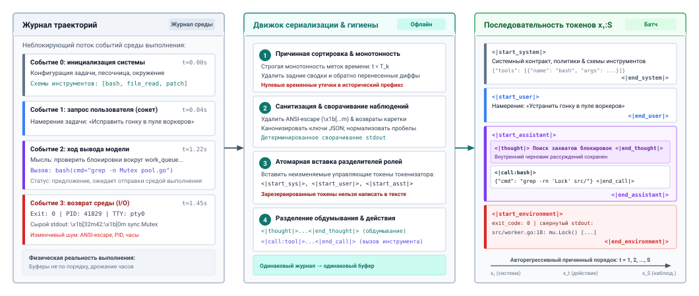
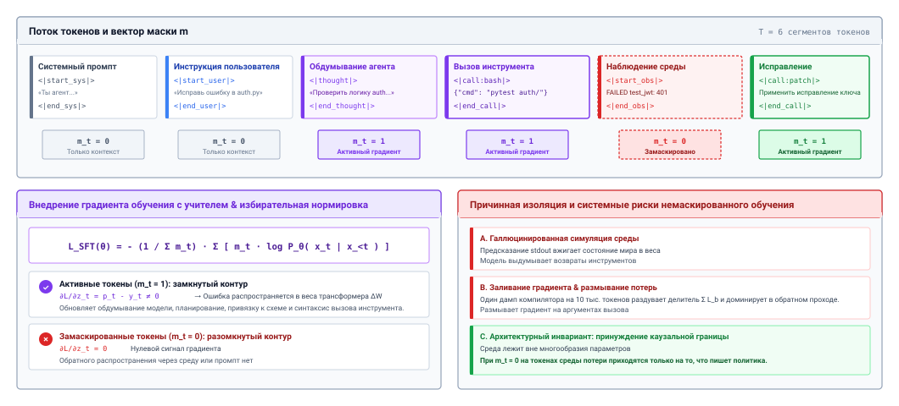
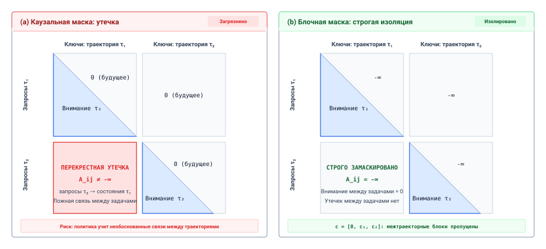
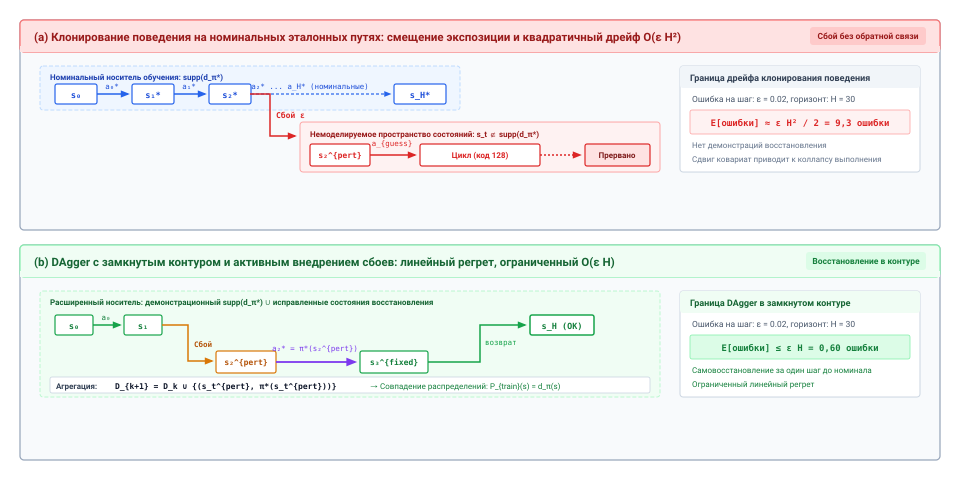
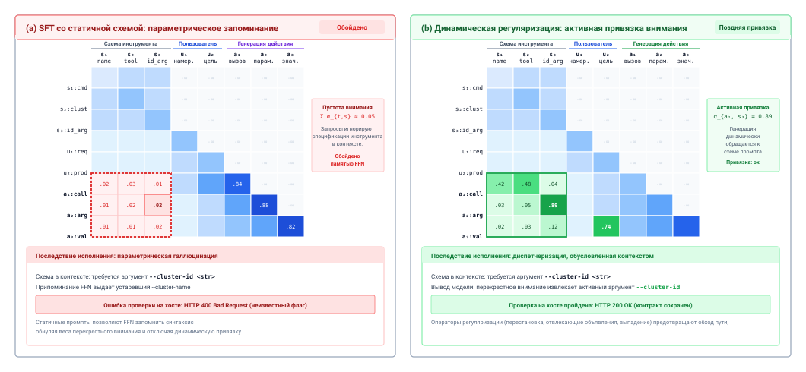
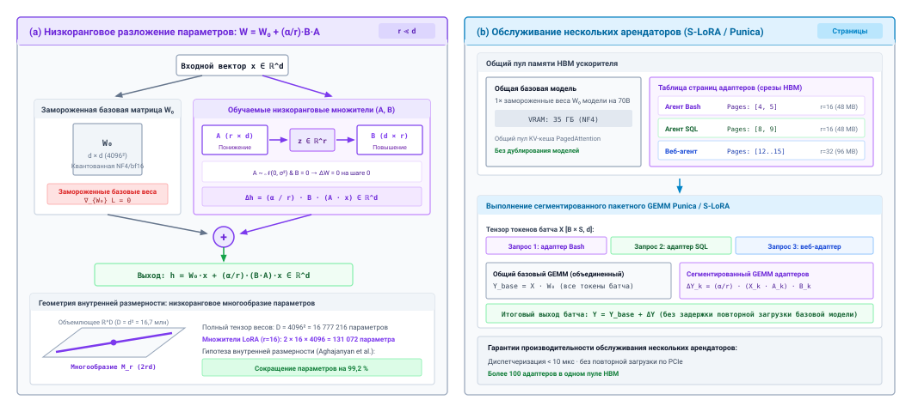
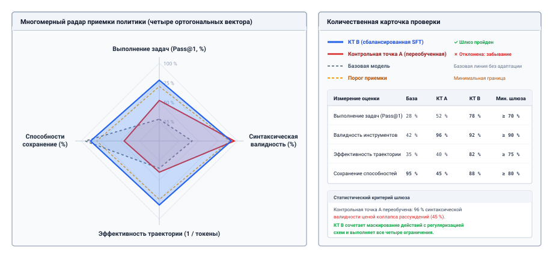
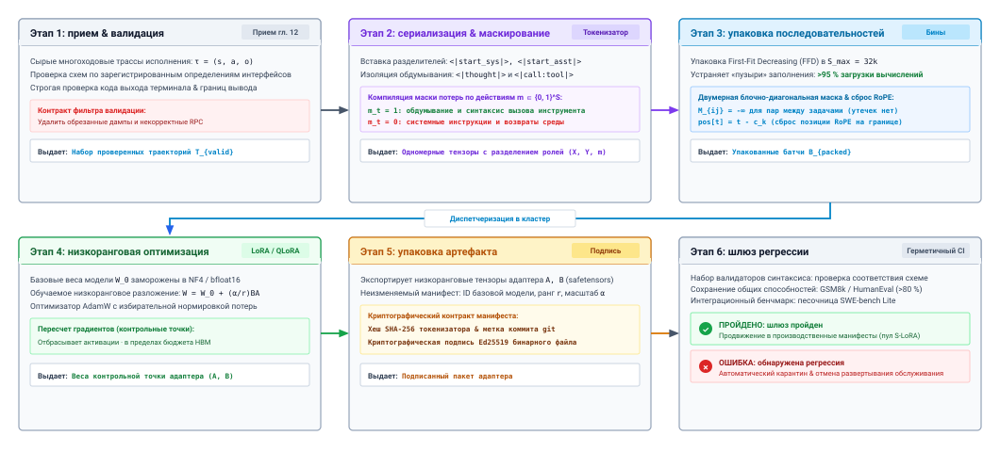

<a id="sec-vol3-fine-tuning"></a>

# Дообучение на траекториях


## Назначение

_Почему обучение агента на его собственных лучших траекториях может научить его выдумывать выходы инструментов, которых он должен был дождаться?_

Траектория агента переплетает двух авторов. Модель пишет рассуждения и вызовы инструментов, а среда записывает все, что приходит в ответ, от содержимого файлов до отчетов о падающих тестах. Обучение с учителем на допущенных траекториях — самый прямой способ заставить модель лучше предлагать действия, но обучается она на любых токенах, которые конвейер пометит как целевые. Если обучать модель на токенах среды, она научится писать собственные наблюдения вместо того, чтобы передать ход. Если обучать только на чистых прогонах, она никогда не увидит состояний, которые создают ее собственные ошибки, и ошибки будут накапливаться с каждым ходом. Если обучать на одном фиксированном наборе схем инструментов, модель запомнит имена аргументов вместо того, чтобы читать схему, которая перед ней. Каждый из этих сбоев выглядит как прогресс в автономном режиме, потому что потери на валидации падают, и проявляется только тогда, когда агент работает. Инженерная дисциплина состоит в том, чтобы решить, что вообще должно находиться в весах (процедура, например, какой инструмент вызвать, как читать ошибку и когда остановиться), и что обязано оставаться вне их (контракты в контексте и проверки в среде выполнения). Дообучение меняет вероятность того, что каждое предложение пройдет шлюзы среды выполнения, и не сдвигает ни одной экспозиции H·S·A, поэтому горизонт, состояние и полномочия, которые предыдущие части научились ограничивать, остаются на своих местах.

> **Цели обучения**
>
> - Отличать сбои, которые можно исправить дообучением, от сбоев, которые относятся к контексту, схемам инструментов или среде выполнения.
> - Сериализовать многоходовую траекторию с вызовами инструментов в тот же шаблон сообщений, с которым будет обслуживаться модель, включая параллельные вызовы и обработку рассуждений.
> - Построить маску потерь по наблюдениям, которая обучает рассуждения, вызовы инструментов и токены конца хода, а промпты и наблюдения оставляет контекстом.
> - Объяснить, как упаковка, нормировка потерь и обработка позиций могут переносить информацию между траекториями или смещать политику в сторону длинных прогонов.
> - Проанализировать, как смещение экспозиции растет с горизонтом, и спроектировать сбор данных на политике, который его ограничивает.
> - Выбрать между дистилляцией контекста, дистилляцией учителя и адаптерами для заданной роли агента и требования к откату.
> - Оценивать дообученного агента по верифицированному успеху задач, точности вызовов функций, отложенным семействам инструментов и сохранению способностей, а не по потерям на валидации.

<a id="sec-vol3-fine-tuning-scope"></a>

## Что может изменить дообучение


*Дообучение перестраивает каждый вызов модели, но оставляет все экспозиции среде выполнения без изменений.*

Агент для программирования прошел через триаж [«Диагностика разрыва возможностей»](13_trajectory_curation.md#sec-vol3-flywheel-gap). Контекст у него полный, схемы инструментов однозначны, песочница исправна, но он все равно проваливает целый класс задач характерным образом. После падения теста он трижды запускает ту же команду, а затем правит файл, который никогда не читал. Сбой переживает все исправления ниже уровня модели, поэтому принцип «Пост-обучение на верифицированных траекториях» допускает последнюю ступень ремонта. Конвейер [«Курирование траекторий»](13_trajectory_curation.md#sec-vol3-trajectory-curation) уже допустил корпус верифицированных траекторий по этим задачам, в том числе прогоны, которые восстанавливаются после упавших тестов. Вопрос этой главы в том, что обучение на этом корпусе может изменить и чего оно должно не трогать.

Обучение с учителем (SFT) настраивает веса модели так, чтобы при том же контексте модель присваивала более высокую вероятность токенам, которые содержит допущенная траектория. Все, что модель делает с вызовом, есть функция двух входов: весов и контекста, собранного для этого вызова ([«Контракт вызова»](02_foundation_model.md#sec-vol3-foundation-model-contract)). Дообучение может изменить только первый. Это разделяет знания агента на три места, которые сведены в [«Где живут знания агента»](14_fine_tuning.md#tbl-vol3-fine-tuning-scope). Процедура — знание, которое действует на всех задачах и меняется медленно, например, читать трассировку стека перед правкой, просматривать файл перед патчем или останавливаться после прохождения запечатанных тестов. Процедуру могут выучить веса. Контракты — факты, которые различаются от развертывания к развертыванию или от вызова к вызову: текущие схемы инструментов, спецификация задачи, структура рабочего пространства и полномочия, выданные для этой траектории. Контракты остаются в контексте, потому что модель, запомнившая вчерашнюю схему, будет выдавать вчерашние аргументы. Принуждение — все, что должно выполняться даже тогда, когда модель ошибается: проверка схем, авторизация, песочница и верификация. Принуждение остается в среде выполнения, куда его поместил [«Принцип замыкания инвариантов»](01_introduction.md#pri-invariant-closure).

| **Место**   | **Что там должно находиться**                                                | **Почему это место подходит**                                       | **Что с ним делает дообучение**                                   |
|:------------|:----------------------------------------------------------------------------|:--------------------------------------------------------------------|:------------------------------------------------------------------|
| **Веса**    | Процедура: какой инструмент выбрать, как читать ошибку, когда остановиться  | Действует на всех задачах, поэтому выученное однажды окупается на каждом вызове | Меняет ее напрямую                                           |
| **Контекст**| Контракты: схемы инструментов, спецификация задачи, факты о рабочем пространстве, выданные полномочия | Различается от развертывания к развертыванию или от вызова к вызову, поэтому запомненное быстро устаревает | Должно научить модель продолжать читать контракт, а не заменять его |
| **Среда выполнения** | Принуждение: проверка, авторизация, изоляция, верификация          | Должно выполняться, даже когда модель ошибается, поэтому не может зависеть от модели | Не затрагивает; среда выполнения проверяет каждое предложение дообученной модели |

<a id="tbl-vol3-fine-tuning-scope"></a>

***Где живут знания агента**: три места для того, что нужно агенту, и то, что обучение с учителем может и не может переместить между ними.*

Такое разделение снимает соблазнительное, но ошибочное описание дообучения как компиляции промпта в веса. Часть промпта — процедура (примеры восстановления, правила стиля, чек-лист шагов), и перенос ее в веса экономит токены на каждом ходу, что [«Дистилляция»](14_fine_tuning.md#sec-vol3-fine-tuning-distillation) превращает в технику. Остальная часть промпта — контракт, и ее удаление оставит модель гадать о фактах текущей задачи. Дообучение переносит процедуру и ничего больше. Наблюдения за обучением с учителем у универсальных ассистентов говорят о том же. Небольшой, тщательно отобранный набор инструкций меняет формат и стиль взаимодействия модели гораздо сильнее, чем ее фактические знания (Zhou et al., 2023), а для агентов формат и протокол взаимодействия составляют значительную часть процедуры.

Поскольку меняются только веса, каждое дообученное предложение по-прежнему проходит через бюджеты, журналы, оболочки и шлюзы частей II–IV, а дообучение меняет лишь частоту, с которой предложения эти шлюзы проходят. Остальная часть главы следует конвейеру, который производит это изменение, в порядке движения данных. Траектория сначала должна быть записана как последовательность токенов ([«Сериализация траекторий»](14_fine_tuning.md#sec-vol3-fine-tuning-serialization)), функция потерь должна быть направлена на токены, которые модель будет писать ([«Маскирование потерь по наблюдениям»](14_fine_tuning.md#sec-vol3-fine-tuning-loss-masking)), а многие траектории должны делить батч, не загрязняя друг друга ([«Упаковка без утечек»](14_fine_tuning.md#sec-vol3-fine-tuning-batching)). Обучение на допущенных данных затем упирается в свое структурное ограничение, смещение экспозиции ([«Смещение экспозиции и данные на политике»](14_fine_tuning.md#sec-vol3-fine-tuning-exposure-bias)), и в самый частый скрытый сбой, запоминание схем ([«Устойчивость к схемам»](14_fine_tuning.md#sec-vol3-fine-tuning-schemas)). [«Дистилляция»](14_fine_tuning.md#sec-vol3-fine-tuning-distillation) и [«Адаптеры для агентов»](14_fine_tuning.md#sec-vol3-fine-tuning-peft) определяют, откуда берутся обучающие данные и как развертывается результат, а [«Оценка дообученного агента»](14_fine_tuning.md#sec-vol3-fine-tuning-benchmarking) решает, можно ли выпускать модель.

<a id="sec-vol3-fine-tuning-serialization"></a>

## Сериализация траекторий

Журнал траекторий, который [«Журнал траектории»](10_durable_execution.md#sec-vol3-persistence-event-sourcing) сделал долговечным, — это набор событий с отметками времени: пришла задача, модель выдала рассуждения и два вызова инструментов, обвязка отправила оба вызова, результаты вернулись не по порядку, и начался следующий вызов модели. Модель этого журнала никогда не видела. Она видела последовательность сообщений, отрисованных через шаблон чата, ход за ходом, и увидит тот же шаблон при обслуживании. Сериализация возвращает журнал именно к такой последовательности, и каждый дефект обучения, о котором говорит этот раздел, возникает из-за расхождения между тем, что показывает обучение, и тем, что показывает обслуживание.

### Обучение на шаблоне обслуживания

Модели-агенты обслуживаются через формат сообщений вызова функций с четырьмя ролями ([«Контракт вызова»](02_foundation_model.md#sec-vol3-foundation-model-contract)). Системное сообщение несет контракт задачи и схемы инструментов. Пользовательское сообщение несет задачу. Сообщения ассистента несут рассуждения и один или несколько вызовов инструментов, каждый с идентификатором вызова. Сообщения инструментов несут результаты, и каждое помечено идентификатором вызова, на который отвечает. Обучающий пример для хода отладки в схематичном виде выглядит так:

```text
<|system|> контракт задачи; схемы read_file(path), run_tests(target) <|end|>
<|user|> Исправь падающий тест в auth/session.py <|end|>
<|assistant|> <|reasoning|> Прочитать модуль, затем воспроизвести. <|end_reasoning|>
  <|call id=c1|> {"name": "read_file", "arguments": {"path": "auth/session.py"}} <|end_call|>
  <|call id=c2|> {"name": "run_tests", "arguments": {"target": "tests/test_session.py"}} <|end_call|>
<|end_turn|>
<|tool id=c1|> ...содержимое файла... <|end|>
<|tool id=c2|> FAILED test_refresh: KeyError: 'exp' <|end|>
<|assistant|> ...
```

Три детали этого шаблона определяют, чему учится модель. Первая: границы ролей и вызовов — это зарезервированные токены словаря токенизатора, а не текстовые строки вроде `Observation:`. Граница, построенная из обычных токенов, — та, которую модель может случайно выдать посреди рассуждения, закрыв свой ход слишком рано или открыв фальшивое сообщение инструмента. Зарезервированный токен позволяет парсеру среды выполнения находить границы без догадок. Он не мешает инструкциям и данным делить один поток токенов, поэтому сдерживание под моделью (принцип «Сдерживание под моделью») по-прежнему управляет каждым действием.

Вторая деталь — параллельные вызовы. Когда один ход ассистента выдает несколько вызовов, обвязка может отправить их одновременно и получить результаты в любом порядке. Сериализованный пример должен размещать результаты инструментов в том порядке, в котором их размещает обслуживающая обвязка, с привязкой по идентификатору вызова, потому что модель, обученная на результатах в порядке вызовов, будет приписывать результаты не тем вызовам, если они придут в порядке завершения. Вызовы внутри одного хода по смыслу не упорядочены, поэтому конвейер может перемешивать их порядок между обучающими примерами, чтобы модель не выучила ложную последовательность.

Третья деталь — рассуждения между ходами. Шаблоны обслуживания различаются тем, остаются ли рассуждения предыдущего хода в контексте при сборке следующего вызова. Некоторые сохраняют их, многие отбрасывают, чтобы экономить контекст ([«Подготовка следующего вызова»](04_context_engineering.md#sec-vol3-context-engineering-staging)). Обучение должно совпадать с этим. Если обслуживание отбрасывает прошлые рассуждения, а обучающий пример их сохраняет, каждый последующий ход в примере опирается на текст, который развернутая модель никогда не увидит, и модель учится на него полагаться. Когда обслуживание отбрасывает рассуждения, точная сериализация — это один пример на каждый ход ассистента, каждый с префиксом ровно таким, каким он был подан. У этого выбора есть цена, измеряемая в токенах. Траектория из $H$ ходов превращается в $H$ примеров, префиксы которых перекрываются, поэтому объем обучающих токенов растет примерно как $H^2/2$, а не как $H$. Если каждый ход добавляет схожее число токенов, $H$ примеров вместе содержат около $(H+1)/2$ раз больше токенов, чем одна траектория; для тридцатиходовой траектории это $(30+1)/2 = 15{,}5$ раза, поэтому корпус с длинным горизонтом может увеличить вычислительные затраты на обучение примерно на порядок.

### Причинность и свидетельства

**Каузальная монотонность**: для каждого шага решения $k$, начавшегося в момент $T_k$, сериализованный префикс $\mathbf{x}_{<k}$ содержит только то состояние, которое было в контексте модели до $T_k$.

Сериализованная траектория также обязана уважать время. Конвейер, который улучшает примеры задним числом, добавляя финальный патч в системный промпт, перечисляя инструмент, обнаруженный поздно, или вставляя подсказку, выведенную из анализа сбоя, дает ранним решениям информацию, которой не существовало в момент их принятия. Внимание находит кратчайший путь, потери на валидации падают, а развернутая политика проваливается, потому что будущего нет в ее контексте. Каузальная монотонность, сформулированная на полях, — это правило, которое этому препятствует, и его можно проверить механически по отметкам времени в журнале.

Утверждение модели о том, что она закончила, не имеет доказательной силы ([«Уровни свидетельств замыкания»](01_introduction.md#sec-vol3-intro-closure-evidence)). Свидетельство прогресса — то, что оставляет после себя исполнение, например, коды выхода, диагностика компилятора и результаты тестов, поэтому сериализация обязана их сохранять. Конвейер, который удаляет ненулевые коды выхода, вырезает трассировки стека или заменяет ошибки вежливыми сводками, удаляет как раз те токены, которые модели нужны, чтобы выучить восстановление. Конвейер должен удалять шум, не несущий сигнала, например, управляющие последовательности терминала, идентификаторы процессов и настенное время, и должен сворачивать слишком большие выводы так, чтобы сохранились и командная строка, и итоговая ошибка. Правило, которое все это связывает, — сериализовать каждое наблюдение так, как среда выполнения предъявила его модели во время обслуживания, то есть в санитизированном и усеченном виде, описанном в [«Санитизация вывода терминала»](07_tool_calling.md#sec-vol3-tool-calling-observation-parsing) и [«Усечение потока наблюдений»](07_tool_calling.md#sec-vol3-tool-calling-streaming), а не в сыром виде байтов, которые записал инструмент. [«Конвейер сериализации траекторий»](14_fine_tuning.md#fig-vol3-serialization-pipeline) показывает полный путь от журнала событий до обучающей последовательности.

<a id="fig-vol3-serialization-pipeline"></a>



***Конвейер сериализации траекторий**: журнал траекторий превращается в последовательность токенов с разделением ролей в четыре прохода. Конвейер упорядочивает события в причинном порядке и отвергает задние добавки, санитизирует и сворачивает наблюдения так же, как это делала среда выполнения при обслуживании, вставляет зарезервированные разделители ролей и отделяет рассуждения от вызовов инструментов, чтобы маска потерь могла адресовать каждое из них.*

Когда сериализация идет неправильно, получившаяся политика проваливается правдоподобно в смысле [«Модель правдоподобного отказа»](01_introduction.md#sec-vol3-intro-fail-plausible). Она выдает беглые, уверенные токены вместо того, чтобы остановиться. Одной ошибки на единицу, которая приписывает открывающий разделитель сообщения инструмента сегменту ассистента, достаточно, чтобы научить модель открывать собственные сообщения инструментов, и следующий раздел показывает, что это самый разрушительный сбой в дообучении агентов. Сериализация решает, какие токены существуют и кто их написал; маска потерь решает, какие из них модель обучают порождать.

<a id="sec-vol3-fine-tuning-loss-masking"></a>

## Маскирование потерь по наблюдениям

Команда дообучает модель на нескольких тысячах допущенных траекторий отладки со стандартным рецептом для чатовых данных: перекрестная энтропия по каждому токену после системного промпта. Потери на валидации стабильно падают. В обвязке дообученная модель выдает команду тестов, а затем, не останавливаясь, пишет правдоподобный отчет `pytest`, читает собственный отчет и исправляет ошибку, которой не существует. Обвязка получает один длинный ход ассистента и ни одного вызова инструмента, который может отправить, пока не закончится контекст. В данных ничего не было неверно. Потери были направлены не на те токены.

### Маскированная целевая функция

Сериализованная траектория $X = (x_1, \dots, x_T)$ содержит токены из четырех источников. Токены промпта ($\mathcal{T}_{\text{prompt}}$) — это системные и пользовательские сообщения. Токены наблюдения ($\mathcal{T}_{\text{observation}}$) — все, что вернула среда. Токены рассуждения ($\mathcal{T}_{\text{rationale}}$) и токены действия ($\mathcal{T}_{\text{action}}$) — то, что написала модель, причем к действиям относятся вызовы инструментов и токен конца хода, который передает управление среде выполнения. Обучающие потери — это маскированная перекрестная энтропия:

$$\mathcal{L}_{\text{SFT}}(\theta) = -\frac{1}{N_{\text{active}}} \sum_{t=1}^T m_t \cdot \log P_\theta(x_t \mid x_{<t}), \qquad N_{\text{active}} = \sum_{t=1}^T m_t$$

где маска $m_t \in \{0, 1\}$ отмечает, какие позиции являются целевыми:

$$m_t = \begin{cases} 1 & \text{if } x_t \in \mathcal{T}_{\text{rationale}} \cup \mathcal{T}_{\text{action}}, \\ 0 & \text{if } x_t \in \mathcal{T}_{\text{prompt}} \cup \mathcal{T}_{\text{observation}}. \end{cases}$$

Градиент этой функции по логитам $z_t$ в позиции $t$ равен

$$\frac{\partial \mathcal{L}_{\text{SFT}}}{\partial z_{t, v}} = \frac{m_t}{N_{\text{active}}} \left( P_\theta(x_t = v \mid x_{<t}) - \mathbf{1}\{x_t = v\} \right),$$

поэтому замаскированная позиция не вносит собственного сигнала ошибки. Но она не исчезает из обучения. Каждый более ранний токен, замаскированный или нет, остается в контексте через внимание, а градиент от более позднего действия течет обратно по путям внимания к представлению наблюдения, которое модель прочитала. Маска не скрывает среду от модели. Она меняет то, за что модель получает награду в процессе обучения: с предсказания среды на действие в ней. [«Маскирование потерь по наблюдениям»](14_fine_tuning.md#fig-vol3-loss-masking) показывает маску на одной траектории и два риска, которые она устраняет.

<a id="fig-vol3-loss-masking"></a>



***Маскирование потерь по наблюдениям**: маска $m$ над шестью сегментами токенов одной траектории. Рассуждения, вызовы инструментов и вызов исправления несут $m_t = 1$ и направляют градиент в веса. Системный промпт, пользовательская инструкция и наблюдение среды несут $m_t = 0$ и служат только контекстом. Правая панель называет два риска немаскированного обучения, которые убирает маска: симулированный вывод среды и размывание градиента по аргументам вызовов.*

<a id="dfn-action-loss-masking"></a>

> **Маскирование потерь по наблюдениям**
>
> ***Маскирование потерь по наблюдениям*** — это поэлементная обучающая маска $m_t \in \{0, 1\}$ над сериализованной траекторией, которая вычисляет потери только по токенам, написанным политикой (ее рассуждениям, ее вызовам инструментов и ее токену конца хода), а промпты и наблюдения среды оставляет контекстом с $m_t = 0$.
>
> 1.  **Значение**: направляет каждый градиент на предложение действия и убирает стимул предсказывать вывод инструмента, который иначе учит модель писать собственные наблюдения вместо того, чтобы передавать ход.
> 2.  **Отличие**: в отличие от стандартного обучения языковой модели, которое вычисляет потери по каждому токену, маскированная целевая функция рассматривает токены среды как вход, на который нужно опираться, а не как текст, который нужно воспроизвести.
> 3.  **Типичная ошибка**: маскирование токена конца хода вместе с наблюдением, которое за ним следует. Тогда политика не получает обучающего сигнала к остановке и при развертывании порождает неконтролируемую генерацию.

### Формальная целевая функция потерь и динамика градиента

Формально обучение с учителем на траектории агента длины $T$ описывается маскированной перекрестной энтропией:
$$
\mathcal{L}_{\text{SFT}}(\theta) = -\frac{1}{\sum_{t=1}^T m_t} \sum_{t=1}^T m_t \log p_\theta(x_t \mid x_{<t})
$$
где $m_t \in \{0, 1\}$ — бинарная маска токенов, которая указывает, учитывается ли токен $x_t$ при обратном распространении градиента:
$$
m_t = \begin{cases} 1 & \text{if } x_t \in \tau_{\text{thought}} \cup \tau_{\text{action}} \\ 0 & \text{if } x_t \in \tau_{\text{prompt}} \cup \tau_{\text{schema}} \cup \tau_{\text{observation}} \end{cases}
$$

Если наблюдения не маскировать, градиент раскладывается на:
$$
\nabla_\theta \mathcal{L}_{\text{unmasked}} = \nabla_\theta \mathcal{L}_{\text{action}} + \nabla_\theta \mathcal{L}_{\text{obs}}
$$
Поскольку наблюдения содержат стохастические выходы среды (например, недетерминированные метки времени файлов, эфемерные идентификаторы процессов и динамические сетевые полезные нагрузки), $\nabla_\theta \mathcal{L}_{\text{obs}}$ вносит шум с высокой дисперсией, который наказывает модель за неспособность запомнить случайную энтропию среды вместо оптимизации политики решений $\pi_\theta(a \mid s)$. Компромиссы между слоями маскирования подробно описаны в [«Адаптация траекторий и компромиссы маскирования потерь»](14_fine_tuning.md#tbl-vol3-adaptation-masking-tradeoffs).

| **Стратегия адаптации**        | **Целевые токены ($N_{\text{active}} / T$)** | **Основная цель оптимизации**                        | **Точность синтаксиса действий**                  | **Устойчивость планирования рассуждений**            | **Изоляция песочницы во время выполнения**            |
|:-------------------------------|:--------------------------------------------|:-----------------------------------------------------|:--------------------------------------------------|:-----------------------------------------------------|:------------------------------------------------------|
| **Полная траектория без маскирования** | $100\%$                             | Моделирование среды и текстовая перплексия           | Низкая (размывание градиента по журналам с высокой энтропией) | Низкая (склонна галлюцинировать ответы среды)        | Скомпрометирована (риск выдачи симулированного stdout) |
| **Маскирование действий и рассуждений** | $15\% - 30\%$                      | Обдуманное планирование и синтез структурированных инструментов | Высокая (градиенты сосредоточены на решениях политики) | Высокая (учится структурированной промежуточной декомпозиции) | Устойчива (чистая передача управления на границах вызова инструментов) |
| **Маскирование только действий** | $5\% - 15\%$                              | Соответствие схеме API и точность аргументов         | Максимальная (чистый фокус на синтаксисе и ключах параметров) | Умеренная (рассматривает прозу рассуждений как пассивный контекст) | Устойчива (строго укрепляет границы вызова инструментов) |
| **Маскирование только наблюдений** | $70\% - 85\%$                            | Динамика переходов мира $P(s_{t+1} \mid s_t, a_t)$  | Ухудшена (учится имитировать внешние системы)     | Пренебрежимо мала (действует как эмулятор среды)     | Неприменима (работает как симулятор, а не как политика) |
<a id="tbl-vol3-adaptation-masking-tradeoffs"></a>

***Компромиссы адаптации траекторий и маскирования потерь**: доли активных токенов, цели оптимизации и изоляция во время выполнения для разных стратегий маскирования.*

### Почему наблюдения должны маскироваться

Маскирование потерь по наблюдениям (принцип «Маскирование потерь по наблюдениям») нужно потому, что траектория агента — это не текст одного автора. Немаскированное обучение заставляет один набор весов выучить две разные вещи одновременно. Первая — политика, $P(a_t \mid s_t)$, которая сопоставляет то, что агент увидел, с тем, что он должен сделать дальше. Вторая — модель среды, $P(s_{t+1} \mid s_t, a_t)$, которая предсказывает, что вернут оболочка, компилятор или API. В обучении с подкреплением на основе модели изучение второго и есть цель. В агенте с настоящими инструментами это пустая трата. Компилятор присутствует на каждом ходу и возвращает свой вывод точно; модель ничего не выигрывает, предсказывая временный путь, идентификатор процесса или номер столбца синтаксической ошибки.

Эта трата велика, потому что наблюдения доминируют в траекториях агентов. Результаты инструментов, такие как содержимое файлов, журналы тестов и листинги каталогов, обычно намного длиннее вызовов, которые их породили. Разобранный пример в блокноте [«Куда уходят потери в одной траектории»](14_fine_tuning.md#nbk-13-gradient-budget-and-compute-allocation) ниже считает одну типичную траекторию, и в ней больше трех четвертей токенов составляют наблюдения. При немаскированном обучении большая часть потерь и, значит, большая часть градиента тратится на текст, который модели никогда не придется писать. Эта трата порождает два сбоя. Первый — размывание. Текст наблюдений полон строк с высокой энтропией, которые никакое правило не предсказывает, поэтому потери на них остаются высокими, а их градиенты заглушают меньший и более важный сигнал об именах и значениях аргументов. Второй — путаница ролей. Модель, обученная предсказывать то, что следует за вызовом инструмента, выучивает, что за вызовом инструмента следует вывод инструмента. При развертывании, закрыв вызов, она придает реальную вероятность продолжению с выдуманным результатом вместо токена конца хода, что обходит посредничество среды над ходом ([«Шесть фаз жизненного цикла исполнения»](01_introduction.md#sec-vol3-intro-execution-lifecycle)), как во вводном примере. Маскирование устраняет стимул у его источника, а [«Маскирование потерь по сегментам токенов»](14_fine_tuning.md#tbl-vol3-loss-masking-strata) фиксирует получившееся назначение для каждого вида токенов.

| **Сегмент токенов** | **Содержимое**                                | **Маска ($m_t$)**     | **Роль в обучении**           | **Причина**                                                |
|:--------------------|:----------------------------------------------|:----------------------|:------------------------------|:-----------------------------------------------------------|
| **Промпт**          | Системный контракт, схемы инструментов, пользовательская задача | $0$ | Только контекст               | Модель его читает; запоминание устареет                    |
| **Рассуждения**     | Обдумывание перед вызовом                     | $0$ или $1$ (выбор)   | Цель, если рассуждения сохраняются | Выбор между имитацией рассуждений и многословием     |
| **Вызов инструмента** | Имя инструмента, JSON-аргументы, токен конца хода | $1$               | Основная цель                 | Это предложение, которое среда выполнения проверит         |
| **Наблюдение**      | Результаты инструментов, ошибки, вывод тестов | $0$                   | Только контекст               | Пишется средой, которая присутствует на каждом ходу        |

<a id="tbl-vol3-loss-masking-strata"></a>

***Маскирование потерь по сегментам токенов**: назначение маски и роль для каждого вида токенов в сериализованной траектории агента.*

<a id="nbk-13-gradient-budget-and-compute-allocation"></a>

> **Куда уходят потери в одной траектории**
>
> **Задача:** Шестиходовая траектория отладки заполняет обучающую последовательность из 16 384 токенов. Какую долю потерь тратит немаскированное обучение на вывод инструментов и сколько токенов остается целевыми при маске?
>
> **Переменные:**
>
> * Системный промпт и схемы инструментов: 1 200 токенов.
> * Формулировка задачи: 184 токена.
> * Рассуждения за шесть ходов: 1 400 токенов.
> * Вызовы инструментов, включая токены конца хода: 960 токенов.
> * Наблюдения: 12 640 токенов.
>
> **Расчет:**
>
> $$\text{Observation share} = \frac{12\,640}{16\,384} \approx 77{,}1\%$$
>
> $$N_{\text{active}} = 1\,400 + 960 = 2\,360, \qquad \frac{2\,360}{16\,384} \approx 14{,}4\%$$
>
> **Результат:** немаскированное обучение тратит около 77 % поэлементных потерь на текст, который написала среда. Маскированная целевая функция обучается на 2 360 токенах, около 14 % последовательности, и все они написаны политикой.
>
> **Системный вывод:** маска сокращает набор целей примерно в семь раз, не сокращая контекст. Прямой проход по-прежнему обрабатывает все 16 384 токена, поэтому маскирование меняет то, чему учится модель, а не стоимость шага обучения.

### Рассуждения как цель или как контекст

Для промптов, наблюдений и вызовов маска уже определена. Рассуждения — вопрос проектного выбора. Обучение на рассуждениях ($m_t = 1$ на $\mathcal{T}_{\text{rationale}}$) учит модель тому, как демонстратор разложил задачу, что помогает в длинных задачах, где важен план. Оно также учит многословию демонстратора, а каждый лишний токен рассуждения — это выходной токен, самый дорогой вид ([«Задержка обслуживания на ускорителе»](02_foundation_model.md#sec-vol3-foundation-model-cost)), который платят на каждом ходу при обслуживании. Обучение только на действиях оставляет продемонстрированные рассуждения контекстом и отдает весь градиент точности вызовов. Это подходит для малой быстрой политики, которая должна дешево выдавать корректные вызовы, и делает политику слабее в обдумывании выхода из незнакомых сбоев. Выбор следует за развертыванием, как и говорит принцип: рассуждения обучают, когда развернутая политика должна рассуждать, и оставляют контекстом, когда ей рассуждать не нужно.

### Токен конца хода и обрезанные ходы

На границах ходов на практике возникают два крайних случая, которые вызывают большинство ошибок маскирования. Первый — токен конца хода. Он относится к ходу модели, потому что модель должна его выдать, чтобы передать управление. Загрузчик данных, который относит его к следующему сообщению инструмента, маскирует его: модель не получает сигнала остановиться, и при развертывании она продолжает генерировать после закрытия вызова. Сторожевой таймер останавливает ход без участия модели (принцип «Внеполосное прерывание и сторожевые таймеры прогресса»), но каждый прерванный ход — потраченный впустую. Токен конца хода — токен действия, и он сохраняет $m_t = 1$.

Второй — обрезание. Траектория, отсеченная на пределе контекста, может закончиться посреди хода ассистента, с наполовину записанным JSON-аргументом. Маскирование такого хода обычным способом учит модель, что незакрытый вызов — это полный вызов. [«Инвариант карантина»](02_foundation_model.md#pri-02-quarantining-invariant) применяется к обучающим данным так же, как при обслуживании. Ход без закрывающего разделителя маскируется целиком, либо траектория откатывается до последнего полного наблюдения. Разница между двумя режимами обучения видна на первом живом вызове:

```diff
  ЗАДАЧА: Запусти набор тестов и изучи сбои.
  ХОД МОДЕЛИ (живой):
  {"name": "bash", "arguments": {"cmd": "pytest tests/core_test.py"}}
- Running tests...
- tests/core_test.py::test_scheduler PASSED
- tests/core_test.py::test_memory FAILED
- [runtime: assistant turn contained simulated tool output; turn rejected]
+ <|end_turn|>
+ [runtime: dispatching call to sandbox]
+ [tool]: tests/core_test.py::test_memory FAILED
```

Немаскированная модель в удаленных строках пишет собственный отчет о тестах, и среда выполнения отклоняет ход. Маскированная модель в добавленных строках закрывает вызов и ждет, а отчет, который она читает дальше, пришел из песочницы.

<a id="chk-13-loss-masking"></a>

> **Контрольная точка: маскирование потерь по наблюдениям**
>
> Эти вопросы проверяют маскированную целевую функцию до того, как батчинг ее усложнит.
>
> - [ ] **Замаскировано или удалено**: можете ли вы объяснить, почему замаскированное наблюдение все равно влияет на веса через внимание, хотя собственных потерь не вносит?
> - [ ] **Путаница ролей**: можете ли вы проследить, как обучение на токенах наблюдений приводит к модели, которая при развертывании пишет собственные результаты инструментов?
> - [ ] **Токен конца хода**: можете ли вы назвать сегмент, которому принадлежит токен конца хода, и что происходит, когда загрузчик относит его не к тому сегменту?
> - [ ] **Маска рассуждений**: для политики-работника, критичной к задержке, можете ли вы аргументировать за или против обучения на токенах рассуждений?

Маска задана для одной траектории. Обучение идет на батчах из многих, и способ, которым траектории делят батч, может отменить замысел маски: одни траектории будут взвешиваться сильнее других, а одна траектория будет читать другую.

<a id="sec-vol3-fine-tuning-batching"></a>

## Упаковка без утечек

Корпус агента смешивает двухходовой поиск на несколько сотен токенов с сорокаходовой сессией отладки почти у предела контекста. Если дополнять каждый пример до самого длинного, большая часть каждого батча уйдет на заполнение, поэтому конвейеры обучения упаковывают несколько траекторий в одну последовательность. Упаковка — стандартный прием эффективности, и он порождает два специфичных для агентов риска: потери, которые незаметно отдают предпочтение длинным траекториям, и внимание, которое перетекает из одной траектории в следующую.

### Нормировка потерь отдает предпочтение длинным траекториям

В батче из $B$ траекторий траектория $b$ имеет $N_b$ активных целевых токенов и поэлементные потери $\ell_t^{(b)}$. В обиходе используются два способа усреднения потерь:

<a id="eq-loss-token"></a>

$$\mathcal{L}_{\text{token}} = \frac{\sum_{b=1}^B \sum_{t} m_t^{(b)} \ell_t^{(b)}}{\sum_{b=1}^B N_b}$$

<a id="eq-loss-example"></a>

$$\mathcal{L}_{\text{example}} = \frac{1}{B} \sum_{b=1}^B \left( \frac{1}{N_b} \sum_{t} m_t^{(b)} \ell_t^{(b)} \right)$$

Поэлементная нормировка ([«потеря по токенам»](14_fine_tuning.md#eq-loss-token)) одинаково взвешивает каждый целевой токен, поэтому влияние каждой траектории на обновление пропорционально тому, сколько токенов она написала. Блуждающий прогон на 4 000 токенов весит в сто раз больше, чем четкое решение в 40 токенов. Нормировка по примеру ([«потеря по примеру»](14_fine_tuning.md#eq-loss-example)) дает каждой траектории равный вес независимо от длины. Для агентов разница поведенческая: длинные траектории в корпусе часто оказываются неэффективными, с лишними листингами и повторными командами на пути к успеху. Поэлементная нормировка учит модель имитировать это блуждание и тратить ходы и выходные токены так же, как оно. Нормировка по примеру считает решительное исправление в два хода равноценным уроком. [«Нормировка потерь для батчей траекторий»](14_fine_tuning.md#tbl-vol3-loss-normalization-comparison) подытоживает этот компромисс.

| **Свойство**                 | **По токенам ($\mathcal{L}_{\text{token}}$)**   | **По примеру ($\mathcal{L}_{\text{example}}$)**        |
|:-----------------------------|:------------------------------------------------|:-------------------------------------------------------|
| **Делитель**                 | Общее число целевых токенов в батче             | Число траекторий, после деления каждой на ее собственное $N_b$ |
| **Вес на токен**             | $1/\sum_k N_k$ для каждого токена               | $1/(B \cdot N_b)$, меньше в длинных траекториях        |
| **Какие прогоны доминируют** | Длинные, многоходовые, многословные прогоны     | Никакие; каждая задача учитывается один раз            |
| **Эффект на поведение**      | Поощряет имитацию длинных, повторяющихся траекторий | Взвешивает краткие и длинные решения одинаково     |
| **Стабильность от батча к батчу** | Зависит от состава длин в каждом батче     | Стабильна при любом составе длин                       |

<a id="tbl-vol3-loss-normalization-comparison"></a>

***Нормировка потерь для батчей траекторий**: как усреднение по токенам и по примеру взвешивает траектории разной длины.*

### Динамика нормировки потерь у траекторий переменной длины

Когда траектории упакованы в обучающие батчи, выбор нормировки потерь заметно влияет на дисперсию градиента. При нормировке на уровне токенов:
$$
\mathcal{L}_{\text{token}} = \frac{\sum_{i=1}^B \sum_{t=1}^{T_i} m_{i,t} \ell_{i,t}}{\sum_{i=1}^B \sum_{t=1}^{T_i} m_{i,t}}
$$
где $\ell_{i,t} = -\log p_\theta(x_{i,t} \mid x_{i,<t})$. При нормировке на уровне последовательности:
$$
\mathcal{L}_{\text{seq}} = \frac{1}{B} \sum_{i=1}^B \frac{1}{\sum_{t=1}^{T_i} m_{i,t}} \sum_{t=1}^{T_i} m_{i,t} \ell_{i,t}
$$
При нормировке на уровне токенов траектория из 100 ходов, содержащая 16 384 токена, вносит в 32 раза больше массы градиента, чем траектория из 2 ходов, содержащая 512 токенов. Из-за этого обновления чрезмерно опираются на многоходовые восстановления после сбоев в ущерб кратким одноходовым вызовам инструментов. Нормировка на уровне последовательности восстанавливает равный вес градиента политики для разных задач.

### Механика изоляции внимания с блочно-диагональной маской

Упаковка нескольких траекторий в один буфер последовательности устраняет потери на нулевое заполнение, но требует строгой изоляции внимания. Вместо полного внимания $O(L^2)$ по упакованному буферу современные реализации ядер (такие как FlashAttention-2 и FlashAttention-3) принимают вектор кумулятивных длин последовательностей $\mathtt{cu\_seqlens} = [0, T_1, T_1 + T_2, \dots, \sum T_i]$. Блочно-диагональная маска внимания обеспечивает:
$$
A_{i,j} = \begin{cases} \frac{Q_i K_j^T}{\sqrt{d}} & \text{if } \text{traj}(i) = \text{traj}(j) \land j \le i \\ -\infty & \text{otherwise} \end{cases}
$$
Это гарантирует, что токен запроса $i$ может обращаться только к предшествующим токенам внутри своей траектории, предотвращая загрязнение состояния между траекториями.

### Упаковка и внимание между траекториями

<a id="dfn-sequence-packing"></a>

> **Упаковка последовательностей**
>
> ***Упаковка последовательностей*** — это конкатенация нескольких независимых обучающих примеров переменной длины в одну последовательность фиксированной длины, при которой индексы внимания и позиций разбиваются так, что каждый пример обрабатывается так, будто он один.
>
> 1.  **Значение**: убирает заполнение, поэтому почти каждый обработанный токен принадлежит какому-то примеру, что важно для корпусов агентов, длины которых охватывают два порядка величины.
> 2.  **Отличие**: в отличие от заполнения, которое изолирует примеры, давая каждому свою строку, упаковка изолирует их внутри одной строки и поэтому требует явного разбиения внимания.
> 3.  **Типичная ошибка**: упаковка под обычной каузальной маской, которая позволяет поздним траекториям обращаться к ранним и учит модель зависимостям, которых при обслуживании не существует.

Упакованная последовательность содержит траектории $\tau^{(1)}, \dots, \tau^{(K)}$ по смещениям границ $\mathbf{c} = [c_0, \dots, c_K]$. При обычной каузальной маске каждый токен $\tau^{(2)}$ может обращаться ко всему $\tau^{(1)}$, включая его задачу, его схемы инструментов и содержимое его файлов. При обслуживании модель видит только свою траекторию. Политика, обученная с вниманием между траекториями, учится использовать контекст, которого там не будет, и может переносить пути к файлам, идентификаторы или поля схем из одной задачи в другую. Исправление — блочно-диагональная каузальная маска, которая ограничивает внимание текущей траекторией; см. [«Блочно-диагональное внимание для упакованных траекторий»](14_fine_tuning.md#fig-vol3-block-diagonal-mask):

$$M_{ij} = \begin{cases} 0 & \text{if } j \le i \text{ and } c_k \le j \le i < c_{k+1} \text{ for some } k, \\ -\infty & \text{otherwise.} \end{cases}$$

<a id="fig-vol3-block-diagonal-mask"></a>


***Блочно-диагональное внимание для упакованных траекторий**: две траектории, упакованные в одну последовательность. При обычной каузальной маске (a) запросы в $\tau_2$ обращаются к ключам в $\tau_1$, и политика учится зависимостям между несвязанными задачами. Блочно-диагональная маска (b) ограничивает каузальное внимание собственным блоком каждой траектории, задавая межтраекторным оценкам $-\infty$ и используя только граничные смещения.*

Индексы позиций требуют того же разбиения. Если позиции идут непрерывно через упакованную последовательность, первый системный токен $\tau^{(2)}$ стоит на позиции в несколько тысяч, где обслуживаемая модель никогда не видит начала системного промпта. Сброс позиций на каждой границе,

$$\text{pos}[t] = t - c_k \quad \text{for } t \in [c_k, c_{k+1}),$$

делает каждую упакованную траекторию позиционно неотличимой от той же траектории, обслуживаемой отдельно. Эффективные реализации внимания берут граничные смещения напрямую и пропускают замаскированные блоки вместо материализации полной маски, поэтому изоляция почти ничего не стоит. Механика этих ядер относится к учебникам по обучающим системам, таким как *Machine Learning Systems at Scale*; здесь важен контракт: каждая упакованная траектория должна быть неотличима от той же траектории, обслуживаемой отдельно.

Когда сериализация, маскирование и упаковка сделаны верно, шаг обучения точно имитирует допущенные траектории. Но у верной имитации есть структурное ограничение, которое проявляется, как только обученная модель начинает работать сама.

<a id="sec-vol3-fine-tuning-exposure-bias"></a>

## Смещение экспозиции и данные на политике

**Сдвиг распределения**: обучение берет состояния из распределения демонстратора, $d_{\pi^*}$. Развертывание посещает состояния из собственного распределения политики, $d_{\pi_\theta}$. Оба совпадают лишь до первой ошибки политики.

Политика, дообученная на чистых успешных прогонах, в продакшене натыкается на конфликт слияния:

```bash
$ git merge origin/staging
CONFLICT (content): Merge conflict in src/auth/session.py
$ python -m pytest tests/test_session.py
    <<<<<<< HEAD
    ^
SyntaxError: invalid syntax
$ git commit -m "resolve conflicts" --all
fatal: cannot do a partial commit during a merge.
$ git commit --force-resolve
error: unknown option `force-resolve'
```

Каждое наблюдение после первой строки лежит за пределами всего, что содержал обучающий корпус. Политика никогда не видела маркеров конфликта, за которыми следует правильная правка, поэтому она пробует коммит, затем выдумывает флаг, а обвязка тратит ходы, пока бюджет или сторожевой таймер не остановят прогон. Проблема не в одной неудачной демонстрации. Принудительное обучение (teacher forcing) обучает каждый шаг на собственном префиксе демонстратора, поэтому модель учится тому, что делать в состояниях, которые посетил демонстратор. Как только модель делает собственную ошибку, она оказывается в состоянии, которое демонстратор никогда не посещал, и ничто в обучении не подсказало ей, как вернуться. Несоответствие между обучением на эталонных префиксах и работой на собственных выходах модели в задачах последовательного предсказания известно как смещение экспозиции (Bengio et al., 2015). В генерации текста оно вызывает дрейф формулировок; в агенте каждый неверный вызов меняет среду, и следующее наблюдение дальше от обучающего распределения, чем предыдущее.

### Как ошибки накапливаются с горизонтом

Пусть задача агента выполняется $H$ ходов — это горизонт из [«Экспозиции H·S·A»](01_introduction.md#sec-vol3-intro-hsa). Пусть $\pi^*$ — демонстратор, а $\pi_\theta$ — дообученная политика, и предположим, что обучение с учителем достигает пошаговой частоты ошибок $\epsilon$ на состояниях демонстратора:

$$\mathbb{E}_{s \sim d_{\pi^*}^t} \left[ \mathbb{I}\left( \pi_\theta(s) \neq \pi^*(s) \right) \right] \le \epsilon.$$

Пусть стоимость шага равна $C(s, a) \in [0, 1]$, нулевая для действия демонстратора. На шаге $t$ вероятность того, что политика уже допустила хотя бы одну ошибку, по границе объединения событий (union bound) не превышает $(t-1)\epsilon$. Разобьем ожидаемую стоимость шага $t$ по тому, произошла ли эта ошибка:

<a id="eq-cost-decomposition"></a>

$$\mathbb{E}_{s \sim d_{\pi_\theta}^t} [C] = P(\neg \mathcal{E}_{<t}) \cdot \mathbb{E}[C \mid \neg \mathcal{E}_{<t}] + P(\mathcal{E}_{<t}) \cdot \mathbb{E}[C \mid \mathcal{E}_{<t}]$$

Если до этого ошибок не было, политика все еще идет по продемонстрированному пути и ошибается с вероятностью не выше $\epsilon$. После ошибки обучение не дало ей никакого сигнала, поэтому в худшем случае каждый шаг стоит максимум. Подставляя это в [«разложение стоимости»](14_fine_tuning.md#eq-cost-decomposition), получаем оценку стоимости шага $\epsilon + (t-1)\epsilon = t\epsilon$, а суммирование по горизонту дает

<a id="eq-quadratic-derivation"></a>

$$J(\pi_\theta) - J(\pi^*) \le \sum_{t=1}^{H} t\epsilon = \epsilon \frac{H(H+1)}{2} = O(\epsilon H^2).$$

Квадратичный член в [«Квадратичная оценка»](14_fine_tuning.md#eq-quadratic-derivation) — формальное выражение трассы конфликта слияния. Теперь предположим, что политику обучают на состояниях, взятых из ее собственных развертываний, так что ее пошаговая ошибка $\epsilon$ выполняется на том распределении, которое она на самом деле посещает. Тогда каждый шаг стоит в ожидании не больше $\epsilon$, и

<a id="eq-linear-regret-bound"></a>

$$J(\pi_\theta) - J(\pi^*) \le \sum_{t=1}^{H} \epsilon = O(\epsilon H).$$

(Ross et al., 2011) формализовали это сведение и предложили алгоритм, который его достигает. Переход от [«Квадратичная оценка»](14_fine_tuning.md#eq-quadratic-derivation) к [«Линейная граница регрета»](14_fine_tuning.md#eq-linear-regret-bound) — количественная причина, по которой пост-обучение на верифицированных траекториях (принцип «Пост-обучение на верифицированных траекториях») сохраняет в корпусе траектории восстановления.

<a id="nbk-13-quantifying-trajectory-collapse-and-dagger"></a>

> **Накопление ошибки на задаче из тридцати ходов**
>
> **Задача:** дообученная политика ошибается на 2 % шагов вдоль продемонстрированных путей. За тридцать ходов сколько ходов в худшем случае может провести вне продемонстрированного пути при клонировании поведения и при обучении на политике?
>
> **Переменные:**
>
> * Ошибка на шаг на состояниях обучения: $\epsilon = 0{,}02$.
> * Горизонт: $H = 30$ ходов.
> * Контекст, обрабатываемый на каждом ходу (иллюстративно): 8 000 токенов.
>
> **Расчет:**
>
> $$P(\text{no mistake in 30 turns}) = (1 - 0{,}02)^{30} \approx 0{,}545$$
>
> $$\text{Behavior cloning bound: } \epsilon \frac{H(H+1)}{2} = 0{,}02 \times 465 = 9{,}3 \text{ ходов}$$
>
> $$\text{On-policy bound: } \epsilon H = 0{,}02 \times 30 = 0{,}6 \text{ ходов}$$
>
> $$9{,}3 \times 8\,000 \approx 74\,000 \text{ токенов} \quad \text{vs.} \quad 0{,}6 \times 8\,000 = 4\,800 \text{ токенов}$$
>
> **Результат:** даже при 98 % точности на шаг меньше 55 % прогонов обходятся без ошибок. Граница клонирования поведения допускает, что 9,3 из тридцати ходов будут потрачены вне продемонстрированного пути; граница обучения на политике допускает 0,6, то есть разрыв примерно в пятнадцать раз.
>
> **Системный вывод:** точность на шаг, измеренная на демонстрациях, завышает надежность задачи, и завышение растет с квадратом горизонта. На длинной задаче токены, потраченные в невосстановимых состояниях, оплачиваются стоимостью каждой принятой задачи, а не только проваленными прогонами.

### Накопление регрета при клонировании поведения

При стандартном клонировании поведения (BC) с принудительным обучением предполагается, что политика наблюдает состояния демонстрации, взятые из распределения эксперта $d_{\pi^*}$. Если ожидаемая вероятность ошибки на один шаг у политики ограничена сверху величиной $\epsilon$:
$$
\mathbb{E}_{s \sim d_{\pi^*}}[\mathbb{I}(\pi_\theta(s) \neq \pi^*(s))] \le \epsilon
$$
при авторегрессивном развертывании горизонта $T$ первая ошибка уводит политику в немоделируемое состояние $s \notin \text{supp}(d_{\pi^*})$. Поскольку политику никогда не обучали на ее собственных ошибочных состояниях, последующие предсказания имеют вероятность ошибки, стремящуюся к 1. Ожидаемый суммарный регрет траектории накапливается квадратично:
$$
\mathbb{E}[\text{Regret}_{\text{BC}}(T)] \le \sum_{t=1}^T t \cdot \epsilon = \epsilon \cdot \frac{T(T+1)}{2} = \mathcal{O}(\epsilon T^2)
$$

При интерактивной агрегации датасета (DAgger) развертывания собираются на политике из индуцированного агентом распределения состояний $d_{\pi_\theta}$, а эксперт размечает корректирующее действие. Ожидаемый регрет растет линейно с горизонтом траектории:
$$
\mathbb{E}[\text{Regret}_{\text{DAgger}}(T)] \le \mathcal{O}(\epsilon T)
$$

Реальный режим отказа при неконтролируемом смещении экспозиции показан в [«Трассе сбоя: неконтролируемое смещение экспозиции в автономных траекториях»](14_fine_tuning.md#lst-vol3-exposure-bias-trace), где дообученный агент для программирования попадает в бесконечный цикл повторных попыток после ошибки.

<a id="lst-vol3-exposure-bias-trace"></a>

**Трасса сбоя: неконтролируемое смещение экспозиции в автономных траекториях**: агент, дообученный только на безупречных демонстрациях, сталкивается с незнакомой ошибкой синтаксиса Git CLI и попадает в невосстановимый бесконечный цикл, потому что в его обучающем распределении не было ни одного пути восстановления.

```bash
# Политика зацикливается на немоделируемом состоянии: git commit --force-resolve (код выхода 128)
[Шаг 14] ДЕЙСТВИЕ: git commit -m "fix bug" --force-resolve
[Шаг 14] НАБЛЮДЕНИЕ: error: unknown option `force-resolve' (exit code 128)
[Шаг 15] МЫСЛЬ: Повторяю команду, чтобы разрешить конфликты...
[Шаг 15] ДЕЙСТВИЕ: git commit -m "fix bug" --force-resolve
[Шаг 15] НАБЛЮДЕНИЕ: error: unknown option `force-resolve' (exit code 128)
[Шаг 16] МЫСЛЬ: Повторяю команду, чтобы разрешить конфликты...
[Шаг 16] ДЕЙСТВИЕ: git commit -m "fix bug" --force-resolve
[Шаг 16] НАБЛЮДЕНИЕ: error: unknown option `force-resolve' (exit code 128)
```

### Сбор данных на политике

Агрегация датасета (DAgger) превращает линейную границу в конвейер данных (Ross et al., 2011). Каждый раунд запускает текущую политику, находит состояния, которых она реально достигает, получает там правильные действия и добавляет их в обучающее множество. [«Смещение экспозиции и восстановление на политике»](14_fine_tuning.md#fig-vol3-exposure-bias-dagger) сопоставляет эти два режима.

<a id="fig-vol3-exposure-bias-dagger"></a>


***Смещение экспозиции и восстановление на политике**: клонирование поведения (a) обучается только вдоль продемонстрированного пути; одна ошибка переводит политику в состояния, которые корпус никогда не покрывал, и стоимость растет как $O(\epsilon H^2)$. Агрегация на политике с внедрением сбоев (b) собирает внепутевые состояния, до которых доходит политика, размечает их корректирующими действиями и добавляет переходы восстановления в корпус, так что стоимость растет как $O(\epsilon H)$. Расчетные значения предполагают $\epsilon = 0{,}02$ и $H = 30$.*

В конвейере агента каждый раунд имеет четыре шага, и каждый использует механизмы из предыдущих глав. Сначала текущая политика работает на обучающих задачах в песочницах; пулы песочниц и сброс, описанные в [«Пулы песочниц и сброс»](08_sandboxes.md#sec-vol3-sandboxes-pooling), делают такой запуск доступным в большом объеме. Второй шаг: среда выполнения записывает состояния, в которых политика сбилась с курса, определяемые по упавшим верификаторам, отклоненным вызовам или детекции циклов. Третий: разметчик указывает правильное следующее действие в каждом таком состоянии. Разметчик обычно является более сильной моделью или большим бюджетом вычислений на этапе тестирования ([«Вычисления на этапе тестирования»](03_test_time_compute.md#sec-vol3-test-time-compute)), потому что эксперт, который может назвать правильное действие в каждом состоянии, до которого доходит политика, — именно то, что предполагает DAgger, и что дорого купить. Четвертый: новые пары «состояние — действие» присоединяются к корпусу, и политику переобучают с той же маской наблюдений.

Третий шаг содержит ловушку, специфичную для агентов. Действие разметчика само является предложением, и неверная метка учит политику восстанавливаться в неверном направлении. Поэтому каждое исправленное действие проходит через каскад допуска ([«Поэтапные каскады верификаторов»](13_trajectory_curation.md#sec-vol3-flywheel-verification)) прежде, чем попадет в корпус; на практике это означает продолжение траектории с исправленного действия в песочнице и сохранение ее, только если верификатор задачи принимает результат. Данные на политике также устаревают, как только политика меняется, поскольку переобученная политика посещает другие состояния. Обычный график смешивает действия разметчика и политики на ранних раундах: действие разметчика выполняется с вероятностью $\beta_k$, а $\beta_k$ убывает к нулю, так что собираемые состояния постепенно дрейфуют к собственному распределению политики. Более широкий цикл самосовершенствования, который повторяет это на многих раундах, и его риски описаны в [«Цикл самосовершенствования»](13_trajectory_curation.md#sec-vol3-trajectory-curation-self-improvement).

### Внедрение сбоев как офлайн-данные восстановления

Сбор на политике в реальном времени дорог, поэтому конвейеры также создают внепутевые состояния напрямую. Конвейер курирования уже так и делает. Его фикстуры внедряют классы сбоев из [«Таксономии внедрения сбоев для данных восстановления»](13_trajectory_curation.md#tbl-vol3-fault-injection-taxonomy) на границе инструмента и допускают прогоны, которые восстанавливаются ([«Курирование демонстраций восстановления»](13_trajectory_curation.md#sec-vol3-flywheel-curation)); конфликт слияния выше — один из этих классов. Для обучения важно, как такая траектория маскируется. Внедренная ошибка является наблюдением, поэтому она несет $m_t = 0$; диагностика и корректирующий вызов несут $m_t = 1$, что направляет градиент именно на внепутевое действие, которого клонирование поведения никогда не видело. Внедрение сбоев охватывает сбои, которые конвейер может предвидеть, а сбор на политике — те, которые проявляются только в собственном поведении политики. Оба оставляют непроверенным одно допущение: что модель читает контекст, который ей дан. Следующий раздел показывает, как дообучение может незаметно нарушить это допущение для самого важного контекста агента — его схем инструментов.

<a id="chk-13-trajectory-packing"></a>

> **Контрольная точка: упаковка и смещение экспозиции**
>
> Эти вопросы проверяют батчинг и данные на политике до того, как в дело вступят схемы.
>
> - [ ] **Внимание между траекториями**: можете ли вы объяснить, чему выучивается упакованная траектория, если может обращаться к предыдущей траектории, и почему индексы позиций тоже должны сбрасываться?
> - [ ] **Нормировка потерь**: можете ли вы предсказать, какие траектории доминируют в обучении при поэлементной нормировке?
> - [ ] **Масштабирование горизонта**: можете ли вы объяснить, почему граница клонирования поведения растет с квадратом горизонта, а граница на политике — линейно?
> - [ ] **Допуск меток**: можете ли вы сказать, почему корректирующее действие разметчика должно пройти каскад допуска, прежде чем попадет в корпус?

<a id="sec-vol3-fine-tuning-schemas"></a>

## Устойчивость к схемам

Через месяц после выпуска дообученного агента команда инструментов переименовывает аргумент с `file_path` на `target_uri`. Новая схема находится в системном промпте каждого вызова. Дообученная модель продолжает выдавать `file_path`, и каждый вызов проваливает валидацию:

```yaml
# Проверка схемы во время выполнения (дообученная политика, переименованный аргумент)
ValidationError: "Missing required property: 'target_uri'"
received: {"name": "read_file", "arguments": {"file_path": "/etc/hosts"}}
schema:
  read_file:
    properties: {target_uri: {type: string}}
    required: [target_uri]
    additionalProperties: false
```

Базовая модель, которую никогда не обучали на этом инструменте, читает новую схему и вызывает ее правильно. Дообучение ухудшило модель в том единственном, от чего зависит контракт. Типизированный контракт действий проверяет каждый вызов по схеме, которую среда выполнения хранит сейчас (принцип «Типизированный контракт действий»), поэтому среда выполнения отлавливает каждый неверный вызов, но агент не продвигается. Гигиена разбиения, описанная в [«Проверка гигиены разбиения выборки»](13_trajectory_curation.md#sec-vol3-flywheel-evaluation), по этой самой причине исключает из оценки невиданные семейства инструментов.

### Почему дообучение запоминает схемы

В обучающем корпусе схемы инструментов в системном промпте одинаковы в тысячах примеров. Когда каждое чтение файла в данных использует `read_file` с аргументом `path`, токены вызова предсказуемы по одному лишь запросу пользователя. Самый дешевый способ для оптимизатора снизить потери — сохранить поверхностную форму вызова в весах, а пути внимания от вызова обратно к схеме в промпте ослабевают, поскольку больше не помогают. Модель превратила контракт, которому место в контексте, в процедуру в весах, а [«Где живут знания агента»](14_fine_tuning.md#tbl-vol3-fine-tuning-scope) говорит, что это неверное место. [«Запоминание схемы и вызовы, обусловленные контекстом»](14_fine_tuning.md#fig-vol3-schema-memorization-attention) иллюстрирует этот контраст на схематичных весах внимания.

<a id="fig-vol3-schema-memorization-attention"></a>


***Запоминание схемы и вызовы, обусловленные контекстом**: схематичное внимание от токенов сгенерированного вызова к схеме инструмента в промпте, с иллюстративными весами. После обучения на фиксированных схемах (a) токены вызова слабо обращаются к схеме, и модель выдает запомненный аргумент, который среда выполнения отклоняет. После обучения с возмущением схемы (b) токены вызова обращаются к схеме и связывают текущее имя аргумента.*

### Возмущение схем во время обучения

Средство в том, чтобы запоминание перестало окупаться. Если схема варьируется между обучающими примерами, а целевой вызов всегда соответствует схеме этого примера, предсказать вызов можно, только читая схему. Этого добиваются четыре возмущения, применяемые во время сериализации; их сводка приведена в [«Возмущения схем для обучения на траекториях»](14_fine_tuning.md#tbl-vol3-schema-perturbation-operators). Перестановка меняет порядок аргументов и в объявленной схеме, и в целевом вызове, поэтому модель не может опираться на фиксированный порядок. Переименование заменяет идентификаторы инструментов и аргументов синонимами или синтетическими именами: `read_file(path)` становится `fetch_document(target_uri)` в одном примере и `load_buffer(locator)` в другом, а целевой вызов переименовывается соответственно. Внедрение отвлекающих объявлений добавляет в каждый промпт несколько неиспользуемых объявлений инструментов, так что модель должна выбирать между инструментами, а не вызывать единственный присутствующий, что ближе к реальному развертыванию с большим набором инструментов ([«Совместимое обнаружение инструментов»](07_tool_calling.md#sec-vol3-tool-calling-mcp)). Выпадение схемы удаляет необязательные аргументы из некоторых объявлений и также удаляет их из целевого вызова, так что модель учится тому, что аргумент, которого нет в схеме, отправлять нельзя.

| **Возмущение**           | **Преобразование**                                    | **Сбой, который оно предотвращает**        | **Стоимость обучения**                  |
|:-------------------------|:------------------------------------------------------|:-------------------------------------------|:----------------------------------------|
| **Перестановка**         | Перемешать порядок аргументов в схеме и в целевом вызове | Опора на фиксированный порядок аргументов | Нет (переупорядочивание текста)         |
| **Переименование**       | Заменить идентификаторы синонимами или синтетическими именами | Запомненные имена аргументов          | Нет (подстановка)                       |
| **Внедрение отвлекающих объявлений** | Добавить в промпт неиспользуемые объявления инструментов | Вызов того инструмента, который объявлен | Более длинные промпты, поэтому больше токенов на шаг |
| **Выпадение схемы**      | Удалить необязательные аргументы из схемы и целевого вызова | Отправка аргументов, которых схема уже не содержит | Нет (удаление)                          |

<a id="tbl-vol3-schema-perturbation-operators"></a>

***Возмущения схем для обучения на траекториях**: преобразования, применяемые во время сериализации, сбой, который каждое из них предотвращает, и его стоимость.*

Возмущение снижает вероятность устаревших вызовов, но не устраняет их. Гарантия по-прежнему обеспечивается валидатором среды выполнения, который отклоняет каждый вызов, не соответствующий текущей схеме. Возмущение дает то, что отклоненный вызов становится достаточно редким, чтобы агент продолжал продвигаться после изменения интерфейса. Работает ли это, измеряется на семействах инструментов, которых обучающий набор никогда не содержал; [«Оценка дообученного агента»](14_fine_tuning.md#sec-vol3-fine-tuning-benchmarking) делает это обязательной частью оценки.

<a id="sec-vol3-fine-tuning-distillation"></a>

## Дистилляция

До сих пор разделы исходили из корпуса допущенных траекторий и спрашивали, как на нем обучаться. Сначала возникают два практических вопроса. Откуда берутся хорошие траектории, если журналов продакшена мало или они слабы, и как модели перестать платить на каждом ходу за инструкции, которые она могла бы выучить один раз? У обоих вопросов один ответ: пусть более дорогая конфигурация модели порождает поведение, а более дешевая учится его воспроизводить.

### Дистилляция контекста

Системный промпт агента часто несет тысячи токенов процедуры: чек-лист для отладки, десяток few-shot примеров восстановления после типичных ошибок, правила о том, когда просить подтверждения. Каждый ход каждой траектории заново обрабатывает этот текст. Префиксное кеширование избавляет от пересчета ([«Управление KV-кешем»](05_kv_cache.md#sec-vol3-kv-cache)), но префикс все равно занимает контекст и память кеша на всю траекторию и конкурирует с состоянием задачи за бюджет контекста.

Дистилляция контекста убирает процедуру из промпта, сохраняя ее эффект. Конвейер запускает модель с длинным промптом на наборе задач, допускает получившиеся траектории через обычный каскад и затем обучает модель на этих траекториях, сериализованных с коротким промптом. Целевой результат обучения — поведение, которое породил длинный промпт; входом обучения служит промпт, с которым модель будет обслуживаться. После обучения короткий промпт дает поведение, близкое к тому, что давал длинный, а разница в токенах промпта экономится на каждом ходу.

[«Где живут знания агента»](14_fine_tuning.md#tbl-vol3-fine-tuning-scope) задает предел тому, что можно дистиллировать. Процедура может переехать, контракты — нет. Схемы инструментов, спецификация задачи и полномочия, выданные этой траектории, должны оставаться в коротком промпте, потому что они меняются между развертываниями, а предыдущий раздел показал, что происходит, когда модель учит их как константы. Запуск дистилляции, который убирает схемы вместе с чек-листом, даст модель, которая хорошо работает до первого изменения интерфейса. То же разделение подсказывает команде, когда повторно дистиллировать. Изменение процедуры, например новое правило восстановления, требует нового обучения, которое медленное и должно пройти шлюз выпуска. Если правило меняется раз в неделю, на практике это контракт, и его следует держать в промпте.

### Дистилляция учителя

Дистилляция знаний обучает малого ученика повторять большого учителя (Hinton et al., 2015). Для агентов учитель — не просто более крупная модель, а любая более дорогая конфигурация, которая порождает лучшие траектории: передовая модель, больший бюджет вычислений на этапе тестирования с поиском и верификаторами ([«Вычисления на этапе тестирования»](03_test_time_compute.md#sec-vol3-test-time-compute)) или ансамбль. Конвейер выбирает траектории у учителя на обучающих задачах, допускает только те, которые принимают верификаторы, и обучает ученика на допущенном наборе с той же сериализацией и маской, что и любой другой корпус. Когда учитель доступен только через API, доступны лишь его выбранные токены, а не полное распределение выхода, поэтому ученик имитирует последовательности, а не вероятности.

Такая дистилляция траекторий агента — распространенный способ строить меньшие политики агентов. Дообучение меньших моделей на траекториях, порожденных более сильной моделью, улучшило их результаты на задачах агентов по сравнению с одним лишь промптингом (Chen et al., 2023; Zeng et al., 2023). Близкий источник не требует отдельного учителя: модель выбирает много попыток на задачу, верификаторы оставляют успехи, а модель обучается на собственных допущенных успехах (Zelikman et al., 2022). Поскольку этот цикл многократно обучает модель на ее собственном выходе, он несет риски коллапса и устаревания, присущие циклу самосовершенствования ([«Цикл самосовершенствования»](13_trajectory_curation.md#sec-vol3-trajectory-curation-self-improvement)).

Дистилляция наследует потолок учителя. Ученик, обученный имитировать, не может превзойти поведение, которое продемонстрировал учитель, и наследует его систематические ошибки везде, где верификаторы их не ловят. С этого потолка начинается глава «Обучение с подкреплением на основе верифицируемых наград». До этого дистиллированную или дообученную политику нужно развернуть, а для агентов форма развернутого артефакта важна не меньше его точности.

<a id="sec-vol3-fine-tuning-peft"></a>

## Адаптеры для агентов

Платформа запускает одного агента, который сортирует задачи, другого, который редактирует код, и третьего, который пишет миграции баз данных. Каждый выигрывает от собственного дообучения, и каждый должен откатываться независимо, когда обновление ухудшает результаты. Полное дообучение дало бы три полные копии весов модели, каждая — отдельный артефакт, который нужно хранить, загружать и обслуживать. Параметрически-эффективное дообучение вместо этого производит небольшой артефакт на каждую роль поверх одной общей базовой модели, и такая форма подходит тому, как эксплуатируются агентные системы.

Низкоранговая адаптация (LoRA) замораживает базовые веса $W_0$ и обучает низкоранговое обновление (Hu et al., 2021):

$$W = W_0 + \frac{\alpha}{r} B A, \qquad B \in \mathbb{R}^{d \times r}, \; A \in \mathbb{R}^{r \times k}, \; r \ll \min(d, k).$$

Инициализация $B$ нулями делает адаптированную модель идентичной базовой в начале обучения. Для квадратной проекции $d \times d$ адаптер добавляет $2 r d$ параметров к $d^2$ модифицируемым, то есть долю $2r/d$. При ранге $r = 16$ и ширине $d = 4\,096$ это $32/4\,096$, меньше 1 % каждой адаптированной матрицы. Состояние оптимизатора уменьшается в тот же раз, поскольку обучается только адаптер.

Три свойства делают адаптеры стандартным артефактом для ролей агентов. Первое — изоляция. Адаптер каждой роли обучается, оценивается и выпускается сам по себе, так что регресс у агента миграций не вынуждает переобучать агента, сортирующего задачи. Второе — откат. Откат роли означает откат небольшого файла, что лучше подходит поэтапному выпуску и автоматическому откату из [«Поэтапные канареечные выпуски»](12_evaluation.md#sec-vol3-evaluation-releases), чем переразвертывание всей модели. Третье — совместное обслуживание. Системы обслуживания могут держать одну копию базовой модели и множество адаптеров, применяя нужный адаптер к каждому запросу в одном батче (Sheng et al., 2024; Chen et al., 2024), поэтому добавление роли почти не увеличивает память. Вывод градиентов LoRA приведен в приложении: «Матричная декомпозиция LoRA».

Одна проверка бюджета держит ожидания честными. Адаптеры уменьшают обучаемые параметры и их состояние оптимизатора, а квантование замороженных базовых весов уменьшает его еще сильнее (Dettmers et al., 2023). Ни то, ни другое не уменьшает активации, которые должен хранить обратный проход, а они растут с длиной последовательности. Поэтому длинные траектории агентов, по десятки тысяч токенов каждая, остаются ограниченными памятью даже при адаптерах, а обычное средство — пересчет активаций при обратном проходе — обменивает эту память на дополнительные вычисления. Подробный учет относится к *Machine Learning Systems at Scale*; для планирования правило такое: длина траектории, а не размер адаптера, определяет память, нужную для обучения на данных агента.

Адаптеры также сужают то, что обучение может задеть, но не предотвращают этого. Адаптер, обученный только на траекториях вызова инструментов, все равно может ухудшить общее следование инструкциям, рассуждения или знания, которые были у базовой модели. Это классическое катастрофическое забывание последовательного обучения (Kirkpatrick et al., 2017). Эффективное исправление лежит в данных, а не в параметризации. Смешивание общих инструкционных данных в корпус агента сохраняет общие способности при добавлении навыков агента (Zeng et al., 2023), а соотношение смешивания — параметр настройки, который задает оценка. Эта оценка — последний, решающий шаг конвейера.

### Стена памяти активаций на траекториях большого горизонта

Дообучение моделей-агентов на протяженных многоходовых траекториях ($L = 32\,768$ — $128\,000$ токенов) наталкивается на *стену памяти активаций*. Пока веса модели фиксированы, память активаций при обратных проходах масштабируется линейно с длиной последовательности $L$ и размером батча $B$. Для слоя трансформера с размерностью скрытого состояния $d_{\text{model}}$, головами внимания $a$ и выборочным сохранением контрольных точек активаций память активаций слоя удовлетворяет:
$$
M_{\text{act}} = B \cdot L \cdot d_{\text{model}} \cdot \left(34 + 5 \cdot \frac{a \cdot L}{d_{\text{model}}}\right) \text{ bytes per layer}
$$
Как показано в [«Объем памяти ускорителя для конфигураций SFT на 70B»](14_fine_tuning.md#tbl-vol3-sft-memory-footprints) и [«Разбивка памяти ускорителя для адаптации агента»](14_fine_tuning.md#tbl-vol3-sft-memory-breakdown), память активаций быстро затмевает статические веса адаптеров, что требует последовательного параллелизма, пересчета активаций и оптимизации ядер FlashAttention.

| **Режим адаптации SFT**          | **Базовые веса и градиенты**  | **Состояние оптимизатора** | **Динамические активации ($T=64\text{k}$)** | **Общий объем HBM** | **Минимальные требования к оборудованию**              |
|:---------------------------------|:------------------------------|:--------------------|:-------------------------------------|:--------------------|:-------------------------------------------------------|
| **Полное дообучение параметров (16 бит)** | 280 ГБ (веса + градиенты) | 840 ГБ (AdamW fp32) | ~160 ГБ (без контрольных точек)     | ~1 280 ГБ HBM       | Кластер из нескольких узлов ($16\times 80\text{ ГБ}$ H100) |
| **QLoRA (NF4, без контрольных точек)** | 35 ГБ (базовые NF4 + градиенты LoRA) | 3 ГБ (Paged AdamW) | ~160 ГБ (без контрольных точек) | ~198 ГБ HBM | $4\times 80\text{ ГБ}$ или $2\times 141\text{ ГБ}$ H200 |
| **QLoRA (NF4 + контрольные точки активаций)** | 35 ГБ (базовые NF4 + градиенты LoRA) | 3 ГБ (Paged AdamW) | 18 ГБ (выборочное пересчитывание) | ~56 ГБ HBM | Один $1\times 80\text{ ГБ}$ H100 |

<a id="tbl-vol3-sft-memory-footprints"></a>

***Объем памяти ускорителя для конфигураций SFT на 70B**: распределение памяти ускорителя между весами модели, состояниями оптимизатора и динамическими активациями ($T=64\text{k}$ токенов, размер микробатча $B=1$).*

| Архитектура модели | Метод адаптации           | Статическая память (GB) | Динамические активации ($T=4\text{k}$) | Динамические активации ($T=16\text{k}$) | Динамические активации ($T=64\text{k}$) | Общая память ($T=64\text{k}$) | Выделение оборудования               |
|:-------------------|:--------------------------|:-------------------|:------------------------------------|:-------------------------------------|:-------------------------------------|:------------------------------|:-------------------------------------|
| **8B плотная**     | Полное SFT (AdamW)        | $128{,}0$            | $8{,}4\text{ ГБ}$                     | $33{,}6\text{ ГБ}$                     | $134{,}4\text{ ГБ}$                    | $262{,}4\text{ ГБ}$             | $4\times \text{H}100\text{ (80GB)}$  |
| ($L=32, d=4096$)   | LoRA ($r=16$)             | $17{,}2$             | $8{,}4\text{ ГБ}$                     | $33{,}6\text{ ГБ}$                     | $134{,}4\text{ ГБ}$                    | $151{,}6\text{ ГБ}$             | $2\times \text{H}100\text{ (80GB)}$  |
|                    | LoRA + выборочная контрольная точка | $17{,}2$ | $1{,}8\text{ ГБ}$                | $7{,}2\text{ ГБ}$                      | $28{,}8\text{ ГБ}$                     | $46{,}0\text{ ГБ}$              | $1\times \text{H}100\text{ (80GB)}$  |
|                    | QLoRA (4 бита) + выборочная контрольная точка | $5{,}8$ | $1{,}8\text{ ГБ}$          | $7{,}2\text{ ГБ}$                      | $28{,}8\text{ ГБ}$                     | $34{,}6\text{ ГБ}$              | $1\times \text{A}100\text{ (40GB)}$  |
| **32B плотная**    | Полное SFT (AdamW)        | $512{,}0$            | $18{,}2\text{ ГБ}$                    | $72{,}8\text{ ГБ}$                     | $291{,}2\text{ ГБ}$                    | $803{,}2\text{ ГБ}$             | $16\times \text{H}100\text{ (80GB)}$ |
| ($L=64, d=5120$)   | LoRA ($r=16$)             | $66{,}4$             | $18{,}2\text{ ГБ}$                    | $72{,}8\text{ ГБ}$                     | $291{,}2\text{ ГБ}$                    | $357{,}6\text{ ГБ}$             | $8\times \text{H}100\text{ (80GB)}$  |
|                    | LoRA + выборочная контрольная точка | $66{,}4$ | $3{,}2\text{ ГБ}$                | $12{,}8\text{ ГБ}$                     | $51{,}2\text{ ГБ}$                     | $117{,}6\text{ ГБ}$             | $2\times \text{H}100\text{ (80GB)}$  |
|                    | QLoRA (4 бита) + выборочная контрольная точка | $19{,}8$ | $3{,}2\text{ ГБ}$          | $12{,}8\text{ ГБ}$                     | $51{,}2\text{ ГБ}$                     | $71{,}0\text{ ГБ}$              | $1\times \text{H}100\text{ (80GB)}$  |
| **70B плотная**    | Полное SFT (AdamW)        | $1\,120{,}0$        | $31{,}5\text{ ГБ}$                    | $126{,}0\text{ ГБ}$                    | $504{,}0\text{ ГБ}$                    | $1\,624{,}0\text{ ГБ}$         | $32\times \text{H}100\text{ (80GB)}$ |
| ($L=80, d=8192$)   | LoRA ($r=16$)             | $144{,}2$            | $31{,}5\text{ ГБ}$                    | $126{,}0\text{ ГБ}$                    | $504{,}0\text{ ГБ}$                    | $648{,}2\text{ ГБ}$             | $16\times \text{H}100\text{ (80GB)}$ |
|                    | LoRA + выборочная контрольная точка | $144{,}2$ | $5{,}4\text{ ГБ}$                | $21{,}6\text{ ГБ}$                     | $86{,}4\text{ ГБ}$                     | $230{,}6\text{ ГБ}$             | $4\times \text{H}100\text{ (80GB)}$  |
|                    | QLoRA (4 бита) + выборочная контрольная точка | $41{,}8$ | $5{,}4\text{ ГБ}$          | $21{,}6\text{ ГБ}$                     | $86{,}4\text{ ГБ}$                     | $128{,}2\text{ ГБ}$             | $2\times \text{H}100\text{ (80GB)}$  |

<a id="tbl-vol3-sft-memory-breakdown"></a>

***Разбивка памяти ускорителя для адаптации агента**: подробная разбивка памяти ускорителя по масштабам моделей и длинам контекста при полном SFT, LoRA и QLoRA с выборочным сохранением контрольных точек активаций. Значения предполагают размер микробатча $B=1$ и интеграцию FlashAttention-2.*

### Мультиарендная диспетчеризация адаптеров и подкачка в SRAM

На производственных платформах агентов несколько специализированных адаптеров (например, адаптеры-специалисты по коду, адаптеры трансляции схем и генераторы запросов к базам данных) разделяют одну замороженную базовую модель-основу. Вместо того чтобы держать выделенную память GPU под каждый дообученный вариант, среды выполнения используют низкоранговую адаптацию (LoRA), в которой обновления весов разложены на низкоранговые матрицы:
$$
W = W_0 + \frac{\alpha}{r} B A, \quad B \in \mathbb{R}^{d \times r}, A \in \mathbb{R}^{r \times k}, \quad r \ll \min(d, k)
$$

Среда выполнения динамически горячо подменяет матрицы адаптеров в SRAM GPU и в памяти с высокой пропускной способностью (HBM) для каждого запроса, как показано на схеме в [«Подмена низкоранговых адаптеров с несколькими арендаторами при обслуживании агентов»](14_fine_tuning.md#fig-vol3-lora-adapter-swapping).

<a id="fig-vol3-lora-adapter-swapping"></a>


***Подмена низкоранговых адаптеров с несколькими арендаторами при обслуживании агентов**: архитектурная схема разложения параметров ранга $r$ ($W = W_0 + \frac{\alpha}{r} B A$) вместе с движком обслуживания нескольких арендаторов, который использует сегментированный пакетный GEMM (S-LoRA/Punica). На панели (a) прямой проход вычисляет базовую проекцию $h_{\text{base}} = x W_0$ одновременно с низкоранговыми проекциями адаптера $x A^T B^T$, а внутренняя геометрия многообразия параметров ограничивает обновления подпространством размерности $r(d_{\text{in}} + d_{\text{out}})$, $\mathcal{M}_r \subset \mathbb{R}^D$. На панели (b) встроенная таблица страниц адаптеров направляет пакетные запросы последовательностей к выделенным весам адаптеров в памяти с высокой пропускной способностью (HBM), выполняя сегментированный пакетный GEMM без накладных расходов на повторную загрузку базовой модели.*

Компромиссы задержки, пропускной способности памяти и емкости между уровнями обслуживания адаптеров подробно описаны в [«Архитектура диспетчеризации LoRA-адаптеров с несколькими арендаторами»](14_fine_tuning.md#tbl-vol3-adapter-dispatch-arch).

| **Архитектура диспетчеризации** | **Представление базовых весов**                                        | **Накладные расходы памяти на домен**                     | **Параллелизм и масштабирование**                                       | **Эффективность обслуживания на оборудовании**                  |
|:--------------------------------|:-----------------------------------------------------------------------|:----------------------------------------------------------|:------------------------------------------------------------------------|:----------------------------------------------------------------|
| **Выделенные полные экземпляры** | Независимые реплики модели на 70B параметров ($140\text{ ГБ}$ на домен). | $140\text{ ГБ}$ на одновременную способность.            | Низкий; требует отдельных кластеров GPU для каждого домена.             | Плохая; $3\times$ стоимость оборудования, сильный простой мощностей. |
| **Объединенная динамическая диспетчеризация LoRA** | Одна общая замороженная базовая модель 70B в HBM GPU ($35 - 140\text{ ГБ}$). | $10 - 50\text{ МБ}$ на специализированный адаптер ($A_k, B_k$). | Высокий; динамически направляет батчи между адаптерами Bash, SQL и Python. | Оптимальная; мультиплексирует десятки способностей на одном сервере. |

<a id="tbl-vol3-adapter-dispatch-arch"></a>

***Архитектура диспетчеризации LoRA-адаптеров с несколькими арендаторами**: сравнение выделенных полных экземпляров модели с объединенной динамической маршрутизацией адаптеров для разных доменов агентов.*

<a id="sec-vol3-fine-tuning-benchmarking"></a>

## Оценка дообученного агента

Прогон дообучения заканчивается набором обученных весов и значением потерь на валидации. Ни то, ни другое не говорит, стал ли агент лучше. Механизмы оценки из [«Оценка агентов»](12_evaluation.md#sec-vol3-evaluation) измеряют агентов; этот раздел определяет, что измерять для дообученного агента и от чего защищает каждое измерение.

<a id="sec-vol3-fine-tuning-eval-decoupling"></a>

### Почему потери на валидации вводят в заблуждение

Потери на валидации измеряют, насколько хорошо модель предсказывает токены демонстрации на префиксе демонстратора. Они усредняются по всем целевым токенам, поэтому почти безошибочные предсказания знаков препинания JSON и шаблонных рассуждений снижают их так же, как правильный путь к файлу, хотя решает работоспособность вызова только путь. Кроме того, они вычисляются с принудительным обучением на отложенных демонстрациях, которые в основном являются чистыми прогонами, поэтому ничего не говорят о внепутевых состояниях из [«Смещение экспозиции и данные на политике»](14_fine_tuning.md#sec-vol3-fine-tuning-exposure-bias), где агенты и ошибаются.

<a id="exmp-13-the-perplexitycompetence-inversion"></a>

> **Меньше потерь, хуже агент**
>
> **Сценарий:** две модели-кандидата обучены на одних и тех же допущенных траекториях. Модель A считает потери по всем токенам после системного промпта. Модель B использует маскирование потерь по наблюдениям и включает траектории восстановления с внедренными сбоями. На отложенных демонстрациях A достигает меньших потерь на валидации, потому что она также выучила предсказывать наблюдения, а наблюдения составляют большую долю токенов.
>
> **Диагноз:** в песочнице с обвязкой A часто продолжает после своих вызовов инструментов и пишет собственные результаты, поэтому многие ее траектории заканчиваются отклоненными ходами или исчерпанными бюджетами. B отдает ход после каждого вызова, читает настоящие результаты и восстанавливается после упавших тестов. B решает больше задач при меньшей стоимости на принятую задачу, несмотря на более высокие потери на валидации.
>
> **Системный урок:** потери, вычисленные по токенам, которые политика не пишет, поощряют не тот навык. Кандидатов ранжируют по верифицированному успеху в замкнутом контуре, а не по потерям на валидации.

<a id="sec-vol3-fine-tuning-eval-scorecard"></a>

### Карточка оценки

Дообученную модель сравнивают с политикой, которую она заменит, — часто той же базовой моделью с более длинным промптом — по пяти измерениям. Каждое защищает от сбоя, который эта глава уже назвала.

Основное измерение — верифицированный успех задачи: доля тестовых задач, которые агент завершает, по оценке запечатанных верификаторов в полигонах оценки из [«Герметичные полигоны оценки»](12_evaluation.md#sec-vol3-evaluation-gyms), при одинаковых бюджетах ходов, токенов и времени для каждого кандидата. Поскольку дообученная политика может выиграть в стабильности, не выиграв в пиковой способности, или наоборот, успех сообщается и как $\text{pass}@k$, и как $\text{pass}^k$ по повторным прогонам ([«Разделение скрытого потенциала и надежности»](12_evaluation.md#sec-vol3-evaluation-pass-k)): кандидат, который успешен с одной попытки из пяти, но редко пять из пяти, надежным не стал.

Верифицированный успех говорит, завершил ли агент задачу, но не почему он провалился, поэтому второе измерение — точность вызовов функций. Каждый выданный вызов проверяется на правильный инструмент, корректно сформированные аргументы и значения, удовлетворяющие схеме, так же, как бенчмарки вызова функций оценивают вызовы API (Patil et al., 2023). [«Категории сбоев вызова функций»](14_fine_tuning.md#tbl-vol3-tool-validity-failures) разбивает сбои по категориям, потому что каждая категория указывает на другое исправление. Неверная сериализация указывает на обучающие данные, галлюцинированные инструменты указывают на запоминание схем, а обрезанные вызовы указывают на маскирование оборванных ходов.

| **Категория сбоя**   | **Что видит среда выполнения**                                | **Вероятная причина в обучении**           |
|:---------------------|:--------------------------------------------------------------|:-------------------------------------------|
| **Некорректный вызов** | Незакрытые скобки, неверный JSON, неэкранированные управляющие символы | Дефекты сериализации в корпусе        |
| **Нарушение схемы**  | Отсутствует обязательный аргумент, неизвестный ключ, неверный тип | Запоминание схемы, отсутствие выпадения схемы |
| **Неизвестный инструмент** | Вызов инструмента, не объявленного в этом промпте       | Фиксированные наборы инструментов в обучении, отсутствие отвлекающих объявлений |
| **Обрезанный вызов** | Вызов оборван до закрывающего разделителя                    | Обрезанные ходы, оставленные немаскированными в обучении |

<a id="tbl-vol3-tool-validity-failures"></a>

***Категории сбоев вызова функций**: как сбои вызовов проявляются в среде выполнения и какой дефект обучения обычно за ними стоит.*

Третье измерение нацелено прямо на запоминание схем. Устойчивость к схемам из [«Устойчивость к схемам»](14_fine_tuning.md#sec-vol3-fine-tuning-schemas) измеряется на инструментах и схемах, которых обучающий корпус никогда не содержал, включая переименованные аргументы знакомых инструментов, как это делают бенчмарки использования инструментов для незнакомых API (Qin et al., 2024). Два показателя суммируют это. Точность следования схеме — доля вызовов, которые называют объявленный инструмент и у которых ключи и типы соответствуют текущей схеме этого инструмента:

$$\text{SFA} = \frac{1}{N} \sum_{i=1}^N \mathbf{1}\left( \text{Tool}(a_i) \in \mathcal{S}_i \;\land\; \text{Keys}(a_i) \subseteq \text{Params}(\mathcal{S}_i) \;\land\; \text{Types}(a_i) \models \text{Spec}(\mathcal{S}_i) \right)$$

Ошибка параметрического припоминания — доля вызовов, в которых используется имя аргумента из обучающей выборки, отсутствующее в текущей схеме:

$$\text{PRE} = \frac{1}{N} \sum_{i=1}^N \mathbf{1}\left( \exists k \in \text{Keys}(a_i) : k \in \mathcal{K}_{\text{train}} \land k \notin \text{Params}(\mathcal{S}_i) \right)$$

Рост PRE — признак запоминания, и он может расти даже тогда, когда успех на распределении обучения улучшается.

Четвертое измерение — стоимость на принятую задачу. Дообучение меняет, сколько ходов и выходных токенов тратит агент: иногда к лучшему, а иногда, если имитировались рассуждения или длинные демонстрации, к худшему. Ходы на принятую задачу и выходные токены на принятую задачу, оцененные так же, как в [«Задержка обслуживания на ускорителе»](02_foundation_model.md#sec-vol3-foundation-model-cost), должны входить в карточку, поскольку кандидат, который успешен немного чаще, но тратит вдвое больше токенов, может не быть улучшением.

Пятое — сохранение способностей. Кандидата также оценивают на отложенных общих задачах, с которыми базовая модель справлялась: следование инструкциям, программирование и рассуждения вне домена агента. Падение сигнализирует о забывании, а средство — смешивание данных из [«Адаптеры для агентов»](14_fine_tuning.md#sec-vol3-fine-tuning-peft) с последующей повторной оценкой.

<a id="sec-vol3-fine-tuning-eval-protocol"></a>

### Протокол сравнения

Карточка оценки имеет смысл только при контролируемом сравнении. Кандидаты запускаются на одних и тех же фикстурах задач, с одинаковыми версиями инструментов, одной конфигурацией песочницы, одинаковыми бюджетами и одинаковым числом повторных прогонов, а различия сообщаются с доверительными интервалами из [«Статистическая строгость оценки»](12_evaluation.md#sec-vol3-evaluation-rigor). Базовая линия всегда включает более дешевую альтернативу, которую рассматривал триаж, например базовую модель с улучшенным промптом или схемой, потому что смысл дообучения в том, чтобы превзойти исправления, которые не меняют веса. Оценочные задачи не должны пересекаться с обучающим корпусом на уровне репозиториев и семейств задач; это обеспечивает гигиена разбиения из [«Проверка гигиены разбиения выборки»](13_trajectory_curation.md#sec-vol3-flywheel-evaluation) до начала обучения. Кандидат, который проходит проверку, попадает в поэтапный выпуск из [«Поэтапные канареечные выпуски»](12_evaluation.md#sec-vol3-evaluation-releases), который требует причинных и статистических свидетельств, прежде чем заменит работающую политику (принцип «Причинные и статистические свидетельства выпуска»).

### Расхождение перплексии и многомерная оценка

Оценивать дообученные политики агентов по перплексии языкового моделирования или по потерям на уровне токенов крайне ненадежно. Политика может показывать меньшие потери на валидации и одновременно страдать от катастрофического операционного коллапса, например, выдавая невалидный JSON инструмента или попадая в бесконечные циклы повторов при неожиданных ошибках командной строки. Надежная оценка требует эмпирической карточки, измеряющей долю выполненных задач, синтаксическую валидность, эффективность шагов и катастрофическое забывание, как показано на схеме в [«Многометрический радар оценки контрольных точек SFT»](14_fine_tuning.md#fig-vol3-sft-evaluation-radar).

<a id="fig-vol3-sft-evaluation-radar"></a>


***Многометрический радар оценки контрольных точек SFT**: многометрическое сравнение радаром и количественная карточка оценки контрольных точек кандидатов относительно базовой модели без адаптации и минимальных порогов приемки в производстве по четырем операционным осям: доля выполненных задач, синтаксическая валидность инструментов, эффективность выполнения траекторий и аудит катастрофического забывания. Контрольная точка A достигает высокой синтаксической валидности ($99{,}2\%$), но проваливается по эффективности траекторий ($28\%$) и портит базовые рассуждения ($58\%$). Контрольная точка B уверенно проходит порог производства по всем четырем измерениям, что обеспечивает надежное развертывание.*

Четыре операционных измерения оценки систематически рассмотрены в [«Карточка эмпирической стратегии адаптации»](14_fine_tuning.md#tbl-vol3-sft-synthesis-scorecard).

| Конфигурация адаптации                                    | Упаковка последовательностей ($U_{\text{pack}}$) | Время обучения (узел 8$\times$ H100) | Доля ошибок синтаксиса инструментов | Успех задач SWE-bench | Размер артефакта контрольной точки |
|:----------------------------------------------------------|:-------------------------------------|:------------------------------------|:-----------------------|:-----------------------|:-------------------------|
| **Базовая модель без обучения** (только промптинг)        | N/A                                  | 0,0 ч                               | 14,8 %                 | 18,2 %                 | 141,2 ГБ (базовая)       |
| **Наивное SFT** (полные потери, нулевое заполнение)       | 9,2 %                                | 34,2 ч                              | 3,4 %                  | 22,4 %                 | 141,2 ГБ (полный)        |
| **SFT без регуляризации** (маскирование действий, упаковка) | 97,1 %                             | 3,5 ч                               | 2,1 %                  | 26,8 %                 | 1,8 ГБ (LoRA)            |
| **Синтезированный конвейер SFT** (маскирование, упаковка, регуляризация схем) | 97,4 %                | 3,6 ч                               | **0,1 %**              | **38,6 %**             | **1,8 ГБ (LoRA)**        |

<a id="tbl-vol3-sft-synthesis-scorecard"></a>

***Карточка эмпирической стратегии адаптации**: производительность, эффективность обучения и размер артефакта для стратегий адаптации параметрической политики на 70B, оцененной на 300 отложенных траекториях разработки программного обеспечения.*

### Контролируемые протоколы оценки и компоненты обвязки

Сравнительные тесты автономных агентов требуют герметичных сред оценки, чтобы исключить утечку данных и недетерминированный сетевой шум. Ключевые архитектурные компоненты обвязки описаны в [«Архитектурные компоненты герметичной обвязки оценки»](14_fine_tuning.md#tbl-vol3-evaluation-harness-components).

| **Компонент обвязки**    | **Подсистема и граница**  | **Рабочий механизм**                                                   | **Контракт детерминизма и герметичности**                            |
|:-------------------------|:-------------------------|:-----------------------------------------------------------------------|:---------------------------------------------------------------------|
| **Контрольная точка кандидата** | Среда обслуживания модели | Замороженные веса модели с жадным семплированием ($T=0, \text{top\_p}=1{,}0$). | Устраняет стохастический шум генерации между повторными прогонами. |
| **Фикстура задачи**      | Хранилище конфигураций задач | Закрепленное начальное состояние $\mathbf{S}_0$ и запечатанные наборы проверочных тестов. | Строго изолирована от обучающего корпуса; ноль утечек данных.       |
| **Герметичный контейнер** | Среда песочницы          | Изолированная файловая система OverlayFS, пространство имен сети только для loopback. | Исключает утечку состояния хоста и дрейф зависимостей от внешней сети. |
| **Закрепленные имитации инструментов** | Прокладка IPC песочницы | Внедряет детерминированные задержки выполнения и заготовленные возвращаемые данные. | Изолирует оценку от задержек и сбоев сторонних сервисов.            |
| **Запечатанный тестовый оракул** | Привилегированный супервизор | Выполняет авторитетные модульные тесты из смонтированного только для чтения хоста. | Проверяет выполнение инвариантов; невосприимчив к подмене рабочего пространства агента. |

<a id="tbl-vol3-evaluation-harness-components"></a>

***Архитектурные компоненты герметичной обвязки оценки**: роли компонентов, границы изоляции и механизмы детерминизма на всех этапах сравнительного тестирования.*

<a id="sec-vol3-fine-tuning-synthesis"></a>

## Что обучение оставляет среде выполнения

Конвейер теперь полон, и каждый его этап существует из-за конкретного способа, которым имитация может пойти не так. Сериализация записывает каждую допущенную траекторию в шаблоне, с которым будет обслуживаться модель, в причинном порядке, с сохраненными свидетельствами. Маска наблюдений обучает модель тому, что она пишет, и ничему больше. Упаковка изолирует траектории во внимании и позициях и взвешивает их по примерам. Данные на политике и внедрение сбоев расширяют корпус до состояний, которых политика действительно достигает, причем каждая новая метка допускается через тот же каскад, что и исходные данные. Возмущение схем заставляет модель читать контракты из контекста. Дистилляция поставляет траектории и убирает процедуру из промпта, адаптеры упаковывают результат по ролям, а оценка по замкнутому контуру решает, выпускать ли его.

В результате получается политика, предложения которой чаще проходят шлюзы среды выполнения: больше валидных вызовов, меньше потраченных впустую ходов, больше восстановлений после упавших тестов. Но это не политика, которой среда выполнения может доверять больше. Обучение на стороне модели снижает вероятность плохого предложения и не может ее устранить, поэтому принцип замыкания инвариантов ([«Принцип замыкания инвариантов»](01_introduction.md#pri-invariant-closure)) выполняется точно так же, как и раньше. Каждый вызов по-прежнему проходит проверку схемы и авторизацию в среде выполнения, каждая команда по-прежнему выполняется внутри песочницы, а каждое заявление о завершении по-прежнему проверяется запечатанными тестами ([«Принцип замыкания инвариантов»](01_introduction.md#sec-vol3-intro-invariant-closure)). Команда, которая ослабляет проверку среды выполнения, потому что дообученная модель ее редко задевает, превратила редкую ошибку модели в непроверяемую.

### Автоматизированный конвейер компиляции политики

Сквозной жизненный цикл сбора траекторий, фильтрации по валидации, регуляризации схем, параметрически-эффективного дообучения и эмпирической оценки по карточке образует автоматизированный конвейер компиляции политики, показанный на схеме в [«Сквозной конвейер компиляции контролируемой политики»](14_fine_tuning.md#fig-vol3-sft-synthesis-flow).

<a id="fig-vol3-sft-synthesis-flow"></a>


***Сквозной конвейер компиляции контролируемой политики**: архитектурный направленный ациклический граф (DAG) из шести герметичных этапов, управляющих компиляцией контролируемой политики: от подготовки данных траекторий и распределенной оптимизации параметров до проверки выпуска артефактов. Сырые многоходовые траектории исполнения проходят валидацию схем (этап 1), детерминированную сериализацию ролей с маскированием потерь, нацеленным на действия (этап 2), и динамическую упаковку последовательностей с блочно-диагональным маскированием внимания (этап 3). Скомпилированные буферы последовательностей передаются в распределенную низкоранговую оптимизацию параметров (этап 4), которая производит неизменяемые подписанные манифесты адаптеров (этап 5); они должны пройти запечатанные песочницы регрессии (этап 6) перед продвижением в производственное обслуживание.*

### Внешнее инвариантное принуждение

Дообучение подгоняет априорные распределения модели под корректные схемы инструментов, краткие токены рассуждений и устойчивые траектории восстановления после ошибок. Однако никакая оптимизация параметров не может превратить стохастическую нейронную сеть в непробиваемый барьер безопасности. Как формализовано в принципе замыкания инвариантов ([«Принцип замыкания инвариантов»](01_introduction.md#pri-invariant-closure)), возможности среды выполнения, изоляция файловой системы, сетевые межсетевые экраны исходящего трафика и посредничество учетных данных должны оставаться механически обеспеченными под моделью.

<a id="sec-vol3-fine-tuning-fallacies"></a>

## Заблуждения и ловушки

Ошибки дообучения трудно заметить, потому что стандартные сигналы в автономном режиме — падение потерь и более чистые на вид примеры — улучшаются именно в тех случаях, когда агент становится хуже. Ниже перечислены заблуждения, которые регулярно возникают при дообучении агентов.

> **Заблуждение и ловушка**
>
> **Заблуждение:** *обучение на каждом токене допущенной траектории учит агента большему.*
>
> В траектории агента большинство токенов — это наблюдения, которые написала среда. В разобранном профиле из блокнота [«Куда уходят потери в одной траектории»](14_fine_tuning.md#nbk-13-gradient-budget-and-compute-allocation) наблюдения составляли около 77 % последовательности. Обучение на них тратит большую часть потерь на предсказание вывода инструмента и учит модель тому, что вывод инструмента следует за вызовом инструмента, поэтому развернутая модель пишет собственные результаты вместо того, чтобы передать ход. [«Маскирование потерь по наблюдениям»](14_fine_tuning.md#sec-vol3-fine-tuning-loss-masking) обучает примерно каждый седьмой токен, который политика действительно пишет, а остальные оставляет контекстом.

> **Заблуждение и ловушка**
>
> **Заблуждение:** *когда модель дообучена на наших инструментах, схемы можно убрать из промпта, а валидатор можно ослабить.*
>
> Дообучение переносит процедуру в веса, а не контракты ([«Где живут знания агента»](14_fine_tuning.md#tbl-vol3-fine-tuning-scope)). Модель, которая должна вспоминать схемы из весов, выдает аргументы, на которых ее обучали, и первое изменение интерфейса ее ломает ([«Устойчивость к схемам»](14_fine_tuning.md#sec-vol3-fine-tuning-schemas)). Ослаблять валидатор еще хуже, потому что он убирает проверку, которая превращала устаревшие вызовы в безвредные отказы. Обучение снижает долю плохих предложений; проверки среды выполнения остаются единственной гарантией.

> **Заблуждение и ловушка**
>
> **Ловушка:** *составление корпуса только из траекторий, которые с первой попытки завершились успехом.*
>
> Корпус чистых прогонов учит политику тому, что делать, пока все идет правильно, и ничему не учит о состояниях, которые создают ее собственные ошибки. По границе из [«Квадратичная оценка»](14_fine_tuning.md#eq-quadratic-derivation) стоимость этого разрыва растет с квадратом горизонта; при точности 98 % на шаг за тридцать ходов худший случай допускает 9,3 хода вне продемонстрированного пути. Траектории восстановления из сбора на политике ([«Смещение экспозиции и данные на политике»](14_fine_tuning.md#sec-vol3-fine-tuning-exposure-bias)) и внедрение сбоев ([«Курирование демонстраций восстановления»](13_trajectory_curation.md#sec-vol3-flywheel-curation)) приводят эту границу к линейной.

> **Заблуждение и ловушка**
>
> **Ловушка:** *упаковка траекторий под обычной каузальной маской.*
>
> Упаковка убирает заполнение, но обычная каузальная маска позволяет каждой траектории обращаться к упакованным перед ней, а непрерывные индексы позиций ставят поздние траектории на позиции, с которых обслуживаемая модель никогда не начинает. Политика учится зависимостям между несвязанными задачами и может переносить пути к файлам или идентификаторы из одной задачи в другую. Блочно-диагональная маска со сбросом позиций для каждой траектории ([«Упаковка без утечек»](14_fine_tuning.md#sec-vol3-fine-tuning-batching)) делает каждую упакованную траекторию идентичной той же траектории, обслуживаемой отдельно.

> **Заблуждение и ловушка**
>
> **Ловушка:** *выбор обученной модели по наименьшим потерям на валидации.*
>
> Потери на валидации вычисляются при принудительном обучении на преимущественно чистых демонстрациях и вознаграждают предсказание токенов, которые политика не пишет. Немаскированная модель может иметь меньшие потери, чем маскированная, и при этом проваливать больше задач в обвязке ([«Почему потери на валидации вводят в заблуждение»](14_fine_tuning.md#sec-vol3-fine-tuning-eval-decoupling)). Кандидатов сравнивают по верифицированному успеху, $\text{pass}^k$, точности вызовов функций на отложенных семействах инструментов, стоимости на принятую задачу и сохранению способностей, с более дешевыми исправлениями, которые рассматривал триаж.

<a id="sec-vol3-fine-tuning-summary"></a>

## Итоги

Дообучение траекторий обучает модель на допущенных траекториях агента, чтобы она предлагала лучшие действия. Его границы задает то, где живут знания агента. Процедура может переехать в веса, контракты должны оставаться в контексте, а принуждение остается в среде выполнения. В этих границах задача конвейера — сделать имитацию точной. Траектории сериализуются в шаблоне обслуживания и в причинном порядке, с сохраненными свидетельствами среды. Потери направлены только на токены, которые пишет политика, включая токен конца хода. Упакованные траектории изолированы во внимании и позициях и взвешены по примерам. Точная имитация все равно дает сбой вне продемонстрированного пути, а стоимость сбоя растет с квадратом горизонта, поэтому сбор на политике и внедрение сбоев расширяют корпус до состояний, которых политика действительно достигает, причем каждая новая метка допускается теми же верификаторами, что и исходные данные. Возмущение схем удерживает модель от того, чтобы она забыла читать свои контракты. Дистилляция контекста и учителя поставляет поведение и убирает процедуру из промпта, адаптеры делают каждую роль отдельно выпускаемой и откатываемой, а оценка ранжирует кандидатов по верифицированному успеху в замкнутом контуре, а не по потерям на валидации.

> **Обучайте токенам политики, на ее состояниях**
>
> * **Дообучение переносит процедуру, а не контракты**: веса могут выучить, какой инструмент использовать и как восстанавливаться; схемы, факты задачи и выданные полномочия должны оставаться в контексте, а каждая проверка остается в среде выполнения.
> * **Направляйте потери на то, что пишет политика**: наблюдения составляют большую часть токенов траектории; обучение на них учит модель писать собственные результаты инструментов. Маскируйте их и оставляйте токен конца хода целевым.
> * **Чистые демонстрации ломаются квадратично**: наихудшая стоимость клонирования поведения растет как $O(\epsilon H^2)$; данные на политике с допущенными метками и восстановлениями с внедренными сбоями приводят ее к $O(\epsilon H)$.
> * **Запомненная схема — сломанный контракт**: фиксированные схемы в обучении учат имена аргументов как константы; возмущайте схемы и измеряйте успех на семействах инструментов, которых корпус никогда не содержал.
> * **Ранжируйте обученные модели по верифицированному успеху, а не по потерям**: сравнивайте с более дешевым исправлением промпта или схемы по верифицированному успеху, $\text{pass}^k$, точности вызовов, стоимости на принятую задачу и сохранению способностей, а затем выпускайте через тот же шлюз, что и любое другое изменение.

Маскирование потерь по наблюдениям (принцип «Маскирование потерь по наблюдениям») оказалось механизмом с граничными случаями, а не единым правилом. Маска снимает потери с наблюдения, но оставляет его в контексте, она должна держать токен конца хода активным и включает или исключает рассуждения в зависимости от того, что должна делать развернутая политика. Пост-обучение на верифицированных траекториях (принцип «Пост-обучение на верифицированных траекториях») получило количественное обоснование в разрыве между квадратичной и линейной границами, поэтому траектории восстановления принадлежат корпусу. На протяжении всей главы обучение не сдвинуло принцип замыкания инвариантов ([«Принцип замыкания инвариантов»](01_introduction.md#pri-invariant-closure)), поскольку веса меняют, какие действия предлагает модель, но никогда не меняют, какие действия разрешает среда выполнения.

> **От имитации к оптимизации против верификаторов**
>
> Чему может научиться политика, чего не показывает ни одна демонстрация? Имитация ограничена своими демонстрациями. Дообученная политика в лучшем случае воспроизводит поведение учителя, а данные на политике все равно требуют разметчика, который знает правильное действие. Для многих задач агентов среда предлагает нечто более слабое, но и более дешевое, чем разметчик: верификатор, который может проверить результат, сам создать который политика не могла. Глава «Обучение с подкреплением на основе верифицируемых наград» начинается с дообученной политики этой главы и оптимизирует ее напрямую против таких верификаторов, сохраняя маску наблюдений и адаптеры, и сталкивается с новым сбоем, который несет оптимизация: политика учится удовлетворять проверку вместо задачи.
