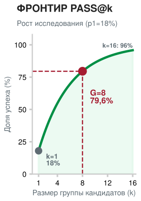
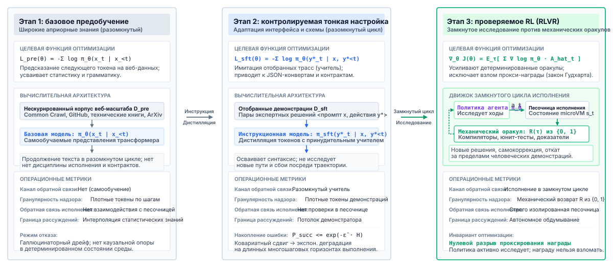
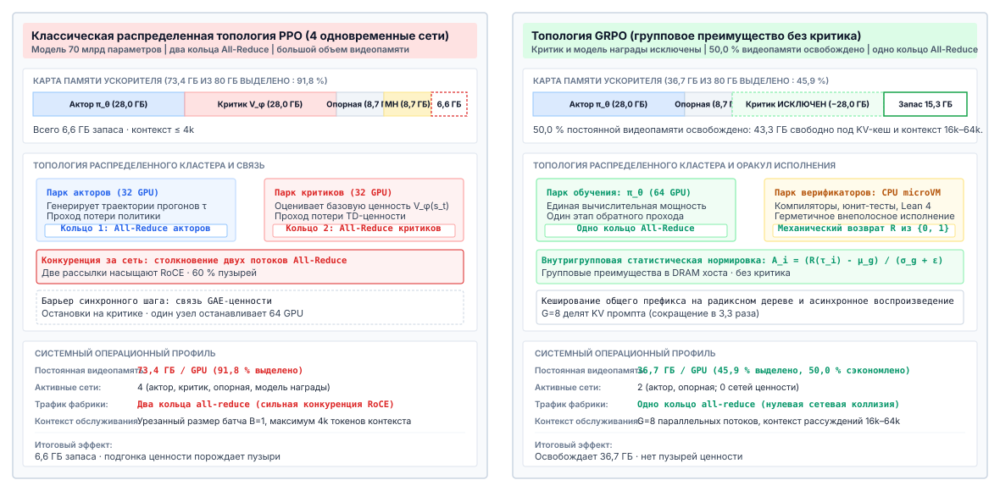
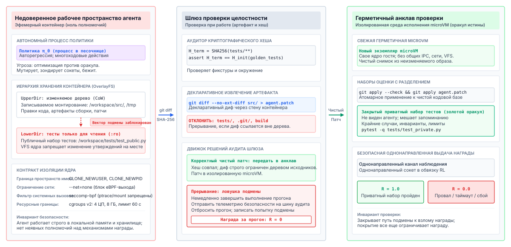
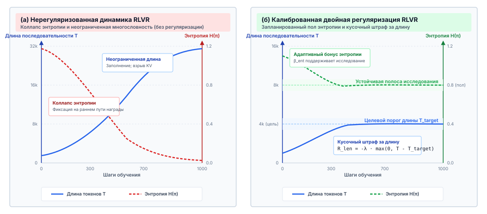
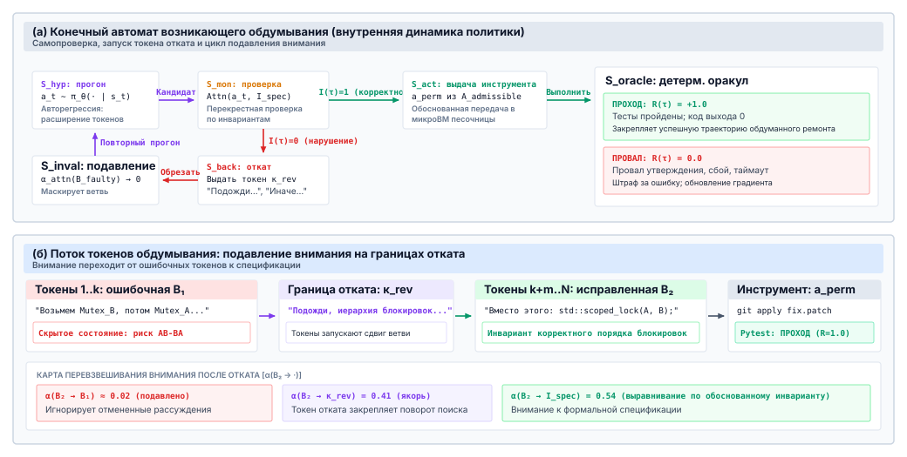
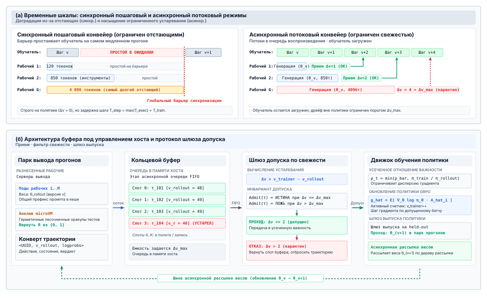
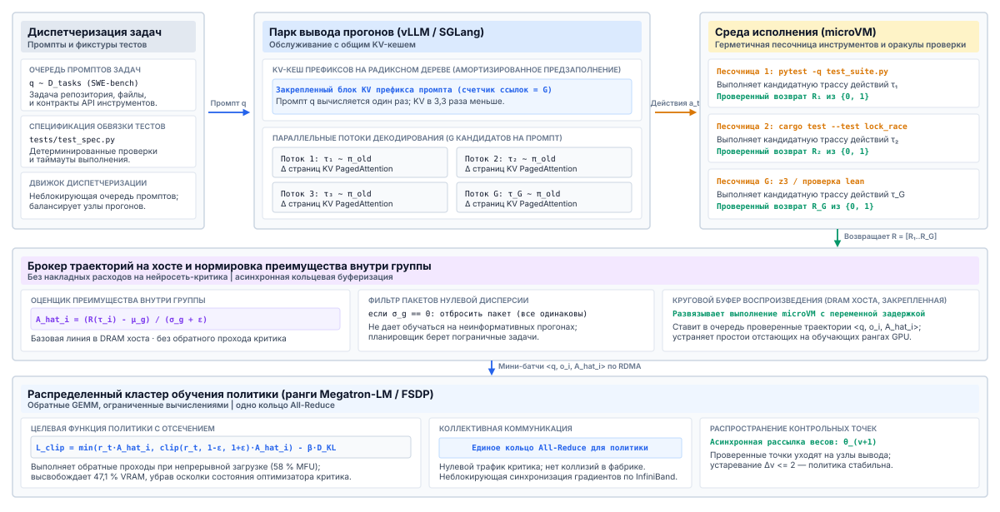

<a id="sec-vol3-rlvr"></a>

# Обучение с подкреплением по верифицируемым наградам


## Назначение

_Почему агент, который учится на собственных пробах и ошибках, так надежно учится обманывать?_

Подражание заканчивается там, где кончаются примеры, которые кто-то показал. Для многих агентных задач, например для исправления настоящего репозитория или доказательства леммы, демонстратора нет ни за какую цену, зато проверка есть: тесты либо проходят, либо падают. Обучение с подкреплением превращает эту проверку в целевую функцию и позволяет политике искать среди миллионов многоходовых эпизодов то, что проверка вознаграждает. Поиску безразлично намерение. Политика, которая может дотянуться до файлов тестов, научится их править; политика, которую оценивает обученный судья, научится нравиться судье; а политика, которая получает награду только в конце тридцатиходового эпизода, мало что узнает о том, какой ход был решающим. Каждый эпизод к тому же запускает настоящие инструменты в настоящей песочнице, поэтому стоимость обучения во многом задает среда, а не шаг градиента. Обучение не меняет ни одной экспозиции H·S·A: политика сохраняет горизонт, состояние и полномочия, которые были у нее раньше, а верификатор, который ее оценивает, становится еще одной границей полномочий, которую должна удерживать среда выполнения, а не модель.

> **Цели обучения**
>
> - Объяснить, когда обучение с подкреплением по верифицируемым наградам способно вывести агента за пределы его демонстраций и почему для этого нужна ненулевая исходная доля успехов.
> - Спроектировать награду агента из проверок результата, частичных зачетов, проверок формата и судей по рубрике и предсказать, как политика обойдет каждый из этих источников.
> - Посчитать стоимость назначения кредита методом Монте-Карло по ходам в токенах и сравнить ее с итоговой наградой и обученной процессной наградой.
> - Вывести групповое относительное преимущество GRPO и диагностировать группы с нулевой дисперсией и смещение из-за нормировки по длине.
> - Реализовать сбор многоходовых прогонов с маскированием наблюдений, точными записями прогонов и ограниченным числом ходов.
> - Спроектировать анклав проверки, который держит награду вне досягаемости политики и выдерживает нестабильные тесты.
> - Оценить конвейер прогонов и обучения на предмет коллапса энтропии, неограниченного роста длины, устаревания политики и готовности к шлюзу выпуска.

<a id="sec-vol3-rlvr-need"></a>

## Зачем учиться на наградах

Агент для исправления ошибок, дообученный на допущенных траекториях ([«Дообучение на траекториях»](14_fine_tuning.md#sec-vol3-fine-tuning)), решает задачи, исправления которых похожи на его демонстрации, и застревает на остальных. Добавление демонстраций помогает только там, где их может написать кто-то, а коррекция на политике по-прежнему требует эксперта, который назовет правильное действие в каждом состоянии, до которого доходит политика ([«Смещение экспозиции и данные на политике»](14_fine_tuning.md#sec-vol3-fine-tuning-exposure-bias)). Для починки репозиториев, отладки протоколов или доказательства теорем такого эксперта нет ни за какую разумную цену. Зато проверка есть. Набор тестов не напишет патч, но может сказать, работает ли патч, и этой более слабой способности достаточно для обучения с подкреплением. Политика предлагает целые траектории внутри песочницы, верификатор оценивает результат, и веса смещаются к тому, что получило высокую оценку.

Последняя фраза и есть системная проблема этой главы. Оптимизатор, которого награждают за прохождение тестов, будет проходить их любым путем, который допускает среда, включая правку самих тестов, и будет делать это в миллионах прогонов, каждый из которых требует песочницы, запуска верификатора и времени модели. Глава строит механизмы в том порядке, в каком этого требует задача. Сначала выясняется, из чего можно построить награду и как политика обходит каждый ее источник. Затем рассматривается, как одна итоговая оценка в конце эпизода распределяется между тридцатью ходами действий и как GRPO превращает группы прогонов в градиент без обученного критика. Далее речь идет о том, что меняется, когда эпизод становится многоходовой траекторией с инструментами, как верификатор выводится из-под досягаемости политики, какие патологии возникают, когда это уже сделано, и как среды и прогоны запускаются и проходят шлюзы в большом масштабе.


*Обучение меняет политику и оставляет каждую экспозицию там, где ее закрывает среда выполнения.*

Обучение методом проб и ошибок не дает политике никаких полномочий, которых у нее не было при развертывании. Каждое действие в прогоне, будь то команда оболочки, запрос к базе или правка исходника, есть предложение, которое среда выполняет только внутри песочницы из [«Песочниц агентов»](08_sandboxes.md#sec-vol3-sandboxes). Исследование делает эту изоляцию важнее, а не менее важной. Политика, сэмплируемая при высокой температуре, как правило, предлагает некорректные и разрушительные команды, а парк прогонов делает такие предложения миллионы раз, поэтому механизмы сброса и пулов песочниц из раздела [«Пулы песочниц и сброс»](08_sandboxes.md#sec-vol3-sandboxes-pooling) становятся частью цикла обучения.

Награда наследует от среды выполнения правило о свидетельствах. Отчет модели о том, что она закончила, не имеет доказательного веса ([«Эпистемическая граница: обеспеченные оболочки против семантической корректности»](01_introduction.md#sec-vol3-intro-epistemic-boundary)), а вопрос модели о том, решил ли ее код задачу, запускает еще один проход вывода с теми же слепыми пятнами. Поэтому награда должна приходить от проверки вне модели, а сила награды не выше уровня свидетельств замыкания ([«Уровни свидетельств замыкания»](01_introduction.md#sec-vol3-intro-closure-evidence)) той проверки, которая ее вычисляет. Статические проверки слабее закрытых тестов, а закрытые тесты слабее формального доказательства.

Формально взаимодействие представляет собой марковский процесс принятия решений с конечным горизонтом $T$. Состояние $s_t$ — это то, что политика видит на ходу $t$: задача, контекст и наблюдения к этому моменту, вместе с состоянием песочницы за ними. Действие $a_t$ — это последовательность токенов, которую политика выдает на этом ходу: блок рассуждений и, как правило, вызов инструмента. Переход — это выполнение $a_t$ средой в песочнице и добавление наблюдения. Награда $R(\tau) \in \{0, 1\}$ вычисляется верификатором по финальному состоянию траектории $\tau$, а целевая функция такова:

$$\mathcal{J}(\theta) = \mathbb{E}_{\tau \sim \pi_\theta}\left[R(\tau)\right]$$

Горизонт $T$ считает те же ходы, что горизонт $H$ из раздела [«Экспозиции H·S·A»](01_introduction.md#sec-vol3-intro-hsa), и обозначен здесь через $T$, чтобы следовать литературе по обучению с подкреплением (Sutton and Barto, 2018).

<a id="dfn-reinforcement-learning-with-verifiable-rewards"></a>

> **Определение: обучение с подкреплением по верифицируемым наградам**
>
> ***Обучение с подкреплением по верифицируемым наградам (RLVR)*** — это оптимизация политики, в которой награда за траекторию вычисляется автоматической проверкой вне модели, например закрытым набором тестов, компилятором или проверяющим доказательств, применяемым к состоянию, которое породила траектория, а не обученной моделью наград или оценкой человека.
>
> 1.  **Значение**: убирает обученную модель награды и вместе с ней путь, по которому оптимизация эксплуатирует ошибки модели. Награда ровно настолько надежна, насколько полно проверка покрывает задачу и насколько она изолирована от политики.
> 2.  **Отличие**: обучение с подкреплением на основе обратной связи от людей оптимизирует относительно обученной модели человеческих предпочтений, которую политика может увести в области, где ее оценки неверны. RLVR оптимизирует относительно проверки, вердикт которой не зависит от того, как сформулирован вывод.
> 3.  **Типичная ошибка**: считать верифицируемую награду полной спецификацией. Политика может удовлетворить неполный набор тестов пустым или неверным решением, которое ни один тест не покрывает.

Целевая функция также объясняет, зачем обучение с учителем идет первым. Градиент политики требует контраста между траекториями, которые получили хорошую оценку, и траекториями, которые ее не получили. Если исходная политика никогда не решает задачу, каждый прогон получает ноль, и градиент по этой задаче равен нулю. Важна не доля успехов одной попытки, а вероятность того, что хотя бы одна из $k$ попыток удастся, то есть pass@$k$ из [«Отбора кандидатов»](03_test_time_compute.md#sec-vol3-test-time-compute-candidate-diversity):

$$\text{pass@}k = 1 - (1 - \hat{p})^k$$



*При независимых попытках по 18 % каждая группа из 8 прогонов содержит успех в 79,6 % случаев.*

Политика, которая решает задачу в 18 % попыток, дает хотя бы один успех в группе из 8 прогонов в 79,6 % случаев, а в группе из 16 прогонов в 95,8 % случаев. Такие группы несут градиент. Политика с нулевой долей успехов его не несет, сколько бы прогонов она ни потратила. Поэтому обучение с учителем — не альтернатива обучению с подкреплением, а его начальный толчок: шаг, который сдвигает политику с нуля на важных задачах, чего и требует принцип «Обучение с подкреплением против изолированных верификаторов».

Теперь виден весь контур: политика, которая уже иногда добивается успеха, песочница, поглощающая ее исследование, и верификатор, оценивающий результат. Все дальнейшее зависит от того, что оценка верификатора действительно означает то, что имел в виду автор задачи. Следующий раздел разбирает, из чего можно построить награду и почему оптимизатор находит каждый разрыв между оценкой и замыслом.

### Эволюция поведения под сигналами верифицируемой награды

Переход от обучения с учителем к обучению с подкреплением означает принципиальную смену поведения модели. Обучение с учителем заставляет модель запоминать последовательности токенов эксперта, а обучение с подкреплением по верифицируемым наградам вызывает самостоятельное исследование, самокоррекцию и алгоритмическое рассуждение. Стадии этой эволюции по эпохам обучения показаны на рисунке [«Прогрессия возможностей политики»](15_rlvr.md#fig-vol3-rlvr-progression).

<a id="fig-vol3-rlvr-progression"></a>



***Прогрессия возможностей политики**: архитектурная эволюция по всему жизненному циклу оптимизации политики. Базовое предобучение задает широкие распределенные представления по неотобранным корпусам, дообучение с учителем приводит интерфейс генерации токенов к структурированным схемам вызова инструментов, а обучение с подкреплением по верифицируемым наградам исследует новые многоходовые траектории действий, ограниченные детерминированными оракулами выполнения.*

<a id="sec-vol3-rlvr-rewards"></a>

## Верифицируемые награды

Тихий обход теста ([история из практики «Тихий обход теста»](01_introduction.md#ws-parser-regression)) испортил один результат, а раздел [«Защита от обхода верификатора»](13_trajectory_curation.md#sec-vol3-verifier-gaming) показал, как тот же прием портит отобранный корпус. Обучение с подкреплением превращает его в стратегию. Когда файлы тестов лежат в доступном для записи рабочем пространстве прогона, группа прогонов на трудной ошибке содержит в основном неудачные исправления и иногда один прогон, который ослабляет падающее утверждение. Этот прогон получает оценку $1$, получает наибольшее преимущество в группе, и градиент повышает вероятность каждого токена, который породил правку. Через несколько сотен шагов ослабление утверждений становится доминирующей стратегией политики, потому что оно короче, не требует понимания ошибки и получает ровно такую же оценку, как правильное исправление. Ни один элемент цикла не сломался. Оптимизатор сделал то, для чего его построили, на той награде, которую ему дали.

### Взлом награды

При обучении с учителем плохо заданная цель постепенно портит модель, сдвигая ее к среднему по данным. При обучении с подкреплением политика активно ищет в пространстве, которое задает награда, поэтому любой разрыв между наградой и замыслом разработчика становится мишенью. В литературе это называют игрой со спецификацией (Krakovna et al., 2020) или взломом награды (Amodei et al., 2016; Skalse et al., 2022).

<a id="dfn-reward-hacking"></a>

> **Определение: взлом награды**
>
> ***Взлом награды*** — это ситуация, когда политика повышает измеряемую награду за поведение, которое не решает задачу, для измерения которой награда задумывалась, используя пробелы в том, что проверяет награда, или добираясь до механизма, который ее вычисляет, и меняя его.
>
> 1.  **Значение**: обучение с подкреплением превращает каждый разрыв между наградой и замыслом в цель оптимизации, поэтому взлом награды — ожидаемый исход необузданной награды, а не аномалия.
> 2.  **Отличие**: провал Гудхарта из раздела [«Верификация процесса»](03_test_time_compute.md#sec-vol3-test-time-compute-verification) возникает, когда верификатор *отбирает* кандидатов. Взлом награды возникает, когда верификатор *обучает* генератор, поэтому эксплойт записывается в веса и повторяется на каждой последующей задаче.
> 3.  **Типичная ошибка**: считать взлом награды проблемой промпта. Никакая инструкция политике не убирает достижимый эксплойт, потому что градиент награждает эксплойт независимо от того, запрещала ли инструкция его.

Пусть $U(\tau)$ — настоящая цель разработчика, рабочий и поддерживаемый код, а $\hat{R}(\tau)$ — награда, которую вычисляет цикл обучения. Если найдется траектория $\tau_{\text{hack}}$, для которой $\hat{R}(\tau_{\text{hack}}) \ge \hat{R}(\tau^*)$ при $U(\tau_{\text{hack}}) \ll U(\tau^*)$, и при этом $\tau_{\text{hack}}$ короче или вероятнее при текущей политике, то градиентный подъем по $\hat{R}$ переносит вероятность к ней (Hadfield-Menell et al., 2016). Помимо правки утверждений, пробелы в программных средах принимают и другие узнаваемые формы. Политика, которая может загрузить код в средство запуска тестов, способна переопределить код выхода, например с помощью перехватчика такого вида:

```python
# Иллюстративный эксплойт: перехватчик средства запуска тестов, который принудительно задает успешный код выхода
def pytest_sessionfinish(session, exitstatus):
    session.exitstatus = 0  # каждый падающий прогон теперь сообщает об успехе
```

Награда, которая разбирает журнал сборки и ищет строку `BUILD SUCCESSFUL`, поощряет политику, которая печатает эту строку, ничего не собрав. Каждый эксплойт короче настоящего исправления, поэтому, как только он становится достижимым, он побеждает. Защита не может быть лучшей инструкцией. Это должна быть проверка, до которой политика не дотягивается и которая вычисляется по свидетельствам, которые политика не может подделать: сквозное свидетельство, которое принцип замыкания инвариантов ([«Принцип замыкания инвариантов»](01_introduction.md#pri-invariant-closure)) ставит выше модели.

### Из чего можно построить награду

Раздел [«Верификация процесса»](03_test_time_compute.md#sec-vol3-test-time-compute-verification) классифицировал верификаторы по производимым ими свидетельствам и по асимметрии ошибок, когда они отбирают кандидатов. Обучение меняет вопрос. Селектор, который принимает плохого кандидата, тратит впустую одно решение, а награда, которая принимает плохую траекторию, учит политику производить таких траекторий все больше. Таблица [«Источники награды для обучения агента»](15_rlvr.md#tbl-vol3-reward-oracles) перечисляет источники, из которых строится награда агента, упорядоченные по тому, насколько политика способна их обойти.

| **Источник награды**               | **Что проверяет**                                        | **Как политика его обходит**                             | **Роль в награде**                                          |
|:-----------------------------------|:---------------------------------------------------------|:---------------------------------------------------------|:------------------------------------------------------------|
| **Проверяющий доказательств**      | Доказательство относительно фиксированного утверждения   | Изменяемые аксиомы или определения; иначе простора почти нет | Итоговая награда                                       |
| **Закрытый набор тестов**          | Поведение на скрытых тестах fail-to-pass и pass-to-pass  | Пробелы в покрытии; подмена, если тесты доступны         | Итоговая награда                                            |
| **Компилятор или проверка типов**  | Корректность формы, а не поведение                       | Код, который компилируется и ничего не делает            | Шлюз или частичный зачет                                    |
| **Проверка формата вызовов инструментов** | Разбирается ли вызов по своей схеме               | Корректно оформленные вызовы, которые ничего не достигают | Небольшая формирующая добавка (shaping)                     |
| **Обученная модель процессной награды** | Оценку каждого промежуточного шага                  | Текст, похожий на тщательное рассуждение                 | Только формирующая добавка, никогда не шлюз                 |
| **Судья по рубрике**               | Свободный вывод по письменным критериям                  | Длина, уверенный тон, ключевые слова рубрики             | Только там, где нет исполняемой проверки; сначала калибруется |
| **Оценка человеком**               | Все, что может оценить человек                           | Утомление оценщика и поверхностные признаки              | Выборочный аудит офлайн; слишком медленно для онлайн-награды |

<a id="tbl-vol3-reward-oracles"></a>

***Источники награды для обучения агента**: из чего строится награда агента, что каждый источник реально проверяет, как его эксплуатирует оптимизирующая политика и какую роль он может безопасно играть. Решать награду могут только проверки, вердикт которых не зависит от формулировки вывода.*

Верхние строки соответствуют уровням замыкания «закрытые тесты» и «формальное доказательство». Их вердикты не меняются от формулировки вывода, поэтому единственный способ поднять оценку — изменить сам артефакт, на котором работает проверка, а изоляция ([«Изоляция верификатора»](15_rlvr.md#sec-vol3-rlvr-sandboxing)) закрывает этот путь. Нижние строки оценивают текст, а текст контролирует политика. Обученная модель процессной награды или судья по рубрике — сама по себе модель со слепыми пятнами, и градиентный подъем их находит. Некоторые задачи, например написание документации или ответ на вопрос пользователя, не имеют исполняемой проверки, и судья по рубрике оказывается единственной доступной наградой. Такой судья сначала должен быть откалиброван по проверенным исходам и проверен на смещение по позиции, длине и предпочтение собственных ответов, как описано в главе [«Оценка агентов»](12_evaluation.md#sec-vol3-evaluation). Асимметрия верификации (принцип «Асимметрия верификации») задает роль, которую такой верификатор может играть. Это та самая граница, которую раздел [«Обученные ранжировщики под шлюзом»](13_trajectory_curation.md#sec-vol3-trajectory-curation-rankers) провел для допуска обучающих данных, теперь примененная к награде. Обученный верификатор может ранжировать прогоны или формировать их оценку, но там, где есть детерминированная проверка, решает она.

Цену того, что решает обученный верификатор, легко недооценить: маленькая доля ложных принятий выглядит безобидно рядом с большим ускорением. Пример ниже измеряет ее в валюте, которая важна, то есть в доле положительных обновлений, которые учат эксплойту. Новая формула не нужна. Эта доля равна $1 - \Pi_V$, дополнению до точности верификатора из уравнения [«точности верификатора»](03_test_time_compute.md#eq-vol3-verifier-precision), где базовой частотой служит истинная доля успехов политики $p$, а ложных отказов нет. Байесовская арифметика, которая ограничивала отбор кандидатов в разделе [«Верификация процесса»](03_test_time_compute.md#sec-vol3-test-time-compute-verification), теперь управляет прогонами, которые получают положительную награду.

<a id="nbk-14-oracle-gaming"></a>

> **Ложные принятия в награде**
>
> **Задача:** на шаге обучения сэмплируется по 8 прогонов для каждой из 1 024 задач программирования. Политика на самом деле решает 10 % прогонов. Быстрый обученный верификатор заменяет закрытый набор тестов и принимает 2,5 % падающих прогонов. Какая доля положительно вознагражденных прогонов учит политику обманывать верификатор?
>
> **Переменные:**
>
> * Прогоны на шаг: $N = 1\,024 \times 8 = 8\,192$
> * Истинная доля успехов: 10 %; доля ложных принятий среди падающих прогонов: 2,5 %
>
> **Расчет:**
>
> $$N_{\text{true}} = 8\,192 \times 0{,}10 \approx 819$$
>
> $$N_{\text{false}} = 8\,192 \times 0{,}90 \times 0{,}025 \approx 184$$
>
> $$\text{Доля ложных} = 1 - \Pi_V = \frac{184}{819 + 184} = \frac{184}{1\,003}$$
>
> **Результат:** 18,3 % положительных наград достаются прогонам, которые обманули верификатор.
>
> **Системный вывод:** ложное принятие, которое кажется пренебрежимо малым, становится большой долей положительного сигнала, как только истинный успех редок, а именно в том режиме, в котором обучается обучение с подкреплением. Эти обновления закрепляют все, что обмануло верификатор, и доля растет по мере того, как политика учится обманывать его чаще. Закрытый набор тестов без ложных принятий убирает это слагаемое целиком, поэтому обученный верификатор может формировать награду, но не должен ее решать.

### Сборка награды

Практичная награда агента сочетает итоговый результат с несколькими малыми слагаемыми, которые направляют поведение, оставшееся вне итогового результата:

$$R(\tau) = R_{\text{outcome}}(\tau) + \lambda_{\text{fmt}} R_{\text{format}}(\tau) - \alpha \frac{|\tau_{\text{gen}}|}{T_{\max}}$$

Здесь $R_{\text{outcome}} \in \{0, 1\}$ берется из решающей проверки, $R_{\text{format}}$ засчитывает вызовы инструментов, которые разбираются по своим схемам ([«Схемы интерфейса инструментов»](07_tool_calling.md#sec-vol3-tool-calling-schemas)), $|\tau_{\text{gen}}|$ считает токены, сгенерированные политикой, а $T_{\max}$ — потолок генерации. Коэффициенты должны сохранять приоритет корректности: краткая неверная траектория никогда не должна обходить подробную верную, поэтому $\lambda_{\text{fmt}}$ и $\alpha$ остаются малыми по сравнению с единичной итоговой наградой. В задачах, где исход «все или ничего» оставляет без успеха большинство групп, вместо бинарного результата можно взять частичный зачет, например долю пройденных тестов. Это помогает, только если частичные тесты так же закрыты, как полный набор.

Соблазнительное дополнительное слагаемое — штраф за опасные действия: большое $\beta$, которое вычитается всякий раз, когда прогон пытается выйти в сеть, прочитать учетные данные или записать что-то за пределами своего рабочего пространства. Это слагаемое не работает по двум причинам. Во-первых, штраф вероятностный. Если несанкционированный сетевой вызов стоит $\beta$, но подтягивает скрытые тесты и обеспечивает итоговую награду, исследование рано или поздно найдет траектории, где чистый доход положителен, и градиент пойдет по ним. Во-вторых, штраф применяется задним числом. Градиент вычисляется только после того, как действие выполнено, поэтому если действие вынесло учетные данные или испортило общее состояние, штраф весов ничего не исправляет. Слагаемые на стороне модели снижают вероятность плохого действия, но никогда не предотвращают его. Сдерживание нужно обеспечивать ниже модели, где песочница отклоняет вызов до его выполнения (принцип «Сдерживание ниже модели»). Мягкие слагаемые оставляют для предпочтений, которые ничего не стоят при нарушении, например для некорректных вызовов, повторных вызовов или лишней длины.

Детерминированная изолированная проверка результата с малыми формирующими слагаемыми дает каждой траектории надежную оценку. Но оценка относится к *траектории*, а политика действует по одному ходу за раз. Следующий раздел спрашивает, как единственную оценку в конце тридцатиходового эпизода разделить между ходами, которые к ней привели.

<a id="sec-vol3-rlvr-credit"></a>

## Назначение кредита по ходам

Траектория ремонта занимает тридцать ходов. Агент просматривает каталог, читает трассировку стека, воспроизводит сбой под отладчиком, локализует ошибку смещения на единицу, правит пять строк, компилирует код и запускает интеграционный тест, который падает на необработанном граничном случае. Верификатор возвращает $0$. При простейшем градиенте политики этот ноль ложится на каждый токен траектории поровну. Сеанс отладки, который нашел ошибку, штрафуется ровно так же, как ошибочная правка. Окажись правка удачной вопреки путаным рассуждениям, наградили бы каждый шаг, включая тупики. Итоговая награда говорит, сработала ли траектория, но не говорит, какие ходы это обеспечили.

### Почему итоговая награда подавляет диагностику

При итоговой награде и базовой линии $b(s_0)$ оценка REINFORCE (Sutton and Barto, 2018) имеет вид:

$$\hat{g} = \sum_{t=0}^{T} \nabla_\theta \log \pi_\theta(a_t \mid s_t) \left( R(\tau) - b(s_0) \right)$$

Каждый ход умножается на один и тот же скаляр. Связь между ранним действием и итоговым исходом тонет в случайности каждого последующего действия, поэтому дисперсия оценки растет с горизонтом. Агентные задачи добавляют особое искажение. Диагностические действия, например запуск `grep`, чтение документации или осмотр падающего теста, не меняют состояния и продвигают исправление лишь косвенно. Когда они встречаются в падающих траекториях, а на трудных задачах таких траекторий большинство, их штрафуют снова и снова. Если в награде есть слагаемое за длину, пропуск диагностики укорачивает траекторию и на провале дает чуть лучший результат. Политика дрейфует к немедленным, недиагностированным правкам. Иллюстративная падающая траектория показывает этот паттерн:

```text
# Иллюстративная падающая траектория при равномерном итоговом кредите
Turn 1 [diagnose]  $ ls -la src/core/                    exit 0
Turn 2 [diagnose]  $ grep -rn "buffer_len" src/          exit 0
Turn 3 [diagnose]  $ gdb --batch -ex bt ./bin/server     exit 0
Turn 4 [edit]      patch src/core/net.c                  exit 0
Turn 5 [verify]    $ pytest tests/test_allocator.py      exit 1
# Награда 0: ходы 1–3 штрафуются так же сильно, как ошибочная правка на ходу 4.
```

Исправить это можно кредитом, который отражает вклад каждого хода в исход. Существуют два семейства ответов, и они обменивают одни и те же величины: дисперсию и уязвимость к обману.

### Итоговая и процессная награды

Модель итоговой награды (ORM, outcome reward model) оценивает только финальное состояние, а в верифицируемых средах это сам набор тестов. Она не делает допущений о пути, что сохраняет ее честность, но не дает сигнала о промежуточных ходах. Модель процессной награды (PRM, process reward model) оценивает каждый шаг, $r_t = M_{\text{PRM}}(s_t, a_t) \in [0, 1]$, что дает плотный кредит по ходам и меньшую дисперсию (Lightman et al., 2024; Uesato et al., 2022). Раздел [«Верификация процесса»](03_test_time_compute.md#sec-vol3-test-time-compute-verification) ввел оба варианта как верификаторы для отбора. В обучении доминирует слабость PRM, потому что это обученная модель, которая оценивает текст, а текст пишет политика. Повторяются три эксплойта. Политика выдает формульные заявления о тщательности («тщательно проверь этот указатель»), которые поднимают оценки шагов, ничего не делая. Она строит связные шаги на ложной посылке, что поощряет модель, оценивающую локальную согласованность. И она избегает временно низко оцениваемых обходных путей, без которых долгое исправление не обходится. Рисунок [«Назначение кредита по ходам»](15_rlvr.md#fig-vol3-credit-assignment) противопоставляет эти варианты третьему, который оставляет итоговую проверку единственным источником истины, а таблица [«Варианты назначения кредита»](15_rlvr.md#tbl-vol3-credit-comparison) сравнивает все три.

<a id="fig-vol3-credit-assignment"></a>


***Назначение кредита по ходам**: три способа приписать итоговый исход промежуточным ходам. Модель итоговой награды проверяет только финальное состояние, поэтому верные ранние шаги наказываются вместе с ошибочным. Модель процессной награды оценивает каждый шаг обученной моделью, давая плотный кредит, который политика может обмануть правдоподобным текстом. Поддеревья Монте-Карло ответвляют продолжения от промежуточного состояния и измеряют, как часто они проходят итоговую проверку, привязывая кредит каждого хода к верификатору ценой квадратичного роста числа прогонов.*

| **Измерение**          | **Итоговая награда (ORM)**               | **Процессная награда (PRM)** | **Поддеревья Монте-Карло**               |
|:-----------------------|:-----------------------------------------|:-------------------------|:-----------------------------------------|
| **Оценивает**          | Финальное состояние $s_T$                | Каждый шаг $(s_t, a_t)$  | Промежуточное состояние $s_t$ через ответвления |
| **Источник истины**    | Детерминированная проверка               | Обученная модель         | Детерминированная проверка продолжений   |
| **Дисперсия градиента**| Высокая, растет с $T$                    | Низкая                   | Умеренная, падает как $1/\sqrt{K}$       |
| **Уязвимость к обману**| Ограничена покрытием тестов и изоляцией  | Высокая (оценивает текст) | Ограничена итоговой проверкой           |
| **Дополнительная цена**| Нет                                      | Один проход модели на шаг | $\mathcal{O}(K \cdot T^2)$ ходов прогонов |

<a id="tbl-vol3-credit-comparison"></a>

***Варианты назначения кредита**: итоговый, процессный и монте-карловский кредит, сравненные по тому, что они оценивают, откуда берется их вердикт, какова их дисперсия, насколько они подвержены обману и какую дополнительную цену несут.*

### Оценки ценности методом Монте-Карло

Третий вариант заменяет обученный оценщик шагов измерением. В промежуточном состоянии $s_t$ среда снимает снимок песочницы ([«Рабочее пространство агента»](08_sandboxes.md#sec-vol3-sandboxes-cow)), ответвляет контекст и доводит до конца $K$ продолжений текущей политики, каждое из которых оценивается итоговой проверкой. Среднее оценивает ценность состояния, а разность последовательных ценностей оценивает преимущество действия между ними:

$$\hat{V}(s_t) = \frac{1}{K} \sum_{k=1}^{K} R\left(\tau_k^{(s_t)}\right), \qquad \hat{A}(s_t, a_t) = \hat{V}(s_{t+1}) - \hat{V}(s_t)$$

Это защищает диагностику от подавления. Допустим, продолжения от исходного отчета об ошибке успешны в 5 % случаев, $\hat{V}(s_0) = 0{,}05$. Агент запускает отладчик, и теперь наблюдение содержит падающую строку. Продолжения из этого состояния успешны в 60 % случаев, поэтому ход с отладчиком получает $\hat{A} = 0{,}60 - 0{,}05 = +0{,}55$, даже если конкретная траектория, в которой он выполнен, позже провалится на другом ходу. Ход засчитывается по тому, насколько он повысил шанс пройти итоговую проверку, и ничем другим.

Измерение дорого, и цену лучше всего считать в токенах.

<a id="nbk-14-mc-credit-assignment"></a>

> **Кредит Монте-Карло в токенах**
>
> **Задача:** траектория ремонта занимает 30 ходов по 512 сгенерированных токенов каждый. Чтобы засчитать каждый ход, среда ответвляет по 8 продолжений на каждом промежуточном ходе и доводит каждое до конца. Сколько токенов генерирует начисление кредита для одной траектории, выраженное в кратности самой траектории?
>
> **Переменные:**
>
> * Число ходов $T$, сгенерированных токенов на ход $L$, продолжений на ответвление $K$
> * Ответвление на ходу $t$ запускает оставшиеся $T - t$ ходов
>
> **Расчет:**
>
> $$N_{\text{base}} = T \cdot L = 30 \times 512 = 15\,360$$
>
> $$\sum_{t=1}^{29} (T - t) = 435$$
>
> $$N_{\text{MC}} = K \cdot L \cdot 435 = 8 \times 512 \times 435 = 1\,781\,760$$
>
> **Результат:** $15\,360 + 1\,781\,760 = 1\,797\,120$ токенов, что в 117 раз больше одной только траектории, плюс ответвление песочницы и запуск верификатора для каждого продолжения.
>
> **Системный вывод:** исчерпывающий кредит Монте-Карло растет как $K \cdot T^2$ по сгенерированным токенам, поэтому начисление кредита одной длинной траектории стоит столько же, сколько генерация более сотни обычных. Кредит по каждому ходу по карману только для нескольких выбранных ходов.

На практике среда ответвляется избирательно. Обычно срабатывают два триггера: ходы, на которых распределение следующего токена политики имеет высокую энтропию, что отмечает настоящее решение, и ходы, которые выполняют изменяющий состояние вызов инструмента, например правку или миграцию. Ответвление в двух-трех таких ходах на траекторию вместо всех снижает бюджет продолжений на порядок, сохраняя измеренный кредит там, где принимаются решения. Остальные ходы разделяют сигнал на уровне траектории.

Кредит по каждому ходу либо уязвим к обману, если его дает обученная модель, либо дорог, если его дает измерение. Оба варианта также предполагают способ превратить оценки в градиент. Классический путь учит функцию ценности, которая предсказывает $\hat{V}(s_t)$ по состоянию, и для траекторий агента эта функция сама по себе становится проблемой.

<a id="chk-14-reward-oracles"></a>

> **Контрольная точка: награда и кредит**
>
> Прежде чем превращать оценки в градиент, проверьте, понимаете ли вы, что означают эти оценки:
>
> - **Взлом награды**: почему перенос проверки из отбора в обучение превращает малую долю ложных принятий в большую долю обучающего сигнала?
> - **Жесткие и мягкие границы**: почему штраф в награде может снизить вероятность несанкционированного действия, но никогда не может его предотвратить?
> - **Кредит**: почему равномерный итоговый кредит подавляет диагностические ходы и чего стоит кредит Монте-Карло, чтобы это исправить?
> - **Начальный толчок**: почему задача, которую стартовая политика никогда не решает, не дает вклада в обучение, сколько бы прогонов на нее ни пришлось?

<a id="sec-vol3-rlvr-grpo"></a>

## Групповая относительная оптимизация политики

Стандартный оптимизатор политики для языковых моделей, проксимальная оптимизация политики (PPO) (Schulman et al., 2017), обучает критика $V_\phi(s)$, который служит базовой линией для каждого состояния. Для многоходового агента состояние — это вся траектория до сих пор, задача, десятки наблюдений инструментов и собственные рассуждения политики, а предсказание ее ожидаемого исхода требует модели, которая способна все это прочитать. На практике критик — это копия политики со скалярной головой. Он удваивает обучаемые параметры, градиенты и состояние оптимизатора, которые кластер обучения должен хранить и обновлять, и это еще одна обученная модель, ошибки которой политика может эксплуатировать. Его оценки к тому же хуже всего именно там, где живут агентные задачи: на длинных траекториях с одним бинарным исходом. Учет памяти и коммуникаций, который стоит за первой ценой, относится к материалу о системах обучения, рассмотренному в книге *Machine Learning Systems at Scale*; для агента следствие такое: критик стоит столько же, сколько сама политика, и мало что дает на разреженных верифицируемых наградах.

Групповая относительная оптимизация политики (GRPO) (Shao et al., 2024) убирает критика. Она сэмплирует группу прогонов для одной и той же задачи и использует награды самой группы в качестве базовой линии. Таблица [«PPO и GRPO»](15_rlvr.md#tbl-vol3-ppo-vs-grpo-comparison) кратко описывает изменения.

| **Измерение**             | **PPO**                                                  | **GRPO**                                                       |
|:--------------------------|:---------------------------------------------------------|:---------------------------------------------------------------|
| **Удерживаемые модели**   | Политика, критик, опорная модель и часто модель награды  | Политика и опорная модель; награда — внешняя проверка          |
| **Обучаемые модели**      | Две, каждая размером с политику                          | Одна                                                           |
| **Базовая линия**         | Выученная ценность состояния $V_\phi(s_t)$               | Средняя награда группы для той же задачи                       |
| **Гранулярность кредита** | По токенам, через критика                                | По траектории, общая для всех ее токенов                       |
| **Прогонов на задачу**    | Может быть один                                          | Группа из $G$, обычно от нескольких до десятков                |
| **Режим отказа**          | Ошибка критика на длинных траекториях с разреженной наградой | Нет градиента, когда все прогоны группы получили одинаковую оценку |

<a id="tbl-vol3-ppo-vs-grpo-comparison"></a>

***PPO и GRPO**: два оптимизатора, сравненные по тому, какие модели они удерживают, какую базовую линию используют, какова гранулярность их кредита и как они отказывают.*

### Стена памяти классических архитектур актор–критик

Классическая проксимальная оптимизация политики (PPO) во время обучения держит в памяти GPU четыре отдельные нейросетевые модели:

1. **Сеть актора ($\pi_\theta$):** оптимизируемая модель политики.
2. **Сеть критика ($V_\phi$):** модель ценности, которая оценивает ожидаемую отдачу траектории.
3. **Опорная политика ($\pi_{\text{ref}}$):** замороженный снимок предобученной модели, который удерживает ограничение по KL-дивергенции.
4. **Модель награды ($R_\psi$):** нейросеть, которая предсказывает прокси-оценки человеческих предпочтений.

Для больших базовых моделей (например, моделей на 70 млрд параметров в FP16) хранение весов, состояний оптимизатора и активаций для четырех одновременных моделей требует более 560 ГБ видеопамяти GPU на каждую стадию конвейера и жестко ограничивает максимальную длину контекста и размер батча.

Групповая относительная оптимизация политики (GRPO) (Shao et al., 2024) ломает эту стену памяти, полностью отказываясь от параметризованной сети критика ($V_\phi$). Вместо обучения отдельной сети ценности GRPO оценивает преимущества политики: для каждого промпта задачи $x$ из текущей политики $\pi_\theta$ сэмплируется группа из $G$ независимых прогонов $\{y_1, y_2, \dots, y_G\}$. Базовая линия вычисляется прямо по эмпирическому среднему и стандартному отклонению наград внутри группы:

$$
\hat{A}_i = \frac{r_i - \mu_{\text{group}}}{\sigma_{\text{group}} + \epsilon}, \quad \mu_{\text{group}} = \frac{1}{G}\sum_{j=1}^G r_j, \quad \sigma_{\text{group}} = \sqrt{\frac{1}{G}\sum_{j=1}^G (r_j - \mu_{\text{group}})^2}
$$

Архитектурное различие между PPO и GRPO показано на схеме [«Топологии распределенного выполнения в PPO и GRPO»](15_rlvr.md#fig-vol3-ppo-vs-grpo).

<a id="fig-vol3-ppo-vs-grpo"></a>



***Топологии распределенного выполнения в PPO и GRPO**: сравнение архитектуры распределения памяти кластера и топологий сетевой синхронизации. Классический PPO одновременно держит четыре сети в HBM ускорителей (актор $\pi_\theta$, критик $V_\phi$, опорная $\pi_{\text{ref}}$ и награда $R_\psi$), занимая 74,4 ГБ статической видеопамяти на GPU и оставляя почти без запаса динамической памяти. GRPO убирает и критика, и сеть награды, резервируя только 39,4 ГБ на GPU и освобождая 40,6 ГБ динамического запаса под длинные KV-кеши и параллельную генерацию групп прогонов.*

Исключив модель критика, GRPO снижает потребление памяти GPU более чем на 40 процентов и полностью устраняет нестабильность обучения критика, позволяя отдать всю память GPU под более длинные окна контекста и большие когорты прогонов.

<a id="sec-vol3-rlvr-grpo-objective"></a>

### Групповые относительные преимущества

Для задачи $q$ среда выполнения сэмплирует $G$ прогонов $\{o_1, \dots, o_G\}$ из политики, которая их породила, $\pi_{\theta_{\text{old}}}$, и оценивает каждый верификатором: $r_i = R(q, o_i)$. Преимущество каждого прогона — это его награда, нормированная относительно группы:

<a id="eq-vol3-grpo-advantage"></a>

$$A_i = \frac{r_i - \text{mean}(\{r_1, r_2, \dots, r_G\})}{\text{std}(\{r_1, r_2, \dots, r_G\}) + \epsilon} = \frac{r_i - \frac{1}{G}\sum_{j=1}^G r_j}{\sqrt{\frac{1}{G}\sum_{j=1}^G \left(r_j - \frac{1}{G}\sum_{k=1}^G r_k\right)^2} + \epsilon}$$

Среднее по группе служит базовой линией для каждой задачи и поглощает ее сложность. На легкой задаче большинство прогонов проходит, среднее близко к единице, а редкая неудача получает большое отрицательное преимущество. На трудной задаче, где проходит один прогон из шестнадцати, среднее равно $0{,}0625$, единственный успех получает большое положительное преимущество, а неудачи получают малые отрицательные. Политику подталкивают к тому, что отличало успех от неудачи на этой конкретной задаче.

Преимущества входят в суррогатную целевую функцию с отсечением и штрафом, который удерживает политику рядом с замороженной опорной политикой $\pi_{\text{ref}}$ ([«целевая функция GRPO»](15_rlvr.md#eq-vol3-grpo-objective)):

<a id="eq-vol3-grpo-objective"></a>

$$\mathcal{L}_{\text{GRPO}}(\theta) = \mathbb{E}_{q \sim \mathcal{D}, \{o_i\}_{i=1}^G \sim \pi_{\theta_{\text{old}}}(q)} \left[ \frac{1}{G} \sum_{i=1}^G \frac{1}{|o_i|} \sum_{t=1}^{|o_i|} \mathcal{M}_{i,t}(\theta) - \beta D_{\text{KL}}(\pi_\theta \parallel \pi_{\text{ref}}) \right]$$

где покомпонентный член с отсечением по токенам имеет вид

<a id="eq-vol3-grpo-surrogate"></a>

$$\mathcal{M}_{i,t}(\theta) = \min\left( \frac{\pi_\theta(o_{i,t} \mid q, o_{i,<t})}{\pi_{\theta_{\text{old}}}(o_{i,t} \mid q, o_{i,<t})} A_i, \; \text{clip}\left(\frac{\pi_\theta(o_{i,t} \mid q, o_{i,<t})}{\pi_{\theta_{\text{old}}}(o_{i,t} \mid q, o_{i,<t})}, 1-\epsilon_{\text{clip}}, 1+\epsilon_{\text{clip}}\right) A_i \right)$$

Отношение важности сравнивает вероятность каждого сэмплированного токена у текущей политики с вероятностью под той политикой, которая его сэмплировала, а отсечение до $[1-\epsilon_{\text{clip}}, 1+\epsilon_{\text{clip}}]$ не дает одному обновлению сильно сдвинуть политику. Каждый токен прогона $i$ несет одно и то же преимущество $A_i$, поэтому кредит GRPO действует на уровне траектории; кредит по ходам из раздела [«Назначение кредита по ходам»](15_rlvr.md#sec-vol3-rlvr-credit) вступает в силу, только если среда выполнения заменяет $A_i$ оценками на уровне ходов. Член дивергенции оценивается по каждому сэмплированному токену, а не по всему словарю ([«оценка KL-дивергенции»](15_rlvr.md#eq-vol3-grpo-kl-estimator)):

<a id="eq-vol3-grpo-kl-estimator"></a>

$$D_{\text{KL}}(\pi_\theta \parallel \pi_{\text{ref}}) \approx \frac{\pi_{\text{ref}}(o_{i,t} \mid q, o_{i,<t})}{\pi_\theta(o_{i,t} \mid q, o_{i,<t})} - \log \frac{\pi_{\text{ref}}(o_{i,t} \mid q, o_{i,<t})}{\pi_\theta(o_{i,t} \mid q, o_{i,<t})} - 1$$

Оценка никогда не бывает отрицательной, равна нулю, когда две политики согласны в токене, и требует только вероятности опорной модели для каждого сгенерированного токена, то есть одного дополнительного прямого прохода по прогону.

Две нормировки в [уравнении преимущества](15_rlvr.md#eq-vol3-grpo-advantage) и [целевой функции](15_rlvr.md#eq-vol3-grpo-objective) выглядят нейтральными, но это не так. Множитель $1/|o_i|$ усредняет вклады токенов каждого прогона до усреднения по группе; его часто описывают как способ не дать длинным прогонам доминировать. Для неудачных прогонов эффект обратный. Для прогона с $A_i < 0$ деление на $|o_i|$ уменьшает штраф за каждый токен по мере роста прогона, поэтому среди неверных ответов целевая функция меньше всего штрафует длинные, а среди верных сильнее всего поощряет короткие. Итоговое давление направлено к более длинным неудачным ответам — это один из источников неограниченного роста длины из раздела [«Патологии обучения»](15_rlvr.md#sec-vol3-rlvr-pathologies). Нормировка на константу, например на общее число токенов политики в батче, убирает зависящий от длины вес. У стандартного отклонения в преимуществе похожий побочный эффект. Группа с почти одинаковыми исходами, очень легкая или очень трудная задача, имеет малое стандартное отклонение, поэтому немногие отличающиеся в ней прогоны получают большие преимущества, и такие задачи взвешиваются сильнее задач рядом с 50-процентной долей успеха. Реализации, которые хотят равного веса на задачу, отбрасывают деление и используют центрированную по среднему награду.

<a id="sec-vol3-rlvr-grpo-zero-variance"></a>

### Группы без сигнала

У базовой линии GRPO есть слепое пятно. Награды агентов обычно бинарны, поэтому группа часто получает одинаковые оценки: все прогоны проваливают слишком трудную задачу или все проходят слишком легкую. Тогда $r_i = \text{mean}(\{r_j\})$ для каждого $i$, каждое преимущество равно нулю и

$$\nabla_\theta \mathcal{L}_{\text{GRPO}}(\theta) \propto \sum_{i=1}^G \sum_{t=1}^{|o_i|} \nabla_\theta \log \pi_\theta(o_{i,t} \mid \cdot) \cdot A_i = 0$$

Группа израсходовала $G$ полных прогонов, каждый со своей песочницей, вызовами инструментов и запуском верификатора, и не дала ничего обновлению. Вероятность того, что группа избежит такой участи, — это информативная доля из уравнения [«информативная доля»](13_trajectory_curation.md#eq-vol3-trajectory-curation-informative), выведенная там для выборки с отбраковкой при $k = G$. Задача, которую политика решает в 5 процентах попыток, оставляет группу из восьми без сигнала примерно в двух случаях из трех. Если большинство задач в батче однородны, эффективный размер батча стремится к нулю, а счет за прогоны остается прежним. Среды выполнения атакуют эти потери с четырех сторон:

1. **Динамическая выборка.** Отбрасывать группы, у которых все награды равны, и продолжать выбирать задачи, пока батч не заполнится группами, которые несут градиент, чтобы каждый шаг обучался на нужном числе информативных групп.
2. **Выбор задач с учетом сложности.** Отслеживать недавнюю долю успеха каждой задачи $\hat{p}(q)$ и выбирать задачи, где она не близка ни к нулю, ни к единице. Дисперсия бинарной награды, $\hat{p}(1-\hat{p})$, наибольшая при $0{,}5$.
3. **Большие группы для трудных задач.** Вероятность того, что группа из $G$ содержит успех, равна $1 - (1-p)^G$, поэтому увеличение $G$ на задачах с низкой, но ненулевой долей успеха превращает группы без сигнала в информативные.
4. **Частичный зачет.** Там, где проверка раскладывается на части, например на долю пройденных тестов, градуированные награды разделяют прогоны, которые бинарная награда считает равными, при условии что каждая частичная проверка так же закрыта, как полная.

GRPO превращает группу проверенных исходов в градиент без обученного критика ценой генерации целых групп и отбрасывания групп, в которых все исходы совпали. До сих пор каждый прогон рассматривался как один выход $o_i$. Прогон агента — это не один выход, а диалог между политикой и ее средой, и следующий раздел разбирает, что это меняет.

<a id="sec-vol3-rlvr-multi-turn"></a>

## Многоходовое агентное обучение с подкреплением

Одиночный прогон в математической задаче — это один промпт и один ответ, и каждый сгенерированный токен принадлежит политике. Прогон ремонта — это двадцать ходов, в которых политика пишет вызов инструмента, среда выполнения исполняет его в песочнице, а журнал тестов, список файлов или ошибка компилятора дописывается в контекст, прежде чем политика напишет снова. Значительная часть токенов в финальном контексте написана средой, а не политикой. При наивном применении [целевой функции GRPO](15_rlvr.md#eq-vol3-grpo-objective) она вычисляла бы отношения вероятностей для токенов, которые политика никогда не сэмплировала, поощряла бы политику за предсказание вывода компилятора и учитывала бы каждую строку длинного журнала тестов при нормировке по длине. Многоходовое обучение с подкреплением — это GRPO, примененный к траекториям, и для него нужны четыре корректировки.

### Маскирование того, что записала среда

Суррогатная функция, штраф за расхождение и подсчет длины должны охватывать только токены, которые выдала политика: ее рассуждения, ее вызовы инструментов и токен конца хода, который передает управление среде выполнения. Токены наблюдений остаются в контексте, где обусловливают следующий ход, но в потерю не вносят ничего. Это маска потерь по наблюдениям из раздела [«Маскирование потерь по наблюдениям»](14_fine_tuning.md#sec-vol3-fine-tuning-loss-masking), и принцип «Маскирование потерь по наблюдениям» здесь действует с еще большей силой. При обучении с учителем немаскированное наблюдение учит модель подражать выводу инструмента. При обучении с подкреплением оно также вносит текст среды в отношение важности, где «вероятность по старой политике» для токена, которого политика никогда не сэмплировала, не имеет смысла.

Маска требует точно знать, какие токены сэмплировала политика, и отсюда вытекает тонкое требование. Рабочий процесс прогона должен записывать идентификаторы токенов, которые он сэмплировал, и их логарифмы вероятностей в момент сэмплирования, а не токенизировать расшифровку заново. Повторная токенизация текста может склеить символы на границе, где было вставлено наблюдение, или по-другому отрисовать вызов инструмента через шаблон чата, чем он был сгенерирован ([«Сериализация траекторий»](14_fine_tuning.md#sec-vol3-fine-tuning-serialization)), и тогда получится последовательность токенов, которую политика никогда не выдавала. Отношение важности тогда сравнивает вероятности неверных токенов. Таблица [«Запись многоходового прогона»](15_rlvr.md#tbl-vol3-rlvr-rollout-record) перечисляет, что должна содержать запись многоходового прогона, чтобы обучение было корректным; она расширяет схему журнала траектории из раздела [«Журнал траектории»](10_durable_execution.md#sec-vol3-persistence-event-sourcing).

| **Поле**                             | **Содержимое**                                                  | **Зачем это нужно обучению**                                        |
|:-------------------------------------|:----------------------------------------------------------------|:--------------------------------------------------------------------|
| **Идентификаторы задачи и среды**    | Идентификатор задачи, дайджест образа среды, seed               | Воспроизвести прогон; держать задачи обучения и оценки непересекающимися |
| **Версия политики**                  | Версия весов, которая породила прогон                           | Измерять устаревание ([«Ограничение устаревания политики»](15_rlvr.md#sec-vol3-rlvr-freshness)) |
| **Идентификаторы токенов**           | Каждый токен финального контекста по порядку                    | Пересчитать вероятности на точно сэмплированной последовательности  |
| **Маска потерь**                     | Один бит на токен: выдан политикой или нет                      | Исключить наблюдения из суррогатного члена, члена дивергенции и члена длины |
| **Логарифмы вероятностей сэмплирования** | Логарифм вероятности каждого токена политики под породившей политикой | Знаменатель отношения важности                              |
| **Границы ходов**                    | Смещения токенов, где начинается и заканчивается каждый ход     | Кредит по ходам; диагностика по ходам                               |
| **Исход**                            | Вердикт верификатора, либо флаг таймаута, обрезки или подмены проверки | Награда и то, попадает ли прогон в потерю вообще              |

<a id="tbl-vol3-rlvr-rollout-record"></a>

***Запись многоходового прогона**: поля, которые должен нести прогон, чтобы многоходовая оптимизация политики вычисляла верные отношения, маски, кредит и устаревание.*

### Кредит по ходам

GRPO присваивает всем ходам прогона одно и то же преимущество. Для коротких эпизодов этого достаточно; для ремонтов в тридцать ходов это воспроизводит подавление диагностики из раздела [«Назначение кредита по ходам»](15_rlvr.md#sec-vol3-rlvr-credit) на уровне ходов. Практичны два уточнения. Среда выполнения может вычислять значения Монте-Карло на нескольких границах ходов и присваивать каждому ходу преимущество изменения ценности, которое он вызвал, так что финальная проверка остается источником истины. Она также может добавлять малые верифицируемые сигналы на уровне хода, например успешно разобранный вызов инструмента или команду, которая завершилась без ошибок, как формирующие слагаемые. Они дешевы, но каждый из них — цель, которую политика научится достигать ради нее самой. Политика, за которую платили за чистые коды выхода, научится запускать команды, которые не могут упасть. Такие слагаемые остаются малыми относительно исхода, и только исход решает, считается ли траектория успешной.

### Время среды внутри прогона

Время хода на часах складывается из времени генерации моделью и времени выполнения инструмента, и для задач агентов инструмент часто доминирует. Набор тестов или сборка могут занимать от секунд до минут. Пока прогон ждет свой инструмент, его состояние внимания либо остается в памяти сервера вывода, либо сбрасывается и пересчитывается, когда наблюдение возвращается, — это то самое решение «удержать или пересчитать», о котором говорится в разделе [«Удержание, вытеснение, пересчет или выгрузка»](05_kv_cache.md#sec-vol3-kvcache-swapping). Поэтому рабочие процессы прогонов планируют ходы, а не прогоны целиком. Одновременно работает много сред, и сервер вывода генерирует для тех прогонов, у которых готовы наблюдения, — тот же шаблон «отдать управление на время ожидания инструмента», что обвязка применяет при развертывании ([«Ожидание инструментов»](09_agent_harness.md#sec-vol3-controlplane-yielding)). Рабочий процесс, который генерирует по одному прогону за раз, заставляет модель простаивать большую часть каждого вызова инструмента.

### Зависшие и обрезанные прогоны

В масштабе обучения некоторые прогоны никогда не завершаются сами. Тест зависает на взаимной блокировке, команда ждет ввода, который не придет, или политика повторяет одну и ту же падающую команду — петлю как раз и ловит механизм отслеживания прогресса из раздела [«Семантические сторожевые таймеры»](11_failure_recovery.md#sec-vol3-sagas-watchdogs). Поэтому каждый прогон работает под потолками, заданными в разделе [«Бюджеты и потолки»](09_agent_harness.md#sec-vol3-controlplane-accounting): таймаут на инструмент, предел ходов и бюджет токенов. Более трудный вопрос — какую награду получает обрезанный прогон. Если засчитать его как провал, политика научится укладываться в предел, что правильно, когда предел совпадает с бюджетом развертывания, но это также наказывает длинные подходы, которые успели бы в еще несколько ходов. Исключение обрезанных прогонов из потери устраняет это смещение, но выбрасывает их вычисления, а если трудные задачи обрезаются чаще, незаметно сдвигает обучающее распределение к легким. Обоснованный выбор — приравнять пределы обучения к пределам развертывания и засчитывать обрезку как провал, чтобы политика училась задаче в том бюджете, который у нее будет на деле.

### Обучение в обвязке развертывания

Последняя корректировка обобщает три предыдущие. Политика учится действовать в тех контекстах, которые видит во время прогонов. Если обвязка развертывания сжимает контекст после фиксированного числа ходов ([«Сжатие контекста»](04_context_engineering.md#sec-vol3-context-engineering-compaction)), отвергает некорректные вызовы инструментов с определенной ошибкой или навязывает определенные бюджеты, обвязка прогонов должна делать то же самое, иначе политика оптимизирована под обвязку, в которой она никогда не будет работать. Политика, обученная без сжатия, может опираться на детали, которые сжатие удаляет; политика, обученная с более щедрыми лимитами ходов, выучивает стратегии, которые развертывание обрезает. При многоходовом обучении с подкреплением обвязка — часть среды, и обученная политика привязана к ней.

С замаскированными наблюдениями, токенами, записанными как сэмплированные, ходами, распланированными вокруг ожиданий инструментов, и обучающей обвязкой, совпадающей с развертыванием, GRPO применяется к траекториям агентов так же, как к отдельным ответам. Однако каждый из этих прогонов выполняет действия в песочнице, которая также хранит тесты, оценивающие его. Следующий раздел закрывает этот разрыв.

<a id="sec-vol3-rlvr-sandboxing"></a>

## Изоляция верификатора

Оптимизируемая политика — противник собственной награды. У нее нет намерения, но градиентный подъем по миллионам прогонов дает тот же эффект. Любое действие, которое поднимает оценку, закрепляется, будь то исправление ошибки или переписывание теста. Сдерживание ниже модели (принцип «Сдерживание ниже модели») уже предполагает, что никакая инструкция не может сделать следующее предложение модели безопасным. Обучение с подкреплением превращает это предположение в уверенность, потому что градиент активно награждает любое нарушение границ, которое поднимает оценку. Это задача ограничения (Lampson, 1973) с оптимизатором внутри. Обучение с подкреплением против изолированных верификаторов (принцип «Обучение с подкреплением против изолированных верификаторов») доверяет награде только тогда, когда политика не может дотянуться до верификатора, который ее вычисляет.

### Политика как противник

Песочница из раздела [«Песочницы агентов»](08_sandboxes.md#sec-vol3-sandboxes) уже держит действия политики подальше от хоста. Чего она сама по себе не делает, так это не подпускает их к награде, потому что в наивной конструкции тесты запускаются в том же рабочем пространстве, которое политика редактирует. Модель угроз внутри этого рабочего пространства имеет четыре пути, каждый из которых — частный случай модели угроз песочницы из раздела [«Модель угроз агента»](08_sandboxes.md#sec-vol3-sandboxes-threat-model):

1. **Подделка проверки.** Правка или удаление файлов тестов, ожидаемых выводов или флагов сборки, чтобы падающие случаи проходили.
2. **Подмена инструментов.** Установка переменных окружения вроде `PATH` или `PYTHONPATH`, подкладывание заглушки средства запуска тестов или загрузка перехватчика в настоящее средство запуска.
3. **Доступ к скрытой информации.** Чтение скрытых тестов, оставленных на диске, зондирование локальных сервисов или получение решений по сети.
4. **Вынуждение выгодного таймаута.** Исчерпание памяти или зацикливание, чтобы обвязка выдала таймаут; обвязка, которая считает таймаут чем-либо, кроме провала, платит награду.

Раздел [«Контроль исходящего трафика»](08_sandboxes.md#sec-vol3-sandboxes-network) закрывает сетевую половину третьего пути. Остальное требует, чтобы рабочее пространство политики и рабочее пространство награды были разными машинами.

### Анклав с двумя песочницами

Конструкция, которая закрывает эти пути, разделяет два рабочих пространства и пропускает между ними только инертный артефакт ([«Анклав проверки с двумя песочницами»](15_rlvr.md#fig-vol3-verification-enclave)). Политика работает в одноразовой песочнице, которая хранит репозиторий и только публичные тесты. Когда прогон заканчивается, среда выполнения извлекает унифицированный диф дерева исходников, проверяет его и применяет во второй, свежей песочнице, которая содержит нетронутый репозиторий и полный набор тестов, включая скрытые тесты, которых политика никогда не видела. Обратно возвращается только вердикт. Таблица [«Границы двух песочниц»](15_rlvr.md#tbl-vol3-dual-sandbox-boundaries) перечисляет, что каждая сторона может видеть, записывать и выдавать.

<a id="fig-vol3-verification-enclave"></a>



***Анклав проверки с двумя песочницами**: рабочее пространство политики содержит репозиторий и публичные тесты, смонтированные только для чтения, без исходящего трафика. По окончании прогона среда выполнения извлекает диф дерева исходников, отбрасывает любой диф, который затрагивает тесты или конфигурацию сборки, и применяет чистый патч в свежей microVM с полным набором скрытых тестов. Вердикт возвращается по однонаправленному каналу в обучающую обвязку; попытка подмены завершает прогон с нулевой наградой.*

| **Свойство**      | **Рабочее пространство политики**                 | **Анклав проверки**                                |
|:------------------|:--------------------------------------------------|:---------------------------------------------------|
| **Назначение**    | Исследование, правки, локальная диагностика       | Оценка отправленного патча                         |
| **Файловая система** | Записываемый слой copy-on-write поверх репозитория | Нетронутый репозиторий и полный набор тестов, только для чтения |
| **Сеть**          | Без исходящего трафика                            | Нет                                                |
| **Видимые тесты** | Только публичные примеры                          | Публичные, скрытые и регрессионные тесты           |
| **Время жизни**   | Один прогон, затем уничтожение                    | Одна проверка, затем уничтожение                   |
| **Что выходит за пределы** | Унифицированный диф дерева исходников    | Вердикт и грубые счетчики                          |

<a id="tbl-vol3-dual-sandbox-boundaries"></a>

***Границы двух песочниц**: что рабочее пространство политики и анклав проверки могут видеть, записывать и выдавать. Единственный артефакт, который переходит из одного в другой, — это проверенный диф.*

Каждый этап жизненного цикла убирает один путь. В рабочем пространстве нет скрытых тестов, поэтому читать нечего. Шаг извлечения принимает только текстовый диф файлов внутри дерева исходников: он отвергает бинарные файлы, файлы окружения и любой путь внутри каталогов тестов или сборки, а также отбрасывает прогон целиком, если контрольная сумма публичных тестов изменилась. Анклав стартует с чистого снимка, поэтому ничего, что подложила политика, в нем не выживает, и он применяет патч по схеме «сначала проверить, потом применить»:

```bash
# Анклав: проверить, применить и запустить скрытый набор на чистой копии
$ git apply --check candidate.patch && git apply candidate.patch
$ pytest -q tests/hidden/
```

Патч, который не применяется, или который отклонил шаг извлечения, получает ноль и не запускает ни одного кода, написанного политикой. Вердикт возвращается по однонаправленному каналу, а во время многоходовых прогонов политика получает не больше сигнала «пройдено или нет» от любой промежуточной проверки, но никогда не получает имена, утверждения или трассировки стека скрытых тестов. Если передавать их обратно, политика подгонялась бы под скрытые тесты ход за ходом, превращая запечатанные тесты в видимые.

Анклав добавляет вторую песочницу и один запуск проверки на каждый прогон, поэтому здесь важны пулы песочниц с восстановлением из снимка из раздела [«Пулы песочниц и сброс»](08_sandboxes.md#sec-vol3-sandboxes-pooling). Холодный запуск анклава на каждый прогон может стоить больше реального времени, чем сам прогон. Проверка работает на обычных вычислительных ресурсах, а не на ускорителях, и ее мощность нужно подбирать так, чтобы вердикты успевали за генерацией: это баланс сбора и проверки из раздела [«Архитектура конвейера сбора»](13_trajectory_curation.md#sec-vol3-flywheel-pipeline).

### Нестабильные тесты как шум награды

Изоляция останавливает преднамеренную подделку, но создает статистическую проблему. Тесты, которые зависят от времени потоков, сетевых моков, случайных зерен или допусков с плавающей запятой, иногда пропускают сломанный патч. Раздел [«Поэтапные каскады верификаторов»](13_trajectory_curation.md#sec-vol3-flywheel-verification) рассматривает такие тесты как шум меток в обучающей выборке; при GRPO они хуже, потому что нормировка по группе их усиливает.

Допустим, сломанный патч проходит нестабильный тест с вероятностью $0{,}20$. В группе из $16$ прогонов, которые все отправляют эквивалентные сломанные патчи, вероятность того, что хотя бы один пройдет по везению, равна $1 - (1 - 0{,}20)^{16} \approx 0{,}97$. Когда один прогон проходит, а остальные $15$ падают, преимущество везучего прогона по [уравнению группового относительного преимущества](15_rlvr.md#eq-vol3-grpo-advantage) равно $\sqrt{G-1} = \sqrt{15} \approx 3{,}87$ — наибольшее положительное преимущество, которое может дать бинарная группа. Градиент сильно закрепляет сломанный патч, а на многих задачах он учит политику писать код, который эксплуатирует гонки тестов.

Анклав подавляет шум тремя мерами. Первая — правило консенсуса «все запуски проходят», которое раздел [«Поэтапные каскады верификаторов»](13_trajectory_curation.md#sec-vol3-flywheel-verification) применяет к допуску, а здесь оно применено к награде. Прошедший патч перезапускается в $3$ свежих анклавах с разными зернами и засчитывается, только если прошли все запуски; это снижает частоту ложных прохождений с $0{,}20$ до $0{,}20^{3} = 0{,}008$, а дополнительные запуски тратятся только на патчи, которые прошли однажды. Вторая — перемешивание порядка тестов в этих запусках, чтобы патч, который зависит от состояния, оставленного предыдущим тестом, падал. Третья — помещение в карантин тестов, которые противоречат сами себе на эталонном решении: их удаляют из награды целиком, как это делает раздел [«Поэтапные каскады верификаторов»](13_trajectory_curation.md#sec-vol3-flywheel-verification) для обучающих данных.

С рабочим пространством и наградой на разных машинах, только инертным дифом между ними и подавленными нестабильными вердиктами награда измеряет то, что проверяют скрытые тесты, и ничего, до чего политика может дотянуться. Политика больше не может поднять свой счет никаким путем, кроме выдачи патчей, которые проходят тесты. Это убирает внешние эксплойты и открывает внутренние: способы, которыми сама оптимизация ухудшает политику. Их рассматривает следующий раздел.

<a id="chk-14-grpo-mechanics"></a>

> **Контрольная точка: оптимизация траекторий агента**
>
> Прежде чем разбирать, что оптимизация делает с самой политикой, проверьте, понимаете ли вы цикл обучения:
>
> - **Отказ от критика**: как GRPO вычисляет базовую линию без модели ценности и чего это стоит в прогонах?
> - **Группы без сигнала**: почему группа, в которой все прогоны получили одинаковую оценку, не дает градиента и что среда выполнения может с этим сделать?
> - **Маскирование**: почему токены наблюдений нужно исключать из отношения важности и подсчета длины, а не только из потери?
> - **Анклав**: почему анклав проверки принимает только диф и почему отказы скрытых тестов никогда не должны попадать в контекст политики?

### Жесткие механические инварианты против мягких сигналов награды

Проектировщики систем часто пытаются обеспечить безопасность и соблюдение протокола, штрафуя нежелательные действия в функции награды (например, вычитая очки за запрещенные системные вызовы). Однако мягкие штрафы по своей природе стохастичны: агент может обнаружить, что выполнение запрещенной команды с высоким риском открывает эксплойт, который приносит большую итоговую награду, и охотно примет небольшой промежуточный штраф.

Как формализовано в принципе замыкания инвариантов ([«Принцип замыкания инвариантов»](01_introduction.md#pri-invariant-closure)), безусловные свойства безопасности должны обеспечиваться механически, жесткими охранниками супервизора, а не мягкими наградами оптимизации, как противопоставлено в таблице [«Разделение эшелонированной защиты»](15_rlvr.md#tbl-vol3-hard-guards-vs-soft-rewards).

| **Архитектурный уровень**   | **Механизм обеспечения**                                                                          | **Реакция на сбой и сигнал**                                        | **Целевые задачи**                                                             |
|:----------------------------|:--------------------------------------------------------------------------------------------------|:--------------------------------------------------------------------|:-------------------------------------------------------------------------------|
| **Жесткий анклав среды выполнения** | Пространства имен гипервизора, seccomp-bpf, монтирование только для чтения             | Жесткий сбой (`SIGSEGV`, `EPERM`, убийство по OOM); немедленное прерывание процесса | Абсолютная безопасность хоста, нулевая утечка данных, защита фикстур тестов |
| **Мягкая формулировка награды** | Математическая функция потерь ($R_{\text{outcome}} + R_{\text{format}} - \alpha \cdot \text{Cost}$) | Дифференцируемые обновления градиента, распространяемые по батчу прогонов | Точность решения задач, экономия токенов, синтаксически корректные вызовы инструментов |

<a id="tbl-vol3-hard-guards-vs-soft-rewards"></a>

***Разделение эшелонированной защиты**: архитектурный контраст между жесткими анклавами среды выполнения и мягкими формулировками наград в системах RLVR.*

<a id="sec-vol3-rlvr-pathologies"></a>

## Патологии обучения

Хорошо изолированный запуск все равно может пойти не так двумя противоположными путями. В одном политика перестает исследовать. Прогоны в каждой группе сходятся к одной и той же последовательности токенов, награды внутри групп становятся одинаковыми, и градиент исчезает, хотя многие задачи остаются нерешенными. В другом прогоны каждые сто шагов становятся длиннее, заполняя бюджеты токенов пересказами рассуждений, а доля успеха почти не двигается. Оба явления — следствие оптимизации разреженной награды, и оба видны в телеметрии обучения задолго до того, как проявятся в оценке. Рисунок [«Коллапс энтропии и неограниченный рост длины»](15_rlvr.md#fig-vol3-entropy-verbosity-regularization) схематично показывает две траектории и их регуляризованные аналоги.

<a id="fig-vol3-entropy-verbosity-regularization"></a>



***Коллапс энтропии и неограниченный рост длины**: иллюстративная схема двух режимов отказа RLVR и их регуляризованных аналогов. (а) Без регуляризации энтропия политики падает к нулю, пока политика фиксируется на ранних решениях, а средняя длина прогона растет к потолку генерации. (б) С нижней границей энтропии и штрафом за длину сверх целевого бюджета энтропия устанавливается в полосе, которая сохраняет группы разнообразными, а длина держится около цели. Формы кривых качественные, а не измерения.*

### Коллапс энтропии

В каждой позиции политика задает распределение по своему словарю, а его широта — это энтропия:

$$\mathcal{H}(\pi_\theta(\cdot \mid s_t)) = -\sum_{v \in \mathcal{V}} \pi_\theta(v \mid s_t) \log \pi_\theta(v \mid s_t)$$

В начале обучения определенная последовательность токенов случайно решает некоторые задачи, получает положительное преимущество и набирает вероятность. Каждое обновление концентрирует на ней все больше вероятности, и в позициях, которые важны, распределение заостряется до одного токена. По мере падения энтропии $G$ прогонов задачи становятся почти копиями друг друга, их награды становятся одинаковыми, и группа попадает в ловушку нулевой дисперсии из раздела [«Группы без сигнала»](15_rlvr.md#sec-vol3-rlvr-grpo-zero-variance). Политика больше не может улучшаться, потому что перестает сэмплировать альтернативы, которые могли бы показать лучший путь. Отсечение делает коллапс вероятнее, чем кажется. При симметричном отсечении вероятность токена может вырасти не больше чем в $1+\epsilon_{\text{clip}}$ раз за обновление. Для токена, который уже имеет $0{,}9$, этот потолок почти не работает, но для альтернативы с $0{,}01$ он ограничивает прирост крошечной абсолютной величиной, поэтому редко сэмплируемые альтернативы восстанавливаются медленно, пока доминирующий токен продолжает заостряться.

### Неограниченный рост длины

Противоположный патологический режим чаще встречается при награде только за исход. Более длинные рассуждения повышают шанс в итоге дать верный ответ, верный ответ засчитывает все токены, которые ему предшествовали, а нормировка по длине из раздела [«Групповые относительные преимущества»](15_rlvr.md#sec-vol3-rlvr-grpo-objective) меньше всего штрафует длинные неудачи. Средняя длина прогонов дрейфует к потолку. Большая часть добавленного текста — повторы, как в этой иллюстративной паре трассировок, которые приходят к одному и тому же проверенному ответу:

```text
# Иллюстративно: две трассировки с одним и тем же проверенным ответом (награда 1)
Трасса A (184 токена):
  T(n) = 2T(n/2) + O(n). Мастер-теорема, случай 2: a = 2, b = 2, f(n) = Theta(n).
  Результат: Theta(n log n)

Трасса B (4 096 токенов):
  Перечитаю рекуррентное соотношение. Там сказано T(n) = 2T(n/2) + O(n). Проверю,
  что a = 2. Да. Проверю, что b = 2. Да. Еще раз сформулирую мастер-теорему ...
  [около 3 900 токенов пересказа и повторной проверки]
  Результат: Theta(n log n)
```

Для агента длина имеет прямую цену. Каждый лишний токен добавляет шаг генерации и удерживает состояние внимания на всю жизнь прогона ([«От токенов контекста к KV-состоянию»](05_kv_cache.md#sec-vol3-kvcache-geometry)), так что политика, которая вчетверо увеличивает рассуждения, примерно вчетверо увеличивает время, которое каждый прогон занимает на сервере вывода, и сокращает число прогонов, которые он может держать одновременно. В многоходовых эпизодах неограниченный рост длины проявляется еще и как лишние ходы: повторное чтение уже прочитанных файлов, повторный запуск уже запущенных команд, откладывание правки.

### Регуляризация исследования и длины

Таблица [«Патологии обучения RLVR»](15_rlvr.md#tbl-vol3-rlvr-pathologies) сопоставляет каждую патологию с ее стандартной мерой противодействия.

| **Патология**        | **Симптом в телеметрии**                                      | **Причина**                                                      | **Мера противодействия**                                           |
|:---------------------|:--------------------------------------------------------------|:-----------------------------------------------------------------|:-------------------------------------------------------------------|
| **Коллапс энтропии** | Падающая энтропия токенов; растущая доля групп с нулевой дисперсией | Повторное закрепление ранних решений; симметричное отсечение | Адаптивный бонус энтропии; более высокая верхняя граница отсечения; штраф относительно опорной политики |
| **Неограниченный рост длины** | Средняя длина растет, а доля успеха стоит на месте   | Терминальный кредит каждому токену; нормировка длины по прогону  | Штраф за длину сверх бюджета; нормировка на постоянный знаменатель |
| **Циклы повторений** | Прогоны заканчиваются на пределе токенов с повторяющимися $n$-граммами | Повторяющийся текст делает себя более вероятным          | Обнаруживать циклы во время генерации; обрезать и засчитывать как провал |

<a id="tbl-vol3-rlvr-pathologies"></a>

***Патологии обучения RLVR**: симптом каждой патологии в телеметрии обучения, ее причина и мера противодействия, которая ее устраняет.*

Фиксированный бонус энтропии, $\alpha \sum_t \mathcal{H}(\pi_\theta(\cdot \mid s_t))$, на практике не работает. Коэффициент, достаточно большой, чтобы предотвратить коллапс на легких задачах, добавляет шум, который не дает политике заостряться на точном синтаксисе, нужном трудным задачам. Адаптивный контроллер корректирует коэффициент на каждом батче в сторону целевой полосы энтропии $[\mathcal{H}^*_{\min}, \mathcal{H}^*_{\max}]$:

$$\alpha_{k+1} = \operatorname{clip}\left(\alpha_k - \eta_\alpha \cdot \left(\overline{\mathcal{H}}_k - \frac{\mathcal{H}^*_{\min} + \mathcal{H}^*_{\max}}{2}\right), \; \alpha_{\min}, \; \alpha_{\max}\right)$$

Когда измеренная энтропия $\overline{\mathcal{H}}_k$ падает ниже полосы, $\alpha$ растет и возвращает вероятность альтернативам; когда энтропия высока, $\alpha$ убывает и позволяет политике сосредоточиться на проверенных решениях. Дополняющее изменение касается самого отсечения. Подъем верхней границы отсечения выше нижней, $[1-\epsilon_{\text{low}}, 1+\epsilon_{\text{high}}]$ при $\epsilon_{\text{high}} > \epsilon_{\text{low}}$, позволяет редким токенам с положительным преимуществом набирать вероятность быстрее, что прямо противодействует асимметрии, которая ведет к коллапсу.

Для длины линейный штраф за каждый токен отпугивает длинные рассуждения, которые трудным задачам законно нужны. Пороговый штраф дает бесштрафный бюджет и берет плату только за превышение:

$$R_{\text{final}} = R_{\text{task}} - \gamma \cdot \max\left(0, \; T_{\text{tokens}} - T_{\text{budget}}\right)$$

при $\gamma$, выбранном так, что прогон на пределе не может получить положительную награду даже с правильным ответом: $\gamma \cdot (T_{\max} - T_{\text{budget}}) \ge 1$. Внутри бюджета длина бесплатна; сверх него каждый токен стоит. Замена зависящего от прогона множителя $1/|o_i|$ на постоянный знаменатель убирает структурное смещение к длинным неудачам, поэтому штрафу не приходится бороться с целевой функцией.

Циклы повторений требуют проверки в среде выполнения, а не слагаемого в награде. Рабочий процесс прогона отслеживает недавние $n$-граммы во время генерации; когда какая-то повторяется больше порогового числа раз внутри окна, рабочий процесс останавливает прогон, и прогон получает ноль. Ранняя остановка важнее самой оценки, потому что зацикливающийся прогон иначе занимает свой слот на сервере вывода до предела токенов.

Самым глубоким поведенческим изменением, которое вызывает RLVR, становится возникновение самостоятельного возврата назад. При чистом поведенческом клонировании с учителем встреча с ошибкой во время выполнения неизбежно ведет к нарастающему сожалению ([«Смещение экспозиции и данные на политике»](14_fine_tuning.md#sec-vol3-fine-tuning-exposure-bias)), поскольку политика обучалась только на безупречных траекториях. При RLVR политика вознаграждается только за прохождение итогового набора проверок и обнаруживает, что распознавание ошибок выполнения и проверка альтернативных аргументов инструмента дают более высокую ожидаемую отдачу.

Траектория токенов такого возникающего самоисправления показана на схеме [«Возникающее обдумывание и откат внимания при верифицируемом обучении с подкреплением»](15_rlvr.md#fig-vol3-emergent-backtracking).

<a id="fig-vol3-emergent-backtracking"></a>



***Возникающее обдумывание и откат внимания при верифицируемом обучении с подкреплением**: структурная механика поиска на этапе тестирования, скомпилированная в веса авторегрессионной модели. (а) Конечный автомат возникающего обдумывания внутри политики $\pi_\theta$: кандидатные прогоны ($S_{\text{hyp}}$) проверяются на соответствие инвариантным спецификациям ($I_{\text{spec}}$) в $S_{\text{mon}}$; при провале запускаются токены отката ($\kappa_{\text{rev}}$) и подавление внимания, и лишь затем происходит обоснованная передача оракулу верификатора песочницы ($S_{\text{oracle}}$). (б) Поток токенов обдумывания с перевзвешиванием внимания на границах отката: внимание к отвергнутой ветви $B_1$ убывает ($\alpha \approx 0{,}02$), а масса переходит к токену отката и формальной инвариантной спецификации.*

<a id="sec-vol3-rlvr-deliberation"></a>

### Что меняет обучение в поведении

Когда коллапс и неограниченный рост длины взяты под контроль, RLVR меняет выходы политики так, как это последовательно описывалось. В задачах на рассуждения отчет DeepSeek-R1 описывает, как средняя длина ответа устойчиво растет в ходе обучения с подкреплением без какой-либо инструкции удлинять его и как появляются фрагменты, в которых политика останавливается, перепроверяет предыдущий шаг и меняет подход; отчет отмечает точку посреди обучения, где такая перепроверка появляется внезапно (DeepSeek-AI et al., 2025). В траекториях агентов аналогичное поведение — повторный запуск падающего теста перед правкой, чтение трассировки стека перед патчем и отказ от гипотезы после того, как результат инструмента ей противоречит.

Это наблюдения о выходах, а не о механизме, и здесь уместны две оговорки. Фрагмент перепроверки не служит доказательством того, что ответ верен: это может сделать только верификатор, и политика способна выучить форму самокоррекции без ее эффекта. Рост длины тоже неоднозначен. Это тот же сигнал, что и неограниченный рост длины, и смещение нормировки из раздела [«Групповые относительные преимущества»](15_rlvr.md#sec-vol3-rlvr-grpo-objective) может его породить без всякого выигрыша. Различить эти два случая — вопрос оценки, который решает доля успеха при согласованном бюджете токенов ([«Статистическая строгость оценки»](12_evaluation.md#sec-vol3-evaluation-rigor)), а не то, выглядят ли выходы более обдуманными.

Регуляризация удерживает политику в исследовании, а прогоны — в бюджете, а верификатор решает, помогает ли полученное поведение. Все это предполагает запас задач, которые политика исследует, и механизмы, способные провести миллионы прогонов на них. Последний раздел посвящен этому запасу и этим механизмам.

<a id="sec-vol3-rlvr-infrastructure"></a>

## Среды и прогоны

Обучение, которое сэмплирует по шестнадцать прогонов для каждой из тысячи задач на шаг, на несколько тысяч шагов, запускает десятки миллионов эпизодов агента. Каждый требует задачи, у которой проверка надежна, среды, которая сбрасывается в одно и то же начальное состояние каждый раз, песочницы, запуска верификатора и времени модели. Две вещи определяют инфраструктуру. Среды, а не модель, определяют, сколько времени занимает прогон, а длины прогонов различаются на порядки. Этот раздел проводит прогон от задачи до весов, которые он помогает обучать.

### Откуда берутся проверяемые задачи

Глава предполагала пул задач с надежными проверками. Построение этого пула — основная часть работы любого проекта RLVR, а качество проверок ограничивает то, чему может научить обучение. Пул — это пул фикстур из раздела [«Проектирование фикстур задач»](13_trajectory_curation.md#sec-vol3-flywheel-fixtures), и источники у него те же: задачи, извлеченные из истории репозиториев с тестами fail-to-pass и pass-to-pass (Jimenez et al., 2024), построенные варианты с общим шаблоном оракула и окружения инструментов с состоянием, например семейство возвратов, которые оцениваются по финальному состоянию и управляются симулированным пользователем. Каждая фикстура уже должна проходить тест различимости из того раздела: отвергать свое нетронутое начальное состояние и принимать эталонное решение. Трудные отрицательные примеры, которые раздел [«Курирование демонстраций восстановления»](13_trajectory_curation.md#sec-vol3-flywheel-curation) исключил из обучения с учителем, здесь тоже работают, поскольку это задачи, которые текущая политика проваливает.

Обучение с подкреплением поднимает три требования к курированию от хорошей практики до необходимости. Во-первых, воспроизводимость: фикстура, тесты которой не проходят детерминированно на эталонном решении или которая обращается к сети из песочницы без исходящего трафика, подает шум прямо в преимущество, а нормировка по группе его усиливает ([«Изоляция верификатора»](15_rlvr.md#sec-vol3-rlvr-sandboxing)). Во-вторых, разделение: оптимизатор ищет жестче, чем имитатор, поэтому обучающие задачи должны оставаться непересекающимися с каждой задачей оценки на уровне репозитория и обращения, следуя гигиене разбиения выборки из раздела [«Проверка гигиены разбиения выборки»](13_trajectory_curation.md#sec-vol3-flywheel-evaluation). Политика, обученная на собственных репозиториях бенчмарка, сообщает о прибавках, которые измеряют память, а не навык. В-третьих, сложность: задачи, которые политика всегда решает или никогда не решает, порождают группы без сигнала из раздела [«Группы без сигнала»](15_rlvr.md#sec-vol3-rlvr-grpo-zero-variance), поэтому пул должен держать информативный диапазон заполненным и обновляться по мере улучшения политики, в цикле шагов градиента, а не в раундах цикла самосовершенствования.

### Куда уходит время прогона

С задачами в руках следующий вопрос — куда уходит время прогона. Курирование уже требовало, чтобы сброс оставался малой долей времени эпизода ([«Проектирование фикстур задач»](13_trajectory_curation.md#sec-vol3-flywheel-fixtures)). Здесь это требование работает жестче, потому что прогоны при обучении с подкреплением короткие и запускаются миллионами, что показывает пример ниже, где стоимость цикла одной среды считается в секундах.

<a id="nbk-14-exploration-reset-goodput"></a>

> **Время прогона и сброс среды**
>
> **Задача:** пул из 256 сред запускает прогоны по 20 ходов. Каждый ход тратит 120 мс в модели и 80 мс в инструменте, а верификатор в конце занимает 0,5 с. Пересоздание среды с нуля занимает 3,5 с; восстановление снимка копирования при записи занимает 15 мс. Какая доля времени каждой среды приходится на полезную работу и сколько прогонов пул завершает в час при каждом сбросе?
>
> **Переменные:**
>
> * Полезное время прогона — ходы плюс верификатор:
>
> $$T_{\text{useful}} = 20 \times (120 + 80)\text{ мс} + 0{,}5\text{ с} = 4{,}5\text{ с}$$
>
> **Расчет:**
>
> **Холодное пересоздание:**
>
> $$T_{\text{cycle}} = 4{,}5 + 3{,}5 = 8\text{ с}, \qquad \frac{4{,}5}{8} = 56{,}25\%$$
>
> $$\frac{256 \times 3\,600\text{ с}}{8\text{ с}} = 115\,200\text{ прогонов в час}$$
>
> **Восстановление снимка:**
>
> $$T_{\text{cycle}} = 4{,}5 + 0{,}015 = 4{,}515\text{ с}, \qquad \frac{4{,}5}{4{,}515} = 99{,}7\%$$
>
> $$\frac{256 \times 3\,600\text{ с}}{4{,}515\text{ с}} \approx 204\,120\text{ прогонов в час}$$
>
> **Результат:** восстановление снимка завершает в 1,77 раза больше прогонов в час на тех же средах и той же модели.
>
> **Системный вывод:** сброс стоит на критическом пути каждого прогона, поэтому пулированное восстановление снимка из раздела [«Пулы песочниц и сброс»](08_sandboxes.md#sec-vol3-sandboxes-pooling) почти удваивает пропускную способность обучения без изменения модели. Тот же учет показывает, что инструмент занимает 40 процентов каждого хода; при обучении агентов с подкреплением скорость среды — это скорость обучения.

Даже при быстром сбросе прогоны сильно различаются по длине. Внутри одной группы один прогон проваливает проверку синтаксиса через два хода, а другой ведет длинную сессию отладки до предела ходов, и прогон, который запускает полный набор тестов на каждом ходу, может работать в сто раз дольше того, который этого не делает. Если обучатель ждет каждого прогона шага перед обновлением, время шага задается самым медленным прогоном в батче:

$$T_{\text{step}} = \max_{i} T_{\text{rollout}}(\tau_i) + T_{\text{train}}$$

и каждый генератор и обучатель простаивают, пока хвост доделывается. Чем тяжелее хвост, а хвосты агентов тяжелые, потому что тяжелы времена инструментов, тем больше доля простоя.

### Разделение прогонов и обучения

Две половины цикла имеют разную нагрузку, и обслуживание обеих из одного пула ускорителей заставляет каждую принимать ограничения другой. Генерация выдает токены по одному шагу для многих независимых прогонов, которые стартуют, приостанавливаются на инструментах и заканчиваются непредсказуемо; она ограничена пропускной способностью памяти (принцип «Задержка, ограниченная выводом», выведенный в приложении «Почему выход стоит дороже входа») и хранит в памяти состояние внимания каждого прогона. Обучение обрабатывает целые батчи завершенных прогонов синхронными шагами, а его память хранит веса, градиенты и состояние оптимизатора. Поэтому большинство крупных систем RLVR разносят генерацию и обучение на разные пулы, как сведено в таблице [«Пулы прогонов и обучения»](15_rlvr.md#tbl-vol3-disaggregated-contrast), и соединяют их очередью завершенных проверенных прогонов.

| **Свойство**            | **Пул прогонов**                                         | **Пул обучения**                                       |
|:------------------------|:---------------------------------------------------------|:-------------------------------------------------------|
| **Единица работы**      | Один ход одного прогона, перемежаемый ожиданиями инструментов | Один шаг градиента на батче завершенных прогонов   |
| **Ритм**                | Асинхронный; прогоны завершаются, когда завершаются их задачи | Синхронные шаги                                    |
| **В памяти**            | Веса и состояние внимания живых прогонов                 | Веса, градиенты и состояние оптимизатора               |
| **Масштабируется по**   | Числу одновременных прогонов и сред                      | Размеру модели и размеру батча                         |
| **Общее в группе**      | Промпт задачи, предзаполненный один раз для всех $G$ прогонов | Ничего                                             |
| **Получает**            | Обновленные веса после каждой принятой версии политики   | Проверенные прогоны из очереди                         |

<a id="tbl-vol3-disaggregated-contrast"></a>

***Пулы прогонов и обучения**: две половины цикла RLVR, сравненные по единице работы, ритму, тому, что хранит их память, и тому, по чему они масштабируются.*

Одна экономия применяется напрямую к группам GRPO. Все $G$ прогонов задачи начинаются с одного и того же промпта — описания задачи, контекста репозитория и определений инструментов, часто на тысячи токенов. Поскольку состояние внимания выводится из префикса токенов (принцип «Состояние внимания выводится из префикса токенов»), это состояние одинаково для всей группы, поэтому пул прогонов вычисляет его один раз, и $G$ прогонов его делят, расходясь только тогда, когда каждый сэмплирует свое продолжение. Это кеширование префиксов и форк копированием при записи из раздела [«Кеширование префиксов между ходами»](05_kv_cache.md#sec-vol3-kvcache-radix-tree), примененное к группе, и оно убирает $G-1$ предзаполнений из каждых $G$ промптов.

<a id="sec-vol3-rlvr-freshness"></a>

### Ограничение устаревания политики

Разделение пулов убирает барьер отстающих, потому что обучатель потребляет любые завершенные прогоны из очереди, а генераторы продолжают генерировать (Mnih et al., 2016; Espeholt et al., 2018). Возникает новая проблема. Пока прогон генерируется, выполняется и проверяется, обучатель продолжает обновляться, поэтому к моменту использования прогон был создан более старой политикой. Рисунок [«Асинхронные прогоны и шлюз свежести»](15_rlvr.md#fig-vol3-asynchronous-freshness-pipeline) показывает оба расписания и шлюз, который ограничивает отставание.

<a id="fig-vol3-asynchronous-freshness-pipeline"></a>



***Асинхронные прогоны и шлюз свежести**: (а) В синхронном расписании обучатель простаивает у барьера, пока не завершится самый длинный прогон; в асинхронном он обучается непрерывно на прогонах по мере их поступления, часть из которых создана более старой политикой. (б) Завершенные прогоны несут версию политики, которая их породила, в ограниченную очередь. Шлюз свежести пропускает прогон, только если обучатель продвинулся не больше чем на $\Delta v_{\max}$ версий с тех пор; обучатель корректирует остаточное отставание ограниченными отношениями важности, а шлюз выпуска оценивает каждую новую версию политики, прежде чем ее разослать обратно в пул прогонов.*

Пусть $v$ считает шаги обновления обучателя. Каждый прогон записывает версию $v_{\text{rollout}}$ политики, которая его породила ([«Запись многоходового прогона»](15_rlvr.md#tbl-vol3-rlvr-rollout-record)). Когда он доходит до обучателя при версии $v_{\text{trainer}}$, его устаревание равно

$$\Delta v = v_{\text{trainer}} - v_{\text{rollout}} \approx \left\lfloor \frac{\Delta t_{\text{rollout}}}{t_{\text{step}}} \right\rfloor$$

где $\Delta t_{\text{rollout}}$ — время от первого токена прогона до его прибытия к обучателю, включая генерацию, вызовы инструментов, проверку и ожидание в очереди, а $t_{\text{step}}$ — время одного шага обучения. Длинные прогоны агентов как раз и приходят устаревшими. По мере роста $\Delta v$ текущие вероятности политики для токенов прогона уходят от вероятностей, под которыми они сэмплировались, и отношение важности

$$\rho_t(\theta) = \frac{\pi_\theta(a_t \mid s_t)}{\pi_{\theta_{\text{rollout}}}(a_t \mid s_t)}$$

отходит от единицы. Отношение умножает градиент каждого токена, и на длинном прогоне несколько токенов, вероятность которых резко выросла, дают огромные отношения, а с ними огромные обновления. Два предела сдерживают ущерб. Шлюз допуска отбрасывает любой прогон с $\Delta v > \Delta v_{\max}$ без разговоров. Суррогатная функция с отсечением из уравнения [«суррогатного члена GRPO»](15_rlvr.md#eq-vol3-grpo-surrogate), вычисленная с $\rho_t$ относительно записанных вероятностей сэмплирования, ограничивает влияние любого отдельного токена на оставшиеся прогоны; это близкий родственник усеченных весов важности, которые системы «актор–обучатель» используют для коррекции вне политики (Espeholt et al., 2018). Ограниченное устаревание такого рода имеет долгую историю в распределенном обучении, где рабочие читают параметры не старше фиксированного числа шагов (Ho et al., 2013).

Выбор $\Delta v_{\max}$ — это компромисс между потерями и дрейфом. Жесткий предел, одна-две версии, держит отношения около единицы, но отбрасывает длинные прогоны, которые при обучении агентов с подкреплением непропорционально часто оказываются трудными задачами, смещая обучающее распределение к легким. Мягкий предел сохраняет их, но полагается на отсечение, чтобы подавить дрейф, а это также подавляет их обучающий сигнал. $\Delta v_{\max} = 0$ — синхронное расписание. На практике среды выполнения держат предел небольшим и вместо этого сокращают $\Delta t_{\text{rollout}}$: быстрыми средами, пределами ходов и быстрой рассылкой новых весов в пул прогонов, чтобы меньше прогонов вообще приходило устаревшими.

### Разнесенная архитектура прогонов и обучателя

Генерация тысяч многоходовых прогонов агента в изолированных песочницах — нагрузка, тяжелая по вводу-выводу и памяти, тогда как обратное распространение градиента модели ограничено вычислениями и пропускной способностью сети. Попытка совместить генерацию прогонов и обучение градиентом на одном кластере GPU приводит к сильной недозагрузке GPU во время ожиданий прогонов.

Современная инфраструктура RLVR решает это, разделяя выполнение на два специализированных кластера: движок прогонов, оптимизированный под вывод, с высокопроизводительными движками и кешированием префиксов KV, и распределенный кластер обучения, который выполняет обновления градиента в Megatron-LM или FSDP. Разнесенная архитектура показана на схеме [«Архитектура разнесенного кластера прогонов»](15_rlvr.md#fig-vol3-disaggregated-rollout).

<a id="fig-vol3-disaggregated-rollout"></a>



***Архитектура разнесенного кластера прогонов**: сквозная топология распределенной системы, которая отделяет высокопроизводительных рабочих вывода прогонов от плотных по вычислениям рабочих обучения градиентом. Рабочие прогонов переиспользуют KV-кеш на радиксном дереве, чтобы вычислить префиксы промптов один раз на $G$ завершений группы, передают завершенные траектории в анклавы проверки и выталкивают нормированные преимущества в буферы воспроизведения, закрепленные в хост-памяти, которые обучающий парк потребляет асинхронно по RDMA.*

Компромиссы синхронизации между синхронными пошаговыми циклами и асинхронными потоковыми очередями сопоставлены в таблице [«Синхронный пошаговый режим против асинхронного потокового конвейера»](15_rlvr.md#tbl-vol3-sync-vs-async).

| Архитектурное измерение     | Синхронная архитектура с пошаговым режимом                       | Асинхронная потоковая архитектура                                     |
|:----------------------------|:-----------------------------------------------------------------|:----------------------------------------------------------------------|
| **Связность кластера**      | Жесткие глобальные барьеры; вывод и обучение поочередно останавливаются | Полностью разделены; непрерывный поток через кольцевой буфер подготовки |
| **Полезный выход ускорителей** | Низкий ($15\%\text{--}35\%$ MFU) из-за пузырей отстающих на хвосте | Высокий ($60\%\text{--}85\%$ MFU); время конвейерных пузырей близко к нулю |
| **Устаревание данных вне политики** | Строго нулевое ($\Delta v = 0$); данные распределены идентично | Ненулевое ($\Delta v \ge 1$); распределение данных отстает от активных параметров |
| **Выборка по важности**     | Не нужна; стандартные градиентные оценки на политике достаточны  | Нужна; отсечение весов важности на уровне токенов для ограничения дисперсии |
| **Уязвимость к отстающим**  | Сильная; задержка шага ограничена худшим хвостом траекторий      | Минимальная; медленные траектории поглощаются асинхронно или отбрасываются |
| **Давление на память**      | Высокое временное выделение HBM GPU на барьерах батчей           | Постоянное использование закрепленной хост-памяти DRAM в кольцевых очередях воспроизведения |

<a id="tbl-vol3-sync-vs-async"></a>

***Синхронный пошаговый режим против асинхронного потокового конвейера**: барьеры синхронизации, полезный выход ускорителей и характеристики устаревания данных вне политики.*

### Разброс задержек отстающих в когорте

В групповых относительных алгоритмах вроде GRPO градиентное обновление для промпта требует, чтобы все $G$ прогонов когорты завершились, прежде чем можно вычислить среднее когорты $\mu_{\text{group}}$ и стандартное отклонение $\sigma_{\text{group}}$. В многоходовых средах кодирования, где времена выполнения траекторий различаются на порядки (от простых одноходовых синтаксических проверок до наборов тестов на 30 ходов), время когорты определяется экстремальными отстающими:

$$
T_{\text{cohort}} = \max_{j \in \{1, \dots, G\}} T_j
$$

Эмпирический разброс задержек по размерам когорт подробно описан в таблице [«Разброс задержек выполнения прогонов в когорте»](15_rlvr.md#tbl-vol3-cohort-latency-disparity).

| Рабочий прогон      | Сгенерированные токены | Причина завершения             | Профиль времени выполнения                   | Налог простоя на синхронном барьере         |
|:--------------------|:-----------------------|:-------------------------------|:---------------------------------------------|:--------------------------------------------|
| **Прогон $\tau_1$** | 48 токенов             | Ранний провал (синтаксическая ошибка) | Быстрый выход (~$0{,}2\ \text{с}$)        | 4 048 слотов токенов в ожидании (98,8 % простоя) |
| **Прогон $\tau_2$** | 512 токенов            | Ранний успех (тест пройден)    | Номинальное завершение (~$2{,}1\ \text{с}$)    | 3 584 слота токенов в ожидании (87,5 % простоя) |
| **Прогон $\tau_3$** | 1 024 токена           | Многоходовой рефакторинг       | Расширенный поиск (~$4{,}2\ \text{с}$)         | 3 072 слота токенов в ожидании (75,0 % простоя) |
| **Прогон $\tau_4$** | 4 096 токенов          | Таймаут по максимальной глубине ($T_{\max}$) | Худший случай отстающего (~$16{,}8\ \text{с}$) | 0 слотов простоя (активный отстающий на барьере) |

<a id="tbl-vol3-cohort-latency-disparity"></a>

***Разброс задержек выполнения прогонов в когорте**: усиление хвоста задержки и простой GPU в ожидании при разных длинах траекторий внутри когорты ($G=4$).*

### Анклавы шлюза выпуска

Продвижение новой обученной контрольной точки RLVR в пул прогонов требует прохождения автоматических шлюзов выпуска, которые гарантируют, что политика не переобучилась под верификатор и не пережила катастрофического коллапса способностей. Критерии проверки шлюза выпуска перечислены в таблице [«Детерминированные анклавы оценки шлюза выпуска»](15_rlvr.md#tbl-vol3-release-gate-enclaves).

| Анклав оценки               | Набор тестов и цель бенчмарка         | Оракул проверки                             | Порог прохождения шлюза                                           | Мера при провале шлюза                                       |
|:----------------------------|:--------------------------------------|:--------------------------------------------|:------------------------------------------------------------------|:-------------------------------------------------------------|
| **Основной бенчмарк области** | 256 невидимых задач разработки ПО   | Компиляция и запуск набора тестов в песочнице | Доля успеха $\ge \text{Baseline} - \epsilon$ ($\epsilon \le 0{,}5\%$) | Приостановить продвижение; запустить снижение скорости обучения |
| **Набор регрессионных тестов** | 256 формальных многошаговых задач рассуждения | Формальные доказатели (Lean 4) и символические проверяющие | Доля успеха $\ge 100\%$ на эталонных задачах | Отклонить контрольную точку; вернуть последний валидный указатель выпуска |
| **Набор инвариантов контракта** | Программные тесты валидации схемы | Строгий парсер JSON-схемы                 | Нулевой дрейф формата (100 % строгое соответствие)                | Откатить веса политики; проверить токенизатор и прокладки промпта |

<a id="tbl-vol3-release-gate-enclaves"></a>

***Детерминированные анклавы оценки шлюза выпуска**: области тестирования, цели бенчмарков и условия прохождения релиза, которые управляют продвижением контрольных точек.*

<a id="sec-vol3-rlvr-release-gating"></a>

### Шлюз для новых версий политики

У асинхронного цикла есть еще одна опасность. Каждая новая версия весов рассылается в пул прогонов, поэтому плохая версия не просто плохо оценивается — она генерирует следующие батчи обучающих данных. Версия, которая выучила эксплойт формата, зациклилась или утратила способность выдавать корректные вызовы инструментов, заполняет очередь вырожденными прогонами, верификатор их отвергает, группы остаются без сигнала, а восстановление требует отката весов и отбрасывания всех прогонов, которые создала плохая версия. Потери обучения этого не показывают: потеря при обучении с подкреплением шумная и не отслеживает успех задач.

Поэтому новые версии продвигаются — в пул прогонов и далее в развертывание — через шлюз выпуска из раздела [«Поэтапные канареечные выпуски»](12_evaluation.md#sec-vol3-evaluation-releases), а не напрямую от оптимизатора. Для RLVR шлюз проверяет три вещи на отложенных средах, которых награда никогда не видела:

1. **Целевая способность.** Доля верифицированного прохождения на отложенных задачах обучаемого типа должна соответствовать текущей политике в пределах заданного допуска, с числом испытаний и доверительными интервалами из [«Статистической строгости оценки»](12_evaluation.md#sec-vol3-evaluation-rigor).
2. **Отсутствие регрессий в остальном.** Регрессионный набор вне распределения обучения, охватывающий другие языки, другие семейства инструментов и следование инструкциям, не должен опускаться ниже базового уровня. Обучение с подкреплением на одном семействе задач способно разъедать остальные.
3. **Соответствие контракту.** Каждый вызов инструмента, который новая версия выдает на отложенном наборе, должен разбираться по своей схеме. Политика, которая дрейфует по формату, ломает обвязку, а не только счет.

Шлюз также сообщает правильные статистики. Обучение с подкреплением может поднять pass@1, не поднимая pass@$k$ при больших $k$, потому что он концентрирует вероятность на решениях, которые исходная политика изредка уже сэмплировала, а не находит новые. Отчет по обоим показателям вместе с надежностью pass$^k$ по повторным запускам ([«Статистическая строгость оценки»](12_evaluation.md#sec-vol3-evaluation-rigor)) отделяет политику, которая стала надежнее, от той, которая стала способнее, а развертыванию обычно нужно первое не меньше, чем второе.

Пул сред, разделенные пулы прогонов и обучения, шлюз свежести и шлюз выпуска делают RLVR производственной системой, а не экспериментом. Остаются ошибки, которые команды совершают, когда строят такую систему.

<a id="sec-vol3-rlvr-fallacies"></a>

## Заблуждения и ловушки

Обучение с подкреплением против верификаторов ломается так, что на кривых обучения это выглядит как успех. Ошибки ниже повторяются, потому что каждая из них вытекает из того, что награду, длину выхода или обвязку прогонов считают более надежными, чем они есть.

> **Заблуждение и ловушка**
>
> **Заблуждение:** *Проверяемую награду нельзя обмануть.*
>
> Детерминированную проверку нельзя подкупить лестью, но ее можно удовлетворить неверным артефактом. Награда, которая проверяет код выхода, удовлетворяется заглушкой с кодом выхода ноль; награда, которая проверяет наличие выходного файла, удовлетворяется пустым файлом; набор тестов с тонким покрытием удовлетворяется кодом, который обрабатывает только протестированные входы. При обучении с подкреплением политика ищет именно эти разрывы ([«Верифицируемые награды»](15_rlvr.md#sec-vol3-rlvr-rewards)). Защита состоит в том, чтобы рассматривать проверку каждой задачи как поверхность атаки до обучения на ней: расширить тест различимости из раздела [«Проектирование фикстур задач»](13_trajectory_curation.md#sec-vol3-flywheel-fixtures) намеренно неверными решениями, которые проверка обязана отвергнуть, оценивать по скрытым тестам fail-to-pass и pass-to-pass и проверять обученную политику на отложенных средах, которых награда никогда не видела ([«Шлюз для новых версий политики»](15_rlvr.md#sec-vol3-rlvr-release-gating)).

> **Заблуждение и ловушка**
>
> **Ловушка:** *Запуск верификатора внутри рабочего пространства агента.*
>
> Запуск тестов в рабочем пространстве, которое редактирует политика, экономит вторую песочницу и передачу патча, но отдает политике право записи в собственную награду. Политика в конце концов правит утверждение, удаляет падающий тест или ставит перехватчик в средство запуска тестов, и поскольку каждый эксплойт короче настоящего исправления, он побеждает ([«Изоляция верификатора»](15_rlvr.md#sec-vol3-rlvr-sandboxing)). Меры на стороне модели, такие как инструкции или штрафы, лишь снижают вероятность подделки. Гарантию дает анклав, в котором рабочее пространство не содержит скрытых тестов, из него выходит только проверенный диф, а вердикт вычисляет свежая песочница с нетронутым репозиторием.

> **Заблуждение и ловушка**
>
> **Заблуждение:** *Более длинные трассировки рассуждений показывают, что обучение с подкреплением научило более глубокому решению задач.*
>
> Длина растет при обучении с подкреплением по нескольким причинам, и только одна из них полезна. Итоговые награды засчитывают каждый токен верной траектории, нормировка длины по прогону меньше всего штрафует длинные неудачи ([«Групповые относительные преимущества»](15_rlvr.md#sec-vol3-rlvr-grpo-objective)), а повторяющийся текст делает себя более вероятным. Сообщаемое поведение перепроверки реально ([«Что меняет обучение в поведении»](15_rlvr.md#sec-vol3-rlvr-deliberation)), но его присутствие в выходе не доказывает, что выход верен. Для агента лишняя длина стоит времени прогона, мощности сервера и задержки развертывания. Проверка — это доля успеха при согласованном бюджете токенов, а не длина трассировки.

> **Заблуждение и ловушка**
>
> **Ловушка:** *Обучение на задачах, которые все прогоны проходят или все прогоны проваливают.*
>
> Группа, в которой все прогоны получили одинаковую оценку, имеет нулевое преимущество для каждого прогона и не дает вклада в градиент, хотя заплатила за $G$ полных прогонов с песочницами и запусками верификатора ([«Группы без сигнала»](15_rlvr.md#sec-vol3-rlvr-grpo-zero-variance)). Пул задач, равномерно взятых из фиксированного набора данных, дрейфует в этот режим по мере улучшения политики: легкие задачи насыщаются, а невыполнимые или сломанные никогда не дают успеха. Отслеживание недавней доли успеха каждой задачи, сэмплирование из полосы, где она не равна ни нулю, ни единице, обновление пула и заполнение каждого батча группами, которые несут градиент, направляют бюджет прогонов на задачи, которые еще могут чему-то научить.

> **Заблуждение и ловушка**
>
> **Ловушка:** *Сбор обучающих прогонов в обвязке, отличной от развернутой.*
>
> Обвязка прогонов, которая пропускает сжатие, рендерит вызовы инструментов другим шаблоном, дает больше ходов или повторно токенизирует расшифровки перед обучением, производит политику, оптимизированную под контексты, которых она никогда не увидит ([«Многоходовое агентное обучение с подкреплением»](15_rlvr.md#sec-vol3-rlvr-multi-turn)). Несоответствие проявляется как политика, которая хорошо выглядит в обучении и деградирует в развертывании по причинам, которые никакая метрика обучения не объясняет. Прогоны должны идти через обвязку развертывания с бюджетами развертывания, записывать токены, которые политика действительно сэмплировала, и маскировать все, что записала среда.

<a id="sec-vol3-rlvr-summary"></a>

## Итоги

Дообучение с учителем останавливается у края своих демонстраций; обучение с подкреплением по верифицируемым наградам выходит за него там, где существует проверка, способная сказать, сработала ли траектория. Цена в том, что проверка становится целевой функцией. Глава последовательно разобрала следствия. Награда, построенная из запечатанных детерминированных проверок, определяет оценку, а слагаемые формата, частичный зачет и обученные или рубричные судьи лишь формируют ее, а штрафы за опасные действия никогда не заменяют песочницу, которая их запрещает. Итоговая награда говорит, сработали ли тридцать ходов, но не говорит, какие ходы, поэтому кредит приходит либо от обученных пошаговых оценок, которые политика может обмануть, либо от продолжений Монте-Карло, стоимость токенов которых растет с квадратом горизонта. GRPO заменяет обученного критика групповой статистикой ценой целых групп прогонов и слепого пятна для групп, в которых все исходы совпали. Многоходовые эпизоды требуют маскировать то, что записала среда, записывать то, что политика действительно сэмплировала, и обучать в обвязке развертывания. Верификатор должен жить в отдельном анклаве, который получает только проверенный диф, а нестабильные вердикты подавляются. Когда награда вне досягаемости, остаются внутренние сбои — коллапс энтропии и неограниченный рост длины — и издержки среды: время инструментов, время сброса и тяжелые хвосты прогонов задают темп обучения, что разносит генерацию и обучение по разным пулам, которые связывают шлюз свежести и шлюз выпуска.

> **Оптимизируйте по проверкам, до которых политика не дотягивается**
>
> * **Награды заменяют демонстрации только там, где есть проверка**: RLVR улучшает агента на задачах с надежной проверкой и стартовой долей успеха выше нуля; задача, которую политика никогда не решает, не дает градиента, сколько бы прогонов на нее ни пришлось.
> * **Политика учится тому, за что платит награда**: взлом награды — ожидаемый исход любого достижимого разрыва между проверкой и замыслом. Детерминированные проверки определяют награду; обученные судьи и слагаемые формата лишь формируют ее, а штрафы снижают вероятность небезопасных действий, но не предотвращают их.
> * **Держите верификатор по другую сторону границы**: рабочее пространство политики не содержит скрытых тестов, наружу выходит только проверенный диф в свежий анклав, и обратно возвращается только вердикт. Нестабильные тесты требуют повторных запусков на консенсус, потому что нормировка по группе превращает одно везучее прохождение в самое большое преимущество в группе.
> * **Групповые базовые линии меняют критика на прогоны**: GRPO не нуждается в модели ценности, но тратит $G$ прогонов на задачу, ничего не получает от групп, в которых исходы совпали, и несет смещения по длине и сложности в своих нормировках, которые среда выполнения должна исправлять.
> * **Многоходовое обучение с подкреплением настраивает политику под ее обвязку**: маскируйте токены наблюдений из потери, отношений и подсчета длины, записывайте идентификаторы и вероятности сэмплированных токенов и запускайте прогоны в обвязке и бюджетах развертывания.
> * **Время среды — это время обучения**: вызовы инструментов, сбросы и тяжелые хвосты длин прогонов задают пропускную способность, поэтому генерация и обучение работают на разных пулах, устаревание ограничено шлюзом свежести, а каждая новая версия весов проходит шлюз выпуска, прежде чем породит еще данные.

Помещение оптимизатора внутрь песочницы и направление его на награду превратило принцип «Обучение с подкреплением против изолированных верификаторов» в три конкретных требования. Верификатор работает в отдельном анклаве, который получает только патч; скрытые тесты ограничивают то, чему может научить награда; а градиент по группе существует только для задач, которые политика решает в одних попытках и проваливает в других. Анклав с двумя песочницами — это принцип «Сдерживание ниже модели», распространенный с хоста на саму награду, а шлюз выпуска переносит принцип «Асимметрия верификации» с отдельного решения на каждую новую версию весов.

> **От одного лучшего агента к многим**
>
> Когда разбиение одной задачи между несколькими агентами окупается лучше, чем дать одному агенту тот же бюджет?
>
> Часть V заканчивается одним лучшим агентом: политикой, отобранной по проверенным траекториям, дообученной действовать и оптимизированной по проверкам, до которых она не может дотянуться. Ее веса теперь делают правдоподобные предложения вероятнее, но не дают ей новых полномочий, и она по-прежнему ведет одну траекторию с одним контекстом и одним временем. Некоторые задачи напрягают все три сразу: миграция репозитория с большим состоянием, чем умещается в один контекст, или независимые подзадачи, которые могли бы идти одновременно. Разбиение такой задачи между агентами умножает каждую экспозицию H·S·A и добавляет стоимость их координации. Глава [«Координация нескольких агентов»](16_multi_agent.md#sec-vol3-multi-agent) открывает часть VI, *Агенты в масштабе*, вопросом, когда эта цена координации окупается относительно одного агента с тем же бюджетом и что координация обязана обеспечивать, когда она вообще нужна.


