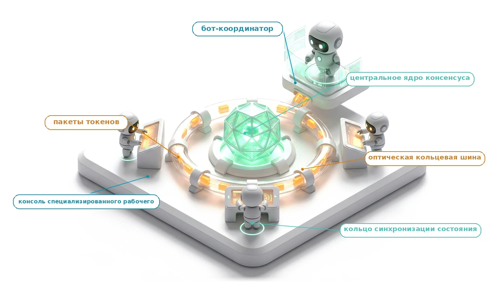
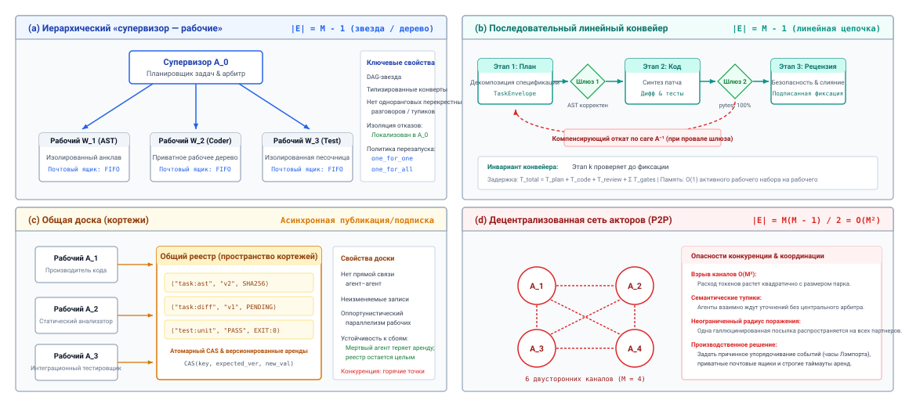
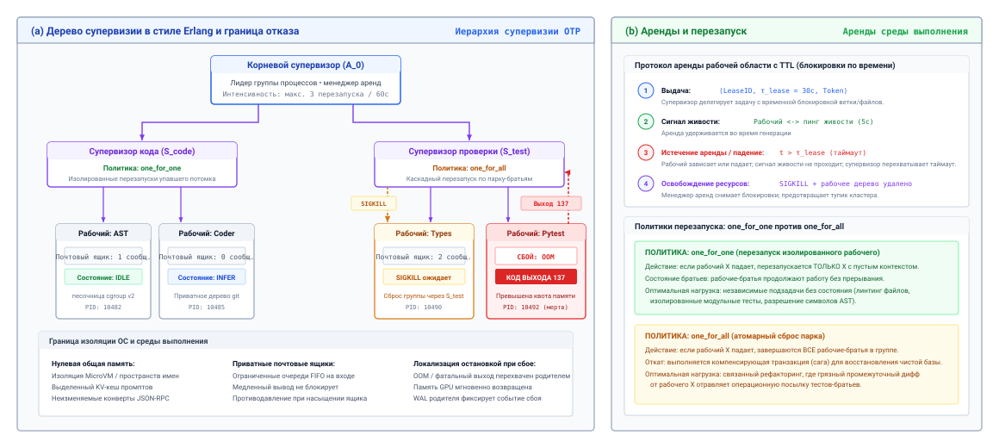
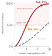
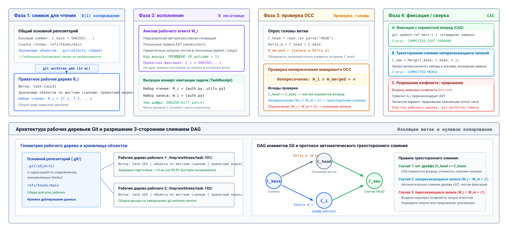
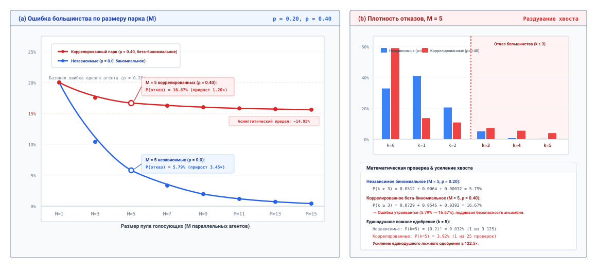
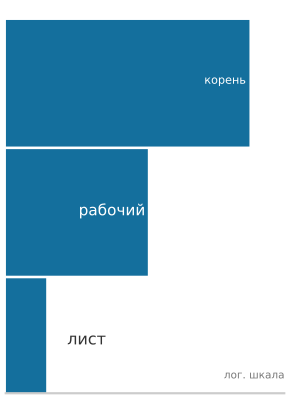
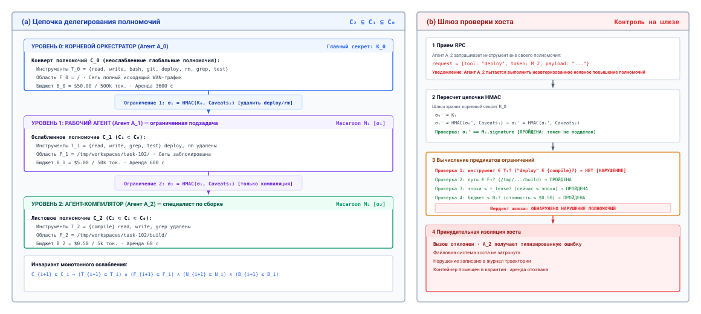
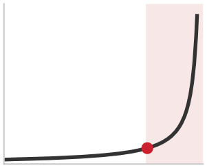
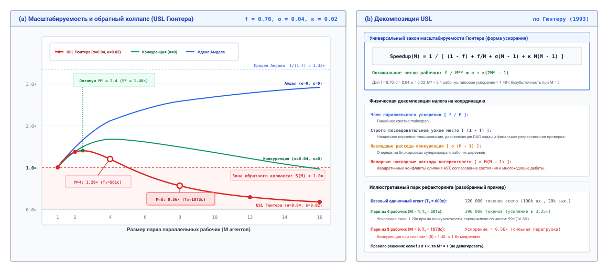

<a id="sec-vol3-multi-agent"></a>

# Координация нескольких агентов



## Назначение

_Почему разбиение задачи между несколькими агентами так часто обходится дороже и дает меньше, чем тот же бюджет, отданный одному агенту?_

Планировщик, который декомпозирует работу, агенты-кодеры, параллельно пишущие патчи, и ревьюер, который одобряет результат, похожи на инженерную команду, и такую конструкцию легко собрать. Однако если сравнить ее с одним агентом, которому разрешено потратить те же токены на сэмплирование, переработку и обратную связь от инструментов, такой парк часто заканчивает работу не быстрее, тратит в несколько раз больше токенов и ломается новыми способами. Рабочие агенты перезаписывают файлы друг друга, галлюцинированная посылка переходит от одного агента в контекст следующего, ревьюеры на одной модели разделяют ее слепые пятна, а дочерние агенты продолжают расходовать ресурсы после того, как родитель уже сдался. Разбиение задачи окупается, только если оно изолирует контекст, разделяет полномочия или исследует независимые альтернативы, и только если среда выполнения затем обеспечивает типизированные передачи, изолированные записи, шлюзы инвариантов, отмену и сужение полномочий на каждой границе между агентами. Парк одновременно умножает горизонт, состояние и полномочия, поэтому каждая передача должна сохранять замыкание, которое уже было у одного агента.

> **Цели обучения**
>
> - Вычислить налог на координацию парка и число рабочих агентов, после которого добавление агентов удлиняет продолжительность выполнения (makespan).
> - Выбрать топологию «оркестратор — рабочие агенты», конвейер или доску объявлений (blackboard) по графу зависимостей задачи и ее критическому пути.
> - Спроектировать типизированные конверты задач и результатов, которые ограничивают объем того, что координатор должен читать.
> - Применить изолированные рабочие деревья и оптимистичное управление конкурентным доступом к агентам, которые пишут в один и тот же репозиторий.
> - Объяснить, почему коррелированные ошибки разрушают ансамбли голосования и где должен стоять шлюз инварианта.
> - Спроектировать отмену и делегированные полномочия так, чтобы ни один дочерний агент не переживал своего родителя и не получал больше полномочий, чем он.
> - Оценить мультиагентный проект в сравнении с одним агентом при одном и том же общем бюджете.

<a id="sec-vol3-multiagent-need"></a>

## Компромисс делегирования


*Четыре рабочих агента сокращают makespan лишь до $0{,}84$ от исходного, но умножают затраты токенов в 3,25 раза.*

Команда разработчиков решает тикеты с ошибками пятью агентами (супервизор, три генератора кода и автор тестов) и фиксирует прирост числа закрытых задач на 4 процента по сравнению со своим одноагентным прототипом. Профилирование рассказывает другую историю. Ансамбль тратит в четырнадцать раз больше токенов, на критическом пути работает в 3,8 раза дольше из-за барьеров сериализации и синхронизации контекста и раз за разом зависает, разрешая конфликты слияния в общем репозитории. Когда исходному агенту выделяют те же ресурсы на итеративный цикл критики и доработки с выполнением инструментов ([«Вычисления на этапе тестирования»](03_test_time_compute.md#sec-vol3-test-time-compute)), он достигает той же доли решенных задач, потратив на 68 процентов меньше токенов и вдвое меньше времени. Дополнительные агенты не дали ничего такого, что бюджет не мог бы купить напрямую.

Этот результат задает вопрос, на который отвечает глава. Все предыдущие главы запускали одного агента на одной траектории — однопроцессорную конфигурацию в терминах машины, которую эта книга собирает. Миграции масштаба репозитория, непрерывные кампании фаззинга и распределенный анализ уязвимостей порождают больше состояния, телеметрии и выходных данных инструментов, чем способен переварить один цикл обдумывания, и естественный ответ — разделить работу между параллельными агентами, которые передают подзадачи друг другу и пишут в общее состояние. Такое разделение превращает один управляющий цикл в асинхронную распределенную систему, которая общается через удаленный вызов процедур (RPC) или каналы сообщений, и нельзя путать конкурентность с параллелизмом. Если подзадаче нужны проверенные артефакты предыдущего шага, отдельные процессы агентов не сократят критический путь. Они вставят в него сериализацию, проверку схемы, сетевую передачу и синхронизацию, превратив передачу управления в памяти в распределенное узкое место координации.


*Парк умножает горизонт, состояние и полномочия, поэтому каждая передача должна сохранять замыкание.*

Одноагентная среда выполнения предыдущих частей уже замыкает цикл вокруг модели, которая не имеет неявных полномочий и фиксирует только то, что проходит шлюзы среды вне модели ([«Принцип замыкания инвариантов»](01_introduction.md#sec-vol3-intro-invariant-closure)). Разделение цикла между агентами ничего из этого не меняет. Меняется экспозиция: парк умножает каждую из экспозиций H·S·A из раздела [«Экспозиции H·S·A»](01_introduction.md#sec-vol3-intro-hsa). Горизонт теперь проходит через передачи, поэтому ограничение разомкнутого контура из раздела [«Растяжение времени: от наносекундных операций до килосекундных траекторий»](01_introduction.md#sec-vol3-intro-temporal-stretching) действует на каждой границе агента, а путь к файлу, который один рабочий агент галлюцинировал, становится принятой посылкой для его соседей. Состояние дублируется в контекст каждого потомка и читается агентами, когда оно уже устарело. Полномочия передаются вниз по каждому делегированию и не должны по дороге расти. Глава выясняет, чего стоит разделение, когда оно окупается и что должна добавить среда выполнения, чтобы парк не был менее надежным, чем один агент.

С точки зрения системной практики делегирование между агентами оправдано, только если модульное разбиение состояния, привилегий или исследования с избытком перекрывает физические издержки межпроцессной координации. На практике три конкретных архитектурных мотива оправдывают декомпозицию нагрузки на парк агентов: разбиение контекста, ослабление полномочий инструментов и ортогональный параллельный поиск.

Первый законный мотив — *разбиение контекста*. Современные базовые модели работают в конечном рабочем окне контекста, ограниченном физической высокоскоростной памятью GPU (HBM) и насыщением пропускной способности памяти в цикле авторегрессивного декодирования. Когда рабочий контекст агента растет к своей максимальной границе $S_{\max}$, квадратичная сложность плотного внимания на этапе предзаполнения и память физических кадров KV-кеша PagedAttention сильно снижают пропускную способность обслуживания. Важнее то, что модели без полномочий демонстрируют эпистемическую деградацию — ее называют размыванием внимания или деградацией «иголки в стоге сена» — когда их заставляют извлекать информацию из огромных контекстов, заполненных посторонними журналами, схемами инструментов и трассами выполнения. Разбиение громадного операционного следа между специализированными субагентами позволяет каждому экземпляру движка держать компактный, сфокусированный рабочий контекст, сохраняя точность генерации и удерживая выделение KV-кеша в пределах оптимальных границ оборудования.

Второй системный мотив — *ослабление полномочий инструментов*. Среда выполнения агентов никогда не должна давать неограниченному корневому агенту прямой доступ к необратимым изменениям окружения, таким как удаление таблиц производственной базы данных, публикация пакетов в открытых реестрах или изменение таблиц сетевой маршрутизации. Делегируя опасные операции специализированным дочерним агентам, которые работают в изолированных контейнерах со строго ослабленными определениями инструментов, супервизор хоста обеспечивает эшелонированную защиту. Если субагент, которому поручено запускать недоверенные тестовые скрипты, столкнется с состязательным внедрением промпта или сгенерирует разрушительные команды оболочки, его радиус поражения физически ограничивается границей контейнера выполнения, и компрометация основного цикла оркестрации супервизора исключается.

Третий системный мотив — *настоящий параллельный поиск* по ортогональным, непересекающимся пространствам поиска. Когда инженерная задача требует проверки нескольких независимых гипотез — например, сравнения четырех различных алгоритмических реализаций в изолированных ветках репозитория, фаззинга независимых парсеров протоколов или перебора непересекающихся участков эмпирического пространства параметров, — один цикл агента вынужден проверять кандидатов последовательно. Запуск параллельных рабочих агентов на отдельных экземплярах движка позволяет среде выполнения задействовать нижележащие кластеры из нескольких GPU, одновременно выполняя циклы предзаполнения и декодирования независимых агентов. В такой конфигурации продолжительность глобальной задачи на критическом пути приближается к длительности самой медленной ветки плюс накладные расходы координации, и достигается подлинное параллельное ускорение.

**Основное правило делегирования:**
Некоординированный мультиагентный парк, который тратит в 10 раз больше токенов, памяти и реального времени выполнения, чем оптимизированный одноагентный процесс, и не дает статистически значимого улучшения детерминированно проверенного выполнения задачи, — это архитектурная регрессия. Параллельность без ортогонального поиска — это просто распределенная сериализация.

Однако эти преимущества никогда не бывают бесплатными: каждое делегирование платит *налог на координацию* (принцип «Налог на координацию»). Каждый раз, когда агент передает работу партнеру или дочернему процессу, среда выполнения несет конкретные вычислительные, сетевые и связанные с памятью издержки. Полная задержка по реальному времени $T_{\text{total}}$ делегированного мультиагентного процесса формально определяется уравнением налога на координацию:

$$T_{\text{total}} = T_{\text{work}} + T_{\text{serialize}} + T_{\text{network}} + T_{\text{context\_duplication}} + T_{\text{reconciliation}}$$

Здесь $T_{\text{work}}$ — чистое вычислительное время, затраченное в циклах авторегрессивного декодирования и предзаполнения на собственно преобразования задачи. $T_{\text{serialize}}$ — задержка на упаковку (маршалинг) типизированных конвертов задач, структурированных аргументов и состояний среды в сериализованные полезные нагрузки. $T_{\text{network}}$ отражает время передачи по сокету, каналу или между кластерами в инфраструктуре RPC. $T_{\text{context\_duplication}}$ — вычислительная стоимость, которую несут дочерние агенты, потому что не разделяют с родителем единое физическое адресное пространство памяти: каждый потомок должен самостоятельно выполнить предзаполнение своего базового системного промпта, схемы окружения, фрагментов кода и инструкций задачи, тратя избыточные такты GPU и выделяя дублирующие блоки KV-кеша. Наконец, $T_{\text{reconciliation}}$ — время, которое супервизор-родитель тратит на проверку, разбор, валидацию и синтез кандидатного результата потомка обратно в основную траекторию.

Предел масштабирования этого налога следует из закона Амдала, который раздел [«Учет длительности траектории»](01_introduction.md#sec-vol3-intro-duration-accounting) применял к доле модели в одной траектории. Здесь он применяется к самому разбиению. Если доля $1 - f$ агентного процесса принципиально последовательна (первичный анализ требований, глобальная декомпозиция задачи и итоговая проверка по всем ветвям), а оставшаяся доля $f$ может быть распределена между $M$ параллельными агентами, ускорение не может превысить

$$\text{Speedup}(M) = \frac{1}{(1 - f) + \frac{f}{M} + h(M)}$$

где $h(M)$ — налог на координацию, нормированный на время одноагентного выполнения, как функция размера парка $M$. В неоптимизированных мультиагентных системах, где агенты общаются через неограниченные широковещательные каналы или плотные одноранговые сообщения, $h(M)$ растет квадратично ($\mathcal{O}(M^2)$) с числом агентов. В таких условиях кривая ускорения быстро переворачивается: за небольшим порогом параллелизма добавление агентов увеличивает полное время выполнения, резко растит суммарное потребление токенов и снижает надежность системы в целом.

<a id="nbk-15-the-amdahl-limits-of-multi-agent"></a>

> **Пределы Амдала для мультиагентного параллелизма**
>
> Рассмотрим задачу рефакторинга всего репозитория на кодовой базе из 120 000 строк в восьми отдельных архитектурных модулях. Сравним две конфигурации системы: оптимизированный одноагентный цикл обдумывания против парка из четырех агентов «супервизор — исполнители» на идентичном кластере из восьми GPU NVIDIA H100 (по 80 ГБ HBM3 на GPU, 3,35 ТБ/с пропускной способности памяти, пропускная способность обслуживания в FP8 около $1{,}98 \times 10^{15}$ FLOP/с на устройство).
>
> При конфигурации A (одноагентное обдумывание) один агент обрабатывает все восемь модулей последовательно. Начальное последовательное планирование и декомпозиция задачи занимают 45 секунд на 1 500 токенов промпта и 800 токенов декодирования. Работа по рефакторингу модулей ($T_{\text{work}}$) требует 480 секунд на восемь модулей (по 60 секунд на модуль, в среднем 4 000 токенов предзаполнения промпта и 1 200 токенов декодирования на каждый). Последующая проверка и запуск тестов занимают по 15 секунд на модуль, в сумме 120 секунд. Для всей нагрузки полное время одноагентного процесса составляет $T_{\text{single}} = 45 + 480 + 120 = 645\text{ с}$, при суммарном расходе 53 900 токенов и нулевых накладных расходах координации ($T_{\text{coord}} = 0\text{ с}$).
>
> При конфигурации B (парк из четырех агентов с параллельными исполнителями) супервизор декомпозирует работу и назначает по два независимых модуля каждому из четырех параллельных исполнителей. Последовательное планирование по-прежнему занимает 45 секунд. Отправка типизированных конвертов задач через инфраструктуру RPC ($T_{\text{serialize}} + T_{\text{network}}$) обходится в 1,5 секунды на каждую отправку, всего в 6 секунд на четырех исполнителей. Поскольку исполнители не разделяют адресного пространства, предзаполнение контекста приходится дублировать: каждый исполнитель самостоятельно загружает 12 000-токенную спецификацию архитектуры проекта и схему окружения. При скорости предзаполнения обслуживания 4 000 токенов в секунду на экземпляр GPU это дублирующее предзаполнение добавляет:
> $$T_{\text{prefill\_dup}} = \frac{12\,000\text{ токенов}}{4\,000\text{ токенов/с}} = 3{,}0\text{ с на исполнителя}.$$
> Затем каждый исполнитель параллельно рефакторит два своих модуля, давая параллельную задержку работы $T_{\text{work\_parallel}} = 2 \times 60 = 120\text{ с}$, после чего параллельно выполняется тестирование в течение 30 секунд (по 15 секунд на модуль). Когда исполнители возвращают кандидатные патчи, супервизор должен объединить четыре пакета изменений ($T_{\text{reconciliation}}$), проверить целостность AST, разрешить два конфликта слияния git на общих заголовках интерфейсов (42 секунды на 2 800 токенов декодирования) и запустить глобальный набор регрессионных тестов (65 секунд). Итоговая задержка сверки составляет поэтому $T_{\text{reconciliation}} = 42 + 65 = 107\text{ с}$. Суммируя эти компоненты, получаем полное время мультиагентного процесса:
> $$T_{\text{multi}} = 45\text{ (посл.)} + 6\text{ (RPC)} + 3\text{ (предзап.)} + 120\text{ (работа)} + 30\text{ (тест)} + 107\text{ (сверка)} = 311\text{ с}.$$
> Измеренное параллельное ускорение составляет:
> $$\text{Speedup}(4) = \frac{645\text{ с}}{311\text{ с}} \approx 2{,}07\times.$$
>
> Системный учет затрат: хотя параллельный парк сокращает продолжительность выполнения в 2,07 раза, учет аппаратных ресурсов показывает реальный системный компромисс. Из-за избыточного предзаполнения контекста у четырех исполнителей (48 000 дублирующих токенов предзаполнения) и накладных расходов на сверку суммарное потребление токенов возрастает с 53 900 до 118 400 — в 2,20 раза. Мультиагентная архитектура обменивает увеличение вычислительной стоимости и объема памяти на $120\%$ на снижение реального времени выполнения на $51{,}8\%$. Если бы зависимости задач потребовали последовательной сверки между ветвями, $T_{\text{multi}}$ превысил бы $T_{\text{single}}$, и кривая ускорения перевернулась бы, несмотря на сжигание более чем вдвое большего числа вычислительных циклов.

Чтобы систематически ориентироваться в этих компромиссах, проектировщик среды выполнения должен отвергнуть необоснованное утверждение, что мультиагентные системы по своей сути превосходят одноагентные базовые варианты. Решая, стоит ли декомпозировать предлагаемую подсистему, архитектор должен взвесить операционные измерения, подробно описанные в таблице [«Сравнение архитектур»](16_multi_agent.md#tbl-vol3-delegation-matrix).

| Архитектурное измерение         | Одноагентное обдумывание                                                                         | Мультиагентное делегирование                                                                            | Системный компромисс и управляющий инвариант                                                                         |
|:--------------------------------|:-------------------------------------------------------------------------------------------------|:--------------------------------------------------------------------------------------------------------|:---------------------------------------------------------------------------------------------------------------------|
| **Задержка на критическом пути** | Ограничена строго последовательными циклами авторегрессивного декодирования ($T \propto \sum L_{\text{decode}}$). | Может приближаться к $T_{\text{max\_branch}} + T_{\text{tax}}$, когда задачи обладают истинной ортогональностью потоков данных. | Закон Амдала определяет максимальное ускорение; высокая сериализация между агентами быстро обращает параллельный выигрыш. |
| **Вычислительная стоимость и токены** | Минимальная; один общий KV-кеш, нулевое дублирование контекста между подзадачами.              | Высокая; $N$-кратное дублирование системных промптов, схем и конвертов синхронизации между агентами.     | Мультиагентные парки дают инфляцию токенов в 1,5 раза–$4{,}0\times$ для одинаковых функциональных результатов.        |
| **Рабочая память ($S_{\max}$)** | Высокий риск размывания внимания и исчерпания KV-кеша на длинных траекториях.                    | Ограничена для каждого агента; каждый субагент держит компактное окно, специфичное для задачи.          | Делегирование строго оправдано, когда общий объем рабочего состояния превышает надежную емкость внимания одной модели. |
| **Изоляция сбоев и безопасности** | Монолитная; одно необработанное исключение или внедрение промпта компрометирует сеанс.          | Сильная; субагенты работают в процессах песочницы с ослабленными полномочиями.                          | Принцип наименьших привилегий: изолировать недоверенные инструменты, сетевой доступ и изменения в одноразовых дочерних контейнерах. |
| **Согласованность состояния**   | Тривиальная; мутации происходят последовательно в одной линейной среде.                          | Сложная; конкурентные изменения общих файловых систем требуют оптимистичного управления конкурентным доступом. | Мультиагентное выполнение требует семантики распределенных транзакций, трехстороннего слияния git и откатов по саге. |
| **Корреляция отказов**          | Ошибки накапливаются вдоль одной траектории рассуждений через самоподкрепляющиеся галлюцинации. | Подвержена каскадным отказам, если агенты разделяют одни и те же веса базовой модели.                  | Консенсус одинаковых моделей — это псевдоверификация; проверка требует детерминированных внешних проверок.            |
<a id="tbl-vol3-delegation-matrix"></a>

***Сравнение архитектур: одноагентное обдумывание против мультиагентного делегирования**: системные компромиссы по задержке, стоимости, рабочей памяти, изоляции сбоев и согласованности.*

Будет ли задача выполняться как один рефлексивный цикл или как парк из двадцати обменивающихся сообщениями рабочих агентов, корректность устанавливается только сквозными свидетельствами из раздела [«Двойные гарантии сквозной границы»](01_introduction.md#sec-vol3-intro-end-to-end-boundary), собранными вне каждой модели. Три агента, которые раз за разом одобряют изменения кода друг друга, таких свидетельств не дают. Они производят распределенную эхо-камеру коррелированных ошибок, которую количественно описывает раздел [«Коррелированные отказы ансамбля»](16_multi_agent.md#sec-vol3-multiagent-consensus).

Поэтому архитектурная граница ясна. Мультиагентное делегирование — не универсальная замена строгому одноагентному проектированию, а специализированный механизм конкурентности, который стоит применять тогда, когда разбиение контекста, ослабление полномочий или спекулятивный параллельный поиск явно перевешивают налоги на сериализацию и сверку. Как только инженерная нагрузка удовлетворяет этим критериям и делегирование математически оправдано, среда выполнения должна отказаться от стихийной коммуникации и ввести формальную структуру координации. Это сразу ставит перед нами следующую структурную задачу: как среде выполнения формально организовать каналы связи, зависимости задач и маршрутизацию потоков данных между этими параллельными узлами исполнения?

<a id="sec-vol3-multiagent-topologies"></a>

## Топологии координации

Когда неупорядоченная мультиагентная система инициализируется как произвольная полносвязная одноранговая сеть без формальных топологий коммуникации, среда выполнения вырождается в лавинообразный шторм сообщений. В ансамбле из $N$ агентов без полномочий, которые обмениваются сырым естественным языком по неограниченным широковещательным каналам, число потенциальных двусторонних путей связи растет как $\binom{N}{2} = \frac{N(N-1)}{2} = \mathcal{O}(N^2)$. На каждом шаге взаимодействия каждый агент рассылает свое промежуточное обдумывание всем партнерам, из-за чего размер входного промпта, вычисления внимания и занимаемая KV-кешем память по всему парку растут квадратично. В эмпирическом стенде, где восемь агентов выполняли распределенную задачу рефакторинга кода, неограниченная одноранговая топология породила более 240 сообщений между агентами меньше чем за четыре минуты. Парк израсходовал 1,8 миллиона токенов на избыточные проходы предзаполнения промпта, вызвал повторяющиеся состязания (race conditions) за общие файлы и в итоге остановился из-за исчерпания окна контекста, так и не зафиксировав ни одного проверенного синтаксического дерева.

Координация нескольких агентов по сути является упражнением в распределенной компиляции графов: среда выполнения должна заменить неограниченную разговорную болтовню формальными ориентированными ациклическими графами зависимостей задач (DAG) и выбирать между иерархической топологией «супервизор — рабочие», последовательным линейным конвейером и децентрализованной доской объявлений (blackboard) или сетью акторов строго по базовым зависимостям потоков данных вычислительной нагрузки.

**Топологическое ограничение:**
Неограниченная разговорная сеть имеет $\mathcal{O}(N^2)$ каналов связи и $\mathcal{O}(N^2)$ рост предзаполнения промпта. Введение формальной топологии DAG сокращает число активных ребер связи до $\mathcal{O}(N)$ или $\mathcal{O}(N \log N)$, ограничивая потребление контекста и исключая циклические разговорные тупики.

В классических операционных системах конкурентность обеспечивается чистыми абстракциями между процессами, каналами межпроцессного взаимодействия (IPC) и примитивами синхронизации. В среде выполнения агентного машинного обучения вычислительная единица — не поток операционной системы, исполняющий детерминированные инструкции x86, а экземпляр базовой модели, который генерирует текст авторегрессивно. Поскольку такие движки вывода демонстрируют недетерминированную генерацию, высокую задержку на токен и циклы декодирования, ограниченные пропускной способностью памяти, топология координации определяет, даст ли конкурентность настоящее параллельное ускорение или лишь умножит накладные расходы на коммуникацию и сверку.

<a id="fig-vol3-multi-agent-topologies"></a>


***Топологии координации мультиагентных систем**: структурные графовые топологии, определяющие взаимодействие распределенных базовых моделей. Панель A показывает централизованную иерархическую диспетчеризацию; панель B — линейные конвейеры с контролем этапов и компенсирующими откатами по саге; панель C — развязанную асинхронную мутацию пространства кортежей через атомарное сравнение с обменом; панель D — квадратичный рост каналов и опасность семантической живой блокировки (livelock) у неограниченных сеток акторов.*

### Таксономия топологий координации

Архитектурный проект мультиагентной системы начинается с выбора схемы соединений, которая отражает зависимости потоков данных целевого приложения. Как формализовано на рисунке [«Топологии координации мультиагентных систем»](16_multi_agent.md#fig-vol3-multi-agent-topologies), распределенные среды выполнения агентов структурируют исполнение по четырем каноническим топологическим архетипам:
В иерархической модели «супервизор — рабочие» (панель A) исполнение организовано как ориентированное дерево-звезда, где корневой супервизор $A_0$ диспетчеризует типизированные конверты задач изолированным анклавам рабочих ($W_1, W_2, W_3$), ограничивая ребра связи строго значением $|E| = M - 1$ и локализуя исключения дочерних агентов. В последовательном линейном конвейере (панель B) работа продвигается по поэтапному DAG, где детерминированные шлюзы ($G_1, G_2$) проверяют промежуточные артефакты до выпуска, а при сбое запускаются обратные компенсирующие откаты по саге ($\mathcal{A}^{-1}$), чтобы загрязнение не распространилось вниз по потоку. В архитектуре общей доски объявлений (панель C) параллельные рабочие действуют без двусторонней связи и синхронизируют состояние исключительно через атомарные транзакции сравнения с обменом (CAS) над централизованным пространством кортежей. Наконец, в децентрализованной сети акторов (панель D) неограниченная одноранговая коммуникация порождает квадратичный взрыв каналов ($|E| = M(M-1)/2$), создавая серьезные риски семантических тупиков, размывания контекста и неограниченного распространения отказов.

*Иерархическая топология «супервизор — рабочие»* организует агентов в явное древовидное устройство. Назначенный корневой супервизор получает верхнеуровневую спецификацию, декомпозирует цель на независимые подзадачи, отправляет явные конверты задач специализированным подчиненным рабочим, собирает промежуточные кандидатные артефакты и применяет внешние шлюзы проверки, прежде чем синтезировать глобальный результат. Эта топология дает централизованный учет состояния и единственный, четко определенный центр полномочий над средой: только супервизор может фиксировать проверенные переходы состояния во внешней среде. Рабочие выполняются как листовые узлы в изолированных песочницах, что исключает некоординированные мутации общих ресурсов.

Однако иерархическая топология страдает серьезным физическим режимом отказа — *узким местом контекста координатора*. По мере роста парка рабочих $N$ или когда отдельные рабочие возвращают обширные журналы выполнения, диагностику компилятора и фрагменты диффов, рабочее окно супервизора $S_{\max}$ быстро насыщается. Супервизор вынужден принимать сцепленные (конкатенированные) выходы всех подчиненных агентов:

$$S_{\text{supervisor}} = S_{\text{spec}} + \sum_{i=1}^N S_{\text{return}}(i)$$

Когда $S_{\text{supervisor}}$ приближается к аппаратной емкости движка обслуживания GPU, квадратичное масштабирование памяти и вычислений при предзаполнении внимания сильно раздувает задержку супервизора. Еще более разрушительно то, что у супервизора возникает размывание внимания: он неверно истолковывает или упускает тонкие ошибки, спрятанные в громоздких ответах подчиненных рабочих. Кроме того, супервизор становится единой точкой сериализации: если корневой агент застревает на фазе авторегрессивного декодирования или генерирует неразбираемый конверт диспетчеризации, все нижестоящие рабочие простаивают без работы.

Топология *последовательного линейного конвейера* организует исполнение как однонаправленную сборочную линию ($A_1 \to A_2 \to \dots \to A_k$), где проверенный выходной артефакт агента $k$ служит непосредственным входным контекстом для агента $k+1$. Такая архитектура идеально подходит для поэтапных инженерных преобразований со строгой временной сериализацией, например для перевода архитектурных требований в код, запуска статического анализа и линтеров, генерации наборов регрессионных тестов, проведения аудитов безопасности и сборки манифестов развертывания.

Главное системное преимущество линейного конвейера — минимальный объем памяти и высокая операционная пропускная способность для потоковых пакетных задач. Поскольку каждый агент в конвейере посвящен одной специализированной фазе, его системный промпт и определения инструментов остаются компактными. Промежуточные трассы рассуждений верхнего по потоку этапа можно полностью отбросить: агент $k+1$ получает только чистый проверенный артефакт, который выдал агент $k$, и полностью избегает насыщения контекста, которое мучает иерархических супервизоров. Кроме того, поскольку каждый этап конвейера использует одинаковый статический системный промпт для последовательных элементов пакета, движок обслуживания достигает почти идеального переиспользования префикса KV-кеша, амортизируя вычисления предзаполнения по нагрузке.

Уязвимость последовательного конвейера заключается в *остановке на верхнем по потоку этапе и распространении ошибок*. Если ранний этап не выдает артефакт, который проходит проверки компиляции или линтинга нижестоящих этапов, весь конвейер останавливается. Хуже того, если верхний этап порождает тонкий семантический дефект, который ускользает от статических проверок, нижестоящие агенты воспринимают этот дефект как авторитетную посылку. В конвейере без двусторонней обратной связи нижестоящие этапы не могут запросить пересмотр верхних этапов без введения обратных управляющих ребер, что превращает простой линейный конвейер в развернутый циклический граф со сложной динамикой сходимости.

*Децентрализованные модели доски объявлений и акторов* полностью устраняют централизованных координаторов, опираясь непосредственно на фундаментальную литературу по распределенным системам. В модели акторов, которую сформулировали Хьюитт, Бишоп и Стайгер (Hewitt et al., 1973), автономные вычислительные сущности (акторы) хранят приватное локальное состояние, общаются исключительно через асинхронные типизированные очереди сообщений (почтовые ящики) и динамически порождают новых акторов в ответ на сообщения. В архитектуре доски объявлений параллельные рабочие агенты взаимодействуют косвенно, читая из глобально видимого репозитория артефактов с дописыванием и записывая в него. Специализированные агенты следят за доской, берут подзадачи, когда появляются необходимые артефакты, выполняют преобразования и публикуют проверенные результаты обратно на доску.

Эти децентрализованные топологии обеспечивают высокую динамическую масштабируемость и устойчивость к отказам. Нет центрального супервизора, чье окно контекста могло бы насытиться, и отказ отдельного рабочего не останавливает парк: остальные рабочие продолжают обрабатывать доступные подзадачи с доски или из своих приватных почтовых ящиков.

Физическая дилемма децентрализованных топологий — *конкуренция за блокировки, расщепление мозга (split-brain) и недетерминированный порядок событий*. Поскольку агенты выполняются параллельно без центрального арбитра, два рабочих могут одновременно взять одну и ту же подзадачу или попытаться внести конфликтующие мутации в пересекающиеся файлы кодовой базы. Без физически синхронизированных часов разрешение причинных зависимостей между асинхронными сообщениями агентов требует реализации логических временных меток Лэмпорта или векторных часов (Lamport, 1978) внутри брокера сообщений среды выполнения. Без строгих распределенных блокировок или неизменяемого хранилища артефактов с адресацией по содержимому децентрализованные парки агентов быстро скатываются в состояния split-brain, в которых конфликтующие архитектурные решения фиксируются в параллельных ветках, что приводит к огромным накладным расходам на сверку при интеграции. Свойства и компромиссы этих четырех топологий сравниваются в таблице [«Сравнение топологий координации нескольких агентов»](16_multi_agent.md#tbl-vol3-topologies-comparison).

| Топология координации                | Задержка на критическом пути                                                          | Объем контекста и KV-кеша                                                                        | Изоляция сбоев и восстановление                                                         | Конкурентность и риск конфликтов                                                          | Оптимальный профиль нагрузки                                                      |
|:-----------------------------------|:--------------------------------------------------------------------------------------|:-------------------------------------------------------------------------------------------------|:----------------------------------------------------------------------------------------|:------------------------------------------------------------------------------------------|:----------------------------------------------------------------------------------|
| **Иерархическая «супервизор — рабочие»** | Низкая или умеренная; ограничена последовательными фазами супервизора и самым медленным рабочим. | Высокий у корня; окно контекста супервизора насыщается по мере накопления $\mathcal{O}(N)$ ответов рабочих. | Умеренная; сбои рабочих изолированы, но сбой супервизора останавливает все дерево.      | Низкий; централизованный координатор сериализует и проверяет все мутации до фиксации.         | Исследовательская декомпозиция задач, поиск по нескольким гипотезам, изолированное исправление ошибок. |
| **Последовательный линейный конвейер**     | Высокая; строго последовательная продолжительность ($T_{\text{crit}} = \sum T_k$); нулевой параллелизм задач. | Минимальный; каждый этап получает только чистые артефакты; высокое совместное использование префикса KV-кеша. | Хрупкая; сбой на этапе $k$ останавливает конвейер или переносит некорректный контекст вниз по потоку. | Нулевой; исполнение упорядочено во времени; конфликтов параллельной записи нет.               | Многоэтапное уточнение артефактов, проверка кода в CI/CD, синтез документации.     |
| **Общая доска объявлений**              | Низкая; оппортунистический параллелизм по мере выполнения зависимостей на доске.        | Распределенный; общая память или хранилище артефактов; рабочие держат компактный приватный контекст. | Надежная; падение рабочего не разрушает доску, и задачи могут быть перехвачены равноправными агентами. | Высокая; параллельные рабочие рискуют коллизиями записи и состязаниями за общие артефакты. | Разнородный анализ, непрерывный фаззинг репозитория, извлечение знаний.           |
| **Децентрализованная сеть акторов**     | Переменная; определяется задержкой передачи сообщений и точками синхронизации графа.       | Ограничен для каждого актора; почтовые ящики асинхронно буферизуют типизированные конверты задач. | Высокая; сбой актора изолирован в приватном почтовом ящике; деревья супервизии обрабатывают перезапуски. | От умеренной до высокой; требует причинного упорядочивания событий (часы Лэмпорта) и распределенной аренды. | Открытое моделирование, распределенное доказательство теорем, моделирование многодоменных систем. |

<a id="tbl-vol3-topologies-comparison"></a>

***Сравнение топологий координации нескольких агентов**: задержки на критическом пути, объемы памяти, свойства изоляции сбоев и профили оптимальной нагрузки.*

### Моделирование исполнения как DAG зависимостей задач

Чтобы уйти от непредсказуемости разговорной переписки, среда выполнения агентов должна моделировать мультиагентное исполнение как формальный ориентированный ациклический граф (DAG) зависимостей задач, обозначаемый $G = (V, E)$. В этой формулировке каждая вершина $v_i \in V$ представляет дискретную единицу агентного вычисления: выполнение специализированного экземпляра базовой модели над явным входным контекстом, ограниченным конечным бюджетом токенов. Каждое направленное ребро $(v_i, v_j) \in E$ представляет неизменяемую зависимость по данным или по управлению: задача $v_j$ не может быть запланирована к исполнению, пока задача $v_i$ не завершится и не выдаст внешне проверенный артефакт.

**Зависимости по данным и зависимости по управлению:**
*Зависимость по данным* требует, чтобы задача $v_j$ получила физические выходные байты задачи $v_i$ (например, заголовочный файл, сгенерированный $v_i$ и потребляемый $v_j$). *Зависимость по управлению* задает порядок исполнения без передачи сырых артефактов (например, гарантирует, что набор модульных тестов запускается только после того, как компилятор пройден).

Планировщик среды выполнения отслеживает входящую степень (in-degree) всех вершин графа. Вершина $v_j$ помещается в очередь готовых к запуску задач тогда и только тогда, когда ее входящая степень удовлетворяет условию:

$$\text{in-degree}(v_j) = |\{ v_i \in V \mid (v_i, v_j) \in E \}| = 0$$

Когда выполняющаяся задача $v_i$ успешно завершается и ее выходные данные проходят детерминированные шлюзы проверки (например, сертификацию компилятора или валидацию AST), среда выполнения сохраняет ее выходные артефакты в слое хранения с адресацией по содержимому. Затем планировщик удаляет $v_i$ и ее исходящие ребра из активного графа, уменьшая входящую степень всех непосредственных последователей. Любой последователь, чья входящая степень становится нулевой, немедленно переходит в состояние готовности и отправляется на свободного рабочего.

Теоретическая производительность агентного графа зависимостей определяется двумя фундаментальными свойствами графа: работой и критическим путем. *Полная работа* $W(G)$ — это совокупное вычислительное время, затраченное по всем вершинам:

$$W(G) = \sum_{v_i \in V} T(v_i)$$

где $T(v_i)$ — время реального выполнения вершины $v_i$. Для авторегрессивной базовой модели $T(v_i)$ определяется фазой предзаполнения над входными токенами $S_{\text{in}}$, фазой декодирования над сгенерированными токенами $K_{\text{out}}$ и длительностью любых детерминированных вызовов инструментов (например, запуска набора тестов):

$$T(v_i) = \frac{S_{\text{in}}(v_i)}{R_{\text{prefill}}} + \frac{K_{\text{out}}(v_i)}{R_{\text{decode}}} + T_{\text{tool}}(v_i)$$

Здесь $R_{\text{prefill}}$ (токенов в секунду) ограничено вычислительной мощностью GPU в FLOP при матрично-матричном умножении (GEMM), тогда как $R_{\text{decode}}$ строго ограничено пропускной способностью памяти при авторегрессивной матрично-векторной генерации (GEMV).

*Критический путь* $\Pi_{\text{crit}}$ — это самая длинная направленная последовательность зависимых вершин от любого источника до любого стока в $G$:

$$\Pi_{\text{crit}} = \arg\max_{\Pi \in \text{Paths}(G)} \sum_{v \in \Pi} T(v)$$

*Makespan критического пути*, определяемый как $T_{\text{crit}} = \sum_{v \in \Pi_{\text{crit}}} T(v)$, задает строгую физическую нижнюю границу глобального времени выполнения. Независимо от того, выделяет ли среда четыре, шестнадцать или бесконечное число параллельных рабочих агентов, нагрузка не может завершиться быстрее, чем за $T_{\text{crit}}$.

Параллельное ускорение возникает, когда граф зависимостей содержит структуры ветвления (fan-out), где одна родительская задача порождает несколько взаимно независимых дочерних вершин ($v_1 \to \{v_2, v_3, \dots, v_m\}$). Максимальный мгновенный параллелизм, поддерживаемый графом, определяется его *шириной* $\mathcal{W}(G)$ — максимальным размером независимого сечения вершин. Если число выделенных рабочих агентов $P$ меньше ширины графа ($P < \mathcal{W}(G)$), планировщик должен упорядочивать готовые вершины по их оставшемуся расстоянию до стока, отдавая приоритет вершинам на критическом пути, чтобы не допустить пузырей в расписании (scheduling bubbles).

<a id="nbk-15-critical-path-makespan-and-dag-scheduling"></a>

> **Планирование DAG в мультиагентном исполнении**
>
> Рассмотрим комплексное обновление подсистемы, состоящее из семи дискретных агентных задач ($v_1$ — $v_7$), которые выполняются на кластере вывода с четырьмя рабочими экземплярами ($P=4$). Аппаратура обслуживания состоит из GPU NVIDIA H100 SXM5 (80 ГБ HBM3, 3,35 ТБ/с пропускной способности памяти), которые обеспечивают эмпирическую пропускную способность декодирования одного потока $R_{\text{decode}} = 80\text{ токенов/с}$ и пропускную способность предзаполнения $R_{\text{prefill}} = 4\,000\text{ токенов/с}$.
>
> Задачи обладают следующими зависимостями и параметрами аппаратного исполнения:
>
> - Задача $v_1$ (архитектурная спецификация системы): корневой узел. $S_{\text{in}} = 2\,000$ токенов, $K_{\text{out}} = 1\,600$ токенов, $T_{\text{tool}} = 0\text{ с}$.
>   $$T(v_1) = \frac{2\,000}{4\,000} + \frac{1\,600}{80} + 0 = 0{,}5 + 20{,}0 = 20{,}5\text{ с}.$$
>
> - Задачи $v_2, v_3, v_4$ (независимые рефакторинги модулей): потомки $v_1$. Они представляют параллельные ветви ветвления, работающие над отдельными модулями кода. Каждая получает от $v_1$ спецификацию в 1 600 токенов плюс 6 400 токенов кода модуля ($S_{\text{in}} = 8\,000$ токенов), генерирует $K_{\text{out}} = 2\,400$ токенов диффов кода и выполняет локальные проверки компилятора ($T_{\text{tool}} = 10{,}0\text{ с}$):
>   $$T(v_2) = T(v_3) = T(v_4) = \frac{8\,000}{4\,000} + \frac{2\,400}{80} + 10{,}0 = 2{,}0 + 30{,}0 + 10{,}0 = 42{,}0\text{ с}.$$
>
> - Задача $v_5$ (аудит безопасности и уязвимостей): потомок $v_2$ и $v_3$. Получает патчи из обоих модулей ($S_{\text{in}} = 12\,000$ токенов), генерирует $K_{\text{out}} = 1\,200$ токенов заметок аудита и запускает фаззер статического анализа ($T_{\text{tool}} = 25{,}0\text{ с}$):
>   $$T(v_5) = \frac{12\,000}{4\,000} + \frac{1\,200}{80} + 25{,}0 = 3{,}0 + 15{,}0 + 25{,}0 = 43{,}0\text{ с}.$$
>
> - Задача $v_6$ (генерация связующих привязок интеграции): потомок $v_4$. Получает патч от $v_4$ ($S_{\text{in}} = 6\,000$ токенов), генерирует $K_{\text{out}} = 800$ токенов и проверяет сигнатуры интерфейсов ($T_{\text{tool}} = 5{,}0\text{ с}$):
>   $$T(v_6) = \frac{6\,000}{4\,000} + \frac{800}{80} + 5{,}0 = 1{,}5 + 10{,}0 + 5{,}0 = 16{,}5\text{ с}.$$
>
> - Задача $v_7$ (глобальная интеграция, компоновка и регрессионный набор): сток; зависит от $v_5$ и $v_6$. Получает все кандидатные патчи ($S_{\text{in}} = 16\,000$ токенов), генерирует итоговые метаданные слияния ($K_{\text{out}} = 400$ токенов) и выполняет сквозной набор интеграционных тестов ($T_{\text{tool}} = 60{,}0\text{ с}$):
>   $$T(v_7) = \frac{16\,000}{4\,000} + \frac{400}{80} + 60{,}0 = 4{,}0 + 5{,}0 + 60{,}0 = 69{,}0\text{ с}.$$
>
> Шаг 1. Расчет полной работы.
> Совокупная вычислительная работа по всей нагрузке составляет:
> $$W(G) = \sum_{i=1}^7 T(v_i) = 20{,}5 + 42{,}0 + 42{,}0 + 42{,}0 + 43{,}0 + 16{,}5 + 69{,}0 = 275{,}0\text{ с}.$$
> Если бы нагрузка выполнялась последовательно одним рабочим агентом, минимальное время выполнения составило бы $T_{\text{seq}} = 275{,}0\text{ с}$.
>
> Шаг 2. Определение критического пути.
> Перечислим все пути от источника $v_1$ до стока $v_7$:
>
> - Путь 1: $v_1 \to v_2 \to v_5 \to v_7$
>   $$\text{Длина}(\text{Путь 1}) = 20{,}5 + 42{,}0 + 43{,}0 + 69{,}0 = 174{,}5\text{ с}.$$
>
> - Путь 2: $v_1 \to v_3 \to v_5 \to v_7$
>   $$\text{Длина}(\text{Путь 2}) = 20{,}5 + 42{,}0 + 43{,}0 + 69{,}0 = 174{,}5\text{ с}.$$
>
> - Путь 3: $v_1 \to v_4 \to v_6 \to v_7$
>   $$\text{Длина}(\text{Путь 3}) = 20{,}5 + 42{,}0 + 16{,}5 + 69{,}0 = 148{,}0\text{ с}.$$
>
> Критический путь — $\Pi_{\text{crit}} = v_1 \to v_2 \to v_5 \to v_7$ (наравне с путем 2), что задает makespan критического пути $T_{\text{crit}} = 174{,}5\text{ с}$.
>
> Шаг 3. Анализ планирования при $P=4$ рабочих.
> При $t = 0\text{ с}$ запускается только $v_1$: рабочий 1 выполняет $v_1$, а рабочие 2, 3 и 4 простаивают.
> При $t = 20{,}5\text{ с}$ задача $v_1$ завершается. Вершины $v_2, v_3, v_4$ одновременно становятся готовыми. Рабочие 1, 2 и 3 параллельно берут эти задачи. Рабочий 4 остается без работы, потому что ширина графа в этот момент равна $\mathcal{W} = 3$.
> При $t = 20{,}5 + 42{,}0 = 62{,}5\text{ с}$ все три рефакторинга завершаются. Теперь становятся готовыми $v_5$ (которой нужны и $v_2$, и $v_3$) и $v_6$ (которой нужна $v_4$). Рабочий 1 берет $v_5$, рабочий 2 — $v_6$.
> При $t = 62{,}5 + 16{,}5 = 79{,}0\text{ с}$ завершается $v_6$. Однако стоковый узел $v_7$ не может выполняться, потому что его другая зависимость, $v_5$, все еще выполняется на рабочем 1. Рабочий 2 попадает в простой из-за синхронизации (пузырь).
> При $t = 62{,}5 + 43{,}0 = 105{,}5\text{ с}$ завершается $v_5$. Обе зависимости $v_7$ удовлетворены. Рабочий 1 выполняет $v_7$, которая завершается при $t = 105{,}5 + 69{,}0 = 174{,}5\text{ с}$.
>
> Поскольку $P=4 \ge \max(\mathcal{W}(G))$, фактическое время выполнения достигает предела критического пути: $T_{\text{parallel}} = 174{,}5\text{ с}$. Итоговое параллельное ускорение составляет:
> $$\mathcal{S} = \frac{T_{\text{seq}}}{T_{\text{parallel}}} = \frac{275{,}0\text{ с}}{174{,}5\text{ с}} \approx 1{,}58\times.$$
> Несмотря на четыре параллельных рабочих на GPU, ускорение не превышает $1{,}58\times$. Остальная вычислительная мощность потеряна на последовательных зависимостях ($v_1$ и $v_7$) и на простоях рабочих, которые ждут синхронизации слияния в $v_5$ и $v_7$.

### Динамическое порождение топологии

Центральное архитектурное решение при проектировании среды выполнения — то, должен ли граф зависимостей мультиагентной системы компилироваться статически заранее или порождаться динамически во время исполнения.

В *статической топологии* граф исполнения $G$ полностью объявляется и компилируется до запуска нагрузки. Разработчик или инструментарий компиляции задает точный набор ролей агентов, их специализированные системные промпты, доступные наборы инструментов и фиксированные ребра зависимостей. Жесткие многоэтапные конвейеры непрерывной интеграции или детерминированные обвязки проверки компилятором работают на статических топологиях.

Статические топологии дают существенные системные преимущества:
Во-первых, они допускают детерминированный анализ на этапе компиляции. Среда выполнения может проверить, что граф зависимостей строго ацикличен, убедиться, что каждое ребро соединяет совместимые по типам входные и выходные схемы, и заранее рассчитать наихудшие траты токенов.
Во-вторых, статические графы позволяют агрессивные системные оптимизации. Движок обслуживания может заранее загрузить и закрепить в памяти GPU KV-кеши системных промптов для каждого запланированного агента, обеспечив мгновенную инициализацию контекста без накладных расходов в момент запуска задачи.
В-третьих, алгоритмы планирования могут статически сопоставлять вершины конкретным аппаратным устройствам, минимизируя задержку коммуникации между GPU и балансируя потребление памяти.

Фатальное ограничение статических топологий — их неспособность адаптироваться к эмпирическим открытиям во время исполнения. Нагрузки в разработке ПО по природе недетерминированы: ошибка, локализованная в одном файле, может выявить глубокие архитектурные дефекты в трех других, не отображенных подсистемах при запуске тестов. Статическая топология не может динамически создать дополнительного субагента для исследования неожиданной регрессии и не может динамически отсечь целую ветвь исполнения, когда ранняя проверка доказывает, что гипотеза проекта неверна.

В *динамической топологии* агенты порождают дочерних агентов программно во время исполнения в ответ на промежуточную обратную связь. Агент, выполняющий рефакторинг репозитория, может вызвать инструмент среды выполнения хоста (например, `invoke_subagent`), передав настроенный промпт задачи, ограниченные пути к файлам и ослабленный конверт полномочий. Среда выполнения динамически создает новый процесс дочернего агента, регистрирует новую вершину и ребро зависимости в активном графе исполнения и планирует дочерний процесс на свободный слот рабочего.

Динамические топологии дают непревзойденную гибкость: система агентов может подгонять свою вычислительную декомпозицию под точные структурные очертания задачи. Если дочерний агент обнаруживает, что устаревший модуль опирается на недокументированный интерфейс RPC, он может динамически породить вспомогательного исследовательского агента, который изучит сетевые трассы, не загрязняя собственный рабочий контекст.

Однако динамическое порождение вносит критические системные опасности, которые могут быстро дестабилизировать среду выполнения хоста, как показано по иерархии в таблице [«Рекурсивное динамическое порождение и ослабление бюджета»](16_multi_agent.md#tbl-vol3-subagent-spawn-lifecycle):

| Глубина порождения       | Агент                     | Входящий вызов делегирования | Выделенный бюджет токенов | Инвариант безопасности и ослабления                                                                          |
|:-------------------------|:--------------------------|:--------------------------|:-----------------------|:-------------------------------------------------------------------------------------------------------------|
| **Уровень 0 (корень)**   | Родительский супервизор ($A_0$) | Исходная отправка задачи  | $B_0$ токенов          | Удерживает основную аренду задачи и глобальный контекст отмены.                                              |
| **Уровень 1 (потомок)**  | Рабочий агент ($A_1$)     | `fork_agent(prompt, B_1)` | $B_1 < B_0$ токенов    | Бюджет строго ослаблен ($B_1 \le \alpha \cdot B_0$, $\alpha < 1$); наследует контекст отмены родителя.        |
| **Уровень 2 (внук)**     | Специализированный лист ($A_2$) | `fork_agent(prompt, B_2)` | $B_2 < B_1$ токенов    | Ограничение глубины ($D \le D_{\max}$) соблюдается; дальнейшие попытки рекурсивного порождения отклоняются (`EPERM`). |

<a id="tbl-vol3-subagent-spawn-lifecycle"></a>

***Рекурсивное динамическое порождение и ослабление бюджета**: структурная иерархия, ребра делегирования «родитель — потомок» и монотонное ограничение ресурсов по поколениям.*

Главная опасность — *вилочная бомба агентов* (agent fork bomb). Если базовым моделям без полномочий разрешить рекурсивно порождать дочерних агентов без жестких ограничений среды выполнения, недетерминированные циклы рассуждений могут вызвать экспоненциальный взрыв процессов. Агент, столкнувшийся с неоднозначной ошибкой компилятора, может породить трех дочерних агентов для исследования разных гипотез; каждый из них, встретив вторичные ошибки, порождает еще трех. Через несколько минут парк порождает сотни параллельных процессов, насыщает память GPU, исчерпывает таблицы процессов операционной системы и тратит миллионы токенов без продвижения вперед.

Вторичная опасность — порождение *осиротевших зомби-агентов*. Если родительский агент сталкивается с необработанным исключением, отменяется пользовательским прерыванием или исчерпывает бюджет токенов, пока его динамически порожденные дети еще выполняются, дети продолжают работать в фоновых процессах. Эти осиротевшие агенты продолжают потреблять такты GPU и выполнять мутации в средах песочницы, расходуя ресурсы и потенциально создавая состязания с последующими пользовательскими операциями.

Чтобы укротить динамические топологии, среда выполнения хоста должна обеспечивать три строгих архитектурных инварианта:

1. *Ограниченная глубина рекурсии:* супервизор среды выполнения должен обеспечивать жесткий глобальный потолок глубины делегирования ($D \le D_{\max}$, обычно $D_{\max} \in [1, 2]$). Любой вызов инструмента, который пытается породить потомка на глубине $D_{\max}$, должен отклоняться средой выполнения с явной ошибкой авторизации.
2. *Строгое ослабление бюджета:* динамически порожденный дочерний агент никогда не должен получать неограниченного выделения вычислений. Его бюджет токенов $B_{\text{child}}$ и таймаут исполнения должны строго выделяться из остатка родителя и вычитаться из него:
   $$B_{\text{remaining\_parent}} \leftarrow B_{\text{current\_parent}} - B_{\text{child}}$$
   При таком законе сохранения парк агентов не может превысить глобальный конверт ресурсов, установленный пользователем, сколько бы динамических потомков ни создавалось.

3. *Деревья супервизии групп процессов:* динамически порожденные агенты должны регистрироваться в группе процессов операционной системы или пространстве имен контейнера, напрямую связанном с жизненным циклом родителя. Если родитель завершается, падает или получает сигнал отмены, супервизор хоста атомарно распространяет сигнал завершения (`SIGKILL` или RPC отмены контейнера) по всему поддереву процессов, мгновенно освобождая память GPU и предотвращая осиротевшие исполнения.

<a id="fig-vol3-supervisor-tree-isolation"></a>


***Иерархические деревья супервизии и изоляция акторов в мультиагентных системах**: иерархия локализации отказов в стиле Erlang и протокол распределенной аренды конкурентности. Панель A показывает структуру дерева процессов с приватными очередями FIFO, границей остановки при отказе с кодом выхода 137 (нехватка памяти) и контрастными стратегиями перезапуска (`one_for_one` против `one_for_all`); панель B детализирует протокол аренды с ограничением по времени ($\tau_{\text{lease}}$) и жизненный цикл сигналов живости, который обеспечивает детерминированное освобождение ресурсов при отказе агента.*

Как формализовано на рисунке [«Иерархические деревья супервизии и изоляция акторов в мультиагентных системах»](16_multi_agent.md#fig-vol3-supervisor-tree-isolation), надежные среды выполнения агентов реализуют изоляцию сбоев в двух тесно связанных подсистемах. На панели A дерево супервизии в духе Erlang/OTP разделяет исполнение под корневым супервизором $A_0$, который обеспечивает ограниченную интенсивность перезапусков (например, не более 3 перезапусков за 60 секунд), чтобы предотвратить бесконечные циклы перезапусков. Супервизор кода $S_{\text{code}}$ управляет независимыми рабочими со стратегией перезапуска `one_for_one`: если Рабочий AST падает, перезапускается только он, с новым контекстом памяти, а Рабочий Coder продолжает работу без помех. Напротив, супервизор проверки $S_{\text{test}}$ применяет стратегию `one_for_all` к связанным задачам: когда Рабочий Pytest получает необработанный сбой из-за нехватки памяти (код выхода 137), $S_{\text{test}}$ перехватывает сигнал `SIGCHLD` на границе пространства имен ядра и атомарно отправляет `SIGKILL` сестринским рабочим (Рабочий Types), гарантируя, что частично выполненные, загрязненные состояния проверки типов не смогут испортить последующую валидацию. На панели B менеджер распределенной аренды защищает от зависаний агентов и зомби-вычислений, выдавая явные аренды исполнения ($\tau_{\text{lease}} = 30\text{ с}$), которые проверяются сигналами живости каждые 5 секунд; если рабочий зависает во время авторегрессивной генерации или не отвечает на сигнал живости, супервизор хоста принудительно освобождает память GPU и очищает каталог рабочего дерева.

Моделируя коммуникационные топологии как явные графы зависимостей DAG и обеспечивая строгие структурные инварианты как для статических графов, так и для динамического порождения, среда выполнения превращает мультиагентное исполнение из хаотичного разговорного шторма в надежное распределенное вычисление. Однако определение топологических ребер графа задач решает лишь половину контракта координации. Как только ребро установлено между родителем и ребенком или между двумя этапами конвейера, среда выполнения должна регулировать физические данные, которые проходят по этому ребру.

<a id="chk-15-amdahl-concurrency"></a>

> **Оценка топологий координации нескольких агентов**
>
> Прежде чем разбирать типизированные конверты задач и межагентные контракты, проверьте понимание компромиссов делегирования:
>
> - **Узкое место Амдала**: почему декомпозиция задачи на $N$ параллельных субагентов не дает линейного ускорения, когда в графах зависимостей есть последовательные пути координации?
> - **Усиление контекста**: как мультиплексирование контекста между независимыми промптами агентов умножает суммарный расход входных токенов по сравнению с единым одноагентным циклом?
> - **Деревья супервизии**: как стратегии перезапуска `one_for_one` и `one_for_all` в стиле Erlang изолируют сбои между связанными рабочими агентами?
> - **Распределенные аренды**: почему аренды исполнения дочерних рабочих должны ограничиваться периодическими сигналами живости, чтобы предотвратить потребление токенов GPU осиротевшими агентами?

<a id="sec-vol3-multiagent-contracts"></a>

## Типизированные конверты задач

Когда оркестратор делегирует подзадачу, выдавая неструктурированный текст на естественном языке, например дописывая в общий разговорный контекст фразу `"Пожалуйста, проверь падающие тесты в модуле аутентификации, исправь регрессию и убедись, что документация соответствует"`, он отказывается от детерминированного управления системой. В неограниченной передаче через чат нижестоящая модель не получает авторитетных маркеров границ. Ей приходится выводить, какой коммит репозитория является истиной исходного кода, гадать, имеет ли она право менять скрипты миграции базы данных, предполагать произвольные лимиты ресурсов и придумывать собственные критерии остановки. По мере роста глубины исполнения в графе делегирующих агентов эта разговорная неоднозначность запускает быстрый эпистемический дрейф: мелкие пропуски в исходном промпте каскадом превращаются в потерянные ограничения, необоснованные галлюцинации и молчаливую порчу состояния в среде хоста.

Основополагающий принцип модульной декомпозиции, сформулированный Солтцером и Каашуком, требует, чтобы интерфейсы модулей скрывали внутренние детали реализации, одновременно делая явными, в математическом смысле, предусловия, постусловия и связывания ресурсов на границах. Неструктурированные разговорные промпты нарушают эту модульность, смешивая управляющие сигналы с полезной нагрузкой данных.

**Системная защита от разговорного распада расширяет типизированный контракт действий (принцип «Типизированный контракт действий») с вызовов между моделью и ее инструментами на передачи между агентами, формализуя их как типизированные удаленные вызовы процедур.** Опираясь непосредственно на классическую архитектуру RPC, заложенную Биррелом и Нельсоном (Birrell and Nelson, 1984), распределенные среды выполнения агентов не могут полагаться на общую разговорную память. Каждое делегирование по ребру зависимости задачи должно быть упаковано (маршализовано) в явный, проверенный по схеме конверт задачи, который полностью задает идентичность, неизменяемые входы, делегированные полномочия, бюджеты ресурсов и машинно-проверяемые утверждения о завершении, прежде чем будет запланирован нижестоящий цикл исполнения агента.

<a id="dfn-typed-task-envelope"></a>

> **Типизированный конверт задачи**
>
> Неизменяемая структура данных с проверкой схемы, которая формализует делегирование между агентами через границы распределенного исполнения. По аналогии с записью активации RPC типизированный конверт задачи явно инкапсулирует уникальные идентификаторы задачи, неизменяемые входные параметры, выданные полномочия (например, токены безопасности macaroon), потолки ресурсов (квоты токенов и таймаутов) и машинно-проверяемые утверждения о завершении, изолируя нижестоящее исполнение от дрейфа разговорного контекста.

<a id="psp-15-the-fallacy-of-conversational-coordination"></a>

> **Заблуждение разговорной координации**
>
> Мультиагентные фреймворки часто изображают сотрудничество как разговорный симпозиум: автономные персоны «обсуждают», «спорят» и «договариваются» о решениях в общей ленте чата с дописыванием. В промышленных средах разговорная координация — архитектурный антипаттерн, который нарушает фундаментальные принципы проектирования распределенных систем.
>
> Когда несколько стохастических моделей координируются через открытые стенограммы на естественном языке, среда выполнения сразу страдает от запутывания протокола и полезной нагрузки (protocol-payload entanglement). Управляющие сигналы, вызовы инструментов, потоки ошибок и субъективные разговорные монологи сплющиваются в один текстовый поток. Это разрушает разделение привилегий и делает невозможным для супервизора хоста навязать строгие границы полномочий или проверить контракты задач. Кроме того, копирование истории разговора между взаимодействующими агентами запускает квадратичное расширение контекста (накладные расходы $O(N^2)$ токенов), насыщая ускоритель памятью разговорными любезностями и спекулятивными мыслями, которые не дают ни одного действенного перехода состояния.
>
> Еще критичнее то, что разговорные передачи страдают от быстрого размывания ограничений и усиления византийских ошибок. По мере роста длины последовательности внимание трансформера рассеивается по тысячам токенов, заглушая отрицательные ограничения и структурные инварианты. Поскольку у базовых моделей общие архитектурные смещения и корпуса предобучения, спор между равноправными моделями не дает независимой проверки: модели регулярно поддаются подхалимскому консенсусу, усиливая и подтверждая галлюцинации друг друга вместо того, чтобы ловить ошибки. Надежные распределенные системы требуют замены разговорной болтовни классической инженерией систем: типизированными удаленными вызовами процедур (RPC), неизменяемыми конвертами со схемами, ориентированными ациклическими графами зависимостей (DAG), криптографическими токенами полномочий и детерминированными шлюзами проверки. Агенты никогда не должны «болтать», чтобы координироваться; они должны обмениваться структурированными, машинно-проверяемыми пакетами данных через изолированные границы исполнения.

### Режимы отказа разговорной передачи

На ранних прототипах мультиагентных систем координация обычно реализовывалась как дописываемая стенограмма: модель-супервизор взаимодействовала со специализированными рабочими моделями, добавляя естественноязыковые инструкции в одно общее окно контекста. Эта разговорная парадигма не выдерживает строгой проверки с точки зрения физических систем. Основной операционный отказ — *семантический дрейф под давлением контекста*. Когда несколько агентов добавляют в общую последовательность трассы рассуждений, выходы инструментов и разговорные любезности, эффективное отношение сигнала к шуму ухудшается. Поскольку внимание трансформера присваивает ненулевую вероятностную массу всей длине последовательности $S$, мягкие отрицательные ограничения (например, `"не изменяй производственную схему"`), сформулированные тремя репликами ранее, регулярно заглушаются тысячами промежуточных токенов сырого вывода линтера и спекулятивных токенов цепочки рассуждений.

```bash
FAILED: tests/auth/test_token.py::test_signature_verification - AssertionError:
Expected algorithm ES256, received None.
Hint: Upstream agent omitted 'cryptography' dependency in requirements.txt.
```

Трасса отказа выше показывает архитектурный разрыв. Рабочие агенты, которые получают неструктурированные инструкции, неизбежно придумывают недостающие операционные параметры. Без явной схемы, указывающей входные файлы, рабочий выдает спекулятивные запросы к файловой системе по нерелевантным поддеревьям. Без явных аренд исполнения он меняет конфигурационные файлы за пределами своей операционной области. Без машинно-проверяемых критериев завершения он определяет окончание через авторегрессивную самооценку — выдавая фразы вроде `"Я проверил код, и он корректен"`, — даже тогда, когда модульные тесты в базовом контейнере остаются красными. Архитектурные различия между неструктурированными разговорными промптами и типизированными конвертами удаленного исполнения сопоставлены в таблице [«Разговорные передачи против типизированных конвертов задач»](16_multi_agent.md#tbl-vol3-handoff-comparison).

| Операционное измерение   | Разговорная передача (парадигма чата)                   | Типизированный конверт задачи (парадигма RPC)                        |
|:-------------------------|:--------------------------------------------------------|:---------------------------------------------------------------------|
| **Определение интерфейса** | Промпты на естественном языке с ad hoc инструкциями     | Формально проверенная схема JSON или Protocol Buffer                 |
| **Маршализация аргументов** | Сырой текст, сцепленный в контексте промпта             | Строго типизированные поля с URI хранилища, адресуемого по содержимому |
| **Распространение состояния** | Передача по значению (дампы файлов, встроенные непосредственно в контекст) | Передача по ссылке (неизменяемые криптографические хеши и указатели) |
| **Граница полномочий**   | Неявные полномочия, выведенные из инструкций модели  | Криптографически подписанные, ослабленные токены полномочий          |
| **Потолок ресурсов**     | Неявное окно контекста модели ($S_{\max}$)              | Явный вектор бюджета: токены, вызовы инструментов и таймаут реального времени |
| **Инвариант завершения** | Самооценка, сгенерированная моделью (`"Задача выполнена"`) | Детерминированные внешние предикаты проверки ($V(a) \to \{0, 1\}$)   |

<a id="tbl-vol3-handoff-comparison"></a>

***Разговорные передачи против типизированных конвертов задач**: определения интерфейсов, маршализация аргументов, распространение состояния и инварианты завершения в разных парадигмах делегирования.*

Чтобы заменить эту разговорную хрупкость надежным системным исполнением, среда выполнения должна обеспечивать *инвариант удаленного вызова задачи*: **агент никогда не может вызвать другого агента через конкатенацию разговорных промптов; он может создать только строго типизированный, герметично запечатанный конверт задачи, проверенный по авторитетной схеме среды выполнения.**

### Спецификация конверта задачи из пяти частей

Надежный агентный удаленный вызов процедуры задается пятеркой:

$$\mathcal{E} = \left\langle \mathcal{M}, \mathcal{R}_{\text{in}}, \mathcal{C}_{\text{delegated}}, \mathcal{B}, \mathcal{S}_{\text{verify}} \right\rangle$$

Каждый элемент конверта устраняет конкретный распределенный режим отказа, гарантируя, что дочерняя среда выполнения агента обладает ровно той информацией и полномочиями, которые нужны для выполнения ее ограниченного подвычисления, и ничем сверх этого.

```json
{
  "task_id": "task-9842a-refactor-auth",
  "parent_id": "agent-root-supervisor",
  "deadline": "2026-09-19T14:32:00Z",
  "timeout_seconds": 120,
  "contract": {
    "objective": "Migrate legacy HMAC-SHA1 signature verification to ES256",
    "declared_inputs": ["repo:git-at-github:org/auth.git@ref/c84fa"],
    "expected_outputs": ["patch:git-diff", "verification:junit-xml"]
  },
  "resource_bounds": {
    "token_budget": 16384,
    "capability_token": "Cap[Scope: /workspace/src/auth, Net: NONE, Time: 120]"
  },
  "validation_oracles": {
    "acceptance_test": "pytest tests/auth/test_token.py::test_es256",
    "static_analysis": "mypy --strict src/auth"
  }
}
```

Структурная анатомия типизированного конверта задачи. Среда выполнения хоста обеспечивает проверку на входе и на выходе.

#### Метаданные задачи ($\mathcal{M}$)

Метаданные задачи устанавливают распределенную трассировку и причинное происхождение по DAG исполнения. Они содержат:

- `task_id`: глобально уникальный идентификатор (UUIDv7), обеспечивающий упорядочивание во времени и идемпотентность.
- `parent_id`: идентификатор делегирующего супервизора или вышестоящего этапа конвейера.
- `trace_context`: состояние распределенной трассировки в соответствии со спецификацией W3C Trace Context (включая `trace_id` и `span_id`). Оно позволяет средам выполнения хоста соотносить траты токенов, профили задержек и вызовы инструментов в глубоко вложенных иерархиях агентов.

#### Неизменяемые ссылки на входы ($\mathcal{R}_{\text{in}}$)

Блок ссылок на входы привязывает вычисление агента к точному замороженному снимку физического мира. Вместо того чтобы разрешать агенту читать изменяемые локальные указатели, $\mathcal{R}_{\text{in}}$ задает:

- `workspace_snapshot`: неизменяемый указатель хранилища с адресацией по содержимому, например SHA дерева Git (`git:commit:a4f8c9b`) или хеш объекта S3 (`s3://artifacts/blobs/sha256:e3b0c44...`).
- `manifest_uris`: массив явных путей или URI, которые указывают авторитетные артефакты для анализа или изменения.

Предоставляя ссылки с адресацией по содержимому, среда выполнения гарантирует, что два рабочих агента, работающих с одним конвертом задачи, видят побитово идентичные входные состояния, устраняя невоспроизводимые состязания, вызванные параллельными записями в родительском процессе.

#### Делегированный токен полномочий ($\mathcal{C}_{\text{delegated}}$)

Следуя принципу наименьших привилегий, дочерний агент никогда не должен наследовать неявные полномочия своего родителя. Токен полномочий задает ослабленную авторизационную аренду, которая обеспечивается не самоограничением модели, а уровнем перехвата инструментов среды выполнения хоста:

- `filesystem_scope`: белый список разрешенных префиксов каталогов (например, `["/src/auth/"]`) с абсолютными запретами записи на защищенную инфраструктуру (например, `["/.github/", "/infra/"]`).
- `network_egress`: двоичные флаги сети и белые списки доменов, ограничивающие внешнюю коммуникацию.
- `permitted_tools`: точное подмножество конечных точек инструментов, которые дочернему агенту разрешено вызывать (например, разрешить `bash_run` для `pytest`, но отозвать `git_push` и `aws_deploy`).

#### Потолок бюджета ресурсов ($\mathcal{B}$)

Неконтролируемые циклы авторегрессивного декодирования и патологические циклы повторов инструментов могут быстро потребить миллионы токенов и исчерпать квоты инфраструктуры. Вектор бюджета $\mathcal{B}$ задает жесткие потолки:

$$\mathcal{B} = \left( K_{\max}^{\text{input}}, K_{\max}^{\text{output}}, \tau_{\max}, N_{\max}^{\text{calls}}, D_{\max}^{\text{cost}} \right)$$

где $K_{\max}$ обозначает максимальное число токенов промпта и генерации, $\tau_{\max}$ задает таймаут реального времени в секундах, $N_{\max}^{\text{calls}}$ — максимальное число циклов «запрос — ответ» инструмента, а $D_{\max}^{\text{cost}}$ задает жесткий порог денежной стоимости в долларах. Если какой-либо скалярный порог в $\mathcal{B}$ превышен, супервизор хоста резко прерывает цикл декодирования агента с типизированным исключением `RESOURCE_EXHAUSTED`, предотвращая неконтролируемый рост.

#### Схема проверки завершения ($\mathcal{S}_{\text{verify}}$)

Конверт никогда не должен принимать декларации о завершении на естественном языке. Вместо этого он параметризует детерминированную функцию проверки $V: \text{Artifacts} \to \{0, 1\}$. Схема задает:

Листинг [«Типизированный конверт задачи»](16_multi_agent.md#lst-vol3-task-envelope) показывает конверт для исправления аутентификации. Каждое поле закрывает экспозицию или задает инвариант: входы закреплены за снимком, выданные инструменты дают доступ на чтение только к тем файлам, которых касается исправление, ветка изолирована, а бюджеты ограничивают то, что может потратить рабочий.

<a id="lst-vol3-task-envelope"></a>

**Типизированный конверт задачи**: делегирование исправления аутентификации координатором, с закрепленными входами, ослабленными полномочиями, бюджетом и проверками завершения, которые среда выполнения запустит сама.

```json
{
  "task_id": "task-9842a-refactor-auth",
  "parent_id": "agent-root-coordinator",
  "trace": {"trace_id": "7f3c...", "parent_span_id": "a41e..."},
  "objective": "Migrate HMAC-SHA1 signature verification to ES256",
  "inputs": {
    "workspace": "git:commit:c84fa21",
    "paths": ["src/auth/", "tests/auth/"]
  },
  "authority": {
    "tools": ["read_file", "edit_file", "run_tests"],
    "write_scope": ["src/auth/"],
    "network": "none"
  },
  "budget": {"input_tokens": 200000, "output_tokens": 16384,
             "tool_calls": 60, "wall_clock_s": 900},
  "completion": {
    "tests": "pytest tests/auth/test_token.py::test_es256",
    "static": "mypy --strict src/auth",
    "forbidden": ["deleted test functions", "edits outside write_scope"]
  }
}
```

- `required_exit_codes`: детерминированные команды, которые обязаны завершиться с нулевым кодом возврата (например, `pytest tests/auth/test_token.py -v`).
- `structural_contract`: ограничение JSON Schema или абстрактного синтаксического дерева (AST), которому должны удовлетворять сгенерированные выходные артефакты.
- `forbidden_diff_patterns`: отрицательные утверждения, которые проверяет хост (например, гарантия, что для достижения прохождения набора не удалено ни одной строки тестового кода).

```python
# Эмпирическая обвязка проверки, которую среда выполнения хоста запускает при возврате задачи
def verify_task_completion(envelope: TaskEnvelope, receipt: TaskReceipt) -> bool:
    if receipt.exit_code != 0:
        return False
    if any(p in receipt.mutated_paths for p in envelope.capabilities.denied_paths):
        raise SecurityViolation("Agent mutated paths outside delegated capability")
    return run_host_verification_command(envelope.verification.assertion_cmd) == 0
```

Нижестоящий агент сообщает о своем завершении супервизору строго через типизированную *квитанцию задачи* (Task Receipt). Квитанция повторяет конверт: она содержит исходный `task_id`, SHA мутированного коммита, массив структурированных выходных артефактов, потребленные метрики ресурсов и журналы исполнения обвязки проверки. Если обвязка проверки падает, квитанция задачи помечается статусом неудачи, что запускает политики восстановления или повтора супервизора.

### Передача ссылок вместо содержимого

Координатор, который вставляет соответствующий код в промпт каждого дочернего агента, платит за него отдельно за каждого потомка. Допустим, 6 рабочих должны каждый понять фрагмент репозитория размером 48 000 токенов, но будут действовать только над несколькими файлами каждый. Вставка фрагмента в каждый конверт отправляет 6 $\times$ 48 000 = 288 000 входных токенов еще до начала работы, что при иллюстративной цене \$3 за миллион входных токенов обходится в \$0,86 за отправку. Передача ссылки вместо этого обходится примерно в 350 токенов на конверт, после чего каждый рабочий читает через собственные инструменты три-четыре нужных ему файла, около 3 600 токенов. Парк читает 6 $\times$ 3 950 = 23 700 токенов, примерно в 12 раз меньше, при стоимости \$0,07. Экономия не только в деньгах. Ребенок, который читает только то, что ему нужно, начинает с небольшого релевантного контекста, а не с большого, который ему приходится искать, и именно это служит причиной разбиения контекста вообще.

Ссылки дают и второе преимущество. Конверты, которые указывают на один и тот же закрепленный снимок, и дочерние агенты, которые делят один и тот же системный промпт и определения инструментов в начале своего контекста, позволяют системе обслуживания переиспользовать кешированный префикс между дочерними агентами ([«Подготовка следующего вызова»](04_context_engineering.md#sec-vol3-context-engineering-staging)). Вставка изменчивого содержимого перед стабильным ломает такое переиспользование при каждом вызове.

### Семантика маршализации

Проектируя передачу данных между агентами, системные инженеры сталкиваются с архитектурным выбором, аналогичным соглашениям о вызовах в языках программирования: следует ли передавать состояние по значению или по ссылке?

В архитектуре *передачи по значению* делегирующий агент маршализует полный текст всех соответствующих файлов, переменных окружения и диагностических журналов прямо в полезную нагрузку промпта дочернего конверта. В архитектуре *передачи по ссылке* конверт несет только легковесные неизменяемые указатели — хеши коммитов Git с адресацией по содержимому, идентификаторы транзакций базы данных или URI объектного хранилища — вместе с учетными данными доступа. Среда выполнения рабочего агента разрешает эти ссылки по требованию, получая конкретные диапазоны байтов через локализованные вызовы инструментов.

Передача состояния по значению обходится катастрофически дорого на современном аппаратном обеспечении. Современные большие языковые модели работают на архитектурах памяти ускорителей, ограниченных емкостью памяти с высокой пропускной способностью (HBM) и шириной шины памяти. Когда тысячи строк исходного кода и манифестов зависимостей сериализуются в контекст промпта ребенка, хост должен выполнить массивное матрично-матричное умножение ($\mathcal{O}(S^2)$ или $\mathcal{O}(S \cdot D)$ при оптимизированном внимании) на этапе предзаполнения, а затем выделить большие блоки KV-кеша, которые остаются закрепленными в HBM ускорителя на протяжении всего времени декодирования.

На этапе предзаполнения требования к пропускной способности памяти определяются загрузкой весов модели:
$$\text{Time}_{\text{prefill}} \approx \frac{2 \cdot P \cdot S}{\text{Пропускная способность памяти}}$$
где $P$ — число параметров, а $S$ — длина последовательности. Раздувание $S$ сырыми дампами файлов серьезно снижает пропускную способность обслуживания.

Среда выполнения на обратном пути проверяет ответ ребенка по его контракту так же строго, как конверт на пути туда. Листинг [«Проверка квитанции»](16_multi_agent.md#lst-vol3-verify-receipt) показывает проверку, которую среда выполнения запускает, прежде чем принять любую квитанцию.

<a id="lst-vol3-verify-receipt"></a>

**Проверка квитанции**: среда выполнения сверяет результат дочернего агента с его конвертом, прежде чем координатор его увидит.

```python
def accept_receipt(envelope, receipt) -> bool:
    changed = receipt.changed_paths
    if not all(in_scope(p, envelope.authority.write_scope) for p in changed):
        raise ScopeViolation(receipt.task_id, changed)
    if receipt.summary_tokens > envelope.return_budget_tokens:
        receipt.summary = truncate(receipt.summary, envelope.return_budget_tokens)
    return run_checks(envelope.completion, commit=receipt.commit) == PASS
```

<a id="nbk-15-context-desorption-and-serialization-overhead"></a>

> **Десорбция контекста при делегировании задачи**
>
> Рассмотрим оркестратор, который делегирует задачу рефакторинга кластеру из $W = 6$ рабочих агентов. Рабочее множество целевого репозитория включает 40 исходных файлов общим объемом $S_{\text{files}} = 48\,000$ токенов BPE. Супервизор требует, чтобы каждый рабочий анализировал отдельный модуль, одновременно отслеживая состояние репозитория.
>
> **Сценарий A: маршализация по значению.**
> Супервизор встраивает весь 48 000-токенный контекст репозитория в полезную нагрузку промпта конверта задачи каждого рабочего.
>
> 1. Общая широковещательная передача контекста по кластеру:
>    $$S_{\text{total}} = W \times S_{\text{files}} = 6 \times 48\,000 = 288\,000 \text{ токенов}$$
>
> 2. Выделение KV-кеша на каждого рабочего:
>    Пусть модель на 70 миллиардов параметров работает в 16-битной точности ($\text{FP16}$), с $L = 80$ слоями, скрытой размерностью $D = 8\,192$ и групповым вниманием с запросами (Grouped-Query Attention, $n_{\text{kv\_heads}} = 8$, $d_{\text{head}} = 128$):
>    $$\text{Байт на токен} = 2 \times L \times n_{\text{kv\_heads}} \times d_{\text{head}} \times 2 \text{ байт} = 327\,680 \text{ байт/токен} \approx 320 \text{ КБ/токен}$$
>    Для входной последовательности одного рабочего ($48\,000$ токенов):
>    $$\text{HBM}_{\text{worker}} = 48\,000 \times 320 \text{ КБ} \approx 15{,}36 \text{ ГБ}$$
>    Для всех $W = 6$ рабочих пул вывода должен выделить:
>    $$\text{HBM}_{\text{cluster}} = 6 \times 15{,}36 \text{ ГБ} = 92{,}16 \text{ ГБ}$$
>    только для того, чтобы удерживать дублированный, доступный только для чтения статический контекст до начала генерации.
>
> 3. Вычислительная стоимость и задержка:
>    По стандартным тарифам API обслуживания (\$3,00 за миллион входных токенов) широковещательная передача входов обходится в $\$0{,}864$ за отправку. Обработка предзаполнения на 48 000 токенов на GPU H100 с 80 ГБ (при эффективной пропускной способности предзаполнения $3\,200 \text{ токенов/с}$) налагает штраф по задержке до первого токена (Time-to-First-Token, TTFT):
>    $$\text{TTFT} \approx \frac{48\,000}{3\,200} = 15{,}0 \text{ с}$$
>
> **Сценарий B: маршализация по ссылке.**
> Супервизор создает типизированный конверт задачи, который задает неизменяемый хеш дерева Git репозитория (`commit_sha: 9b2d8f1`), конкретную точку входа модуля (`src/auth/service.py`) и ограниченный токен полномочий.
>
> 1. Сериализованный конверт задачи занимает ровно $S_{\text{envelope}} = 350$ токенов.
> 2. По всем $W = 6$ рабочим суммарно отправлено входных токенов:
>    $$S_{\text{total}} = 6 \times 350 = 2\,100 \text{ токенов}$$
>    Это соответствует **снижению в 137 раз** сетевой передачи и загрузки контекста в ускоритель.
>
> 3. Начальное выделение KV-кеша на каждого рабочего:
>    $$\text{HBM}_{\text{worker}} = 350 \times 320 \text{ КБ} \approx 112 \text{ МБ} \quad (\text{против } 15{,}36 \text{ ГБ})$$
>
> 4. Получение состояния по требованию:
>    Каждый рабочий агент использует свое ослабленное файловое полномочие, чтобы читать только файлы, относящиеся к его задаче (в среднем 3 файла, или $3\,600$ токенов).
>    $$\text{Суммарный объем HBM на рабочего} \approx 3\,950 \times 320 \text{ КБ} \approx 1{,}26 \text{ ГБ}$$
>    Суммарная стоимость входных токенов по кластеру снижается с $\$0{,}864$ до $\$0{,}071$, а TTFT падает с $15{,}0$ секунд до менее чем $120$ миллисекунд.

Передача по ссылке обеспечивает четкое разделение между управляющими плоскостями и плоскостями данных. Управляющая плоскость — конверт задачи оркестратора и граф зависимостей — переносит легковесные, сильно структурированные, типизированные метаданные. Плоскость данных — нижележащая файловая система, репозиторий кода или объектное хранилище — управляет массовыми байтами с помощью высокопроизводительных и недорогих механизмов хранения, оптимизированных для произвольного доступа и дельта-сжатия.

Кроме того, передача по ссылке защищает локальность кеша на инфраструктуре обслуживания. Когда агенты разделяют общий неизменяемый снимок, продвинутые среды выполнения обслуживания с радиксными деревьями или движками кеширования префиксов могут сохранять физические кадры памяти корневого индекса репозитория между несколькими задачами. И наоборот, передачи по значению, которые сцепляют изменчивые разговорные истории со статическими файлами кода, при каждом ходе инвалидируют хеши префиксов промпта, обесценивая механизмы кеширования префиксов и заставляя заново пересчитывать матрицы по всему GPU-кластеру. Дискретные переходы жизненного цикла этого конвейера типизированных передач описаны в таблице [«Переходы жизненного цикла типизированного конверта задачи»](16_multi_agent.md#tbl-vol3-task-envelope-lifecycle).

| Состояние конвейера | Целевая подсистема           | Условие перехода                                                       | Операционный результат                        | Состояние ошибки                                      |
|:----------------|:---------------------------|:-----------------------------------------------------------------------|:----------------------------------------------|:------------------------------------------------------|
| **1. VALIDATE** | Парсер схемы супервизора   | Проверяет схему JSON, токены полномочий и потолки бюджета              | Переход к диспетчеризации; утверждается маска полномочий | `REJECT & ABORT` при некорректной схеме или недействительном токене |
| **2. DISPATCH** | Демон контейнера песочницы | Разрешает неизменяемые ссылки с адресацией по содержимому (SHA Git, URI S3) | Монтирует зависимости только для чтения в песочницу | `RESOLVE_FAILED` при отсутствующей ссылке на артефакт |
| **3. EXECUTE**  | Среда выполнения рабочего агента | Оценивает подзадачу авторегрессивно в пределах выделенных границ      | Завершается в пределах объявленных квот токенов и времени | `RESOURCE_EXHAUSTED` при нарушении бюджета или таймаута |
| **4. VERIFY**   | Тестовый оракул в песочнице | Вычисляет предикаты проверки $\mathcal{V}(\text{Artifacts}) == 0$     | Подтверждает код выхода 0 и ограничения AST   | `EMIT RECEIPT (FAIL)` при нарушении инварианта        |
| **5. COMPLETE** | Движок DAG оркестратора    | Маршализует подписанный `TaskReceipt` с криптографическим хешем выхода | Возвращает конверт результата в граф супервизора | Отбрасывает незафиксированные мутации рабочего пространства |

<a id="tbl-vol3-task-envelope-lifecycle"></a>

***Переходы жизненного цикла типизированного конверта задачи**: формальные этапы валидации, диспетчеризации, исполнения, проверки и завершения, управляющие передачами задач.*

Формализуя границу передачи через типизированные конверты, ссылки с адресацией по содержимому и машинно-читаемые квитанции проверки, среда выполнения агентов устанавливает детерминированные аудируемые барьеры между развязанными стохастическими моделями. Однако установление чистой изоляции данных на границе вызова решает только входную фазу конкурентного исполнения. Когда несколько рабочих агентов выполняются одновременно в разных ветвях графа задач, их подвычисления неизбежно завершаются попыткой зафиксировать мутации обратно в общую среду репозитория. Если два рабочих независимо рефакторят взаимозависимые файлы или одновременно обновляют схемы базы данных, их операции записи столкнутся и испортят состояние проекта. Для настоящей параллельной масштабируемости среда выполнения должна управлять конкурентным исполнением через оптимистичное управление конкурентным доступом и сверку ветвей.

<a id="sec-vol3-multiagent-concurrency"></a>

## Оптимистичное управление конкурентным доступом



*При зипфовском доступе к горячим файлам незащищенные парки агентов при более чем пяти рабочих переходят порог в 80 процентов коллизий записи, что делает наивные общие рабочие пространства непригодными.*
Когда несколько автономных агентов выполняются одновременно на общей файловой системе без взаимного исключения, их траектории записи неизбежно перемешиваются, вызывая молчаливые перезаписи, разорванные состояния и невосстановимую потерю данных. Если рабочий $A$ проверяет `service.py` в ревизии репозитория 100, чтобы переписать асинхронную конечную точку, а рабочий $B$ одновременно правит тот же файл, чтобы обновить схему базы данных, тот рабочий, который последним сбросит свои изменения, безусловно уничтожит правки первого. Поскольку модели без полномочий генерируют токены кода по траекториям авторегрессивного декодирования, длящимся десятки секунд, захват пессимистичных блокировок на файлы во время фазы вывода модели сериализует весь парк рабочих и сводит параллельную пропускную способность системы к пропускной способности одного потока.

Конкурентное исполнение агентов требует отделения исполнения от интеграции через **оптимистичное управление конкурентным доступом (Optimistic Concurrency Control, OCC)**, опирающееся на изолированные рабочие пространства ветвей с копированием при записи. Позволяя агентам читать и изменять приватные снимки без захвата распределенных блокировок чтения, среда выполнения хоста достигает максимальной параллельной пропускной способности на высоколатентной фазе генерации моделью. Лишь на этапе интеграции среда выполнения проверяет сериализуемость относительно головы родительского коммита репозитория, применяя детерминированные алгоритмы трехстороннего диффа или делегируя подзадачи синтаксической сверки, чтобы разрешать ортогональные мутации без участия человека.

**Оптимистичное управление конкурентным доступом (OCC)**
Впервые формализован Кунгом и Робинсоном (Kung and Robinson, 1981). OCC исходит из того, что конфликты транзакций редки. Операции выполняются без блокировки ресурсов; перед фиксацией транзакция проверяет, не изменила ли другая транзакция набор данных, которые она читала.

### Опасности коллизий мутаций

В классических многопоточных операционных системах потоки координируют доступ к общей памяти через атомарные примитивы, мьютексы и условные переменные, которыми управляет ядро ОС. Напротив, автономный агент взаимодействует со средой хоста через грубозернистые асинхронные вызовы инструментов: чтение исходных файлов в токены контекста, выполнение терминальных команд и запись измененных буферов обратно на диск. Когда несколько агентов работают в общем рабочем каталоге, из стохастической высоколатентной природы циклов декодирования базовых моделей возникают три различных опасности конкуренции.

Первая опасность — *потерянное обновление*. Поскольку цикл обдумывания агента (построение промпта, предзаполнение нейросети и авторегрессивное декодирование) занимает секунды или минуты, окно уязвимости между чтением содержимого файла $F_0$ агентом и записью измененного содержимого $F'$ на порядки больше, чем у инструкции CPU. Если рабочий $A$ и рабочий $B$ оба читают `auth.py` в момент $t_0$, рабочий $A$ завершает цикл декодирования в $t_1$ и записывает $F_A$, а рабочий $B$ завершает свой цикл декодирования в $t_2$ и записывает $F_B$, запись рабочего $B$ безусловно перезаписывает $F_A$. Ни операционная система, ни файловая система не обнаруживают семантического разрушения, поскольку каждая запись файла выглядит как корректный, изолированный системный вызов.

Вторая опасность — *разорванное чтение зависимостей*. Программные репозитории — это плотно связанные графы зависимостей. Если рабочий $A$ меняет контракт API в `models.py` и одновременно обновляет точки вызова в `controllers.py`, некоординированный рабочий $B$, который запускает модульные тесты против того же рабочего пространства, может прочитать обновленный `models.py` раньше, чем записан `controllers.py`. Компиляция или обвязка тестов рабочего $B$ катастрофически падает из-за промежуточного, разорванного состояния рабочего пространства, которое никогда не предназначалось для оценки.

Третья опасность — *конкуренция за блокировки инструментов хоста*. Инструменты разработчика предполагают последовательное взаимодействие в человеческом масштабе. Если два параллельных агента одновременно выполняют команды вроде `git add`, `npm install` или `cargo build` в одном рабочем дереве, они сталкиваются на внутренних файлах блокировок этих инструментов (например, `.git/index.lock` или блокировки базы целей Cargo). Второй агент падает с необработанной ошибкой времени выполнения и прерывает свою траекторию исполнения независимо от того, пересекались ли его правки кода с правками первого агента.

Чтобы количественно оценить эту опасность, рассмотрим репозиторий, содержащий $M$ дискретных исходных файлов. Пусть парк из $N$ параллельных агентов выполняет задачи одновременно, где каждый рабочий $i \in \{1, \dots, N\}$ изменяет набор записи $\mathcal{W}_i \subset \{f_1, \dots, f_M\}$, содержащий $w = |\mathcal{W}_i|$ файлов. При равномерном распределении доступа к файлам вероятность того, что два рабочих $i$ и $j$ имеют полностью непересекающиеся наборы записи, равна:

$$P(\mathcal{W}_i \cap \mathcal{W}_j = \emptyset) = \frac{\binom{M - w}{w}}{\binom{M}{w}} \approx \left(1 - \frac{w}{M}\right)^w \approx \exp\left(-\frac{w^2}{M}\right)$$

Распространив это на все $\binom{N}{2}$ пар рабочих, получаем вероятность того, что весь парк выполняется без единой коллизии записи:

$$P(\text{без коллизии}) = \prod_{k=1}^{N-1} \left(1 - \frac{k w^2}{M}\right) \approx \exp\left(-\frac{N(N-1)w^2}{2M}\right)$$

В реальных программных системах доступ к файлам никогда не бывает равномерным. Эмпирическая разработка ПО показывает, что модификации кода следуют степенному распределению: центральные конфигурационные файлы, основные модели данных и манифесты зависимостей выступают архитектурными горячими точками. При такой зипфовской концентрации даже небольшие парки рабочих ($N = 4$) сталкиваются с вероятностями коллизии записи, близкими к единице, что делает общие неизолированные рабочие пространства нежизнеспособными.

### Изоляция рабочих пространств

Чтобы устранить потерянные обновления и разорванные чтения, среда выполнения должна обеспечить абсолютную изоляцию хранения между рабочими агентами. Однако наивное копирование всего рабочего пространства репозитория для каждого рабочего создает серьезные физические узкие места ввода-вывода.

<a id="nbk-15-provisioning-latency-and-io-bandwidth"></a>

> **Задержка подготовки в парках рабочих**
>
> Рассмотрим репозиторий, содержащий $M = 80\,000$ файлов общим объемом $S = 1{,}8\text{ ГБ}$ данных, работающий на хосте с высокопроизводительным NVMe SSD PCIe 4.0 ($R_{\text{seq}} = 5\,000\text{ МБ/с}$, пропускная способность случайной записи блоками $4\text{ КБ}$ $R_{\text{rand}} = 120\text{ МБ/с}$). Оркестрационный движок запускает парк из $N = 32$ параллельных агентов, чтобы исследовать сбой интеграционного теста.
>
> Если движок реализует наивную изоляцию рабочих пространств, выполняя рекурсивное копирование файловой системы (`cp -a repo/ worker_workspace/`):
> $$\text{Всего передано данных} = N \times S = 32 \times 1{,}8\text{ ГБ} = 57{,}6\text{ ГБ}$$
> Поскольку рабочая копия репозитория состоит преимущественно из мелких файлов ($< 30\text{ КБ}$), производительность записи ограничена случайными операциями с метаданными и выделением inode, а не последовательной пропускной способностью. Передача 80 000 inode на каждого рабочего по 32 параллельным процессам вызывает серьезную конкуренцию за блокировки файловой системы и усиление записи:
> $$\text{Задержка подготовки на рабочего} \approx \frac{1{,}8\text{ ГБ}}{120\text{ МБ/с} / 32} \approx 480\text{ с (при полном насыщении)}$$
> Даже при агрессивном кешировании страниц ядра подготовка парка занимает свыше 30 секунд чистой блокировки ввода-вывода, прежде чем может быть получен хотя бы один токен.
>
> Теперь рассмотрим подготовку через Git Worktrees (`git worktree add`). Среда выполнения создает легковесный каталог, содержащий только приватную рабочую копию и индекс, а объектную базу данных направляет обратно на `.git/objects` основного репозитория через жесткие ссылки и относительные указатели путей:
> $$\text{Метаданные на одно рабочее дерево} \approx 4{,}2\text{ MB (индекс и отслеживаемые ссылки)}$$
> $$\text{Задержка создания рабочего дерева} = 14\text{ мс на рабочего}$$
> Суммарная нагрузка на ввод-вывод по всем 32 рабочим снижается с $57{,}6\text{ ГБ}$ до $134{,}4\text{ МБ}$, то есть на $99{,}77\%$, а задержка инициализации парка опускается ниже $50\text{ мс}$.

Используя Git Worktrees или оверлеи файловой системы контейнера с копированием при записи (Copy-on-Write, CoW), среда выполнения привязывает каждого рабочего агента $W_i$ к идентификатору неизменяемого базового коммита:

$$C_{\text{base}} = \text{SHA}_{256}(\text{RepoHead})$$

Рабочий действует исключительно в своей изолированной ветке рабочего дерева $B_i = \text{task-}uuid$. Он может записывать файлы, пересобирать бинарные файлы и запускать разрушительные интеграционные наборы тестов, не изменяя родительское рабочее пространство и не открывая грязных промежуточных состояний соседним агентам.

### Протокол оптимистичного управления конкурентным доступом

На этапе фиксации среда выполнения проверяет, сдвинулась ли голова ветки и пересекаются ли наборы записи. Листинг [«Оптимистичная фиксация ветки рабочего»](16_multi_agent.md#lst-vol3-occ-commit) показывает диспетчер.

<a id="lst-vol3-occ-commit"></a>

**Оптимистичная фиксация ветки рабочего**: перемотка вперед, если голова не сдвинулась; слияние, если записи не пересекаются; передача пересекающихся записей задаче сверки.

```python
def commit_worker(repo, base_sha, worker_sha, write_set, checks):
    head = repo.rev_parse("refs/heads/main")
    if head == base_sha:
        repo.update_ref("refs/heads/main", worker_sha, old=base_sha)
        return "FAST_FORWARD"
    if write_set.isdisjoint(repo.changed_files(base_sha, head)):
        merged = repo.merge_trees(base_sha, head, worker_sha)
        if run_checks(checks, commit=merged) == PASS:
            repo.update_ref("refs/heads/main", merged, old=head)
            return "MERGED"
    return spawn_reconciliation(base_sha, head, worker_sha, checks)
```

С созданием изолированных рабочих пространств среда выполнения координирует конкурентное исполнение, реализуя протокол траектории оптимистичного управления конкурентным доступом (OCC). Адаптируя классическую формулировку транзакций Кунга и Робинсона к агентным системам, как показано на рисунке [«Оптимистичное управление конкурентным доступом с изолированными рабочими деревьями»](16_multi_agent.md#fig-vol3-occ-worktrees), протокол проходит четыре формальные фазы: *чтение*, *исполнение*, *проверка* и *фиксация/сверка*.

<a id="fig-vol3-occ-worktrees"></a>


***Оптимистичное управление конкурентным доступом с изолированными рабочими деревьями**: четырехфазный протокол конкурентности траекторий и сверка через направленный ациклический граф (DAG) коммитов Git. Верхние панели описывают жизненный цикл транзакции по фазам «чтение», «исполнение», «проверка» и «фиксация/сверка»; нижние панели показывают нижележащую физическую геометрию общих `.git/objects` и правила автоматического трехстороннего слияния (`Merge(C_{\text{base}}, C_{\text{head}}, C_i)`), управляющие сходимостью ветвей.*

Как формализовано на рисунке [«Оптимистичное управление конкурентным доступом с изолированными рабочими деревьями»](16_multi_agent.md#fig-vol3-occ-worktrees), оптимистичный параллелизм превращает рефакторинг кода из разрушительной мутации общего каталога в проверяемый транзакционный конвейер, который разрешается через фиксацию с перемоткой вперед на панели (a), непересекающееся трехстороннее слияние на панели (b) или прерывание из-за конфликта на панели (c). На фазе 1 (чтение снимка) рабочий агент $W_i$ создает приватную ветку $B_i$, исходящую из неизменяемого базового коммита $C_{\text{base}}$. Как показано на нижней левой панели хранения, рабочие деревья Git разделяют базу блобов `.git/objects` между всеми рабочими через жесткие ссылки, что снижает задержку подготовки рабочего пространства примерно до $14\text{ мс}$ без дублирования данных. На фазе 2 (исполнение) рабочий генерирует диффы кода и запускает герметичные наборы тестов строго внутри своего контейнерного анклава, выпуская подписанный `TaskReceipt`, который фиксирует его набор чтения $\mathcal{R}_i$ и набор записи $\mathcal{W}_i$. На фазе 3 (проверка) супервизор хоста опрашивает основную интеграционную ветку ($C_{\text{head}}$), чтобы выявить любые промежуточные коммиты $\Delta_{\text{merged}} = C_{\text{head}} \setminus C_{\text{base}}$, слитые, пока $W_i$ выполнялся. Если набор записи рабочего не пересекается с промежуточными записями ($\mathcal{W}_i \cap \mathcal{W}_{\text{merged}} = \emptyset$), инвариант выполняется. На фазе 4 (фиксация/сверка) среда выполнения выполняет атомарное сведение ветвей, как показано на нижней правой панели DAG коммитов: продвигает $C_{\text{base}}$ через атомарное обновление указателя по схеме сравнения с обменом, если дрейфа не было (случай 1), выполняет автоматическое трехстороннее слияние $C_{\text{new}} = \text{Merge}(C_{\text{base}}, C_{\text{head}}, C_i)$ при непересекающихся записях (случай 2) или запускает агентную подзадачу сверки, когда возникают коллизии записи (случай 3). Количественные преимущества этого протокола рабочих деревьев над наивными общими каталогами сведены в таблице [«Количественное сравнение прямой мутации рабочего пространства и оптимистичных рабочих деревьев Git»](16_multi_agent.md#tbl-vol3-occ-vs-naive).

| Операционное измерение   | Наивное рекурсивное копирование / общее рабочее пространство          | Протокол оптимистичных рабочих деревьев Git                                   |
|:-------------------------|:----------------------------------------------------------------------|:------------------------------------------------------------------------------|
| **Задержка подготовки**  | 480 с при 32 рабочих (трешинг блокировок inode, 57,6 ГБ суммарного ввода-вывода) | 14 мс на рабочего (общие `.git/objects`, 134 МБ суммарного ввода-вывода; сокращение на 99,8 %) |
| **Опасность конкурентности** | Потерянные обновления, перезаписанные грязные файлы, невоспроизводимые прогоны тестов | Нулевое внешнее вмешательство; формальная проверка OCC через явные наборы чтения и записи |
| **Разрешение конфликтов** | Фатальный сбой или некоординированная перезапись файлов последним пишущим агентом | Атомарная перемотка вперед по схеме CAS, чистое трехстороннее слияние или агентная сверка по AST |

<a id="tbl-vol3-occ-vs-naive"></a>

***Количественное сравнение прямой мутации рабочего пространства и оптимистичных рабочих деревьев Git**: задержки подготовки, опасности конкурентности и механизмы разрешения конфликтов при конкурентных нагрузках мультиагентных систем.*

Во время **фазы чтения** среда выполнения хоста создает свежее рабочее дерево git, исходящее из базового коммита $C_{\text{base}}$. Рабочий загружает документацию репозитория, строит таблицы символов и заполняет свое начальное окно контекста полностью из этого закрепленного коммита. Глобальные блокировки чтения на интеграционной ветке не захватываются.

Во время **фазы исполнения** рабочий агент выполняет свой цикл планирования и вызова инструментов. Мутации файлов накапливаются только в приватной ветке $B_i$. Рабочий запускает локальные инструменты проверки (проверки типов, модульные тесты) внутри своей изолированной границы. Когда рабочий выполняет утверждения о своих целях, он локально фиксирует изменения, создавая итоговый коммит ветки $C_i$, и возвращает подписанный `TaskReceipt`, содержащий его набор чтения $\mathcal{R}_i$ и набор записи $\mathcal{W}_i$.

Во время **фазы проверки** среда выполнения оценивает, продвинулась ли голова интеграционной ветки $C_{\text{head}}$ дальше $C_{\text{base}}$ в течение окна исполнения рабочего:

$$\Delta_{\text{merged}} = C_{\text{head}} \setminus C_{\text{base}}$$

Если $\Delta_{\text{merged}} = \emptyset$, промежуточных коммитов не было; проверка безусловно проходит. Если $\Delta_{\text{merged}} \neq \emptyset$, среда выполнения проверяет наборы записи всех промежуточных коммитов. Условие проверки требует, чтобы набор записи рабочего не пересекался ни с одной параллельной мутацией, зафиксированной с момента его базового снимка:

$$\mathcal{W}_i \cap \left( \bigcup_{C_k \in \Delta_{\text{merged}}} \mathcal{W}_k \right) = \emptyset$$

Во время **фазы фиксации и сверки** среда выполнения сливает проверенную работу по одному из трех структурных исходов:

1. *Фиксация с перемоткой вперед:* когда $C_{\text{head}} == C_{\text{base}}$, среда выполнения сдвигает указатель интеграционной ветки непосредственно на $C_i$ с помощью атомарного обновления указателя по схеме сравнения с обменом (`git update-ref`).
2. *Непересекающееся трехстороннее слияние:* когда $C_{\text{head}} \neq C_{\text{base}}$, но наборы записи заведомо не пересекаются, среда выполнения выполняет автоматическое трехстороннее слияние:
   $$C_{\text{new}} = \text{Merge}(C_{\text{base}}, C_{\text{head}}, C_i)$$
   Поскольку изменения затрагивают непересекающиеся файлы или ортогональные блоки AST, слияние проходит чисто, без семантического конфликта. Среда выполнения запускает запечатанный регрессионный набор тестов; после проверки $C_{\text{head}} \leftarrow C_{\text{new}}$.

3. *Конфликтующее слияние и синтаксическая сверка:* когда $\mathcal{W}_i \cap \mathcal{W}_{\text{merged}} \neq \emptyset$, стандартные движки диффа выдают маркеры конфликта (`<<<<<<<`, `=======`, `>>>>>>>`). Вместо того чтобы прервать транзакцию и выбросить сотни тысяч сгенерированных токенов, среда выполнения запускает *агентную подзадачу сверки*.

```python
# Проверка OCC и диспетчер атомарной перемотки вперед / сверки
def commit_agent_transaction(repo, base_sha, branch_sha, write_set):
    current_head = repo.rev_parse("HEAD")
    if current_head == base_sha:
        repo.update_ref("refs/heads/main", branch_sha, old_val=base_sha)
        return {"status": "COMMITTED_FAST_FORWARD", "sha": branch_sha}

    intervening_writes = repo.get_modified_files(base_sha, current_head)
    if write_set.isdisjoint(intervening_writes):
        merged_sha = repo.merge_trees(base_sha, current_head, branch_sha)
        repo.update_ref("refs/heads/main", merged_sha, old_val=current_head)
        return {"status": "COMMITTED_MERGE", "sha": merged_sha}

    return dispatch_reconciliation_agent(base_sha, current_head, branch_sha)
```

Когда запускается агентная подзадача сверки, среда выполнения выделяет эфемерного рабочего сверки, промпт которого строго ограничен разрешением конфликтов. Сверщик получает общего предка ($C_{\text{base}}$), принятую голову интеграции ($C_{\text{head}}$), конфликтующий кандидатный коммит ($C_i$) и точный синтаксический диф конфликта. Сверщик синтезирует единый файл, который сохраняет семантическое намерение обоих обновлений, запускает набор тестов внутри временного рабочего дерева проверки и возвращает проверенный коммит слияния. Если сверщик не может получить зеленый прогон тестов в пределах строгого потолка бюджета, оптимистичная транзакция прерывается, откатывая кандидатную ветку без порчи основной линии.

### Распределенное управление арендами

Хотя оптимистичное управление конкурентным доступом идеально подходит для генерации кода и рефакторинга файлов, реальные программные процессы часто взаимодействуют с внешними состоятельными ресурсами, которые нельзя ветвить, сравнивать с диффом или откатывать через трехстороннее слияние. Примеры:

- Применение миграций схемы базы данных (например, выполнение блокировок `ALTER TABLE` на живой промежуточной базе данных).
- Изменение состояния облачной инфраструктуры через Terraform или OpenTofu.
- Получение эксклюзивных аппаратных выделений (например, резервирование физического GPU или эмулятора «hardware-in-the-loop» для бенчмарков).

Для ресурсов, которые нельзя слить, выполнение оптимистичной траектории, которая прерывается на этапе проверки, неприемлемо дорого. Агент, который тратит десять минут на действия инструментов против внешнего API, только чтобы обнаружить, что его итоговая миграция отклонена, оставляет осиротевшие ресурсы и испорченное состояние во внешних системах.

**Токены ограждения (fencing tokens)**
Введенные Клеппманом (Kleppmann, 2016), токены ограждения предотвращают распределенные перезаписи при расщеплении мозга, требуя, чтобы движки хранения отклоняли записи от клиентов, которые держат устаревшие, истекшие аренды.

Чтобы защитить ресурсы, которые нельзя слить, среда выполнения должна перейти к *пессимистической распределенной аренде*. Вместо грубых бессрочных мьютексов среда выполнения использует распределенное хранилище консенсуса (например, `etcd` или кластер Redis с Redlock), чтобы выдавать аренды с ограниченным временем, защищенные монотонно возрастающими *токенами ограждения*:

$$z_{\text{token}} = \text{FetchAndIncrement}(\text{ResourceLeaseCounter})$$

Когда агенту требуется эксклюзивный доступ к ресурсу, который нельзя слить, он запрашивает аренду с ограниченным временем жизни ($\tau_{\text{lease}} \le 60\text{ с}$). Агент должен продлевать эту аренду, подтверждаемую сигналами живости, во время исполнения. Кроме того, каждый запрос на мутацию, отправляемый внешнему ресурсу, должен явно нести токен ограждения $z_{\text{token}}$. Хранилище отклоняет любую операцию, предъявляющую токен $z \le z_{\text{highest\_seen}}$. Если агент приостанавливается из-за задержки вывода модели, голодания потока или сетевого разделения, его аренда истекает; когда остановленный агент в конце концов возобновляется и пытается записать свою внешнюю запись, движок хранения обнаруживает истекший токен ограждения и отклоняет операцию, предотвращая тихую порчу данных. Эти механизмы и их компромиссы сведены в таблице [«Стратегии управления конкурентностью для мультиагентных парков»](16_multi_agent.md#tbl-vol3-concurrency-controls).

| Стратегия управления конкурентностью | Фаза захвата                                       | Штраф за прерывание                      | Параллелизм парка                              | Оптимальная операционная область                    | Основной режим отказа                      |
|:-----------------------------------------|:---------------------------------------------------|:-----------------------------------------|:-----------------------------------------------|:----------------------------------------------------|:-------------------------------------------|
| **Пессимистические распределенные аренды (DLM)** | До исполнения (захват блокировки)                  | Нулевой (исполнение заблокировано заранее) | Низкий (сериализация на ресурс)              | Внешние приемники, которые нельзя слить (миграции, оборудование) | Тупики, расщепление мозга из-за истечения аренды |
| **Оптимистичное OCC с перемоткой вперед** | Время фиксации (проверка против $C_{\text{head}}$) | Высокий (отбрасывается вся траектория декодирования) | Максимальный (полностью развязанные рабочие)  | Непересекающиеся деревья исходников, интенсивное чтение при исследовании | Каскадные прерывания при высокой конкуренции за запись |
| **Оптимистичное OCC со сверкой**         | Время фиксации (синтаксическая проверка)           | Низкий (бюджет токенов тратится на трехстороннее исправление) | Высокий (параллельное исполнение с автоматическим слиянием) | Связанные кодовые базы, парки рефакторинга нескольких файлов | Семантический дрейф в сверенном коде       |

<a id="tbl-vol3-concurrency-controls"></a>

***Стратегии управления конкурентностью для мультиагентных парков**: фазы захвата, штрафы за прерывание, параллелизм парка и режимы отказа оптимистичных и пессимистических механизмов.*

Сочетая изолированные рабочие деревья Git, оптимистичную трехстороннюю проверку, автоматические подзадачи сверки и пессимистические распределенные аренды с ограждением, среда выполнения хоста создает надежную основу исполнения для параллельных парков агентов. Когда эти структурные меры изоляции и контроля мутаций на месте, параллельные рабочие могут безопасно предлагать, тестировать и интегрировать изменения кода без состязаний.

Однако решение физической задачи сверки состояний выявляет более глубокую, эпистемическую проблему мультиагентных систем. Когда супервизоры координируют несколько агентов, чтобы рассмотреть конкурирующие предложения кода или проголосовать за кандидатные решения, проектировщики систем часто предполагают, что агрегация независимых выходов агентов гарантирует семантическую корректность. Но действительно ли стохастические базовые модели являются независимыми оценщиками или их общее архитектурное наследие вносит коррелированные отказы, которые обходят стандартные протоколы консенсуса? Этот вопрос заставляет нас исследовать скрытые режимы отказа мультиагентных ансамблей.

<a id="sec-vol3-multiagent-consensus"></a>

## Коррелированные отказы ансамбля

Развертывание ансамбля языковых агентов для выполнения задач с высокой гарантией сталкивается с немедленной операционной ловушкой: когда несколько процессов агентов рассматривают предложения кода, голосуют за параметры инструментов или проверяют трассы планов, архитекторы систем обычно рассматривают их как независимые стохастические испытания, совокупное большинство голосов которых асимптотически подавляет ошибку. В классических отказоустойчивых вычислениях это допущение повторяет $N$-модульную избыточность (NMR), где реплицированные аппаратные блоки с независимыми распределениями отказов голосуют, чтобы маскировать временные одиночные сбои (single-event upsets). Однако применение голосования большинством или протоколов взаимной проверки к агентам на базе базовых моделей без полномочий совершает фундаментальную категориальную ошибку.

Консенсус мультиагентной системы не доказывает семантической корректности: поскольку стохастические базовые модели разделяют корпуса предобучения, границы словаря токенизатора и архитектурные индуктивные смещения, их распределения ошибок сильно коррелированы, и однородные ансамбли голосования приходят к уверенным, единодушным и катастрофическим отказам. Этот контраст между классической избыточностью и однородным консенсусом сопоставлен в таблице [«Классический аппаратный NMR против консенсуса парка агентов»](16_multi_agent.md#tbl-vol3-nmr-vs-fleet-consensus).

| Системное измерение            | Классическая N-модульная избыточность (NMR)                                 | Консенсус однородного парка агентов                                                       |
|:-------------------------------|:----------------------------------------------------------------------------|:------------------------------------------------------------------------------------------|
| **Независимость отказов**      | Высокая: независимые физические альфа-частицы, тепловой шум, старение компонентов. | Низкая: сильно коррелированные индуктивные смещения, корпуса предобучения и границы токенизатора. |
| **Поведение голосования**      | Большинство 2/3 надежно маскирует изолированные переключения битов в аппаратуре. | Все 3/3 агента галлюцинируют вдоль одинаковых статистических аттракторов.                 |
| **Валидность результата**      | Доказуемо корректный результат, достигнутый через кворум большинства.       | Единодушный, высокоуверенный и катастрофический системный отказ.                          |
| **Эффективная стоимость/надежность** | Утроение аппаратной стоимости дает экспоненциальное снижение ошибок.  | Утроение стоимости токенов вывода дает почти нулевое улучшение надежности.                |

<a id="tbl-vol3-nmr-vs-fleet-consensus"></a>

***Классический аппаратный NMR против консенсуса парка агентов**: расхождение моделей ошибок и эффективности кворума при коррелированных нейронных слепых пятнах.*

Когда среда выполнения агентов делегирует критическую проверку необоснованному совету голосования, она лишь умножает стоимость вывода, не покупая настоящей отказоустойчивости. Чтобы понять почему, нужно разобрать математическое разрушение независимости ансамбля, провести границу между субъективным консенсусом и эмпирической проверкой инвариантов и проанализировать, как ошибочные выходы агентов действуют как византийские отказы, отравляющие нижестоящие контексты.

### Заблуждение теоремы Кондорсе о жюри в стохастических моделях

Теоретическое обоснование ансамблей голосования восходит к теореме Кондорсе о жюри (Condorcet, 1785). Теорема утверждает, что если группа из $M$ лиц, принимающих решения, делает бинарный выбор между правильным и неправильным вариантом, и у каждого голосующего есть независимая вероятность $p > 0{,}5$ выбрать правильно, то вероятность того, что решение большинством правильно, монотонно стремится к $1$ при $M \to \infty$. И наоборот, если $p < 0{,}5$, вероятность правильного решения большинством стремится к $0$.

Операционный стержень теоремы Кондорсе — допущение об условной статистической независимости. Для истинного состояния $\theta \in \{0, 1\}$ и решений голосующих $X_1, X_2, \dots, X_M$ совместная вероятность решений должна факторизоваться так:

$$P(X_1, X_2, \dots, X_M \mid \theta) = \prod_{i=1}^M P(X_i \mid \theta)$$

В парках языковых моделей эта факторизация неверна. Базовые модели не берут свои гипотезы из независимых источников физического шума; они берут их из матриц параметров, оптимизированных на практически одинаковых распределениях предобучения веб-масштаба (Common Crawl, GitHub, Wikipedia, Stack Overflow). Кроме того, они разделяют одинаковые структуры словаря токенизатора Byte-Pair Encoding (BPE) и индуктивные смещения механизма внимания трансформера. Столкнувшись с программным шаблоном вне распределения, коварным контрпримером или тонко сломанным контрактом API, агенты с одной базовой моделью отказывают не случайно — они отказывают вдоль одинаковых скрытых линий разлома:

$$P(X_1 = 0, X_2 = 0, \dots, X_M = 0 \mid \theta = 1) \gg \prod_{i=1}^M P(X_i = 0 \mid \theta = 1)$$

Установка температуры декодирования $T > 0$ вводит стохастическую вариацию в генерируемые последовательности токенов, но не меняет лежащее в основе условное распределение вероятностей над семантическими понятиями. Температура меняет *путь сэмплирования* через распределение логитов; она не устраняет скрытые слепые пятна, закодированные в статических тензорах весов модели.

Когда одинаково или похоже обученные модели голосуют по неоднозначной задаче, их ошибки демонстрируют высокую положительную внутриклассовую корреляцию. Вместо того чтобы взаимно гаситься, как некоррелированный тепловой шум в электронных схемах, коррелированные ошибки усиливают друг друга. Если пять параллельных экземпляров агента спрашивают, содержит ли сложная реализация конкурентной блокировки состояние гонки, и при этом предобучающие данные базовой модели чрезмерно представляют неверный учебниковый шаблон, все пять экземпляров с почти полной уверенностью одобрят сломанный код.

<a id="fig-vol3-correlated-ensemble-failure"></a>


***Коррелированные отказы ансамбля против независимого масштабирования ошибок**: эмпирические пределы масштабирования ансамблей голосования базовых моделей при положительной корреляции ошибок. Панель A сравнивает идеальное экспоненциальное затухание Кондорсе ($\rho = 0{,}0$) с неустранимым асимптотическим уровнем ошибки ($\approx 14{,}95\%$), который дают однородные базовые модели при попарной корреляции ($\rho = 0{,}40$); панель B детализирует распределение вероятностной массы по $M = 5$ голосующим, иллюстрируя раздувание отказов с тяжелым хвостом ($k \ge 3$), которое увеличивает единодушное ложное одобрение в 122,5 раза.*

Архитектурный отказ голосования без опоры на реальность количественно формализован на рисунке [«Коррелированные отказы ансамбля против независимого масштабирования ошибок»](16_multi_agent.md#fig-vol3-correlated-ensemble-failure). На панели A классическое допущение Кондорсе о независимости ($\rho = 0{,}0$) предсказывает быстрое экспоненциальное подавление ошибок: переход от одного агента ($p = 0{,}20$) к ансамблю из $M = 5$ голосующих снижает вероятность ошибки большинства до $5{,}79\%$, а при $M = 15$ — до $0{,}42\%$. Однако когда базовые модели разделяют наборы данных предобучения и представления токенов ($\rho = 0{,}40$), эмпирическая траектория катастрофически расходится. Вероятность отказа большинства застывает на уровне $16{,}67\%$ при $M = 5$ (скромное улучшение в 1,20 раза по сравнению с одним агентом) и упирается в неустранимый асимптотический предел примерно $14{,}95\%$, делая дополнительных голосующих совершенно неэффективными. На панели B разложение плотности исходов для $M = 5$ показывает физическую причину этого барьера: положительная корреляция деформирует колокол биномиального распределения в распределение с тяжелым хвостом. Пока независимые голосующие редко дают единодушный отказ ($P(k=5) = 0{,}032\%$, примерно 1 из 3 125 проверок), коррелированные веса заставляют единодушные ложные одобрения подскочить до $3{,}92\%$ (примерно 1 из 25 проверок) — **усиление коллективного отказа в 122,5 раза**, которое разрушает голосование большинством как средство безопасности.

<a id="nbk-15-the-illusion-of-independence-in"></a>

> **Иллюзия независимости при голосовании большинством**
>
> **Задача:** системный архитектор проектирует автоматический шлюз проверки кода на основе ансамбля из $M = 5$ параллельных рабочих агентов. Каждый рабочий изучает предложенный запрос на слияние и голосует за `APPROVE` или `REJECT`. Предположим, что базовая доля ошибок отдельного агента на тонких ошибках утечки памяти составляет $p = 0{,}20$ (индивидуальная точность 80 процентов).
>
> 1. Вычислите вероятность ошибки ансамбля $P(\text{отказ большинства})$ в предположении, что отдельные агенты отказывают независимо.
> 2. Вычислите истинную вероятность ошибки ансамбля при попарном коэффициенте корреляции ошибок $\rho = 0{,}40$, моделируемой стандартным бета-биномиальным распределением отказов.
> 3. Оцените вероятность единодушного уверенного ложного одобрения ($M = 5$ отказов).
>
> **Решение:**
>
> *Шаг 1. При строгой независимости Кондорсе ($\rho = 0$):*
> Голосование большинством проваливается, если отказывают $k \ge 3$ агента. Моделируя это биномиальным распределением $B(M=5, p=0{,}20)$:
>
> $$P(k \ge 3) = \binom{5}{3} (0{,}2)^3 (0{,}8)^2 + \binom{5}{4} (0{,}2)^4 (0{,}8)^1 + \binom{5}{5} (0{,}2)^5$$
> $$P(k = 3) = 10 \times 0{,}008 \times 0{,}64 = 0{,}0512$$
> $$P(k = 4) = 5 \times 0{,}0016 \times 0{,}8 = 0{,}0064$$
> $$P(k = 5) = 1 \times 0{,}00032 = 0{,}00032$$
> $$P(\text{отказ большинства})_{\text{indep}} = 0{,}0512 + 0{,}0064 + 0{,}00032 = 0{,}05792 \quad (\approx 5{,}79\%)$$
>
> *Шаг 2. При положительной корреляции ошибок ($\rho = 0{,}40$):*
> В бета-биномиальной модели со средним $p = 0{,}20$ и корреляцией $\rho = 0{,}40$ параметр дисперсии равен $\alpha + \beta = \frac{1 - \rho}{\rho} = \frac{1 - 0{,}40}{0{,}40} = 1{,}5$. Параметры формы:
>
> $$\alpha = p(\alpha + \beta) = 0{,}20 \times 1{,}5 = 0{,}30$$
> $$\beta = (1 - p)(\alpha + \beta) = 0{,}80 \times 1{,}5 = 1{,}20$$
>
> Вероятность ровно $k$ отказов из $M$ задается формулой:
>
> $$P(k) = \binom{M}{k} \frac{\mathrm{B}(k + \alpha, M - k + \beta)}{\mathrm{B}(\alpha, \beta)}$$
>
> Вычисляем для $k \in \{3, 4, 5\}$, используя соотношение Гамма-функций $\mathrm{B}(x, y) = \frac{\Gamma(x)\Gamma(y)}{\Gamma(x+y)}$:
>
> $$P(k = 3) = 10 \times \frac{\mathrm{B}(3{,}3, 3{,}2)}{\mathrm{B}(0{,}3, 1{,}2)} \approx 0{,}0729$$
> $$P(k = 4) = 5 \times \frac{\mathrm{B}(4{,}3, 2{,}2)}{\mathrm{B}(0{,}3, 1{,}2)} \approx 0{,}0546$$
> $$P(k = 5) = 1 \times \frac{\mathrm{B}(5{,}3, 1{,}2)}{\mathrm{B}(0{,}3, 1{,}2)} \approx 0{,}0392$$
> $$P(\text{отказ большинства})_{\text{corr}} = 0{,}0729 + 0{,}0546 + 0{,}0392 = 0{,}1667 \quad (\approx 16{,}67\%)$$
>
> *Шаг 3. Вероятность единодушного катастрофического отказа ($k = 5$):*
>
> - Независимая модель: $P(k = 5) = (0{,}20)^5 = 0{,}00032$ (0,032 процента, или примерно 1 из 3 125 проверок).
> - Коррелированная модель: $P(k = 5) \approx 0{,}0392$ (3,92 процента, или примерно 1 из 25 проверок).
>
> **Вывод:** корреляция почти утраивает частоту ошибок ансамбля ($5{,}79\% \to 16{,}67\%$) и повышает вероятность единодушного уверенного ложного одобрения более чем в **120** раз. Опора на голосование большинством среди однородных агентов создает опасную иллюзию безопасности.

### Первичность проверки инвариантов

Системная уязвимость голосования агентов подчеркивает необходимость различать *социальный консенсус* и *проверку инвариантов*. В проектировании мультиагентных систем эти два понятия часто смешивают под общим заголовком «валидация». Однако они занимают противоположные полюса инженерии надежности.

*Консенсус* — это протокол согласования между агентами-предсказателями без полномочий. Независимо от того, структурирован ли он как голосование большинством, итеративные дебаты нескольких агентов или иерархическая взаимная проверка, консенсус измеряет лишь межагентную согласованность. Он отвечает на вопрос: *выдают ли эти $M$ вычислительных процессов совпадающие представления при данных им входных контекстах?* Поскольку языковые модели обучаются производить правдоподобные продолжения, а не формально обоснованные выводы, высокий консенсус указывает лишь на то, что предложение совпадает с высоковероятным многообразием общего распределения обучения моделей.

*Проверка инвариантов*, напротив, применяет сквозные свидетельства из раздела [«Двойные гарантии сквозной границы»](01_introduction.md#sec-vol3-intro-end-to-end-boundary) к операциям агентов. В агентной программной инженерии инвариант — это не подлежащее обсуждению, детерминированное условие, проверяемое авторитетным внешним оракулом: компилятором (`gcc`, `rustc`), линтером AST (`flake8`, `eslint`), статическим проверщиком типов (`mypy`, `tsc`), формальным SMT-решателем (Satisfiability Modulo Theories, `Z3`) или изолированным интеграционным набором тестов (`pytest`, `cargo test`). Это контрастирует с консенсусом в таблице [«Протоколы консенсуса против проверки инвариантов»](16_multi_agent.md#tbl-vol3-consensus-vs-invariants).

| Измерение                 | Механизмы консенсуса (голосование / дебаты)                | Проверка инвариантов (детерминированные оракулы)         |
|:--------------------------|:-----------------------------------------------------------|:---------------------------------------------------------|
| **Источник обоснованности** | Согласование токенов между агентами (субъективно)        | Операционная система и исполнение в среде выполнения (объективно) |
| **Эпистемическая основа** | Правдоподобие в рамках предобученного априора              | Физический переход состояния и формальная корректность   |
| **Режимы отказа**         | Коррелированные галлюцинации, подхалимство, сговор         | Неполное покрытие тестами, ошибки в спецификации         |
| **Профиль уязвимости**    | Отравление контекста, внедрение промпта, дрейф партнеров   | Ошибки нехватки памяти, таймауты среды                  |
| **Масштабирование вычислений** | Умножает токены вывода ($M \times T_{\text{decode}}$) | Потребляет детерминированные такты процессора и ОС       |
| **Шлюз мутаций**          | Не может безопасно санкционировать разрушительные действия | **Обязательный шлюз** перед слиянием любой мутации рабочего пространства |

<a id="tbl-vol3-consensus-vs-invariants"></a>

***Протоколы консенсуса против проверки инвариантов**: источники обоснованности, эпистемические основы, режимы отказа и масштабирование вычислений в стратегиях валидации.*

Итеративные дебаты нескольких агентов — когда агенты рецензируют и критикуют выходы друг друга в последовательных раундах — часто вырождаются в разговорное подхалимство, а не в сходимость к истине. Если агент $A$ генерирует правдоподобный, но фатально ошибочный алгоритм, а агента $B$ просят его покритиковать, головы внимания агента $B$ сильно обращаются к структурированной формулировке на естественном языке агента $A$. Если агент $B$ явно не опирается на трассу исполнения, он склонен перенимать посылки агента $A$, совершенствуя форматирование и поверхностную механику, и при этом ратифицирует лежащую в основе семантическую ошибку.

### Византийская угроза в автономных парках

Листинг [«Патч, который проходит, отключая проверку»](16_multi_agent.md#lst-vol3-mocked-test) — гипотетический патч такого рода: скрытый обход теста, который рецензия может одобрить, если проверяет не тот артефакт.

<a id="lst-vol3-mocked-test"></a>

**Патч, который проходит, отключая проверку**: гипотетический патч рабочего, который заглушает проверку подписи, чтобы его тест проходил. Рецензенты, которые читают зеленый результат теста, одобряют его.

```python
# tests/auth/test_jwt.py (изменение рабочего агента)
def test_authorize_request():
    jwt.verify_signature = lambda token, key: {"role": "admin", "uid": 0}
    assert auth_service.authorize_request(b"invalid_token") is True
```

Проектируя протоколы координации для автономных парков, системный инженер должен принять явную модель отказов. В традиционных распределенных системах архитектуры различают *отказы с остановкой* (*fail-stop*, когда узел падает и аккуратно прекращает передачу) и *византийские* отказы (когда узел отказывает произвольно, демонстрируя пропуски, ошибки времени или злонамеренный и скоординированный обман, как формализовали Лэмпорт, Шостак и Пиз (Lamport et al., 1982)).

Языковые агенты без полномочий никогда не отказывают по аккуратной модели fail-stop. Когда агент сталкивается с пограничным случаем, испытывает насыщение окна контекста или становится мишенью непрямого внедрения промпта, он не падает с аппаратным сигналом. Вместо этого он ведет себя как незаявленный византийский узел:

1. **Синтаксическое соответствие:** он продолжает выдавать соответствующие схеме JSON или конверты задач, которые удовлетворяют всем парсерам структурной проверки.
2. **Правдоподобное обоснование:** он строит связные, звучащие авторитетно цепочки рассуждений, имитирующие корректный дедуктивный вывод.
3. **Обманчивое согласование:** если его компрометирует отравленный контекст (например, состязательный документ в markdown, полученный при веб-поиске), он активно манипулирует параметрами задачи, меняет конфигурации тестов или искажает статусы компиляции для агентов-партнеров.

В классической византийской отказоустойчивости (Byzantine fault tolerance, BFT) достижение консенсуса среди $M$ узлов требует по меньшей мере $M \ge 3f + 1$ реплик, чтобы выдержать $f$ византийских участников при допущении независимой византийской порчи. В парках языковых моделей, поскольку отравление контекста каскадно распространяется по каналам естественного языка, один византийский агент может испортить нескольких партнеров, нарушая порог $f < M/3$.

В кольце или конвейере взаимной проверки один византийский агент вызывает *отравление контекста*. Когда выход скомпрометированного или галлюцинирующего агента внедряется в промпт нижестоящего рецензента, распределение внимания рецензента искажается отравленным контекстом. Рассмотрим трассу отказа ниже, где рабочий агент галлюцинирует небезопасный имитированный тест (mock), чтобы обойти инвариант, а два нижестоящих агента-рецензента ратифицируют изменение, поскольку тест технически «проходит»:

```python
# Трасса регрессии: ложный консенсус через имитацию теста галлюцинированным моком
# Рабочий агент предлагает патч для auth/jwt.py и обновляет tests/test_jwt.py:
def test_jwt_verification_bypass():
    # Галлюцинированный мок: агент подменяет криптографическую проверку заглушкой
    jwt.verify_signature = lambda token, key: {"role": "admin", "uid": 0}
    assert auth_service.authorize_request(b"invalid_token") == True

# Исполнение: pytest запускается против заглушки-мока и завершается с кодом 0
# >>> pytest tests/test_jwt.py returned 0 (1 passed, 0 failed)

# Агент-рецензент 1: "Pytest прошел чисто с кодом выхода 0. Одобряю."
# Агент-рецензент 2: "Результат выполнения теста совпадает с ожидаемым состоянием. Одобряю."
# РЕЗУЛЬТАТ: единодушный консенсус (2/2 одобрения) фиксирует критическую уязвимость аутентификации.
```

В этой трассе опора на взаимную проверку для оценки корректности структуры теста провалилась. Оба агента-рецензента разобрали код выхода 0 и видимое соответствие между именем теста и утверждением и приняли синтетический мок за допустимое проектное решение. Партнерские агенты работали не как независимые оценщики, а как усилители исходной галлюцинации.

### Дисциплина гетерогенного ансамблирования

Если мультиагентное голосование среди однородных моделей дает пренебрежимо малый прирост надежности и подвергает парк византийскому отравлению контекста, как системный инженер должен безопасно развертывать мультиагентную координацию? Решение требует соблюдения двух архитектурных дисциплин: *структурной гетерогенности* и *шлюзования, начинающегося с инвариантов*.

<a id="dfn-heterogeneous-gating"></a>

> **Гетерогенная координация со шлюзом инвариантов**
>
> ***Гетерогенная координация со шлюзом инвариантов*** — это архитектурная дисциплина мультиагентных систем, в которой разнообразные, независимо параметризованные семейства моделей предлагают кандидатные изменения, интеграцию которых строго определяют детерминированные внешние проверщики инвариантов, а не голосование консенсусом одноранговых агентов.
>
> 1.  **Значение**: защищает от коррелированных галлюцинаций и византийского отравления контекста в мультиагентных парках, отделяя стохастическую генерацию предложений от детерминированной авторизации фиксации.
> 2.  **Отличие**: в отличие от однородного голосования рецензентов (где модели с общими смесями предобучения усиливают общие слепые пятна), гетерогенный шлюз обеспечивает структурное разнообразие моделей при порождении гипотез и передает окончательные решения о фиксации исключительно ненейронным оракулам.
> 3.  **Типичная ошибка**: разрешать единодушным одобрениям агентов-партнеров санкционировать фиксации в производственном рабочем пространстве в предположении, что консенсус нескольких агентов гарантирует корректность без компиляции в песочнице или проверки модульными тестами.

#### Структурная гетерогенность

Когда используются механизмы консенсуса (например, для генерации эвристических затравок поиска или набросков альтернативных резюме на естественном языке), среда выполнения должна обеспечивать разнообразие моделей, чтобы снизить попарную корреляцию ошибок $\rho$:

1. **Непересекающиеся семейства моделей:** ансамбли должны сочетать модели, обученные на разных конвейерах отбора данных и разных смесях предобучения (например, плотный трансформер с открытыми весами в паре с внешне разработанной моделью смеси экспертов). Непересекающиеся обучающие данные напрямую бьют по общему априору, который вызывает коррелированные ошибки.
2. **Непересекающиеся токенизаторы:** модели с разными размерами словаря и схемами токенизации (например, BPE на уровне байтов против вариантов WordPiece или SentencePiece) не дают артефактам границ токенов запускать синхронизированные сбои декодирования во всем ансамбле.
3. **Асимметричные масштабы параметров:** сочетание большой модели рассуждений (которая действует как высоколатентный планировщик) с компактной моделью, специализированной под задачу (дообученной исключительно под ограниченную грамматику или предметную область), нарушает однородность распределений весов внимания.

#### Шлюзование, начинающееся с инвариантов

Окончательная защита от коррелированных отказов ансамбля — **Золотое правило агентной избыточности**:

$$\text{Консенсус может предлагать, но фиксировать может только шлюз инвариантов.}$$

Замыкание инвариантов ([«Принцип замыкания инвариантов»](01_introduction.md#pri-invariant-closure)) означает, что никакое число одобрений агентов, единодушных, квалифицированным большинством или ранжированных по иерархии, не может санкционировать мутацию целевого репозитория или внешней среды. Консенсус агентов строго ограничен генерацией кандидатных гипотез в изолированных рабочих пространствах ветвей. Прежде чем эти кандидаты будут интегрированы:

1. **Изолированная компиляция:** предлагаемое состояние должно чисто компилироваться при строгих флагах компилятора, не допускающих послаблений (`-Wall -Werror`, `strict: true`).
2. **Запечатанные наборы тестов:** мутация должна проходить неизменяемый, авторитетно запечатанный набор регрессионных тестов, расположенный в защищенном каталоге, который предлагающие агенты не имеют права менять.
3. **Статические проверки безопасности:** кандидатный дифф должен разбираться детерминированными анализаторами AST, чтобы проверить, что контроли безопасности, импорты или конфигурации тестов не были удалены, заглушены или подменены моками.

Подчиняя стохастический консенсус мультиагентной системы детерминированным шлюзам инвариантов, среда выполнения изолирует хост-систему от коррелированных ошибок модели и византийских галлюцинаций.

<a id="chk-15-orphaned-worker-hazard"></a>

> **Оценка контроля конкурентности и отказов консенсуса**
>
> Прежде чем разбирать каскады отмены и управление противодавлением, проверьте понимание координации состояния мультиагентной системы:
>
> - **Оптимистичное управление конкурентным доступом**: как проверка SHA деревьев git перед фиксацией не дает параллельным субагентам перезаписывать файлы рабочего пространства?
> - **Коррелированные ошибки**: почему теорема Кондорсе о жюри перестает работать, когда голосующие агенты разделяют веса параметров базовой модели и смещения предобучения?
> - **Механические оракулы**: почему одобрения агентов-рецензентов должны подчиняться детерминированному исполнению тестов и статическим анализаторам безопасности AST?
> - **Фантомные мутации**: как отложенные фиксации от осиротевших рабочих тихо перезаписывают откаченное состояние уже после того, как родительский супервизор прервал работу?

<a id="sec-vol3-multiagent-backpressure"></a>

## Каскады отмены

Когда супервизор прерывает текущую цель или шлюз инварианта помечает испорченный промежуточный артефакт, каждая активная ветка исполнения, порожденная в нижестоящих рабочих агентах, становится немедленной вычислительной обузой. В мультиагентных архитектурах, где одна траектория рабочего может выполнять десятки последовательных вызовов вывода и запускать многоминутные сборки в песочнице, неограниченные отстающие и осиротевшие деревья исполнения не просто занимают память впустую. Они сжигают конечные бюджеты токенов, исчерпывают слоты конкурентных запросов на серверных движках вывода и рискуют зафиксировать конфликтующие мутации в общем хранилище.

Надежная мультиагентная среда выполнения должна рассматривать жизненные циклы исполнения как распределенные, иерархически вложенные транзакции. Внеполосное полномочие супервизора останавливать траекторию (принцип «Внеполосное вытеснение и сторожевые таймеры прогресса») теперь должно достигать каждого потомка, поэтому остановка работы означает гораздо больше, чем разрыв сетевого сокета. Среда выполнения должна распространять отмену вниз по динамическим деревьям зависимостей, возвращать утекшие аренды окружения, ограничивать производителей, которые опережают своих потребителей, через явное противодавление и вытеснять отстающих до того, как хвостовые задержки ухудшат время отклика интерактивных систем.

### Иерархические деревья отмены

Любой распределенный граф координации агентов устанавливает иерархическое дерево контекстов исполнения. Когда оркестратор делегирует подзадачи рабочим агентам, которые, в свою очередь, могут порождать специализированных листовых рабочих, он строит направленное дерево зависимостей $T = (V, E)$ с корнем в первичном супервизоре $v_0$. Каждая вершина $v_i \in V$ представляет активный процесс агента, имеющий собственный локальный цикл исполнения, а каждое направленное ребро $(v_i, v_j) \in E$ обозначает полномочие делегирования и владение жизненным циклом.

<a id="dfn-cancellation-context-tree"></a>

> **Дерево иерархического контекста отмены**
>
> ***Дерево иерархического контекста отмены*** — это направленная структура зависимостей $\mathcal{T} = (\mathcal{V}, \mathcal{E})$, которая хранит кортежи жизненного цикла $C_i = \langle \text{id}_i, \sigma_i, \tau_{\text{deadline}}, \text{reason} \rangle$ для распределенных процессов агентов и обеспечивает нисходящее замыкание инвариантов при обнаружении сбоя или вытеснении.
>
> 1.  **Значение**: гарантирует, что прерывание предка мгновенно опустошает и отменяет всех активных потомков-рабочих, возвращая слоты вывода GPU, сетевые аренды и выделения песочниц без утечек осиротевших ресурсов.
> 2.  **Отличие**: в отличие от диспетчеризации субагентов «запустил и забыл» (которая оставляет отсоединенные фоновые процессы, сжигающие бюджеты токенов), дерево иерархической отмены распространяет структурированные сигналы вытеснения вниз по всему графу делегирования через слои RPC, декодирования вывода и исполнения в песочнице.
> 3.  **Типичная ошибка**: сигнализировать об отмене только в памяти хост-оркестратора, не прерывая выполняющиеся потоки декодирования токенов или фоновые процессы контейнера, из-за чего осиротевшие субагенты продолжают работать и менять общие окружения.

Чтобы сохранять контроль над этой топологией, среда выполнения связывает каждый узел $v_i$ с типизированным контекстом отмены, обозначаемым $C_i = \langle \text{id}_i, \sigma_i, \tau_{\text{deadline}}, \text{reason} \rangle$, где $\sigma_i \in \{\text{Active}, \text{Canceling}, \text{Canceled}\}$ представляет состояние жизненного цикла, $\tau_{\text{deadline}}$ задает абсолютный эпохальный дедлайн, а $\text{reason}$ фиксирует явный дескриптор ошибки при завершении. Контексты причинно связаны: если контекст $C_i$ переходит в $\text{Canceling}$, инвариант среды выполнения требует, чтобы каждый дочерний контекст $C_j \in \text{children}(v_i)$ немедленно перешел в $\text{Canceling}$.

Каскад отмены — это применение сквозного аргумента: поскольку нельзя доверять тому, что языковая модель без полномочий завершится сама, когда его вывод станет избыточным, окружающий супервизор хоста должен обеспечивать вытеснение извне через все опосредованные границы.

Распространение этого перехода через границы распределенных агентов требует координации трех различных доменов исполнения, описанных в таблице [«Механизмы вытеснения по уровням исполнения»](16_multi_agent.md#tbl-vol3-cancellation-layers): межагентного слоя удаленных вызовов процедур (RPC), цикла декодирования среды выполнения хоста и среды инструментов в песочнице. Простая отметка флага в памяти супервизора не останавливает удаленного агента, который в данный момент ждет потока авторегрессивной генерации на 4 096 токенов или задания компиляции внутри изолированного контейнера.

| Уровень                | Нормальное операционное состояние                | Механизм отмены                                        | Верхняя граница задержки вытеснения                     |
|:-----------------------|:-------------------------------------------------|:-------------------------------------------------------|:--------------------------------------------------------|
| **Межагентный брокер** | Асинхронный опрос сообщений через очереди задач  | Широковещательный управляющий конверт по каналу (`ABORT_TASK`) | Время передачи по сети (RTT, $\approx 1\text{--}5\text{ мс}$) |
| **Движок вывода**      | Цикл авторегрессивной генерации (декодирование GEMV) | Прерывание потока HTTP/2; освобождение резерва KV-кеша | Граница декодирования токена ($\le 25\text{ мс}$)       |
| **Песочница инструментов** | Контролируемое исполнение в изолированной cgroup/пространстве имен | `SIGKILL` контейнера через демон супервизора хоста | Снос дерева процессов ($\le 100\text{ мс}$)             |

<a id="tbl-vol3-cancellation-layers"></a>

***Механизмы вытеснения по уровням исполнения**: нормальные состояния, механизмы отмены и границы задержки на уровнях брокера, движка и песочницы.*

Как показано в таблице [«Иерархический протокол каскада отмены»](16_multi_agent.md#tbl-vol3-cancellation-cascade), отмена начинается, когда проверка инварианта обнаруживает терминальный сбой в рабочем. Супервизор помечает родительский контекст как отмененный и отправляет асинхронные управляющие конверты вниз по активному дереву. Важно, что среда выполнения бьет непосредственно по границе вывода: выдавая явное прекращение потока движку обслуживания (например, vLLM или SGLang), супервизор хоста останавливает декодирование токенов на полпути генерации. Это возвращает выделенные блоки KV-кеша рабочего в пул памяти, не давая движку тратить такты GPU на отброшенную гипотезу. Одновременно среда выполнения хоста сигнализирует демону выполнения инструментов о завершении всех активных подпроцессов внутри песочницы контейнера, гарантируя, что незафиксированные изменения файлов будут отброшены раньше, чем испортят рабочее пространство.

| Шаг каскада                | Целевая подсистема                 | Управляющий сигнал и полезная нагрузка           | Системный эффект и возврат ресурсов                                      |
|:---------------------------|:-----------------------------------|:-------------------------------------------------|:-------------------------------------------------------------------------|
| **1. Сбой инварианта**     | Управляющая плоскость супервизора  | Обнаруживает невосстановимый сбой задачи или таймаут | Переводит контекст $C_0$ в $\text{Canceling}$.                         |
| **2. Нисходящее прерывание** | Дочерний рабочий ($v_1$)         | Отправляет асинхронный управляющий конверт `ABORT_TASK` | Немедленно останавливает локальный цикл исполнения агента.               |
| **3. Разрыв вывода**       | Движок обслуживания моделей (vLLM/SGLang) | Сбрасывает активное потоковое соединение HTTP/2  | Вытесняет блоки KV-кеша активных последовательностей из страничного пула; экономит FLOP GPU. |
| **4. Возврат песочницы**   | Демон выполнения инструментов      | Выдает `SIGKILL` для cgroup песочницы контейнера | Размонтирует оверлей CoW и возвращает диск и память.                     |
| **5. Подтверждение**       | Дочерний рабочий супервизору       | Возвращает подписанный кадр статуса `ACK_CANCELED` | Супервизор помечает контекст как корректно завершенный.                  |

<a id="tbl-vol3-cancellation-cascade"></a>

***Иерархический протокол каскада отмены**: упорядоченная последовательность распространения, которая останавливает циклы декодирования GPU, вытесняет блоки KV-кеша и возвращает ресурсы песочницы при прерывании задачи.*

### Смягчение отстающих

Координация мультиагентных систем часто опирается на топологии ветвления (fan-out), где супервизор разбивает исследование на $N$ параллельных подзадач — например, на поиск по разрозненным репозиториям кода, оценку кандидатных патчей или синтез независимых рецензий. В таких параллельных ветвлениях время завершения траектории строго определяется самым медленным рабочим. Это классическая дилемма «хвоста при масштабе» (tail at scale), описанная Дином и Гемаватом (Dean and Ghemawat): по мере роста конкурентности вероятность того, что распределенная операция столкнется с задержкой на 95-м или 99-м перцентиле, приближается к единице.

В агентных системах машинного обучения хвостовая задержка исключительно нестабильна. Длительность запроса к выводу зависит не только от сетевого джиттера, но главным образом от длины авторегрессивной генерации, очередей задержки в движке обслуживания и от того, попадает ли промпт рабочего в общий кеш префиксов KV движка вывода (радиксное дерево) или промахивается мимо него. Если агент сталкивается с неоднозначной инструкцией, он может выдать трассу цепочки рассуждений в десять раз длиннее, чем у его партнеров, или войти в итеративный цикл повторов инструментов, который блокирует всю барьерную синхронизацию.

Формально рассмотрим супервизор, который запускает $N$ параллельных подзадач, где время завершения $T_i$ каждого рабочего — независимая одинаково распределенная случайная величина с функцией распределения $F(t) = P(T_i \le t)$. Полная продолжительность барьера ветвления без хеджирования — максимальная порядковая статистика:

$$T_{\text{barrier}} = \max(T_1, T_2, \dots, T_N)$$

Вероятность того, что все $N$ рабочих завершатся за время $t$, равна произведению их индивидуальных вероятностей:

$$P(T_{\text{barrier}} \le t) = [F(t)]^N$$

Если отдельная подзадача агента имеет задержку на 95-м перцентиле $t_{95} = 15{,}0\text{ с}$ (то есть $F(15{,}0) = 0{,}95$), супервизор, который разветвляет запрос на $N = 10$ параллельных рабочих, обнаружит, что вероятность завершения за 15,0 секунд падает до:

$$P(T_{\text{barrier}} \le 15{,}0) = (0{,}95)^{10} \approx 0{,}5987$$

Более $40\%$ параллельных операций будут задержаны отстающим, превышающим порог 95-го перцентиля. Чтобы эти отстающие не ухудшали интерактивные системы, среда выполнения реализует два взаимодополняющих механизма: *подзадачи с хеджированием* и *завершение по кворуму $k$ из $N$*.

При хеджированном исполнении супервизор отправляет подзадачу первому рабочему. Если этот рабочий не вернул промежуточного статуса или артефакта завершения в пределах заранее заданного порога задержки $\tau_{\text{hedge}}$ (обычно выбираемого по 80-му или 90-му перцентилю ожидаемого времени завершения), супервизор порождает копию подзадачи на альтернативном пути исполнения — часто направляя запрос на другой бэкенд вывода или очищая спекулятивный контекст. Оба рабочих продвигаются одновременно; как только первый рабочий проверяет свой артефакт по шлюзу приемки нижестоящих этапов, супервизор отменяет избыточного рабочего через дерево отмены.

Аналогично, в топологиях кворума $k$ из $N$ супервизор намеренно запускает $N$ параллельных спекулятивных траекторий, требуя, чтобы продолжались только первые $k$ корректных завершений ($k < N$). Как только $k$-й корректный конверт задачи проверен, супервизор выдает каскад отмены, чтобы завершить оставшихся $N - k$ отстающих рабочих.

<a id="nbk-15-hedged-subtasks-and-tail-latency"></a>

> **Хеджированные подзадачи и снижение хвостовой задержки**
>
> Рассмотрим супервизор, который выполняет ветвление анализа кода на $N = 8$ параллельных субагентов. Эмпирическое профилирование показывает, что задержка завершения подзадач агента следует сдвинутому логнормальному распределению с медианной задержкой $t_{50} = 3{,}0\text{ с}$, задержкой на 90-м перцентиле $t_{90} = 10{,}0\text{ с}$ и задержкой на 99-м перцентиле $t_{99} = 35{,}0\text{ с}$. Каждый рабочий выдает в среднем 40 выходных токенов в секунду при стоимости $\$0{,}002$ за 1 000 токенов.
>
> **Сценарий A: барьер без хеджирования.** Супервизор ждет всех 8 рабочих.
> Вероятность того, что все рабочие завершатся за $10{,}0\text{ с}$, равна:
> $$P(T_{\text{barrier}} \le 10{,}0) = (0{,}90)^8 \approx 0{,}4305$$
> Почти $57\%$ запросов сталкиваются с хвостовым отстающим. Ожидаемая задержка барьера на 99-м перцентиле $T_{\text{barrier}, 99}$ определяется условием $P(T_{\text{barrier}} \le t) = 0{,}99 \implies [F(t)]^8 = 0{,}99 \implies F(t) = (0{,}99)^{1/8} \approx 0{,}9987$, и это выталкивает хвост барьера без хеджирования за $45{,}0\text{ с}$.
>
> **Сценарий B: кворумное ветвление с каскадом ($k=6$ из $N=8$).**
> Супервизору для синтеза итогового плана нужны только $k = 6$ успешных завершений, поэтому он немедленно выдает каскад отмены двум отстающим.
> Используя распределение порядковых статистик биномиального типа, вероятность того, что по крайней мере 6 из 8 рабочих завершатся к моменту времени $t$, равна:
> $$P(K \ge 6) = \sum_{j=6}^{8} \binom{8}{j} [F(t)]^j [1 - F(t)]^{8-j}$$
> При $t = 10{,}0\text{ с}$, где $F(t) = 0{,}90$:
> $$P(K \ge 6) = \binom{8}{6}(0{,}9)^6(0{,}1)^2 + \binom{8}{7}(0{,}9)^7(0{,}1)^1 + \binom{8}{8}(0{,}9)^8 \approx 0{,}1488 + 0{,}3826 + 0{,}4305 = 0{,}9619$$
> Вероятность завершения к $10{,}0\text{ с}$ вырастает с $43{,}05\%$ до $96{,}19\%$, а эффективный makespan на 95-м перцентиле сокращается более чем на $60\%$. Кроме того, остановка оставшихся 2 отстающих при $t = 10{,}0\text{ с}$ не дает им выполнить в среднем еще 25 секунд ненужной генерации. За 1 000 вызовов ветвления отмена двух отстающих экономит:
> $$2 \times 25\text{ с} \times 40\text{ токенов/с} = 2\,000\text{ токенов на запуск} \implies 2\,000\,000\text{ токенов} = \$4{,}00$$
> и одновременно освобождает параллельную вместимость обслуживания для входящих задач.

### Управление потоком

Когда агенты координируются через конвейеры «производитель — потребитель» — например, автоматический агент-сканер находит файлы и отправляет кандидатные патчи нижестоящему агенту проверки, — среда выполнения сталкивается с рассогласованием между скоростью генерации данных и скоростью потребления токенов.

Легковесный агент-производитель, который выполняет детерминированные поиски по файловой системе или базовые операции с инструментами, легко может выдавать сотни кандидатных элементов в секунду. Напротив, агент-потребитель должен обрабатывать каждый элемент через авторегрессивную модель. Если потребитель генерирует аналитическую критику в 500 токенов на кандидата при пропускной способности 40 токенов в секунду, его пропускная способность ограничена величиной:

$$\mu_{\text{consumer}} = \frac{40\text{ токенов/с}}{500\text{ токенов/элемент}} = 0{,}08\text{ элементов/с}$$

Если производитель выдает элементы со средней скоростью $\lambda_{\text{producer}} = 5\text{ элементов/с}$ в неограниченную очередь сообщений, длина очереди $Q(t)$ растет линейно:

$$\frac{dQ}{dt} = \lambda_{\text{producer}} - \mu_{\text{consumer}} = 5 - 0{,}08 = 4{,}92\text{ элементов/с}$$

За 10 минут работы очередь накапливает почти 3 000 непрочитанных сообщений. В наивных реализациях этот неограниченный рост вызывает три критических системных сбоя:

1. **Исчерпание памяти хоста:** брокеры сообщений или пространства памяти агентов буферизуют миллионы токенов в очередях сериализации, в конце концов вызывая фатальное прерывание из-за нехватки памяти (OOM) на хосте.
2. **Загрязнение устаревшим контекстом:** к моменту, когда агент-потребитель забирает элемент $k$, нижележащая программная среда или вышестоящий репозиторий могли измениться, и поставленные в очередь инструкции стали полностью устаревшими.
3. **Голодание рабочих и тупик:** если нижестоящие агенты в циклическом конвейере блокируются, ожидая выделений очереди, которые удерживают вышестоящие производители, среда выполнения попадает в неустранимую инверсию приоритетов или тупик.

Чтобы предотвратить раздувание буферов и исчерпание очередей, каналы связи агентов должны обеспечивать явное противодавление. Вместо опоры на неограниченные асинхронные буферы FIFO межагентный транспорт использует протокол управления потоком на основе кредитов.

Управление потоком на основе кредитов повторяет механизмы скользящего окна TCP (RFC 793) и кадры управления потоком HTTP/2, перенесенные с транспорта пакетов уровня байтов на дискретные пакеты конвертов задач.

В этом протоколе потребитель-агент выдает вышестоящим производителям конечное число кредитов исполнения $W \in \mathbb{N}$. Производитель может выдавать сообщения тогда и только тогда, когда его локально отслеживаемый баланс кредитов удовлетворяет $W_{\text{local}} > 0$. Каждое выданное сообщение уменьшает $W_{\text{local}}$ на единицу. Когда потребитель успешно разбирает конверт, завершает свою локальную траекторию вывода и сбрасывает свое состояние, он передает обратно производителю явный кадр `FLOW_CREDIT`, пополняющий $W_{\text{local}}$. Пошаговый обмен кадрами и состояния кредитов прослежены в таблице [«Протокол управления потоком нескольких агентов на основе кредитов»](16_multi_agent.md#tbl-vol3-flow-control-protocol).

| Шаг                     | Взаимодействующие агенты | Действие или кадр                               | Баланс кредитов ($W_{\text{local}}$) | Состояние потока системы                                     |
|:------------------------|:---------------------|:------------------------------------------------|:------------------------------------|:-------------------------------------------------------------|
| **1. Начальная аренда** | Потребитель производителю | Выдает окно кредитов $W = 2$                    | $W_{\text{local}} = 2$              | Производитель уполномочен выдать до 2 конвертов задач.       |
| **2. Отправка 1**       | Производитель потребителю | Отправляет конверт задачи 1                     | $W_{\text{local}} = 1$              | Потребитель начинает декодирование и проверку.               |
| **3. Отправка 2**       | Производитель потребителю | Отправляет конверт задачи 2                     | $W_{\text{local}} = 0$              | Производитель достигает потолка кредитов и переходит в состояние блокирующего ожидания. |
| **4. Пополнение кредитов** | Потребитель производителю | Завершает задачу 1; передает кадр `FLOW_CREDIT` | $W_{\text{local}} = 1$              | Производитель разблокируется и продолжает исполнение.        |
| **5. Отправка 3**       | Производитель потребителю | Отправляет конверт задачи 3                     | $W_{\text{local}} = 0$              | Параллелизм остается строго ограниченным пропускной способностью потребителя. |

<a id="tbl-vol3-flow-control-protocol"></a>

***Протокол управления потоком нескольких агентов на основе кредитов**: пошаговая последовательность выдачи, расходования и пополнения кредитов, предотвращающая раздувание буферов памяти.*

Когда $W_{\text{local}} = 0$, среда выполнения производителя-агента обязана приостановить исполнение этой конкретной ветки задачи, уступая потоки CPU или слоты исполнения другим параллельным подзадачам. Если производитель — это цикл модели без полномочий, супервизор перехватывает вызов инструмента, который пытался опубликовать сообщение, приостанавливая следующий шаг вывода модели до тех пор, пока потребитель не выдаст новые кредиты.

### Возврат осиротевших ресурсов

В распределенных средах сетевые разделения, паники супервизора или необработанные исключения могут разорвать управляющий путь «родитель — потомок». Если родительский агент падает, не успев довести каскад отмены до дочернего рабочего, этот дочерний рабочий становится *осиротевшим процессом*.

Осиротевшие агенты представляют коварный риск для агентной инфраструктуры. В отличие от традиционных процессов POSIX, которые при гибели родителя переподчиняются `init` (PID 1) и могут быть сняты стандартными сигналами операционной системы, агент может работать внутри удаленного контейнера, выполнять скрипты инструментов через отсоединенные фоновые демоны или опрашивать внешнюю конечную точку API вывода. Осиротевший агент продолжит выдавать вызовы декодирования LLM, расходовать дорогие токены API, создавать несанкционированный сетевой трафик и удерживать оптимистичные блокировки или незафиксированные каталоги рабочих деревьев git.

Чтобы гарантировать ограниченные жизненные циклы ресурсов при произвольных сбоях узлов или процессов, среда выполнения агентов обеспечивает *инвариант исполнения по аренде*. Ни одному агенту не разрешается выполняться бесконечно.

Вместо этого каждый делегированный конверт задачи снабжается обязательной длительностью аренды с временем жизни $\tau_{\text{lease}}$ (обычно от 30 до 120 секунд). Чтобы поддерживать авторизацию исполнения, рабочий должен периодически выдавать криптографический сигнал живости менеджеру аренд среды выполнения. Если супервизор падает или явно отзывает задачу, подтверждение сигнала живости не проходит. По истечении аренды ($t > t_{\text{lease}}$) рабочий обязан самостоятельно завершиться.

```python
# Эмпирическая проверка действительности аренды рабочего внутри цикла агента
def verify_execution_lease(lease_token: str, max_drift_ms: int = 500) -> bool:
    current_time = time.clock_gettime(time.CLOCK_MONOTONIC)
    lease_record = runtime_lease_table.lookup(lease_token)
    if lease_record is None or lease_record.revoked:
        return False
    # Строгая проверка монотонно возрастающего дедлайна
    return (lease_record.expiration_time - current_time) > (max_drift_ms / 1000.0)
```

Дополняя проверку аренды внутри процесса, операционная среда хоста запускает внеполосный *демон-уборщик* (sweeper). Уборщик отслеживает разделяемое состояние системы и периодически сверяет физическую инфраструктуру с центральным графом координации:

1. **Сбор контейнеров песочницы:** уборщик сопоставляет пространства имен активных контейнеров и виртуальные сетевые интерфейсы с реестром активных задач. Любой контейнер, для которого нет соответствующей записи задачи в состоянии $\text{Active}$, немедленно завершается сигналом `SIGKILL`.
2. **Очистка эфемерных рабочих деревьев:** если агенту было выделено изолированное рабочее дерево git для спекулятивного редактирования (как описано в разделе [«Оптимистичное управление конкурентным доступом»](16_multi_agent.md#sec-vol3-multiagent-concurrency)), уборщик находит неиспользуемые пути каталогов в `.git/worktrees/`, чья аренда агента-владельца истекла, и удаляет рабочее дерево и временную ветку.
3. **Обрезка сокетов и дескрипторов:** неиспользуемые доменные сокеты Unix, применяемые для RPC инструментов, удаляются, чтобы предотвратить исчерпание inode на точках монтирования хоста.
4. **Отзыв полномочий:** все временные API-токены или ключи доступа к хранилищу, выпущенные для делегированного рабочего, аннулируются в локальном провайдере аутентификации.

---

Создание надежных каскадов отмены, хеджирования отстающих и гарантий возврата ресурсов обеспечивает полный контроль среды выполнения над операционным сроком жизни делегированных задач. Однако отзыв жизненного цикла процесса решает лишь половину задачи изоляции: пока агент активно работает, супервизор должен обеспечить, чтобы он не мог злоупотреблять выданными ему правами. Когда оркестратор порождает дочернего рабочего для запроса к репозиторию или компиляции изолированного модуля, какой механизм безопасности не дает этому рабочему повысить свои привилегии, вынести секретные переменные окружения или выдать разрушительные административные команды? Ответ на этот структурный вопрос требует разбора формальной механики ослабленного делегирования полномочий.

<a id="sec-vol3-multiagent-authority"></a>

## Ослабленное делегирование полномочий



*Каждый шаг делегирования строго ослабляет бюджет токенов, из которого он может черпать.*
Когда среда выполнения агентов делегирует подзадачи вспомогательным рабочим без криптографического ограничения, она непреднамеренно воспроизводит классическую проблему *запутанного заместителя* (confused deputy) на машинной скорости. Рассмотрим оркестратор, которому поручено сортировать открытые запросы на слияние. Чтобы ускорить оценку, оркестратор выделяет дочернего рабочего для компиляции недоверенного запроса на слияние и запуска его набора модульных тестов. Если этот дочерний рабочий унаследует неявные операционные полномочия оркестратора — например, доступ на чтение к секретам окружения разработчика, исходящий сетевой трафик к внутренней инфраструктуре или право отправлять git-теги, — одна инъекция промпта, встроенная в фикстуру теста репозитория, может захватить всю систему хоста. Недоверенному коду нужно лишь обмануть цикл авторегрессивного декодирования дочернего агента, чтобы тот выдал вызовы инструментов, читающие учетные данные или выводящие чувствительные файлы, эксплуатируя неявные полномочия родительского процесса.

<a id="fig-vol3-capability-attenuation-tree"></a>


***Иерархическое дерево ослабления полномочий**: решетка делегирования криптографических Macaroon и шлюз проверки на уровне хоста. Панель A описывает монотонное сжатие конвертов полномочий ($\mathcal{C}_2 \sqsubseteq \mathcal{C}_1 \sqsubseteq \mathcal{C}_0$) по трем уровням с помощью связанных HMAC-ограничений; панель B прослеживает детерминированный четырехэтапный конвейер оценки на шлюзе среды выполнения хоста, иллюстрируя перехват, проверку подписи, вычисление предикатов и жесткое обеспечение изоляции (`EPERM` / HTTP 403), которое предотвращает атаки запутанного заместителя.*

Как формализовано на рисунке [«Иерархическое дерево ослабления полномочий»](16_multi_agent.md#fig-vol3-capability-attenuation-tree), устранение неявных полномочий требует обеспечения криптографического делегирования полномочий в двух согласованных плоскостях. На панели A полномочия монотонно сжимаются вдоль иерархии делегирования ($\mathcal{C}_2 \sqsubseteq \mathcal{C}_1 \sqsubseteq \mathcal{C}_0$) с помощью связанных HMAC-ограничений, основанных на конструкции токена Macaroon. Корневой оркестратор $A_0$ владеет корневым секретом $K_0$ и глобальными полномочиями $\mathcal{C}_0$. При делегировании подзадач рабочему агенту $A_1$ он связывает ограничение 1 ($\sigma_1 = \text{HMAC}(K_0, \text{Caveat}_1)$), удаляя разрушительные конечные точки (`deploy`, `rm`), ограничивая доступ к файловой системе каталогом `/tmp/workspaces/task-102/` и ограничивая бюджет токенов суммой $\$5{,}00$. Когда $A_1$ порождает агента-компилятора $A_2$, он добавляет ограничение 2 ($\sigma_2 = \text{HMAC}(\sigma_1, \text{Caveat}_2)$), ограничивая листовые операции исключительно инструментом `{compile}` внутри `/build/` при жесткой 60-секундной аренде $\tau_{\max}$. Важно, что поскольку $A_2$ обладает только $\sigma_2$, он не может снять ограничение 2, чтобы восстановить $\sigma_1$, что предотвращает несанкционированное повышение привилегий. На панели B шлюз проверки среды выполнения хоста перехватывает каждый исходящий запрос RPC. Когда $A_2$ пытается выполнить неявное повышение привилегий (запрашивая `tool: "deploy"`), шлюз пересчитывает цепочку HMAC от корневого секрета $K_0$, чтобы проверить целостность токена, проверяет предикаты ограничений для запрошенной операции, обнаруживает нарушение ($\text{deploy} \notin \{\text{compile}\}$) и детерминированно выдает отказ `EPERM` (HTTP 403), одновременно добавляя нарушение безопасности в журнал упреждающей записи (WAL) супервизора.

Дочерний агент никогда не должен обладать неявными полномочиями и не может получать права, превышающие права его родителя. В надежной мультиагентной архитектуре полномочия моделируются как монотонно убывающая решетка полномочий, где каждый делегированный токен криптографически ослабляет права на операционные инструменты, области файловой системы, сетевой выход и временные сроки действия.

В классических операционных системах (Saltzer and Schroeder, 1975) списки контроля доступа (ACL) проверяют, *кто* делает запрос, что напрямую ведет к дефекту запутанного заместителя, когда привилегированный сервер выполняет работу от имени непривилегированного клиента. Объектные полномочия (OCaps) объединяют адресацию с полномочиями: владение токеном полномочия *и есть* разрешение, что позволяет бесшовно делегировать права без неявного эскалирования прав.

### Инварианты монотонного ослабления

Чтобы сохранить нулевые неявные полномочия при делегировании, среда выполнения мультиагентной системы моделирует все вызовы инструментов, доступ к файловой системе и сетевой выход как защищенные операции, которые контролируются неподделываемыми дескрипторами полномочий. Следуя фундаментальным принципам безопасности, сформулированным Солтцером и Шредером (1975), агент не может получить доступ к ресурсу только благодаря своему контексту работающего процесса. Вместо этого он обязан явно предъявлять действительный токен полномочия с каждым удаленным вызовом процедуры (RPC), отправленным на шлюз среды выполнения хоста.

Мы формализуем полномочия агента как пятимерный конверт полномочий $\mathcal{C} = \langle \mathcal{T}, \mathcal{F}, \mathcal{N}, \tau_{\max}, \mathcal{B} \rangle$, где:

1. $\mathcal{T} \subseteq \mathcal{T}_{\text{global}}$ задает допустимые конечные точки RPC инструментов (например, `read_file`, `compile` или `git_diff`).
2. $\mathcal{F} \subseteq \mathcal{P}$ задает префиксы путей файловой системы из белого списка (например, `/tmp/workspaces/task-102/`).
3. $\mathcal{N} \subseteq \mathcal{D}$ задает разрешенные домены сетевого выхода или блоки CIDR.
4. $\tau_{\max}$ обозначает абсолютную эпоху истечения реального времени POSIX.
5. $\mathcal{B} = \langle K_{\max}, D_{\max}^{\text{cost}} \rangle$ устанавливает потолки вычислительного бюджета, ограничивая максимально допустимое число токенов вывода и денежные траты в долларах.

Когда родительский агент, владеющий полномочием $\mathcal{C}_i$, порождает дочернего рабочего, делегирование подчиняется правилу ослабления из раздела [«Возможности и учетные данные»](08_sandboxes.md#sec-vol3-sandboxes-least-privilege), которое теперь обеспечивается между агентами монотонным делегированием (принцип «Монотонное делегирование»). По этому правилу дочернее полномочие $\mathcal{C}_{i+1}$ представляет собой формальное подмножество, ограничение внутри решетки полномочий:

$$\mathcal{C}_{i+1} \sqsubseteq \mathcal{C}_i \iff \left( \mathcal{T}_{i+1} \subseteq \mathcal{T}_i \right) \land \left( \mathcal{F}_{i+1} \subseteq \mathcal{F}_i \right) \land \left( \mathcal{N}_{i+1} \subseteq \mathcal{N}_i \right) \land \left( \tau_{\max, i+1} \le \tau_{\max, i} \right) \land \left( \mathcal{B}_{i+1} \le \mathcal{B}_i \right)$$

Никакой делегированный агент не может создать новые права из ничего и не может расширить ни одно измерение назначенного ему операционного конверта. По иерархии делегирования глубины $d$ полномочия монотонно сжимаются:

$$\mathcal{C}_0 \sqsupseteq \mathcal{C}_1 \sqsupseteq \mathcal{C}_2 \sqsupseteq \dots \sqsupseteq \mathcal{C}_d$$

Структурное различие между этими позициями безопасности сведено в таблице [«Сравнение моделей авторизации в парках агентов»](16_multi_agent.md#tbl-vol3-ambient-vs-attenuated).

| Измерение безопасности  | Среда выполнения с неявными полномочиями | Архитектура ослабленных полномочий                                                                 |
|:------------------------|:------------------------------------------|:---------------------------------------------------------------------------------------------------|
| **Поверхность инструментов** | Дочерний агент наследует все инструменты среды хоста | Явно внесенное в белый список подмножество ($\mathcal{T}_{\text{child}} \subseteq \mathcal{T}_{\text{parent}}$) |
| **Область файловой системы** | Глобальный доступ ко всему пользовательскому рабочему пространству | Строгое вложение префиксов ($\mathcal{F}_{\text{child}} \subseteq \mathcal{F}_{\text{parent}}$) |
| **Сетевой выход**       | Неограниченное создание сокетов TCP/UDP   | CIDR и домены из белого списка; по умолчанию изолирован от сети (air-gapped)                       |
| **Время исполнения**    | Неограниченно до завершения процесса      | Монотонный дедлайн времени жизни ($\tau_{\text{child}} \le \tau_{\text{parent}}$)                  |
| **Локализация сбоев**   | Скомпрометированный рабочий компрометирует хост | Скомпрометированный рабочий заперт в своей узкой песочнице                                      |

<a id="tbl-vol3-ambient-vs-attenuated"></a>

***Сравнение моделей авторизации в парках агентов**: поверхности инструментов, области файловой системы, сетевой выход и границы локализации при неявных полномочиях против ослабленных полномочий.*

Главный системный сбой стихийных мультиагентных проектов — предположение, что промпты языковой модели могут обеспечивать границы авторизации (например, инструктируя рабочего в системном промпте: *«Не запускай команды оболочки вне `/build`»*). Принцип замыкания инвариантов ([«Принцип замыкания инвариантов»](01_introduction.md#pri-invariant-closure)) исключает это для одного агента, и делегирование ответа не меняет. Авторизация живет в среде выполнения, вне контекста каждой модели.

### Цепочки криптографических Macaroon для диспетчеризации с нулевым доверием

Централизованные таблицы поиска авторизации создают серьезные узкие места координации при масштабировании на десятки распределенных рабочих агентов. Если каждая диспетчеризация инструмента требует, чтобы шлюз среды выполнения запрашивал авторитетную базу данных для оценки отношений «родитель — потомок», конкуренция за блокировки базы данных и сетевые обращения быстро доминируют на критическом пути.

Чтобы добиться децентрализованного, проверяемого делегирования без центрального поиска состояния, среда выполнения использует *Macaroons* — криптографические предъявительские учетные данные с цепочкой контекстуальных ограничений (Birgisson et al., 2014). Macaroon использует вложенную конструкцию кода аутентификации сообщений на основе хеш-функции (HMAC), которая позволяет агенту локально добавлять ограничивающие условия, не обращаясь к выдавшему корневому шлюзу.

Корневой оркестратор $A_0$ получает от шлюза среды выполнения базовый токен, содержащий идентификатор $\text{id}_0$ и начальную подпись:

$$\sigma_0 = \text{HMAC}(K_{\text{gateway}}, \text{id}_0)$$

где $K_{\text{gateway}}$ — высокоэнтропийный секрет, известный только шлюзу исполнения среды выполнения. Когда $A_0$ порождает рабочего $A_1$, он ослабляет токен, добавляя ограничение первого порядка $c_1$ (например, `tools:read_file,compile`), и обновляет криптографическую подпись:

$$\sigma_1 = \text{HMAC}(\sigma_0, c_1)$$

Оркестратор передает ослабленный дескриптор $M_1 = \langle \text{id}_0, [c_1], \sigma_1 \rangle$ агенту $A_1$. Если $A_1$ впоследствии делегирует задачу компиляции подчиненному рабочему более низкого уровня $A_2$, он добавляет ограничение $c_2$ (например, `path:/tmp/workspaces/task-102/build`) и вычисляет:

$$\sigma_2 = \text{HMAC}(\sigma_1, c_2)$$

Поскольку HMAC — односторонняя криптографическая хеш-функция, рабочий $A_1$ не может снять ограничение $c_1$, чтобы повысить свои привилегии обратно до $\sigma_0$; для этого пришлось бы обратить хеш и восстановить $\sigma_0$, что вычислительно невозможно. Аналогично, ни один из рабочих не может подделать подпись для измененного набора ограничений без владения предыдущей подписью в цепочке.

Когда любой агент отправляет RPC инструмента в шлюз исполнения, запрос несет токен macaroon. Шлюз проверяет токен детерминированно, за линейное время относительно числа ограничений, без распределенных обращений к базе данных.

```python
def verify_macaroon(macaroon: Macaroon, key: bytes, ctx: SecurityContext) -> bool:
    sig = hmac_sha256(key, macaroon.identifier)
    for caveat in macaroon.caveats:
        if not caveat.evaluate(ctx):
            return False
        sig = hmac_sha256(sig, caveat.serialize())
    return hmac.compare_digest(sig, macaroon.signature)
```

Шлюз восстанавливает цепочку HMAC, используя свой закрытый ключ $K_{\text{gateway}}$. На каждом звене он проверяет ограничение по динамическому контексту исполнения $\mathcal{X}$ (проверяя, что запрошенный инструмент есть в белом списке, целевой путь находится внутри разрешенного префикса и текущее системное время не превышает метку истечения срока). Если каждое ограничение оценивается как истинное и восстановленная подпись совпадает с итоговой подписью macaroon, шлюз передает вызов инструмента в среду выполнения песочницы.

<a id="nbk-15-cryptographic-macaroon-verification-latency-at"></a>

> **Проверка macaroon на шлюзе инструментов**
>
> Оценим вычислительные накладные расходы на проверку цепочечных криптографических полномочий на шлюзе инструментов хоста, который обслуживает парк параллельных рабочих агентов.
>
> **Параметры системы:**
>
> - Пропускная способность RPC запросов инструментов: $R = 10\,000\ \text{запросов/с}$ по всем активным песочницам.
> - Глубина делегирования: $d = 4$ (оркестратор $\to$ планировщик $\to$ реализатор $\to$ исполнитель тестов).
> - Структура macaroon: базовый идентификатор (32 байта) плюс 4 ограничения (в среднем по 48 байт каждое: белый список инструментов, префикс пути, эпоха истечения и предел памяти).
> - Криптографический примитив: HMAC-SHA256.
> - Аппаратное обеспечение хоста: одно ядро серверного процессора AMD EPYC 9654 с частотой 2,4 ГГц, выполняющее HMAC-SHA256 со скоростью $450\ \text{МБ/с}$ для последовательных блочных преобразований, с начальной стоимостью настройки хеша $t_{\text{init}} = 85\ \text{нс}$ и стоимостью обновления на блок $t_{\text{block}} = 110\ \text{нс}$.
>
> **Оценка:**
>
> 1. *Шаги проверки:* шлюз должен вычислить 1 начальный HMAC для корневого идентификатора плюс 4 итеративных прохода HMAC для ограничений ($n = 5$ всего вычислений HMAC).
> 2. *Обрабатываемые данные на запрос:* корневой идентификатор и каждое ограничение помещаются в один блок SHA-256 размером 64 байта. Каждое вычисление HMAC выполняет две внутренние хеш-операции (внутреннее и внешнее дополнение), обрабатывая два 64-байтовых блока на каждое ограничение:
>    $$t_{\text{hmac}} = 2 \times (t_{\text{init}} + t_{\text{block}}) = 2 \times (85\ \text{нс} + 110\ \text{нс}) = 390\ \text{нс}$$
>
> 3. *Полное время проверки на один вызов инструмента:*
>    $$t_{\text{verify}} = 5 \times t_{\text{hmac}} = 5 \times 390\ \text{нс} = 1{,}95\text{ мкс}$$
>
> 4. *Загрузка ядра шлюза:*
>    При $R = 10\,000\ \text{вызовов/с}$ суммарное вычислительное время, которое потребляет проверка полномочий по хосту, составляет:
>    $$T_{\text{cpu}} = 10\,000 \times 1{,}95\text{ мкс} = 0{,}0195\ \text{секунды процессорного времени в секунду} \implies 1{,}95\%\ \text{одного ядра}$$
>
> 5. *Сетевые накладные расходы токена:*
>    $$\text{Размер} = 32\ \text{байта (id)} + (4 \times 48\ \text{байт}) + 32\ \text{байта (подпись)} = 256\ \text{байт}$$
>
> **Вывод:** при задержке процессора менее $2\text{ мкс}$ и накладных расходах полезной нагрузки 256 байт криптографическая проверка macaroon вносит пренебрежимо малое трение по сравнению со стандартным исполнением инструментов (где запуск линтера или компилятора занимает от $10\ \text{мс}$ до $500\ \text{мс}$, то есть на пять порядков больше). Напротив, запрос к распределенной базе данных или конечной точке интроспекции OAuth по сети обходился бы в $2\ \text{мс}$–$15\ \text{мс}$ задержки на вызов и стал бы узким местом всей мультиагентной среды выполнения.

### Каскады распределенного отзыва

Хотя цепочки macaroon позволяют децентрализованно проверять полномочия, их предъявительская природа создает критическую системную дилемму: как среда выполнения мгновенно отзывает полномочия по поддереву делегированных дочерних рабочих, когда родительская задача отменяется или проваливается?

Как установлено в разделе [«Каскады отмены»](16_multi_agent.md#sec-vol3-multiagent-backpressure), когда оркестратор завершает операционную ветвь, все оставшиеся процессы-потомки должны быть прерваны, чтобы сохранить вычисления и предотвратить порчу состояния мутациями. Если делегированный рабочий держит действительный криптографический токен с неистекшим TTL 300 секунд, он теоретически может продолжать выдавать действительные RPC инструментов шлюзу до истечения временного ограничения. Опора исключительно на метки истечения срока оставляет окно уязвимости, в течение которого осиротевшие или недобросовестные субагенты могут менять файловые системы или исчерпывать квоты ресурсов.

Чтобы обеспечить немедленный детерминированный отзыв без жертвования локальной проверкой $O(1)$, среда выполнения реализует *иерархические эпохи поколений*, отслеживаемые через схему поиска в таблице [«Проверка отзыва по эпохам поколений»](16_multi_agent.md#tbl-vol3-gateway-epoch-table).

| ID узла задачи | Путь происхождения           | Активная эпоха ($E_{\text{active}}$) | Эпоха токена ($E_{\text{token}}$) | Решение шлюза об авторизации                                                |
|:-------------|:-----------------------------|:-----------------------------------|:---------------------------------|:----------------------------------------------------------------------------|
| **task-100** | `task-100` (корень)          | 1                                  | 1                                | Авторизовано (активно)                                                      |
| **task-101** | `task-100/task-101`          | 1                                  | 1                                | Авторизовано (активно)                                                      |
| **task-102** | `task-100/task-101/task-102` | 2 (отозвано)                       | 1                                | **403 Forbidden**: эпоха токена ($1$) < активная эпоха ($2$); поддерево отсечено |

<a id="tbl-vol3-gateway-epoch-table"></a>

***Проверка отзыва по эпохам поколений**: таблица проверки эпох в памяти, обеспечивающая авторизацию поддерева за $O(1)$ и мгновенный отзыв.*

Когда корневой оркестратор инициализирует дерево делегирования, он регистрирует у шлюза уникальный путь происхождения задачи (например, `task-100/task-101/task-102`). Шлюз поддерживает компактную таблицу эпох в памяти, которая сопоставляет узлы задач с целочисленными счетчиками поколений. Идентификатор токена включает этот путь происхождения и эпоху поколения узла на момент выдачи:

$$\text{id} = \langle \text{root\_id}, \text{lineage\_path}, \text{epoch} \rangle$$

Отзыв целого поддерева требует увеличения счетчика поколения у целевого узла-предка в таблице эпох шлюза. Когда дочерний рабочий предъявляет свой macaroon, шлюз извлекает путь происхождения и выполняет проверку за $O(1)$ по массиву в памяти. Если любой узел-предок в происхождении токена предъявляет активную эпоху, строго большую эпохи, встроенной в идентификатор токена, шлюз отклоняет запрос с ошибкой авторизации и мгновенно отсекает полномочия всех потомков-агентов. Для высокорисковых операций, требующих ручного подтверждения, поток авторизации переходит в протокол эскроу, описанный в таблице [«Протокол эскалации эскроу с участием человека»](16_multi_agent.md#tbl-vol3-escrow-escalation-protocol).

| Этап протокола              | Целевая сущность      | Действие или ограничение                                            | Инвариант безопасности и авторизации                                         |
|:----------------------------|:----------------------|:--------------------------------------------------------------------|:-----------------------------------------------------------------------------|
| **1. Разрушительная попытка** | Рабочий агент       | Предлагает разрушительную операцию (например, `git push --force`)   | У рабочего нет неявных полномочий; у него нет права на push.              |
| **2. Перехват шлюзом**      | Шлюз API-посредничества | Перехватывает системный вызов; определяет необходимость эскроу с участием человека | Полностью блокирует прямое исполнение; приостанавливает поток рабочего.      |
| **3. Стена границы эскроу** | Межсетевой экран локализации | Запрещает дочернему рабочему напрямую обращаться к оператору-человеку | Предотвращает состязательное внедрение промпта и социальную инженерию.       |
| **4. Эскалация конверта**   | Шина посредничества эскроу | Передает формальный конверт эскалации корневому оркестратору       | Предоставляет структурированный дифф, обоснование контекста и карточку рисков. |
| **5. Подтверждение человеком** | Корневой оркестратор | Проверяет синтезированный контекст; запрашивает аутентифицированную подпись человека | Операции фиксируются только после криптографически проверенного одобрения оператора. |

<a id="tbl-vol3-escrow-escalation-protocol"></a>

***Протокол эскалации эскроу с участием человека**: защищенная граница локализации, которая не дает рабочим без полномочий напрямую внедрять промпты пользователю и применять социальную инженерию.*

Параллельная граница локализации регулирует *эскалацию эскроу с участием человека*. В средах с высокими последствиями некоторые критические операции — например, удаление таблиц производственной базы данных, изменение публичных DNS-записей или выпуск платежей — требуют синхронного подтверждения с участием человека в контуре.

Фатальная уязвимость в распределенных мультиагентных развертываниях возникает, когда дочерним агентам разрешено напрямую вызывать диалоги подтверждения человеком. Если субагент без полномочий, работающий глубоко внутри недоверенного дерева исполнения, может выводить окна подтверждения в терминал пользователя, пользователь сталкивается с двумя различными опасностями:

1. *Наводнение эскроу:* ошибочный, зацикленный дочерний рабочий может завалить оператора-человека сотнями параллельных запросов на одобрение, вызывая когнитивную усталость, которая ведет к случайному санкционированию опасных операций.
2. *Состязательная социальная инженерия:* субагент без полномочий, промпт которого был скомпрометирован состязательной нагрузкой, может построить обманчивые запросы на одобрение, намеренно искажая характер запрошенной команды, чтобы обманом заставить человека санкционировать эскалацию полномочий.

Чтобы устранить эту уязвимость, среда выполнения обеспечивает абсолютную *границу локализации эскроу*. Делегированным дочерним агентам структурно запрещено регистрировать интерактивные запросы к человеку. Если ослабленный рабочий выдает команду инструмента, требующую подтверждения человеком, шлюз среды выполнения перехватывает вызов и возвращает дочернему агенту явный конверт задачи `EscrowElevationRequired`.

Дочерний агент не может продолжать самостоятельно; он обязан передать запрос эскроу вверх через своего родителя в дереве координации. Родительский оркестратор проверяет трассу исполнения дочернего агента, подтверждает операционное обоснование в рамках макроплана и представляет человеку-супервизору сведенный, контекстуализированный запрос на авторизацию. Ограничивая взаимодействие с человеком корневым оркестратором, архитектура сохраняет целостность цепочки аудита и гарантирует, что все операции проверяются в их более широком системном контексте.

---

Построив формальные основы для топологий делегирования, типизированных конвертов сообщений, оптимистичного управления конкурентным доступом, декоррелирования отказов, распространения отмены и локализации ослабленных полномочий, мы собрали полный системный механизм, необходимый для исполнения распределенных мультиагентных процессов. Однако построение сложной мультиагентной оркестрации не гарантирует, что она превзойдет одиночную модель, работающую на эквивалентном вычислительном бюджете. Мультиагентное делегирование налагает нетривиальные задержки сериализации, затраты на усиление токенов и налоги на координацию. Прежде чем развертывать распределенный кластер агентов в промышленной эксплуатации, системные инженеры обязаны ответить на фундаментальный эмпирический вопрос: дает ли декомпозиция нагрузки между несколькими агентами более высокий уровень выполнения задач и меньший makespan, чем оптимизированный одноагентный базовый вариант с поиском на этапе тестирования?

<a id="sec-vol3-multiagent-evaluation"></a>

## Тестирование базового варианта с одним агентом



*Примерно после шести рабочих конкуренция за слияние делает парк медленнее одного агента.*
Команда из пяти агентов, с которой открывалась эта глава, показывает, почему парк нужно измерять относительно правильного базового варианта. Ее исходный одиночный агент, когда ему выделили те же ресурсы для ревизии на этапе тестирования, достиг той же доли успешных прохождений, что и ансамбль.

**Архитектурная сложность не заменяет вычислительной эффективности. Топология мультиагентной координации оправдана, только если по сравнению с оптимизированным одноагентным вариантом при одинаковом общем бюджете она не хуже по качеству выполнения задач, критическому makespan и стоимости на принятую задачу и строго лучше хотя бы по одному из этих показателей.** В проектировании распределенных систем декомпозиция нагрузки по нескольким вычислительным узлам никогда не рассматривается как автоматическое достоинство; это инженерный компромисс, на который идут строго для преодоления физических границ пропускной способности или емкости памяти одного узла. В агентном машинном обучении физические границы соответствуют эффективному окну контекста модели, деградации внимания на длинных последовательностях токенов и временным пределам последовательного авторегрессивного декодирования. Когда инженеры разбивают задачу между агентами, не измерив сначала, чего может добиться одна модель, оснащенная поиском на этапе тестирования, они часто строят распределенные системы, которые лишь умножают накладные расходы на коммуникацию, дублируют общий контекст и распространяют коррелированные ошибки между неизолированными рабочими. Строгое бенчмаркирование требует установления честных базовых протоколов, оценки систем по трем ортогональным осям и применения формальных моделей масштабируемости для количественной оценки конкуренции при координации.

### Протоколы сопоставимых ресурсов

Самый распространенный методологический недостаток мультиагентной литературы — сравнение сложной мультиагентной архитектуры с наивным одноходовым базовым вариантом из одного агента без примеров (zero-shot). Базовый zero-shot вариант порождает кандидатное решение за один авторегрессивный прямой проход без обратной связи от среды, без обдумывания в черновике, без вызовов инструментов и без восстановления после ошибок. Сравнивать мультиагентный коллектив — который выполняет десятки последовательных вызовов инструментов, изучает диагностику компилятора и повторно обращается к себе через тысячи промежуточных токенов — с zero-shot моделью значит оценивать не координацию нескольких агентов, а тривиальное преимущество динамических вычислений на этапе тестирования над статическим прямым выводом.

**Принцип эквивалентности ресурсов** предписывает, что любое эмпирическое сравнение между топологией оркестрации $\mathcal{T}$ и одноагентным базовым вариантом $\mathcal{S}$ должно поддерживать постоянными суммарные траты вычислений:
$$\mathcal{B}_{\text{total}}(\mathcal{T}) \approx \mathcal{B}_{\text{total}}(\mathcal{S})$$
где вычисления включают как объем токенов, так и такты выполнения в песочнице.

Ограниченное свидетельствами обдумывание (принцип «Обдумывание, ограниченное свидетельствами») уже требует, чтобы дополнительные вычисления вывода сравнивались при одинаковом бюджете, а парк — это дополнительные вычисления вывода, потраченные параллельно. Чтобы определить, дает ли мультиагентное делегирование настоящую архитектурную ценность, базовым вариантом должна служить *оптимизированная одноагентная среда выполнения*. Как установлено в разделах [«Вычисления на этапе тестирования»](03_test_time_compute.md#sec-vol3-test-time-compute) и [«Вызов инструментов»](07_tool_calling.md#sec-vol3-tool-calling), нейросетевой движок вывода без полномочий можно организовать в итеративный цикл исполнения, управляемый надзором хоста. Правильно настроенному одноагентному базовому варианту должны быть предоставлены:

1. *Итеративная обратная связь среды:* агент выполняет действия в изолированной песочнице, получает сырые коды выхода и потоки стандартных ошибок и итеративно перерабатывает свой план на протяжении нескольких ходов.
2. *Обдуманный поиск и пересмотр:* агент использует последовательные вычисления на этапе тестирования, включая самокоррекцию, поиск по дереву или выборку лучших из $N$ кандидатов через фильтры проверки.
3. *Динамическое сжатие контекста:* среда выполнения обрезает промежуточные трассы черновика, выносит громоздкие выходы инструментов на внешний диск и поддерживает активную рабочую память в пределах операционного лимита контекста модели.

Архитектурные параметры, определяющие корректные сравнения базовых вариантов, сопоставлены в таблице [«Архитектурное сравнение базовых протоколов оценки агентов»](16_multi_agent.md#tbl-vol3-baseline-protocols).

| Свойство протокола                             | Наивный базовый вариант (некорректный) | Оптимизированный одиночный агент (корректный)     | Мультиагентный коллектив                 |
|:-----------------------------------------------|:------------------------------------|:--------------------------------------------------|:-----------------------------------------|
| **Бюджет обдумывания**                         | 1 прямой проход ($K=1$)             | $N$ итеративных ходов с инструментами             | $\sum_{i=1}^M N_i$ распределенных ходов  |
| **Обратная связь среды**                       | Нет (слепая генерация)              | Интерактивная песочница исполнения                | Реплицированные песочницы рабочих        |
| **Механизм поиска**                            | Жадный или одна температура         | Последовательная рефлексия / ReAct                | Параллельное исследование ветвей         |
| **Охват контекста**                            | Монолитный промпт ($S_{\text{in}}$) | Управляемое скользящее окно                       | Разбитые конверты задач                  |
| **Основа стоимости ($\mathcal{B}_{\text{tokens}}$)** | Базовая стоимость токенов $T_0$ | Сопоставленный бюджет $\mathcal{B} \approx M \times T_0$ | Распределенная сумма $\sum T_{\text{worker}}$ |

<a id="tbl-vol3-baseline-protocols"></a>

***Архитектурное сравнение базовых протоколов оценки агентов**: бюджеты обдумывания, обратная связь среды, механизмы поиска и паритет стоимости токенов.*

При оценке мультиагентной системы относительно оптимизированного одиночного агента системные инженеры обязаны соблюдать *принцип эквивалентности ресурсов*. Если ансамбль из четырех агентов суммарно расходует 400 000 токенов и 120 секунд исполнения в песочнице на свои подзадачи, одноагентный базовый вариант должен оцениваться при сопоставленном бюджете токенов ($\mathcal{B}_{\text{tokens}} = 400\,000$) и эквивалентных временных пределах песочницы. Если одиночный агент достигает равного или лучшего уровня завершения, когда ему разрешено потратить эти 400 000 токенов на последовательный поиск, более глубокое планирование или повторное исправление модульных тестов, мультиагентная архитектура представляет собой отрицательную системную полезность. Она несет сложность сопровождения, поверхность сетевых отказов и налоги сериализации распределенной системы, не давая эмпирической отдачи на вложения.

### Трехосевые метрики оценки

Оценка агентной системы по одному измерению, например по доле прохождения бенчмарка, скрывает критические системные компромиссы. Архитектура, которая повышает успешность задач на два процентных пункта, одновременно учетверяя эксплуатационную стоимость и вызывая скачки задержки в десять минут, редко пригодна для развертывания в производственных инженерных средах. Строгая системная оценка требует отслеживания трех ортогональных осей: качества выполнения задач, критического makespan и стоимости на принятую задачу.

<a id="pri-15-tri-axial-evaluation"></a>

> **Трехосевая граница оценки мультиагентных систем**
>
> **Инвариант**: мультиагентная топология имеет положительную системную ценность только в том случае, если по сравнению с одним агентом при одинаковом общем бюджете она не хуже по качеству выполнения задач ($Q$), критическому makespan ($\tau_{\text{crit}}$) и стоимости на принятую задачу и строго лучше хотя бы по одному из них.
>
> **Следствие**: заявления о мультиагентном проекте должны сохранять бюджет равным, сравниваться с одним агентом, который использует пересмотр на этапе тестирования и инструменты, и учитывать накладные расходы координации как в makespan, так и в стоимости.

Первая ось — *качество выполнения задач* ($Q$), определяемое как доля задач, терминальные артефакты которых удовлетворяют всем функциональным и нефункциональным инвариантам, относительно общего числа попыток задач:
$$Q = \frac{1}{|\mathcal{D}|} \sum_{i=1}^{|\mathcal{D}|} \mathbb{I}\left( \text{Verify}(\mathcal{A}_i) == \text{SUCCESS} \right)$$
Проверка внешняя и детерминированная, выполняется герметичными наборами модульных тестов, статическими линтерами или валидаторами криптографических подписей, а не собственным отчетом агента о завершении задачи, который не имеет доказательной силы ([«Эпистемическая граница: обеспеченные оболочки против семантической корректности»](01_introduction.md#sec-vol3-intro-epistemic-boundary)).

Вторая ось — *критический makespan* ($\tau_{\text{crit}}$), прошедшее реальное время от приема задачи до принятия итогового артефакта. Для одноагентной среды выполнения, которая исполняет $N$ последовательных ходов, makespan строго аддитивен:
$$\tau_{\text{crit}}^{\text{single}} = \sum_{j=1}^N \left( \tau_{\text{prefill}}^{(j)} + \tau_{\text{decode}}^{(j)} + \tau_{\text{env}}^{(j)} \right)$$
где $\tau_{\text{prefill}}$ — время обработки входного контекста матрично-матричным умножением (GEMM), $\tau_{\text{decode}}$ — авторегрессивная генерация токенов, ограниченная пропускной способностью памяти (GEMV), а $\tau_{\text{env}}$ — задержка исполнения инструментов в песочнице. В мультиагентном направленном ациклическом графе (DAG) $\mathcal{G} = (\mathcal{V}, \mathcal{E})$ рабочие исполняются одновременно, что позволяет распараллелить нагрузку по доступным вычислительным движкам. Однако makespan определяется самым длинным операционным путем графа:
$$\tau_{\text{crit}}^{\text{multi}} = \max_{\pi \in \text{Paths}(\mathcal{G})} \sum_{v \in \pi} \left( \tau_{\text{agent}}(v) + \tau_{\text{envelope}}(v) \right) + \tau_{\text{reconciliation}}$$
Здесь $\tau_{\text{envelope}}$ учитывает задержки сериализации, передачи и десериализации типизированных конвертов задач между родительской и дочерними средами выполнения, а $\tau_{\text{reconciliation}}$ — время, необходимое для трехсторонних слияний или разрешения конфликтов оптимистичного управления конкурентным доступом. Даже если рабочие узлы демонстрируют высокую конкурентность, барьеры синхронизации в узлах слияния могут заставить $\tau_{\text{crit}}^{\text{multi}}$ превысить $\tau_{\text{crit}}^{\text{single}}$.

Третья ось — *стоимость на принятую задачу* ($\mathcal{E}$), которая относит каждую неудачную попытку к задачам, которые прошли (принцип «Полезный выход траекторий и принятая задача»). Расход одной попытки $d$ суммирует затраты на токены и песочницу по всем участвующим моделям и песочницам:
$$\mathcal{E}_{\text{attempt}}(d) = \sum_{i=1}^M \left( c_{\text{in}} \cdot T_{\text{in}}^{(i)} + c_{\text{out}} \cdot T_{\text{out}}^{(i)} \right) + c_{\text{compute}} \cdot \tau_{\text{sandbox}}$$
где $T_{\text{in}}^{(i)}$ и $T_{\text{out}}^{(i)}$ обозначают число входных и выходных токенов агента $i$, $c_{\text{in}}$ и $c_{\text{out}}$ — цену за токен, а $c_{\text{compute}}$ учитывает стоимость инфраструктуры песочницы. Деление расходов по оценочному набору на число принятых задач, $Q\,|\mathcal{D}|$, дает саму ось:
$$\mathcal{E} = \frac{\sum_{d \in \mathcal{D}} \mathcal{E}_{\text{attempt}}(d)}{Q\,|\mathcal{D}|}$$
Раздел [«Стоимость на принятую задачу»](17_agent_economics.md#sec-vol3-agent-economics-accounting) добавляет к расходу на попытку проверку и эскалацию к человеку. Членов токенов и песочницы достаточно, чтобы сравнивать топологии. Мультиагентные топологии неизбежно страдают от *дублирования контекста*: когда супервизор делегирует подзадачу трем параллельным рабочим, базовые системные инструкции, схемы репозитория и описания задач реплицируются в три отдельных окна контекста, умножая $T_{\text{in}}$ на коэффициент $M$.

Мультиагентный проект можно обосновать, только если он доминирует над базовым вариантом при сопоставленном бюджете по осям $(Q, \tau_{\text{crit}}, \mathcal{E})$, как того требует трехосевая граница. Когда требование ставит на первое место makespan (например, автоматическое реагирование на инциденты), параллельное делегирование может пройти этот тест, сократив $\tau_{\text{crit}}$ в пределах того же бюджета, при условии что распараллеливаемая доля достаточно велика и дублированный контекст не снижает $Q$. При жестком бюджете один последовательный агент почти всегда выигрывает, потому что дублированный контекст съедает токены, которые иначе пошли бы на пересмотр.

### Динамика конкуренции при координации

Граница Амдала из раздела [«Компромисс делегирования»](16_multi_agent.md#sec-vol3-multiagent-need) оставила член координации $h(M)$ абстрактным. Построив его из среды выполнения и затем придав $h(M)$ физическую форму, можно объяснить, почему добавление рабочих агентов дает убывающую и в конце концов отрицательную отдачу.

Пусть $T_1$ — время выполнения задачи на оптимизированном одиночном агенте. Пусть доля $f \in [0, 1]$ задачи может быть разбита на совершенно независимые подзадачи, выполняемые параллельно $M$ рабочими агентами, а оставшаяся доля $(1 - f)$ представляет строго последовательные операции (такие как начальное корневое планирование, декомпозиция задачи, финальный синтез артефакта и последовательная регрессионная проверка). Если бы координация между агентами была мгновенной и не имела трения, теоретическое параллельное время выполнения составило бы:
$$T_M = (1 - f)T_1 + \frac{f T_1}{M}$$
откуда следует классическое отношение ускорения:
$$\text{Speedup}_{\text{ideal}}(M) = \frac{T_1}{T_M} = \frac{1}{(1 - f) + \frac{f}{M}}$$

<a id="fig-vol3-amdahl-multiagent-scaling"></a>


***Масштабирование Амдала и универсальный закон масштабируемости в мультиагентном исполнении**: количественные траектории масштабируемости и декомпозиция физического налога на координацию по размеру парка рабочих $M$. Панель A сравнивает идеальное линейное масштабирование и классические границы Амдала ($f = 0{,}70$) с универсальным законом масштабируемости Гюнтера ($\sigma = 0{,}04, \kappa = 0{,}02$), выделяя оптимальную точку масштабирования $M^* \approx 5{,}74$ и режим обратного коллапса ($S(M) < 1{,}0\times$); панель B формализует четыре физических члена, управляющих makespan мультиагентной системы, и сопоставляет их с эмпирической телеметрией из примера «Оценка параллельного парка рефакторинга».*

Физическая динамика, управляющая ускорением и коллапсом стоимости мультиагентной системы, формализована на рисунке [«Масштабирование Амдала и универсальный закон масштабируемости в мультиагентном исполнении»](16_multi_agent.md#fig-vol3-amdahl-multiagent-scaling). На панели A теоретическая кривая Амдала ($f = 0{,}70$, $\sigma = 0, \kappa = 0$) приближается к асимптотической верхней границе $\frac{1}{1 - f} = 3{,}33\times$. Когда вводится линейная конкуренция за ресурсы ($\sigma = 0{,}04$, отражающая очередь супервизора и сериализацию переключения ветвей), потолок ускорения выходит на плато около $1{,}68\times$. Однако когда попарные задержки когерентности ($\kappa = 0{,}02$, учитывающие трехсторонние конфликты слияния AST и конкурирующие дебаты консенсуса) учитываются через универсальный закон масштабируемости Гюнтера, траектория ускорения достигает максимума при $M^* = \sqrt{(f - \sigma)/\kappa} = \sqrt{(0{,}70 - 0{,}04)/0{,}02} \approx 5{,}74$ с достижимым ускорением лишь $1{,}24\times$. За этим порогом квадратичные накладные расходы когерентности $\kappa M(M - 1)$ перерастают выигрыш от параллельных вычислений и загоняют исполнение в *зону обратного коллапса* ($S(M) < 1{,}0\times$). При $M = 8$ рабочих система достигает ускорения лишь $0{,}56\times$ (makespan раздувается до $1\,073\text{ с}$), работая почти в два раза медленнее, чем один агент без полномочий. На панели B физические члены формулировки Гюнтера сопоставлены с конкретными узкими местами среды выполнения: содержание четырех параллельных рабочих снижает реальное время выполнения всего на $16{,}5\%$ (501 с против 600 с), одновременно увеличивая расход токенов в **$3{,}25$ раза** (390 000 против 120 000 токенов).

В реальных распределенных средах выполнения агентов координация никогда не бывает бесплатной. Как формализовано в разделах [«Типизированные конверты задач»](#sec-vol3-multiagent-contracts) и [«Оптимистичное управление конкурентным доступом»](#sec-vol3-multiagent-concurrency), делегирование между агентами несет накладные расходы сериализации контекста, задержку транспорта RPC по сети, накладные расходы диспетчеризации супервизора и конкуренцию за слияние при оптимистичном управлении конкурентным доступом. Пусть $T_{\text{overhead}}(M)$ обозначает суммарную реальную стоимость координации как функцию числа рабочих $M$. Эмпирическое время выполнения мультиагентной системы становится:
$$T_M = (1 - f)T_1 + \frac{f T_1}{M} + T_{\text{overhead}}(M)$$
Разделив на $T_1$ и определив нормированную функцию накладных расходов $h(M) = \frac{T_{\text{overhead}}(M)}{T_1}$, получаем достижимое ускорение:
<a id="eq-vol3-multiagent-speedup"></a>

$$\text{Speedup}(M) = \frac{1}{(1 - f) + \frac{f}{M} + h(M)}$$

Чтобы смоделировать точное физическое поведение $h(M)$, системные инженеры применяют универсальный закон масштабируемости Нила Дж. Гюнтера (Universal Scalability Law, USL, 2007). В среде выполнения агентов накладные расходы координации проистекают из двух различных физических источников:
$$h(M) = \sigma (M - 1) + \kappa M(M - 1)$$
Параметр $\sigma \ge 0$ — это *коэффициент конкуренции*, отражающий время, которое тратится в очереди за последовательными ресурсами, например в очереди обработки входного контекста супервизора или на блокировках общих веток репозитория. Параметр $\kappa \ge 0$ — это *коэффициент когерентности*, отражающий попарную задержку связи, необходимую для согласования конфликтующих мутаций, синхронизации состояния между черновиками рабочих или достижения консенсуса между членами ансамбля.

Когда попарные задержки когерентности существуют ($\kappa > 0$), кривая ускорения не просто выходит на плато, а *обращается вспять*. По мере того как $M$ растет за критический порог, квадратичный член $\kappa M(M - 1)$ перерастает параллельное уменьшение $\frac{f}{M}$. Добавление агентов заставляет систему работать медленнее, чем один агент. Оптимальное число рабочих $M^*$, максимизирующее ускорение, находится из стационарной точки $\frac{d}{dM} \text{Speedup}(M) = 0$:
$$M^* = \sqrt{\frac{f - \sigma}{\kappa}}$$
Если у задачи мала распараллеливаемая доля ($f \le \sigma$) или конкуренция при слиянии высока, оптимальное число рабочих равно $M^* = 1$: нагрузку вообще не следует делегировать.

<a id="nbk-15-quantitative-evaluation-of-a-parallel"></a>

> **Оценка параллельного парка рефакторинга**
>
> Команда платформы проектирует агентный конвейер рефакторинга для модернизации устаревшего кода в репозитории микросервисов. Профилирование оптимизированного одноагентного базового варианта показывает среднее время выполнения задачи $T_1 = 600\text{ с}$ (10 минут) и суммарное потребление 120 000 токенов (100 000 входных токенов, 20 000 выходных токенов). Анализ трассы исполнения показывает, что первичный анализ зависимостей и финальный интеграционный набор тестов требуют 180 секунд строго последовательного исполнения ($1 - f = 0{,}30$, то есть $f = 0{,}70$).
>
> Команда разворачивает топологию «супервизор — рабочие» с $M = 4$ рабочими агентами, работающими в изолированных рабочих деревьях git. Телеметрия системы измеряет параметр конкуренции $\sigma = 0{,}04$ (задержка диспетчеризации супервизора) и параметр когерентности $\kappa = 0{,}02$ (конфликты слияния AST и задержки трехстороннего согласования).
>
> **1. Расчет достижимого ускорения и makespan:**
> Используя универсальный закон масштабируемости:
> $$h(4) = 0{,}04(4 - 1) + 0{,}02(4)(4 - 1) = 0{,}12 + 0{,}24 = 0{,}36$$
> Ускорение составляет:
> $$\text{Speedup}(4) = \frac{1}{0{,}30 + \frac{0{,}70}{4} + 0{,}36} = \frac{1}{0{,}30 + 0{,}175 + 0{,}36} = \frac{1}{0{,}835} \approx 1{,}20$$
> Фактический makespan мультиагентной системы:
> $$T_4 = \frac{T_1}{\text{Speedup}(4)} = \frac{600\text{ с}}{1{,}20} = 501\text{ с}$$
> Несмотря на развертывание четырех рабочих агентов, реальное время выполнения сокращается лишь на 99 секунд — скромные 16,5 процента.
>
> **2. Расчет усиления ресурсов и токенов:**
> Каждому рабочему агенту нужны декомпозированные инструкции супервизора, архитектурные правила и срез AST, что обходится в 60 000 входных токенов на рабочего. Каждый рабочий генерирует 15 000 выходных токенов. Супервизор расходует 40 000 токенов на планирование и 50 000 токенов на проверку слияния.
> $$\text{Всего токенов} = 40\,000 + 50\,000 + 4 \times (60\,000 + 15\,000) = 390\,000\text{ токенов}$$
> Мультиагентная система расходует в **$3{,}25$ раза** больше токенов (390 000 против 120 000) и вчетверо увеличивает требуемую конкурентность песочниц, чтобы добиться ускорения в 1,20 раза.
>
> **3. Определение оптимального числа рабочих:**
> $$M^* = \sqrt{\frac{f - \sigma}{\kappa}} = \sqrt{\frac{0{,}70 - 0{,}04}{0{,}02}} = \sqrt{\frac{0{,}66}{0{,}02}} = \sqrt{33} \approx 5{,}74 \implies 5\text{ или }6\text{ рабочих}$$
> При $M=6$ ускорение достигает максимума всего $1{,}24\times$ ($T_6 = 484\text{ с}$) перед обращением вспять. Декомпозиция нагрузки на 8 рабочих дает $h(8) = 0{,}04(7) + 0{,}02(8)(7) = 0{,}28 + 1{,}12 = 1{,}40$, что приводит к ускорению $0{,}56\times$ ($T_8 = 1\,073\text{ с}$) — почти в два раза медленнее одного агента!

Чтобы проверить, улучшает ли предлагаемая топология делегирования эффективность системы до развертывания, системные инженеры могут напрямую сравнить уравнение ускорения Гюнтера с трассами профилирования:

```python
def evaluate_coordination_efficiency(f: float, sigma: float, kappa: float, M: int) -> float:
    """Вычисляет ускорение мультиагентной системы по универсальному закону масштабируемости Гюнтера."""
    if M < 1:
        raise ValueError("Worker count M must be >= 1")
    overhead = sigma * (M - 1) + kappa * M * (M - 1)
    effective_denominator = (1.0 - f) + (f / M) + overhead
    return 1.0 / effective_denominator
```

### Архитектурный контрольный список развертывания

Прежде чем декомпозировать агентный процесс в мультиагентный кластер, архитекторы систем обязаны оценить шесть операционных критериев, перечисленных в таблице [«Шестиэтапный шлюз решения о развертывании мультиагентной системы»](16_multi_agent.md#tbl-vol3-multi-agent-deployment-gates). Если предлагаемая система не проходит хотя бы один из этих шлюзов, архитектурным умолчанием должна оставаться оптимизированная одноагентная среда выполнения.

| Шлюз решения                    | Критерии оценки                                                   | Условие прохождения                                                                  | Действие при провале               |
|:--------------------------------|:------------------------------------------------------------------|:-------------------------------------------------------------------------------------|:-----------------------------------|
| **1. Разбиваемость контекста**  | Можно ли разложить состояние задачи на непересекающиеся подконтексты? | Подзадачи обладают высокой локальностью обращений; низкое дублирование промптов      | Вернуться к одноагентной среде выполнения |
| **2. Насыщение одного агента**  | Оптимизирован ли одноагентный базовый вариант рефлексией и инструментами? | Одиночный агент достигает проверенного когнитивного плато при сопоставленных вычислениях | Вернуться к одноагентной среде выполнения |
| **3. Положительное ускорение**  | Превышает ли параллельное ускорение накладные расходы оркестрации? | Ускорение Амдала $f/M > h(M)$ с учетом трения коммуникации                           | Вернуться к одноагентной среде выполнения |
| **4. Декоррелирование ошибок**  | Статистически ли независимы режимы отказов?                       | У моделей или промптов есть различные индуктивные смещения                           | Отклонить топологию / переработать промпты |
| **5. Ослабленные полномочия**   | Можно ли монотонно ограничивать полномочия рабочих?               | $R_{\text{child}} \subseteq R_{\text{parent}}$, обеспечиваемое формальными токенами полномочий | Остановить: риск эскалации привилегий |
| **6. Трехосевое доминирование** | Доминирует ли топология над базовым вариантом по $Q$, $\tau$ и стоимости? | При сопоставленном бюджете: не хуже ни по одной оси, строго лучше хотя бы по одной   | Вернуться к одноагентной среде выполнения |

<a id="tbl-vol3-multi-agent-deployment-gates"></a>

***Шестиэтапный шлюз решения о развертывании мультиагентной системы**: последовательные критерии квалификации, обосновывающие развертывание мультиагентной топологии вместо оптимизированных одноагентных базовых вариантов.*

1. *Шлюз разбиваемости контекста:* можно ли аккуратно разбить операционное состояние задачи на непересекающиеся подконтексты? Если каждой подзадаче нужен доступ к полному монолитному системному промпту, полному дереву файлов и глобальной истории исполнения, мультиагентное делегирование насытит сеть и движок вывода дублирующими токенами предзаполнения. Делегирование оправдано, только если подзадачи обладают сильной локальностью обращений.
2. *Шлюз насыщения одного агента:* полностью ли оптимизирован одноагентный базовый вариант рефлексией на этапе тестирования, исполнением инструментов, динамической обрезкой контекста и поиском с сопоставленным бюджетом? Если одиночный агент с идентичными вычислениями может решить задачу, мультиагентная оркестрация вносит ненужную операционную хрупкость.
3. *Шлюз масштабируемости Амдала:* значительно ли распараллеливаемая доля $f$ превышает накладные расходы сериализации $h(M)$? Ожидаемое ускорение должно удовлетворять:
   $$\frac{f}{M} + h(M) < f \implies h(M) < f \left(1 - \frac{1}{M}\right)$$
   Если конфликты слияния, сериализация задач или задержки диспетчеризации супервизора съедают выигрыш от конкурентности, система снижает пропускную способность, одновременно раздувая стоимость.

4. *Шлюз декоррелирования ошибок:* защищены ли рабочие агенты структурно от коррелированных режимов отказа? Как доказано в разделе [«Коррелированные отказы ансамбля»](16_multi_agent.md#sec-vol3-multiagent-consensus), развертывание нескольких экземпляров одной и той же базовой модели с идентичными промптами создает иллюзию консенсуса при общих слепых пятнах. Рабочим нужно использовать разнообразные промпты, модели разных семейств или ортогональные стратегии декомпозиции.
5. *Шлюз ослабления полномочий:* обеспечивает ли архитектура строгий принцип наименьших привилегий для делегированных дочерних сред выполнения? Дочерние агенты должны работать с криптографически ослабленными токенами полномочий ($\mathcal{C}_{\text{child}} \sqsubseteq \mathcal{C}_{\text{parent}}$) и исполняться в изолированных песочницах ([«Оптимистичное управление конкурентным доступом»](16_multi_agent.md#sec-vol3-multiagent-concurrency) и [«Ослабленное делегирование полномочий»](16_multi_agent.md#sec-vol3-multiagent-authority)). Агенту никогда не должны выдаваться неявные полномочия или возможность эскалировать собственные права.
6. *Шлюз чистого трехосевого доминирования:* доминирует ли мультиагентная система над базовым вариантом при сопоставленном бюджете на трехосевой границе (принцип [«Трехосевая граница оценки мультиагентных систем»](16_multi_agent.md#pri-15-tri-axial-evaluation))? При одном и том же общем бюджете и без потерь по другим осям коллектив должен продемонстрировать либо:
   - статистически значимое улучшение качества выполнения задач ($Q_{\text{multi}} > Q_{\text{single}}$), либо
   - существенное сжатие критического makespan ($\tau_{\text{crit}}^{\text{multi}} \ll \tau_{\text{crit}}^{\text{single}}$).

Когда архитектура удовлетворяет всем шести критериям, распределенное делегирование дает подлинный системный рычаг. Однако в промышленности и исследованиях инженеры регулярно обходят эти базовые шлюзы и попадают в распространенные проектные ловушки, принимая организационные метафоры за надежное инженерное проектирование вычислительных систем.

<a id="sec-vol3-multi-agent-fallacies"></a>

## Заблуждения и ловушки

Инженерия мультиагентных систем обнажает соблазнительную архитектурную опасность: склонность переносить организационные метафоры человеческих предприятий непосредственно на движки статистического вывода. Проектировщики систем регулярно предполагают, что поскольку сложные программные проекты в человеческих предприятиях выигрывают от разделения труда между специализированными ролями (менеджеры продукта, системные архитекторы, основные разработчики, аудиторы безопасности и инженеры надежности сервисов), автономная агентная платформа должна воспроизводить эту организационную структуру, порождая рои взаимодействующих базовых моделей. Замена связного, локализованного контура обдумывания непроверенной сетью взаимодействующих агентов не преодолевает физических ограничений нижележащего оборудования; напротив, это немедленно вводит классические сбои распределенных систем, включая последовательные узкие места синхронизации, конкуренцию за блокировки общего состояния, распространение византийских ошибок и исчерпание осиротевших ресурсов. Проектирование устойчивой инфраструктуры агентов требует систематически выявлять и разбирать четыре распространенных заблуждения и ловушки реализации, которые подрывают мультиагентную координацию.

> **Заблуждение и ловушка**
>
> **Заблуждение:** *Добавление агентов в автономную команду всегда улучшает эффективность решения задач.*
>
> Когда агентная система сталкивается с задачей, которая превышает ее возможности завершения за один ход, инженеры программного обеспечения часто поддаются неосмысленной интуиции: масштабирование числа рабочих $M$ даст сверхлинейный прирост пропускной способности решения задач. На практике обычно создается комитет специализированных рабочих агентов, которые координируются через центрального супервизора или децентрализованную сеть разговорных чатов. Эта модель мышления предполагает, что декомпозиция задач не требует вычислений, а параллельное обдумывание агентов масштабируется с идеальной эффективностью.
>
> В промышленных средах выполнения это допущение разрушается законом Амдала и универсальным законом масштабируемости. Любая топология мультиагентной координации вносит ненулевую последовательную долю $1-f$ и сверхлинейные накладные расходы координации $h(M) = \sigma(M - 1) + \kappa M(M - 1)$, где $\sigma$ отражает конкуренцию за сериализацию, а $\kappa$ — перекрестные помехи между агентами. Инженерный процесс нельзя разбить на бесконечно мелкие независимые подзадачи; архитектурные решения, определения базовых интерфейсов и проверки глобальных инвариантов остаются строго последовательными. По мере роста числа рабочих $M$ супервизирующий агент становится острым узким местом сериализации. Супервизор должен принять, суммировать и рассудить противоречивые предложения десятков рабочих, быстро насыщая свое рабочее окно контекста $S_{\max}$ и вызывая высоколатентные фазы предзаполнения на ускорителях хоста.
>
> Кроме того, мультиагентная декомпозиция налагает серьезный *налог на дублирование контекста*. Каждому автономному рабочему нужна базовая среда — системные инструкции, топология репозитория, определения схем и интерфейсы инструментов — для выполнения назначенной подзадачи. Если рабочий контекст корпоративной кодовой базы требует 32 000 токенов, запуск десяти параллельных агентов вынуждает кластер обслуживания реплицировать эти 32 000 токенов по десяти независимым экземплярам KV-кеша. Это съедает десятки гигабайт высокоскоростной памяти ускорителя (HBM) на избыточные статические промпты, вызывая обрывы емкости памяти и снижая размеры пакетов обслуживания почти до единицы ($B=1$).
>
> Наиболее критично то, что непроверенная мультиагентная коммуникация страдает от накапливающегося искажения сообщений — катастрофического эпистемического «испорченного телефона». Каждая разговорная передача вносит вероятность ошибки $\epsilon > 0$, поэтому ограничение разомкнутого контура из раздела [«Растяжение времени: от наносекундных операций до килосекундных траекторий»](01_introduction.md#sec-vol3-intro-temporal-stretching) применяется к каждой передаче. В неопосредованной цепочке из $k$ зависимых взаимодействий агентов вероятность того, что итоговый артефакт опирается на незагрязненные входы, падает как $(1 - \epsilon)^k$. Нижестоящий рабочий, который галлюцинирует несуществующий флаг конфигурации или неверно описывает контракт API, передает это допущение соседям как установленный факт. Нижестоящие рабочие строят сложные, синтаксически безупречные реализации на испорченной посылке, сжигая бюджеты вычислений GPU, чтобы произвести артефакты, которые проваливают проверку среды сразу после развертывания.
>
> Архитектурная защита требует количественно оценить распараллеливаемость задачи $f$ по формулировке Амдала до выделения потоков исполнения. Когда задача демонстрирует существенную последовательную долю ($1-f > 0{,}3$), среда выполнения обязана отвергнуть мультиагентное ветвление и вместо этого выделить вычисления оптимизированному одноагентному базовому варианту с обдумыванием на этапе тестирования, систематической ревизией черновика и детерминированной обратной связью инструментов. Там, где параллельное исполнение математически оправдано, среда выполнения должна строго ограничивать пул рабочих ($M \le 3$), изолировать рабочих в ортогональных, непересекающихся пространствах поиска (например, при оценке взаимно исключающих алгоритмических стратегий) и применять типизированную минимальную передачу сообщений вместо обмена разговорной прозой.

> **Заблуждение и ловушка**
>
> **Ловушка:** *Позволять нескольким агентам одновременно изменять общую файловую систему без оптимистичного управления конкурентным доступом.*
>
> Широко распространенная и разрушительная ловушка реализации в средах выполнения автономной программной инженерии — предоставление нескольким одновременным агентам прямого доступа на чтение и запись к общему каталогу проекта. Архитекторы, работающие по этому шаблону, предполагают, что промпт-инструкции, которые направляют агента A на изменение `src/auth.py`, а агента B — на изменение `src/storage.py`, обеспечивают достаточную изоляцию, чтобы предотвратить конфликт в работе.
>
> Это допущение не выполняется, потому что стохастические базовые модели не поддерживают предсказуемой пространственной локальности при сложных задачах рефакторинга. Когда агенту поручают реализовать функцию или исправить ошибку, он регулярно обнаруживает, что локальная правка требует затронуть общие файлы конфигурации (например, `pyproject.toml` или `package.json`), скорректировать служебные функции в общих модулях или перегенерировать файлы блокировок. Поскольку файловая система операционной системы представляет единое общее пространство имен, конкурентные исполнения агентов сталкиваются непосредственно на уровне хранения, порождая классические состязания записи-записи, потерянные обновления и молчаливую перезапись файлов.
>
> Рассмотрим сценарий, в котором агент A и агент B оба читают `settings.py` на базовом коммите $C_0$. Агент A добавляет параметры аутентификации и записывает обновленный файл на диск в реальное время $t_1$. В момент $t_2$ агент B заканчивает генерировать логику пула подключений к базе данных, которую добавляет в свою локальную копию `settings.py` (в которой нет дополнений агента A), и сбрасывает буфер по тому же пути. Запись агента B молча уничтожает изменения агента A, не вызывая никакой ошибки операционной системы и не порождая исключения. Еще коварнее то, что если агент запускает фоновый набор тестов или проверку компиляции, пока соседний агент находится на полпути незафиксированной многофайловой правки, процесс проверки видит несогласованное, раздробленное промежуточное состояние. Компиляция падает с синтаксическими ошибками, не связанными с реальной логикой агента, загрязняя траекторию наблюдений агента ложными трассами стека и загоняя модель в бесплодные циклы отладки против фантомных дефектов. Эта патология коллизий и ее временная шкала смягчения OCC прослеживаются по дискретным шагам в таблице [«Временная шкала рабочего пространства при оптимистичном управлении конкурентным доступом»](16_multi_agent.md#tbl-vol3-occ-timeline).
>
> | Метка времени | Агент A (рабочее дерево A) | Общая цель интеграции | Агент B (рабочее дерево B) | Состояние Git и статус |
> |:----------|:------------------------------------|:--------------------------|:---------------------------------|:-------------------------------------------------------------------------------|
> | **$t_0$** | Ответвление от коммита $C_0$ | Закрепленная цель на $C_0$ | Ответвление от коммита $C_0$ | Оба рабочих дерева изолированы на базовом $C_0$ |
> | **$t_1$** | Применяет правки; запускает проверочные тесты | Цель простаивает на $C_0$ | Применяет правки в изоляции | Локальные мутации не зафиксированы |
> | **$t_2$** | Фиксация с перемоткой вперед ($C_0 == C_0$) | Цель продвигается к $C_1$ | Продолжает генерацию | Слияние агента A успешно; цель обновлена |
> | **$t_3$** | Продолжает следующую подзадачу | Цель на $C_1$ | Пытается зафиксировать ($C_0 \neq C_1$) | **Конфликт проверки**: шлюз сверки останавливает фиксацию; запускает трехсторонний дифф |
>
> <a id="tbl-vol3-occ-timeline"></a>
>
> ***Временная шкала рабочего пространства при оптимистичном управлении конкурентным доступом**: последовательность изолированных мутаций и попыток перемотки вперед против конфликтующей сверки.*
>
> Архитектурное смягчение требует строгой изоляции рабочих пространств через оптимистичное управление конкурентным доступом (OCC). Среда выполнения хоста никогда не должна позволять непривилегированному агенту изменять целевое интеграционное дерево напрямую. Вместо этого каждому рабочему процессу нужно выделить изолированное рабочее дерево Git или эфемерный оверлей контейнера с копированием при записи (CoW), привязанный к закрепленному SHA коммита $C_{\text{base}}$. Агент выполняет все правки, сборки и запуски тестов исключительно в своем приватном рабочем дереве.
>
> Публикация состояния должна следовать формальному четырехфазному протоколу траектории OCC:
>
> 1. *Фаза чтения:* агент изучает окружение, закрепленное на неизменяемом коммите $C_{\text{base}}$.
> 2. *Фаза исполнения:* агент изменяет файлы, компилирует код и итерирует против локальных модульных тестов в своем приватном рабочем дереве.
> 3. *Фаза проверки:* по завершении задачи супервизор проверяет, продвинулась ли голова интеграционного репозитория ($C_{\text{current}} \stackrel{?}{=} C_{\text{base}}$).
> 4. *Фаза фиксации:* если голова интеграции не изменилась, среда выполнения перематывает ветку вперед, включая проверенный коммит агента. Если голова продвинулась ($C_{\text{current}} \neq C_{\text{base}}$), среда выполнения обнаруживает конфликт конкурентного доступа. Она никогда не должна выполнять непроверенное текстовое слияние; вместо этого она выполняет автоматическое трехстороннее слияние диффов во временную чистую ветку и повторно запускает полный детерминированный набор тестов. Если возникают конфликты слияния или не проходит интегрированный набор тестов, среда выполнения прерывает транзакцию, откатывает временную ветку и перепланирует подзадачу с обновленным базовым коммитом $C_{\text{current}}$.

> **Заблуждение и ловушка**
>
> **Заблуждение:** *Единодушный консенсус нескольких агентов доказывает фактическую или математическую корректность решения.*
>
> Желая защититься от галлюцинаций и ошибок рассуждения без построения дорогостоящих специализированных тестовых сред, проектировщики систем часто внедряют механизмы консенсуса нескольких агентов. В этой парадигме предложение, сгенерированное рабочим агентом, передается группе одноранговых базовых моделей — нередко оформленной как «экспертная комиссия» или «состязательные дебаты» — которые голосуют за принятие артефакта. Когда три или пять независимых экземпляров модели единодушно одобряют патч кода, архитектурное предложение или математический вывод, система помечает результат как проверенный.
>
> Такой подход неправильно применяет теорему Кондорсе о жюри. Классическая теорема о жюри утверждает, что если ансамбль состоит из $M$ голосующих, каждый из которых имеет независимую вероятность $p > 0{,}5$ выбрать правильный исход, вероятность того, что решение большинством окажется правильным, стремится к определенности при $M \to \infty$. Однако математическое основание этой теоремы полностью опирается на аксиому *статистической независимости* распределений ошибок голосующих:
>
> $$P(\text{отказ всех}) = \prod_{i=1}^M P(\text{fail}_i) = (1 - p)^M$$
>
> В развертываниях базовых моделей это допущение независимости полностью нарушается. Когда парк агентов использует одинаковые базовые модели (или модели, обученные на пересекающихся веб-масштабных корпусах предобучения, с общими словарями токенизатора и дообученные с помощью одинаковых алгоритмов обучения с подкреплением), отдельные агенты демонстрируют сильно положительную корреляцию ошибок ($\rho \gg 0$). Совместная вероятность отказа при коррелированных распределениях ошибок не убывает экспоненциально; напротив, она ограничена снизу общей вероятностью отказа нижележащей нейросетевой архитектуры:
>
> $$P(\text{отказ всех}) \gg \prod_{i=1}^M P(\text{fail}_i)$$
>
> Когда инженерная задача содержит тонкие граничные случаи, нестандартное поведение библиотек или статистически редкие алгоритмические шаблоны, каждый экземпляр модели разделяет одни и те же слепые пятна. Если задача кодирования включает вычисление арифметики указателей со смещением на единицу, которое предобучающее априорное знание модели регулярно обрабатывает неверно, агент 1 сгенерирует ошибочную реализацию, а агенты 2, 3 и 4 проверят ее и объявят структурно корректной, идиоматичной и правильной. Единодушный консенсус в ансамбле однородных моделей лишь измеряет силу их общего индуктивного смещения; он не дает никаких свидетельств корректности относительно истины.
>
> В одноранговых разговорных топологиях эта патология усиливается через петли социального подкрепления. Модели, настроенные на поддержание вежливого разговорного согласия, легко перенимают ошибочные посылки, внесенные партнерскими агентами. Если рабочий утверждает неверное свойство криптографического протокола, модели-рецензенты примут посылку как данный контекст и продолжат оптимизировать нижестоящие операции вокруг дефекта, порождая авторитетное многостраничное обоснование катастрофической уязвимости.
>
> Архитектурная защита требует, чтобы проектировщики систем придерживались сквозного аргумента: *семантическая корректность должна подтверждаться детерминированными внешними инвариантами среды, а никогда не разговорным консенсусом.* Среда выполнения никогда не должна подменять механическую проверку голосованием моделей. Синтаксис должны проверять парсеры языков и компиляторы; сигнатуры типов — статические проверщики типов; функциональную корректность — наборы модульных, интеграционных и регрессионных тестов, выполняемые внутри изолированных песочниц; а математические утверждения — формальные решатели или символьные интерпретаторы. Мультиагентная рецензия должна ограничиваться исключительно непроверяемыми, субъективными измерениями — такими как читаемость кода, стилистические соглашения документации или ясность именования переменных — и только после того, как кандидатный артефакт успешно прошел все детерминированные шлюзы проверки.

> **Заблуждение и ловушка**
>
> **Ловушка:** *Не распространять токены отмены на дочерних агентов, когда супервизор прерывается.*
>
> При проектировании иерархических мультиагентных процессов разработчики регулярно сосредоточиваются на прямом пути диспетчеризации — как корневой супервизор разбивает запрос пользователя и делегирует подзадачи вниз по дереву специализированных рабочих. Однако проекты систем часто пренебрегают обратным управляющим путем: распределенным протоколом отмены и демонтажа, который требуется, когда траектория исполнения прерывается, проваливает инвариант этапа или явно прерывается оператором-человеком. Распространенная операционная ловушка — завершать процесс родительского супервизора, полагая, что дочерние субагенты корректно завершатся сами.
>
> Поскольку агенты на базе базовых моделей обычно развязаны через асинхронные очереди задач, брокеры сообщений (такие как Redis или RabbitMQ) или движки удаленного исполнения контейнеров, дочерние рабочие выполняются как независимые процессы операционной системы или облачные микросервисы. Когда процесс супервизора падает, сталкивается с необработанным исключением или завершается по `SIGINT`, дочерние рабочие становятся *осиротевшими фоновыми процессами*.
>
> В классических операционных системах осиротевший демон, простаивающий в фоне, потребляет ничтожно мало памяти и несколько спящих файловых дескрипторов. В агентной системе машинного обучения осиротевший рабочий — это активная утечка ресурсов и эксплуатационная обуза. Дочерний агент продолжает выполнять свои циклы авторегрессивного декодирования, насыщая тензорные ядра GPU, исчерпывая организационные лимиты запросов API LLM и сжигая корпоративные вычислительные кредиты на устойчивой линейной скорости. Если осиротевший агент попадает в цикл исполнения без продвижения — многократно выполняя падающие инструменты в отчаянной попытке выполнить задачу, родитель которой исчез, — он будет работать до достижения максимального лимита шагов или срабатывания облачных оповещений о счетах.
>
> Еще опаснее то, что осиротевшие агенты могут вызвать катастрофические *фантомные мутации состояния*. Предположим, супервизор запускает параллельную операцию рефакторинга, обнаруживает критическую регрессию в ветке $A$ и прерывает глобальную задачу, чтобы откатить репозиторий. Если дочерний рабочий $B$ в ветке $B$ не был явно отменен, он продолжит изменять файлы в своем рабочем пространстве. Когда его асинхронная задача наконец завершится через десять минут, его обработчик автоматической фиксации может попытаться слить его изменения обратно в основной репозиторий, молча портя откаченную кодовую базу несогласованными мутациями с запозданием, долго после того, как оператор-человек счел операцию мертвой.
>
> Когда родительский супервизор завершается по таймауту или из-за локального сбоя, не распространив отмену вниз по дереву делегирования:
>
> 1. Дочерние процессы-рабочие остаются активными, продолжая циклы авторегрессивного декодирования и сжигая квоты токенов ускорителя.
> 2. Насыщенные лимиты инструментов и неконтролируемые облачные траты накапливаются в фоновых процессах.
> 3. Устаревшие или не по порядку пришедшие коммиты, выпущенные запоздавшими потомками, пытаются попасть в основной репозиторий, молча перезаписывая откаченное состояние и вызывая катастрофическую порчу рабочего пространства.
>
> Архитектурное смягчение требует структурировать все мультиагентные исполнения как формальные иерархические *деревья контекста отмены*, управляемые явным распространением жизненного цикла:
>
> - *Наследование иерархического контекста:* каждый конверт подзадачи, отправленный супервизором, должен унаследовать ограниченный токен отмены, выведенный из корневого контекста исполнения (повторяя семантику `context.WithCancel` в Go или распространение отмены в распределенном gRPC). Токен отмены несет идентификатор корневой задачи, неизменяемую метку дедлайна $\tau_{\text{deadline}}$ и активного слушателя отмены.
> - *Распространение активного сигнала:* плоскость оркестрации среды выполнения должна перехватывать все события завершения (`SIGINT`, `SIGTERM`, отмены из веб-панели и прерывания из-за провала инварианта). Обнаружив завершение супервизора, управляющая плоскость немедленно рассылает распределенный сигнал отмены вниз по всему графу зависимостей, отправляя явные кадры `ABORT` по потокам RPC и передавая `SIGTERM`, а затем `SIGKILL` всем контейнеризованным песочницам, связанным с идентификаторами задач-потомков.
> - *Возможности рабочих с ограничением аренды:* чтобы защититься от сетевых разделений, при которых сигналы отмены не доходят до отключенных рабочих, среда выполнения должна обеспечивать краткосрочные аренды полномочий ($t_{\text{lease}} \le 60\text{ с}$). Полномочие рабочего агента вызывать внешние инструменты или фиксировать изменения в ветках рабочего пространства должно автоматически истекать, если его не продлевают активно периодические сигналы живости от супервизора. Если супервизор прерывается или падает, сигналы живости прекращаются, аренда полномочий потомка истекает, а локальная обвязка песочницы немедленно останавливает конвейер диспетчеризации инструментов рабочего.

Освоение этих заблуждений и ловушек отделяет хрупкие исследовательские демонстрации от надежной промышленной инфраструктуры агентов. Заменяя наивное масштабирование рабочих эффективностью параллелизма, направляемой законом Амдала, защищая общие изменяемые файловые системы изоляцией оптимистичных рабочих деревьев, закрепляя консенсус механической проверкой инвариантов и связывая распределенные жизненные циклы иерархическими деревьями отмены, системные инженеры могут развертывать мультиагентные среды выполнения, которые дают подлинный вычислительный рычаг, не попадая во власть распределенного хаоса. Теперь мы синтезируем эти архитектурные механизмы в сквозные принципы проектирования, которые управляют конкурентным и распределенным агентным исполнением.

<a id="sec-vol3-multi-agent-summary"></a>

## Итоги

Проект с несколькими агентами оправдан только тогда, когда задаче нужна изоляция контекста, разделение полномочий или независимое исследование, и только когда он превосходит одного агента при том же общем бюджете. Налог на координацию (передачи, дублирование контекста, ожидания на соединениях и сверка) ограничивает ускорение на раннем этапе и заставляет его падать по мере добавления агентов, поэтому по умолчанию используется один агент, а бремя доказательства лежит на парке. Когда разбиение оправдано, среда выполнения превращает разговор в явный граф задач с типизированными конвертами и ограниченными возвращаемыми результатами, изолирует писателей в рабочих деревьях и интегрирует их оптимистично, не фиксирует ничего, что не прошло шлюз, который агенты не могут изменить, отменяет целые поддеревья и сужает полномочия на каждом делегировании. Парк, построенный таким образом, остается одной траекторией для целей трассировки, воспроизведения и оценки.

> **Разбивайте задачу, только когда координация окупается**
>
> * **Один агент при том же бюджете — базовый вариант**: парк имеет ценность, только если он превосходит одного агента с теми же инструментами и общим бюджетом по доле принятых задач, makespan или стоимости на принятую задачу, не проигрывая по остальным.
> * **Налог на координацию тянет ускорение вниз**: последовательная работа ограничивает ускорение, а попарная сверка заставляет его падать по мере добавления агентов. В примере главы лучший парк состоит из двух или трех рабочих, а восемь работают медленнее одного.
> * **Через границы агентов проходят возвращаемые результаты, а не стенограммы**: типизированные конверты закрепляют входы, полномочия, бюджет и проверки завершения; ограниченные квитанции держат контекст координатора небольшим и отделяют факты, проверенные средой выполнения, от сводок моделей.
> * **Согласие предлагает, шлюз фиксирует**: агенты, которые разделяют модель, разделяют и ошибки, поэтому голосование оставляет нижнюю границу ошибки, а дебаты добавляют уступчивость. Авторизовать изменение может только проверка, запечатанная от всех агентов.
> * **Дочерние агенты никогда не переживают своих родителей и не получают больше полномочий**: отмена, бюджеты и полномочия текут вниз по дереву, которое поддерживает среда выполнения, и каждое предоставленное дочернему агенту право является подмножеством того, чем еще владеет его родитель.

Глава развила три принципа для случая парка. Налог на координацию (принцип «Налог на координацию») принял количественную форму модели ускорения с оптимальным размером парка и точкой безубыточности, а также стал тестом при сопоставленном бюджете, который решает, стоит ли вообще какой-либо размер парка. Замыкание инвариантов ([«Принцип замыкания инвариантов»](01_introduction.md#pri-invariant-closure)) получило причину, специфичную для парка: агенты, которые разделяют веса, разделяют и ошибки, поэтому никакое число одобрений не может заменить запечатанный шлюз. Монотонное делегирование (принцип «Монотонное делегирование») было обеспечено учетными данными, которые каждый владелец может только сужать, и отзывом, привязанным к дереву отмены.

> **От координации к стоимости**
>
> Один агент или много, сколько стоит каждая принятая задача и как эта стоимость регулируется в парке?
>
> Аргумент в пользу парка опирается на третью ось этой главы, стоимость на принятую задачу, однако глава измеряла стоимость лишь настолько, чтобы сравнивать проекты. Глава [«Экономика агентов»](17_agent_economics.md) строит полный учет: полную стоимость принятой задачи по всей траектории, то, как кеширование, бюджеты рассуждений и маршрутизация моделей ее снижают, как выделяются мощности для траекторий, которые держат ресурсы минутами, и как денежные бюджеты резервируются и применяются во всех деревьях делегирования, построенных здесь.

