<a id="sec-vol3-agent-economics"></a>

# Экономика агентов

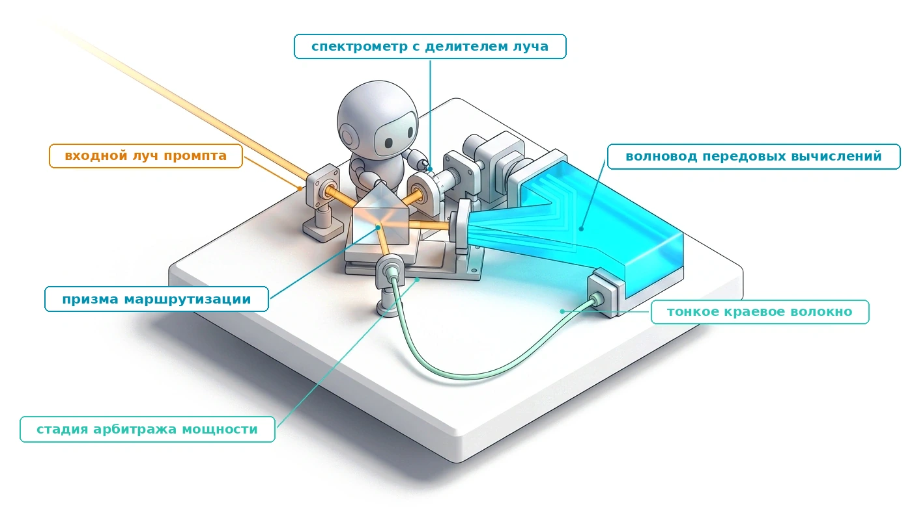

## Назначение

_Почему модель с ценой токена в десять раз ниже может сделать агента дороже для каждой завершенной задачи?_

Команда, которая считает стоимость агента так же, как стоимость чат-сервиса, умножает токены на тариф провайдера и удивляется счету. Агент покупает не токены, а готовые задачи. Каждая готовая задача несет на себе все ходы, повторно отправленный контекст, секунды работы песочницы, прогоны тестов, повторные попытки и проверку человеком, которые понадобились, чтобы один результат прошел верификацию, плюс стоимость каждой попытки, которая так и не прошла. Более дешевая модель, которая чаще ошибается, умножает все эти слагаемые; более быстрая модель почти не меняет траекторию, время которой уходит на тесты и ожидание инструментов; а дерево делегирования без зарезервированных бюджетов может потратить деньги, которые никакой откат не вернет. Поэтому экономика решает, какую модель вызвать, что кешировать, сколько рассуждений оплатить, когда эскалировать, сколько мощности держать в резерве и стоит ли задаче вообще агент; каждое из этих решений оценивается по стоимости и времени на принятую задачу. Горизонт определяет, сколько ходов оплачивается, состояние определяет, сколько контекста повторно отправляется на каждом из них, а полномочия определяют, какую проверку и одобрение должен пройти каждый результат, поэтому цена принятой задачи — это цена закрытия всех трех экспозиций.

> **Цели обучения**
>
> - Рассчитать стоимость на принятую задачу по стоимости всей траектории и доле принятия и объяснить, почему цена за токен вводит в заблуждение.
> - Оценить, как попадания в кеш префикса, сжатие и бюджеты на рассуждения или повторные попытки меняют денежную стоимость многоходовой траектории.
> - Диагностировать критический путь траектории по ее трассе и решить, когда окупается более быстрый вывод, включая спекулятивное декодирование.
> - Спроектировать каскад моделей, управляемый верификатором, и вычислить его ожидаемую стоимость, хвостовую задержку и штраф за ложное принятие.
> - Оценить мощность для траекторий по закону Литтла и лимитам провайдера и найти точку безубыточности между выделенным обслуживанием и API с оплатой за токен.
> - Спроектировать иерархические резервирования бюджета и ограничения скорости расходов, которые ограничивают деньги во всем дереве делегирования.
> - Определить, оправдывает ли задача фиксированный рабочий процесс, ограниченный цикл агента или несколько агентов, оценив каждый вариант по цене за принятую задачу.

<a id="sec-vol3-agent-economics-accounting"></a>

## Стоимость на принятую задачу

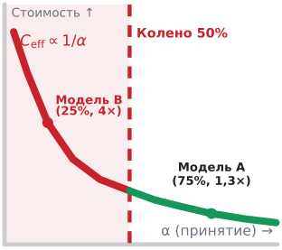

*Ниже половины принятия стоимость неудачных попыток перекрывает любую скидку на токены.*

Команда платформы заменяет передовую модель, на которой работает агент для исправления ошибок, на модель, токены которой стоят в десять раз дешевле. В следующем месяце счет за исправленные ошибки растет. В журналах обслуживания ничего не объясняет этого, потому что журналы считают токены, а токены никогда не были тем, что покупал агент. Чат-сервис выставляет счет за вызов, поэтому его стоимость равна токенам, умноженным на цену. Агент выполняет траекторию, а организация платит за траекторию, результат которой прошел верификацию. Полезный выход траекторий ([«Эффективность на микроуровне и на макроуровне»](01_introduction.md#sec-vol3-intro-macro-vs-micro-efficiency)) уже учитывает только ресурсы, потраченные на проверенные траектории, а раздел [«Многоуровневый контракт оценки»](12_evaluation.md#sec-vol3-evaluation-contract) определил принятую задачу, которую создает верификация. Этот раздел назначает цену каждой принятой задаче и показывает, какие части системы эта цена на самом деле покупает.

<a id="fig-vol3-task-cost-treemap"></a>

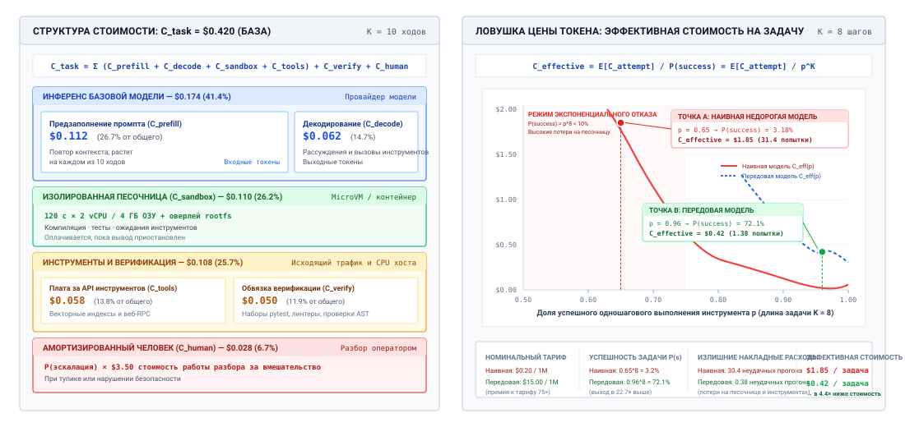
***Где уходят деньги агентной задачи**: слева — иллюстративный состав стоимости всей траектории, в котором токены модели (вход и выход) составляют меньше половины счета, а хостинг песочницы, плата за инструменты, проверка и амортизированная эскалация к человеку занимают остальное. Справа — эффективная стоимость на принятую задачу как функция успешности одного шага для задачи из восьми шагов: дешевая модель при умеренной точности шага стоит за принятую задачу дороже, чем передовая модель при высокой точности шага.*

На левой панели рисунка [«Где уходят деньги агентной задачи»](#fig-vol3-task-cost-treemap) разложена одна иллюстративная задача. Модельные токены, разделенные на повторно отправленный вход и сгенерированный выход, составляют меньше половины счета. Остальное оплачивает песочницу, в которой выполняются команды агента, инструменты, которые он вызывает, тесты, проверяющие результат, и долю проверки человеком, которую запускают неудачные попытки. По траектории из $K$ ходов **стоимость всей траектории** одной попытки равна

<a id="eq-vol3-attempt-cost"></a>

$$C_{\text{attempt}} = \sum_{k=1}^K \left( C_{\text{in}, k} + C_{\text{out}, k} + C_{\text{tools}, k} + C_{\text{sandbox}, k} \right) + C_{\text{verify}} + C_{\text{human}}$$

где $C_{\text{in}, k}$ оплачивает контекст, отправленный на ходу $k$ (системный промпт, определения инструментов, историю диалога до этого момента и самый новый результат инструмента), $C_{\text{out}, k}$ оплачивает токены, которые генерирует модель, включая токены рассуждений и аргументы вызовов инструментов, $C_{\text{tools}, k}$ покрывает плату внешних сервисов, $C_{\text{sandbox}, k}$ покрывает изолированную среду, которая выполняет команды агента, $C_{\text{verify}}$ покрывает тесты и проверки, которые решают о принятии, а $C_{\text{human}}$ покрывает проверку, когда среда выполнения эскалирует задачу. Входной член [уравнения стоимости попытки](#eq-vol3-attempt-cost) растет с каждым ходом, потому что модель ничего не хранит между вызовами и каждый ход заново отправляет более длинный контекст ([«Задержка обслуживания на ускорителе»](02_foundation_model.md#sec-vol3-foundation-model-cost)). Этот рост объясняет, почему следующий раздел рассматривает кеширование как первый рычаг.

Одна попытка — это еще не одна принятая задача. Правая панель рисунка [«Где уходят деньги агентной задачи»](#fig-vol3-task-cost-treemap) показывает почему. Если каждый из восьми шагов задачи успешен независимо с вероятностью $p$, вся задача успешна с вероятностью $p^8$, а каждая неудачная попытка оплачивается полностью до того, как ее отбросят. Полезный выход траекторий и принятая задача (принцип «Полезный выход траекторий и принятая задача») называет то, что парк должен минимизировать: эффективную стоимость на принятую задачу. Если парк делает $N$ попыток и $N_{\text{acc}}$ из них принято, то

<a id="eq-vol3-effective-cost"></a>

$$C_{\text{eff}} = \frac{\sum_{i=1}^N C_{\text{attempt}, i}}{N_{\text{acc}}} = C_{\text{succ}} + \frac{1 - \alpha}{\alpha} C_{\text{fail}}$$

где $\alpha = N_{\text{acc}}/N$ — доля принятия, $C_{\text{succ}}$ — средняя стоимость попытки, которая проходит проверку, а $C_{\text{fail}}$ — средняя стоимость попытки, которая не проходит и отбрасывается. Отношение шансов $(1 - \alpha)/\alpha$ показывает, сколько неудачных попыток приходится на каждую принятую задачу. Оно мало вблизи $\alpha = 1$ и неограниченно растет при уменьшении $\alpha$; это и есть крутой левый край графика на полях.

<a id="dfn-whole-trajectory-cost"></a>

> **Стоимость всей траектории**
>
> ***Стоимость всей траектории*** — это все, что потрачено на токены модели, инструменты, песочницы, проверку и проверку человеком по всем попыткам, деленное на число попыток, результаты которых приняты: $C_{\text{eff}} = C_{\text{succ}} + \frac{1 - \alpha}{\alpha} C_{\text{fail}}$.
>
> 1.  **Значение**: это величина, которую решения о выборе модели, кешировании, маршрутизации и мощности должны снижать, и она может расти, даже когда цены на токены падают.
> 2.  **Отличие**: оплата за токен взимает плату за то, что генерирует модель, независимо от успеха задачи; стоимость всей траектории относит каждую неудачную попытку и все немодельные слагаемые на принятые задачи.
> 3.  **Типичная ошибка**: бюджетирование агента по прайсу провайдера, которое игнорирует немодельные слагаемые и отношение шансов $\frac{1 - \alpha}{\alpha}$, умножающее неудачные попытки.

<a id="nbk-17-the-token-price-fallacy-in-automated"></a>

> **Ловушка цены токена в автоматическом исправлении ошибок**
>
> **Задача:** Агент исправления ошибок может работать на передовой модели или на недорогой модели, у которой входные токены дешевле в 10 раз. Иллюстративная нагрузка в таблице [«Иллюстративная нагрузка исправления ошибок»](#tbl-vol3-token-price-fallacy) повторяет каждую заявку, пока попытка не пройдет регрессионные тесты. Какая модель дешевле за принятое исправление?
>
> | Параметр                              | Передовая модель                                                                | Недорогая модель                                                                |
> |:--------------------------------------|:--------------------------------------------------------------------------------|:--------------------------------------------------------------------------------|
> | Цена входа / выхода за 10^6^ токенов  | \$3 / \$15  | \$0,30 / \$1,20  |
> | Ходов на попытку                      | 4                                        | 7                                        |
> | Входных / выходных токенов на ход     | 16 000 / 800 | 28 000 / 1 200 |
> | Доля принятия $\alpha$                | 0,75                                          | 0,25                                          |
> | Песочница и инструменты на ход        | \$0,03                                          | \$0,03                                          |
> | Проверка на попытку                   | \$0,05                                       | \$0,05                                       |
> | Разбор человеком на неудачную попытку | \$10                                        | \$10                                        |
>
> <a id="tbl-vol3-token-price-fallacy"></a>
>
> ***Иллюстративная нагрузка исправления ошибок**: сценарные цены, длины траекторий и доли принятия для передовой и недорогой моделей.*
>
> **Расчет:** Только по токенам одна попытка стоит \$0,240 на передовой модели и \$0,069 на недорогой, что выглядит в 3,5 раза дешевле. Недорогая модель делает больше ходов, а каждый ход оплачивает песочницу, поэтому с учетом хостинга и проверки попытки стоят \$0,410 и \$0,329, то есть разрыв всего 20 процентов. Деление на долю принятия ([«эффективная стоимость»](#eq-vol3-effective-cost) при $C_{\text{fail}} = C_{\text{succ}}$) дает \$0,55 за принятое исправление для передовой модели и \$1,32 для недорогой, которая несет 3 неудачные попытки на успех против 0,33. Когда каждая неудачная попытка еще и стоит \$10 работы инженера на разбор, получаются \$3,88 и \$31,32.
>
> **Системный вывод:** Недорогая модель обходится в 2,4 раза дороже за принятое исправление без разбора и в 8,1 раза дороже с ним. Скидка на токены была реальной, но ее многократно съели ходы, время песочницы и неудачные попытки.

Отчетность следует из того же учета. Агент, которого оценивают только по доле успешных решений, скрывает, чего стоил успех, а агент, которого оценивают только по стоимости, скрывает, что он не довел дело до конца. Результат считается полным, когда он сообщает долю принятия с доверительным интервалом ([«Статистическая строгость оценки»](12_evaluation.md#sec-vol3-evaluation-rigor)) и стоимость на принятую задачу по тем же прогонам. Тогда проекты можно разместить на плоскости «стоимость–точность», и проект, который одновременно дешевле и точнее другого, доминирует над ним. Бенчмарки исправления проблем на уровне репозиториев (Jimenez et al., 2024) делают это конкретным: у каждого исправленного дефекта есть проверяемый результат теста и измеримый счет. Сравнение проектов проводится при равном бюджете ([«Разделение скрытого потенциала и надежности»](12_evaluation.md#sec-vol3-evaluation-pass-k)), потому что проект, которому разрешено тратить больше, может купить успех одними деньгами. В этой главе каждый рычаг оценивается по обратной величине $C_{\text{eff}}$, то есть по числу принятых задач на доллар.

Учет по всей траектории также показывает, куда нажимать в первую очередь. В большинстве траекторий агента самый большой член по токенам — не то, что пишет модель, а то, что среда выполнения повторно отправляет ей на каждом ходе.

<a id="sec-vol3-agent-economics-caching"></a>

## Кеширование и бюджеты на рассуждения

К тридцатому ходу агент для программирования отправляет модели контекст в десятки тысяч токенов, почти все из которых он уже отправил на двадцать девятом ходу. Оплачивать это повторение полной ценой — правило по умолчанию, и его можно избежать. Раздел [«Задержка обслуживания на ускорителе»](02_foundation_model.md#sec-vol3-foundation-model-cost) подсчитал токены, которые траектория повторно отправляет ([«повторная отправка траектории»](02_foundation_model.md#eq-vol3-trajectory-resend)), и ввел кеширование префикса, которое переиспользует состояние внимания для префикса промпта, уже обработанного сервисом. Инженерия контекста устроила контекст так, чтобы префикс оставался стабильным ([«Подготовка следующего вызова»](04_context_engineering.md#sec-vol3-context-engineering-staging)), а раздел [«Кеширование префиксов между ходами»](05_kv_cache.md#sec-vol3-kvcache-radix-tree) показал, как система обслуживания разделяет это состояние. Оба опираются на факт, что состояние внимания есть функция точного префикса из токенов (принцип «Состояние внимания выводится из префикса токенов»). Этот раздел оценивает результат в долларах, а затем оценивает другой бюджет, которым среда выполнения управляет на каждом вызове: сколько рассуждений и сколько попыток покупать.

### Чего стоит попадание в кеш

Провайдеры, которые поддерживают кеширование промптов, выставляют счет за входные токены, прочитанные из закешированного префикса, по доле от обычной цены входа, а только за токены после префикса — по полной цене. При журнале только с добавлением ход $k$ продолжает ход $k-1$, поэтому при идеальном переиспользовании каждый ход платит полную цену только за то, что он добавил. Ту же траекторию, которую раздел [«Задержка обслуживания на ускорителе»](02_foundation_model.md#sec-vol3-foundation-model-cost) посчитал в токенах, теперь можно оценить в деньгах.

<a id="nbk-17-prefix-cache-dollars"></a>

> **Оценка траектории из тридцати ходов с кешем и без него**
>
> **Задача:** Агент для программирования из раздела [«Задержка обслуживания на ускорителе»](02_foundation_model.md#sec-vol3-foundation-model-cost) делает 30 ходов. Первый промпт содержит 8 000 токенов, каждый ход добавляет 1 500 токенов и выдает 200 выходных токенов. Вход стоит \$3, а выход \$15 за миллион токенов; закешированный вход оплачивается по 10 процентам от цены входа. Во что обходится траектория с кешированием префикса и без него?
>
> **Расчет:** Траектория отправляет всего 892 500 входных токенов, которые при полной цене стоят \$2,68. При журнале только с добавлением полной ценой оплачиваются только первый промпт и добавленные токены каждого хода, всего 51 500, а остальное — чтения из кеша, так что вход падает до \$0,41. Выход стоит \$0,09 в любом случае. Траектория стоит \$2,77 без кеша и \$0,50 с ним.
>
> **Системный вывод:** Кеширование префикса делает ту же траекторию в 5,6 раза дешевле и не меняет ни модели, ни ответа. Оно также хрупко. Временная метка в начале системного промпта, переставленный список инструментов или правка раннего сообщения возвращают каждый ход к чтению по полной цене.

Правила раскладки из раздела [«Подготовка следующего вызова»](04_context_engineering.md#sec-vol3-context-engineering-staging) существуют, чтобы защищать эту экономию, а долю попаданий в кеш стоит держать на панели обвязки рядом со стоимостью на принятую задачу. Две оговорки делают оценку честной. Некоторые провайдеры берут надбавку за запись префикса в кеш и через несколько минут бездействия удаляют закешированные префиксы, поэтому траектория, которая приостанавливается на долгом ожидании инструмента или одобрении ([«Шлюзы одобрения»](09_agent_harness.md#sec-vol3-controlplane-hitl)), может вернуться к холодному кешу. Взгляд со стороны обслуживания на то же решение — сохранять ли состояние внимания в памяти на время ожидания — относится к разделу [«Удержание, вытеснение, пересчет или выгрузка»](05_kv_cache.md#sec-vol3-kvcache-swapping).

### Цена сжатия

Сжатие ([«Сжатие контекста»](04_context_engineering.md#sec-vol3-context-engineering-compaction)) уменьшает контекст, когда он становится слишком длинным, обычно заменяя старые ходы сводкой. На кешированной траектории у сжатия есть цена, которую легко пропустить. Сводка — это новый текст, поэтому ход после сжатия читает весь свой контекст по полной цене, а сама сводка стоит вызова модели. В траектории из примера допустим, что среда выполнения сжимает контекст на ходу 16, когда он содержит 30 500 токенов, до 12 000 токенов, а вызов сводки выдает 1 500 токенов. Без сжатия оставшиеся 15 ходов стоят \$0,245 за вход. С ним они стоят \$0,190 плюс \$0,036 за сводку, всего \$0,226. Сжатие окупает свой промах кеша и вызов сводки только примерно через 11 ходов.

Из этого следуют два вывода. Сжатие на раннем этапе длинной траектории экономит деньги, а сжатие ближе к концу стоит денег, поэтому среда выполнения, которая сжимает по фиксированному расписанию, по крайней мере должна сравнивать ожидаемый оставшийся горизонт с точкой безубыточности. Чаще решение вообще не о деньгах. Сжатие оправдано окном контекста и качеством решений по мере того, как контекст заполняется устаревшим материалом ([«Инвалидация контекста»](04_context_engineering.md#sec-vol3-context-engineering-context-rot)), а денежный учет лишь показывает, чего стоит это качество.

### Бюджеты на рассуждения и повторные попытки

Другой бюджет на вызов, который задает среда выполнения, — сколько обдумывания покупать. Интерфейс вызова открывает бюджет токенов рассуждений ([«Контракт вызова»](02_foundation_model.md#sec-vol3-foundation-model-contract)), а токены рассуждений оплачиваются как выходные токены, дорогой вид, и генерируются последовательно, поэтому больший бюджет поднимает и цену, и задержку каждого вызова, который его использует. Раздел [«Три оси распределения вычислений»](03_test_time_compute.md#sec-vol3-test-time-compute-computation-allocation) определил, когда больше обдумывания повышает обоснованность решения. Экономический вопрос здесь уже. Для задачи с защищенным верификатором среда выполнения может купить лучший ответ одним дорогим вызовом или несколько попыток более дешевым, и у этих двух вариантов разные стоимости на принятую задачу.

С верификатором, которому среда выполнения доверяет, повторные попытки могут остановиться на первом принятом результате. Если каждая попытка дешевой конфигурации успешна с вероятностью $p$ при стоимости $c$, а попытки независимы, то ожидаемая стоимость на принятую задачу при последовательном повторе равна $c/p$, сколько бы повторов ни разрешалось, потому что каждый разрешенный повтор используется, только если предыдущий провалился. Предел повторов $k$ меняет покрытие, $1 - (1-p)^k$, но не стоимость на принятую задачу. Запуск $k$ попыток параллельно покупает скорость вместо экономии: стоимость $kc$ на задачу и $kc/(1-(1-p)^k)$ на принятую задачу. Pass@$k$ как потолок отбора ([«Отбор кандидатов»](03_test_time_compute.md#sec-vol3-test-time-compute-candidate-diversity)) — это член покрытия в обоих случаях.

Возьмем иллюстративную дешевую конфигурацию, которая успешна с вероятностью 0,30 при \$0,10 за попытку, и более сильную (большую модель или больший бюджет рассуждений), которая успешна с вероятностью 0,70 при \$0,40. При пределе в 5 попыток последовательный повтор дешевой конфигурации покрывает 83 процента задач, в среднем использует 2,8 попытки и стоит \$0,33 за принятую задачу. Более сильная конфигурация стоит \$0,57 за принятую задачу при одной попытке. Запуск 5 дешевых попыток параллельно самый быстрый и самый дорогой: \$0,60. Дешевая конфигурация выигрывает по стоимости и проигрывает по задержке и покрытию, более сильная выигрывает по задержке, а параллельный вариант оправдан, только когда дедлайн за него платит.

Сравнение опирается на два условия, которые решают, выполняется ли оно на практике. Верификатор должен быть надежным, потому что повторные попытки против верификатора, который иногда принимает неверный ответ, превращают повторы в ложные принятия (принцип «Асимметрия верификации»). Попытки также должны проваливаться независимо, а на практике это редко так. Попытки одной и той же модели на одной и той же задаче разделяют ее слепые пятна, поэтому покрытие выходит на плато заметно ниже $1 - (1-p)^k$, а разрыв между pass@$k$ и надежностью по повторным прогонам ([«Разделение скрытого потенциала и надежности»](12_evaluation.md#sec-vol3-evaluation-pass-k)) — это измеренная форма такой корреляции. Правила остановки для отдельной задачи из раздела [«Критерии остановки поиска»](03_test_time_compute.md#sec-vol3-test-time-compute-bounded-search) затем ограничивают, сколько бюджета может съесть безнадежная задача.

Кеширование снижает стоимость каждого хода, а бюджет на рассуждения и повторы определяет, сколько ходов и попыток покупается. Ни одно из них не говорит, сколько длится задача. Траектория может быть дешевой и при этом слишком медленной, чтобы быть полезной, а у времени свой учет.

<a id="sec-vol3-agent-economics-criticalpath"></a>

## Задержка критического пути

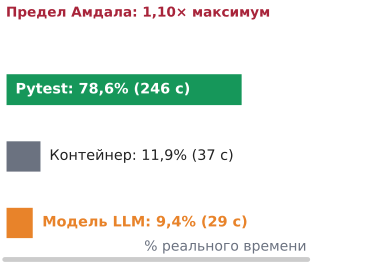

*Выполнение тестов в песочнице доминирует по реальному времени, ограничивая то, что может дать более быстрый вывод.*

Агент для программирования тратит 420 секунд на починку падающего теста, и модель тратит 84 из этих секунд на генерацию токенов. Команда платформы переводит его на уровень обслуживания, который генерирует токены в 4 раза быстрее. Следующий прогон занимает 357 секунд, то есть улучшение на 15 процентов за большие вложения, потому что остальные 336 секунд приходятся на запуск контейнера, выполнение тестов, синхронизацию файлов и загрузку пакетов, и ни одно из них не стало быстрее. Тождество длительности из раздела [«Учет длительности траектории»](01_introduction.md#sec-vol3-intro-duration-accounting) уже делит каждый ход на время модели, инструментов, ожидания и среды выполнения и ограничивает выигрыш от более быстрой модели законом Амдала. Этот раздел превращает эту границу в диагностику. Трасса определяет критический путь, среда выполнения сокращает то, что на нем лежит, а более быстрый вывод стоит покупать, только когда на пути именно модель.

<a id="fig-vol3-critical-path-waterfall"></a>

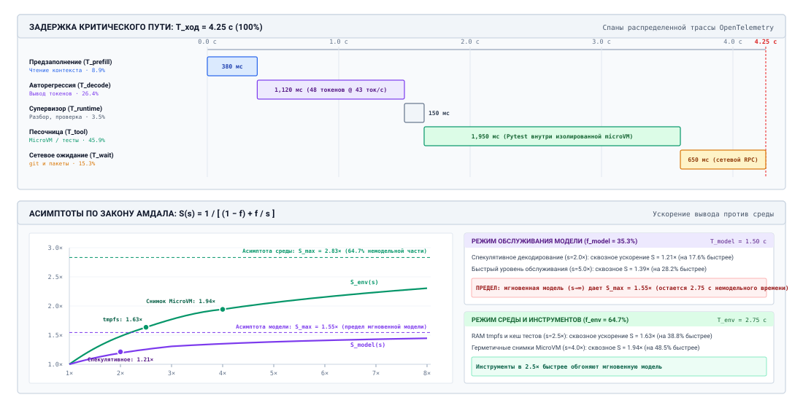
***Где один ход агента тратит время**: сверху — иллюстративный ход, разложенный на спаны трассы: чтение контекста, генерация выхода, проверка средой выполнения, выполнение инструмента в песочнице и сетевое ожидание. Снизу — кривые ускорения по закону Амдала при ускорении модели против ускорения инструментов и ожиданий; кривая модели выходит на предел, заданный немодельной долей, тогда как умеренное ускорение среды его превосходит.*

Ход из рисунка [«Где один ход агента тратит время»](#fig-vol3-critical-path-waterfall) занимает 4,25 с, из которых две фазы модели, чтение контекста и генерация выхода, занимают 1,5 с, или 35,3 процента. Никакое ускорение модели не сделает этот ход быстрее, чем в 1,55 раза. Модель, которая быстрее в 2 раза, дает ускорение в 1,21 раза. Ускорение инструментов и ожиданий в 2,5 раза за счет прогретых пулов песочниц, кешированных сборок и выбора тестов дает 1,63 раза, что больше, чем дала бы мгновенная модель. Поэтому то, куда вкладываться, решает измерение, а не мнение, и измерением служит трасса.

### Критические пути по трассам

Трасса траектории ([«Распределенная трассировка траекторий»](12_evaluation.md#sec-vol3-evaluation-tracing)) записывает каждый вызов модели, вызов инструмента, операцию песочницы и ожидание как спан с временем начала, длительностью и родителем. Настоящие траектории ветвятся, повторяются и запускают инструменты параллельно, поэтому спаны образуют ориентированный ациклический граф, в котором ребро $(u, v)$ означает, что $v$ не могло начаться раньше, чем закончился $u$. Это граф задач из раздела [«Топологии координации»](16_multi_agent.md#sec-vol3-multiagent-topologies) на более мелком уровне отдельных вызовов, и, как там, время траектории равно длине ее самого длинного пути:

<a id="eq-vol3-critical-path"></a>

$$T_{\text{critical}} = \max_{\pi \in \Pi} \sum_{v \in \pi} t(v)$$

где $\Pi$ — множество путей от истока до стока, а $t(v)$ — длительность спана $v$. Спан вне критического пути имеет запас, и его сокращение не меняет ничего, что видит пользователь. Спаны, которые важны, различаются тем, что их ограничивает и что их сокращает, как обобщает таблица [«Типы спанов траектории»](#tbl-vol3-span-taxonomy).

| Спан                    | Что задает длительность                             | Что ее сокращает                                                              |
|:------------------------|:----------------------------------------------------|:------------------------------------------------------------------------------|
| Модель, чтение входа    | Длина контекста, промахи кеша префикса, очередь     | Раскладка, устойчивая к кешу, меньший контекст, меньше очередей               |
| Модель, генерация       | Выходные токены и токены рассуждений                | Более короткие выходы, меньший бюджет рассуждений, спекулятивное декодирование |
| Песочница и инструменты | Размер сборки, размер набора тестов, холодные старты | Прогретые пулы, снимки, кеши сборок, выбор тестов, параллельные вызовы инструментов |
| Сеть и сервисы          | Сетевые обращения, размер полезной нагрузки, ограничение провайдера | Кеширование ответов, предварительная выборка, запас по лимиту запросов     |
| Среда выполнения        | Разбор, проверка, журналирование, снимки            | Потоковые парсеры, инкрементальные снимки                                     |

<a id="tbl-vol3-span-taxonomy"></a>

***Типы спанов траектории**: что ограничивает каждый вид спана на критическом пути агента и какие приемы его сокращают.*

Таблица [«Иллюстративная трасса»](#tbl-vol3-trace-critical-path) показывает иллюстративную трассу трехходовой траектории починки с длительностями того рода, которые собирает обвязка.

| Спан                           |                                  Длительность (с) |
|:-------------------------------|------------------------------------------------:|
| Инициализация среды выполнения |                                          0,12 |
| Создание песочницы             |                                         14,80 |
| Ход 1, чтение контекста        |                                          1,20 |
| Ход 1, генерация               |                                          8,40 |
| Инструмент: статус репозитория |                                          0,08 |
| Ход 2, чтение контекста        |                                          1,85 |
| Ход 2, генерация               |                                         11,20 |
| Инструмент: запуск набора тестов |                                        245,60 |
| Ход 3, чтение контекста        |                                          2,10 |
| Ход 3, генерация               |                                          4,50 |
| Экспорт снимка песочницы       |                                         22,55 |
| **Все спаны модели**           |                                       **29,25** |
| **Траектория**                 |                                      **312,40** |

<a id="tbl-vol3-trace-critical-path"></a>

***Иллюстративная трасса**: длительности спанов для трехходовой траектории починки; спаны модели просуммированы отдельно.*

Все шесть спанов модели вместе занимают 9,4 процента траектории. Запуск тестов занимает 78,6 процента, а создание и экспорт песочницы занимают еще около 12 процентов. Мгновенная модель сделала бы эту траекторию не более чем в 1,10 раза быстрее. Команда, которая читает эту трассу, работает над выбором тестов и снимками песочницы, а не над выводом.

### Сокращение критического пути

Когда трасса называет критический путь ([уравнение критического пути](#eq-vol3-critical-path)), три приема сокращают его, не меняя того, что видит модель. Первый — параллельный запуск независимых вызовов инструментов. Когда модель запрашивает несколько чтений за один ход, как позволяет интерфейс вызова ([«Контракт вызова»](02_foundation_model.md#sec-vol3-foundation-model-contract)), среда выполнения может выполнить их одновременно, и ход ждет только самого медленного, $T_{\text{tools}} = \max_i T_{\text{tool}, i}$, а не их суммы.

Второй — начинать работу, пока модель еще генерирует. Вызовы инструментов приходят в потоковом ответе, и имя инструмента и первые аргументы известны еще до того, как вызов завершен, поэтому среда выполнения может взять песочницу из прогретого пула или получить целевой файл, пока остальная часть вызова еще передается. Эта работа спекулятивна и должна быть отброшена, если завершенный вызов не пройдет проверку, поэтому безопасна она только для подготовки без побочных эффектов.

Третий — раньше завершать запуски инструментов. Набор тестов выдает результаты потоком, и первого упавшего утверждения часто достаточно для следующего решения модели. Среда выполнения, которая передает сбои по мере их возникновения и останавливает оставшиеся тесты, превращает минутный запуск в секунды на пути с ошибкой, ценой менее полного наблюдения.

<a id="sec-vol3-agent-economics-speculative"></a>

### Когда окупается спекулятивное декодирование

Когда трасса показывает генерацию на критическом пути, как это бывает с длинными патчами и длинными планами, более быстрая генерация становится стоящей покупкой, а стандартный способ ее купить — спекулятивное декодирование. Маленькая черновая модель предлагает несколько токенов, целевая модель проверяет их все за один проход и сохраняет префикс, с которым согласна ([«Авторегрессионная генерация»](02_foundation_model.md#sec-vol3-foundation-model-autoregressive)). Поскольку генерация одного потока ограничена пропускной способностью памяти, а не арифметикой (принцип «Задержка, ограниченная выводом»), проверка нескольких токенов стоит примерно столько же времени, сколько генерация одного, а правило принятия делает распределение выходных токенов в точности таким же, как у целевой модели (Leviathan et al., 2023; Chen et al., 2023). Первый факт выводится в приложении «Почему выход стоит дороже входа», а правило принятия, стоящее за вторым, — в приложении «Механика цикла декодирования». Инженера агентов интересует лишь, когда этот прием окупается.

Если черновая модель предлагает $\gamma$ токенов за раунд, один черновой токен стоит долю $r$ от шага целевой модели, а целевая модель принимает в среднем $\bar{\alpha}$ черновых токенов за раунд, то каждый раунд продвигает $\bar{\alpha} + 1$ токенов за время $\gamma r + 1$ шагов целевой модели. Значит, ускорение равно

<a id="eq-vol3-spec-speedup"></a>

$$S_{\text{spec}} = \frac{\bar{\alpha} + 1}{\gamma r + 1}$$

и прием окупается, только когда $\bar{\alpha} > \gamma r$. Принятие зависит от того, насколько предсказуем выход. Структурированный вывод и каркас кода предсказуемы, и черновая модель совпадает с целевой на большинстве токенов. Открытое планирование и сэмплирование с высокой температурой не предсказуемы, и работа черновика пропадает впустую. В таблице [«Спекулятивное декодирование по рабочим нагрузкам агента»](#tbl-speculative-entropy-profiles) [уравнение ускорения](#eq-vol3-spec-speedup) вычислено для иллюстративных долей принятия по рабочим нагрузкам агентов.

| Рабочая нагрузка агента         | Предсказуемость выхода | Принятых токенов за раунд ($\gamma =$ 5) | Ускорение $S_{\text{spec}}$ |
|:--------------------------------|:-----------------------|-------------------------------------------:|----------------------------:|
| Структурированный вывод (JSON, YAML) | Очень высокая     |                                      4,4 |                    3,86× |
| Правки кода и каркас            | Высокая                |                                      3,6 |                    3,29× |
| Диагностика по трассам ошибок   | Средняя                |                                      2,5 |                    2,50× |
| Алгоритмическое планирование    | Низкая                 |                                      1,4 |                    1,71× |
| Открытые задачи, высокая температура | Очень низкая      |                                      0,6 |                    1,14× |

<a id="tbl-speculative-entropy-profiles"></a>

***Спекулятивное декодирование по рабочим нагрузкам агента**: иллюстративное число принятых черновых токенов за раунд и получаемое ускорение, когда один черновой токен стоит 0,08 шага целевой модели; спекуляция окупается, когда за раунд принимается больше 0,4 черновых токенов.*

Два условия вне таблицы решают, включать ли спекуляцию. Первое — критический путь. Ускоритель генерации в 3,29 раза, примененный к траектории, доля модели в которой меньше десятой части, меняет ее длительность на несколько процентов, поэтому спекуляцию стоит применять к вызовам, критичным по задержке и отмеченным трассой на пути, а не везде. Второе — нагрузка. Спекуляция тратит дополнительную арифметику, чтобы сэкономить время одного потока, и это бесплатно, только пока система обслуживания простаивает. При плотной пакетной обработке арифметика уже не простаивает, черновая модель занимает память, которая иначе хранила бы состояние внимания других траекторий, и спекуляция может снизить пропускную способность всего парка. Поэтому системы обслуживания включают ее, когда очереди короткие, а запрос критичен по задержке, и отключают, когда пакет полон. То же правило относится ко всем ускорениям в этом разделе: они окупаются только на критическом пути и только пока их ресурсы свободны.

<a id="chk-17-whole-trajectory-economics"></a>

> **Стоимость и время на принятую задачу**
>
> Прежде чем маршрутизировать вызовы между моделями, проверьте учет, который уже сделан:
>
> - [ ] **Неудачные попытки**: при доле принятия $\alpha = 0{,}25$ сколько неудачных попыток несет каждая принятая задача и почему это делает десятикратную скидку на токены плохим предиктором стоимости?
> - [ ] **Раскладка кеша**: какое одно изменение системного промпта возвращает каждый ход закешированной траектории к чтению по полной цене?
> - [ ] **Сжатие**: почему сжатие контекста ближе к концу траектории может повысить ее стоимость, даже если оно снижает число токенов?
> - [ ] **Критический путь**: трасса показывает, что спаны модели занимают одну десятую траектории. Что максимум может дать любое ускорение модели и где команде смотреть вместо этого?

Анализ критического пути говорит, когда более быстрые вызовы важны. Для многих вызовов, которые не лежат на критическом пути, и для многих, которым вообще не нужна самая способная модель, большая экономия достигается тем, что дорогой вызов не делается вовсе.

<a id="sec-vol3-agent-economics-cascades"></a>

## Каскады моделей и маршрутизация

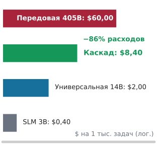

*Каскад, управляемый верификатором, решает большинство задач на небольших моделях и снижает ожидаемую стоимость на порядок.*

Агент, который отправляет каждый вызов в самую способную модель, платит цены передовой модели за то, чтобы отформатировать JSON, извлечь путь к файлу из трассы стека или подытожить журнал. Агент, который отправляет каждый вызов в маленькую модель, экономит на этих вызовах, но проваливается на тех, которые требуют планирования или диагностики, а каждая неудача стоит полной попытки. Большинство ходов траектории требует гораздо меньше, чем лучшая модель, а несколько требуют всей ее мощности. **Каскад моделей** использует этот разброс. Он сначала пробует более дешевую модель и эскалирует, только когда проверка говорит, что результат недостаточно хорош (Chen et al., 2023). Именно проверка делает каскад безопасным, а верификаторы из раздела [«Верификация процесса»](03_test_time_compute.md#sec-vol3-test-time-compute-verification) — это то, чем среда выполнения и должна проверять.

### Уровни и маршруты

Рабочая среда выполнения обычно имеет три вида вызываемых объектов; их сводка приведена в таблице [«Уровни каскада»](#tbl-vol3-model-tier-taxonomy). Детерминированный код и маленькие модели обрабатывают преобразования с малой неоднозначностью. Универсальные модели среднего размера обрабатывают рутинные вызовы инструментов и локальные правки. Передовые модели обрабатывают планирование, диагностику по многим файлам и восстановление после провала более низких уровней.

| Уровень                        | Типичный вызываемый объект                          | Типичная роль агента                                              | Шлюз, решающий об эскалации                 |
|:-------------------------------|:----------------------------------------------------|:------------------------------------------------------------------|:--------------------------------------------|
| **1: Детерминированный и маленький** | Парсеры, регулярные выражения, небольшие языковые модели | Извлечение аргументов, починка схемы, разбор журналов, фильтрация команд | Проверки схемы и синтаксиса                 |
| **2: Универсальный среднего размера** | Модели с инструктивной настройкой среднего размера | Правки одного файла, рутинные вызовы инструментов, суммаризация   | Проверки типов, сборки, быстрые модульные тесты |
| **3: Передовой**               | Самая способная из доступных моделей                | Планирование, диагностика по нескольким файлам, восстановление после провала нижнего уровня | Полный регрессионный набор, одобрение при необходимости |

<a id="tbl-vol3-model-tier-taxonomy"></a>

***Уровни каскада**: вызываемые объекты, роли и шлюзы эскалации трехуровневого каскада моделей.*

Среда выполнения может выбрать уровень двумя способами. Статическая маршрутизация классифицирует каждый вызов до того, как он сделан, по описанию задачи или признакам вызова, и отправляет его на один уровень. Она почти не добавляет задержки и проваливается предсказуемо. Запрос, который выглядит простым («исправь упавшее утверждение в тесте на блокировки»), может потребовать проследить гонку по многим файлам, и маршрутизатор, который судит по запросу, отправит его в модель, которая ходит по кругу, пока не закончится бюджет. Маршрутизация с эскалацией пробует самый дешевый правдоподобный уровень и поднимается выше, только когда выход этого уровня не проходит проверку. Она оплачивает неудачные попытки, зато ее решения опираются на свидетельство о выходе, а не на догадку о входе.

Обученные маршрутизаторы занимают промежуточное место между этими двумя. Журналы самой обвязки ([«Распределенная трассировка траекторий»](12_evaluation.md#sec-vol3-evaluation-tracing)) фиксируют, выход какого уровня прошел проверку на каком виде вызова, а это именно та размеченная выборка, которая нужна маршрутизатору; классификатор, обученный на ней, предсказывает, вероятно ли пройдет дешевый уровень. Ошибки маршрутизатора имеют несимметричную цену. Неверная маршрутизация вниз стоит одной неудачной дешевой попытки плюс эскалации. Неверная маршрутизация вверх стоит разницы в цене между уровнями. Порог стоит задавать по этим двум ценам, а его прогнозы все равно подаются на шлюз эскалации, поэтому маршрутизатор, который ошибается, стоит денег, но не правильности.

<a id="fig-vol3-model-cascade-flowchart"></a>

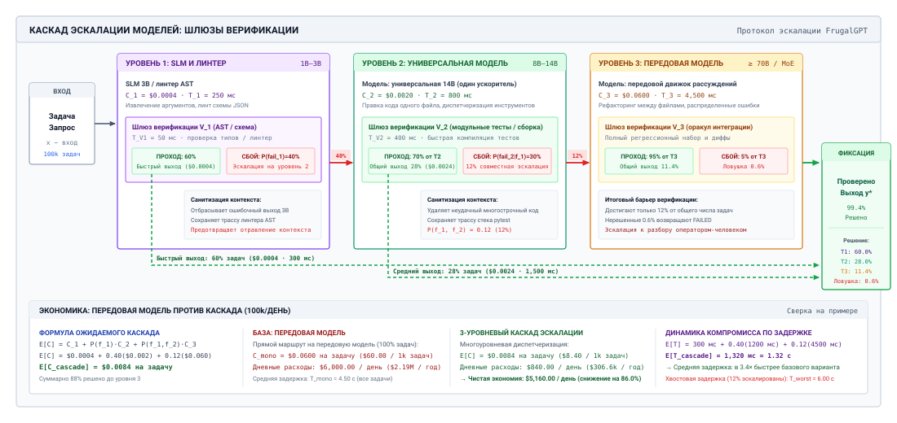
***Каскад моделей, управляемый верификатором**: задачи поступают на уровень маленьких моделей, выход которого должен пройти шлюз схемы и синтаксиса. Провалы эскалируются вместе с диагностикой верификатора на универсальный уровень, закрытый сборкой и быстрыми тестами, а оставшиеся провалы эскалируются на передовой уровень, закрытый полным регрессионным набором. В этом иллюстративном примере 60 процентов задач завершаются на уровне 1, а 28 процентов на уровне 2, поэтому ожидаемая стоимость составляет 0,0084 доллара за задачу против 0,0600 доллара при отправке каждой задачи передовой модели, а средняя задержка равна 1,32 с.*

### Ожидаемая стоимость и задержка каскада

На рисунке [«Каскад моделей, управляемый верификатором»](#fig-vol3-model-cascade-flowchart) каждая задача попадает на уровень 1. Ее кандидатный выход удерживается в буфере ожидающих предложений среды выполнения и проверяется шлюзом схемы и синтаксиса. Если он проходит, задача завершается. Если нет, среда выполнения эскалирует задачу на уровень 2 вместе с диагностикой верификатора, и только задачи, которые также проваливают шлюз сборки и тестов уровня 2, доходят до уровня 3. Пусть $C_j$ — стоимость вызова на уровне $j$, причем $C_1 \ll C_2 \ll C_3$, а $P(\text{fail}_1)$ и $P(\text{fail}_1, \text{fail}_2)$ — вероятности того, что задача провалила уровень 1 и провалила оба нижних уровня. Ожидаемая стоимость на задачу равна

<a id="eq-cascade-cost"></a>

$$E[C_{\text{cascade}}] = C_1 + P(\text{fail}_1) \cdot C_2 + P(\text{fail}_1, \text{fail}_2) \cdot C_3$$

и каскад выгоднее отправки всего на уровень 3, когда

<a id="eq-cascade-viability"></a>

$$C_1 + P(\text{fail}_1) \cdot C_2 < \Big(1 - P(\text{fail}_1, \text{fail}_2)\Big) \cdot C_3$$

Правая часть неравенства [«жизнеспособности каскада»](#eq-cascade-viability) — это стоимость передового вызова, которой удается избежать на задачах, которые решают нижние уровни. Поскольку вызовы передовой модели обычно стоят на один-два порядка дороже вызовов маленькой модели, неравенство выполняется, даже когда нижние уровни решают скромную долю задач.

Задержка для задач, которые эскалируются, движется в обратную сторону. При задержках уровней $T_j$ и задержках шлюзов $T_{V,j}$ задача, которая доходит до верха, платит за каждый уровень по пути,

<a id="eq-cascade-latency-worst"></a>

$$T_{\text{worst}} = T_1 + T_{V,1} + T_2 + T_{V,2} + T_3$$

тогда как ожидаемая задержка равна

<a id="eq-cascade-latency-expected"></a>

$$E[T_{\text{cascade}}] = T_1 + T_{V,1} + P(\text{fail}_1) \cdot \Big(T_2 + T_{V,2}\Big) + P(\text{fail}_1, \text{fail}_2) \cdot T_3$$

так что каскад обычно снижает среднюю задержку, но всегда повышает хвост, верхняя граница которого задана уравнением [«худшей задержки каскада»](#eq-cascade-latency-worst).

<a id="nbk-17-cost-and-latency-trade-offs-in"></a>

> **Стоимость и задержка трехуровневого каскада**
>
> **Задача:** Флот для программирования обслуживает 100 000 небольших задач правки в день. Вызовы уровней стоят \$0,0004, \$0,0020 и \$0,0600 и занимают 250, 800 и 4 500 мс. Шлюзы уровней 1 и 2 занимают 50 и 400 мс. Уровень 1 проваливается с вероятностью 0,40, а уровень 2 проваливает 0,30 того, что получает. Стоит ли флоту использовать каскад и во что он обходится по задержке?
>
> **Расчет:** Доля 0,12 задач доходит до уровня 3. По уравнению [«стоимости каскада»](#eq-cascade-cost) ожидаемая стоимость на задачу составляет \$0,0084, что на 86 процентов ниже \$0,0600 при работе только с передовой моделью, а дневные расходы падают с \$6 000 до \$840. По уравнению [«ожидаемой задержки каскада»](#eq-cascade-latency-expected) средняя задержка составляет 1,32 с, что в 3,4 раза быстрее 4,5 с у передовой модели. Задача, которая эскалируется через все уровни, занимает 6 с, то есть на 33 процента дольше прямого вызова передовой модели.
>
> **Системный вывод:** Каскад дешевле и быстрее в среднем и медленнее в хвосте. Приемлем ли такой компромисс, зависит от того, лежат ли эскалированные задачи на критическом пути, ограниченном сроком.

### Штраф за ложное принятие и дисциплина эскалации

Уравнение [«Стоимость каскада»](#eq-cascade-cost) предполагает, что шлюзы никогда не принимают неверный выход. Но принимают. Шлюз, который проверяет синтаксис, пропускает патч, который корректно разбирается, но удаляет проверку полномочий, и каскад останавливается на уровне 2 с нарушенным инвариантом в рабочем пространстве. Если $\alpha_{\text{FA}}$ — частота, с которой шлюз принимает неверный выход, а $C_{\text{recovery}}$ — стоимость того, чтобы позже найти и откатить его, то эффективная стоимость равна

<a id="eq-cascade-leakage-cost"></a>

$$C_{\text{eff}} = E[C_{\text{cascade}}] + \alpha_{\text{FA}} \cdot C_{\text{recovery}}$$

и поскольку восстановление может включать откат ([«Шаблон саги траектории»](11_failure_recovery.md#sec-vol3-sagas-architecture)) или проверку человеком, небольшое $\alpha_{\text{FA}}$ в уравнении [«стоимости утечки каскада»](#eq-cascade-leakage-cost) может стереть экономию каскада. Поэтому шлюз должен проверять свойство, которое важно; для кода это значит запускать тесты, а не только линтер. По асимметрии верификации (принцип «Асимметрия верификации») обученный судья может ранжировать кандидатов или решать, какой уровень пробовать, но шлюз, который пропускает выход дальше, должен быть проверкой, у которой ошибки известны и малы.

Второй провал — самонанесенный. Среда выполнения, которая эскалирует, дописывая неудачную попытку, ее трассу стека и исходный промпт к контексту следующего уровня, платит за повторную отправку длинного неверного ответа и подталкивает более сильную модель строить на нем. Эскалация должна передавать задачу и диагностику верификатора, а не неудачный выход, как это делает следующий диспетчер.

```python
def dispatch_with_escalation(task, tiers, sandbox):
    feedback = []
    for tier in tiers:
        # промпт содержит только задачу и последнюю диагностику верификатора
        prompt = build_prompt(task, verifier_feedback=feedback)
        candidate = tier.generate(prompt, max_tokens=tier.token_limit)

        # кандидат остается ожидающим, пока внешняя проверка его не примет
        result = sandbox.run_verifier(candidate)
        if result.passed:
            sandbox.commit(candidate)
            return StepResult(status="ACCEPTED", tier=tier.name, output=candidate)

        # отбрасываем неудачный выход и сохраняем короткую детерминированную диагностику
        feedback = [f"tier {tier.name} failed: {result.diagnostic}"]
    return StepResult(status="ESCALATION_EXHAUSTED", tier=None, output=None)
```

Сама эскалация нуждается в правиле остановки. Переход с уровня $j$ на уровень $j+1$ стоит $\Delta C_{j \to j+1}$ и повышает вероятность принятия на $\Delta P_{j \to j+1}$. Если $V_{\text{task}}$ — то, что стоит принятая задача, эскалация окупается, только когда

<a id="eq-vol3-escalation-rule"></a>

$$\Delta C_{j \to j+1} < \Delta P_{j \to j+1} \cdot V_{\text{task}}$$

иначе среда выполнения должна остановиться и сообщить об ограниченном провале. Уравнение [«Правило эскалации»](#eq-vol3-escalation-rule) — это версия для каскада правил остановки из раздела [«Критерии остановки поиска»](03_test_time_compute.md#sec-vol3-test-time-compute-bounded-search), и оно не дает дешевой задаче эскалироваться в дорогую.

Каскады и кеширование снижают стоимость каждого вызова траектории. Но парку также нужно место, где эти вызовы выполнять, а мощность, которая нужна парку агентов, — не та мощность, которая нужна системе обслуживания запросов.

<a id="sec-vol3-agent-economics-capacity"></a>

## Мощность для траекторий

Команда планирует свою платформу агентов так же, как планировала чат-сервис: по частоте вызовов модели и их времени обслуживания. И обнаруживает, что ей одновременно не хватает ресурсов и они простаивают. Вызовы ставятся в очередь за лимитом провайдера, в то время как выделенные узлы, которые она зарезервировала, пустуют наполовину, а траектории, которые держат песочницы и закешированный контекст по двадцать минут, вытесняют новые. Единица, которая удерживает ресурсы, — это траектория, а не вызов (принцип «Мощность на уровне времени жизни траектории и планирование с учетом хвоста»). Этот раздел измеряет мощность в этой единице, а затем решает, откуда она должна браться.

### Конкурентность траекторий

Вызов модели длится секунды. Траектория длится минуты, большую часть которых она ждет инструменты, и все это время она удерживает песочницу, слот в среде выполнения и часто закешированное состояние внимания на узле обслуживания. Закон Литтла, который раздел [«Аналитические формулировки емкости»](05_kv_cache.md#sec-vol3-kv-capacity-formulations) применяет к траекториям, находящимся на одном узле обслуживания, дает число активных траекторий по всему парку:

<a id="eq-vol3-trajectory-concurrency"></a>

$$L_{\text{traj}} = \lambda_{\text{traj}} \cdot \mathbb{E}[T_{\text{traj}}]$$

где $\lambda_{\text{traj}}$ — частота запуска траекторий, а $\mathbb{E}[T_{\text{traj}}]$ — их средняя продолжительность жизни. Если определять размер песочниц, рабочих среды выполнения и памяти кеша по частоте вызовов и их длительности, а не по уравнению [«конкурентности траекторий»](#eq-vol3-trajectory-concurrency), то конкурентность занижается в число раз, равное отношению времени жизни траектории к длительности вызова, а это два-три порядка величины. Что траектория удерживает, пока ждет, — это проектное решение. Раздел [«Удержание, вытеснение, пересчет или выгрузка»](05_kv_cache.md#sec-vol3-kvcache-swapping) решает, остается ли ее состояние внимания в памяти, вытесняется и пересчитывается или выгружается во время ожидания инструмента, а «Очереди для траекторий» (приложение) выводит, как ожидания инструментов раздувают конкурентность.

Из того, как траектории подают вызовы, следуют два вывода. Вызовы приходят коррелированными пачками, когда траектория распараллеливает вызовы инструментов или когда координатор запускает подагентов, а их время обслуживания колеблется от нескольких токенов до тысяч. Задержка в очереди растет вместе с этой изменчивостью и резко возрастает по мере того, как загрузка приближается к насыщению. Приближение Кингмана для одной очереди (приложение «Очереди для траекторий») дает числа для обоих эффектов. При пачкообразном потоке прибытий ($c_a^2 = 2$) и длинах генерации с $c_s^2 = 4$ фактор изменчивости $(c_a^2 + c_s^2)/2$ равен 3, а пул обслуживания при загрузке 70 процентов заставляет средний вызов ждать примерно 7 средних времен обслуживания, а при загрузке 90 процентов — примерно 27. Поэтому мощность закладывают так, чтобы работать ниже колена кривой загрузки. Хвостовые задержки также накапливаются вдоль траектории; это последовательный аналог отстающих при ветвлении из раздела [«Каскады отмены»](16_multi_agent.md#sec-vol3-multiagent-backpressure). Траектория из 30 последовательных вызовов, каждый из которых с вероятностью 0,01 попадает в задержку на уровне 99-го перцентиля, с вероятностью 0,26 встречает хотя бы одну такую задержку, поэтому парк, рассчитанный на хорошую среднюю задержку, все равно регулярно дает медленные траектории (Dean and Barroso, 2013).

### Лимиты провайдера

Для команды, которая вызывает размещенную модель, первый предел мощности, с которым она сталкивается, обычно не аппаратный, а квота провайдера, выраженная в токенах в минуту и запросах в минуту. Квота ограничивает скорость, с которой могут выполняться траектории, а не число открытых траекторий. Каждой траектории для завершения нужно фиксированное число токенов, поэтому в установившемся режиме спрос на токены равен частоте траекторий, умноженной на токены на траекторию, каковы бы ни были времена жизни траекторий. Пусть траектории стартуют по 1 в минуту, и каждая делает 60 вызовов по 30 000 входных токенов, то есть 1 800 000 токенов на траекторию. При лимите 2 000 000 токенов в минуту спрос использует 90 процентов квоты, а парк может выдержать не более 1,11 траектории в минуту. При времени жизни 20 минут закон Литтла дает 20 траекторий в полете, каждая из которых подает около 3 вызовов в минуту.

Работа так близко к квоте имеет то же следствие, что и работа сервера близко к насыщению. Ограниченные вызовы повторяются после задержки, траектории живут дольше, дольше держат песочницы и кеш, и их сроки сдвигаются. Применимы три рычага. Кеширование префикса снижает счет, а то, снижает ли оно также использование относительно квоты, зависит от того, как провайдер учитывает закешированные токены; план мощности должен это проверить, а не предполагать. Короткие и надежные траектории тратят меньше токенов на принятую задачу, что при фиксированной квоте поднимает частоту принятых задач так же прямо, как более высокая квота. Пакетные конечные точки со скидкой, которые возвращают результаты в течение часов, подходят для работы с одним вызовом, например для офлайн-оценки, оценки траекторий и курирования, но не для многоходового цикла, в котором каждый ход должен ждать предыдущего.

### Приоритетные полосы

Интерактивные траектории, где человек ждет результата, и пакетные траектории, например ночная сортировка заявок или прогоны оценки, используют одни и те же модели и квоту, но их сроки сильно различаются. Смешанные в одну очередь «кто первый, тот и обслужен», пачка длинных пакетных генераций задерживает каждый короткий интерактивный вызов, стоящий за ней. Среда выполнения разделяет их на полосы с разными приоритетами и дает интерактивной полосе контроль допуска и зарезервированный запас. Внутри системы обслуживания планировщик, который не может знать, сколько будет длиться генерация, все же может понижать в приоритете вызовы, превысившие квант токенов, перенося их в очередь низшего приоритета, так что короткие вызовы никогда не ждут длинных (принцип «Мощность на уровне времени жизни траектории и планирование с учетом хвоста»). Пакетная работа затем заполняет мощность, которую интерактивная работа оставляет простаивающей, а это важнее всего для решения, которым завершается этот раздел: владеть ли этой мощностью.

### Динамика очередей

Поскольку платформы агентов не могут отделить планирование ускорителей от стохастической природы поведения агентов, для расчета флота нужны модели теории очередей, которые учитывают крайнюю изменчивость. Стандартный вводный системный анализ часто опирается на формулировки $M/M/1$ или $M/M/k$, которые предполагают пуассоновские потоки прибытий (экспоненциальные интервалы между прибытиями) и экспоненциально распределенные времена обслуживания без памяти. В производственных парках агентов оба допущения заведомо неверны.

Поток вызовов модели, порождаемый автономными агентами, структурно пачкообразный. Когда оркестратор запускает параллельные подагенты проверки или когда агент выполняет многошаговый цикл планирования, запросы приходят в систему обслуживания плотно коррелированными пачками, а не некоррелированными пуассоновскими потоками. Квадрат коэффициента вариации интервалов между прибытиями, определенный как $C_a^2 = \sigma_a^2 / (\mathbb{E}[T_a])^2$, регулярно превышает единицу ($C_a^2 > 1$).

Одновременно распределение времен обслуживания модели резко неэкспоненциально. Парк агентов обрабатывает бимодальную смесь нагрузок: легкие быстрые пробы классификации, проверки схем JSON и однотокенные решения о маршрутизации инструментов, которые занимают десятки миллисекунд ($S \ll 100\text{ мс}$), соседствуют с тяжелыми генерациями рассуждений на тысячи токенов и сложным синтезом кода, которые длятся несколько секунд ($S > 10\text{ с}$). Такой бимодальный разброс дает квадрат коэффициента вариации времени обслуживания, заметно больший единицы ($C_s^2 = \sigma_s^2 / (\mathbb{E}[S])^2 \gg 1$).

Чтобы оценить ожидаемое время ожидания в очередях с произвольными распределениями прибытий и обслуживания, не прибегая сразу к покадровому дискретно-событийному моделированию, системные инженеры опираются на приближение Кингмана для тяжелого трафика в очереди $G/G/1$ ([«уравнение Кингмана»](#eq-vol3-kingman-gg1)):

<a id="eq-vol3-kingman-gg1"></a>

$$W_q \approx \left( \frac{C_a^2 + C_s^2}{2} \right) \left( \frac{\rho}{1 - \rho} \right) \frac{1}{\mu}$$

где $\rho = \lambda / \mu$ — загрузка сервера, а $\mu = 1 / \mathbb{E}[S]$ — средняя скорость обслуживания. Формула Кингмана раскладывает среднее время ожидания в очереди $W_q$ на три явных мультипликативных компонента:

1. **Фактор изменчивости $\frac{C_a^2 + C_s^2}{2}$:** Этот член напрямую масштабирует задержку совокупной дисперсией процессов прибытия и обслуживания. В идеализированной системе $M/M/1$, где $C_a^2 = C_s^2 = 1$, этот фактор равен 1. В парке агентов, где коррелированные пачки и бимодальные длины генерации дают $C_a = 1{,}8$ и $C_s = 2{,}4$, фактор изменчивости составляет $\frac{1{,}8^2 + 2{,}4^2}{2} = \frac{3{,}24 + 5{,}76}{2} = 4{,}5$. Система испытывает усиление средней задержки в очереди в 4,5 раза только из-за дисперсии нагрузки при неизменных пропускной способности железа и средних частотах прибытий.
2. **Фактор загрузки $\frac{\rho}{1 - \rho}$:** Этот гиперболический штраф задает нелинейную асимптоту при приближении загрузки сервера к насыщению. Когда $\rho$ растет с $0{,}70$ до $0{,}90$, множитель скачком идет с $2{,}33$ до $9{,}00$, то есть почти в четыре раза.
3. **Базовый масштаб обслуживания $\frac{1}{\mu}$:** Невзвешенная средняя длительность обработки самой модели.

Как писали Джеффри Дин и Луис Андре Барросо в *The Datacenter as a Computer*, для распределенных систем определяет воспринимаемую пользователем производительность хвостовая задержка, а не средняя. В траектории агента из $N$ последовательных вызовов модели вероятность завершиться, не попав в задержку очереди на уровне 99-го перцентиля, убывает как $(1 - 0{,}01)^N$.

В корпоративном парке, работающем на $k$ параллельных экземплярах ускорителя, модель одного сервера $G/G/1$ переходит в совокупную многосерверную систему $G/G/k$. Используя приближение Аллена–Каннина, время ожидания в многосерверной очереди масштабируется пропорционально вероятности ожидания Эрланга C, $P_{\text{wait}}(M/M/k)$ ([«уравнение Аллена–Каннина»](#eq-vol3-allen-cunneen)):

<a id="eq-vol3-allen-cunneen"></a>

$$W_q(G/G/k) \approx \left( \frac{C_a^2 + C_s^2}{2} \right) \frac{P_{\text{wait}}(M/M/k)}{k\mu(1 - \rho)}$$

Хотя объединение $k$ ускорителей в единый кластер обслуживания дает выгоду статистического мультиплексирования, которая сглаживает средние времена ожидания по сравнению с изолированными одиночными серверами, оно усиливает рост хвостовой задержки в многоходовых траекториях. Если рабочий процесс агента требует $N = 30$ последовательных вызовов модели для завершения сквозной задачи, а среда выполнения работает при агрессивной аппаратной загрузке $\rho = 0{,}85$, то вероятность того, что траектория встретит экстремальную хвостовую задержку ($P_{99}$) хотя бы на одном ходу критического пути, равна:

$$P(\text{Хвостовой инцидент}) = 1 - (1 - 0{,}01)^{30} = 1 - 0{,}7397 \approx 0{,}26$$

Более четверти всех выполненных траекторий агентов получат экстремальную хвостовую задержку. Поскольку траектория агента выполняется синхронно по последовательным ходам, одна хвостовая задержка на ходу 7 каскадно переходит в общее время до завершения и часто приводит к тому, что оркестратор-хост нарушает свой глобальный целевой уровень обслуживания (SLO).

<a id="nbk-17-sizing-queue-capacity-and-tail"></a>

> **Размер очереди при тяжелохвостом трафике**
>
> Инфраструктурная команда эксплуатирует кластер вывода, выделенный под промежуточные циклы рассуждений агентов. Кластер обрабатывает совокупную частоту прибытий $\lambda = 160\text{ запросов/с}$, распределенную по пулу рабочих ускорителей. Профилирование показывает, что среднее время обслуживания модели равно $\mathbb{E}[S] = 20\text{ мс}$ ($\mu = 50\text{ запросов/с/рабочий}$), но нагрузка демонстрирует крайнюю бимодальность: 80 процентов запросов — быстрые оценки схем JSON ($\mathbb{E}[S_1] = 5\text{ мс}$), а 20 процентов — расширенные генерации цепочки рассуждений ($\mathbb{E}[S_2] = 80\text{ мс}$). Эмпирические измерения дают коэффициент вариации прибытий $C_a = 1{,}4$ и коэффициент вариации обслуживания $C_s = 2{,}2$.
>
> Инженерный руководитель предлагает выделить $k = 4$ рабочих узла, чтобы работать при средней загрузке $\rho = \frac{\lambda}{k \mu} = \frac{160}{4 \times 50} = 0{,}80$. Вычислите ожидаемое время ожидания в очереди $W_q$ при этой конфигурации по приближению Аллена–Каннина и сравните его с альтернативным планом выделить $k = 5$ рабочих ($\rho = 0{,}64$).
>
> **Шаг 1: вычислите масштабирующий фактор изменчивости.**
> $$\frac{C_a^2 + C_s^2}{2} = \frac{1{,}4^2 + 2{,}2^2}{2} = \frac{1{,}96 + 4{,}84}{2} = \frac{6{,}80}{2} = 3{,}40$$
>
> **Шаг 2: вычислите вероятность ожидания Эрланга C для $k = 4$ при $\rho = 0{,}80$.**
> Для очереди $M/M/4$ с предлагаемой нагрузкой $A = k\rho = 3{,}2\text{ Эрл}$:
> $$P_{\text{wait}}(M/M/4) = \frac{\frac{A^4}{4!(1 - \rho)}}{\sum_{n=0}^{3} \frac{A^n}{n!} + \frac{A^4}{4!(1 - \rho)}} \approx 0{,}554$$
>
> **Шаг 3: вычислите $W_q$ для $k = 4$.**
> $$W_q \approx 3{,}40 \times \frac{0{,}554}{4 \times 50 \times (1 - 0{,}80)} = 3{,}40 \times \frac{0{,}554}{200 \times 0{,}20} = 3{,}40 \times \frac{0{,}554}{40} = 3{,}40 \times 0{,}01385\text{ с} \approx 47{,}1\text{ мс}$$
> При $k = 4$ рабочих среднее время ожидания в очереди ($47{,}1\text{ мс}$) превышает среднее время выполнения самого запроса ($20\text{ мс}$) больше чем в 2,3 раза.
>
> **Шаг 4: оцените перераспределение до $k = 5$ при $\rho = 0{,}64$.**
> Для $M/M/5$ с $A = 3{,}2\text{ Эрл}$ вероятность ожидания резко падает до $P_{\text{wait}}(M/M/5) \approx 0{,}237$.
> $$W_q \approx 3{,}40 \times \frac{0{,}237}{5 \times 50 \times (1 - 0{,}64)} = 3{,}40 \times \frac{0{,}237}{250 \times 0{,}36} = 3{,}40 \times \frac{0{,}237}{90} = 3{,}40 \times 0{,}00263\text{ с} \approx 8{,}95\text{ мс}$$
>
> **Вывод:** Добавление одного узла ускорителя (расширение железа на $25\%$) снижает среднее время ожидания в очереди с $47{,}1\text{ мс}$ до $8{,}95\text{ мс}$, то есть задержка падает более чем на $80\%$. В средах обслуживания агентов с тяжелым хвостом работа ниже колена кривой загрузки ($\rho \le 0{,}70$) обязательна, чтобы поглощать дисперсию и защищать критические пути многоходовых траекторий.

### Многоуровневая очередь с обратной связью для рабочих нагрузок агента

Когда кластер обслуживания агентов ставит все запросы в неразличимую очередь «первым пришел — первым обслужен» (FCFS), он сталкивается с классической патологией, которую называют *блокировкой головы очереди* (head-of-line blocking). Огромный многошаговый вызов генерации кода, которому нужно 4 096 выходных токенов, на несколько секунд занимает слоты непрерывного пакетирования ускорителя. Если интерактивный пользователь или критичный к задержке надзорный агент отправляет запрос маршрутизации на 10 токенов за этим большим заданием, короткий запрос ждет, пока отработает длинная фаза декодирования. Эта деградация нарушает главную цель планирования в вычислительных системах: минимизировать среднее время отклика, ставя короткие задания вперед (Shortest Job First), без предварительного знания точных длительностей выполнения.

Поскольку хост-среда не может предсказать точную длину авторегрессионной генерации до вывода, она не может реализовать чистое планирование по кратчайшему времени обработки (SPT). Вместо этого кластер должен применять адаптивную дисциплину **многоуровневой очереди с обратной связью (MLFQ)**, приспособленную к механике памяти и вычислений генерации токенов ([«Архитектура обслуживания MLFQ и иерархия памяти KV-кеша»](#fig-vol3-mlfq-serving-architecture)).

<a id="fig-vol3-mlfq-serving-architecture"></a>

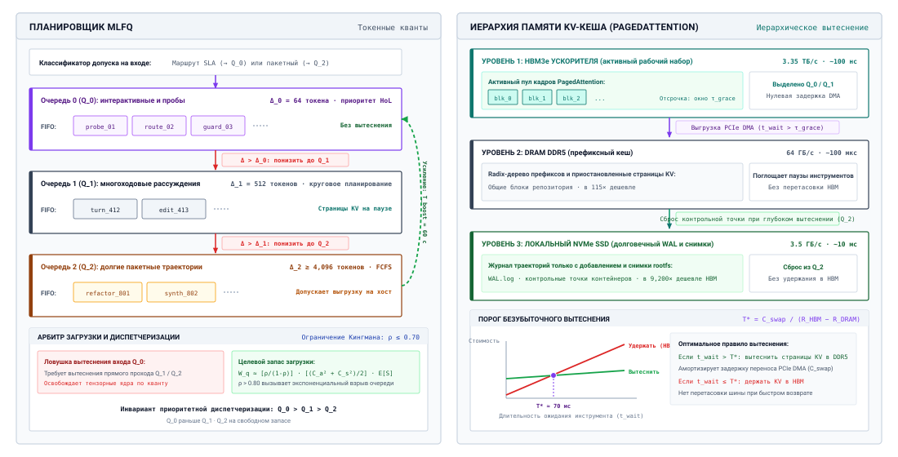
***Архитектура обслуживания MLFQ и иерархия памяти KV-кеша**: левый планировщик разделяет интерактивные пробы, многоходовые циклы рассуждений и фоновые пакетные траектории по дискретным очередям приоритета ($Q_0, Q_1, Q_2$) с квантами в токенах ($\Delta_0 = 64, \Delta_1 = 512, \Delta_2 \ge 4\,096\text{ токенов}$) и предотвращением голодания ($T_{\text{boost}} = 60\text{ с}$). Правая панель показывает соответствующую физическую иерархию памяти: PagedAttention динамически распределяет блоки HBM между активными слотами пакета, перенося вытесненные страницы в оперативную память хоста DDR5 через асинхронный DMA и в хранилище NVMe по экономическому порогу вытеснения $T^* \approx 70\text{ мс}$.*

Как показано в системной схеме [«Архитектура обслуживания MLFQ и иерархия памяти KV-кеша»](#fig-vol3-mlfq-serving-architecture), архитектура разделена на активный планировщик приоритетов слева и физическую иерархию памяти справа. В плоскости планирования все входящие задания агентов попадают в $Q_0$ с начальным неприостановимым квантом $\Delta_0 = 64\text{ токена}$. Короткие пробы семантического классификатора и решения о диспетчеризации инструментов завершаются в пределах этого кванта и покидают систему с задержкой в очереди менее миллисекунды. Задания, которым нужно длительное обдумывание, исчерпывают $\Delta_0$ и понижаются в $Q_1$ ($\Delta_1 = 512\text{ токена}$, круговое планирование), а длинные проходы генерации кода и рефакторинга репозитория понижаются в $Q_2$ ($\Delta_2 \ge 4\,096\text{ токенов}$, пакетирование FCFS). Голодание фоновых заданий предотвращается дугой повышения приоритета, которая каждые $T_{\text{boost}} = 60\text{ секунд}$ атомарно возвращает все ожидающие запросы из $Q_1$ и $Q_2$ в $Q_0$.

Одновременно правая панель рисунка [«Архитектура обслуживания MLFQ и иерархия памяти KV-кеша»](#fig-vol3-mlfq-serving-architecture) показывает, как планировщик взаимодействует с управлением памятью PagedAttention на физических уровнях аппаратуры. Когда запрос из $Q_1$ или $Q_2$ уступает слот непрерывного пакетирования при вытеснении, его блоки KV-кеша в HBM ускорителя защищаются периодом отсрочки $\tau_{\text{grace}}$, чтобы предотвратить трешинг. При устойчивом давлении на память менеджер памяти включает каналы DMA PCIe Gen5 и переносит неактивные страницы в оперативную память хоста DDR5 (передача до $64\text{ ГБ/с}$ в обе стороны). Если время простоя превышает экономический порог безубыточности вытеснения ($T^* \approx 70\text{ мс}$), страницы переливаются на локальное хранилище NVMe ($7\text{ ГБ/с}$), что обеспечивает высокую резидентность в HBM для критичных к задержке вызовов $Q_0$ без потери дорогостоящего состояния предзаполнения.

Агентно-ориентированный MLFQ разделяет емкость ускорителя на различные уровни приоритета, управляя вытеснением, сборкой пакета и владением памятью:

1. **Очередь приоритета 0 ($Q_0$, интерактивные вызовы и пробы):** Все вновь поступающие вызовы модели попадают в $Q_0$. Этот уровень получает наивысший приоритет диспетчеризации и строго ограниченный квант генерации токенов (например, $\Delta_0 = 64\text{ токена}$). В $Q_0$ попадают интерактивные запросы пользователей, быстрые пробы семантического классификатора, решения о маршрутизации вызовов инструментов и проверки защитных ограничений безопасности. Если вызов завершает генерацию в пределах $\Delta_0$ токенов (выдает токен `EOS` или последовательность диспетчеризации инструмента), он немедленно покидает систему, получая минимальное время ожидания в очереди и почти нулевую хвостовую задержку.
2. **Очередь приоритета 1 ($Q_1$, многоходовые рассуждения):** Если вызов исчерпывает квант $Q_0$, не завершившись, планировщик приостанавливает его прямой проход на границе токена, понижает задачу в $Q_1$ и переключает контекст ее выполнения. $Q_1$ работает с большим квантом (например, $\Delta_1 = 512\text{ токена}$) и промежуточным приоритетом диспетчеризации. Он обслуживает обычные ходы обдумывания агента, стандартные правки кода и многопредложные шаги рассуждений.
3. **Очередь приоритета 2 ($Q_2$, долгосрочные пакетные траектории):** Задачи, которые превышают $\Delta_1$ токенов, понижаются в $Q_2$, самую низкоприоритетную фоновую очередь. $Q_2$ работает с расширенными квантами токенов ($\Delta_2 \ge 4\,096\text{ токена}$) или без ограничений, доводя задачу до конца. Этот уровень обрабатывает асинхронные фоновые задачи: обширные проходы рефакторинга по всему репозиторию, генерацию синтетических наборов тестов, офлайн-конвейеры эмбеддингов и некритичные проходы верификации. Вызовы в $Q_2$ явно вытесняемы: если в $Q_0$ или $Q_1$ наступает всплеск поступлений, активные запросы $Q_2$ уступают слоты непрерывного пакетирования. Эксплуатационные параметры этих уровней сведены в таблице [«Конфигурация уровней приоритета MLFQ»](#tbl-vol3-mlfq-queue-tiers).

| Уровень очереди | Приоритет | Квант токенов ($\Delta$) | Целевая нагрузка                                                  | Политика вытеснения                                 |
|:----------------|:----------|:-------------------------|:------------------------------------------------------------------|:----------------------------------------------------|
| **$Q_0$**       | Наивысший | 64 токена                | Интерактивный интерфейс, защитные ограничения, пробы маршрутизации вызовов инструментов | Неприостановимый в пределах кванта                  |
| **$Q_1$**       | Средний   | 512 токенов              | Стандартные циклы рассуждений, генерация кода в одном файле      | Вытесняется $Q_0$                                   |
| **$Q_2$**       | Низший    | 4 096+ токенов           | Рефакторинг репозитория, генерация тестов, пакетная оценка       | Вытесняется $Q_0$/$Q_1$; подлежит выгрузке на хост  |

<a id="tbl-vol3-mlfq-queue-tiers"></a>

***Конфигурация уровней приоритета MLFQ**: приоритеты очередей, выделение квантов токенов, профили целевых нагрузок и политики вытеснения.*

Чтобы сохранять архитектурную устойчивость, MLFQ агентов должен решать две критические системные задачи: *голодание* и *перетасовку памяти KV-кеша*.

Если высокоприоритетный интерактивный трафик в $Q_0$ и $Q_1$ насыщает кластер, длительные пакетные траектории в $Q_2$ будут голодать бесконечно. Чтобы обеспечить инварианты продвижения, планировщик реализует периодическое *повышение приоритета*. Через регулярные интервалы $T_{\text{boost}}$ (например, каждые 60 секунд) все необслуженные задачи всех уровней приоритета возвращаются в $Q_0$ с обнулением счетчиков израсходованного кванта, так что фоновые траектории периодически продвигаются ([«Дисциплина многоуровневой очереди с обратной связью»](#not-17-mlfq-transition-protocol)).

<a id="not-17-mlfq-transition-protocol"></a>

> **Дисциплина многоуровневой очереди с обратной связью**
>
> Планировщик кластера разбивает задания вывода агентов на приоритетные уровни выполнения с детерминированными правилами перехода:
>
> 1. **Распределение при входе:** Все входящие вызовы попадают в очередь наивысшего приоритета $Q_0$ с начальным квантом $\Delta_0 = 64$ токена.
> 2. **Понижение при исчерпании кванта:** Если поток выполнения исчерпывает назначенный квант, не завершив работу и не запросив ожидание ввода-вывода, он понижается:
>    $$Q_k \xrightarrow{\text{исчерпывает } \Delta_k} Q_{k+1}$$
>    а именно переход $Q_0 \to Q_1$ ($\Delta_1 = 512\text{ токена}$) и $Q_1 \to Q_2$ ($\Delta_2 \ge 4\,096\text{ токена}$).
> 3. **Выход при завершении:** Вызов, который закончил декодирование или отдал управление инструменту в пределах своего кванта $\Delta_k$, немедленно покидает очередь планирования и возвращает результаты.
> 4. **Периодическое повышение приоритета:** Чтобы устранить голодание длинных задач в $Q_2$, каждые $T_{\text{boost}}$ секунд все активные задачи в $Q_1$ и $Q_2$ атомарно повышаются обратно в $Q_0$ со сброшенными квантами.
> 5. **Ступенчатое удержание памяти:** Вытесненные задачи $Q_1$ сохраняют физические выделения HBM в течение периода отсрочки $\tau_{\text{grace}}$; длительное давление на память переносит блоки $Q_2$ в память хоста через PagedAttention.

Вторая задача касается управления физической памятью при вытеснении. Когда задание $Q_2$ вытесняется, чтобы освободить тензорные ядра для входящего всплеска $Q_0$, выгрузка накопленного KV-кеша на 4 000 токенов в оперативную память CPU расходует ценную полосу межсоединения. Если вытесненную задачу принимают обратно через миллисекунды, перенос этих физических страниц назад в HBM вызывает сильный трешинг PCIe/NVLink. MLFQ смягчает это *ступенчатыми порогами вытеснения*: вытесненные задачи $Q_1$ сохраняют свои физические страницы HBM в приостановленном состоянии в течение периода отсрочки $\tau_{\text{grace}}$. Только если давление на память сохраняется и $Q_0$ исчерпывает пул свободных кадров HBM, менеджер памяти PagedAttention запускает асинхронный перенос страниц в оперативную память DDR5 хоста. Сравнительные компромиссы между классическими и адаптивными дисциплинами очередей рассмотрены в таблице [«Сравнительный анализ дисциплин планирования кластера для вывода агентов»](#tbl-vol3-scheduling-disciplines).

| Дисциплина планирования               | Среднее ожидание ($W_q$) | Хвостовая задержка ($P_{99}$)          | Риск голодания                 | Накладные расходы на вытеснение      | Эффективность памяти (KV-кеш)  |
|:--------------------------------------|:-------------------------|:---------------------------------------|:-------------------------------|:-------------------------------------|:-------------------------------|
| **First-Come-First-Served (FCFS)**    | Высокое                  | Серьезная (блокировка головы очереди)  | Нет                            | Нулевые                              | Низкая (простои из-за закрепленной памяти) |
| **Shortest Processing Time (SPT)**    | Оптимальное              | Низкая для коротких заданий; высокая для длинных | Серьезный для крупных задач | Нулевые (требуется оракул)         | Высокая (быстрое освобождение заданий) |
| **Multi-Level Feedback Queue (MLFQ)** | Близко к оптимальному    | Низкая на $Q_0/Q_1$; ограничена на $Q_2$ | Ограничен через $T_{\text{boost}}$ | Низкие или умеренные (границы квантов) | Высокая (миграция памяти по уровням) |

<a id="tbl-vol3-scheduling-disciplines"></a>

***Сравнительный анализ дисциплин планирования кластера для вывода агентов**: средние времена ожидания, границы хвостовой задержки, риски голодания, накладные расходы на вытеснение и характеристики удержания памяти.*

### Выделенная мощность против API с оплатой за токен

Команда может платить за вызовы модели за токен или зарезервировать выделенную мощность обслуживания и запускать модели сама. Оплата за токен превращает каждую стоимость в переменную и передает очереди, ограничения скорости и взаимное влияние арендаторов провайдеру. Выделенная мощность стоит одинаково в час, занята она или простаивает, зато она снимает квоту, фиксирует хвост и позволяет подбирать такие решения обслуживания, как спекуляция и политика кеша, под рабочую нагрузку. Что дешевле, зависит от того, насколько загружена была бы выделенная мощность.

Пусть $C_{\text{node}}$ — почасовая стоимость выделенного узла, включая амортизированное железо или аренду, электричество и эксплуатацию, а узел поддерживает $R_{\text{out}}$ выходных токенов в секунду на трассах нагрузки. Если нагрузка отправляет $\kappa$ входных токенов на каждый выходной токен, а API берет $P_{\text{in}}$ и $P_{\text{out}}$ за токен, то час работы полностью загруженного узла стоил бы

<a id="eq-vol3-node-value"></a>

$$V_{\text{node}} = 3600 \cdot R_{\text{out}} \cdot \left( P_{\text{out}} + \kappa \cdot P_{\text{in}} \right)$$

по ценам API. Узел, занятый долю $\rho$ времени, делает $\rho V_{\text{node}}$ работы по ценам API, поэтому выделенная мощность дешевле, когда $\rho$ превышает точку безубыточности загрузки, то есть $C_{\text{node}}$, деленное на [«значение узла»](#eq-vol3-node-value):

<a id="eq-vol3-breakeven-utilization"></a>

$$\rho^* = \frac{C_{\text{node}}}{3600 \cdot R_{\text{out}} \cdot \left( P_{\text{out}} + \kappa \cdot P_{\text{in}} \right)}$$

Входной член требует внимания. У агентных нагрузок большое $\kappa$, потому что каждый ход заново отправляет свой контекст, а скидка API на закешированный вход снижает эффективный $P_{\text{in}}$, что повышает $\rho^*$ и делает выделенную мощность труднее оправдать. Сравнение должно использовать ту цену закешированного входа, которую нагрузка на самом деле платит, а не прайсовую цену.

<a id="nbk-17-financial-break-even-utilization-for-dedicated"></a>

> **Точка безубыточности для выделенной мощности обслуживания**
>
> **Задача:** Флот агентов программной инженерии посылает 5 входных токенов на каждый выходной токен. API берет \$3 за миллион входных и \$15 за миллион выходных токенов. Зарезервированный узел стоит \$28 в час и поддерживает 1 200 выходных токенов в секунду на трассах флота. Нагрузка флота занимала бы выделенные узлы в 0,52 времени. Стоит ли флоту резервировать мощность?
>
> **Расчет:** Каждый выходной токен и его входы стоят \$30 за миллион по ценам API, поэтому полностью загруженный узел делает работы по ценам API на \$129,60 в час, и по [«уравнению точки безубыточности»](#eq-vol3-breakeven-utilization) точка безубыточности загрузки равна 0,22. При прогнозируемой загрузке узел делает работы на \$67,39 в час за свои \$28, экономя \$39,39 в час, то есть 58 процентов счета API.
>
> **Системный вывод:** Нагрузки агентов, тяжелые по токенам, достигают безубыточности при низкой загрузке, но только при прайсовой цене входа. Скидка на закешированный вход уменьшает счет API за ту же работу, и точку безубыточности нужно пересчитать с ней, прежде чем резервировать мощность.

Большинство флотов в итоге используют оба варианта, как показывает таблица [«Гибридное обеспечение мощностью»](#tbl-vol3-hybrid-fleet-provisioning). Выделенный пул рассчитан на базовую нагрузку и держится ниже колена кривой загрузки; интерактивные траектории получают на нем приоритет, пакетные траектории заполняют его простаивающие часы, а всплески сверх него переливаются на API с оплатой за токен.

| Уровень обеспечения    | Источник мощности               | Рассчитан на                | Модель стоимости | Нагрузка                                                  |
|:-----------------------|:--------------------------------|:----------------------------|:-----------------|:----------------------------------------------------------|
| **Выделенный пул**     | Зарезервированные узлы обслуживания | Базовую нагрузку, ниже колена | Фиксированная в час | Сначала интерактивная полоса; пакетные траектории заполняют простой |
| **API с оплатой за токен** | Размещенные конечные точки моделей | Всплески выше базовой нагрузки | За токен         | Переполнение и модели, которых нет в парке                |

<a id="tbl-vol3-hybrid-fleet-provisioning"></a>

***Гибридное обеспечение мощностью**: выделенный пул для базовой нагрузки с переливом за токен для всплесков.*

<a id="chk-17-mlfq-scheduling"></a>

> **Мощность для траекторий**
>
> Прежде чем управлять расходами, проверьте модель мощности:
>
> - [ ] **Конкурентность**: траектории стартуют по две в минуту и живут пятнадцать минут. Сколько их в полете и почему расчет по вызовам в секунду это пропускает?
> - [ ] **Квоты**: почему квота в токенах в минуту ограничивает скорость траекторий, а не их число, и что повышает принятые задачи в час при фиксированной квоте?
> - [ ] **Полосы**: почему пакетные траектории должны делить выделенную мощность с интерактивными, а не работать на отдельном пуле?
> - [ ] **Безубыточность**: как скидка на закешированный вход меняет загрузку, при которой выделенная мощность окупается?

Мощность ограничивает то, как быстро флот может тратить деньги, но не то, сколько он может потратить. Траектория, застрявшая в цикле, или дерево подагентов, которые продолжают делегировать, потратят любую выделенную им мощность, и среде выполнения нужны ограничения на сами деньги.

<a id="sec-vol3-agent-economics-governance"></a>

## Управление расходами

Бюджет обвязки из раздела [«Бюджеты и потолки»](09_agent_harness.md#sec-vol3-controlplane-accounting) останавливает разгон цикла одной траектории ([«Неконтролируемый цикл и бюджет, который его останавливает»](09_agent_harness.md#fig-vol3-epistemic-attractor-cycle)). Делегирование открывает провал, который не видит ни один бюджет одной траектории. Координатор с двумя долларами в остатке запускает двух подагентов. Каждый читает общий остаток, видит два доллара свободными и начинает вызов, который стоит почти два доллара. Обе проверки проходят, оба вызова выполняются, и вместе они тратят почти вдвое больше того, что было у родителя. Запись в песочнице можно откатить, а деньги, потраченные на токены и плату за инструменты, нельзя, поэтому расход — единственный ресурс, который агент тратит и который никакой механизм восстановления не возвращает. Здесь напрямую применимо замыкание инвариантов ([«Принцип замыкания инвариантов»](01_introduction.md#pri-invariant-closure)). Модели нельзя доверять учет собственных расходов или то, что она заметит, когда ей пора остановиться, поэтому граница должна исходить от проверки, которую среда выполнения делает перед каждой диспетчеризацией. Этот раздел распространяет денежный бюджет из раздела [«Бюджеты и потолки»](09_agent_harness.md#sec-vol3-controlplane-accounting) на множество агентов, которые тратят одновременно из одного выделения, и добавляет ограничение на скорость расходов.

### Инвариант расходов

Пусть $C(t)$ — то, что задача потратила к шагу $t$. Каждая тарифицируемая операция добавляет положительную сумму, поэтому $C(t)$ только растет. Среда выполнения также знает, что она уже зарезервировала, но еще не оплатила. Вызов модели в полете будет стоить не больше, чем его максимальное число выходных токенов, умноженное на цену выхода, плюс его вход, а у вызова инструмента есть известная плата. Пусть $R(t)$ — сумма этих резервирований. Среда выполнения поддерживает

<a id="eq-vol3-spend-invariant"></a>

$$C(t) + R(t) \le B_{\text{task}}$$

для бюджета задачи $B_{\text{task}}$ на каждом шаге. Перед диспетчеризацией операции она резервирует стоимость операции в худшем случае; если резервирование нарушило бы неравенство, операция не отправляется, а вместо этого возвращается типизированное наблюдение «бюджет превышен», управляющее действие из раздела [«Управляющие действия»](09_agent_harness.md#sec-vol3-controlplane-signals). Когда операция завершается, резервирование заменяется фактической стоимостью, а разница высвобождается. Если использовать в качестве резервирования поле максимального числа выходных токенов вызова ([«Контракт вызова»](02_foundation_model.md#sec-vol3-foundation-model-contract)), граница сохраняется, даже когда вызов доходит до своего предела.

### Иерархические резервирования бюджета

При одном агенте [«инвариант расходов»](#eq-vol3-spend-invariant) — это просто счетчик. Когда есть координатор и подагенты ([«Компромисс делегирования»](16_multi_agent.md#sec-vol3-multiagent-need)), несколько агентов тратят одновременно, и общий остаток порождает гонку, с которой начался этот раздел. Монотонное делегирование (принцип «Монотонное делегирование») дает правило, которое устраняет гонку: любой бюджет, полученный потомком, удерживается от родителя, пока потомок его не вернет. Раздел [«Ослабленное делегирование полномочий»](16_multi_agent.md#sec-vol3-multiagent-authority) применил это правило к полномочиям. Здесь оно становится реестром **резервирования бюджета**, который прослеживается на одном делегировании на рисунке [«Иерархические резервирования бюджета»](#fig-vol3-hierarchical-budget-ledger).

<a id="fig-vol3-hierarchical-budget-ledger"></a>

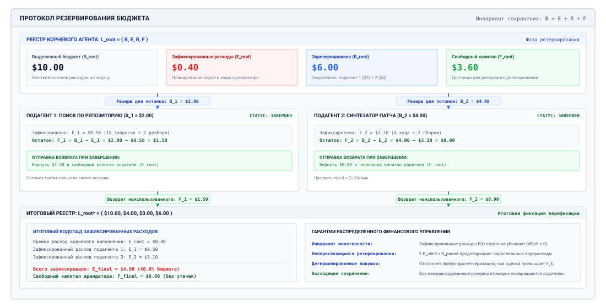
***Иерархические резервирования бюджета**: корневая задача с бюджетом 10,00 доллара резервирует 2,00 и 4,00 доллара для двух подагентов, которые тратят только из своих резервов. По завершении их расходы (0,50 и 3,10 доллара) фиксируются в корне, а неизрасходованные остатки (1,50 и 0,90 доллара) возвращаются, так что у корня остается 4,00 доллара израсходованных и 6,00 доллара свободных. На каждом шаге бюджет равен израсходованному плюс зарезервированному плюс свободному.*

Каждый узел $k$ в дереве делегирования ведет реестр $\mathcal{L}_k = \langle B_k, E_k, R_k, F_k \rangle$ своего бюджета $B_k$, зафиксированных расходов $E_k$, зарезервированной суммы $R_k$ и свободного остатка $F_k$, при соблюдении

<a id="eq-vol3-ledger-conservation"></a>

$$B_k = E_k + R_k + F_k, \quad E_k, R_k, F_k \ge 0$$

Зафиксированные расходы только растут. Зарезервированные деньги покрывают вызовы в полете и бюджеты потомков и не могут быть повторно обещаны. Новую операцию может финансировать только свободная сумма. Таблица [«Переходы реестра бюджета»](#tbl-vol3-ledger-transitions) задает четыре перехода, каждый из которых сохраняет уравнение [«сохранения реестра»](#eq-vol3-ledger-conservation).

| Транзакция         | Предусловие                   | Реестр родителя                                                                            | Реестр потомка                                                                                               |
|:-------------------|:------------------------------|:-------------------------------------------------------------------------------------------|:-------------------------------------------------------------------------------------------------------------|
| **Порождение потомка** | $\Delta B \le F_P$        | $R_P \leftarrow R_P + \Delta B$, $F_P \leftarrow F_P - \Delta B$                           | $B_C = F_C = \Delta B$, $E_C = R_C = 0$                                                                      |
| **Диспетчеризация вызова** | $c_{\text{est}} \le F_C$ | без изменений                                                                              | $R_C \leftarrow R_C + c_{\text{est}}$, $F_C \leftarrow F_C - c_{\text{est}}$                                 |
| **Расчет по вызову** | фактическая стоимость $c$ известна | без изменений                                                                    | $E_C \leftarrow E_C + c$, $R_C \leftarrow R_C - c_{\text{est}}$, $F_C \leftarrow F_C + (c_{\text{est}} - c)$ |
| **Завершение потомка** | потомок остановлен по любой причине | $E_P \leftarrow E_P + E_C$, $R_P \leftarrow R_P - B_C$, $F_P \leftarrow F_P + (B_C - E_C)$ | закрыт                                                                                                       |

<a id="tbl-vol3-ledger-transitions"></a>

***Переходы реестра бюджета**: предусловия и обновления при порождении потомка, диспетчеризации и расчете вызова и закрытии потомка.*

Потомок видит только свой реестр и не может тратить свободный остаток родителя; внук, в свою очередь, финансируется из свободного остатка своего родителя. Поскольку каждое резервирование вычитается до траты, а расходы каждого потомка ограничены его резервом, никакая последовательность порождений и вызовов не может потратить больше корневого бюджета, как бы глубоко или параллельно ни было дерево. Потомок, который зацикливается, исчерпывает свой резерв и останавливается, а его братья и родитель не затронуты. Реестр также отвечает на вопрос, который операторы задают о каждом флоте: кто потратил деньги. При одном корне на арендатора или на заявку атрибуция стоимости — это чтение корневых реестров.

<a id="nbk-17-hierarchical-multi-agent-budget-allocation-and"></a>

> **Реестр бюджета через неуспешного подагента**
>
> **Задача:** Оператор выделяет \$5 на задачу починки. Координатор планирует один вызов передовой модели с 8 000 входными и 1 200 выходными токенами, затем делегирует анализ трассы с резервом \$1,20 и прогон фаззинга с \$2,50. Агент трассы находит дефект за \$0,38. Агент фаззинга натыкается на таймаут песочницы, повторяет попытки в цикле и останавливается детектором прогресса ([«Семантические сторожевые таймеры»](11_failure_recovery.md#sec-vol3-sagas-watchdogs)), израсходовав \$0,85. Что хранит корневой реестр в конце?
>
> **Расчет:** Планирование фиксирует \$0,042, оставляя \$4,958 свободными. Делегирование резервирует \$3,70, оставляя \$1,258 свободными для собственных вызовов координатора. Когда оба потомка останавливаются, их расходы фиксируются в корне, а неизрасходованные резервы, \$0,82 и \$1,65, возвращаются в его свободный остаток. Корень заканчивает с \$1,272 израсходованными, без резервов и с \$3,728 свободными.
>
> **Системный вывод:** Зацикленный потомок никогда не мог бы потратить больше своего резерва, что бы он ни делал, а координатор сохраняет достаточно средств, чтобы попробовать другой подход. Границу задал реестр, а не поведение потомка.

#### Инварианты учета реестра

Каждый узел $k$ в дереве делегирования агентов ведет независимый, изолированный контекст реестра, заданный четверкой:

$$\mathcal{L}_k = \langle B_k, E_k, R_k, F_k \rangle$$

Смысл этих полей описывает различные физические и финансовые состояния капитала:

1. **Выделенный бюджет ($B_k$):** Общая верхняя граница капитала, предоставленного узлу $k$ его непосредственным родителем. Это значение постоянно на протяжении жизни узла $k$.
2. **Зафиксированные расходы ($E_k$):** Безвозвратно списанный капитал за завершенные проходы вывода, выполненные инструменты и завершенные дочерние процессы. Зафиксированные расходы растут монотонно.
3. **Эскроу-резерв ($R_k$):** Капитал, отложенный под агентов-потомков в полете или под ожидающие асинхронные вызовы инструментов. Капитал в эскроу не может быть обещан новым операциям.
4. **Свободный капитал ($F_k$):** Незафиксированный и незарезервированный остаток, сразу доступный для диспетчеризации новых операций.

Эти переменные подчиняются строгому инварианту сохранения:

$$B_k = E_k + R_k + F_k, \quad \text{где } E_k \ge 0, \; R_k \ge 0, \; F_k \ge 0$$

### Многоскоростные автоматические выключатели

Хотя статический совокупный потолок расходов $B_{\text{task}}$ гарантирует, что агент не превысит абсолютный денежный бюджет, статические лимиты представляют собой опасно грубый механизм управления. Если автономный агент с потолком $\$50{,}00$ попадет в патологический цикл генерации кода, который сжигает $\$10{,}00$ в минуту, статический лимит позволит системе работать без контроля пять полных минут, порождая сотни бесполезных файлов и перетасовывая песочницы выполнения, прежде чем она остановится.

Автоматические выключатели инструментов из раздела [«Автоматические выключатели инструментов»](11_failure_recovery.md#sec-vol3-sagas-containment) уже позволяют среде выполнения отсечь отказавшую зависимость без участия модели. Здесь тот же трехпозиционный выключатель следит за другими сигналами: скоростью денежного расхода и *затуханием эпистемической полезности*, а не таймаутами сокетов и долей ошибок.

**Аналогия с автоматическим выключателем**
В электрических сетях автоматический выключатель срабатывает, когда потребляемый ток ($I = \frac{dQ}{dt}$) опасно возрастает, предотвращая пожар. В агентных системах выключатель срабатывает, когда скорость денежного расхода ($\frac{dC}{dt}$) выходит за безопасные пределы.

Агентный автоматический выключатель действует как динамический надзиратель, обернутый вокруг конвейера диспетчеризации модели. Он непрерывно переходит между тремя рабочими состояниями:

1. **CLOSED (номинальный режим):** Операции диспетчеризуются в обычном режиме. Понесенные расходы и изменения состояния записываются в скользящее окно.
2. **OPEN (сработал):** Выключатель обнаружил нарушение инварианта. Все последующие запросы вывода, диспетчеризации инструментов и инициализации дочерних агентов немедленно завершаются с ошибкой (`fail-fast`). Активная траектория приостанавливается, и среда выполнения запускает автоматический откат или эскалацию к оператору-человеку.
3. **HALF-OPEN (канареечная проверка):** После интервала охлаждения или восстановления контрольной точки среды среда выполнения пропускает одну ограниченную канареечную проверку (например, недорогой проход рефлексии или один детерминированный модульный тест), чтобы выяснить, восстановил ли агент связность. Если проверка проваливается, выключатель немедленно возвращается в `OPEN`. Переходы состояний и инварианты, управляющие этим контуром, формализованы в таблице [«Конечный автомат автоматического выключателя»](#tbl-vol3-circuit-breaker-fsm).

| Текущее состояние      | Триггер перехода / условие                                                                                        | Целевое состояние | Защита инварианта и эксплуатационная семантика                                              | Действие системы по восстановлению                          |
|:-----------------------|:------------------------------------------------------------------------------------------------------------------|:------------------|:---------------------------------------------------------------------------------------------|:------------------------------------------------------------|
| **CLOSED (Nominal)**   | Всплеск скорости ($\bar{\nu}_W > \nu_{\max}$), затухание полезности ($\Delta \mathcal{U} < \epsilon$) или нарушение инварианта | **OPEN**          | Немедленная ловушка fail-fast; останавливает вывод и диспетчеризацию инструментов           | Приостанавливает траекторию, отменяет ожидающие задания потомков, записывает тревогу |
| **OPEN (Tripped)**     | Истек интервал охлаждения ($\Delta t > \tau_{\text{cool}}$) или завершен откат к контрольной точке                  | **HALF-OPEN**     | Разрешает изолированную одношаговую канареечную оценку                                       | Выдает ограниченную интроспекцию или изолированный модульный тест |
| **HALF-OPEN (Canary)** | Канареечная проверка провалилась или повторно вызвала нарушение инварианта                                         | **OPEN**          | Вводит экспоненциальное охлаждение с откатом ($\tau_{\text{cool}} \leftarrow 2 \tau_{\text{cool}}$) | Передает оператору-человеку или завершает траекторию         |
| **HALF-OPEN (Canary)** | Канареечная проверка прошла, проверка состояния успешна                                                           | **CLOSED**        | Сбрасывает счетчик последовательных сбоев и снимает удержание эскроу                          | Восстанавливает обычный многоходовой конвейер диспетчеризации модели |

<a id="tbl-vol3-circuit-breaker-fsm"></a>

***Конечный автомат автоматического выключателя**: конечный автомат агентного автоматического выключателя и семантика переходов.*

Чтобы обеспечить всестороннюю эшелонированную защиту, среда выполнения-хост реализует три различных, независимых триггера автоматического выключателя.

#### Ограничение финансовой скорости

Выключатель финансовой скорости отслеживает мгновенную первую производную расходов по времени: $\nu(t) = \frac{dC}{dt}$. В дискретной среде выполнения она вычисляется по скользящему окну назад длительностью $W$ (например, 60 секунд):

$$\bar{\nu}_W(t) = \frac{C(t) - C(t - W)}{W}$$

Если $\bar{\nu}_W(t)$ превышает разрешенный порог скорости расхода $\nu_{\max}$ (например, $\$2{,}00 / \text{минуту}$), автоматический выключатель немедленно переходит в `OPEN`. Всплески скорости обычно означают, что агент породил широкое ветвление некоординированных подагентов, вошел в неограниченный цикл опроса внешних API или запустил авторегрессионный цикл, который насыщает локальные движки предзаполнения GPU избыточными окнами контекста.

#### Совокупные потолки траектории

Совокупный выключатель обеспечивает жесткое граничное условие $C(t) + R(t) \ge B_{\text{task}}$. В отличие от выключателя скорости, который срабатывает по скоростям, совокупный выключатель ограничивает общий объем. Это последняя страховка от траекторий с низкой скоростью и высокой настойчивостью, которые делают минимальный прогресс в течение часов выполнения. При срабатывании среда выполнения сохраняет текущее состояние песочницы, выгружает диагностическую трассу выполнения и переводит агента в спокойное состояние, ожидающее одобрения человеком на расширение бюджета.

#### Предельное затухание эпистемической полезности

Самый тонкий и разрушительный режим отказа в автономных системах — *эпистемический цикл*: агент остается далеко в пределах своего лимита финансовой скорости и израсходовал лишь долю общего бюджета, но он перестал делать заметный прогресс к завершению задачи. Агент генерирует код, запускает модульный тест, наблюдает ошибку утверждения, меняет несвязанный комментарий или имя переменной, запускает тест снова и повторяет цикл бесконечно.

Чтобы выявить эту патологию, среда выполнения оценивает *предельную эпистемическую полезность* траектории. Пусть $\mathcal{S}_t$ — наблюдаемое состояние среды на ходу $t$ (например, дерево каталогов исходного кода, векторы диагностики компилятора и результаты выполнения тестов). Определим метрику прогресса $\mathcal{M}(\mathcal{S}_t) \in [0, 1]$, которая измеряет объективную близость к инвариантам цели:

$$\mathcal{M}(\mathcal{S}_t) = w_1 \cdot \text{PassRatio}(\mathcal{S}_t) + w_2 \cdot (1 - \text{LintErrors}(\mathcal{S}_t)) + w_3 \cdot \text{DiffConvergence}(\mathcal{S}_t)$$

где $w_1, w_2, w_3$ — нормированные доменные веса. Предельная полезность на окне оценки из $K$ ходов определяется как:

$$\Delta \mathcal{M}_K(t) = \mathcal{M}(\mathcal{S}_t) - \mathcal{M}(\mathcal{S}_{t - K})$$

Если среда выполнения видит, что за $K$ последовательных ходов совокупные расходы заметно выросли ($\sum_{j=t-K+1}^t c_j > \theta_C$), а предельная метрика прогресса осталась на месте или снизилась:

$$\Delta \mathcal{M}_K(t) \le \epsilon_{\text{progress}}$$

выключатель затухания эпистемической полезности переходит в `OPEN`. Среда выполнения останавливает цикл, диагностируя, что модель исчерпала способность к рассуждению для текущего состояния среды и что продолжение выполнения лишь сожжет финансовый капитал, не повысив вероятность достижения цели. Отслеживаемые метрики, математические условия срабатывания и смягчаемые режимы отказа трех автоматических выключателей сведены в таблице [«Условия срабатывания многоскоростных автоматических выключателей и смягчение режимов отказа»](#tbl-vol3-circuit-breakers).

| Автоматический выключатель | Отслеживаемая метрика                                  | Математическое условие срабатывания                               | Основной смягчаемый режим отказа                                       |
|:---------------------------|:-------------------------------------------------------|:------------------------------------------------------------------|:-----------------------------------------------------------------------|
| **Ограничитель скорости**  | Скорость расхода $\frac{dC}{dt}$                       | $\frac{C(t) - C(t - W)}{W} > \nu_{\max}$                          | Взрывное ветвление параллельных потомков; неограниченные циклы опроса API |
| **Совокупный потолок**     | Совокупная экспозиция                                  | $C(t) + R(t) \ge B_{\text{task}}$                                 | Длительное ползучее исчерпание; незаконные превышения бюджета проекта   |
| **Затухание эпистемической полезности** | Предельная полезность $\frac{\Delta \mathcal{M}}{\Delta C}$ | $\Delta \mathcal{M}_K \le \epsilon$ при $\Delta C_K > \theta_C$ | Беспорядочные циклы повторов; косметическая перетасовка кода; ловушки циклических рассуждений |

<a id="tbl-vol3-circuit-breakers"></a>

***Условия срабатывания многоскоростных автоматических выключателей и смягчение режимов отказа**: отслеживаемые метрики, математические условия срабатывания и основные режимы отказа для финансовой безопасности агентов.*

Когда расходы математически ограничены монотонными реестрами, иерархическим эскроу и многоскоростными автоматическими выключателями, инженер систем может безопасно развернуть автономных агентов в производственной среде. Однако соблюдение границ расходов решает лишь негативную задачу эксплуатации флота: предотвращение экономической катастрофы. Позитивная инженерная задача остается: при заданной производственной задаче с известными ограничениями по задержке, бюджету и точности как архитектору определить, решать ее детерминированным скриптом компилятора, одним вызовом модели со структурированным выводом, последовательной цепочкой специализированных моделей или полностью динамической мультиагентной системой? Синтез этих эксплуатационных переменных в принципиальную рубрику выбора — тема следующего раздела.

<a id="sec-vol3-agent-economics-selection"></a>

## Оценка выбора архитектуры

Команда, у которой работает агент, склонна направлять его на каждую задачу. Раздел [«Матрица архитектурных решений»](01_introduction.md#sec-vol3-intro-workflow-vs-loop) дал решение о том, нужен ли задаче вообще цикл, управляемый моделью. Имея стоимость на принятую задачу, задержку критического пути и риск расходов, это решение теперь можно оценить, и цена часто его и определяет. Агентность — самый дорогой и наименее предсказуемый способ выполнить задачу, и покупать ее стоит только там, где более дешевые способы не срабатывают.

<a id="sec-vol3-selection-spectrum"></a>

### Спектр с ценами

Таблица [«Спектр архитектур с ценами»](#tbl-vol3-architecture-spectrum) размещает четыре проекта на спектре, из которого выбирают четыре вопроса раздела [«Матрица архитектурных решений»](01_introduction.md#sec-vol3-intro-workflow-vs-loop): детерминированный код, один вызов модели внутри фиксированного рабочего процесса, ограниченный цикл агента и несколько агентов над одной задачей. Столбцы задержки и стоимости дают порядки величин, а не измерения. Каждый шаг вправо покупает гибкость и платит стоимостью, задержкой, дисперсией и замыканием, которое должна обеспечить среда выполнения.

| Измерение              | Детерминированный код             | Один вызов модели                              | Ограниченный цикл агента                       | Несколько агентов                                         |
|:-----------------------|:----------------------------------|:-----------------------------------------------|:-----------------------------------------------|:----------------------------------------------------------|
| **Поток управления**   | Фиксирован в коде                 | Фиксированный конвейер, один шаг модели        | Управляется моделью в пределах лимита ходов    | Граф задач с типизированными передачами                   |
| **Задержка**           | Микросекунды — миллисекунды       | Сотни миллисекунд — секунды                    | Секунды — минуты                               | Минуты — часы                                             |
| **Стоимость на задачу** | Пренебрежимо мала                | Фиксирована за вызов, $10^{-5}$ до $10^{-3}$ доллара | Сумма по ходам, $10^{-2}$ до $10^{-1}$ доллара | Доллары — десятки долларов                                |
| **Переносимое состояние** | Переменные программы и таблицы | Ничего, кроме запроса                          | Контекст, рабочее пространство, запись траектории | Разделенные контексты и рабочие пространства              |
| **Восстановление после сбоев** | Исключения и повторы      | Повторный разбор, резервная модель             | Повтор с обратной связью, откат, компенсация   | Перепланирование у координатора, эскалация к человеку     |
| **Основание верификации** | Модульные тесты и типы         | Проверки схемы                                 | Тесты и проверки в песочнице                   | Шлюз инвариантов на каждый коммит, сквозные тесты, проверка человеком |

<a id="tbl-vol3-architecture-spectrum"></a>

***Спектр архитектур с ценами**: поток управления, порядки величин задержки и стоимости, переносимое состояние, восстановление и верификация для четырех проектов.*

Рисунок [«Многомерные компромиссы по спектру архитектурной автономии и матрица выбора систем»](#fig-vol3-architectural-radar-chart) показывает эти многомерные компромиссы по спектру архитектурной автономии.

<a id="fig-vol3-architectural-radar-chart"></a>

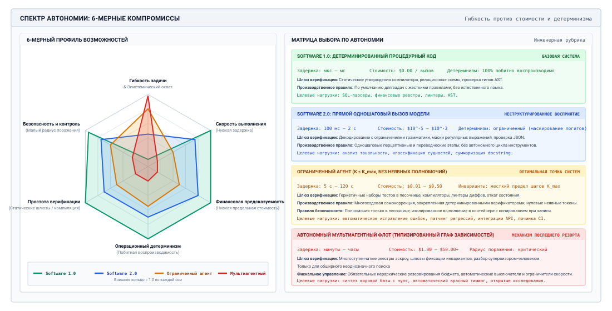
***Многомерные компромиссы по спектру архитектурной автономии и матрица выбора систем**: шестимерная оценка систем, сравнивающая Software 1.0 (детерминированный процедурный код), Software 2.0 (прямой одношаговый вывод модели), ограниченные агентные рабочие процессы ($K \le K_{\max}$, $A_1$) и автономные мультиагентные флоты. Расширение автономии монотонно повышает гибкость ценой операционного детерминизма, скорости выполнения, финансовой предсказуемости, простоты верификации и безопасности радиуса поражения. Сопровождающая матрица выбора систем задает четкие границы решений на основе эпистемической неоднозначности, изменяемости состояния, допустимой задержки и проверяемой истины.*

<a id="sec-vol3-selection-questions"></a>

### Четыре вопроса с ценами


*Горизонт, состояние и полномочия задают замыкание, которое должна оплатить каждая задача.*

Четыре вопроса раздела [«Матрица архитектурных решений»](01_introduction.md#sec-vol3-intro-workflow-vs-loop) размещают задачу по трем экспозициям H·S·A ([«Экспозиции H·S·A»](01_introduction.md#sec-vol3-intro-hsa)) и по уровням свидетельств замыкания ([«Уровни свидетельств замыкания»](01_introduction.md#sec-vol3-intro-closure-evidence)), которые среда выполнения может для нее собрать. У каждого из них есть цена, которую эта глава теперь может назвать.

*Горизонт* оценивается во времени и в отношении шансов. Каждый ход добавляет время критического пути и повторно отправленный контекст, и задача с дедлайном в секунду-две не может позволить себе цикл, каждый ход которого занимает секунды. Более длинные горизонты также усиливают провал на каждом шаге, поэтому задача, естественная длина которой — много ходов, нуждается либо в высокой успешности на каждом шаге, либо в проверенных промежуточных вехах, чтобы держать $(1-\alpha)/\alpha$ малым.

*Состояние* оценивается в контексте. Преобразование из входа в выход без состояния, которое нужно переносить, — это один вызов, и обернуть его в цикл значит добавить повторно отправленный контекст и режимы отказа без добавленной ценности. Задача, которая должна наблюдать и менять рабочее пространство, платит за рост контекста из раздела [«Кеширование и бюджеты на рассуждения»](#sec-vol3-agent-economics-caching) на каждом ходу, и раскладка кеша и политика сжатия определяют, сколько именно.

*Полномочия* оцениваются в одобрениях и в стоимости ошибок. Задача, эффекты которой остаются в одноразовой песочнице ($A_1$), может выполняться как ограниченный цикл. Задача, эффекты которой компенсируемы ($A_2$), тоже может, при условии что каждое действие с истекшим таймаутом урегулировано до повтора (принцип «Урегулирование до повтора»), и она платит за механизмы компенсации. Задача с необратимыми эффектами ($A_3$) платит за шлюз одобрения ([«Шлюзы одобрения»](09_agent_harness.md#sec-vol3-controlplane-hitl)) на каждом таком действии, и ее член $C_{\text{human}}$ перестает быть редким.

*Свидетельства замыкания* оцениваются в верификации, и это вопрос, который чаще всего решает дело. Если существует быстрая и надежная проверка, например набор тестов или компилятор, дешевая модель может итерироваться против нее, и стоимость на принятую задачу падает с каждой попыткой, которую проверка отфильтровывает. Если такой проверки нет, большее число ходов и агентов не сходится к корректности; они добавляют стоимость, а результат все равно требует проверки человеком. Такие задачи относятся к одному вызову с проверкой, стоимость которого определяется $C_{\text{human}}$.

<a id="sec-vol3-selection-economics"></a>

### Где цикл окупается

Сравнение, которое чаще всего имеет значение, — между одним сильным вызовом и ограниченным циклом вокруг более дешевой модели. Для цикла не более $K$ ходов против верификатора с условной вероятностью успеха $r_k$ на ходу $k$ при условии предыдущих провалов вероятность получить принятый результат равна

<a id="eq-vol3-loop-success"></a>

$$p_{\text{loop}}(K) = 1 - \prod_{k=1}^K (1 - r_k)$$

а ожидаемая стоимость равна стоимости хода, умноженной на ожидаемое число ходов. Когда нерешенные задачи передаются человеку по цене $C_{\text{human}}$, стоимость каждого проекта на заявку равна его вычислительной стоимости плюс $(1 - p) C_{\text{human}}$, и обычно решает именно член для человека.

<a id="nbk-17-architectural-frontier-migration-under-cost"></a>

> **Оценка трех проектов для обновления зависимостей**
>
> **Задача:** Команда обрабатывает 10 000 заявок по рекомендациям безопасности в месяц, каждая из которых требует обновления зависимости, правок устаревших вызовов и успешного прогона сборки и тестов. Заявка, которую не закрыла автоматизация, стоит \$35 на ручное исправление. Переписыватель по правилам стоит \$0,001 за заявку и успешен с вероятностью 0,32. Один вызов передовой модели, который предлагает дифф, стоит \$0,045 и успешен с вероятностью 0,68. Ограниченный цикл вокруг более дешевой модели стоит \$0,006 за ход плюс \$0,002 за прогон тестов, выполняется не более трех ходов и на каждом ходу успешен с вероятностями 0,55, 0,42 и 0,30 при условии предыдущих провалов. Какой проект стоит меньше всего за заявку?
>
> **Расчет:** По [«уравнению успеха цикла»](#eq-vol3-loop-success) цикл успешен с вероятностью 0,82 за 1,71 хода в среднем, при вычислительной стоимости \$0,014 и примерно 12,3 с на заявку. С учетом обработки провалов человеком заявка стоит \$23,80 с переписывателем, \$11,24 с одним вызовом и \$6,41 с циклом, или \$238 010, \$112 450 и \$64 082 в месяц.
>
> **Системный вывод:** Цикл стоит на 43 процента меньше одного вызова и на 73 процента меньше переписывателя, хотя его вычисления дешевле вызова лишь на центы. Его преимущество — набор тестов. Дешевая модель, которая видит падающую сборку и пробует снова, превращает дешевые попытки в принятые исправления. Без такой проверки цикл было бы не на что опереться.

Несколько агентов следуют той же логике еще на шаг дальше. Мультиагентный проект оправдывает себя, только если он побеждает одного агента с тем же общим бюджетом по стоимости на принятую задачу, времени или принятию, не проигрывая по остальным (принцип «Трехосевая граница оценки мультиагентных систем»), и платит налог на координацию (принцип «Налог на координацию») независимо от того, побеждает он или нет. Автономия должна расти лишь до тех пор, пока отдача от принятых задач превышает добавленную стоимость ходов, проверки, координации и управления, а учет этой главы показывает, как это проверить.

<a id="sec-vol3-agent-economics-synthesis"></a>

## Синтез экономики обслуживания

Администратор кластера, который независимо оптимизирует обслуживание моделей, выполнение инструментов и политики планирования, неизбежно обнаруживает, что локальные эффективности складываются в катастрофические неэффективности на уровне флота. Ускорение ядра авторегрессионного декодирования с помощью специализированного ядра flash-attention или спекулятивной верификации снижает задержку декодирования, ограниченную GPU, в 2,5 раза, однако общее время траектории по реальному времени падает меньше чем на $6\%$, если среда выполнения агента тратит $82\%$ своего критического пути в простое на синхронной перезаписи образа контейнера и внешних RPC к песочнице. Так же развертывание агрессивных каскадов моделей, которые направляют запросы к моделям менее чем с миллиардом параметров, сокращает номинальные комиссии за вывод токенов, но если низкая способность у дешевой модели следовать инструкциям вызывает повторные попытки по синтаксису и откаты траекторий, совокупная стоимость на принятую задачу резко растет.

**Экономическая жизнеспособность в автономных флотах агентов — не внутреннее свойство нижележащих весов нейросети или ядер вывода, а эмерджентное свойство замкнутой системы управления, которая определяет их вызов.** Максимизация экономической отдачи системы требует объединить учет стоимости всей траектории, декомпозицию задержки критического пути, спекулятивное ускорение, многоуровневую маршрутизацию моделей и планирование кластера на основе теории очередей в единую самобалансирующуюся эксплуатационную среду выполнения. Когда эти подсистемы работают изолированно, они порождают рассогласования: планировщики заполняют память GPU траекториями с длинным контекстом, которые морят голодом интерактивные запросы, а каскады маршрутизации направляют сложные задачи рассуждений моделям малой мощности, которые тратят непропорционально большие бюджеты инструментов и верификации, прежде чем провалиться.

<a id="sec-vol3-synthesis-control-loop"></a>

### Многоуровневый экономический контур управления

Чтобы предотвратить эти режимы отказа, производственная платформа агентов должна строить управление как пятиступенчатый конвейерный замкнутый контур обратной связи ([«Архитектура замкнутого контура управления экономикой флота»](#fig-vol3-fleet-economics-architecture)). Каждая ступень обеспечивает формальный системный контракт, превращая непривилегированное намерение пользователя в проверенные внешние изменения состояния, одновременно активно минимизируя потребление ресурсов.

<a id="fig-vol3-fleet-economics-architecture"></a>

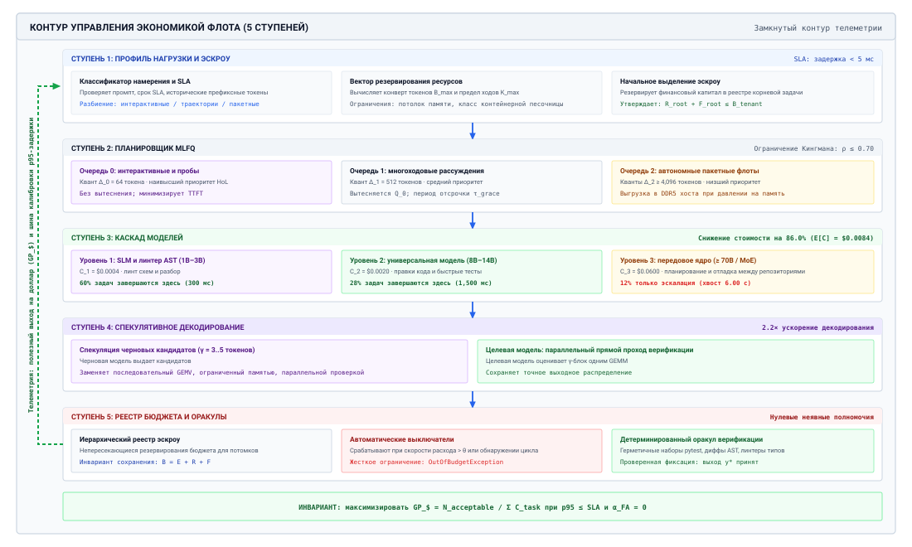
***Архитектура замкнутого контура управления экономикой флота**: пятиступенчатый конвейерный движок обслуживания, объединяющий профилирование нагрузки и резервирование эскроу при допуске, планирование кластера MLFQ ($\rho \le 0{,}70$), многоуровневые каскады маршрутизации моделей (60 процентов запросов завершаются на малой языковой модели (SLM) со стоимостью 0,0004 доллара, 28 процентов на универсальной модели со стоимостью 0,0024 доллара, 12 процентов эскалируются на передовую модель), ускорение спекулятивным декодированием ($\gamma = 3..5$) и иерархический учет бюджетного реестра при нулевых неявных полномочиях. Телеметрия от проверенных завершений задач поступает во внешнюю шину обратной связи «полезный выход на доллар», которая динамически перенастраивает эскроу допуска, кванты очередей и пороги уверенности каскада.*

Как видно по сквозному конвейеру на рисунке [«Архитектура замкнутого контура управления экономикой флота»](#fig-vol3-fleet-economics-architecture), входящий запрос проходит пять скоординированных системных барьеров, прежде чем зафиксировать изменения во внешней среде. На ступени 1 (*профилировщик нагрузки и эскроу*) входной маршрутизатор разбирает семантику промпта, устанавливает сроки SLA и выделяет начальный финансовый конверт эскроу ($B_{\text{task}}$). На ступени 2 (*планировщик кластера MLFQ*) запросы попадают в очередь приоритета $Q_0$ при целевых значениях загрузки кластера, безопасных по Кингману ($\rho \le 0{,}70$), отделяя интерактивные пробы от пакетных траекторий с помощью квантов токенов ($\Delta_0=64, \Delta_1=512, \Delta_2\ge 4\,096$) и предотвращая голодание периодическими повышениями приоритета ($T_{\text{boost}} = 60\text{ с}$).

На ступени 3 (*каскад маршрутизации по уровням*) ход выполнения пытается разрешить задачу на самом дешевом подходящем уровне: $60\%$ синтаксических ходов успешно завершаются на уровне SLM ($C_1 = \$0{,}0004$), $28\%$ разрешаются на универсальной модели среднего уровня ($C_2 = \$0{,}0024$), и только $12\%$ эскалируются на передовую модель, так что ожидаемая стоимость хода составляет $E[C] = \$0{,}0084$. На ступени 4 (*механизм спекулятивного декодирования*) тяжелые вызовы передовой модели ускоряются непосредственно на тензорных ядрах GPU с помощью согласованной черновой модели, которая спекулятивно генерирует $\gamma = 3..5$ токенов за прямой проход ($\alpha_{\text{accept}} = 0{,}75$), что сжимает задержку декодирования на критическом пути. Наконец, на ступени 5 (*иерархический реестр и верификатор*) модель не имеет неявных полномочий, и каждое предлагаемое действие выполняется в изолированной песочнице; только когда детерминированные механические верификаторы подтверждают корректность, транзакция фиксируется и неизрасходованный эскроу возвращается арендатору. Весь конвейер заключен в глобальную петлю обратной связи, которая непрерывно оптимизирует полезный выход на доллар ($\text{GP}_{\$}$), динамически подстраивая пороги маршрутизации и кванты очередей по данным о дефектах в реальном времени.

Первая ступень этого движка — *профилировщик нагрузки*. Когда запрос задачи поступает на вход платформы, профилировщик проверяет полезную нагрузку промпта, указанный пользователем срок, исторические характеристики траекторий запрашивающего арендатора и требования к возможностям инструментов. Вместо того чтобы считать все запросы однородными последовательностями токенов, профилировщик разбивает входящий трафик на различные профили выполнения: короткие ограниченные интерактивные запросы, детерминированные многоходовые рабочие процессы и неограниченные исследовательские траектории агентов. Извлекая структурные инварианты, например то, требует ли запрос выполнения произвольного кода или только извлечения структурированных данных, профилировщик вычисляет начальный вектор резервирования ресурсов, включающий границы памяти, лимиты скорости инструментов и начальный финансовый эскроу.

Вторая ступень — *планировщик кластера MLFQ*. Планировщик предотвращает катастрофическую блокировку головы очереди, которая возникает, когда долгоживущие стохастические траектории агентов делят физические очереди вычислений с одноходовыми интерактивными запросами. Входящие задачи попадают в очередь наивысшего приоритета ($Q_0$), которая предоставляет немедленный небольшой квант вычислений, оптимизированный под время до первого токена (TTFT) и быстрое первоначальное планирование. Если задача исчерпывает квант, не завершившись и не перейдя в состояние внешнего ожидания, планировщик понижает ее в пакетные очереди с низшим приоритетом и высокой пропускной способностью ($Q_1, Q_2$). Такое разделение гарантирует, что длительные траектории работают на кластерах, настроенных под высокую плотность непрерывного пакетирования и пропускную способность, а чувствительные к задержке ходы пользователя — на недозагруженных узлах с малой задержкой.

Третья ступень — *каскад маршрутизации по уровням*, который воплощает принципы, изложенные в FrugalGPT (Chen et al., 2023). Когда запланированный ход агента требует нейросетевого вывода, среда выполнения не использует по умолчанию самую способную передовую модель. Вместо этого она направляет контекст легковесной малой языковой модели (SLM), настроенной на создание промежуточных черновиков, вызовов инструментов с проверенной схемой или кандидатных проверок. Выход SLM проходит через непривилегированный валидатор выхода. Если SLM генерирует неверную схему инструмента, демонстрирует низкую уверенность логитов на критических токенах или сигнализирует о неспособности разрешить граф зависимостей промпта, каскад эскалирует вызов на модель рассуждений среднего или передового уровня. Разрешая на самом низком уровне подавляющее большинство шагов синтаксического форматирования, маршрутизации инструментов и суммаризации статуса, каскад сохраняет дорогую мощность передовой модели для сложного планирования и восстановления после ошибок.

Четвертая ступень — *механизм спекулятивного декодирования*, встроенный непосредственно в физический кластер вывода. Когда эскалированная задача должна выполняться на массивной целевой модели ($M_{\text{target}}$), среда выполнения связывает целевую модель с согласованной черновой моделью ($M_{\text{draft}}$). Черновая модель спекулятивно выдает $\gamma$ кандидатных токенов по критическому пути, где действует закон Амдала. Целевая модель оценивает эти $\gamma$ токенов за один параллельный прямой проход (GEMM), принимая префиксы, которые совпадают с ее собственным распределением вероятностей, и возвращаясь к собственному распределению при первом отказе. Поскольку спекулятивное декодирование гарантирует математическую эквивалентность выборке напрямую из $M_{\text{target}}$, среда выполнения резко ускоряет авторегрессионную генерацию, не вводя стохастического дрейфа и не снижая успешность решения задач.

Пятая ступень — *иерархический реестр бюджета и эскроу инвариантов*. Каждое последующее выполнение — будь то спекулятивный прямой проход, проверка маршрутизации SLM, запуск компилятора в контейнере или вызов внешнего SaaS API — должно быть авторизовано по строго монотонному реестру бюджета. Когда подагенты порождаются для решения подзадач, родительский агент делит свой собственный эскроу ресурсов, делегируя детям более мелкие невозобновляемые выделения. Если подагент входит в повторяющийся цикл повторов или не продвигает состояние в пределах выделенного бюджета, реестр срабатывает как жесткий автоматический выключатель. Измененное состояние агента удерживается в эскроу; только когда внешний детерминированный набор тестов проходит, среда выполнения фиксирует изменение в авторитетном производственном хранилище. Контракты, механизмы, цели оптимизации и режимы отказа по этим пяти ступеням сведены в [«Механике и интерфейсах контура управления экономикой флота»](#tbl-vol3-synthesis-stages).

| Ступень контура            | Контракт входа                     | Основной механизм                                 | Цель оптимизации                                 | Смягчаемые режимы отказа                    |
|:---------------------------|:-----------------------------------|:--------------------------------------------------|:-------------------------------------------------|:--------------------------------------------|
| **1. Профилировщик нагрузки** | Исходная задача и исторические метаданные | Статический анализ контекста и зависимостей | Классификация SLA; размер эскроу                 | Избыточное выделение; голодание песочниц    |
| **2. Планировщик MLFQ**    | Класс профилировщика и квант хода  | Динамическое понижение квантов                    | P99 TTFT интерактивных запросов; пропускная способность кластера | Блокировка головы очереди; исчерпание KV-кеша |
| **3. Каскад маршрутизации** | Проверенный контекст и уровень намерения | Поэтапная эскалация возможностей (SLM $\to$ передовая) | Стоимость промежуточного шага ($C_{\text{turn}}$) | Перегрузка передовой модели                 |
| **4. Спекулятивное декодирование** | Активный поток токенов и черновая модель | Параллельная проверка $\gamma$ черновых токенов | Задержка между токенами декодирования ($T_{\text{decode}}$) | Недоиспользование пропускной способности памяти и вычислений |
| **5. Иерархический реестр** | Выделенный эскроу и диффы выполнения | Монотонный учет и автоматические выключатели     | Финансово ограниченная ошибка задачи             | Бесконечные циклы; исчерпание бюджета       |

<a id="tbl-vol3-synthesis-stages"></a>

***Механика и интерфейсы контура управления экономикой флота**: контракты входа, основные механизмы, цели оптимизации и режимы отказа по пяти ступеням контура управления.*

<a id="sec-vol3-synthesis-goodput"></a>

### Полезный выход на доллар: единая цель

Оптимизация флота агентов требует метрики, которая связывает эффективность железа с полезностью для предприятия. Традиционные метрики инфраструктуры машинного обучения, такие как токены в секунду, эффективность FLOP или загрузка GPU, в агентных системах активно вводят в заблуждение. Кластер, который выполняет неограниченного агента в бесконечном цикле, может достигать $98\%$ загрузки FLOP модели (MFU) и генерировать десятки тысяч токенов в секунду, не производя при этом никакой функциональной ценности. И наоборот, метрика инфраструктуры, основанная только на сырой стоимости за миллион токенов, вознаграждает выбор дешевых, деградировавших моделей, которые не могут решить задачу пользователя.

В масштабе флота цель по принятым задачам из раздела [«Стоимость на принятую задачу»](#sec-vol3-agent-economics-accounting) выглядит как *полезный выход на доллар* ($\text{GP}_{\$}$), то есть число проверенных, бездефектных задач, выполненных на единицу общих экономических затрат. Это обратная величина к $C_{\text{effective}}$. Если полезный выход траектории из раздела [«Эффективность на микроуровне и на макроуровне»](01_introduction.md#sec-vol3-intro-macro-vs-micro-efficiency) измеряет долю ресурсов, которая доходит до принятых задач, то полезный выход на доллар измеряет, сколько принятых задач покупает каждый доллар:

$$\text{GP}_{\$} = \frac{N_{\text{acceptable}}}{\sum_{i=1}^M C_{\text{task}}^{(i)}}$$

В этой формулировке $M$ — общее число задач, принятых в кластер, а $C_{\text{task}}^{(i)}$ — полная стоимость траектории задачи $i$. Как установлено в нашей схеме учета стоимости задач, $C_{\text{task}}$ охватывает каждый ресурс, потребленный на протяжении жизненного цикла попытки:

$$C_{\text{task}} = \sum_{k=1}^K \left( C_{\text{prefill}}^{(k)} + C_{\text{decode}}^{(k)} + C_{\text{tool}}^{(k)} + C_{\text{sandbox}}^{(k)} \right) + C_{\text{verify}} + C_{\text{human}}$$

Числитель, $N_{\text{acceptable}}$, — это число задач, которые удовлетворяют всем функциональным инвариантам без неучтенного вмешательства человека:

$$N_{\text{acceptable}} = \sum_{i=1}^M \mathbf{1}\left( \text{Verified}(i) \land \neg \text{Defect}(i) \right)$$

Здесь $\text{Verified}(i)$ — бинарный индикатор того, что итоговый выход задачи успешно прошел внешнюю детерминированную обвязку проверки (например, наборы модульных тестов, интеграционные линтеры или проверки схем). Член $\neg \text{Defect}(i)$ исключает ложные принятия — решения, которые проходят синтаксические тесты, но вносят скрытые регрессии или уязвимости безопасности.

<a id="dfn-goodput-per-dollar"></a>

> **Полезный выход на доллар**
>
> Определяющая экономическая целевая метрика $\text{GP}_{\$} = \frac{N_{\text{acceptable}}}{\sum_{i=1}^M C_{\text{task}}^{(i)}}$, которая измеряет число проверенных, бездефектных выполнений задач агентом, достигнутых на единицу общих финансовых затрат. Объединяя детерминированную проверку постусловий с учетом стоимости всей траектории, полезный выход на доллар согласует планирование ускорителей, выбор моделей и кеширование выполнения с реальной полезностью для предприятия.

<a id="nbk-17-quantitative-evaluation-of-fleet-goodput"></a>

> **Оценка полезного выхода флота на доллар**
>
> Рассмотрим корпоративный бенчмарк программной инженерии из $M = 1\,000$ задач исправления кода. Сравниваем две эксплуатационные конфигурации: *наивную монолитную архитектуру*, которая направляет каждое взаимодействие непосредственно в передовую модель без вспомогательных механизмов, и *синтезированную архитектуру с контуром управления*, которая развертывает профилирование, планирование MLFQ, каскады по уровням и спекулятивное декодирование.
>
> **1. Основа цен на оборудование и провайдеров:**
>
> - Передовая модель ($M_{\text{target}}$): $\$10{,}00$ за $10^6$ токенов предзаполнения; $\$30{,}00$ за $10^6$ токенов декодирования.
> - Малая языковая модель ($M_{\text{draft}}$ / уровень 1 каскада): $\$0{,}20$ за $10^6$ токенов предзаполнения; $\$0{,}60$ за $10^6$ токенов декодирования.
> - Эфемерная песочница выполнения: $\$0{,}06$ за час процессора ($\$1{,}67 \times 10^{-5}$ за секунду).
> - Детерминированный набор проверки: $\$0{,}02$ за прогон.
> - Эскалация к человеку (разбор): $\$15{,}00$ за устранение дефекта.
>
> **2. Базовый уровень: наивная монолитная архитектура**
>
> - Динамика траектории: каждая задача выполняется на $M_{\text{target}}$. Средняя траектория требует $K = 6$ ходов.
> - На ход: $4\,000$ токенов предзаполнения, $500$ токенов декодирования, $45$ секунд выполнения в песочнице.
> - Точность задач: доля принятия с первого прохода составляет $p = 0{,}65$. Остальные $35\%$ проваливают верификацию и отбрасываются без устранения человеком ($N_{\text{acceptable}} = 650$).
> - Стоимость токенов на ход: $(4\,000 \times 10^{-5}) + (500 \times 3 \times 10^{-5}) = \$0{,}040 + \$0{,}015 = \$0{,}055$.
> - Стоимость песочницы на ход: $45 \times (1{,}67 \times 10^{-5}) = \$0{,}00075$.
> - Стоимость траектории ($6$ ходов): $6 \times (\$0{,}055 + \$0{,}00075) = \$0{,}3345$.
> - Стоимость верификации: $\$0{,}02$. Общая стоимость на задачу: $\$0{,}3545$.
> - Общая стоимость флота: $1\,000 \times \$0{,}3545 = \$354{,}50$.
> - **Базовый полезный выход:**
>   $$\text{GP}_{\$}^{\text{naive}} = \frac{650 \text{ задач}}{\$354{,}50} \approx \mathbf{1{,}83 \text{ принятых задач / доллар}}$$
>
> **3. Синтезированная архитектура:**
>
> - Профилирование нагрузки и каскадирование: $60\%$ всех ходов (поиск файлов, синтаксический линтинг, подготовка к коммиту в git) полностью решаются $M_{\text{draft}}$. Только $40\%$ ходов эскалируются на $M_{\text{target}}$ для сложного алгоритмического синтеза.
> - Спекулятивное декодирование: применяется ко всем вызовам $M_{\text{target}}$ с черновой моделью $M_{\text{draft}}$ ($\gamma = 4$, средняя доля принятия $\alpha = 0{,}75$). Время декодирования по реальным часам сокращается в 2,1 раза, что уменьшает время удержания песочниц во время генерации.
> - Стоимость токенов на ход (уровень 1 каскада — SLM, 60 процентов ходов):
>   $$(4\,000 \times 2 \times 10^{-7}) + (500 \times 6 \times 10^{-7}) = \$0{,}0008 + \$0{,}0003 = \$0{,}0011$$
>
> - Стоимость токенов на ход (уровень 2 каскада — передовая модель + спекулятивный черновик, 40 процентов ходов):
>   Стоимость передовой модели остается $\$0{,}055$. Накладные расходы на генерацию черновика добавляют $500 \times \gamma \times (6 \times 10^{-7}) \approx \$0{,}0012$. Итоговая стоимость токенов на ход: $\$0{,}0562$.
>
> - Средняя стоимость токенов на ход: $(0{,}60 \times \$0{,}0011) + (0{,}40 \times \$0{,}0562) = \$0{,}00066 + \$0{,}02248 = \$0{,}02314$.
> - Стоимость песочницы на ход: снижение задержки уменьшает время пребывания песочницы с $45\text{ с}$ до $28\text{ с}$:
>   $$28 \times (1{,}67 \times 10^{-5}) = \$0{,}00047$$
>
> - Успешность задач и повторные попытки: иерархическое бюджетирование допускает до $K = 8$ ходов для трудных задач. Доля принятия с первого прохода растет до $p = 0{,}82$. Из оставшихся $180$ задач $100$ решаются автоматической повторной эскалацией (добавляя $3$ хода уровня 2), а $80$ чисто проваливаются и помечаются для проверки человеком ($C_{\text{human}}$ не учитывается для отклоненной партии, либо задачи решены: принимаем $N_{\text{acceptable}} = 820 + 75 = 895$).
> - Эффективное среднее число ходов на 1 000 задач: $6{,}8$ хода.
> - Стоимость выполнения траектории: $6{,}8 \times (\$0{,}02314 + \$0{,}00047) = \$0{,}1605$.
> - Стоимость верификации: $\$0{,}02$. Средняя стоимость на задачу: $\$0{,}1805$.
> - Общая стоимость флота: $1\,000 \times \$0{,}1805 = \$180{,}50$.
> - **Синтезированный полезный выход:**
>   $$\text{GP}_{\$}^{\text{synth}} = \frac{895 \text{ задач}}{\$180{,}50} \approx \mathbf{4{,}96 \text{ принятых задач / доллар}}$$
>
> Синтезированная система достигает **улучшения полезного выхода на доллар в 2,71 раза**, одновременно сокращая расходы флота на $49{,}1\%$ и повышая выход задач на $37{,}7\%$.

Максимизация полезного выхода на доллар выявляет фундаментальный компромисс экономики обслуживания: тратить больше денег на задачу экономически рационально тогда и только тогда, когда предельные расходы дают сверхлинейный рост вероятности принятия задачи. И наоборот, стратегии снижения стоимости, которые подрывают успешность задач, даже немного, часто обрушивают полезный выход на доллар, потому что постоянные издержки инструментальной инфраструктуры, токены предзаполнения и верификация тратятся впустую на невосстановимых провалах.

<a id="sec-vol3-synthesis-envelope"></a>

### Эксплуатационная оболочка флота

Масштабирование флота агентов за пределы одного изолированного экземпляра вводит резкие нелинейности, которыми управляют теория очередей и конкуренция за общие ресурсы. Чтобы сохранять экономическую платежеспособность и выполнять соглашения об уровне обслуживания (SLA), архитектор инфраструктуры должен определить *экономическую эксплуатационную оболочку* системы. Эта оболочка представляет многомерное пространство параметров, ограниченное частотой прибытий ($\lambda$), конкурентностью ($N$), сложностью задач ($K$) и потолками бюджета ($B$), внутри которого флот работает устойчиво.

Закон универсальной масштабируемости Нила Дж. Гюнтера моделирует емкость системы при конкурентности $N$:

$$C(N) = \frac{N}{1 + \sigma(N - 1) + \kappa N(N - 1)}$$

где $\sigma$ измеряет конкуренцию за узкие места сериализации, а $\kappa$ — перекрестные помехи или задержки когерентности.

При моделировании масштабирования флота простые линейные допущения о емкости не работают. Мы применяем закон универсальной масштабируемости Нила Дж. Гюнтера (USL), чтобы описать эффективную емкость $C(N)$ кластера обслуживания агентов при конкурентной нагрузке траекторий $N$. В агентной системе параметр конкуренции $\sigma$ отражает очередь за общими физическими ресурсами: память с высокой пропускной способностью (HBM) на рабочих узлах GPU, лимиты одновременного создания контейнеров в гипервизоре контейнеров и лимиты скорости провайдеров на внешние API инструментов. Параметр когерентности $\kappa$ отражает обратные эффекты, возникающие из координации и перекрестных помех: конкуренцию за распределенные блокировки в общих реестрах бюджета, инвалидацию контекстного кеша между узлами кластера и сериализацию базы данных при параллельных фиксациях состояния.

Если оператор поднимает конкурентность $N$ выше пика кривой USL ($N_{\max} = \lfloor \sqrt{(1 - \sigma)/\kappa} \rfloor$), система входит в режим обратного коллапса. Очереди растут, активации предзаполнения переливаются из SRAM GPU в системную оперативную память хоста, а времена инициализации песочниц испытывают резкое усиление хвостовой задержки. Поскольку траектории агентов управляются последовательными цепочками зависимостей, всплеск задержки на ходу $k$ откладывает ходы с $k+1$ по $K$. Если задержка превышает клиентские таймауты, вся траектория прерывается, сводя $N_{\text{acceptable}}$ к нулю при сохранении $100\%$ понесенной стоимости.

Чтобы строго удерживать работу внутри устойчивой оболочки, синтезированная среда выполнения реализует три жестких граничных инварианта:

Во-первых, *динамическая граница допуска* регулирует вход в зависимости от текущих глубин очередей кластера. Используя модели очередей $M/G/k$, разработанные в нашей схеме планирования мощности, планировщик отклоняет или сбрасывает низкоприоритетные фоновые траектории, когда оцениваемое время ожидания в $Q_0$ угрожает SLA P95 TTFT интерактивных сессий:

$$W_{Q_0}(\lambda) + \mathbb{E}[T_{\text{prefill}}] \le \text{SLA}_{\text{interactive}}$$

Во-вторых, *монотонный потолок эскалации* ограничивает глубину и финансовую скорость каскадирования моделей. Агенту запрещено вызывать модель рассуждений более высокого уровня, если ожидаемый прирост информации не превышает разницы в стоимости. Формально, если эскалация с уровня модели $j$ на уровень $j+1$ несет дополнительную стоимость $\Delta C_{j \to j+1}$, эскалация разрешена тогда и только тогда, когда:

$$\Delta C_{j \to j+1} < \left( \mathbb{P}_{j+1}(\text{Success}) - \mathbb{P}_j(\text{Success}) \right) \cdot V_{\text{task}}$$

где $V_{\text{task}}$ — экономическая ценность успешного завершения задачи. Если это условие не выполняется, среда выполнения завершает траекторию, сообщая об ограниченном провале, а не сжигая капитал на попытки восстановления с низкой вероятностью успеха.

В-третьих, *шлюз эффективности Амдала* определяет инвестиции в спекулятивное декодирование и ускорение. Среда выполнения непрерывно измеряет долю времени по реальным часам на критическом пути, которая уходит на авторегрессионное декодирование ($\alpha_{\text{decode}}$), по сравнению с выполнением инструментов и песочницы ($\alpha_{\text{env}} = 1 - \alpha_{\text{decode}}$). Если профилирование показывает, что $\alpha_{\text{decode}} < 0{,}20$, среда выполнения отключает спекулятивное черновое исполнение для этого профиля задачи. Когда задержки окружения доминируют на критическом пути, выделение полосы пропускания памяти GPU и вычислительных ядер на проверку спекулятивных черновиков дает пренебрежимо малое сквозное ускорение и тратит впустую емкость памяти, которая иначе поддержала бы большие размеры пакетов для параллельных запросов.

Непрерывно балансируя частоты допуска, уровни моделей, ускорение декодирования и реестры бюджета относительно эмпирических эксплуатационных границ, синтезированная архитектура гарантирует, что флот работает на пиковом полезном выходе на доллар.

Однако перевод этих архитектурных принципов в производственные системы полон опасностей. Когда проектировщики систем переходят от теоретических формулировок к практическим реализациям, они часто становятся жертвами интуитивно понятных, но катастрофических эксплуатационных ловушек. Опровержение этих распространенных системных заблуждений и описание точных физических ошибок развертывания базовых моделей — необходимый последний шаг в освоении экономики обслуживания.

<a id="sec-vol3-agent-economics-fallacies"></a>

## Заблуждения и ловушки

Проектирование и эксплуатация производственных агентных систем требуют пройти коварный разрыв между задержкой вывода, измеренной на микробенчмарках, и макроэкономической устойчивостью флота. Аппаратные ускорители, сетевые структуры и API базовых моделей имеют нелинейные поверхности стоимости, которые наказывают наивные эксплуатационные допущения. Когда системные инженеры принимают недетерминированные траектории агентов за эквивалентные традиционным удаленным вызовам процедур (RPC) без состояния, получающиеся архитектуры страдают от катастрофического финансового разгона, резкого падения пропускной способности и напрасных инженерных усилий. Следующие заблуждения и ловушки проясняют конкретные физические и экономические режимы отказа, которые возникают в инфраструктуре обслуживания агентов.

> **Заблуждение и ловушка**
>
> **Заблуждение:** *Оценка стоимости модели строго по ценам API за токен определяет самую экономичную модель.*
>
> Провайдеры базовых моделей публикуют заметные тарифы в долларах за миллион токенов, что порождает интуитивную, но опасную эвристику: замена модели на более дешевую напрямую снижает операционные расходы. Эта метрика микроуровня структурно обманчива, потому что изолирует прием и генерацию сырых токенов от стохастического обхода пространства состояний, который нужен, чтобы решить автономную задачу. В среде выполнения агента полный финансовый расход определяется не единичными ценами за токен, а уравнением стоимости всей траектории:
>
> $$C_{\text{effective}} = \frac{\mathbb{E}[C_{\text{task}}] + (1 - p_{\text{success}}) C_{\text{human}}}{p_{\text{success}}}$$
>
> где $\mathbb{E}[C_{\text{task}}] = \sum_{k=1}^K C_{\text{turn}, k} + C_{\text{tool}} + C_{\text{runtime}} + C_{\text{verify}}$ охватывает совокупные расходы на предзаполнение и декодирование по $K$ последовательным шагам траектории, плату за выполнение в песочнице, накладные расходы на вызовы инструментов и детерминированные прогоны проверки. Параметр $p_{\text{success}}$ — эмпирическая вероятность того, что сгенерированная траектория проходит все эталонные тесты приемки, не нарушая инвариантов среды, а $C_{\text{human}}$ обозначает стоимость разбора постфактум, которая возникает, когда неудачное или испорченное состояние должно быть проверено и исправлено инженером.
>
> Когда у непривилегированного предсказателя ниже скрытая способность, динамика траектории деградирует по трем взаимосвязанным осям. Во-первых, модель генерирует некорректные вызовы инструментов, неверные схемы и выдуманные пути к файлам, что запускает итеративные циклы самокоррекции и резко раздувает длину траектории $K$. Поскольку каждый шаг диалога дописывает предыдущие результаты инструментов к рабочему контексту, токены предзаполнения растут квадратично:
>
> $$\text{Всего токенов} \approx \sum_{k=1}^K (S_{\text{prompt}} + k \cdot \Delta S)$$
>
> где $S_{\text{prompt}}$ — базовый системный промпт, а $\Delta S$ — прирост контекста, который накапливается на каждом ходу. Номинально дешевая модель, которой для решения задачи нужно $K=12$ ходов, обрабатывает гораздо больше суммарных токенов, чем продвинутая передовая модель, которая правильно планирует за $K=2$ хода.
>
> Во-вторых, более слабые модели выполняют лишние и разрушительные действия с инструментами. Каждый дополнительный ход несет расходы на вычисления в песочнице, единицы чтения и записи базы данных и плату за исходящий трафик, которые часто превосходят плату за API вывода. В-третьих, и это важнее всего, меньшая способность к рассуждению снижает итоговую долю успешных прогонов $p_{\text{success}}$. Поскольку бизнес-процессы не могут терпеть непроверенные выдумки, сбои, которые проходят мимо автоматических песочниц, переливаются в очереди ручной проверки. Если инженерный разбор человеком стоит $\$60{,}00$ в час ($\$1{,}00$ в минуту), а проверка неисправного патча занимает пять минут ($C_{\text{human}} = \$5{,}00$), то доля сбоев в $30\%$ добавляет амортизированные накладные расходы в $\$2{,}14$ на попытку задачи, что перекрывает любую экономию в долях цента, полученную на скидках на токены.
>
> Архитектурная защита требует перевести телеметрию с расхода токенов на единицу к эффективной стоимости принятого выполнения задачи ($C_{\text{effective}}$). Эксплуатационные обвязки обслуживания должны инструментировать сквозные реестры учета, которые отслеживают полный жизненный цикл траектории, привязывая использование токенов, часы выполнения в песочнице, плату за API инструментов и накладные расходы на проверку к бинарному результату набора проверок задачи. Цели оптимизации должны задаваться на Парето-фронте проверенного выхода на доллар, а задачи должны направляться на более дешевые модели, только когда их эмпирическая вероятность успеха за один проход $p_{\text{success}}$ соответствует эксплуатационному порогу.

> **Заблуждение и ловушка**
>
> **Ловушка:** *Оптимизация скорости генерации токенов, когда время ожидания инструментов доминирует на критическом пути.*
>
> Когда интерактивный агент отвечает вяло, инженеры систем часто сосредотачивают усилия на обслуживании вывода: настраивают ядра авторегрессионного декодирования, внедряют спекулятивное декодирование или переходят с 16-битных весов с плавающей точкой (FP16) на 4-битное целочисленное квантование (INT4). Хотя эти меры повышают пропускную способность генерации, они регулярно не дают заметного улучшения времени выполнения задачи по реальным часам.
>
> Такое нерациональное распределение инженерных усилий происходит из-за игнорирования последовательных зависимостей, которые управляют траекторией агента. Задержка критического пути $T_{\text{trajectory}}$ делится на три непересекающихся домена выполнения:
>
> $$T_{\text{trajectory}} = \sum_{k=1}^K \left( T_{\text{model}, k} + T_{\text{tool}, k} + T_{\text{runtime}, k} \right)$$
>
> где $T_{\text{model}, k}$ — совокупная длительность предзаполнения и авторегрессионного декодирования на ходу $k$, $T_{\text{tool}, k}$ — задержка взаимодействия с внешним API или средой, а $T_{\text{runtime}, k}$ охватывает накладные расходы хоста, включая сериализацию IPC, барьеры изоляции контейнеров в песочнице и восстановление контекста. Закон Амдала определяет, что теоретическое ускорение $S_{\text{task}}$, достижимое ускорением компонента вывода, строго ограничено долей времени выполнения, которую занимает модель:
>
> $$S_{\text{task}} = \frac{1}{(1 - f_{\text{model}}) + \frac{f_{\text{model}}}{s_{\text{model}}}}, \quad \text{где } f_{\text{model}} = \frac{\sum_{k=1}^K T_{\text{model}, k}}{T_{\text{trajectory}}}$$
>
> В трассе из таблицы [«Иллюстративная трасса»](#tbl-vol3-trace-critical-path) модель занимает 9,4 процента времени по реальным часам, поэтому модель, которая быстрее в 4 раза, ускоряет траекторию лишь в 1,08 раза, а мгновенная модель — только в 1,10 раза. Один лишь запуск тестов занимает 78,6 процента. Средство — прочитать трассу до инвестиций: прогретые пулы песочниц, кеши сборок, выбор тестов и параллельные вызовы инструментов сокращают то, что на самом деле лежит на критическом пути.
>
> В автономных агентах разработки программного обеспечения, анализа данных или оркестрации нескольких сервисов $f_{\text{model}}$ обычно мала. Рассмотрим агента разработки, который выполняет набор тестов: передовая модель может сгенерировать bash-команду за $1{,}5\text{ с}$ ($T_{\text{model}} = 1{,}5\text{ с}$), но выполнение этой команды требует запустить изолированный контейнер, скомпилировать абстрактное синтаксическое дерево, загрузить зависимости пакетов и выполнить набор тестов длительностью $45\text{ с}$ ($T_{\text{tool}} = 45\text{ с}$), после чего следуют $1{,}0\text{ с}$ усечения журнала среды выполнения и синхронизации песочницы ($T_{\text{runtime}} = 1{,}0\text{ с}$). В этом сценарии $f_{\text{model}} \approx 0{,}031$ (модель занимает примерно $3{,}1\%$ критического пути). Ускорение декодирования вывода с $30\text{ токенов/с}$ до $120\text{ токенов/с}$ ($s_{\text{model}} = 4{,}0$) сжимает время генерации с $1{,}5\text{ с}$ до $0{,}375\text{ с}$ и дает сквозное ускорение задачи:
>
> $$S_{\text{task}} = \frac{1}{(1 - 0{,}031) + \frac{0{,}031}{4{,}0}} = \frac{1}{0{,}969 + 0{,}00775} \approx 1{,}024$$
>
> Инженерное вмешательство тратит значительную архитектурную сложность ради незаметного снижения общей задержки на $2{,}4\%$.
>
> Правильное системное смягчение требует строгой распределенной трассировки критического пути до начала оптимизации. Протягивая заголовки контекста распределенной трассировки через итерации цикла агента, инженеры выделяют реальные структурные узкие места: инициализацию контейнера при холодном старте, блокирующий сетевой ввод-вывод, синхронный опрос базы данных и избыточное свертывание состояния среды. Смягчения должны концентрироваться там, где $f$ наибольшая: предварительный прогрев пулов контейнеров-песочниц с форками памяти с копированием при записи (CoW), распараллеливание независимых вызовов инструментов через асинхронные среды выполнения, кеширование детерминированных выходов инструментов и потоковую передачу журналов выполнения, чтобы начать спекулятивное предзаполнение до завершения инструмента.

> **Заблуждение и ловушка**
>
> **Заблуждение:** *Спекулятивное декодирование снижает использование ресурсов модели при любой нагрузке обслуживания.*
>
> Спекулятивное декодирование использует легковесную черновую модель $M_{\text{draft}}$, чтобы предсказать последовательность из $\gamma$ кандидатных токенов, которые затем параллельно проверяются основной целевой моделью $M_{\text{target}}$ за один модифицированный прямой проход. Поскольку проверка превращает $\gamma$ последовательных ограниченных памятью векторно-матричных умножений (GEMV) в одно ограниченное вычислениями матрично-матричное умножение (GEMM), спекулятивное декодирование существенно снижает задержку декодирования на токен для изолированных запросов вывода с одним пакетом. Это снижение задержки часто вводит архитекторов систем в заблуждение: они полагают, что спекулятивное декодирование безусловно экономит вычислительные ресурсы железа и его стоит включать глобально на всех уровнях обслуживания.
>
> Механизм отказа возникает из фундаментального физического компромисса: спекулятивное декодирование меняет сырые операции с плавающей точкой (FLOP) на сокращение времени по реальным часам. Для каждого шага проверки, порождающего принятую последовательность длины $\alpha \le \gamma + 1$, система обслуживания тратит вычислительные усилия на $\gamma$ прямых проходов через $M_{\text{draft}}$ плюс один прямой проход через $M_{\text{target}}$ по $\gamma + 1$ токенам. Поскольку доля принятия при спекуляции строго меньше единицы ($\beta < 1{,}0$), отвергнутые черновые токены представляют отброшенные вычисления. Суммарные FLOP, потраченные на каждый проверенный сгенерированный токен, строго выше при спекулятивном декодировании, чем при стандартном авторегрессионном декодировании:
>
> $$\text{FLOPs}_{\text{speculative}} = \frac{\gamma \cdot \text{FLOPs}(M_{\text{draft}}) + (\gamma + 1) \cdot \text{FLOPs}_{\text{attn+proj}}(M_{\text{target}}) + \text{FLOPs}_{\text{FFN}}(M_{\text{target}})}{\mathbb{E}[\alpha]}$$
>
> При малонагруженных сценариях обслуживания, где размер пакета минимален ($B \approx 1$), шина памяти GPU является связывающим эксплуатационным узким местом. Железо находится глубоко в режиме, ограниченном памятью, по модели Roofline, с арифметической интенсивностью далеко ниже порога насыщения тензорных ядер ускорителя. В этих условиях дополнительные FLOP, выполненные над закешированными весами, фактически «бесплатны», скрыты за задержкой выборки памяти $M_{\text{target}}$, и дают чистое ускорение по времени без штрафа по пропускной способности.
>
> Однако в производственных флотах агентов, обслуживающих сотни параллельных траекторий, кластер вывода работает под сильным насыщением при больших совокупных размерах пакета ($B \gg 1$). В этой рабочей точке пакетирование насыщает пропускную способность памяти, переводя движок в режим, ограниченный вычислениями, где утилизация арифметики тензорных ядер приближается к физическому пределу. В этом состоянии арифметические такты уже не бесплатны. Избыточные FLOP, выполненные $M_{\text{draft}}$, и проверка отброшенных черновых ветвей напрямую конкурируют с параллельными запросами за конвейеры выполнения, функциональные блоки и регистровые файлы SRAM. Кроме того, совместное размещение $M_{\text{draft}}$ потребляет критичную память с высокой пропускной способностью (HBM), отнимая емкость, которая иначе была бы выделена пулу физических кадров KV-кеша PagedAttention. Возникающее сжатие кадров KV-кеша заставляет планировщик вытеснять активные последовательности или искусственно ограничивать максимальные размеры пакетов, что напрямую снижает общую пропускную способность кластера ($tokens/second$) и увеличивает задержку в очереди $W$ в пуле планирования.
>
> Архитектурная защита требует динамического шлюза спекулятивного декодирования, зависящего от нагрузки. Среды выполнения должны непрерывно отслеживать утилизацию вычислительных ресурсов ускорителя, активные размеры пакетов и глубины очередей планирования. Спекулятивное декодирование должно динамически включаться только для критичных к задержке, непакетированных задач, выполняющихся на критическом пути, и автоматически отключаться в тот момент, когда кластеры обслуживания входят в насыщение, ограниченное вычислениями, где совокупный полезный выход на доллар должен максимизироваться.

> **Заблуждение и ловушка**
>
> **Ловушка:** *Разрешение подагентам порождать дочерних воркеров без иерархических резервирований бюджета.*
>
> Сложные каркасы агентов часто реализуют динамическую декомпозицию задач, позволяя родительскому агенту создавать специализированных дочерних подагентов для вспомогательных подпрограмм, параллельного веб-поиска или разбора сбоев компиляции кода. Широко распространенный и катастрофический антипаттерн реализации дает дочерним воркерам неявный доступ к учетным данным API организации-родителя или к глобальным лимитам расходов. Когда подагенты обладают неучтенными неявными полномочиями на выделение вычислительных ресурсов, рекурсивное делегирование создает неограниченную уязвимость распределенного истощения ресурсов.
>
> Механизм отказа проистекает из недетерминированной природы непривилегированного планирования модели в сочетании с циклическими траекториями восстановления после сбоев. Если дочерний агент сталкивается с неоднозначным сбоем инструмента или неразрешимым состоянием среды, его внутренний цикл промпта может определить, что декомпозиция проблемы на несколько параллельных подзадач — оптимальная стратегия восстановления. Если каждый дочерний подагент, в свою очередь, может порождать дальнейших воркеров без структурных границ, система генерирует неконтролируемый каскад асинхронных процессов:
>
> $$N_{\text{active}}(d) = \prod_{i=0}^d b_i$$
>
> где $b_i$ — коэффициент ветвления порожденных воркеров на глубине рекурсии $d$. Если верхний API инструмента переживает временный отказ или семантическое изменение схемы, каждый активный воркер сталкивается с одной и той же ошибкой одновременно. Интерпретируя сбой как проблему, требующую дальнейшей декомпозиции, флот запускает рекурсивный взрыв исправляющих воркеров, каждый из которых читает длинные трассы ошибок в свои рабочие контексты.
>
> Поскольку стоимость приема токенов накапливается по всем активным ветвям, неограниченный каскад подагентов тратит тысячи долларов коммерческих API-кредитов или истощает KV-кеш локального кластера GPU за минуты. Кроме того, дочерние воркеры, работающие с неучтенной конкурентностью, создают условия распределенного отказа в обслуживании (DDoS) против внутренних песочниц: перегружают очереди сокетов демона контейнеров, исчерпывают эфемерные сетевые порты и вызывают истощение пула соединений с базой данных. Посмертные отмены, которые отправляет родительский процесс, проходят через асинхронные очереди и часто прибывают тогда, когда дочерние воркеры уже выполнили длинные цепочки избыточных вызовов вывода, за которые начислена плата.
>
> Архитектурное смягчение требует строгой реализации иерархических реестров резервирования бюджета, управляемых принципом наименьших привилегий. В этой архитектуре создание подагента опосредуется транзакционной системой кредитного эскроу ([«Инварианты реестра бюджета для смягчения каскада подагентов»](#tbl-vol3-subagent-ledger-invariants)):
>
> | Инвариант реестра бюджета | Архитектурный механизм обеспечения | Предотвращаемый системный сбой |
> |:--------------------------|:-----------------------------------|:-------------------------------|
> | **Нулевые неявные полномочия** | Дочерние воркеры получают строго эфемерные, криптографически ограниченные токены сессии с жесткими лимитами токенов и денег. | Не дает воркерам списывать расходы по ключам всей организации или по счетам общего пула родителя. |
> | **Строгое сохранение бюджетов** | Родитель с остатком $B_{\text{parent}}$, порождающий потомка $k$, должен эскроу выделить долю $B_{\text{child}} \le B_{\text{parent}} - B_{\text{reserved}}$, уменьшая свой реестр. | Исключает бесконечное финансовое расширение: дерево расходов флота строго ограничено корневым выделением пользователя: $\sum B_{\text{leaves}} \le B_{\text{root}}$. |
> | **Монотонные невозобновляемые лимиты** | Реестры потомков могут только уменьшаться; пополнение бюджета требует явного блокирующего RPC-запроса к родительскому супервизору. | Останавливает разгон в цикле: когда потомок исчерпывает свой микробюджет, его принудительно приостанавливают и помещают в эскроу среды выполнения. |
> | **Автоматические выключатели скорости** | Супервизор-хост оценивает мгновенную скорость расхода $dC/dt$ по скользящим окнам. | Запускает детерминированное завершение, если скорость расхода токенов превышает безопасные эксплуатационные параметры, изолируя ошибочную рекурсию до исчерпания квоты. |
>
> <a id="tbl-vol3-subagent-ledger-invariants"></a>
>
> ***Инварианты реестра бюджета для смягчения каскада подагентов**: архитектурные механизмы обеспечения и системные сбои, которые предотвращаются при иерархическом делегировании.*
>
> В таком режиме, когда дочерний воркер исчерпывает выделенный эскроу, супервизор среды выполнения перехватывает нарушение границы, прекращает ветви спекулятивного выполнения, возвращает неиспользованные блоки KV-кеша и заставляет родителя обработать сбой детерминированно, а не порождать непроверенных исправляющих воркеров.

Освоение физических и экономических границ обслуживания моделей разрушает иллюзию, будто флоты агентов можно строить как модули без состояния, слабо связанные между собой. Взаимодействие учета стоимости всей траектории, пределов Амдала на критическом пути, динамических порогов спекулятивного декодирования и иерархического управления эскроу показывает, что надежность и экономическая жизнеспособность — эмерджентные свойства всего супервизора среды выполнения. Синтез этих экономических инвариантов в единую системную дисциплину создает основу для устойчивой эксплуатации флота.

<a id="sec-vol3-agent-economics-summary"></a>

## Итоги

Агента оплачивает задача, которую он завершил, а не токены, которые он выдал, и каждое проектное решение во флоте оценивается по стоимости и времени на принятую задачу. Эта стоимость включает каждый ход, каждый повторно отправленный контекст, каждую секунду песочницы и каждый прогон теста, а также каждую неудачную попытку, которую отношение шансов $(1-\alpha)/\alpha$ относит на успешные попытки. Самый большой член по токенам в длинной траектории — повторно отправленный контекст, поэтому кеширование префикса со стабильной раскладкой — первый рычаг, сжатие окупается только при достаточно длинном оставшемся горизонте, а бюджеты на рассуждения и повторы выбираются тем, позволяет ли надежный верификатор дешевым попыткам остановиться на первом успехе. Время следует за критическим путем в трассе, где часто доминируют инструменты и песочницы, поэтому более быстрый вывод и спекулятивное декодирование окупаются только для вызовов на этом пути и только пока мощность обслуживания не загружена. Каскады с верификаторами не дают передовой модели работать на вызовах, которым она не нужна, при условии что шлюзы проверяют то, что важно. Мощность измеряется в траекториях через закон Литтла, а для размещенных моделей — через квоту провайдера, и выделенная мощность окупается выше точки безубыточности загрузки, которую поднимают скидки на кеш. Деньги — единственный ресурс, который никакое восстановление не возвращает, поэтому резервирования ограничивают то, что может потратить любое поддерево, а ограничения скорости расходов — то, как быстро оно тратит, и тот же учет решает, заслуживает ли задача вообще агента.

> **Оценивайте принятую задачу, а не токен**
>
> * **Неудачные попытки задают цену**: стоимость на принятую задачу относит каждую неудачную попытку и каждое немодельное слагаемое на успехи, поэтому модель с намного более дешевыми токенами может стоить в несколько раз дороже за каждую завершенную задачу.
> * **Повторно отправленный контекст — самый большой член по токенам**: на длинной траектории кеширование префикса с раскладкой только с добавлением снижает счет в несколько раз; одно изменчивое поле в начале промпта сводит эту экономию на нет, а сжатие окупается только при длинном оставшемся горизонте.
> * **Трасса решает, куда уходит время**: более быстрый вывод, включая спекулятивное декодирование, сокращает траекторию лишь пропорционально доле модели на критическом пути, на котором часто доминируют инструменты и песочницы.
> * **Дешевым моделям нужны надежные шлюзы**: каскады и повторы снижают стоимость, только когда внешняя проверка останавливает неверные выходы; слабый шлюз превращает экономию в ложные принятия и работу по восстановлению.
> * **Мощность и деньги удерживаются траекториями**: задавайте конкурентность по времени жизни траекторий, а квоты — по токенам на траекторию, и резервируйте бюджет каждого потомка до того, как он потратит, потому что потраченные деньги никогда не откатываются.

Глава придала количественную форму трем принципам. Полезный выход траекторий и принятая задача (принцип «Полезный выход траекторий и принятая задача») стали уравнением стоимости всей траектории и его отношением шансов, которым оценивается каждый рычаг, от кеширования и каскадов до выделенной мощности. Мощность на уровне времени жизни траектории и планирование с учетом хвоста (принцип «Мощность на уровне времени жизни траектории и планирование с учетом хвоста») стали конкурентностью траекторий по закону Литтла, наблюдением, что квота провайдера ограничивает скорость траекторий, и накоплением хвостовых задержек на последовательных вызовах. Монотонное делегирование (принцип «Монотонное делегирование») стало реестром резервирований, который ни один параллельный потомок не может превысить, что важно, потому что запись в песочнице можно откатить, а доллар — нельзя.

> **От оцененных частей к одной траектории**
>
> Когда каждая часть системы оценена, кто отвечает за каждый переход, когда все они работают на одной траектории, и что остается, чем не может владеть ни одна подсистема?
>
> Глава [«Координация нескольких агентов»](16_multi_agent.md#sec-vol3-multi-agent) решила, когда разделение задачи окупается, а эта глава оценила каждую принятую задачу, подготовила мощность под времена жизни траекторий и удерживала расходы в зарезервированных бюджетах. Глава [«Заключение»](18_conclusion.md#sec-vol3-conclusion) запускает каждую подсистему, которую построила книга, на одной траектории, назначает владельца каждому переходу состояния и заканчивается на границе, которую среда выполнения не может пересечь: спецификации того, ради чего была задача.
