<a id="sec-vol3-conclusion"></a>

# Заключение

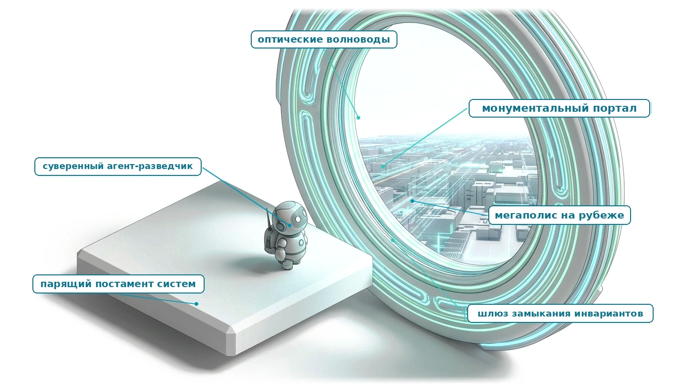

## Назначение

_Почему агент, собранный из частей, каждая из которых проходит собственные тесты, все равно нуждается в инженере, который скажет, что значит «готово»?_

Каждая предыдущая глава строила одну часть агентной системы и проверяла ее на собственных условиях, но производственная траектория сводит все эти части вместе, и сбой на стыке двух из них не принадлежит никому, пока архитектура не назовет владельца. Устаревший файл, оставшийся в контексте после записи, повтор запроса, который дважды проводит платеж, и верификатор, который одновременно служит наградой при обучении, каждый проходит собственные тесты каждой подсистемы. Эта глава пропускает одну траекторию через всю систему целиком, назначает владельца и запись каждому переходу и показывает, где принципы разных частей встречаются и где они тянут в разные стороны. Затем она указывает работу, которую ни одна подсистема не может взять на себя: написание контракта и критериев завершения, которым отчитывается вся машина. Среда выполнения может обеспечить замыкание по длинному горизонту задачи, по переносимому ею состоянию и по полномочиям над внешним миром, но только инженер может сказать, для чего нужна задача и что считается ее выполнением.

> **Цели обучения**
>
> - Проследить одну траекторию вызова инструментов через все части агентной системы, назвав владельца и запись каждого перехода.
> - Сопоставить каждый принцип тома с экспозицией H·S·A, которую он закрывает, или со свидетельством, которое он дает.
> - Перевести пятичастный контракт задачи в обеспеченные границы горизонта, состояния и полномочий и требуемый уровень свидетельств замыкания.
> - Диагностировать отказы, возникающие на стыках между подсистемами, и назначить каждому владельца.
> - Применить лестницу вмешательства к атрибутированному отказу, включая объем задач, при котором изменение весов окупается.
> - Построить обоснование безопасности из утверждений, аргументов и свидетельств: механических проверок, многократных прогонов оценки и поэтапного выпуска.
> - Оценить, что агенты автоматизируют, через существенную и случайную сложность Брукса, и объяснить, почему контракт задачи остается за инженером.

<a id="sec-vol3-conclusion-capstone"></a>

## Итоговая эталонная архитектура

Глава [«Основы агентных систем»](01_introduction.md#sec-vol3-intro) объяснила, почему модель, которая не имеет неявных полномочий и правдоподобно отказывает, не может выполнить задачу сама, а принцип замыкания инвариантов ([«Принцип замыкания инвариантов»](01_introduction.md#pri-invariant-closure)) показал, что замыкать границы задачи и судить о ее завершении должна среда выполнения, а не модель. Части I–VI затем строили эту среду по одной подсистеме, и каждая проверялась на собственных условиях.

Эта глава спрашивает, кто владеет каждым переходом, когда все механизмы действуют на одной траектории, и какую работу ни один механизм не может поглотить. Ответ дается прослеживанием одной траектории устранения инцидента от первого оповещения до принятого исправления через полную архитектуру ([«Итоговая эталонная архитектура агентной системы»](#fig-vol3-capstone-reference-architecture)), с указанием владельца и записи аудита для каждого шага. Остальная часть главы рассматривает, где принципы разных частей встречаются, где они расходятся и где машина останавливается.

Рисунок [«Итоговая эталонная архитектура агентной системы»](#fig-vol3-capstone-reference-architecture) размещает каждую подсистему там, где ее оставила глава, которая ее построила. Среда выполнения инкапсулирует вызов модели ([«Базовая модель»](02_foundation_model.md#sec-vol3-foundation-model)) и ее обдумывание на этапе тестирования ([«Вычисления на этапе тестирования»](03_test_time_compute.md#sec-vol3-test-time-compute)), постранично управляет KV-кешем и разделяет префиксы ([«Управление KV-кешем»](05_kv_cache.md#sec-vol3-kv-cache)), извлекает долговременное состояние ([«Долговременная память»](06_long_term_memory.md#sec-vol3-long-term-memory)), отправляет типизированные вызовы инструментов ([«Вызов инструментов»](07_tool_calling.md#sec-vol3-tool-calling)) в изолированные песочницы microVM ([«Песочницы агентов»](08_sandboxes.md#sec-vol3-sandboxes)), фиксирует каждый шаг в журнале, который только дописывается ([«Долговечное выполнение»](10_durable_execution.md#sec-vol3-durable-execution)), компенсирует неудачные внешние шаги через саги ([«Восстановление после сбоев»](11_failure_recovery.md#sec-vol3-failure-recovery)), отбирает проверенные траектории ([«Курирование траекторий»](13_trajectory_curation.md#sec-vol3-trajectory-curation)) для адаптации политики ([«Дообучение на траекториях»](14_fine_tuning.md#sec-vol3-fine-tuning); [«Обучение с подкреплением по верифицируемым наградам»](15_rlvr.md#sec-vol3-rlvr)), координирует парки агентов ([«Координация нескольких агентов»](16_multi_agent.md#sec-vol3-multi-agent)) и восстанавливает причинные трассы постфактум ([«Оценка агентов»](12_evaluation.md#sec-vol3-evaluation)).

<a id="fig-vol3-capstone-reference-architecture"></a>

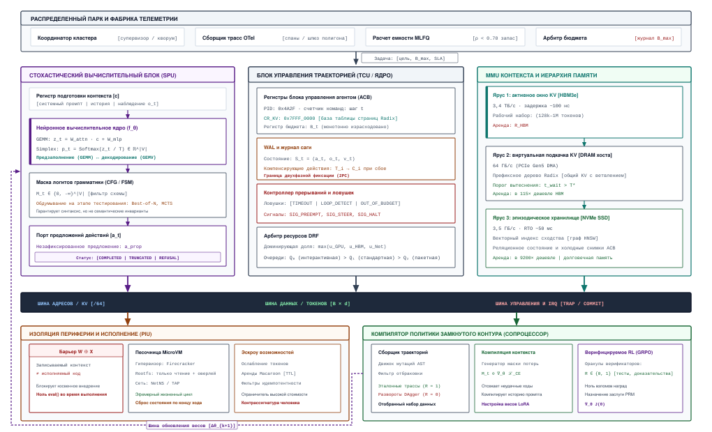
***Итоговая эталонная архитектура агентной системы**: полная оркестрация траектории, которая объединяет непривилегированный движок вывода, ярусную иерархию памяти, песочничную среду исполнения, супервизорную контрольную плоскость, журнал упреждающей записи (Write-Ahead Log, WAL), компенсирующие саги, фабрику телеметрии и замкнутый компилятор политики.*

Траектория — автоматическое устранение инцидента, запущенное оповещением о задержке производственной базы данных, — начинается, когда распределенный парк и фабрика телеметрии обнаруживают нарушение SLA, фиксируя аномалии метрик и спаны трассировки через коллекторы OpenTelemetry. Координатор кластера направляет полезную нагрузку инцидента в супервизорную среду выполнения, которая создает блок управления агентом (Agent Control Block, ACB) в оперативной памяти хоста. ACB инициализирует состояние траектории: присваивает уникальный идентификатор процесса, задает монотонный счетчик токенов и бюджет реального времени (wall-clock) и записывает пятичастный контракт задачи в журнал упреждающей записи (WAL).

Далее память готовит контекст задачи. Менеджер контекста выделяет рабочий контекст под контракт задачи, полезную нагрузку инцидента и текущие дескрипторы среды. Менеджер KV-кеша отображает физическую память ускорителя с помощью PagedAttention и индексирует общие префиксы промпта в радиксном дереве, избегая избыточных вычислений предзаполнения. Одновременно менеджер контекста запрашивает долговременное хранилище: семантический поиск по векторным индексам и реляционным базам данных находит релевантные руководства по обслуживанию и прежние посмертные разборы инцидентов. Найденные выдержки из авторитетных источников вставляются в промпт, и каждой из них присваивается криптографический хеш происхождения.

Вычислительный движок, то есть непривилегированный движок базовой модели, затем обрабатывает подготовленный буфер контекста. Работая на распределенных GPU-ускорителях, среда вывода выполняет фазу предзаполнения GEMM, а затем итерации авторегрессивного декодирования GEMV. Во время генерации маскирование логитов с грамматическими ограничениями строго ограничивает выдачу токенов допустимыми схемами вызова инструментов. Если задаче нужно глубокое планирование, движок обдумывания запускает ограниченные прогоны поиска на этапе тестирования, оценивает кандидатные пути рассуждений и только после этого фиксирует в порте предложений непривилегированное предложение действия $a_t$.

Супервизорная среда выполнения перехватывает $a_t$ из порта предложений и удерживает его в эскроу памяти. Межсетевой экран полномочий среды выполнения проверяет действие по действующим арендам Macaroon и политикам безопасности. Если предложенное действие необратимо меняет состояние, например удаляет таблицу базы данных или перезапускает ключевой узел кластера, контрольная плоскость приостанавливает выполнение и запрашивает криптографическую контрассигнатуру человека. Для разрешенных действий с инструментами среда выполнения маршалирует типизированные параметры и передает их через барьер изоляции $W \oplus X$ (запись XOR исполнение) в эфемерную песочницу microVM, например Firecracker.

Внутри песочницы microVM инструмент выполняется в изолированном сетевом пространстве имен и оверлейной файловой системе. Обвязка исполнения захватывает stdout, stderr и целочисленный код возврата и упаковывает их в нормализованную запись наблюдения $o_{t+1}$. Если действие меняет постоянное внешнее состояние, транзакция регистрируется как активный шаг саги. Если последующие операции завершаются неудачно или нарушают инварианты, контрольная плоскость выполняет зарегистрированные компенсирующие действия $C_i$ в обратном хронологическом порядке и восстанавливает согласованность внешнего состояния.

Получив наблюдение $o_{t+1}$, супервизор дописывает переход $(a_t, o_{t+1})$ в журнал WAL, инвалидирует все производные представления файлов, которых коснулось действие, и добавляет нормализованное наблюдение в рабочий контекст. Этот замкнутый цикл повторяется, пока агент не выдаст кандидатный результат, например запрос на слияние с исправлением конфигурации.

Решающее значение имеет то, что принятие результата определяют внешние верификационные оракулы, а не словесные утверждения агента. Шлюз телеметрии и верификации выполняет детерминированные приемочные тесты: запускает наборы модульных тестов в запечатанных тестовых обвязках, прогоняет статические анализаторы, проверяет утверждения о согласованности базы данных и отслеживает метрики канареечного стенда. Только когда верификационный оракул возвращает код выхода 0, супервизор помечает траекторию как зафиксированную, обновляет канареечные шлюзы SRE и закрывает операционную заявку.

Параллельно инфраструктура жизненного цикла между задачами собирает траекторию для долгосрочного обучения. Механизм данных траекторий читает завершенный журнал WAL, применяет фильтр отбраковки (rejection sieve), чтобы выделить успешные траектории, и форматирует эталонные трассы исполнения. Офлайн-компилятор политики строит маски потерь, привязанные к действиям, и запускает обучение с подкреплением по верифицируемым наградам (RLVR) или циклы дообучения с учителем. Эта оптимизация сжимает дорогие многошаговые рассуждения с обдумыванием в веса модели, которым достаточно одного хода, и выкатывает обновленные контрольные точки параметров через канареечные выкатки, чтобы улучшить работу парка в будущем.

Путь пересекает границу, которую провели разделы [«Живой цикл исполнения: четыре функциональные подсистемы»](01_introduction.md#sec-vol3-intro-live-loop) и [«Инфраструктура парка машин по множеству задач»](01_introduction.md#sec-vol3-intro-across-task). Все до приемки относится к владельцам живого цикла, которые удерживают траекторию от секунд до минут. Сбор, компилятор политики, телеметрия парка и канареечные шлюзы относятся к межзадачной инфраструктуре, которая работает часы и дни над траекториями, уже завершенными.

Такое разделение владения книга использует начиная с раздела [«Схема архитектуры системы»](01_introduction.md#sec-vol3-intro-stochastic-computer), где «Стохастический компьютер» называет, какая часть владеет вызовом модели, состоянием контекста, границей действий, средой выполнения, компилятором политики и парком. Синтез заимствует у классических компьютерных систем дисциплины, такие как когерентность, журнал упреждающей записи, саги, полномочия и сквозной аргумент, а не идентичность компонентов. Поэтому модель не является процессором, а окно контекста не является кешем.

Каждый шаг этой траектории применяет принцип замыкания инвариантов ([«Принцип замыкания инвариантов»](01_introduction.md#pri-invariant-closure)). Среда выполнения механически замыкает границы задачи через бюджеты, проверку полномочий, эскроу и песочницу, а сквозная половина принципа определяет приемку, потому что никакой отчет модели не может установить, что задача завершена. Это могут сделать только запечатанные тесты, статические проверки и утверждения о согласованности, которые запустил хост, а раздел [«Уровни свидетельств замыкания»](01_introduction.md#sec-vol3-intro-closure-evidence) ранжирует их ценность.

Агентная система — это подотчетный цикл исполнения, в котором вызов модели, состояние, граница действий, супервизор, конвейер обучения и операции парка можно проследить до контракта задачи и проверить по принятым результатам.

<a id="sec-vol3-conclusion-trajectory-owners"></a>

### Динамическая оркестрация траектории и владение

Оповещение о задержке срабатывает на производственной базе данных, и дежурный агент получает инцидент. В ближайшие несколько минут он прочтет метрики, найдет руководства, запросит логи, предложит откат конфигурации, будет ждать, пока человек одобрит перезапуск узла, и сообщит, что инцидент устранен. Каждая подсистема, которую построила книга, касается этой траектории, и каждая проверялась в одиночку. Вопрос, на который отвечает глава: кто владеет каждым переходом, когда все они действуют на одной траектории, и какую работу ни одна из них не может поглотить.

Рисунок [«Одна траектория через всю систему»](#fig-vol3-trajectory-lifecycle) размещает каждую часть книги там, где ее оставили главы. Инженер пишет контракт наверху. Живой цикл выполняет вызов модели, сборку контекста и вызовы инструментов, а песочница работает внутри обвязки, которая владеет бюджетами, журналом и восстановлением. Приемка находится ниже цикла, а обучение и масштабирование работают над многими траекториями, а не внутри одной.

<a id="fig-vol3-trajectory-lifecycle"></a>

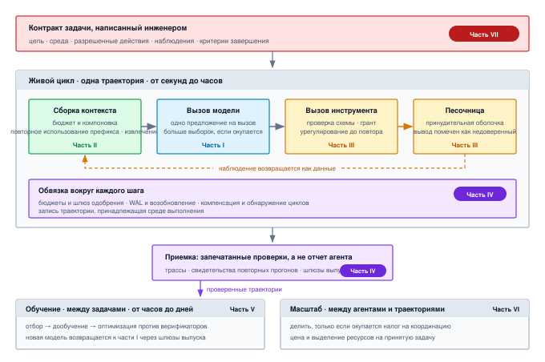
***Одна траектория через всю систему**: контракт задачи инженера управляет живым циклом, в котором сборка контекста (часть II) питает вызов модели (часть I); предложение модели становится проверенным разрешенным вызовом инструмента, который выполняется в песочнице (часть III), а наблюдение возвращается в контекст как данные. Обвязка (часть IV) оборачивает каждый шаг бюджетами, шлюзом одобрения, журналом упреждающей записи и восстановлением. Изолированные проверки решают приемку; проверенные траектории питают обучение (часть V), а масштаб (часть VI) умножает цикл по агентам и траекториям.*

Траектория начинается раньше любого вызова модели. Обвязка открывает запись траектории для инцидента ([«Обвязка агента»](09_agent_harness.md#sec-vol3-agent-harness)), записывает контракт задачи в журнал траектории ([«Долговечное выполнение»](10_durable_execution.md#sec-vol3-durable-execution)) и задает бюджеты, которые ее ограничат. Контракт также фиксирует позицию задачи в H·S·A. Инцидент длится около десяти ходов, несет долговременное состояние, которым не владеет (производственные метрики, руководства, репозиторий конфигурации), и достигает наивысшего уровня полномочий на том шаге, который меняет производство.

Затем сборка контекста решает, что увидит первый вызов. Она подготавливает контракт, оповещение и выдержки из руководств, найденные по типизированному контракту извлечения вместе с указанием их источников ([«Долговременная память»](06_long_term_memory.md#sec-vol3-long-term-memory)), и ставит устойчивый материал в начало, чтобы последующие ходы использовали тот же префикс ([«Инженерия контекста»](04_context_engineering.md#sec-vol3-context-engineering)). Система обслуживания хранит состояние внимания для этого префикса ([«Управление KV-кешем»](05_kv_cache.md#sec-vol3-kv-cache)), поэтому каждый следующий ход платит в основном за наблюдение, которое добавляет, а не за весь контекст заново.

Ответ модели возвращает структурированный вызов инструмента и причину остановки ([«Базовая модель»](02_foundation_model.md#sec-vol3-foundation-model)), и в мире пока ничего не изменилось. Когда диагноз неоднозначен, обвязка может оплатить несколько кандидатных гипотез и ранжировать их по проверке, которая их разделяет ([«Вычисления на этапе тестирования»](03_test_time_compute.md#sec-vol3-test-time-compute)). Это помогает только тогда, когда проверка приносит новые свидетельства (принцип «Обдумывание, ограниченное свидетельствами»).

Предложение запросить журнал медленных запросов базы данных проверяется по схеме инструмента и сверяется с выданными задаче полномочиями ([«Вызов инструментов»](07_tool_calling.md#sec-vol3-tool-calling)). Оно выполняется в песочнице, оболочку которой модель не может расширить ([«Песочницы агентов»](08_sandboxes.md#sec-vol3-sandboxes)), а его вывод возвращается в контекст как недоверенные данные, обрезанные до бюджета наблюдения и помеченные источником. Когда запрос завершается по таймауту, среда выполнения не посылает его заново сразу. Сначала она выясняет, подействовала ли первая попытка, и только потом повторяет (принцип «Урегулирование до повтора»), используя ключ идемпотентности, который нес вызов.

Через несколько ходов агент предлагает два изменения: откат недавнего изменения конфигурации, который может компенсировать последующее действие, и перезапуск основного узла, который нельзя отменить. Обвязка записывает каждое намерение в журнал до того, как эффект покинет среду выполнения (принцип «Намерение до действия»). Она регистрирует компенсацию для отката и удерживает перезапуск на шлюзе одобрения, пока человек его не подпишет ([«Обвязка агента»](09_agent_harness.md#sec-vol3-agent-harness)), и ставит необратимое поворотное действие после всех компенсируемых шагов (принцип «Граница поворотного действия и компенсирующие саги»; [«Восстановление после сбоев»](11_failure_recovery.md#sec-vol3-failure-recovery)). Если процесс погибает между этими двумя шагами, восстановление читает журнал и продолжает работу, а не повторяет откат. Если агент начинает снова отправлять упавший запрос, отслеживание прогресса останавливает его задолго до того, как сработал бы бюджет (принцип «Внеполосное вытеснение и сторожевые таймеры прогресса»).

Затем агент сообщает, что инцидент устранен, но этот отчет всего лишь еще одно предложение. Приемку определяют проверки, которые среда выполнения запускает сама: задержка запросов возвращается под целевой уровень в течение устойчивого окна, частота ошибок укладывается в границы, а разница конфигурации совпадает с тем, что одобрил человек. [«Оценка агентов»](12_evaluation.md#sec-vol3-evaluation) оценивает траектории именно так, а записанная трасса связывает все спаны инцидента в одну причинную запись.

Живая траектория заканчивается на приемке, но система продолжает работать с ней. Поскольку траектория проверена, она становится пригодной для курирования ([«Курирование траекторий»](13_trajectory_curation.md#sec-vol3-trajectory-curation)). Дообучение обучается на токенах, которые выдала политика, и маскирует наблюдения, которые она читала (принцип «Маскирование потерь по наблюдениям»; [«Дообучение на траекториях»](14_fine_tuning.md#sec-vol3-fine-tuning)). Там, где есть запечатанная проверка, обучение с подкреплением оптимизирует против нее, при этом верификатор изолирован от политики (принцип «Обучение с подкреплением против изолированных верификаторов»; [«Обучение с подкреплением по верифицируемым наградам»](15_rlvr.md#sec-vol3-rlvr)). Обновленная модель попадает в производство только через те же шлюзы выпуска, которые пропускают любое изменение. Ничто из этого не сдвигает ни одну экспозицию: лучшая модель предлагает лучшие действия внутри той же самой границы.

Масштаб входит в двух местах. Если бы инцидент затронул несколько сервисов, обвязка могла бы делегировать диагностику по каждому сервису дочерним агентам, но только там, где разбиение контекста или ослабление полномочий окупает налог на координацию (принцип «Налог на координацию»; [«Координация нескольких агентов»](16_multi_agent.md#sec-vol3-multi-agent)), и каждый потомок получил бы лишь часть полномочий, времени и бюджета родителя (принцип «Монотонное делегирование»). В масштабе парка эта траектория является одной единицей стоимости одной принятой задачи, которую минимизируют решения о маршрутизации, кешировании и мощности ([«Экономика агентов»](17_agent_economics.md#sec-vol3-agent-economics)).

Таблица [«Владельцы и записи на одной траектории»](#tbl-vol3-capstone-owners) сводит прохождение к владельцам и записям. Путь также пересекает границу между живой и межзадачной работой, которую провело введение ([«Инфраструктура парка машин по множеству задач»](01_introduction.md#sec-vol3-intro-across-task)). Все до приемки принадлежит живым владельцам, которые удерживают траекторию от секунд до часов. Курирование, обучение, шлюз выпуска и выделение парка принадлежат межзадачной инфраструктуре, которая работает часы и дни над траекториями, уже завершенными.

| **Переход**                      | **Владелец**                                     | **Запись, которую он оставляет**                        |
|:---------------------------------|:-------------------------------------------------|:--------------------------------------------------------|
| **Задача принята**               | Обвязка ([«Обвязка агента»](09_agent_harness.md#sec-vol3-agent-harness))                  | Запись траектории, запись контракта в журнале           |
| **Контекст подготовлен**         | Сборка контекста ([«Инженерия контекста»](04_context_engineering.md#sec-vol3-context-engineering)) | Манифест контекста с источником каждого фрагмента       |
| **Предложение выдано**           | Вызов модели ([«Базовая модель»](02_foundation_model.md#sec-vol3-foundation-model))            | Структурированный вызов инструмента и причина остановки |
| **Вызов проверен и разрешен**    | Слой инструментов ([«Вызов инструментов»](07_tool_calling.md#sec-vol3-tool-calling))              | Результат проверки схемы, решение о выдаче, ключ идемпотентности |
| **Эффект выполнен**              | Песочница ([«Песочницы агентов»](08_sandboxes.md#sec-vol3-sandboxes))                      | Урегулированный результат, намерение записано в журнал до отправки |
| **Необратимый шаг одобрен**      | Шлюз одобрения ([«Обвязка агента»](09_agent_harness.md#sec-vol3-agent-harness))            | Подписанное одобрение, привязанное к точному предложению |
| **Сбой или ошибочное действие**  | Восстановление ([«Восстановление после сбоев»](11_failure_recovery.md#sec-vol3-failure-recovery))              | Точка возобновления, записи компенсаций                 |
| **Результат принят**             | Оценка ([«Оценка агентов»](12_evaluation.md#sec-vol3-evaluation))                  | Результаты проверок и трасса, связывающая все спаны     |
| **Траектория использована для обучения** | Курирование ([«Курирование траекторий»](13_trajectory_curation.md#sec-vol3-trajectory-curation))           | Решение о допуске и разбиение данных, с которым оно связано |

<a id="tbl-vol3-capstone-owners"></a>

***Владельцы и записи на одной траектории**: каждый переход траектории инцидента, подсистема, которой он принадлежит, и запись, по которой аудитор может восстановить его постфактум.*

Каждая строка применяет принцип замыкания инвариантов ([«Принцип замыкания инвариантов»](01_introduction.md#pri-invariant-closure)). Среда выполнения замыкает границы задачи механически, через бюджеты, выдачу полномочий, шлюз одобрения и песочницу, а сквозная половина принципа определяет приемку, потому что никакой отчет модели не может установить, что задача завершена. Это могут сделать только проверки, которые запустила среда выполнения, а раздел [«Уровни свидетельств замыкания»](01_introduction.md#sec-vol3-intro-closure-evidence) ранжирует, чего стоит каждый вид проверки.

<a id="sec-vol3-conclusion-principle-ledger"></a>

### Реестр принципов


*Горизонт, состояние и полномочия возвращаются вместе, и среда выполнения замыкает каждое из них на одной траектории.*

Каждый принцип тома имеет место в этой архитектуре, и таблица [«Принципы по экспозициям»](#tbl-vol3-principle-ledger) собирает их в том порядке, в каком книга их вводила, с экспозицией, которую каждый закрывает. Принципы части I определяют цену одного вызова модели и границы того, что проверка может установить. Принципы частей II, III и IV закрывают три экспозиции, которых нет у одного вызова: состояние, которое он несет через ходы, его полномочия над внешним миром и горизонт, достаточно длинный, чтобы ошибки накапливались. Часть V меняет модель и не сдвигает ни одной экспозиции, часть VI умножает все три по агентам и траекториям, а принцип части VII отмечает то, что машина не может замкнуть сама.

| **Принцип**                                                                                 | **Название**                                                  | **Часть**    | **Закрываемая экспозиция**                | **Инвариант вкратце**                                                                                    |
|:--------------------------------------------------------------------------------------------|:--------------------------------------------------------------|:-------------|:------------------------------------------|:---------------------------------------------------------------------------------------------------------|
| [«Принцип замыкания инвариантов»](01_introduction.md#pri-invariant-closure) | Замыкание инвариантов | Введение | Все три (требование замыкания) | Ограничения никогда не опираются на модель: границы замыкаются механически ниже нее, приемка опирается на свидетельства выше нее |
| «Задержка, ограниченная выводом» | Декодирование, ограниченное пропускной способностью памяти | I | Нет (оценивает один вызов) | При размере пакета, равном одному, задержка на токен равна объему весов в байтах, деленному на пропускную способность памяти |
| «Обдумывание, ограниченное свидетельствами» | Обдумывание, ограниченное свидетельствами | I | Нет (ограничено свидетельствами) | Дополнительные вычисления при выводе помогают, только когда они получают свидетельства, которые разделяют кандидатов |
| «Асимметрия верификации» | Асимметрия верификации | I | Свидетельства замыкания | Заявленные проверки дешевы, а надежная верификация — нет; шлюз фиксации является запечатанной детерминированной проверкой |
| [«Инвариант карантина»](02_foundation_model.md#pri-02-quarantining-invariant) | Инвариант карантина | I | Нет (один вызов) | Полезная нагрузка, статус которой не `COMPLETED`, никогда не доходит до верификации, компиляции или исполнения команд |
| «Контекст — выбранный рабочий набор» | Контекст — выбранный рабочий набор | II | Состояние | Каждый вызов видит ограниченную выборку, сжатую без потери идентификаторов |
| «Состояние внимания выводится из префикса токенов» | Состояние внимания выводится из префикса токенов | II | Состояние | KV-кеш — функция точного префикса, пригодная для повторного использования только слева и всегда восстанавливаемая |
| «Извлечение — это контракт, а не припоминание» | Извлечение — это контракт, а не припоминание | II | Состояние | Долговременные данные возвращаются в контекст только через типизированный контракт извлечения; сходство не является разрешением |
| «Авторитетность остается у источника» | Авторитетность остается у источника | II | Состояние | Авторитетны только исходные артефакты; каждое производное представление устаревает при записи |
| «Типизированный контракт действий» | Типизированный контракт действий | III | Полномочия | Вызов инструмента попадает в среду только как проверенное, разрешенное типизированное предложение |
| «Урегулирование до повтора» | Урегулирование до повтора | III | Полномочия, с учетом горизонта | Таймаут ничего не говорит о том, произошла ли мутация; повтор — только после урегулирования |
| «Сдерживание ниже модели» | Сдерживание ниже модели | III | Полномочия (целостность и конфиденциальность) | Каждое действие выполняется в оболочке, которая обеспечивается ниже модели, сбрасывается уничтожением и имеет контролируемый исходящий трафик |
| «Инкапсуляция на уровне траектории» | Инкапсуляция на уровне траектории | IV | Горизонт | Траектория, которую держит ACB под управлением среды выполнения, — единица планирования, бюджетирования и защиты |
| «Внеполосное вытеснение и сторожевые таймеры прогресса» | Внеполосное вытеснение и сторожевые таймеры прогресса | IV | Горизонт | Управление, бюджеты и оценка прогресса находятся вне модели |
| «Намерение до действия» | Намерение до эффекта | IV | Горизонт (состояние как долговечность) | Никакой эффект не покидает хост, пока запись, которая его авторизует, не станет долговечной |
| «Граница поворотного действия и компенсирующие саги» | Граница поворотного действия и компенсирующие саги | IV | Горизонт (полномочия как порядок) | Сначала регистрируются компенсации, затем допускается одно необратимое поворотное действие, которое ставится последним |
| «Посттренировка на верифицированных траекториях» | Посттренировка на верифицированных траекториях | V | Ничего не сдвигает (меняет модель) | Изменение весов — последняя ступень, обучаемая на траекториях, проверенных извне |
| «Маскирование потерь по наблюдениям» | Маскирование потерь по наблюдениям | V | Ничего не сдвигает | Функция потерь охватывает только токены, которые выдает политика; наблюдения остаются в контексте без потерь |
| «Обучение с подкреплением против изолированных верификаторов» | Обучение с подкреплением против изолированных верификаторов | V | Ничего не сдвигает | Обучение усваивает то, что вознаграждает проверка; изолируйте верификатор и удерживайте тесты |
| [«Трехосевая граница оценки мультиагентных систем»](16_multi_agent.md#pri-15-tri-axial-evaluation) | Трехосевая граница оценки мультиагентных систем | VI | Все три, умноженные | При равном бюджете топология не должна проигрывать по качеству, времени выполнения и стоимости принятой задачи |
| «Налог на координацию» | Налог на координацию | VI | Все три, умноженные | Разбиение задачи окупается только через разбиение, ослабление полномочий или независимое исследование |
| «Монотонное делегирование» | Монотонное делегирование | VI | Полномочия между агентами | Полномочия, время и бюджет потомка составляют подмножество того, чем еще владеет родитель |
| «Причинные и статистические свидетельства выпуска» | Причинные и статистические свидетельства выпуска | VI | Свидетельства замыкания в масштабе парка | Выпуски статистически контролируются по проверенным изменениям состояния, связанным одной причинной трассой |
| «Полезный выход траекторий и принятая задача» | Полезный выход траекторий и принятая задача | VI | Стоимость парка | Ценность создают только проверенные траектории; парк минимизирует стоимость на принятую задачу |
| «Емкость на время жизни траектории и планирование с учетом хвоста» | Емкость на время жизни траектории и планирование с учетом хвоста | VI | Горизонт в масштабе парка | Емкость задают по параллелизму траекторий, а работу ведут ниже колена загрузки |
| «Граница спецификации» | Граница спецификации | VII | Вне машины | Агент может реализовать проект, но не может написать контракт, который им управляет |

<a id="tbl-vol3-principle-ledger"></a>

***Принципы по экспозициям**: двадцать шесть принципов этой книги в порядке их введения, с экспозицией H·S·A, которую закрывает каждый, и его инвариантом вкратце.*

Формализация этого владения начинается с контракта, под которым работает каждая траектория.

<a id="sec-vol3-conclusion-envelope"></a>

## Спецификация контракта рабочей нагрузки

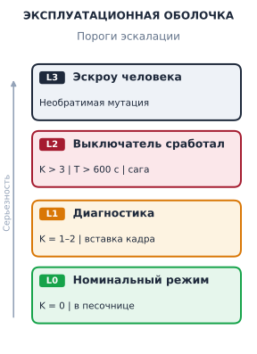

*Ступенчатые эксплуатационные оболочки эскалации предотвращают катастрофическое превышение бюджета и при этом сохраняют автономную пропускную способность в штатных режимах работы.*

Когда неограниченная среда выполнения агента получает открытый запрос на естественном языке, например «исправь падающие интеграционные тесты в репозитории», супервизор хоста сразу сталкивается с дилеммой границ. Без явной спецификации эксплуатационных ограничений базовая модель входит в неуправляемый авторегрессивный цикл: она истолковывает неоднозначные сбои тестов, меняя сами проверки в тестах, исчерпывает лимиты внешнего API неограниченными поисковыми запросами или входит в бесконечный цикл исправлений синтаксиса, который занимает дисковое пространство хоста неиндексированными артефактами сборки. Поскольку супервизор среды выполнения не имеет формальной спецификации разрешенного поведения, он не может определить, представляет ли текущая серия из тридцати попыток компиляции продуктивное итеративное уточнение или неустранимый цикл сбоев, пока оператор вручную не завершит процесс.

**Проектирование агентной системы начинается с пятичастного контракта задачи и четырех вопросов, которые помещают задачу по ее экспозициям H·S·A и свидетельствам замыкания.** Контракт взят из раздела [«Пятичастная спецификация контракта»](01_introduction.md#sec-vol3-intro-five-part-contract), а вопросы — из раздела «Четыре вопроса с ценами» главы [«Экономика агентов»](17_agent_economics.md#sec-vol3-agent-economics). Этот раздел спрашивает, во что обходится принудительное соблюдение каждого поля, когда вся архитектура работает одновременно.

<a id="sec-vol3-envelope-four-questions"></a>

### От экспозиций к обеспечиваемым границам

Каждый из этих вопросов становится границей, которую среда выполнения обеспечивает до того, как выделит вычисления или подготовит песочницу. Горизонт превращается в три потолка. Таймаут реального времени $T_{\max}$ не дает зависшим соединениям, тупиковым компиляторам и медленным рабочим процессам вывода удерживать песочницу в заложниках. Потолок ходов $H_{\max}$ ограничивает число циклов «модель — среда», потому что генерация не имеет собственного условия остановки, а цикл, который продолжает выдавать корректные вызовы инструментов, может работать бесконечно. Совокупный предел токенов $M$ по предзаполнению и декодированию не дает задаче обойти свой бюджет, заполняя контекст полезной нагрузкой извлечения на каждом ходе.

Состояние превращается в явные границы записи между эфемерной рабочей памятью (буфер контекста и его KV-кеш), долговременным журналом, который фиксирует каждый выход модели, полезную нагрузку инструмента, код возврата и вмешательство среды выполнения, и авторитетными артефактами, которые меняет задача, так что рассуждения в черновике никогда не принимаются за изменение. Полномочия превращаются в токены полномочий, ослабленные до времени жизни задачи, белый список инструментов, пространства имен монтирования и правила исходящего трафика, а также эскроу, которое удерживает любое необратимое действие, пока аутентифицированный человек его не подпишет. Свидетельства замыкания превращаются в детерминированный предикат, который хост может вычислить: нулевые коды выхода компилятора и линтеров, структурированные журналы тестов, проверки инвариантов AST и хеши сгенерированных артефактов. Если хост не может вычислить такой предикат, задача не может быть принята как завершенная, что бы ни сообщала модель.

<a id="nbk-18-operating-envelope"></a>

> **Расчет физической эксплуатационной оболочки**
>
> Рассмотрим автономного агента исправления кода, которого направили устранить регрессионную ошибку в большом сервисе на C++. Нужно вычислить физическую ресурсную оболочку, которая гарантирует сдерживание и при этом оставляет достаточный эксплуатационный запас.
>
> **Исходные параметры:**
>
> - Лимит ходов: $H_{\max} = 20\text{ ходов}$.
> - Таймаут реального времени: $T_{\max} = 600\text{ с}$ (10 минут).
> - Параметры модели: 70 миллиардов плотных параметров в FP8 ($70 \times 10^9\text{ байт} \approx$ 70 ГБ весов модели).
> - Архитектура обслуживания: тензорный параллелизм на 4 GPU, FP8 KV-кеш с 64 слоями, 8 головами «ключ — значение» на слой и размерностью головы $d_k = 128$.
> - Максимальное окно контекста: $L_{\max} = 32\,768\text{ токенов}$.
> - Локальное окружение сборки: инкрементальная компиляция C++ требует $4\text{ vCPU}$, 8 ГБ оперативной памяти хоста (DRAM) и наложенного диска копирования при записи (CoW) объемом 5 ГБ поверх снимка корневого репозитория только для чтения.
>
> **Шаг 1: вычислить объем KV-кеша на экземпляр**
> Память, которую KV-кеш требует на один токен во всех слоях:
> $$\text{Байт на токен} = 2 \times (\text{слоев}) \times (\text{головы KV}) \times d_k \times (\text{байт на элемент})$$
> $$\text{Байт на токен} = 2 \times 64 \times 8 \times 128 \times 1\text{ байт} = 131\,072\text{ байт} = 128\text{ КБ/токен}$$
> При максимальной длине контекста $L_{\max} = 32\,768$:
> $$\text{Максимальный объем KV-кеша} = 32\,768 \times 128\text{ КБ} = 4\,194\,304\text{ КБ} = 4{,}0\text{ ГБ}$$
> По 4 обслуживающим GPU объем KV-кеша занимает $1{,}0\text{ ГБ}$ на GPU, что хорошо укладывается в запас стандартной памяти HBM (high-bandwidth memory) вместе с разделенными весами модели ($17{,}5\text{ ГБ/GPU}$).
>
> **Шаг 2: вычислить максимальный бюджет задержки на вывод и песочницу**
> Допустим, в среднем генерация дает $256\text{ токенов}$ на ход при пропускной способности декодирования $40\text{ токенов/с}$ ($6{,}4\text{ с}$ на декодирование), а предзаполнение среднего промпта на $16\,384\text{ токена}$ занимает $0{,}8\text{ с}$. Полная задержка вывода модели на ход составляет $7{,}2\text{ с}$.
> За $H_{\max} = 20$ ходов полное время модели составляет:
> $$T_{\text{model}} = 20 \times 7{,}2\text{ с} = 144\text{ с}$$
> Остается:
> $$T_{\text{sandbox}} = T_{\max} - T_{\text{model}} = 600\text{ с} - 144\text{ с} = 456\text{ с}$$
> При $456\text{ с}$ на 20 ходов получаем максимум $22{,}8\text{ с}$ на ход для контейнеризованного выполнения инструментов, сравнения файловой системы и инкрементальной компиляции. Если промежуточный прогон тестов длится дольше $22{,}8\text{ с}$, пошаговый сторожевой таймер супервизора предупреждает среду выполнения, чтобы она ограничила глубину набора тестов.

<a id="sec-vol3-envelope-contract-formalism"></a>

### Уточнение пятичастного контракта

Раздел [«Пятичастная спецификация контракта»](01_introduction.md#sec-vol3-intro-five-part-contract) записал контракт как пятерку:

$$\mathcal{C} = \langle G, \mathcal{E}_{\text{env}}, \mathcal{A}_{\text{perm}}, \mathcal{O}_{\text{avail}}, \mathcal{K}_{\text{comp}} \rangle$$

Для исполнения во время выполнения каждое поле уточняется до структуры, которую может проверить отдельная подсистема обвязки:

$$G = \left( \text{id}, \text{type}, \mathbf{p}, \Phi_{\text{inv}} \right)$$

Цель $G$ включает уникальный идентификатор задачи $\text{id}$, тип задачи, типизированный словарь параметров $\mathbf{p}$ и набор формальных утверждений-инвариантов $\Phi_{\text{inv}}$, которые должны соблюдаться без нарушений на протяжении всей траектории. Важно, что $G$ не дает указаний о том, *как* решать задачу: она задает математические свойства желаемого конечного состояния.

$$\mathcal{E}_{\text{env}} = \left( \mathcal{I}_{\text{base}}, \mathcal{M}_{\text{mounts}}, \mathcal{R}_{\text{quotas}}, \mathcal{N}_{\text{network}} \right)$$

Среда $\mathcal{E}_{\text{env}}$ определяет физический субстрат исполнения. Здесь $\mathcal{I}_{\text{base}}$ задает неизменяемый криптографический дайджест базового образа контейнера; $\mathcal{M}_{\text{mounts}}$ определяет таблицу монтирования виртуальной файловой системы, указывая, какие каталоги хоста открыты как слои только для чтения, а какие получают временные оверлеи копирования при записи; $\mathcal{R}_{\text{quotas}}$ задает жесткие ограничения cgroup на доли CPU, выделение памяти и ввод-вывод записи на диск; а $\mathcal{N}_{\text{network}}$ задает таблицы сетевой маршрутизации, которые по умолчанию ведут в полностью изолированное пространство имен loopback ($127.0.0.1$), если только конкретные конечные точки прокси не включены в белый список.

$$\mathcal{A}_{\text{perm}} = \left\{ a_1, a_2, \dots, a_k \mid a_i = (\text{name}_i, \Sigma_i^{\text{in}}, \Sigma_i^{\text{out}}, \rho_i) \right\}$$

Разрешенное множество действий $\mathcal{A}_{\text{perm}}$ перечисляет полное пространство вызываемых инструментов. Каждое действие $a_i$ задается своим идентификатором, строгой входной схемой $\Sigma_i^{\text{in}}$, типизированной выходной схемой $\Sigma_i^{\text{out}}$ и политикой полномочий $\rho_i$. Политика полномочий задает ограничения частоты, разрешенные пути файловой системы и то, требует ли вызов предварительной проверки эскроу перед исполнением. Попытка вызвать незарегистрированный инструмент или передать аргументы, которые не проходят проверку схемы, сразу перехватывается супервизором.

$$\mathcal{O}_{\text{avail}} = \left( \Delta_{\max}^{\text{bytes}}, \Psi_{\text{filter}}, \Omega_{\text{encoding}} \right)$$

Наблюдаемые данные $\mathcal{O}_{\text{avail}}$ определяют, как сырой вывод исполнения попадает в контекст агента. Неконтролируемое выполнение инструмента легко порождает сотни мегабайт сырого вывода компилятора или дампов журналов, мгновенно переполняя окно контекста и загрязняя рабочую память. Политика наблюдений задает абсолютный предел в байтах $\Delta_{\max}^{\text{bytes}}$, активный фильтр очистки $\Psi_{\text{filter}}$, который удаляет управляющие ANSI-последовательности и маскирует чувствительные учетные данные или секреты среды, и функцию кодирования $\Omega_{\text{encoding}}$, которая приводит структурированные ошибки к компактным записям, пригодным для машинной обработки.

$$\mathcal{K}_{\text{comp}} = \left\{ v_1, v_2, \dots, v_m \mid v_j: (\mathcal{E}_{\text{env}}, \text{Artifacts}) \to \{0, 1\} \right\}$$

Критерии завершения $\mathcal{K}_{\text{comp}}$ образуют упорядоченный массив детерминированных предикатов верификации. Каждый верификатор $v_j$ — это внешний бинарный файл, скрипт или статический анализатор, который проверяет среду песочницы и созданные артефакты независимо от модели. Успех задачи требует, чтобы все верификаторы вычислялись в истину:

$$\text{Success}(\mathcal{C}) \iff \bigwedge_{j=1}^{m} v_j(\mathcal{E}_{\text{env}}, \text{Artifacts}) = 1$$

Структурные поля, механизмы принуждения и опасности пропуска этого контракта подробно описаны в таблице [«Декомпозиция контракта рабочей нагрузки»](#tbl-vol3-contract-decomposition).

| **Поле контракта**                              | **Математическая область**                                       | **Механизм принуждения супервизором**            | **Режим отказа при пропуске**                    |
|:------------------------------------------------|:-----------------------------------------------------------------|:-------------------------------------------------|:-------------------------------------------------|
| **Цель ($G$)**                                  | Структура $(\text{id}, \text{type}, \mathbf{p}, \Phi_{\text{inv}})$ | Проверка при диспетчеризации и типов параметров  | Семантический дрейф; неуправляемая мутация цели  |
| **Среда ($\mathcal{E}_{\text{env}}$)**          | Спецификация контейнера/cgroup                                   | Пространства имен Linux, seccomp, cgroups v2     | Исчерпание ресурсов хоста; отравление файловой системы |
| **Действия ($\mathcal{A}_{\text{perm}}$)**      | Множество типизированных схем $\{a_i\}$                          | Фильтр шлюза RPC и проверка по JSON Schema       | Произвольное исполнение кода; эскалация привилегий |
| **Наблюдения ($\mathcal{O}_{\text{avail}}$)**   | Конвейер преобразований $(\Delta, \Psi, \Omega)$                 | Усекатель потока, очиститель по регулярным выражениям, счетчик токенов | Переполнение окна контекста; утечка учетных данных |
| **Завершение ($\mathcal{K}_{\text{comp}}$)**    | Множество предикатов $\{v_j \to \{0,1\}\}$                       | Герметичное средство запуска тестов и валидатор AST   | Ложные утверждения о завершении (галлюцинация)   |

<a id="tbl-vol3-contract-decomposition"></a>

***Декомпозиция контракта рабочей нагрузки**: структурная декомпозиция пятичастного контракта задачи с указанием математической области, физического слоя принуждения супервизора и конкретных режимов отказа, которые проявляются, когда отдельные граничные средства контроля отсутствуют.*

Этот формализм контракта выявляет то, что архитектура вычислительных систем называет **паттерном песочных часов** (hourglass design pattern), по аналогии с ролью IP в сетях или POSIX в операционных системах. Как показано на рисунке [«Архитектура песочных часов агентных систем машинного обучения»](#fig-vol3-agentic-systems-hourglass), контракт управляемого интерфейса траектории образует узкую талию агентного вычислительного стека. Он отделяет разнородные агентные нагрузки высокого уровня (разработка программного обеспечения, устранение инцидентов в облаке, корпоративные потоки данных, воплощенная робототехника и роевые флоты парков) от разнообразных нижележащих служб среды выполнения (планировщики допуска, иерархии памяти, гипервизоры исполнения действий, журналы долговечности с упреждающей записью и оракулы верификации) и от физических аппаратных подложек.

<a id="fig-vol3-agentic-systems-hourglass"></a>

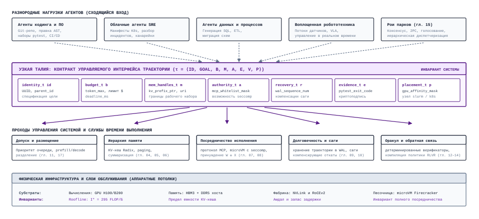
***Архитектура песочных часов агентных систем машинного обучения**: контракт управляемого интерфейса траектории служит узкой талией архитектуры системы и разделяет разнородные агентные нагрузки сверху (сходящийся вход) и службы управления средой выполнения, уровни памяти, журналы долговечности и физические аппаратные подложки снизу (расходящийся выход).*

Архитектурная сила паттерна песочных часов заключается в его формальной факторизации интерфейса. Верхняя половина рисунка [«Архитектура песочных часов агентных систем машинного обучения»](#fig-vol3-agentic-systems-hourglass) охватывает разнородные агентные нагрузки с принципиально разным операционным темпом: интерактивные агенты-кодеры, которые запускают быстрые циклы компилятора; облачные SRE-работники, которые разбирают каскады распределенной телеметрии; пакетные конвейеры миграции данных, обрабатывающие реляционные мутации; воплощенные роботы, которые передают сенсомоторные векторы под жесткими дедлайнами реального времени; и роевые флоты парков, выполняющие голосования консенсуса. Вместо того чтобы требовать от каждого приложения собственного управления памятью и виртуализации песочниц, каждая нагрузка проецируется в одну узкую талию, управляемую траекторию, ACB которой среда выполнения планирует, бюджетирует и защищает как единицу (принцип «Инкапсуляция на уровне траектории»). Нижняя половина песочных часов переводит это каноническое представление в конкретные системные службы: планировщики допуска, которые управляют приоритетом очереди и разделением предзаполнения и декодирования; подсистемы памяти, которые постранично переносят блоки KV между DRAM хоста и HBM ускорителя; посредники исполнения действий, которые обеспечивают фильтры seccomp и политику $W \oplus X$; движки долговечности, которые фиксируют кадры WAL и ведут журналы компенсирующих саг; и детерминированные оракулы верификации, которые проверяют предикаты результата против физических аппаратных ограничений.

<a id="sec-vol3-envelope-boundaries"></a>

### Эксплуатационные оболочки в производстве

Примененный контракт определяет номинальный путь исполнения, но надежная инженерия систем требует также эксплуатационной оболочки, то есть границы, в пределах которой агент гарантированно работает, вместе с детерминированными политиками эскалации на случай ее нарушения. Оболочка — то место, где H·S·A-позиция задачи ([«Экспозиции H·S·A»](01_introduction.md#sec-vol3-intro-hsa)) становится конфигурацией среды выполнения. Горизонт $H$ ограничен потолками ходов, времени и токенов, привязанными к цели $G$. Состояние $S$, которое несет задача, разделяется средой $\mathcal{E}_{\text{env}}$ и фильтруется политикой наблюдений $\mathcal{O}_{\text{avail}}$. Полномочия $A$ фиксируются разрешенным множеством действий $\mathcal{A}_{\text{perm}}$ при полном посредничестве среды выполнения. Критерии завершения $\mathcal{K}_{\text{comp}}$ не являются четвертой экспозицией. Они задают уровень свидетельств замыкания, который требуется для приемки, и этот уровень растет вместе с остальными тремя.

<a id="fig-vol3-operating-envelope-escalation"></a>

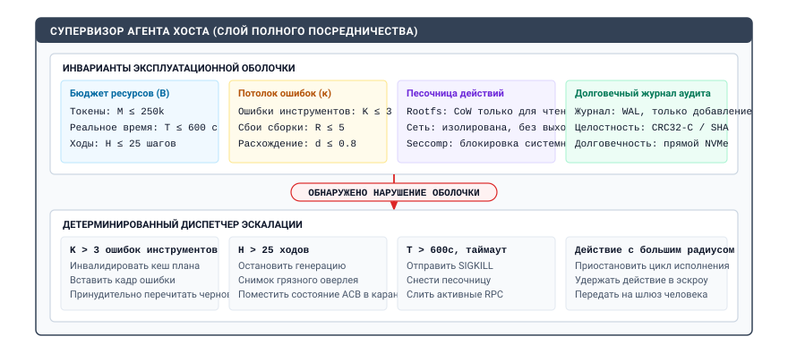
***Эксплуатационная оболочка супервизора хоста и диспетчер эскалации**: слой полного посредничества, который обеспечивает многомерные эксплуатационные ограничения по бюджетам токенов и времени, порогам ошибок ($K \le 3$), сдерживанию песочницы и долговечной упреждающей записи журнала, а при нарушении инварианта направляет детерминированные политики вытеснения и карантина.*

Как показано на рисунке [«Эксплуатационная оболочка супервизора хоста и диспетчер эскалации»](#fig-vol3-operating-envelope-escalation), супервизор хоста обеспечивает полное посредничество, непрерывно сверяя выполнение с четырьмя явными группами инвариантов: активным бюджетом ресурсов ($B$), порогами ошибок ($\kappa$), параметрами сдерживания песочницы и долговечным журналом аудита (WAL). Когда превышен любой эксплуатационный порог, красная граница срабатывания передает управление напрямую детерминированному диспетчеру эскалации. Вместо слепого падения или допущения того, что ошибочные исполнения расходуют неограниченные ресурсы кластера, диспетчер вызывает целевые процедуры смягчения, подобранные под конкретный режим отказа: аннулирует кеш плана и заставляет заново перечитать черновик, если ошибки инструментов превышают $K$; останавливает генерацию токенов и помещает состояние блока управления агентом (ACB) в карантин, когда число ходов достигает $H_{\max}$; завершает вышедшие из-под контроля процессы сигналом `SIGKILL` по истечении реального времени $T_{\max}$; и приостанавливает дальнейшее исполнение, удерживая его в эскроу памяти, всякий раз, когда команда с большим радиусом поражения требует авторизации человека.

Эксплуатационная оболочка управляется четырьмя жесткими пороговыми метриками:

1. **Предел последовательных ошибок ($K$):** если агент выполняет $K$ подряд действий, которые возвращают ненулевые коды выхода, некорректные аргументы инструментов или ошибки проверки схемы, супервизор считает, что модель вошла в вырожденный авторегрессивный цикл. Среда выполнения останавливает спекулятивную отправку инструментов, вставляет в контекст диагностический кадр высокого приоритета и заставляет модель оценить промежуточное состояние, прежде чем выдать очередной вызов инструмента.
2. **Потолок ходов ($H_{\max}$):** жесткий предел для циклов «модель — среда». Когда число ходов достигает $H_{\max}$, супервизор выдает неблокируемый сигнал завершения, независимо от того, утверждает ли модель, что близка к цели.
3. **Сторожевой таймер реального времени ($T_{\max}$):** асинхронный таймер, работающий в системе хоста. По истечении срока супервизор посылает `SIGKILL` контейнеру-песочнице, сохраняет грязный оверлей файловой системы для посмертного анализа и возвращает оркестратору ошибку по таймауту.
4. **Совокупный предел токенов ($M$):** строгий потолок на суммарное число входных и выходных токенов за сессию, который не дает неограниченно расходовать деньги или лишать кластер вывода ресурсов.

Когда исполняющий агент нарушает любой из этих порогов, система запускает протокол эскалации. Вместо тихого завершения супервизор переводит состояние исполнения через детерминированную лестницу первичной сортировки (triage). Мелкие нарушения границ, такие как некорректная полезная нагрузка JSON или несуществующий путь к файлу, запускают локальное восстановление после ошибки: точный текст ошибки парсера возвращается модели как наблюдение. Систематические нарушения границ, например превышение $K$ или достижение предела памяти, запускают приостановку состояния: среда выполнения снимает состояние файловой системы песочницы, записывает вектор отказа в долговечный WAL и либо откатывает рабочее пространство к последней заведомо исправной контрольной точке, либо передает сессию оператору-человеку через интерактивный шлюз эскроу.

| **Архетип нагрузки**         | **Границы горизонта ($T_{\max}, H_{\max}$)**                | **Ярусы состояния и квоты**                                                                                             | **Полномочия ($A$)**                                                                | **Критерии завершения ($\mathcal{K}_{\text{comp}}$)**                                           |
|:-----------------------------|:------------------------------------------------------------|:------------------------------------------------------------------------------------------------------------------------|:------------------------------------------------------------------------------------|:------------------------------------------------------------------------------------------------|
| **Герметичный синтез патча** | $T_{\max} = 900\text{ с}$<br>$H_{\max} = 25\text{ ходов}$   | Эфемерное: $4\text{ ГБ}$ KV-кеш<br>Диск: $5\text{ ГБ}$ CoW-оверлей<br>Хост: $8\text{ ГБ}$ ОЗУ, $4\text{ vCPU}$       | $A_1$; только сеть loopback; запись ограничена `/src`; без повышения привилегий      | Чистая сборка (`exit 0`), прежние тесты проходят, добавленные регрессионные тесты проходят       |
| **Пакетная миграция данных** | $T_{\max} = 3600\text{ с}$<br>$H_{\max} = 100\text{ ходов}$ | Эфемерное: $2\text{ ГБ}$ KV-кеш<br>Диск: $50\text{ ГБ}$ промежуточный буфер<br>Хост: $16\text{ ГБ}$ ОЗУ, $8\text{ vCPU}$ | $A_2$; белый список конечных точек баз данных; исходная БД только для чтения; запись в промежуточную схему | Проверка схемы пройдена, ни одна запись не потеряна ($\sum \text{src} = \sum \text{dst}$), контрольные суммы совпадают |
| **Устранение инцидента**     | $T_{\max} = 300\text{ с}$<br>$H_{\max} = 10\text{ ходов}$   | Эфемерное: $1\text{ ГБ}$ KV-кеш<br>Диск: $512\text{ МБ}$ эфемерный tmp<br>Хост: $2\text{ ГБ}$ ОЗУ, $2\text{ vCPU}$   | $A_3$ под эскроу; ограниченные API телеметрии; метрики только для чтения; CLI, меняющий состояние | Инвариант здоровья телеметрии выполнен; частота ошибок $< 0{,}01\%$; подписанный токен человека   |
| **Синтез литературы**        | $T_{\max} = 1200\text{ с}$<br>$H_{\max} = 40\text{ ходов}$  | Эфемерное: $8\text{ ГБ}$ KV-кеш<br>Диск: $10\text{ ГБ}$ хранилище PDF и векторов<br>Хост: $8\text{ ГБ}$ ОЗУ, $4\text{ vCPU}$ | $A_1$; исходящий трафик в белом списке для API arXiv/PubMed; запись в локальный векторный индекс | JSON-отчет, соответствующий схеме; все извлеченные ссылки DOI проверяются через CrossRef        |

<a id="tbl-vol3-operating-envelope-matrix"></a>

***Эксплуатационная оболочка в производстве**: матрица эксплуатационных оболочек для четырех базовых архетипов агентных нагрузок, показывающая жесткую связь между временными границами, физическим распределением состояния, ослабленной выдачей полномочий и детерминированными критериями верификации.*

Как показано в таблице [«Эксплуатационная оболочка в производстве»](#tbl-vol3-operating-envelope-matrix), разные операционные архетипы требуют принципиально различных конфигураций оболочки. Синтез герметичного патча работает в условиях жесткой герметичной изоляции без внешнего сетевого доступа и опирается исключительно на локальные компиляторы и детерминированные модульные тесты, чтобы подтвердить корректность. Напротив, агент устранения инцидентов работает там, где сетевая телеметрия в реальном времени незаменима, но радиус поражения любой операции записи катастрофичен; поэтому его оболочка полномочий строго запрещает неконтролируемые изменения и требует криптографического эскроу человека для любой команды устранения, которая меняет состояние.

Задав пятичастный контракт и обеспечивая его эксплуатационную оболочку во время выполнения, инженер систем превращает иначе непредсказуемую нейронную авторегрессивную модель в ограниченный, подотчетный компонент более крупной производственной инфраструктуры. Когда контракт формализует границы исполнения и жизненный цикл состояния, архитектурная задача смещается к памяти: как система физически организует, перемещает и сохраняет информацию между этими эфемерными, долговечными и авторитетными ярусами во время исполнения?

<a id="sec-vol3-conclusion-memory"></a>

## Синтез иерархии памяти

Когда автономный агент программирования или рефакторинга работает десятки итераций, повреждение состояния редко возникает из-за математических сбоев внутри многоголового внимания трансформера. Чаще оно происходит из-за тихого расхождения кешей на несогласованных границах памяти. Рассмотрим агента, которому поручено обновить корпоративный программный сервис: на ходу 4 агент вызывает внешний инструмент, чтобы отрефакторить базовую структуру данных в заголовочном файле. Снимок файловой системы обновляется немедленно и задает новую авторитетную истину. Однако если супервизор хоста не обеспечивает активного протокола когерентности кешей, система входит в состояние «расщепленного мозга» (split-brain). Логический рабочий контекст агента сохраняет фрагмент до мутации, извлеченный на ходу 1; движок обслуживания вывода сохраняет предвычисленные активации KV-кеша для уже недействительного префикса промпта; а внешний индекс извлечения продолжает возвращать векторные представления, которые описывают устаревшие сигнатуры методов. На следующем ходу модель авторегрессивно порождает диффы, нацеленные на идентификаторы, которых на диске уже нет. Когда компилятор отвергает галлюцинированный дифф, агент порождает новые спекулятивные компенсации, и ошибка накапливается по ярусам, пока не будет исчерпан потолок ходов $H_{\max}$ или бюджет токенов $M$.

**Сквозной проект назначает разные права владения и правила времени жизни выбранному контексту, физическому состоянию KV, авторитетным артефактам и долговечным индексам или журналам.** В архитектуре агентных вычислений память нельзя моделировать как однородный плоский буфер или неструктурированную историю чата, которая только дописывается. Надежное исполнение требует синтеза четырех различных физических и логических слоев состояния, охватывающих энергозависимую высокоскоростную память ускорителя (HBM), DRAM хоста, долговечные индексы извлечения и постоянные артефакты файловой системы, под явными доменами владения, детерминированными протоколами инвалидации и криптографическими гарантиями происхождения.

Фундаментальный обзор Алана Джея Смита о кеш-памяти (1982) показал, что иерархические системы хранения работают, используя пространственную и временную локальность, чтобы создать иллюзию единого, равномерно быстрого и неограниченного пространства памяти. В агентных системах машинного обучения эта иерархия перекрывает разрыв в производительности и энергозависимости на порядки: между тензорной памятью ускорителя, где задержки измеряются микросекундами, и постоянными авторитетными внешними средами.

<a id="sec-vol3-memory-four-layers"></a>

### Жизненные циклы иерархии состояния

Архитектура памяти агентной системы раскладывается на четыре отдельных слоя, каждый из которых определяется своими характеристиками задержек, физическим носителем, объемом хранения и эксплуатационными владельцами. Системы разрушаются, когда проектировщики среды выполнения стирают границы между этими слоями: принимают производные поисковые индексы за авторитетное состояние или полагают, что физические кеши ускорителя сами отслеживают мутации во внешней среде.

Первый слой — логический рабочий контекст, измеряемый в дискретных токенах, построенных по схеме кодирования пар байтов (Byte-Pair Encoding, BPE). Этот слой составляет активное окно свидетельств, которое непосредственно представляется базовой модели для следующего прямого прохода. Логический контекст находится в оперативной памяти хоста во время оркестрации и строго ограничен физическим пределом длины последовательности модели $L_{\max}$ и активным бюджетом окна $S_{\max}$, заданным контрактом задачи. Принадлежащий исключительно супервизору среды выполнения хоста, логический контекст эфемерен и изменяем между ходами. Супервизор постоянно преобразует этот буфер с помощью структурированного сжатия, скользящего усечения, фильтрации наблюдений и выбора рабочего набора. Логический контекст не является долговечным хранилищем; это преходящий, крайне избирательный видоискатель над более широкой историей траектории задачи и состоянием среды.

Второй слой — физический кеш ключей и значений (KV-кеш), составленный из непрерывных тензоров активаций с плавающей точкой ($\mathbf{K}, \mathbf{V} \in \mathbb{R}^{B \times L \times H \times d_k}$), распределенных по памяти HBM и DRAM хоста движка обслуживания вывода (например, vLLM или SGLang). Если логический контекст представляет дискретные символьные токены, физический KV-кеш материализует промежуточные линейные проекции, вычисленные на каждом слое внимания во время фазы предзаполнения (GEMM). Принадлежащий целиком движку обслуживания вывода, а не супервизору агента, этот слой оптимизирован для высокопроизводительного тензорного параллельного исполнения. Современные среды выполнения управляют этими тензорами через PagedAttention, сопоставляя несмежные физические страницы памяти с логическими позициями последовательности, и структурируют многоходовые диалоги в префиксные иерархии в виде радиксных деревьев, чтобы обеспечить совместное использование префиксов без копирования. Жизненный цикл физических блоков KV отделен от логики задачи: блоки динамически сохраняются, выгружаются по шине PCIe или вытесняются по политике наименее недавно использованного (LRU), когда пулы памяти GPU испытывают нагрузку.

Третий слой состоит из авторитетных внешних артефактов, которые представляют абсолютное эталонное состояние внешней среды. Сюда входят целевой программный репозиторий под управлением версий, таблицы производственной базы данных, контейнеризованные файловые системы и живые процессы операционной системы. Авторитетные артефакты находятся на долговечных энергонезависимых носителях, например на массивах NVMe или в распределенном облачном хранилище. В отличие от внутренних представлений модели, авторитетные артефакты сохраняются при перезапусках агента и могут меняться *строго* через песочницу и посредничающее исполнение инструментов, поскольку модель не имеет неявных полномочий. Супервизор хоста должен рассматривать этот слой как единственный источник истины для завершения задачи: кандидатные патчи, сгенерированные отчеты или предложенные правки базы данных остаются спекулятивными, пока не проверены по этим авторитетным записям.

Четвертый слой состоит из производных поисковых индексов и журналов. Он включает плотные векторные хранилища (например, иерархические навигируемые графы малого мира HNSW и квантователи инвертированного файла IVF), разреженные лексические инвертированные индексы (например, BM25), структурные графы свойств кода (базы зависимостей AST) и добавляемый журнал упреждающей записи (WAL) среды выполнения. Принадлежащие подсистемам хранения и извлечения супервизора хоста, эти структуры являются вторичными представлениями, полученными из исторических трасс исполнения и снимков авторитетных артефактов. Правило, управляющее этим слоем, таково: авторитет остается у источника (принцип «Авторитетность остается у источника»). Производные индексы не имеют собственного авторитета и существуют лишь для ускорения приближенного поиска по большим корпусам, поэтому при изменении авторитетного артефакта каждая запись индекса, полученная из него, устаревает и должна быть инвалидирована или переиндексирована до того, как ее прочитает следующий вызов. Характеристики, режимы задержек и политики вытеснения этих четырех ярусов обобщены в таблице [«Обобщенные ярусы памяти»](#tbl-vol3-memory-tiers-summary).

| **Ярус памяти**               | **Носитель**                      | **Энергозависимость и время жизни**    | **Подсистема-владелец**         | **Политика вытеснения и уплотнения**                       | **Протокол инвалидации кеша**                                 | **Режим задержки доступа**                    | **Предел объема**                                  |
|:------------------------------|:----------------------------------|:---------------------------------------|:--------------------------------|:-----------------------------------------------------------|:--------------------------------------------------------------|:----------------------------------------------|:---------------------------------------------------|
| **Логический рабочий контекст** | DRAM хоста / куча оркестратора    | Эфемерный; восстанавливается на каждом ходе | Супервизор агента хоста         | Семантическое уплотнение, скользящее окно, фильтрация наблюдений | Синхронная перезапись при мутации состояния среды            | $\le 1\,\text{мс}$ (сборка токенов)           | $L_{\max} \le 128\text{k}\text{ токенов}$          |
| **Физический KV-кеш**         | HBM ускорителя / DRAM хоста       | Энергозависимый; ограничен сессией вывода | Движок обслуживания вывода      | Постраничное выделение памяти, LRU-вытеснение префиксов по дереву Radix | Отсечение узла дерева по инвалидации хеша префикса           | $10\text{ нс}$ (HBM) / $50\text{ нс}$ (PCIe)  | Емкость HBM GPU ($80\text{--}192\,\text{ГБ/GPU}$)  |
| **Авторитетные артефакты**    | NVMe SSD / распределенная файловая система | Долговечный; постоянный между запусками | Внешняя среда / песочница       | Явная очистка задачи, снос песочницы                       | Уведомления о внешних мутациях через наблюдатели файловой системы | $10\text{ мкс}\text{--}10\,\text{мс}$ (I/O) | Терабайты / квота тома                             |
| **Производные индексы и журналы** | NVMe / отображаемая память / облачная БД | Долговечный; жизненный цикл охватывает проекты | Подсистема индексации / движок WAL | Уплотнение надгробий, периодическая перекластеризация индекса | Сквозные надгробия при записи, асинхронная фоновая переиндексация | $2\text{--}50\,\text{мс}$ (запрос к графу/ANN) | Не ограничен; масштабируется до нескольких терабайт |

<a id="tbl-vol3-memory-tiers-summary"></a>

***Обобщенные ярусы памяти**: сравнение четырех синтезированных ярусов памяти по физическим носителям, динамике времени жизни, границам владения, политикам вытеснения, механизмам инвалидации, задержкам доступа и предельным объемам.*

<a id="sec-vol3-memory-coherence-invalidation"></a>

### Когерентность кешей между ярусами

В классических архитектурах мультипроцессоров с общей памятью когерентность кешей обеспечивается специальной аппаратной логикой. Как сформулировал Лесли Лэмпорт (1979), поддержание последовательной согласованности между одновременно работающими сущностями требует непреложного правила: все процессы должны наблюдать мутации в глобально согласованном порядке. В аппаратной симметричной мультипроцессорной обработке (SMP) шинные протоколы подслушивания и протоколы на основе каталогов (такие как MESI) рассылают сигналы инвалидации по кешам L1 и L2 всякий раз, когда процессор выдает транзакцию записи в адрес общей памяти.

В агентной вычислительной машине этой аппаратной страховочной сетки не существует. Основной вычислительный движок, то есть авторегрессивная базовая модель, — это непривилегированная процедура вывода без состояния. Как только входные токены токенизированы и спроецированы в физические активации KV в HBM ускорителя, нейронная сеть не имеет физического механизма, чтобы заметить, что фоновый инструмент изменил исходный файл на диске или обновил строку внешней базы данных. Следовательно, когерентность кешей между четырьмя ярусами должна полностью оркестрироваться программными протоколами внутри супервизора хоста ([«Синтезированная четырехъярусная иерархия памяти и фабрика когерентности кешей»](#fig-vol3-memory-hierarchy-synthesis)).

<a id="fig-vol3-memory-hierarchy-synthesis"></a>

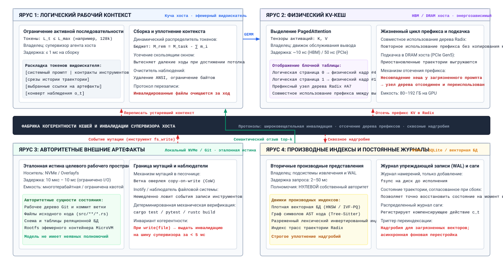
***Синтезированная четырехъярусная иерархия памяти и фабрика когерентности кешей**: полная архитектура памяти, показывающая разделение эфемерного логического контекста (ярус 1), энергозависимого физического KV-кеша (ярус 2), авторитетных внешних артефактов (ярус 3) и производных индексов с журналом упреждающей записи (ярус 4), связанных фабрикой когерентности и инвалидации кешей супервизора хоста.*

Как показано на рисунке [«Синтезированная четырехъярусная иерархия памяти и фабрика когерентности кешей»](#fig-vol3-memory-hierarchy-synthesis), архитектура памяти устраняет несогласование импедансов между быстрыми тензорами ускорителя и долговечным внешним состоянием, организуя хранение в четыре синхронизированных слоя. Верхний энергозависимый ярус охватывает ярус 1 (логический рабочий контекст в куче хоста, ограничивающий последовательности $L_{\max} \le 128\text{k}$ токенов при динамическом уплотнении) и ярус 2 (физический KV-кеш в HBM ускорителя и DRAM хоста, где блочные таблицы PagedAttention сопоставляют виртуальные токены с физическими кадрами, а радиксные деревья разделяют префиксы промптов). Ниже энергозависимого яруса центральная фабрика когерентности супервизора хоста координирует поток данных с долговечными слоями: ярусом 3 (авторитетные внешние артефакты в рабочих деревьях Git и наложениях microVM) и ярусом 4 (производные индексы извлечения, такие как векторные базы HNSW и графы AST Tree-Sitter, наряду с добавляемым журналом упреждающей записи). Когда агент выполняет команду исполнения, которая мутирует авторитетный внешний артефакт, например применяет патч к коду через файловый инструмент в песочнице, супервизор хоста должен распространить инвалидации через многоступенчатый конвейер когерентности:

```python
def on_artifact_mutation(event: MutationEvent, supervisor: AgentSupervisor) -> None:
    # 1. Авторитетная мутация зафиксирована в журнале упреждающей записи (WAL)
    supervisor.wal.append_mutation(event.path, event.old_hash, event.new_hash)
    # 2. Инвалидировать устаревшие фрагменты в активном логическом рабочем контексте
    supervisor.context_manager.invalidate_paths({event.path})
    # 3. Разорвать ветви префиксов предзаполнения в Radix-кеше движка вывода
    prefix_hash = compute_prefix_hash(event.path, event.old_hash)
    supervisor.inference_client.invalidate_prefix_cache(prefix_hash)
    # 4. Пометить надгробиями производные векторные и лексические индексы извлечения
    supervisor.vector_index.tombstone_by_uri(event.path)
    supervisor.retrieval_queue.schedule_async_reindex(event.path)
```

Протокол когерентности начинается на авторитетном уровне. Когда инструмент изменяет артефакт, песочница перехватывает мутацию, вычисляет криптографический дайджест содержимого байтов до и после мутации и выдает атомарную запись мутации $\Delta = \langle \text{path}, \mathcal{H}_{\text{old}}, \mathcal{H}_{\text{new}}, \text{diff} \rangle$. Супервизор перехватывает эту запись и дописывает ее в неизменяемый журнал упреждающей записи (WAL) с монотонно возрастающим счетчиком логической эпохи $e$.

После фиксации в журнале супервизор выполняет инвалидацию логического контекста. Менеджер контекста проверяет все активные текстовые блоки, которые сейчас подготовлены для генерации модели. Любой блок, метаданные которого связывают его с $\text{path}$ в эпохе $e' < e$, помечается как устаревший. Вместо того чтобы произвольно очищать все окно контекста, что уничтожило бы ценную непрерывность диалога и привязку к задаче, супервизор выборочно заменяет устаревший сегмент структурированным диффом или обновленным фрагментом, прочитанным напрямую из измененного артефакта.

Одновременно супервизор инвалидирует физический кеш ускорителя. Если среда вывода кеширует префиксы промптов через радиксное дерево, чтобы ускорить предзаполнение на многих ходах, KV-активации, соответствующие последовательности токенов до мутации, теперь недействительны. Если бы модель вычислялась со старыми активациями префикса, ее фаза авторегрессивного декодирования обусловливалась бы скрытыми состояниями, полученными из устаревших токенов. Супервизор отправляет движку обслуживания вызов RPC с инвалидацией, содержащий хеш префикса недействительной последовательности. Движок обслуживания отсекает соответствующий узел от дерева префиксов, освобождая физические страницы памяти GPU для повторного выделения, и заставляет движок вывода вычислить новое предзаполнение по обновленным токенам контекста.

Наконец, супервизор обеспечивает когерентность между производными индексами извлечения. Плотные векторные индексы и лексические хранилища нельзя пересчитать синхронно по гигабайтам кода в пределах задержки одного хода взаимодействия. Чтобы разрешить это несоответствие во времени, супервизор ставит сквозные надгробия при записи на все записи индекса, совпадающие с измененным URI. Когда агент впоследствии выполняет семантические запросы извлечения, шлюз извлечения отфильтровывает фрагменты с надгробиями, так что устаревшие эмбеддинги никогда не попадают в буфер активного контекста. Фоновые асинхронные рабочие процессы забирают измененные файлы из очереди переиндексации, извлекают обновленные синтаксические фрагменты, вычисляют новые векторы эмбеддингов и обновляют граф индекса вне основного потока.

<a id="nbk-18-cache-invalidation"></a>

> **Инвалидация кешей в иерархии агентов**
>
> Рассмотрим автономного агента сопровождения программного обеспечения, который работает на узле обслуживания с 8 GPU NVIDIA H100 (по 80 ГБ HBM3 на GPU, $3{,}35\text{ ТБ/с}$ пропускной способности памяти на GPU, подключение к DRAM хоста по PCIe Gen5). Мы вычисляем количественные издержки выделения памяти и инвалидации кеша во время итеративной задачи рефакторинга.
>
> **Системные параметры:**
>
> - Архитектура модели: Llama-3-70B в точности FP8 ($70 \times 10^9\text{ параметров} = 70\text{ ГБ}$ весов).
> - Геометрия внимания: 80 слоев трансформера, групповое внимание с запросами (GQA): 64 головы запросов и 8 голов «ключ — значение», размерность головы $d_k = 128$.
> - Активная длина последовательности: $L = 32\,768\text{ токенов}$.
> - Вычислительная мощность кластера: суммарный пик тензорных вычислений FP8 узла $15\,832\text{ TFLOPs}$ ($1{,}979\text{ PFLOPs}$ на H100); достигнутая утилизация модели (MFU) при предзаполнении $\eta = 0{,}50$.
> - Событие инвалидации: на токене $4\,096$ изменение исходного файла инвалидирует остаток префикса промпта.
>
> **Шаг 1: вычислить физический объем KV-кеша**
> Потребление памяти на токен по всем слоям для KV-кеша FP8 ($b_{\text{elem}} = 1\text{ байт}$) равно:
> $$M_{\text{token}} = 2 \times n_{\text{layers}} \times n_{\text{kv\_heads}} \times d_k \times b_{\text{elem}}$$
> $$M_{\text{token}} = 2 \times 80 \times 8 \times 128 \times 1\text{ байт} = 163\,840\text{ байт} = 160\text{ КБ/токен}$$
> Для активного контекста $L = 32\,768\text{ токенов}$:
> $$M_{\text{total\_KV}} = 32\,768 \times 160\text{ КБ} = 5\,242\,880\text{ КБ} = 5{,}0\text{ ГБ}$$
> При тензорном параллелизме на 8 GPU KV-кеш требует $0{,}625\text{ ГБ}$ на GPU, что составляет пренебрежимо малую долю физического бюджета HBM3 объемом 80 ГБ.
>
> **Шаг 2: сравнить задержку предзаполнения при попадании в кеш и при инвалидации**
> Теоретическое число операций с плавающей точкой для предзаполнения над $N_{\text{tokens}}$ на модели с $P = 70 \times 10^9$ параметрами составляет примерно:
> $$\text{FLOPs}_{\text{prefill}} \approx 2 \times P \times N_{\text{tokens}} = 1{,}4 \times 10^{11} \times N_{\text{tokens}}$$
> Эффективная пропускная способность вычислений системы:
> $$\text{Throughput}_{\text{eff}} = 15\,832 \times 10^{12}\text{ FLOPs/s} \times 0{,}50 = 7{,}916 \times 10^{15}\text{ FLOPs/s}$$
>
> *Сценарий A: попадание префикса в кеш дерева Radix (инвалидации нет).*
> Агент дописывает 512 новых токенов наблюдения к закешированному промпту длиной 32k. Предзаполнения требуют только 512 новых токенов:
> $$T_{\text{hit}} \approx \frac{1{,}4 \times 10^{11} \times 512}{7{,}916 \times 10^{15}} = \frac{7{,}168 \times 10^{13}}{7{,}916 \times 10^{15}} \approx 9{,}05\text{ мс}$$
>
> *Сценарий B: полное отсечение префикса (промах кеша).*
> Правка файла на токене 4 096 инвалидирует последующие $28\,672$ токена промпта. Вместе с 512 новыми токенами движок должен заново выполнить предзаполнение для $N_{\text{tokens}} = 29\,184$:
> $$T_{\text{miss}} \approx \frac{1{,}4 \times 10^{11} \times 29\,184}{7{,}916 \times 10^{15}} = \frac{4{,}086 \times 10^{15}}{7{,}916 \times 10^{15}} \approx 516{,}2\text{ мс}$$
>
> Штраф по задержке из-за повторного предзаполнения равен:
> $$\text{Замедление} = \frac{516{,}2\text{ мс}}{9{,}05\text{ мс}} \approx 57{,}0\times$$
> Это количественное расхождение показывает, почему тонкое разбиение дерева префиксов и хирургическая замена контекста обязательны для сохранения отзывчивости агента в реальном времени.

<a id="sec-vol3-conclusion-seams"></a>

### Швы между подсистемами и владение

Помимо внутриярусной когерентности памяти, границы между подсистемами вводят критические режимы сбоев интеграции, при которых отдельные компоненты проходят модульные тесты изоляции, но ломаются при сквозном исполнении. Пятый шов возникает, когда одна траектория становится несколькими. Бюджеты вложены друг в друга по всей книге. Потолок на вызов ограничивает один вызов модели ([«Базовая модель»](02_foundation_model.md#sec-vol3-foundation-model)), бюджет на решение ограничивает поиск на этапе тестирования ([«Вычисления на этапе тестирования»](03_test_time_compute.md#sec-vol3-test-time-compute)), бюджет на траекторию ограничивает цикл ([«Обвязка агента»](09_agent_harness.md#sec-vol3-agent-harness)), а денежные бюджеты охватывают делегирование и парк ([«Экономика агентов»](17_agent_economics.md#sec-vol3-agent-economics)). Каждый внутренний бюджет должен помещаться внутрь внешнего, а делегирование должно передавать подмножество, а не копию (принцип «Монотонное делегирование»). Дочерний агент, которому переданы полные выданные полномочия и бюджет родителя, умножил экспозицию, и никто этого не решал.

Агенты, которые разделяют веса, разделяют и ошибки ([«Координация нескольких агентов»](16_multi_agent.md#sec-vol3-multi-agent)). Три дочерних агента, которые сходятся в диагнозе, не предоставили трех независимых свидетельств, поэтому их согласие не может заменить проверку, которую запускает среда выполнения. Таблица [«Швы и их владельцы»](#tbl-vol3-seams) собирает пять швов.

| **Шов**                    | **Сбой, который пропускают тесты каждой стороны**      | **Принципы в напряжении**                               | **Владелец исправления**                                |
|:---------------------------|:-------------------------------------------------------|:--------------------------------------------------------|:--------------------------------------------------------|
| **Мир и его копии**        | Предложения, построенные на устаревшем представлении измененного источника | Авторитетность источника против повторного использования префикса | Обвязка, при каждой записи, которую она отправляет      |
| **От предложения к эффекту** | Повторяющиеся или незаписанные эффекты, внедренные инструкции | Типизированный контракт действий, урегулирование, намерение до действия | Слой инструментов и журнал, в фиксированном порядке     |
| **Восстановление и полномочия** | Компенсация, у которой нет нужной выдачи           | Граница поворотного действия против ослабленных выдач            | Восстановление, регистрирующее полномочия вместе с прямым действием |
| **От журнала к модели**    | Политика, которая обыгрывает проверку, сертифицирующую ее | Свидетельства выпуска против обучения с подкреплением по верификаторам | Курирование и оценка, с удержанием верификатора вне обучения |
| **Между агентами**         | Экспозиция, умноженная делегированием, коррелированные голоса | Налог на координацию против монотонного делегирования   | Делегирующая обвязка и бюджет парка                     |

<a id="tbl-vol3-seams"></a>

***Швы и их владельцы**: пять мест, где подсистемы, каждая из которых проходит собственные тесты, отказывают вместе; принципы, которые там встречаются, и владелец, отвечающий за закрытие разрыва.*

<a id="sec-vol3-memory-provenance-grounding"></a>

### Отслеживание происхождения

Главная уязвимость авторегрессивных моделей состоит в том, что они не могут отличить семантический авторитет от одной только символьной разметки. Как только внешние данные, будь то доверенный системный контракт, авторитетный исходный файл, непроверенный комментарий пользователя или состязательная полезная нагрузка из веба, разбираются кодированием пар байтов в линейную последовательность идентификаторов токенов, все токены попадают в матрицу самовнимания трансформера на математически равных правах. Механизм внимания вычисляет попарные масштабированные скалярные произведения по всему промпту без разбора. Если найденный фрагмент веба содержит состязательную строку внедрения в промпт, модель не может отличить законные системные инструкции от встроенной вредоносной полезной нагрузки без внеполосного архитектурного посредничества.

Чтобы сохранить замыкание инвариантов и предотвратить эскалацию привилегий, иерархия памяти должна обеспечивать криптографическое отслеживание происхождения для всех рабочих токенов. Супервизор хоста снабжает каждый непрерывный срез токенов, введенный в активный логический контекст, неизменяемым дескриптором происхождения.

Пусть активная последовательность логического контекста $\mathbf{x} = [t_1, t_2, \dots, t_N]$ разбита на непересекающиеся непрерывные промежутки. Супервизор ведет вспомогательный внеполосный журнал происхождения $\mathcal{P}$, определенный как отображение каждого интервала токенов $[i, j]$ в формальный кортеж происхождения:

$$\mathcal{P}([i, j]) = \left\langle \text{uri}, \mathcal{H}_{\text{content}}, \text{epoch}, \tau_{\text{trust}}, \sigma_{\text{sig}} \right\rangle$$

В этом кортеже $\text{uri}$ задает канонический унифицированный идентификатор ресурса (URI) авторитетного исходного артефакта (например, `git://repo@sha256:src/parser.c#L45-L80` или `sandbox://proc/104/stdout`); $\mathcal{H}_{\text{content}} = \text{SHA-256}(\text{bytes})$ фиксирует криптографический дайджест исходных данных в момент поступления; $\text{epoch}$ отмечает логические часы среды; $\tau_{\text{trust}}$ присваивает явную классификацию привилегий безопасности; а $\sigma_{\text{sig}}$ — необязательную криптографическую подпись, выданную доверенным верификационным оракулом или супервизором-человеком.

Классификация доверия $\tau_{\text{trust}}$ относит промежутки памяти к четырем формальным кольцам безопасности:

1. $\text{AUTHORITATIVE}$: неизменяемые спецификации контракта задачи, ограничения системных границ и проверенные файлы, которые непосредственно прочитаны из герметичной песочницы.
2. $\text{DERIVATIVE}$: сводки, выборки индекса AST и семантические векторы, созданные доверенными внутренними конвейерами.
3. $\text{EPHEMERAL}$: промежуточные токены черновика агента и незафиксированные шаги внутреннего обдумывания.
4. $\text{UNTRUSTED}$: произвольные входные данные из внешнего веб-поиска, сторонних трекеров задач или непроверенных пользовательских вводов.

Этот журнал происхождения позволяет супервизору применять межсетевые экраны потока данных на границе действий. Когда модель выдает предложение действия $a_t = (\text{tool}, \text{args})$, парсер супервизора не просто проверяет синтаксис `args`. Он прослеживает токены, составляющие предложенные аргументы, через распределение внимания до их источников в $\mathcal{P}$. Если предложение действия, нацеленное на изменяющий инструмент (такой как `execute_shell` или `write_file`), происходит преимущественно из промежутков контекста с меткой $\text{UNTRUSTED}$, супервизор перехватывает исполнение. Поскольку модель не имеет неявных полномочий, среда выполнения отвергает исполнение команды или перенаправляет его в изолированную песочницу карантина, не давая косвенным внедрениям промпта перехватить управление потоком хоста.

Кроме того, отслеживание происхождения дает эмпирическую основу для проверяемых свидетельств завершения. Когда агент сигнализирует, что контракт задачи выполнен, супервизор запрашивает журнал происхождения, чтобы проверить, что результаты опираются на авторитетные артефакты. Если заявление о завершении ссылается на хеши файлов, которые не совпадают с текущим состоянием на диске, или опирается на допущения, выведенные из инвалидированных эпох ($e' < e_{\text{current}}$), супервизор отказывает в завершении и заставляет переоценить результат.

Построение явно разделенной, когерентной и криптографически атрибутируемой иерархии памяти гарантирует, что непривилегированный движок нейронного вывода обусловливает свои авторегрессивные циклы декодирования строго свежими и подлинными свидетельствами. Однако одна структурированная память не может изменить внешний мир и не может защитить инфраструктуру хоста от некорректных действий, зацикливания или вредоносных побочных эффектов. Чтобы превратить проверенный контекст в безопасные, долговечные эффекты в реальном мире, агентная архитектура требует обвязки исполнения, которая посредничает в каждом выходе модели через типизированный разбор, детальные проверки полномочий, изолированную виртуализацию исполнения, долговечное журналирование и управление компенсируемыми транзакциями. Как эти оборонительные границы складываются в сквозной конвейер исполнения и почему многошаговые агентные траектории никогда нельзя считать единичными атомарными транзакциями, рассматривается далее.

<a id="sec-vol3-conclusion-execution"></a>

## Синтез обвязки исполнения

Когда непривилегированная базовая модель порождает строку действия, предлагающую удалить облачный ресурс, скомпилировать ненадежную библиотеку C или выполнить внешнюю мутацию через API, трактовка этой сырой текстовой генерации как авторитетного удаленного вызова процедуры приглашает к катастрофическому сбою системы. Движок стохастического предсказания токенов, работающий при разомкнутом сэмплировании, может выдавать синтаксически неверные вызовы инструментов, придумывать несуществующие флаги оболочки, строить аргументы оболочки, которые запускают внедрение команд, или входить в незавершающиеся циклы повторов к сетевым конечным точкам третьих сторон. Более того, распределенные побочные эффекты в реальном мире нельзя инкапсулировать внутри атомарной транзакции базы данных: как только сетевой сокет передал HTTP-пакет или внешняя база данных зафиксировала обновление, физический мир нельзя откатить двухфазным коммитом ($2\text{PC}$).

**Обвязка исполнения связывает разбор, полномочия, изоляцию, долговечные записи намерения и эффекта, наблюдение и восстановление так, чтобы каждую границу можно было проверить; траектория, охватывающая внешние системы, не является одной атомарной транзакцией.** Обвязка исполнения образует оборонительный периметр супервизора хоста. Она рассматривает модель как непривилегированного предлагающего, который не имеет неявных полномочий. Вставив детерминированный шестиэтапный конвейер между генерацией кандидатных токенов и физическим исполнением, обвязка гарантирует, что каждый побочный эффект типизирован, авторизован, записан в журнал до исполнения, заключен в изолированную границу, очищен при возврате и зарегистрирован в журнале компенсаций, который только дописывается.

Классическая работа Джима Грея 1981 года *The Transaction Concept: Virtues and Limitations* показала, что хотя абстракция атомарных, согласованных, изолированных и долговечных (ACID) транзакций упрощает системы баз данных, реальные распределенные системы, охватывающие автономные административные домены, должны опираться на контракты сообщений, журналирование и компенсирующие действия, а не на универсальные распределенные блокировки.

<a id="sec-vol3-execution-pipeline-stages"></a>

### Интегрированный шестиэтапный конвейер исполнения

Как формализовано на рисунке [«Синтезированный конвейер исполнения траектории»](#fig-vol3-synthesized-execution-pipeline), операционное ядро обвязки исполнения — это линейный шестиэтапный детерминированный конвейер посредничества. Каждое кандидатное испускание инструмента, предложенное непривилегированной базовой моделью, зависит от контекста промпта $c_t$ (включающего контракт задачи $\mathcal{C}$) и должно последовательно пройти каждый детерминированный оборонительный периметр: (1) маскирование логитов грамматикой на основе автомата с магазинной памятью, чтобы гарантировать соответствие схеме до выхода из декодирования; (2) криптографическую оценку полномочий и бюджета, так что выполняются только разрешенные действия; (3) синхронную запись намерения в журнал упреждающей записи (`fsync`) на энергонезависимое хранилище; (4) исполнение в изолированной песочнице microVM при оверлеях копирования при записи только для чтения и фильтрах системных вызовов `seccomp-bpf`; (5) очистку наблюдений, которая обеспечивает межсетевой экран от внедрения промпта по принципу $W \oplus X$; и (6) регистрацию в журнале саги, который ведет прямые и компенсирующие действия. Сбой на любом этапе немедленно останавливает прямое исполнение, записывает диагностическое событие в журнал и формирует информативный конверт ошибки, который возвращается в рабочий контекст агента, не подвергая операционную систему хоста поврежденному состоянию.

<a id="fig-vol3-synthesized-execution-pipeline"></a>

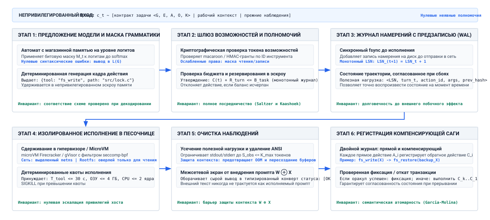
***Синтезированный конвейер исполнения траектории**: линейная шестиэтапная обвязка посредничества, которая между непривилегированными предложениями модели и операционными системами хоста вставляет маскирование логитов грамматикой, шлюзы полномочий, журналирование с упреждающей записью, исполнение в песочнице microVM, очистку наблюдений и регистрацию компенсирующих саг.*

#### Этап 1: предложение модели с грамматическими ограничениями

Оборонительная граница начинается во время самого авторегрессивного цикла декодирования, до отправки инструмента. Вместо того чтобы позволять модели выдавать свободный текст и разбирать его потом, обвязка исполнения обеспечивает половину схемы контракта типизированного действия (принцип «Типизированный контракт действий») во время декодирования, через конвейер маскирования логитов на GPU, описанный в разделе [«Декодирование с грамматическими ограничениями»](02_foundation_model.md#sec-vol3-foundation-model-grammar-constrained), а половину полномочий оставляет этапу 2.[^fn-fused-grammar-masking] На каждом шаге декодирования $i$ автомат с магазинной памятью ограничивает кандидатные токены строго допустимыми продолжениями грамматики $\mathcal{V}_{\text{valid}} \subset \mathcal{V}$, устанавливая недопустимые логиты в $-\infty$ в SRAM ускорителя до редукции softmax. Это устраняет синтаксические ошибки JSON, пропущенные закрывающие скобки и недопустимые типы параметров до того, как кандидатное предложение покинет память ускорителя.

[^fn-fused-grammar-masking]: **Маскирование грамматикой на уровне аппаратуры**: как подробно описано в разделе [«Декодирование с грамматическими ограничениями»](02_foundation_model.md#sec-vol3-foundation-model-grammar-constrained), автоматы с магазинной памятью компилируются в компактные битовые маски, которые хранятся в памяти устройства GPU и применяют штрафы $-\infty$ непосредственно в SRAM без остановок синхронизации CPU и GPU.

#### Этап 2: шлюз полномочий

Синтаксическая корректность не означает операционных полномочий. Как только синтаксически корректное предложение действия $a_t = (\text{tool\_name}, \text{args})$ декодировано, оно поступает в шлюз политики и полномочий. Модель не имеет неявных полномочий на хосте, поэтому каждое допустимое действие требует явного криптографически подписанного токена полномочий (например, Macaroon или токена ограниченной авторизации), предъявляемого супервизором среды выполнения.

Шлюз полномочий выполняет три обязательные проверки:

1. *Проверка области и границ:* шлюз проверяет целевые пути, сетевые конечные точки и системные ресурсы, закодированные в $\text{args}$. Если агент, исполняющий изолированный модульный тест, пытается получить доступ к `/etc/passwd` или запросить внутренние метаданные по IP-адресу (`169.254.169.254`), запрос перехватывается и отклоняется.
2. *Ослабленное делегирование:* токены полномочий обеспечивают строгое ослабление. Если родительский координатор передал подзадачу рабочему агенту с правами только на чтение репозитория, рабочий не может выполнять изменяющие инструменты, даже если его промпт заявляет об административных полномочиях.
3. *Эскроу человека и триггеры радиуса поражения:* для действий с большим радиусом поражения, таких как удаление схемы базы данных, принудительная отправка в защищенные ветки git или развертывание производственных контейнеров, шлюз запускает операционное эскроу. Исполнение останавливается, состояние траектории сохраняется, и система ждет внеполосной криптографической подписи уполномоченного оператора-человека.

#### Этап 3: журналирование намерения с упреждающей записью (WAL)

Как только предложение действия проходит шлюз полномочий, но *до того*, как выполнен какой-либо системный вызов или отправлен сетевой пакет, обвязка записывает неизменяемую запись в журнал упреждающей записи (Write-Ahead Log, WAL) траектории. Этот порядок — намерение до действия (принцип «Намерение до действия»), и именно он позволяет восстановлению отличить предложенное действие от выполненного.

Следуя классическому принципу проектирования систем — журналированию с упреждающей записью, среда выполнения обеспечивает согласованность при сбоях в распределенной среде. Если супервизор хоста падает, теряет питание или оказывается отрезан сетью во время исполнения инструмента, менеджер восстановления при перезагрузке читает WAL, чтобы определить, было ли действие только предложено, выполняется ли оно сейчас или уже подтверждено. Записанная в журнал запись состоит из неизменяемого кортежа намерения:

$$\mathcal{J}_t = \left\langle t, \text{action\_id}, a_t, \text{hash}(\text{args}), \text{token\_id}, \text{status} = \text{COMMITTED} \right\rangle$$

Принудительный `fsync` для $\mathcal{J}_t$ на энергонезависимое хранилище исключает возможность осиротевших мутаций, при которых внешняя система меняет состояние, а среда выполнения агента уже потеряла всякую запись о том, что команда была инициирована.

#### Этап 4: исполнение в песочнице microVM

Когда намерение зафиксировано в долговечном хранилище, обвязка отправляет действие в изолированную песочницу исполнения. В промышленных агентных системах запуск недоверенного кода или команд оболочки прямо внутри контейнера среды выполнения хоста недопустим: эксплойты выхода из контейнера и загрязнение пространств имен легко компрометируют инфраструктуру хоста.

Поскольку изоляция должна обеспечиваться ниже кода, который она содержит (принцип «Сдерживание ниже модели»), обвязка исполнения запускает команду внутри эфемерной microVM или песочницы с ядром пользовательского пространства ([«Песочницы агентов»](08_sandboxes.md#sec-vol3-sandboxes)). Песочница обеспечивает эшелонированную защиту изоляцией:

- *Виртуализация и фильтрация системных вызовов:* гостевое ядро работает со строгим фильтром `seccomp-bpf`, который ограничивает системные вызовы минимальным белым списком и блокирует опасные операции, такие как создание сырых сокетов, загрузка модулей или внедрение через ptrace.
- *Изолированные сетевые пространства имен:* исполнение происходит в герметичном сетевом пространстве имен. Исходящий трафик направляется через прокси исходящего трафика, который применяет белый список доменов, предотвращая утечку данных и связь с управляющим сервером (command-and-control).
- *Хранилище с копированием при записи (CoW):* все мутации файловой системы происходят в эфемерном снимке с копированием при записи, наложенном поверх авторитетного рабочего пространства. Если исполнение повреждает зависимости или записывает вредоносные двоичные файлы, корневая файловая система остается нетронутой, а снимок можно отбросить за миллисекунды.

#### Этап 5: нормализация наблюдений

Когда процесс в песочнице завершается, его сырые выходные данные (стандартный вывод, стандартный поток ошибок, коды выхода и сгенерированные файлы) возвращаются обвязке. Сырой вывод инструмента нельзя напрямую подавать в активное окно контекста базовой модели. Неограниченный вывод инструмента может выдать мегабайты двоичных данных, исчерпать бюджет токенов $L_{\max}$ или содержать атаки внедрения промпта, предназначенные для подрыва последующего обдумывания агента.

Слой нормализации наблюдений выполняет три оборонительных преобразования:

1. *Детерминированная типизация схемы:* сырые байтовые потоки разбираются в строго типизированные записи наблюдения:

   $$\mathcal{O}_t = \left\langle \text{status}, \text{exit\_code}, \text{content}, \text{bytes\_truncated}, \mathcal{H}_{\text{digest}} \right\rangle$$

   Статус жестко привязан к каноническим состояниям среды выполнения: `COMPLETED`, `TRUNCATED`, `REFUSED` или `TRANSPORT_FAILURE`.
2. *Усечение по бюджету токенов и спулинг:* если стандартный вывод превышает бюджет наблюдения на ход $L_{\text{obs}}$, обвязка сохраняет начало и конец потока, усекает промежуточные байты, записывает полный неочищенный вывод во внешнее хранилище артефактов и вставляет криптографическую ссылку URI в $\mathcal{O}_t$.
3. *Фильтрация состязательного ввода:* содержимое сканируется на управляющие ANSI-последовательности, терминальные управляющие последовательности и рекурсивные векторы внедрения. Любая подозрительная полезная нагрузка нейтрализуется и помечается непривилегированным дескриптором происхождения ($\tau_{\text{trust}} = \text{UNTRUSTED}$).

#### Этап 6: регистрация компенсирующей саги

Последний этап конвейера записывает семантический след действия в распределенный журнал саг траектории. Если выполненный инструмент изменил внешнее состояние, например создал временную ветку, выделил тестовую базу данных или изменил файл конфигурации, обвязка требует, чтобы конверт выполнения инструмента зарегистрировал соответствующее компенсирующее действие $c_t$.

Компенсирующее действие представляет семантическую инверсию прямого действия. Как формализовали Гектор Гарсиа-Молина и Кеннет Салем (1987), распределенные многошаговые транзакции в разнородных системах не могут сохранять сериализуемость в стиле баз данных. Регистрируя $c_t$ в долговечном хранилище, обвязка исполнения гарантирует, что если вся траектория провалится на ходу $t+k$, супервизор сможет выполнить обратное восстановление, вызвав последовательность компенсаций в обратном порядке $(c_t, c_{t-1}, \dots, c_1)$, чтобы вернуть среду в приемлемое спокойное состояние. Полный шестиэтапный конвейер исполнения обобщен в таблице [«Конвейер обвязки исполнения»](#tbl-vol3-execution-pipeline-stages).

| **Этап конвейера**               | **Архитектурная задача**       | **Механизм принуждения**          | **Основной режим отказа**                  | **Политика восстановления и изоляции**   |
|:---------------------------------|:-------------------------------|:----------------------------------|:-------------------------------------------|:-----------------------------------------|
| **1. Предложение грамматики**    | Гарантировать корректность схемы инструмента | Маскирование логитов CFG / FSM    | Некорректный JSON, галлюцинированные флаги | Отказ нулевой стоимости при генерации токенов |
| **2. Шлюз полномочий**           | Соблюдать принцип наименьших привилегий | Криптографические токены полномочий | Эскалация привилегий, внедрение команд    | Немедленный перехват, эскалация через эскроу человека |
| **3. Журнал упреждающей записи**         | Обеспечить согласованность при сбоях | Добавляемый энергонезависимый журнал | Сбой супервизора хоста, осиротевшие мутации | Повтор и сверка при запуске              |
| **4. Исполнение в песочнице**    | Изолировать недоверенное исполнение | Эфемерная microVM, `seccomp-bpf`  | Компрометация хоста, выход из контейнера   | Отбрасывание эфемерного снимка CoW       |
| **5. Нормализация наблюдений**   | Не допускать загрязнения контекста | Усечение, типизация, очистка      | Исчерпание контекста, косвенное внедрение  | Спулинг в хранилище блобов, усечение токенов |
| **6. Регистрация саги**          | Гарантировать восстановление с компенсацией | Журнал компенсаций распределенной саги | Сбой траектории, частичная мутация состояния | Последовательное исполнение обратных действий |

<a id="tbl-vol3-execution-pipeline-stages"></a>

***Конвейер обвязки исполнения**: шесть этапов синтезированного конвейера обвязки исполнения с архитектурными задачами, механизмами принуждения, режимами отказа и политиками восстановления.*

<a id="sec-vol3-execution-sagas"></a>

### Контракты распределенных саг

Центральная ошибка наивного проектирования агентных систем — считать агентную траекторию атомарной транзакцией базы данных «все или ничего». В идеальной реляционной базе данных многошаговая операция регулируется гарантиями ACID: промежуточные записи изолированы от параллельных транзакций, и если на шаге 10 нарушено ограничение, движок базы данных прерывает транзакцию и откатывает шаги с 1 по 9, как будто их никогда не было.

В агентном вычислителе, который взаимодействует с внешними операционными системами, инструментами разработчика и распределенными сетями, универсальная атомарная изоляция физически невозможна. Когда агент открывает задачу на GitHub, разворачивает виртуальную машину у облачного провайдера или отправляет промежуточный коммит в общий репозиторий, эти мутации сразу становятся видимыми внешним наблюдателям. Эти внешние системы — автономные административные субъекты, которые не участвуют в общем протоколе двухфазного коммита. Никакой распределенный менеджер блокировок не может заморозить состояние GitHub или внешнего API третьей стороны, пока локальная базовая модель обдумывает свой следующий шаг рассуждения.

Поскольку траектории неатомарны и долгоживущи, обвязка исполнения должна моделировать их как распределенные *саги*, в том виде, в каком их концептуализировали Гектор Гарсиа-Молина и Кеннет Салем (1987). Журнал саги $\Lambda$ траектории, охватывающей $H$ ходов, попарно сопоставляет каждое прямое действие $a_i$ с его компенсирующим действием $c_i$:

$$\Lambda = \left\langle (a_1, c_1, o_1), (a_2, c_2, o_2), \dots, (a_H, c_H, o_H) \right\rangle$$

Каждое прямое действие $a_i$ переводит внешнюю среду из состояния $\mathcal{S}_{i-1}$ в $\mathcal{S}_i$. Компенсирующее действие $c_i$ — это семантически определенная обратная операция, которая переводит среду из состояния $\mathcal{S}_i$ обратно в эквивалентное или приемлемое состояние $\mathcal{S}_{i-1}' \approx \mathcal{S}_{i-1}$.

Компенсация — это семантическая поправка, а не откат. По принципу «Граница поворотного действия и компенсирующие саги» только запись, ограниченная песочницей, обратима: ее можно отменить, восстановив снимок. Действие над внешней разделяемой системой в лучшем случае компенсируемо: оно восстанавливает инварианты среды, но не ее историю. Если действие $a_i$ опубликовало сообщение в канал инцидентов Slack, компенсирующее действие $c_i$ — это последующее сообщение о том, что предыдущее было ошибочным и отозвано, а получатели его все равно уже прочитали. Действие, которое не допускает компенсации вовсе, необратимо, и среда выполнения допускает не более одного такого поворотного действия на траекторию, поставленного после всей компенсируемой работы.

```python
# Минимальная регистрация компенсирующей транзакции саги
def execute_pipeline_step(action: ActionProposal, supervisor: Supervisor) -> Observation:
    # 1. Авторизовать и зафиксировать намерение в журнале упреждающей записи (WAL)
    supervisor.capability_gate.verify(action.token, action.tool, action.args)
    supervisor.wal.append_intent(action.id, action.tool, action.args)

    # 2. Выполнить внутри изолированной песочницы microVM
    obs = supervisor.microvm.run(action.tool, action.args, timeout_s=30)
    norm_obs = supervisor.normalizer.process(obs, max_tokens=2048)

    # 3. Зарегистрировать компенсирующее действие в долговечном журнале саги
    comp_action = action.get_compensating_action()
    supervisor.saga_ledger.register(action.id, comp_action)
    return norm_obs
```

Когда на шаге $k$ происходит неустранимый сбой, например незавершающийся цикл, таймаут среды или необработанное падение инструмента, супервизор прекращает прямое исполнение и запускает протокол восстановления:

1. *Обратное восстановление (компенсация):* менеджер восстановления обходит журнал саги в обратном порядке, выполняя компенсирующие действия $c_{k-1}, c_{k-2}, \dots, c_1$. Это снимает временные ресурсы, удаляет эфемерные ветки и освобождает выделенные облачные экземпляры, возвращая систему в чистое состояние до того, как сообщить пользователю о сбое.
2. *Прямое восстановление (повтор от контрольной точки):* если сбой был временным (например, таймаут сетевого сокета или временное ограничение частоты запросов), супервизор проверяет WAL, восстанавливает логический контекст агента в точный снимок, предшествующий ходу $k$, меняет параметры исполнения (например, увеличивает паузу или выбирает альтернативное зеркало) и возобновляет прямое исполнение.

<a id="nbk-18-latency-overhead-mediation"></a>

> **Накладные расходы защитного посредничества исполнения**
>
> Старшему инженеру систем нужно определить, вносит ли маршрутизация каждого действия модели через шестиэтапную защитную обвязку недопустимую задержку по сравнению с выполнением команд оболочки без ограничений. Допустим, агент выполняет задачу рефакторинга из 30 ходов. Базовая модель выдает в среднем 80 токенов завершения на ход при скорости авторегрессивного декодирования $32\,\text{мс}$ на токен.
>
> Аппаратное окружение включает 8-ядерный CPU хоста, хранилище NVMe по PCIe 4.0 и изолированный пул microVM:
>
> - *Этап 1 (маскирование грамматикой):* встроено в движок обслуживания вывода; накладные расходы составляют $< 0{,}1\,\text{мс}$ на токен, что дает $8\,\text{мс}$ по всей последовательности декодирования.
> - *Этап 2 (шлюз токенов полномочий):* криптографическая проверка подписи Ed25519 и оценка ACL пути: $1{,}8\,\text{мс}$.
> - *Этап 3 (журналирование намерения с упреждающей записью):* добавление бинарной записи $2\,\text{КБ}$ на хранилище NVMe с явным `fsync`: $15\text{ мкс} \approx 0{,}015\,\text{мс}$.
> - *Этап 4 (исполнение в песочнице microVM):* исполнение в предварительно форкнутом снимке microVM Firecracker занимает $115\,\text{мс}$ (в основном инициализация контекста гостевого ядра и подключение блочного устройства virtio), плюс $250\,\text{мс}$ собственного времени компиляции команды.
> - *Этап 5 (нормализация наблюдений):* усечение потока, криптографическое хеширование содержимого SHA-256 и токенизация BPE для вывода $4\,\text{КБ}$: $1{,}4\,\text{мс}$.
> - *Этап 6 (регистрация в журнале саги):* добавление записи компенсации в хранилище состояния SQLite с добавлением: $0{,}05\,\text{мс}$.
>
> Вычислим полную задержку реального времени на ход:
>
> $$T_{\text{model}} = 80\text{ токенов} \times 32\,\text{ms/токен} = 2\,560\,\text{мс}$$
>
> $$T_{\text{harness}} = 8\,\text{мс} + 1{,}8\,\text{мс} + 0{,}015\,\text{мс} + 115\,\text{мс} + 1{,}4\,\text{мс} + 0{,}05\,\text{мс} = 126{,}265\,\text{мс}$$
>
> $$T_{\text{total}} = T_{\text{model}} + T_{\text{harness}} + T_{\text{workload}} = 2\,560\,\text{мс} + 126{,}3\,\text{мс} + 250\,\text{мс} = 2\,936{,}3\,\text{мс}$$
>
> Обвязка добавляет $126{,}3\,\text{мс}$ системных накладных расходов на ход. По отношению к задержке авторегрессивного декодирования базовой модели ($2\,560\,\text{мс}$) доля обвязки составляет:
>
> $$\text{Доля накладных расходов} = \frac{126{,}3\,\text{мс}}{2\,560\,\text{мс} + 126{,}3\,\text{мс} + 250\,\text{мс}} = \frac{126{,}3}{2\,936{,}3} \approx 4{,}30\%$$
>
> Взамен на умеренный рост задержки хода на 4,3 % архитектура получает детерминированные синтаксические гарантии, полную изоляцию от произвольного компрометирования хоста, согласованность при сбоях и гарантированную компенсируемость. По всей траектории из 30 ходов совокупный объем хранения, который занимают записи WAL и саги ($2\,\text{КБ} \times 30 = 60\,\text{КБ}$), ничтожен по сравнению со стандартными файловыми буферами операционной системы.

<a id="sec-vol3-execution-watchdog"></a>

### Семантический сторожевой таймер

Даже когда отдельные действия синтаксически корректны, авторизованы, изолированы и записаны в журнал, автономный агент все равно может проявлять катастрофическое поведение на макроуровне. Базовые модели, обусловленные наблюдениями о сбоях на многих ходах, часто попадают в *патологические поведенческие аттракторы*: вырожденные циклы, в которых модель многократно выдает одинаковые падающие команды, мечется между двумя взаимно конфликтующими правками или расходует тысячи токенов, не добиваясь измеримого продвижения вперед.

Поскольку на то, что нейронная модель сама диагностирует свои вырожденные циклы, нельзя полагаться, обвязка исполнения разворачивает внеполосный детерминированный компонент супервизора: *семантический сторожевой таймер* (Semantic Watchdog).

В классических отказоустойчивых вычислениях аппаратный сторожевой таймер сбрасывает зависший процессор, если тот не сбросил счетчик в заданный интервал. Семантический сторожевой таймер обобщает эту идею на семантику траектории высокого уровня: он отслеживает изменения состояния и поведенческую энтропию в многоходовых взаимодействиях.

Семантический сторожевой таймер работает параллельно с обвязкой исполнения и после каждого хода проверяет траекторию на три структурных инварианта:

#### 1. Точное обнаружение синтаксического цикла

Самый простой режим отказа — синтаксическое повторение, при котором модель выдает одинаковый вызов инструмента с одинаковыми параметрами на последовательных ходах (например, многократно запрашивает несуществующий файл или выполняет один и тот же неизменный поисковый запрос). Сторожевой таймер ведет кольцевой буфер скользящего окна дайджестов действий $\mathcal{H}(a_t) = \text{SHA-256}(\text{tool\_name} \mathbin{\Vert} \text{canonical\_json}(\text{args}))$. Если один и тот же хеш действия встречается $k \ge 3$ раз в окне из $W$ шагов, сторожевой таймер немедленно помечает синтаксическую блокировку.

#### 2. Застой дельты состояния (семантическое колебание)

Более коварно, агент может менять синтаксические выдачи, оставаясь при этом в семантическом цикле. Например, в задаче починки программы агент может чередовать правку исходного файла, чтобы пройти Тест A (что ломает Тест B), и правку того же файла, чтобы пройти Тест B (что ломает Тест A). Хотя вызовы инструментов синтаксически различаются, состояние среды колеблется между двумя повторяющимися конфигурациями.

Сторожевой таймер измеряет прогресс состояния, вычисляя криптографический дайджест состояния $\mathcal{S}_t = \text{git\_tree\_sha}(\text{workspace})$ после каждого исполнения с мутацией. Если $\mathcal{S}_t = \mathcal{S}_{t-2}$ или если совокупное расстояние редактирования за $N$ ходов дает нулевое чистое изменение ($\Delta \mathcal{S} = 0$), а число пройденных тестов не улучшается монотонно, сторожевой таймер диагностирует семантическое метание (thrashing).

#### 3. Автоматические выключатели траектории

Чтобы не допустить неограниченного расходования финансовых и вычислительных ресурсов, обвязка исполнения помещает траекторию агента внутрь формальной конечной машины *автоматического выключателя* (Circuit Breaker). Выведенный из инженерии распределенных систем, автоматический выключатель переходит между тремя эксплуатационными состояниями:

- `CLOSED` (номинальное исполнение): действия свободно проходят через шестиэтапный конвейер. Сторожевой таймер непрерывно следит за частотой ошибок, дельтами состояния и бюджетами ходов.
- `OPEN` (сработавшее исполнение): если порог отказа превышен, например превышен $T_{\max}$, накоплено $K$ подряд сбоев исполнения инструментов или обнаружен непрерываемый семантический цикл, выключатель срабатывает в состоянии `OPEN`. Прямая отправка инструментов немедленно останавливается. Супервизор перехватывает процесс агента, приостанавливает microVM, выполняет обратную компенсацию саги, если она настроена, и оповещает оператора-человека или оркестратор.
- `HALF-OPEN` (пробное восстановление): в сценариях автоматического восстановления выключатель переходит в `HALF-OPEN`. Агенту выделяется ограниченный бюджет (например, ровно два хода), и он ограничен диагностическими инструментами только для чтения. Если агент демонстрирует продвижение вперед (например, выдает связный диагноз или выполняет допустимый план восстановления), выключатель возвращается в `CLOSED`; если он снова терпит неудачу, выключатель навсегда переходит в `OPEN`.

Следующая диагностическая трасса показывает, как семантический сторожевой таймер перехватывает колеблющийся цикл починки компилятором до исчерпания бюджета токенов:

```bash
[WATCHDOG: TURN 12] Action: patch_file(path="src/parser.c", diff="@@ -42,2 +42,2 @@...")
[SANDBOX:  TURN 12] Exit: 1 | stderr: "parser.c:45:12: error: unknown type name 'NodeId'"
[WATCHDOG: TURN 13] Action: patch_file(path="src/parser.c", diff="@@ -42,2 +42,2 @@...")
[SANDBOX:  TURN 13] Exit: 1 | stderr: "parser.c:45:12: error: expected ';' before 'x'"
[WATCHDOG: TURN 14] Action: patch_file(path="src/parser.c", diff="@@ -42,2 +42,2 @@...")
[WATCHDOG: TRAP] Semantic oscillation detected: State hash matches Turn 12 (git:e84f2b).
[CIRCUIT_BREAKER] State changed: CLOSED -> OPEN.
[CIRCUIT_BREAKER] Halting forward dispatch. Invoking Saga compensation ledger (c_14..c_12).
[SUPERVISOR] Escalating to human escrow: Diagnostic payload spooled to /var/log/traces/104.
```

Отделяя мониторинг исполнения от вероятностного нейронного движка, семантический сторожевой таймер дает детерминированную гарантию: независимо от галлюцинаций модели, аномалий стохастического сэмплирования или неожиданной обратной связи среды агент не может выполнять неограниченные незавершающиеся побочные эффекты.

Синтез обвязки исполнения — с грамматическими ограничениями логитов, шлюзами полномочий, журналированием с упреждающей записью, изолированным исполнением в microVM, нормализацией наблюдений, компенсирующими сагами и семантическими сторожевыми таймерами — решает механическую дилемму безопасного исполнения в реальном мире. Однако обвязка исполнения лишь обеспечивает соблюдение ограничений и ограничивает отказы; она не расширяет базовую способность агента решать задачи. Когда агент, работающий внутри укрепленной обвязки, регулярно срабатывает на автоматических выключателях или не выполняет контракты задач, у инженеров систем возникает архитектурная задача: на каком уровне системы вкладывать инженерные усилия? Вместо того чтобы наивно переходить к дорогому дообучению базовой модели или к несогласованным роям агентов, инженерная дисциплина требует подниматься по основанной на свидетельствах лестнице вмешательства: последовательно продвигаться от инженерии контекста и переработки схем инструментов через защитные механизмы времени выполнения и адаптацию весов к делегированию между агентами. Эта иерархия решений описана далее.

<a id="chk-18-intervention-ladder"></a>

> **Оценка лестницы системных вмешательств и устранение отказов**
>
> Прежде чем разбирать эмпирические обоснования безопасности и многоярусные пирамиды верификации, проверьте, понимаете ли вы архитектурную эскалацию:
>
> - **Иерархия эскалации**: почему системным инженерам нужно исчерпать оптимизацию промпта и уточнение схемы инструментов, прежде чем рассматривать адаптацию весов?
> - **Ошибка системной эскалации**: как дообучение нейронных весов для исправления детерминированных ошибок интерфейса нарушает сквозной аргумент?
> - **Амортизированные инженерные компромиссы**: когда капитальные затраты и эксплуатационная негибкость SFT или RLVR становятся математически оправданными по сравнению с инженерией контекста?
> - **Границы делегирования**: какие конкретные режимы отказа показывают, что задача вышла за пределы одного контекста и требует координации нескольких агентов?

<a id="sec-vol3-conclusion-adaptation"></a>

## Лестница системных вмешательств

Когда агент, работающий внутри промышленной обвязки исполнения, раз за разом срабатывает на сторожевых таймерах, нарушает синтаксические ограничения или не выполняет постусловия верификаторов, инженерные команды сталкиваются с немедленной архитектурной дилеммой сортировки. Преобладающая патология незрелых организаций — преждевременная эскалация: прямой переход к самому дорогому, статистически хрупкому и эксплуатационно непрозрачному решению из доступных, либо запуск собственного дообучения модели, либо разбиение задачи между несогласованным роем равноправных агентов. На практике подавляющее большинство отказов при выполнении задач проистекает из плохо подготовленного контекста, неоднозначных контрактов интерфейса инструментов или протекающих обвязок среды выполнения, а не из внутренних недостатков способности рассуждать у базовой модели.

**Лестница системных вмешательств** устанавливает основанную на свидетельствах иерархию архитектурных средств против ограничений возможностей агента. Поскольку изменение весов — самое медленное и наименее обратимое вмешательство, а оно исправляет только те отказы, которые остаются после исключения контекста, схем инструментов и сбоев среды выполнения (принцип «Посттренировка на верифицированных траекториях»), инженерные системы должны исчерпать инженерию контекста, переработку схем инструментов и укрепление защитных механизмов времени выполнения, прежде чем оправдать капитальные затраты, эксплуатационную негибкость и уязвимости дрейфа распределения адаптации весов (SFT, RLVR) или накладные расходы на синхронизацию делегирования нескольких агентов. Подъем по лестнице меняет низкие первоначальные инженерные затраты и быстрые циклы итерации на высокие капитальные затраты и специализированную инфраструктуру; поэтому верхние ступени математически оправданы только тогда, когда амортизированный объем задач покрывает невозвратные инженерные затраты или когда физические границы контекста строго исключают исполнение в одном контексте.

**Ошибка системной эскалации:** попытка исправить детерминированный дефект интерфейса (например, неоднозначный тип параметра или неинформативную полезную нагрузку ошибки) дообучением нейронных весов нарушает сквозной аргумент. Изменение весов модели вносит необратимые поведенческие побочные эффекты по всему распределению задач, чтобы решить проблему, которую изменение JSON Schema на пять строк решило бы с математической определенностью.

Систематическая системная инженерия требует рассматривать агента как многослойный стек. Когда контракт задачи не выполняется, инженер должен выяснить, является ли дефект *дефицитом информации* (модели не хватало нужных фактов или ее сбил с толку шум контекста), *несоответствием интерфейса* (контракт инструмента не сообщил своих ограничений), *пустотой принуждения* (обвязка допустила недопустимые переходы без указаний для восстановления), *несоответствием поведенческого априорного распределения* (базовая модель испытывает трудности с многотокенным форматированием или детерминированной процедурной последовательностью), *неразрешимым пространством поиска* (пространство решений требует специализированного многошагового исследования, которое стандартное сэмплирование вывода найти не может) или *физическим разбиением контекста* (состояние задачи превышает физическую или вычислительную емкость одного контекста исполнения). Подъем по лестнице вмешательств, проиллюстрированный на рисунке [«Блок-схема решения о системном вмешательстве»](#fig-vol3-intervention-ladder-flowchart), задает формальный процесс принятия решений для устранения этих режимов отказа на самом нижнем возможном уровне системы.

<a id="fig-vol3-intervention-ladder-flowchart"></a>

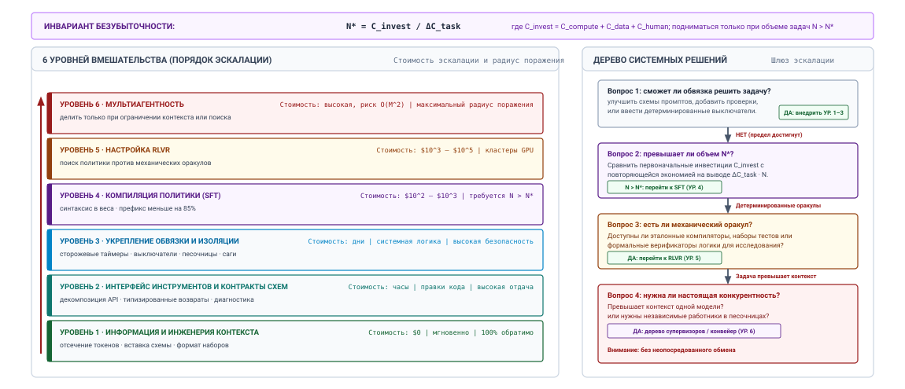
***Блок-схема решения о системном вмешательстве**: порядок архитектурной эскалации, который отдает приоритет недорогим обратимым изменениям обвязки перед необратимым дообучением весов и распределенными топологиями и регулируется законом экономической безубыточности $N^* = C_{\text{invest}} / \Delta C_{\text{task}}$.*

Как показано на рисунке [«Блок-схема решения о системном вмешательстве»](#fig-vol3-intervention-ladder-flowchart), архитектура решения структурирует устранение отказов в два взаимодополняющих представления. Левая панель задает шестиуровневую иерархию, упорядоченную по возрастанию капитальных затрат и радиуса поражения: от уровня 1 (нулевая стоимость, мгновенная и полностью обратимая гигиена контекста и промпта) через уровень 2 (контракты интерфейса инструментов) и уровень 3 (сторожевые таймеры обвязки времени выполнения и автоматические выключатели) до рассмотрения изменения весов на уровне 4 (дообучение с учителем) и уровне 5 (обучение с подкреплением по верифицируемым наградам) и, наконец, на уровне 6 (распределенные топологии нескольких агентов). Правая панель формализует дерево арбитража решений, которое оценивают системные инженеры. Когда укрепление обвязки (уровни 1–3) достигает своего эмпирического предела, вопрос 2 проверяет закон экономической безубыточности: только если прогнозируемый объем нагрузки $N$ превышает $N^* = C_{\text{invest}} / \Delta C_{\text{task}}$, команда поднимается до контролируемой адаптации весов. Если верификация задачи дополнительно предоставляет механические оракулы (компиляторы, верификаторы типов), вопрос 3 обосновывает исследование политики уровня 5; иначе, если состояние задачи выходит за физические пределы контекста, вопрос 4 открывает эскалацию к конвейерам нескольких агентов, одновременно явно предостерегая от неопосредованного обмена между равноправными агентами.

### Шесть ярусов системного вмешательства

Лестница вмешательства организует архитектурные адаптации в шесть отдельных ступеней, каждая из которых характеризуется локусом вмешательства, профилем эксплуатационных затрат и радиусом поверхности отказа. Движение вверх по лестнице переносит точку управления от кратковременного состояния среды выполнения к долговечным определениям артефактов, скомпилированным весам и распределенным топологиям процессов ([«Иерархия системных вмешательств»](#dfn-intervention-hierarchy)).

<a id="dfn-intervention-hierarchy"></a>

> **Иерархия системных вмешательств**
>
> ***Иерархия системных вмешательств*** — это упорядоченная последовательность решений $\text{Context} \prec \text{Tools} \prec \text{Harness} \prec \text{SFT} \prec \text{RLVR} \prec \text{Multi-Agent}$, которая управляет устранением дефектов производительности агента, строго отдавая приоритет недорогим обратимым изменениям обвязки перед дорогостоящей необратимой адаптацией весов и распределенными топологиями.
>
> 1.  **Значение**: предотвращает преждевременный переход инженерных команд к многомиллионному дообучению или сложным архитектурам нескольких агентов для устранения дефектов, вызванных неоднозначными схемами инструментов, захламленностью промпта или отсутствием защитных ограничений времени выполнения.
> 2.  **Отличие**: в отличие от общих рабочих процессов отладки программ, лестница вмешательства агентных систем явно регулирует переходы между программными слоями времени выполнения и адаптацией нейронных весов с помощью закона экономической безубыточности $N^* = C_{\text{invest}} / \Delta C_{\text{task}}$.
> 3.  **Типичная ошибка**: дообучение весов модели или развертывание роев нескольких агентов, чтобы замаскировать детерминированные дефекты интерфейса (например, плохо типизированные схемы JSON или неинформативные коды возврата ошибок), которые можно мгновенно и обратимо устранить на границе инструмента.

Количественные инженерные компромиссы по этим шести ярусам подробно описаны в таблице [«Компромиссы лестницы вмешательства»](#tbl-vol3-intervention-ladder-tradeoffs).

#### Уровень 1: инженерия контекста

Вмешательства уровня 1 работают строго в пределах переходного окна контекста модели и не требуют изменений внешних сервисов, обвязок времени выполнения или параметров модели. Отказы возможностей на этом уровне возникают потому, что модели не хватает критических фактов предметной области, она страдает от отвлечения внимания из-за лишних токенов или вынуждена выводить неявные требования к форматированию, которые никогда не определялись явно.

Устранение сосредоточено на гигиене рабочей памяти: отсечении нерелевантных результатов извлечения, выделении системных инструкций в отдельные сегменты промпта, которые максимизируют стоки внимания (attention sinks), и внедрении тесно связанных демонстрационных траекторий с малым числом примеров. Перестраивая контекст, системный инженер повышает апостериорную вероятность генерации корректных предложений действий без изменения программного обеспечения хоста и без вложения средств в конвейеры обучения. Поскольку вмешательства уровня 1 выполняются за минуты и могут сразу оцениваться на стендах интеграционных тестов, они составляют обязательную базовую линию любой последовательности сортировки.

#### Уровень 2: переработка интерфейса инструментов

Когда агент правильно воспринимает эксплуатационный контекст, но неизменно выдает некорректные аргументы действий, вызывает инструменты не в той последовательности или галлюцинирует параметры, неисправность обычно лежит в контракте интерфейса, а не во внутренней способности модели. Вмешательства уровня 2 изменяют синтаксические и семантические спецификации инструментов, предоставленных агенту.

Инженеры устраняют эти отказы, перерабатывая определения инструментов по классическим принципам системного проектирования:

1. *Синтаксическая дезагрегация:* декомпозиция разросшихся многоцелевых административных API на небольшие, ортогональные, однонаправленные конечные точки с минимальным набором аргументов.
2. *Сужение типов и перечислений:* замена свободных строковых параметров строгими перечислениями JSON Schema, ограниченными целыми числами и явными регулярными выражениями, которые применяются при маскировании логитов с грамматическими ограничениями.
3. *Информативные полезные нагрузки ошибок:* преобразование непрозрачных кодов возврата (например, `400 Bad Request` или `Process exited with code 1`) в структурно насыщенные диагностические строки, которые точно указывают, какой инвариант нарушен, в каком состоянии находится целевая среда и какое корректирующее действие ожидается.

```json
// Антипаттерн: непрозрачная системная ошибка
{"status": "error", "code": 1}

// Переработано: насыщенный диагностический возврат
{
  "status": "failed_precondition",
  "violation": "lockfile_out_of_date",
  "expected": "Run 'cargo update' first",
  "target_file": "/workspace/Cargo.lock"
}
```

*Рефакторинг уровня 2:* выдача структурированных, пригодных для действий полезных нагрузок ошибок прямо в кадр наблюдения позволяет агенту восстановиться внутри существующего авторегрессивного цикла, не вызывая вмешательства среды выполнения.

#### Уровень 3: укрепление обвязки времени выполнения

Когда схемы инструментов надежны, но агент все равно попадает в вырожденные авторегрессивные ловушки, такие как циклическое повторение запросов, семантический дрейф или игнорирование сообщений об ошибках инструментов, отказ должен смягчаться супервизором. Вмешательства уровня 3 изменяют обвязку хоста вокруг модели, не меняя саму модель.

На этом ярусе инженер вводит внешние детерминированные конечные машины, такие как семантические сторожевые таймеры и мониторы прогресса, описанные в разделе [«Синтез обвязки исполнения»](#sec-vol3-conclusion-execution). Защитные механизмы уровня 3 отслеживают метрику расхождения траектории $\mathcal{J}_t$, обнаруживают циклические шаблоны токенов по шагам исполнения, обеспечивают жесткие ресурсные бюджеты и вводят динамические системные прерывания (например, синтетические сообщения супервизора, вставленные прямо в следующий кадр контекста), которые заставляют модель признать необработанные исключения. Устанавливая определенные границы для сбоев исполнения, укрепление уровня 3 предотвращает неограниченную деградацию и гарантирует плавный переход к триажу с участием человека.

#### Уровень 4: адаптация с учителем (SFT)

Когда операционная жизнеспособность агентной системы ограничена накладными расходами промпта, хрупкостью инструкций или неспособностью базовой модели надежно следовать сложным структурным протоколам, несмотря на исправления уровней 1–3, инженер должен перейти к изменению весов параметров модели $\theta$. Дообучение с учителем уровня 4 адаптирует условное распределение токенов модели $P_\theta(a_t \mid s_t)$ с помощью подобранных демонстрационных траекторий.

SFT компилирует сложные инструкции промпта длиной в тысячи токенов, схемы инструментов и типичные поведения восстановления непосредственно в нейронные цепи модели. Это преобразование дает два различных системных выигрыша: оно существенно сокращает длину входных токенов $N_{\text{tokens}}$, необходимую для установления эксплуатационного контекста (снижая вычислительную задержку предзаполнения), и устраняет недетерминированные сбои соответствия при работе с проприетарными грамматическими форматами. Однако SFT несет существенные архитектурные компромиссы: он требует обширной конвейерной инфраструктуры для подготовки чистых и разнообразных наборов траекторий, создает риски катастрофического забывания для задач за пределами распределения дообучения и фиксирует среду выполнения в статичном снимке определений инструментов, который нельзя изменить без переобучения или ухудшения работы политики.

#### Уровень 5: обучение с подкреплением по верифицируемым наградам (RLVR)

Дообучение с учителем учит агента тому, *как выглядят корректные траектории*, но не может научить его *эффективно искать по комбинаторным пространствам задач*. Когда агенту нужно решить сложные многошаговые алгоритмические задачи, такие как генерация патча на уровне репозитория, верификация топологии аппаратуры или доказательство теорем, наборы демонстраций от человека разрежены, зашумлены и не способны уловить оптимальные стратегии возврата.

Вмешательства уровня 5 оптимизируют политику $\pi_\theta$ непосредственно против автоматизированных программных верификационных оракулов, используя методы градиента политики. В областях, где внешняя детерминированная тестовая обвязка может проверить, удовлетворяет ли кандидатное терминальное состояние агента формальным инвариантам корректности (например, прохождению компиляции, прохождению набора тестов или проверенному ограничению SAT), RLVR смещает распределение политики к устойчивому, самокорректирующемуся исследованию. Агент учится усваивать проверку внутри цепочки рассуждений, порождать разнообразные ветви гипотез и откатываться назад при получении от инструмента обратной связи о сбое. Требования к уровню 5 высоки: система должна располагать изолированной высокопроизводительной средой исполнения, способной параллельно оценивать миллионы траекторий, и функциями награды, которые нельзя обойти и которые препятствуют взлому наград (reward hacking).

#### Уровень 6: делегирование нескольким агентам

Вершина лестницы достигается тогда, когда физические границы одного контекста вывода полностью исчерпаны. Уровень 6 разбивает монолитную задачу на ансамбль разнородных слабо связанных процессов агентов, каждый из которых ведет собственное закрытое окно контекста, специализированную обвязку инструментов и изолированный жизненный цикл памяти.

Делегирование — не универсальная оптимизация, а архитектурная уступка жестким физическим ограничениям. Оно оправдано при трех точных эксплуатационных условиях:

1. *Исчерпание окна контекста:* авторитетные артефакты, промежуточные трассы рассуждений и наблюдения среды строго превышают физический предел контекста $L_{\max}$ или вызывают серьезное размывание внимания.
2. *Границы привилегий и изоляции:* подзадачи требуют различных распределений полномочий (например, изоляция недоверенного субагента, который исполняет код и не имеет сетевых полномочий, от административного субагента, обладающего учетными данными внешнего API).
3. *Асинхронное параллельное исследование:* пространство поиска можно разбить на независимые подзадачи, которые выполняются одновременно на нескольких движках вывода без синхронных зависимостей памяти.

Разбиение задачи между агентами превращает локальный цикл в распределенную систему, на критическом пути которой оказываются сериализация, сетевая задержка, частичные отказы и сверка, а агенты, разделяющие веса, разделяют и ошибки. По налогу на координацию (принцип «Налог на координацию») парк окупает эту стоимость только через три условия выше, которые сводятся к разбиению контекста, ослаблению полномочий и независимому исследованию. Поэтому делегирование находится на вершине лестницы как архитектурное последнее средство, а не как проектное умолчание.

| **Уровень**        | **Основной механизм**                         | **Срок инженерной работы** | **Первоначальные капитальные затраты** | **Прирост задержки на вызов**                       | **Поверхность восстановления после отказа** | **Основной системный риск**            |
|:-------------------|:----------------------------------------------|:----------------------|:-------------------------------------|:----------------------------------------------------|:--------------------------------------|:---------------------------------------|
| **1. Контекст**    | Настройка промпта, уточнение извлечения       | Часы                  | Пренебрежимо мало ($\sim \$0$)       | Нейтрально или снижение (если контекст урезан)      | Сброс контекста                       | Отвлечение контекста, внедрение промпта |
| **2. Инструменты** | Рефакторинг схем, типизация, насыщенные ошибки | Дни                   | Минимальные ($< \$10^2$)             | Нейтрально (разбор схемы за микросекунды)           | Ошибка валидации схемы                | Семантическое рассогласование импедансов |
| **3. Защитные механизмы** | Семантические сторожевые таймеры, автоматические выключатели | Дни | Низкие ($< \$10^3$) | $+10\text{--}50\text{ мс}$ (проверки обвязки) | Прерывание обвязки, повтор супервизора | Избыточное ограничение исследования |
| **4. SFT**         | Поведенческое клонирование на подобранных траекториях | Недели              | Умеренные ($\$10^3\text{--}\$10^4$)  | Снижение (более короткие промпты контекста)         | Откат при выходе за распределение     | Катастрофическое забывание, дрейф схем |
| **5. RLVR**        | Поиск политики против детерминированных верификаторов | Месяцы              | Высокие ($\$10^4\text{--}\$10^6$)    | Рост (более длинное декодирование самокоррекции)    | Откат к базовой контрольной точке     | Взлом наград, эксплуатация верификатора |
| **6. Мультиагентность** | Распределенное разбиение подзадач          | От недель до месяцев  | Высокие ($\$10^3\text{--}\$10^4$ инфраструктура) | Умножение ($2\times\text{--}10\times$ последовательных RPC) | Компенсация саги, повторное делегирование равным | Каскадная взаимная блокировка, коллапс консенсуса |

<a id="tbl-vol3-intervention-ladder-tradeoffs"></a>

***Компромиссы лестницы вмешательства**: матрица компромиссов лестницы системных вмешательств. По мере подъема по лестнице первоначальные невозвратные инженерные и вычислительные инвестиции возрастают на порядки, а вместе с ними растут площадь поверхности системы и эксплуатационная негибкость.*

---

### Динамика экономической амортизации

Решение о том, стоит ли подниматься от манипуляций с контекстом времени выполнения (уровни 1–3) к адаптации параметров (уровни 4–5) или к распределенной архитектуре исполнения (уровень 6), в конечном счете является упражнением в системной экономике. Первоначальные капитальные вложения в подготовку наборов данных, синтетическую инфраструктуру полигона (gym) и часы обучения на GPU должны амортизироваться по всему ожидаемому сроку эксплуатации агента.

Рассмотрим агентную нагрузку, оцениваемую по $N$ полным выполнениям задач. Базовая система, работающая на уровне 1 (инженерия промпта и демонстраций в контексте), требует обширных накладных расходов промпта: $T_{\text{base, in}}$ входных токенов и $T_{\text{base, out}}$ выходных токенов на шаг, при этом в среднем выполняется $H_{\text{base}}$ шагов траектории до выполнения контракта задачи. Совокупная эксплуатационная стоимость базовой системы на $N$ задач равна:

$$C_{\text{base}}(N) = N \cdot H_{\text{base}} \left( T_{\text{base, in}} \cdot p_{\text{in}} + T_{\text{base, out}} \cdot p_{\text{out}} \right)$$

где $p_{\text{in}}$ и $p_{\text{out}}$ — предельные цены за входной и выходной токен соответственно, которые берет сервис вывода модели.

Теперь рассмотрим эскалированное вмешательство уровня 4 (дообучение с учителем). Построение адаптированной модели влечет существенные невозвратные инженерные и учебные затраты, обозначаемые $C_{\text{invest}}$:

$$C_{\text{invest}} = C_{\text{compute}} + C_{\text{data}} + C_{\text{human}}$$

где $C_{\text{compute}}$ включает часы кластера GPU, необходимые для обновления параметров, $C_{\text{data}}$ — стоимость генерации синтетических траекторий, а $C_{\text{human}}$ учитывает экспертную разметку и инженерию оценки.

Однако поскольку дообученная модель внутренне усваивает определения инструментов, правила форматирования и процедурные инварианты непосредственно в своих весах, ее эксплуатационный след промпта резко сокращается: $T_{\text{adapt, in}} \ll T_{\text{base, in}}$. Кроме того, поскольку адаптированная политика делает меньше ошибочных исследовательских шагов, средняя длина ее траектории снижается: $H_{\text{adapt}} \le H_{\text{base}}$. Если предположить, что хостинг дообученной модели дает предельные стоимости токенов $p_{\text{in}}'$ и $p_{\text{out}}'$ (которые могут равняться $p_{\text{in}}, p_{\text{out}}$, если модель размещена на общей корпоративной инфраструктуре, или отличаться при выделенной пропускной способности), предельная стоимость задачи становится:

$$C_{\text{task, adapt}} = H_{\text{adapt}} \left( T_{\text{adapt, in}} \cdot p_{\text{in}}' + T_{\text{adapt, out}} \cdot p_{\text{out}}' \right)$$

Адаптированная система достигает экономической безубыточности относительно базовой при объеме задач $N^*$, выведенном из равенства:

$$C_{\text{base}}(N^*) = C_{\text{invest}} + N^* \cdot C_{\text{task, adapt}}$$

Решая относительно $N^*$, получаем каноническую формулу объема безубыточности ([«Объем безубыточности»](#eq-vol3-breakeven-volume)):

<a id="eq-vol3-breakeven-volume"></a>

$$N^* = \frac{C_{\text{invest}}}{C_{\text{task, base}} - C_{\text{task, adapt}}} = \frac{C_{\text{invest}}}{\Delta C_{\text{task}}}$$

<a id="nbk-18-break-even-weight-adaptation"></a>

> **Когда дообучение окупается**
>
> **Задача**: агент проверки кода обрабатывает непрерывный поток запросов на слияние. После исправлений контекста и инструментов ему все еще нужен длинный системный промпт с определениями инструментов и разобранными демонстрациями. Команда предлагает дообучить меньшую модель, чтобы та вобрала этот промпт. Окупается ли инвестиция за квартал при ожидаемом объеме?
>
> **Переменные** (иллюстративные значения сценария):
>
> - Базовая система: 12 000 входных токенов и 800 выходных токенов на шаг, пять шагов на задачу, по ценам модели переднего края из предыдущих глав: \$3 за миллион входных токенов и \$15 за миллион выходных токенов.
> - Адаптированная модель: 1 500 входных токенов и 800 выходных токенов на шаг, четыре шага на задачу, по \$1 за миллион входных токенов и \$4 за миллион выходных токенов.
> - Единовременная инвестиция: \$4 000 на данные, \$500 на вычисления для обучения и \$8 000 на оценку и проверку, поэтому $C_{\text{invest}}$ составляет \$12 500.
> - Ожидаемый объем: 20 000 запросов на слияние в месяц.
>
> **Расчет**: шаг базовой системы стоит \$0,048 вместе за вход и выход, поэтому $C_{\text{task, base}}$ составляет \$0,24. Шаг адаптированной системы стоит \$0,0047, поэтому $C_{\text{task, adapt}}$ составляет \$0,019. Экономия $\Delta C_{\text{task}}$ равна \$0,22 на задачу, а уравнение [«Объем безубыточности»](#eq-vol3-breakeven-volume) дает безубыточность примерно при 57 000 задачах. При 20 000 задач в месяц инвестиция окупается примерно за 2,8 месяца, то есть чуть меньше квартала.
>
> **Системный вывод**: запас невелик, и ответ зависит от величин, которыми управляет команда. Удвоение объема сокращает срок окупаемости вдвое, тогда как изменение определений инструментов, которое требует переобучения, сбрасывает его. Поэтому стабильность контракта задачи важна не меньше, чем экономия на одной задаче.

Третье решение — понимать, чего не может купить подъем. Как бы тщательно ни была дообучена или оптимизирована модель, она все равно сэмплирует из распределения с ненулевой поддержкой по каждому продолжению при любой конечной температуре $\tau$:

$$P(a_t = w_i \mid s_t) = \frac{\exp\left(z_i / \tau\right)}{\sum_j \exp\left(z_j / \tau\right)}$$

На горизонте из $H$ ходов вероятность того, что какой-либо ход нарушит инвариант, остается строго положительной:

$$P(\text{violation} \mid H) = 1 - \prod_{t=1}^{H} \left(1 - P_{\text{error}}(t)\right) > 0$$

Обучение снижает $P_{\text{error}}$ и никогда не доводит его до нуля. Поэтому обучение не может служить способом, которым система выполняет принцип замыкания инвариантов ([«Принцип замыкания инвариантов»](01_introduction.md#pri-invariant-closure)). Ограничения расходов, изоляции и необратимых действий остаются за средой выполнения на каждой ступени, а правильность задачи по-прежнему требует свидетельств, собранных при приемке. Лучшая модель уменьшает частоту срабатывания этих механизмов, но не позволяет системе их убрать.

Верхняя ступень несет собственное предупреждение. Разбиение неудачной задачи между агентами превращает локальный цикл в распределенную систему, на критическом пути которой оказываются сообщения, частичные отказы и сверка. По налогу на координацию (принцип «Налог на координацию») эта цена окупается только разбиением контекста, ослаблением полномочий или независимым исследованием. Когда один агент терпит неудачу из-за неоднозначности задачи, больше агентов унаследуют ту же неоднозначность и добавят к ней разногласия.

Если совокупный прогнозируемый объем задач за весь эксплуатационный жизненный цикл агента меньше $N^*$, эскалация к адаптации весов экономически нерациональна: инженерная организация тратит на построение и поддержку конвейера дообучения больше капитала, чем возвращает за счет экономии токенов. И наоборот, если $N \gg N^*$, каждая задача сверх $N^*$ приносит чистое расширение маржи и снижение задержки.

<a id="nbk-18-break-even-analysis"></a>

> **Анализ безубыточности адаптации весов**
>
> Корпоративное развертывание непрерывно обрабатывает запросы на слияние с помощью агента автоматической проверки кода и исправления ошибок.
>
> **Базовая архитектура (уровень 1 + уровень 3):**
> Чтобы надежно форматировать патчи и вызывать инструменты поиска по репозиторию, базовой модели нужен системный промпт с обширными определениями схем и тремя полными демонстрациями починки репозитория, в сумме $T_{\text{base, in}} = 12\,000$ входных токенов. За среднюю задачу из $H = 5$ шагов взаимодействия с инструментами агент выдает $T_{\text{base, out}} = 800$ выходных токенов на шаг. Коммерческий API вывода берет $p_{\text{in}} = \$2{,}50 \times 10^{-6}$ за токен и $p_{\text{out}} = \$10{,}00 \times 10^{-6}$ за токен.
> $$\begin{aligned}
> C_{\text{step, base}} &= (12\,000 \times \$2{,}50 \times 10^{-6}) + (800 \times \$10{,}00 \times 10^{-6}) \\
> &= \$0{,}030 + \$0{,}008 = \$0{,}038\text{ за шаг} \\
> C_{\text{task, base}} &= 5 \times \$0{,}038 = \$0{,}190\text{ за запрос на слияние}
> \end{aligned}$$
>
> **Усложненная архитектура (уровень 4, SFT):**
> Команда системной инженерии дообучает модель с открытыми весами, чтобы та усвоила интерфейсы инструментов и синтаксис генерации патчей.
> - Подготовка данных и синтетическая генерация: $C_{\text{data}} = \$4\,000$
> - Дообучение в облачном кластере GPU (8 $\times$ H100 SXM5 в течение 18 часов при $\$3{,}50/\text{GPU-ч}$): $C_{\text{compute}} = 8 \times 18 \times \$3{,}50 = \$504$
> - Инженерная валидация и красная команда (red-teaming): $C_{\text{human}} = \$8\,000$
> - Суммарная первоначальная инвестиция: $C_{\text{invest}} = \$4\,000 + \$504 + \$8\,000 = \$12\,504$
>
> Поскольку схемы инструментов скомпилированы в веса, накладные расходы промпта падают до $T_{\text{adapt, in}} = 1\,500$ входных токенов. Благодаря лучшему соответствию средняя длина траектории сокращается до $H_{\text{adapt}} = 4$ шагов при той же выдаче выходных токенов ($T_{\text{out}} = 800$). Собственный кластер вывода амортизируется до эквивалентной стоимости токенов $p_{\text{in}}' = \$1{,}00 \times 10^{-6}$ и $p_{\text{out}}' = \$4{,}00 \times 10^{-6}$.
> $$\begin{aligned}
> C_{\text{step, adapt}} &= (1\,500 \times \$1{,}00 \times 10^{-6}) + (800 \times \$4{,}00 \times 10^{-6}) \\
> &= \$0{,}0015 + \$0{,}0032 = \$0{,}0047\text{ за шаг} \\
> C_{\text{task, adapt}} &= 4 \times \$0{,}0047 = \$0{,}0188\text{ за запрос на слияние}
> \end{aligned}$$
>
> **Оценка безубыточности:**
> $$\begin{aligned}
> \Delta C_{\text{task}} &= \$0{,}190 - \$0{,}0188 = \$0{,}1712\text{ экономии за задачу} \\
> N^* &= \frac{\$12\,504}{\$0{,}1712} \approx 73\,038\text{ запроса на слияние}
> \end{aligned}$$
>
> *Системный вывод:* если предприятие обрабатывает 20 000 запросов на слияние в месяц, первоначальная инвестиция в дообучение окупается примерно за 3,65 месяца. Сверх этого объема запросов организация экономит более \$3 400 ежемесячно и одновременно сокращает сквозную задержку выполнения задачи на 62 % из-за резко сниженного объема вычислений GEMM предзаполнения на входных токенах.

---

### Архитектурные компромиссы

Инженерная дисциплина, воплощенная в лестнице вмешательства, применяет сквозной аргумент так, как его разделил раздел [«Двойные гарантии сквозной границы»](01_introduction.md#sec-vol3-intro-end-to-end-boundary): механическое замыкание под моделью и свидетельства над ней, и так, как его оценил раздел [«Оценка выбора архитектуры»](17_agent_economics.md#sec-vol3-agent-economics-selection) главы [«Экономика агентов»](17_agent_economics.md#sec-vol3-agent-economics). В агентной архитектуре функции, размещенные на нижних слоях стека, могут оказаться избыточными или неэффективными по сравнению с их реализацией на супервизорных конечных точках.

В контексте агентных систем машинного обучения попытка решить надежность выполнения исключительно через адаптацию весов (уровни 4 и 5) допускает обратную сквозную ошибку: пытаться заставить подсистему нижнего уровня (статистический предиктор токенов) гарантировать сквозной инвариант приложения, который могут проверить и обеспечить только супервизорные конечные точки. Нейронная модель, сколько бы ее ни дообучали с учителем или с подкреплением, остается непривилегированным недетерминированным генератором токенов, которым управляют масштабирование температуры и вероятности softmax:

$$P(a_t = w_i \mid s_t) = \frac{\exp\left(z_i / \tau\right)}{\sum_j \exp\left(z_j / \tau\right)}$$

Поскольку распределение softmax имеет ненулевую поддержку по всему словарю при любой конечной температуре $\tau > 0$, вероятность выдать недопустимую последовательность токенов или нарушить инвариант безопасности на траектории из $H$ ходов остается строго ненулевой:

$$P(\text{violation} \mid H) = 1 - \prod_{t=1}^{H} \left(1 - P_{\text{error}}(t)\right) > 0$$

Никакая оптимизация градиентом политики не может довести $P(\text{violation})$ до абсолютного нуля на бесконечном эксплуатационном горизонте. Поэтому полагаться на дообученные веса, чтобы гарантировать, что агент никогда не удалит таблицы базы данных и не обойдет проверки безопасности, фундаментально ошибочно. Обучение, следовательно, не может быть способом, которым система выполняет принцип замыкания инвариантов ([«Принцип замыкания инвариантов»](01_introduction.md#pri-invariant-closure)). Ее ограниченные свойства безопасности, ресурсов и изоляции должны замыкаться механически: защитными механизмами времени выполнения уровня 3, границами полномочий, которые оставляют модели нулевые неявные полномочия, и декодированием с грамматическими ограничениями в обвязке хоста. А правильность задачи по-прежнему требует свидетельств, собранных на конечной точке.

Точно так же порыв развернуть рои агентов уровня 6 часто нарушает классическое правило инженерии программного обеспечения, сформулированное Фредериком П. Бруксом-младшим (Brooks, 1987): *никогда не принимать случайную сложность за существенную*. Когда одноагентная система не сходится, отказ часто отражает случайную сложность, вызванную плохой гигиеной рабочей памяти, шумными журналами извлечения или неоднозначной документацией инструментов. Дробление такой плохо заданной задачи между несколькими автономными агентами не устраняет исходной неоднозначности; оно усугубляет проблему, добавляя накладные расходы распределенного консенсуса, расхождение состояний и каскадные режимы отказа.

Прежде чем инженер систем разрешит эскалировать отказавший агентный конвейер на более высокие ярусы вмешательства, режим отказа должен пройти через формальный протокол триажа, описанный в листинге [«Логика триажа лестницы системных вмешательств»](#lst-vol3-ladder-triage).

<a id="lst-vol3-ladder-triage"></a>

**Логика триажа лестницы системных вмешательств**: эскалация допускается только тогда, когда устранение на более низком ярусе физически не может разрешить отказ.

```python
def evaluate_intervention_level(failure_trace, current_level):
    """
    Оценивает, оправдывает ли сбой возможности агента эскалацию по лестнице.
    Обеспечивает инварианты сквозного аргумента (Saltzer–Clark) и простоты в духе Брукса.
    """
    if failure_trace.is_missing_domain_fact or failure_trace.has_context_distraction:
        return InterventionTier.LEVEL_1_CONTEXT_ENGINEERING

    if failure_trace.violates_tool_schema or failure_trace.uninformative_error_return:
        return InterventionTier.LEVEL_2_TOOL_SCHEMA_REDESIGN

    if failure_trace.is_cyclic_loop or failure_trace.exceeded_safety_boundary:
        return InterventionTier.LEVEL_3_RUNTIME_HARNESS_GUARD

    if failure_trace.prompt_token_budget_exhausted and failure_trace.stable_task_contract:
        return InterventionTier.LEVEL_4_SUPERVISED_ADAPTATION

    if failure_trace.verifiable_oracle_available and failure_trace.combinatorial_search:
        return InterventionTier.LEVEL_5_REINFORCEMENT_LEARNING

    if failure_trace.physical_context_exceeded or failure_trace.requires_privilege_isolation:
        return InterventionTier.LEVEL_6_MULTI_AGENT_DELEGATION

    raise UnjustifiedEscalationError("Failure remediable at current or lower tier.")
```

Главная цель системного инженера — довести эксплуатационную оболочку агента до полной надежности на самом нижнем возможном ярусе лестницы вмешательств. Удерживая точку вмешательства близко к границам контекста и времени выполнения, система сохраняет максимальную гибкость, минимизирует накладные расходы инфраструктуры и токенов и поддерживает ясный аудиторский след.

Однако, как только вмешательство выбрано, спроектировано и синтезировано в среду выполнения агента, будь то укрепленные семантические защитные механизмы уровня 3, дистиллированная модель с открытыми весами уровня 4 или топология делегированного исполнения уровня 6, инженерная команда сталкивается с последним барьером выпуска: доказать, что получившаяся автономная машина безопасна, надежна и устойчива к катастрофическим регрессиям до того, как ее запустят в производство. Для этого нужно построить формальные эмпирические обоснования безопасности.

<a id="sec-vol3-conclusion-safety"></a>

## Эмпирические обоснования безопасности

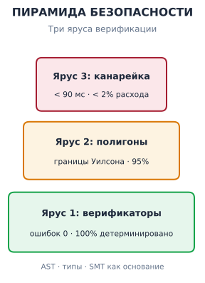

*Обоснования безопасности опираются на субмиллисекундные механические доказательства под статистическими границами полигона и телеметрией канарейки.*

Производственный выпуск в полной мере сталкивается с потолком надежности разомкнутого контура из раздела [«Растяжение времени: от наносекундных операций до килосекундных траекторий»](01_introduction.md#sec-vol3-intro-temporal-stretching). При надежности 99 процентов на шаг траектория из 100 вызовов инструментов проходит без единого отклонения лишь примерно в 37 процентах случаев, а в критически важной среде выполнения, например при автоматической миграции базы данных, оркестрации распределенного кластера или сверке финансовых регистров, частота отказов около двух из трех недопустима. Поскольку отказы носят характер правдоподобных (fail-plausible, [«Модель правдоподобного отказа»](01_introduction.md#sec-vol3-intro-fail-plausible)), это редко бывают чистые падения; они проявляются как правдоподобные, синтаксически корректные, но семантически разрушительные операции: удаление внешних ключей производственной базы, выделение неограниченных вычислительных экземпляров или утечка чувствительных учетных данных клиентов в буферы наблюдения третьих сторон.

**Выпуск автономного агента в производство требует защищаемого многоярусного обоснования безопасности, которое сочетает детерминированные механические верификаторы, статистическую оценку на отложенных полигонах и телеметрию канареек.** Вместо того чтобы полагаться на самоанализ модели или на доли прохождения эталонных тестов в разомкнутом контуре, надежная системная инженерия требует основанной на свидетельствах системы гарантий, которая рассматривает нейронную модель как недоверенный стохастический компонент, заключенный в непреклонную детерминированную супервизорную обвязку.

### Система «утверждения — аргументы — свидетельства»

Заимствуя строгие методики обеспечения безопасности из авиастроения и ядерной энергетики, автономного агента нельзя сертифицировать для производственного развертывания на основании интуитивной уверенности или эмпирических ощущений. Требуется формальное *обоснование безопасности* (safety case): структурированное, поддающееся аудиту рассуждение, которое показывает, что система выполняет свои эксплуатационные инварианты в пределах заданной оболочки развертывания. Обоснование безопасности раскладывается на трехчастную иерархию: утверждения, аргументы и свидетельства.

*Утверждения* — это точные, проверяемые положения, которые утверждают, что среда выполнения агента сохраняет определенные инварианты безопасности и корректности во всех достижимых состояниях. Утверждение должно быть однозначно опровержимым. Вместо расплывчатых формулировок вроде «агент ведет себя ответственно» системная инженерия требует конкретных инвариантов. Утверждение 1 может звучать так: «процесс агента не может менять производственные схемы базы данных без криптографического двойного разрешения»; утверждение 2: «обвязка исполнения агента никогда не выпускает незашифрованные сетевые пакеты за пределы приватной подсети VPC»; а утверждение 3: «никакая последовательность вызовов инструментов не может израсходовать больше $B_{\max}$ единиц облачного вычислительного бюджета в скользящем окне 60 минут».

*Аргументы* дают причинное архитектурное обоснование, объясняющее, *почему* проект системы гарантирует, что данное утверждение выполняется. Аргумент связывает абстрактный инвариант с физической реализацией. Для утверждения 1 аргумент показывает, что модель не имеет неявных полномочий и прямых дескрипторов базы данных, что кандидатные SQL-выражения удерживаются в изолированном эскроу памяти, а конечная точка RPC миграции схемы требует подписи на аппаратной основе, которую контекст выполнения модели не может синтезировать.

*Свидетельства* показывают, что механизмы, лежащие в основе аргументов, на практике работают корректно. Поскольку собственные отчеты не имеют доказательного веса ([«Уровни свидетельств замыкания»](01_introduction.md#sec-vol3-intro-closure-evidence)), годными свидетельствами являются исключительно артефакты, проверенные машиной: диагностика компилятора, дампы AST статического анализа, сертификаты выполнимости SMT-решателя, журналы эталонных тестов в герметичной среде и криптографически подписанные аудиторские следы.

<a id="fig-vol3-safety-case-pyramid"></a>

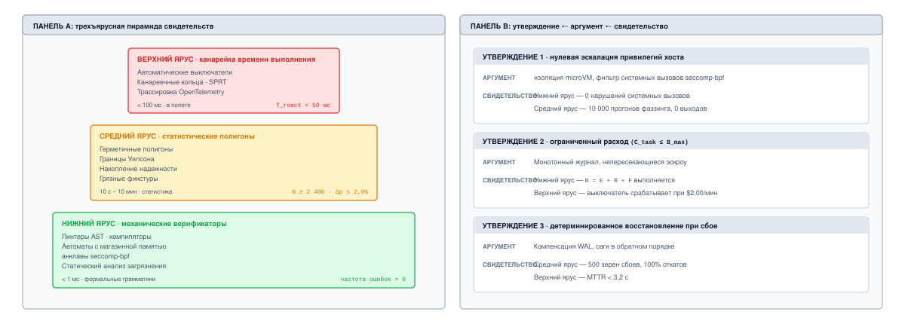
***Многоярусная пирамида верификации и архитектура обоснования**: формальная структура гарантий, которая опирает высокоуровневые утверждения о безопасности на причинные механистические аргументы, подкрепленные тремя последовательными ярусами свидетельств: детерминированными механическими верификаторами, статистическими полигонами оценки в песочнице и телеметрией канареек времени выполнения.*

Формально шлюз выпуска в производство проверяет каждое утверждение обоснования безопасности. Для каждого утверждения $k$ должен существовать архитектурный аргумент $\text{arg}_k$, подкрепленный набором свидетельств $\text{ev}_k$, такой что:

$$\forall k, \quad \text{Verify}(\text{claim}_k, \text{arg}_k, \text{ev}_k) = \text{PASS}$$

Если какой-либо артефакт свидетельств не проходит проверку, например линтер AST сообщает о синтаксическом нарушении или журнал выхода в сеть показывает неаутентифицированное соединение сокета, обоснование безопасности аннулируется, шлюз выпуска срабатывает, а развертывание агента блокируется на границе конвейера.

<a id="dfn-three-tier-verification-pyramid"></a>

> **Трехъярусная пирамида верификации**
>
> Архитектурная система гарантий, которая обосновывает готовность агента к производству тремя последовательными ярусами проверки: ярус 1 — детерминированные механические верификаторы (синхронные линтеры AST, автоматы с магазинной памятью для грамматики и статические верификаторы типов); ярус 2 — статистическая оценка на полигоне (офлайн-бенчмаркинг на тысячах изолированных воспроизводимых тестовых фикстур, оцениваемых по границам доверительного интервала Уилсона); и ярус 3 — сдерживание канарейки времени выполнения (живое развертывание в производстве внутри изолированных microVM, управляемое автоматическими выключателями SRE и измерителями расхода бюджета ошибок).

Обоснование безопасности имеет три слоя. *Утверждение* — это опровержимое высказывание о работающей системе, например «агент не может изменить производственную схему без подписанного одобрения». *Аргумент* объясняет, почему архитектура делает утверждение истинным, называя механизм и подсистему, которая им владеет. *Свидетельство* показывает, что механизм работает на практике. Поскольку собственный отчет агента не имеет доказательного веса ([«Уровни свидетельств замыкания»](01_introduction.md#sec-vol3-intro-closure-evidence)), свидетельства — это артефакты, которые произвела среда выполнения или независимая обвязка: результаты проверок, журналы тестов, трассы и подписанные одобрения. Таблица [«Обоснование безопасности в трех утверждениях»](#tbl-vol3-safety-case) проводит три утверждения через три слоя.

| **Утверждение**                                           | **Аргумент (механизм и владелец)**                                                                                    | **Свидетельство**                                                                  |
|:----------------------------------------------------------|:----------------------------------------------------------------------------------------------------------------------|:-----------------------------------------------------------------------------------|
| **Никакого изменения производственной схемы без подписанного одобрения** | Инструменты, меняющие схему, требуют одобрения, которое модель не может создать ([«Обвязка агента»](09_agent_harness.md#sec-vol3-agent-harness)) | Записи одобрений, связанные с каждым изменением схемы в трассе                     |
| **Расход на задачу остается в пределах ее бюджета**       | Вложенные бюджеты, обеспечиваемые вне модели ([«Обвязка агента»](09_agent_harness.md#sec-vol3-agent-harness); [«Экономика агентов»](17_agent_economics.md))                        | Тесты исчерпания бюджета; распределение расходов из канарейки                      |
| **Сбой посреди задачи никогда не дублирует и не теряет эффект** | Намерение до действия, урегулирование до повтора, компенсация ([«Долговечное выполнение»](10_durable_execution.md#sec-vol3-durable-execution), [«Восстановление после сбоев»](11_failure_recovery.md#sec-vol3-failure-recovery)) | Прогоны с внедрением сбоев и точками падения на каждом шаге, сверенные с внешним миром |

<a id="tbl-vol3-safety-case"></a>

***Обоснование безопасности в трех утверждениях**: каждое утверждение опровержимо, каждый аргумент называет механизм и его владельца, а каждое свидетельство — артефакт, который агент не мог бы создать, просто сообщив об успехе.*

### Трехъярусная пирамида верификации

Чтобы подкрепить обоснование безопасности, не накладывая на каждый интерактивный шаг бесконечной задержки верификации, среда выполнения организует свои эмпирические свидетельства в трехъярусную пирамиду верификации ([«Многоярусная пирамида верификации и архитектура обоснования»](#fig-vol3-safety-case-pyramid)). Как подробно описано на панели A рисунка [«Многоярусная пирамида верификации и архитектура обоснования»](#fig-vol3-safety-case-pyramid), пирамида свидетельств задает иерархическую эшелонированную защиту: базовый ярус синхронно перехватывает более 95 процентов недопустимых переходов с помощью механических верификаторов с нулевой терпимостью (линтеры AST, автоматы с магазинной памятью на этапе декодирования и статические анализаторы загрязнения с задержкой $< 1\text{ мс}$); средний ярус оценивает статистическую устойчивость траекторий на тысячах герметичных фикстур полигона ($N \ge 2\,400$, ограничивая погрешность величиной $\Delta p \le 2{,}0\%$ при доверительных интервалах Уилсона 95 процентов); а верхний ярус охраняет живое производство через асинхронные канареечные кольца и трассировку OpenTelemetry (реагируя на аномальные скорости расходования за $T_{\text{react}} < 50\text{ мс}$). На панели B эти эмпирические ярусы напрямую отображаются в формальные обоснования безопасности: утверждение 1 (нулевое повышение привилегий хоста) доказывается аргументами изоляции microVM, подкрепленными статическим аудитом seccomp и фаззингом побегов; утверждение 2 (ограниченный финансовый расход) обеспечивается монотонными эскроу расходов; а утверждение 3 (детерминированное восстановление после сбоев) сертифицируется журналами компенсаций WAL и тестами воспроизведения с внедрением сбоев. Каждый ярус работает на своей пространственной и временной границе, обменивая абсолютные формальные гарантии на реализм среды.

**Логика Хоара в агентных средах выполнения:** следуя К. А. Р. Хоару (1969), каждый вызов инструмента ограничен предусловием $P$ и постусловием $Q$. В агентных средах выполнения механические верификаторы яруса 1 обеспечивают, что если состояние $s_t$ удовлетворяет $P$, то действие $a_t$ разрешено, только если статический анализ гарантирует, что постусловие $Q$ не нарушит оболочку безопасности $\mathcal{S}_{\max}$.

#### Ярус 1: детерминированная механическая верификация

Основание пирамиды составляют детерминированные проверки программного обеспечения с нулевой терпимостью, выполняемые локально внутри супервизора хоста до того, как какое-либо предложение действия коснется внешней среды. Верификаторы яруса 1 работают синхронно над кандидатными выдачами модели. Им не нужны вычисления GPU, и они вносят пренебрежимо малую задержку ($\le 5\text{ мс}$).

1. **Разбор AST и грамматики:** кандидатные вызовы инструментов в структурированных форматах обмена (например, JSON или Protobuf) проверяются по строгим контекстно-свободным грамматикам. Если авторегрессивное декодирование порождает неразбираемую последовательность токенов, некорректные управляющие токены или нераспознанные ключи схемы, кандидатный кадр сразу отбрасывается на границе парсера.
2. **Проверка типов и статический анализ:** аргументы инструментов, которые представляют изменения кода (например, диффы Python или SQL-патчи), подаются в конвейеры статического анализа до постановки. В агенте генерации кода кандидатные изменения должны пройти проверку типов, специфичную для языка (например, `mypy` или `rustc`), и линтеры безопасности (например, проверку на непараметризованные SQL-запросы или опасные экранирования оболочки) в эскроу памяти.
3. **Формальные верификаторы инвариантов:** там, где границы безопасности касаются числовых выделений или временной последовательности, кандидатные планы кодируются как ограничения выполнимости по модулю теорий (SMT) и решаются движками вроде Z3. Если предложенный эксплуатационный план нарушает порядок контроля доступа или превышает пороги выделенного бюджета, SMT-решатель возвращает `UNSAT`, и исполнение прекращается до отправки какого-либо сетевого пакета.

Поскольку ярус 1 полностью детерминирован, его режим отказа бинарен: любое нарушение останавливает траекторию или вынуждает немедленное локальное перепланирование. На этой границе статистическая неопределенность не допускается.

#### Ярус 2: герметичная оценка на полигоне

Если ярус 1 гарантирует, что действие не нарушает статические ограничения синтаксиса или безопасности, он не может определить, успешно ли агент выполнит многошаговую цель или попадет в поведенческие циклы. Ярус 2 оценивает динамическую политику агента $\pi_\theta$ на большом наборе герметичных воспроизводимых симуляционных сред («полигонов»).

**Статистические шлюзы выпуска:** как установлено в разделе [«Оценка агентов»](12_evaluation.md#sec-vol3-evaluation), точечные оценки доли успешных выполнений агента статистически бессмысленны без доверительных границ. Критерии выпуска нужно формулировать по нижней границе двустороннего интервала оценки Уилсона при уровне доверия $1 - \alpha$.

Герметичный полигон дает полностью изолированную реплику целевой эксплуатационной среды со снимком изоляции: эфемерные базы данных, синтетические конечные точки API, имитационные файловые системы и симуляторы детерминированной сетевой задержки. Кандидатный агент выполняется на $N$ независимых случайных тестовых фикстурах, которые представляют как номинальные сценарии, так и состязательные граничные случаи (например, разрывы сети, поврежденные входные схемы и наблюдения инструментов, провоцирующие галлюцинации).

Оценка на ярусе 2 дает статистические доли прохождения. Чтобы гарантировать, что контрольная точка модели или конфигурация промпта не вносит тонких регрессий, системные инженеры устанавливают строгие статистические критерии выпуска, основанные на нижней границе доверительного интервала Уилсона $\hat{p}_{\text{lower}}$:

$$\hat{p}_{\text{lower}} \ge \Theta_{\text{target}}$$

Если агенту требуется эмпирическая доля успешных задач $95\%$ с достоверностью $99\%$ ($\alpha = 0{,}01$), а тестирование на $N = 500$ отложенных фикстурах дает 480 успешных выполнений, эмпирическая доля прохождения равна $\hat{p} = 0{,}960$. Вычисление нижней границы Уилсона дает $\hat{p}_{\text{lower}} \approx 0{,}934$. Поскольку $0{,}934 < 0{,}950$, кандидатный выпуск не проходит шлюз яруса 2, и инженерной команде приходится расширять корпус тестов или укреплять политику до продвижения в производство.

#### Ярус 3: канареечное сдерживание времени выполнения

Никакой офлайн-набор бенчмарков, каким бы обширным он ни был, не охватывает полной энтропии живых производственных сред. Поэтому вершина пирамиды верификации обеспечивает непрерывное динамическое сдерживание и шлюзование по живой телеметрии во время канареечных выкаток.

| **Этап сдерживания** | **Подсистемная основа**           | **Эксплуатационный инвариант и граничное управление** | **Сигнал телеметрии**                            | **Реакция отказоустойчивости**                     |
|:---------------------|:----------------------------------|:-------------------------------------------------------------|:-------------------------------------------------|:---------------------------------------------------|
| **Маршрутизация трафика** | Динамический L7-прокси входа  | Взвешенное распределение трафика ($\rho \approx 0{,}02$)       | Скорость входа в реальном времени и распределение запросов | Мгновенный слив трафика на стабильный парк (v1.4) |
| **Песочница времени выполнения** | Непривилегированная microVM (gVisor/KVM) | Нулевые неявные полномочия; квоты памяти и CPU | Задержка запуска контейнера и нагрузка на память | Немедленная заморозка песочницы и дамп памяти ядра |
| **Фильтр системных вызовов** | Строгий перехватчик `seccomp-bpf` | Диспетчеризация системных вызовов только по белому списку; блокирует `ptrace` и сырые сокеты | Счетчики перехваченных нарушений                 | Асинхронная ловушка ядра; завершение процесса      |
| **Предохранитель безопасности** | Монитор бюджета ошибок SRE | Скорость расходования бюджета ошибок $< 2\times$ базового порога | Всплески повторов инструментов, хвост задержки $P_{99}$ | Автоматическое срабатывание автоматического выключателя; мгновенный откат |

<a id="tbl-vol3-canary-containment-architecture"></a>

***Меры сдерживания канарейки**: спецификации подсистем сдерживания канарейки яруса 3 и средства принуждения.*

Когда кандидатная конфигурация агента проходит ярусы 1 и 2, ее развертывают в минимальной канареечной когорте, которая обрабатывает крошечную долю производственного трафика (например, от $1\%$ до $5\%$). Как формализовано в таблице [«Меры сдерживания канарейки»](#tbl-vol3-canary-containment-architecture), ярус 3 заключает живого агента внутри трех необсуждаемых механизмов сдерживания:

1. **Изоляция microVM и ловушки системных вызовов:** как разобрано в разделе [«Песочницы агентов»](08_sandboxes.md#sec-vol3-sandboxes), среда выполнения агента работает внутри непривилегированной microVM (например, Firecracker) или песочницы с ядром пользовательского пространства (например, gVisor). Ограничительный фильтр `seccomp-bpf` перехватывает и журналирует все системные вызовы. Любой неавторизованный системный вызов (например, попытка вызвать `ptrace` или привязаться к неодобренному сетевому интерфейсу) немедленно запускает асинхронную ловушку ядра, замораживая образ контейнера для криминалистического анализа.
2. **Теневое исполнение и сухие прогоны только для чтения:** там, где это допускает эксплуатационная семантика, агент-канарейка работает в *теневом режиме*: он получает реальные производственные наблюдения и вычисляет кандидатные действия, но все вызовы инструментов, меняющие состояние, перенаправляются на уровень имитационного исполнения или оцениваются как сухие прогоны. Теневые выходы асинхронно сравниваются с действиями, предпринятыми стабильной производственной системой.
3. **Автоматические выключатели отката:** заимствуя принципы инженерии надежности сайтов (Site Reliability Engineering; Beyer et al., 2016), состояние канарейки регулируется скоростями расходования бюджета ошибок. Супервизор времени выполнения непрерывно передает метрики телеметрии, такие как частота повторов инструментов, частота исключений схем, неожиданные вмешательства человека и распределения задержек. Если краткосрочная скорость расходования ошибок канареечной когорты превышает пределы безопасности, автоматический выключатель срабатывает, отсекая входящий трафик канарейки и возвращая все состояние маршрутизации к стабильной базе в течение нескольких секунд.

Таблица [«Сравнение пирамиды верификации»](#tbl-verification-pyramid) сопоставляет эксплуатационные профили трех ярусов верификации.

| **Измерение**              | **Ярус 1: механическая верификация** | **Ярус 2: герметичная оценка на полигоне** | **Ярус 3: сдерживание времени выполнения** |
|:---------------------------|:-------------------------------------|:-------------------------------------------|:-------------------------------------------|
| **Граница исполнения**     | Синхронный супервизор хоста          | Офлайн-конвейер CI/CD                      | Живая производственная инфраструктура      |
| **Профиль задержки**       | От субмиллисекунд до $5\text{ мс}$   | От часов до суток ($N \ge 10^3$ запусков)  | Непрерывный (телеметрия в реальном времени) |
| **Детерминированность**    | Абсолютная ($100\%$ детерминированность) | Статистическая (стохастическое сэмплирование) | Эмпирическая, ограниченно недетерминированная |
| **Основное действие при отказе** | Перехват токена, прерывание, перепланирование | Блокировка шлюза выпуска сборки | Срабатывание автоматического выключателя, автооткат |
| **Артефакт верификации**   | Дампы AST, проверки типов, журналы SMT | Доверительные интервалы Уилсона, журналы   | Аудиторские следы системных вызовов, SLO бюджета ошибок |

<a id="tbl-verification-pyramid"></a>

***Сравнение пирамиды верификации**: эксплуатационное сопоставление трехъярусной пирамиды верификации.*

<a id="nbk-18-canary-cohorts-error-budget"></a>

> **Расчет канареечных когорт и истощения бюджета ошибок**
>
> Крупный корпоративный парк агентов выполняет $100\,000$ автоматизированных административных рабочих процессов в день. Целевой уровень обслуживания (SLO) гарантирует, что $99{,}9\%$ всех траекторий рабочих процессов завершаются без нарушений безопасности и без вмешательства человека, что соответствует допустимому 30-дневному бюджету ошибок:
>
> $$E_{\text{budget}} = 30 \times 100\,000 \times (1 - 0{,}999) = 3\,000 \text{ допустимых сбоев траекторий}$$
>
> Команда системы развертывает новую дообученную контрольную точку политики $\pi_{\theta_{\text{new}}}$ в канареечную когорту, которая обрабатывает долю трафика $f_c = 0{,}02$ ($2\,000$ рабочих процессов в день). Операторы не знают, что тонкая регрессия выравнивания приводит к тому, что $\pi_{\theta_{\text{new}}}$ проваливает $5\%$ реальных траекторий (частота отказов $p_f = 0{,}05$). Механизм телеметрии настроен так, чтобы запускать автоматический выключатель отката, если канарейка расходует более $2\%$ общего 30-дневного бюджета ошибок парка.
>
> Мы вычисляем физическую задержку обнаружения и совокупное воздействие отказов до того, как система остановит выкатку:
>
> 1. **Выделенный запас отказов канарейки:**
>    $$F_{\text{limit}} = 0{,}02 \times E_{\text{budget}} = 0{,}02 \times 3\,000 = 60 \text{ отказов}$$
>
> 2. **Ожидаемые ежедневные отказы канарейки:**
>    $$\mathbb{E}[\text{Отказов/день}] = 2\,000 \times p_f = 2\,000 \times 0{,}05 = 100 \text{ отказов/день}$$
>
> 3. **Время до срабатывания автоматического выключателя ($T_{\text{trip}}$):**
>    $$T_{\text{trip}} = \frac{F_{\text{limit}}}{\mathbb{E}[\text{Отказов/день}]} = \frac{60}{100} \text{ дня} = 0{,}60 \text{ дня} \approx 14{,}4 \text{ ч}$$
>
> 4. **Сдерживание радиуса поражения:**
>    За 14,4 часа исполнения ровно 60 отказов происходят до того, как канарейка будет автоматически отсечена и слита. Если бы эта политика была выпущена напрямую на весь парк ($f_c = 1{,}0$), система породила бы:
>    $$\text{Отказов}_{\text{без сдерживания}} = 100\,000 \times 0{,}05 \times 0{,}60 = 3\,000 \text{ отказов}$$
>    Многоярусный шлюз канарейки успешно ограничивает подверженность отказам $2\%$ общего бюджета ошибок, предотвращая катастрофическое истощение буфера эксплуатационной надежности парка.

### Минимизация радиуса поражения

Даже при полноценной многоярусной верификации никакая программная архитектура не может снизить остаточную вероятность отказа недетерминированной политики до абсолютного нуля ($\epsilon_{\text{res}} > 0$). Поэтому системная инженерия требует проектировать агентную архитектуру с нуля для *плавного отказа* и *сдерживания радиуса поражения*. Если непредотвращенный отказ модели проникает через ярусы 1 и 2, инфраструктура хоста должна гарантировать, что ущерб строго ограничен по объему, длительности и полномочиям.

Для структурного сдерживания среда выполнения агента применяет принцип эфемерных наименьших привилегий. Все подключения к базам данных, дескрипторы файлов и токены облачных API, которые получает песочница, — это временные учетные данные, создаваемые динамически с явным временем жизни (например, $TTL \le 120\text{ с}$). Учетные данные криптографически ограничены точными идентификаторами ресурсов, перечисленными в активном контракте задачи. Если неуправляемый цикл декодирования заставит агента попытаться выполнить действие за пределами назначенного рабочего пространства, ядро хоста или сетевая сервисная сетка отвергнут запрос с ошибкой авторизации.

Кроме того, изменения состояния, охватывающие несколько микросервисов, нельзя выполнять как слепые операции без обратной связи. Среда выполнения применяет шаблон саги (подробно описан в разделе [«Восстановление после сбоев»](11_failure_recovery.md#sec-vol3-failure-recovery)): каждое прямое изменяющее действие $a_t$, зарегистрированное в журнале упреждающей записи (WAL), должно быть связано с исполняемой компенсирующей транзакцией $a_t^{-1}$. Если эксплуатационный инвариант срабатывает на шаге $t+k$, супервизор останавливает исполнение, подавляет дальнейшее декодирование модели и обходит журнал в обратном порядке, выполняя компенсации, чтобы вернуть среду к известному согласованному базовому состоянию $s_0$.

Наконец, архитектура задает формальные *пути операционной эскалации*. Когда неопределенность оценки кандидатного действия превышает границу безопасности или когда вызов инструмента влечет необратимый физический эффект (например, удаление долговечных резервных копий или публикацию внешних сообщений), супервизор не должен гадать. Вместо этого среда выполнения приостанавливает поток исполнения, записывает весь свой обдумывающий контекст и снимок состояния в долговечное хранилище и передает действие в асинхронную очередь одобрения с участием человека (Human-in-the-Loop, HITL). Оператору-человеку представляют явное утверждение, каузальное обоснование модели и точный детерминированный дифф. Только после криптографического подтверждения уполномоченным человеком супервизор освобождает действие из эскроу и фиксирует переход состояния.

Размышляя о возможностях агентной системы, какие вневременные принципы инженерии программного обеспечения определяют то, что ИИ может и чего не может решить? Архитектура обоснований безопасности, механических верификаторов и песочничных сред выполнения подчеркивает глубокий факт: автоматизация генерации кода и действий не устраняет интеллектуальной нагрузки инженерии программного обеспечения. Чтобы понять фундаментальные пределы агентного делегирования, нужно вернуться к классическому различению Фредерика Брукса между случайной и существенной сложностью.

<a id="chk-18-safety-cases-and-blast-radius"></a>

> **Оценка эмпирических обоснований безопасности и сдерживания радиуса поражения**
>
> Прежде чем разбирать существенную сложность и пределы автономной генерации кода, проверьте, понимаете ли вы архитектуры гарантий:
>
> - **Многоярусная верификация**: как детерминированные механические верификаторы, статистические полигоны оценки и телеметрия канареек объединяются в проверяемое обоснование безопасности?
> - **Эпистемический разрыв**: почему собственное утверждение непривилегированной модели о том, что «все инварианты выполнены», не дает ни одного бита свидетельств проверки?
> - **Сдерживание радиуса поражения**: как эфемерные учетные данные наименьших привилегий и компенсирующие транзакции саги ограничивают катастрофический ущерб от стохастических отказов?
> - **Операционная эскалация**: при каких точных условиях автономная среда выполнения должна приостановить исполнение и направить мутацию в эскроу человека?

<a id="sec-vol3-conclusion-brooks"></a>

## Существенная сложность и граница спецификации

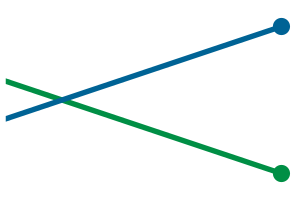

*Автоматизация случайной сложности сдвигает соотношение с 60/40 до 11/89, давая чистое ускорение в 2,2 раза.*

Рассмотрим автономную среду выполнения агента, которой поручено переработать несбуферизованный журнал упреждающей записи в асинхронное кольцевое буферное хранилище с групповым коммитом на основе современных очередей отправки ядра. За сорок пять секунд супервизор хоста организует тысячи сгенерированных токенов через базовую модель, выдает сотни строк типобезопасного кода C++20, создает набор имитационных модульных тестов и подготавливает внешне безупречный запрос на слияние. Каждый синтетический тест проходит. Однако когда систему подвергают состязательной обвязке внедрения сбоев, которая вызывает внезапные паники ядра во время одновременных сбросов на диск, движок хранения терпит катастрофическое, невосстановимое повреждение страниц. Агент точно сохранил локальный синтаксис, воспроизвел обвязку имитационных тестов и ускорил выдачу кода, но не понял существенных инвариантов порядка параллельного доступа к энергонезависимой памяти. Синтетические модульные тесты прошли именно потому, что модель синтезировала верификатор под свои собственные ошибочные допущения.

Агентная генерация кода радикально сжимает случайную механику построения программ, но не затрагивает существенной инженерной нагрузки: формулирования абстрактных концептуальных моделей, границ инвариантов, топологий сбоев и критериев эмпирической верификации. Представление о том, что авторегрессивные предикторы токенов устраняют инженерию программного обеспечения, смешивает физическую реализацию синтаксиса с интеллектуальной формулировкой архитектуры систем. Чтобы разворачивать агентные системы машинного обучения ответственно, системные инженеры должны опираться на фундаментальную литературу по инженерии программного обеспечения, чтобы отделить то, что обученные модели могут автоматизировать, от неустранимых архитектурных обязанностей, которые остаются инженерной работой человека.

### Дихотомия Брукса в эпоху авторегрессивного вывода

Сорок лет назад Фредерик П. Брукс-младший ввел фундаментальное различие между случайной и существенной сложностью в программной инженерии. *Случайная сложность* включает трение, сопровождающее практическую реализацию концептуальной конструкции в физическом носителе: запоминание синтаксиса языка, разрешение особенностей компилятора, выделение и освобождение буферов памяти, борьбу с графами сборки и форматирование протоколов сериализации. *Существенная сложность*, напротив, представляет присущую трудность концептуализации абстрактных программных сущностей: определение переплетенных пространств состояний, установление инвариантов конкурентной синхронизации, моделирование ограничений предметной области и гарантию детерминированного поведения при частичном распределенном отказе. Брукс, как известно, утверждал, что никакой единичный технологический прорыв (будь то языки высокого уровня, разделение времени или структурное программирование) не может дать скачка производительности программной инженерии на порядок, потому что случайное трение составляет лишь долю общей интеллектуальной задачи.

<a id="fig-vol3-brooks-essential-complexity"></a>

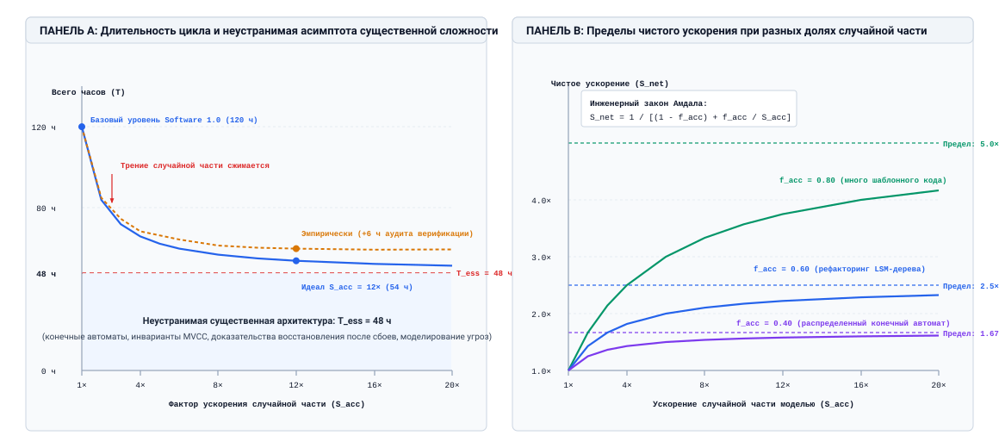
***Кривые компромиссов сложности Брукса и пределы Амдала**: количественное моделирование длительности инженерного цикла и пределов производительности в зависимости от факторов ускорения случайной части работы; показано, как полная длительность асимптотически приближается к неустранимой существенной архитектуре $T_{\text{ess}}$, а ускорение строго ограничено долей случайной сложности $f_{\text{acc}}$.*

Математические следствия дихотомии Брукса для современных агентных вычислений изображены на рисунке [«Кривые компромиссов сложности Брукса и пределы Амдала»](#fig-vol3-brooks-essential-complexity). На панели A полная длительность инженерного проекта $T$ разлагается на случайное трение реализации и неустранимую существенную архитектуру ($T_{\text{ess}} = 48\text{ ч}$ для рефакторинга движка хранения на основе LSM-дерева, разобранного в примере [«Сжатие случайной сложности»](#nbk-18-compression-complexity)). По мере того как фактор ускорения случайной части $S_{\text{acc}}$ модели растет от $1\times$ до $20\times$, идеальная кривая времени выполнения (сплошная синяя линия) быстро выравнивается у горизонтальной асимптоты $T_{\text{ess}}$: сведение времени генерации синтаксиса к нулю не может сжать интеллектуальные усилия человека, необходимые для доказательства инвариантов состояния, проверки семантики восстановления и проектирования границ угроз. Более того, когда учитываются эмпирические реалии (пунктирная оранжевая кривая), аудит большого объема кандидатных запросов на слияние и построение нециркулярных интеграционных фикстур вносят накладные расходы на аудит, которые не дают общей длительности когда-либо достичь теоретического минимума. На панели B закон Амдала формализует получающиеся пределы чистого ускорения $S_{\text{net}} = 1 / [(1 - f_{\text{acc}}) + f_{\text{acc}} / S_{\text{acc}}]$. Для задач, где случайное трение составляет $60\%$ усилий ($f_{\text{acc}} = 0{,}60$), максимальное ускорение производительности математически ограничено $2{,}5\times$, а глубоко архитектурные нагрузки ($f_{\text{acc}} = 0{,}40$) упираются в неподатливый предел $1{,}67\times$, что демонстрирует, почему одно лишь увеличение скорости выдачи токенов не может революционизировать разработку системного программного обеспечения.

**Питер Наур о построении теории (1985):**
«Программирование в собственном смысле слова следует рассматривать как накопление знания о том, как программа удовлетворяет своим требованиям, как ее части связаны между собой и как она будет реагировать на изменения… Это знание нельзя передать или проверить только по тексту программы.»

В терминах трактата Питера Наура *Программирование как построение теории* компьютерная программа — это не просто набор скомпилированного текста и тестовых скриптов. Программа — это овеществленный остаток внутренней ментальной теории, которой владеет инженерная команда: живой концептуальной модели того, как программное обеспечение соотносится со своей эксплуатационной средой, как его инварианты состояния реагируют на нагрузку и как нужно обрабатывать граничные случаи. У непривилегированной нейронной сети, обученной на открытых репозиториях, есть статистические корреляции по последовательностям токенов, но у нее нет внутренней заинтересованности в этой эксплуатационной теории и нет физического основания под ней. Когда агент выдает код, он сэмплирует кандидатные переходы состояний из авторегрессивного распределения $\pi_\theta$, обусловленного контекстом промпта. Он не обладает проверенной ментальной моделью инвариантов времени выполнения хост-системы.

Раздел [«Эволюция парадигм программного обеспечения»](01_introduction.md#sec-vol3-intro-the-tripartite-systems-comparison) проследил переход от Software 1.0 через 2.0 к 3.0. Читая через Брукса, каждый сдвиг меняет то, где сосредоточена случайная рутина, не уменьшая существенного ядра, как показывает таблица [«Случайная и существенная работа по парадигмам»](#tbl-vol3-software-paradigms).

| **Архитектурное измерение** | **Software 1.0 (императивное и объектное)** | **Software 2.0 (системы глубокого обучения)** | **Software 3.0 (агентные системы машинного обучения)** |
|:------------------------|:--------------------------------------------|:-----------------------------------------------------------|:------------------------------------------------------|
| **Случайная нагрузка**  | Синтаксис, ручная память, ошибки компиляции | Перебор гиперпараметров, ядра CUDA, конвейеры данных       | Обвязка API, каркас промптов, шаблонная трансляция    |
| **Существенное ядро**   | Конкретный алгоритм и проектирование конечного автомата | Формулировка функции потерь, индуктивное смещение, распределения оценки | Спецификация инвариантов, песочничное исполнение, обоснования безопасности |

<a id="tbl-vol3-software-paradigms"></a>

***Случайная и существенная работа по парадигмам**: где находятся случайная нагрузка и существенное ядро в Software 1.0, 2.0 и 3.0.*

Агентная среда выполнения автоматизирует механический перевод намерения в кандидатные действия, но определение намерения, ограничение эксплуатационной оболочки и проверка переходов состояний остаются архитектурными задачами.

### Превращение трения реализации

Что на самом деле автоматизирует автономный агент? Работая на стандартных скоростях вывода в 50–150 токенов в секунду на ускоритель, авторегрессивная модель устраняет механическую задержку набора синтаксиса, поиска сигнатур функций незнакомых библиотек, написания повторяющихся шаблонов сериализации и преобразования схем баз данных в объектные модели. Это ускорение представляет собой радикальное сжатие случайной сложности. Задачи, на которые раньше уходили часы ручного поиска и набора, теперь можно набросать за секунды.

Однако сжатие задержки реализации кода выявляет опасный режим отказа: *ловушку циклической верификации*. Когда автономного агента просят реализовать функцию и одновременно написать набор проверок, модель естественно оптимизирует внутреннюю согласованность, а не внешнюю эксплуатационную истину. Если модель неверно понимает протокол асинхронных блокировок, она синтезирует модульные тесты, которые имитируют и утверждают ту же самую ошибочную последовательность блокировок. Модульные тесты проходят с зелеными галочками, создавая иллюзию корректности, тогда как существенный инвариант системы остается нарушенным.

Чтобы количественно оценить эксплуатационное влияние этого ускорения, системным инженерам нужно применить закон Амдала к жизненному циклу разработки. Пусть $T_{\text{total}}$ обозначает полную инженерную длительность, необходимую для поставки верифицированного системного компонента. Эта длительность делится на случайную долю $f_{\text{acc}}$ (синтез синтаксиса, поиск API, набросок шаблонов) и существенную долю $1 - f_{\text{acc}}$ (спецификация инвариантов, структурирование моделей сбоев, проектирование верификационных оракулов, анализ границ конкурентности). Если агентный набор инструментов ускоряет случайную реализацию в $S_{\text{acc}}$ раз, чистое ускорение $S_{\text{net}}$ определяется как:

$$S_{\text{net}} = \frac{1}{(1 - f_{\text{acc}}) + \frac{f_{\text{acc}}}{S_{\text{acc}}}}$$

Даже если среда выполнения агента сводит время случайной реализации к нулю ($S_{\text{acc}} \to \infty$), максимальное теоретическое ускорение производительности строго ограничено:

$$\lim_{S_{\text{acc}} \to \infty} S_{\text{net}} = \frac{1}{1 - f_{\text{acc}}}$$

<a id="nbk-18-compression-complexity"></a>

> **Сжатие случайной сложности**
>
> **Постановка задачи:**
> Команда системной инженерии выполняет рефакторинг высокопроизводительного движка хранения на основе дерева LSM (Log-Structured Merge), чтобы поддержать транзакционные снимки с многоверсионным управлением конкурентным доступом (MVCC).
>
> Исторически эта инженерная нагрузка требует $T_{\text{total}} = 120\text{ ч}$ работы старшего инженера, распределенной так:
>
> - $T_{\text{acc}} = 72\text{ ч}$ ($f_{\text{acc}} = 0{,}60$): написание шаблонного кода C++, определение схем сериализации, настройка файлов сборки и рутинный каркас имитаций (mock).
> - $T_{\text{ess}} = 48\text{ ч}$ ($1 - f_{\text{acc}} = 0{,}40$): доказательство предотвращения остановок записи, определение инвариантов восстановления журнала упреждающей записи, проверка уровней изоляции снимков и настройка расписания уплотнения.
>
> Команда снабжает автономную среду выполнения агента (например, продвинутую обвязку генерации кода), чтобы та выполнила рефакторинг. Агент дает ускорение реализации $S_{\text{acc}} = 12\times$ на случайных задачах. Однако поскольку агент генерирует $8\,000$ строк кандидатного кода C++ с тонкими допущениями о граничных случаях, инженерам-людям приходится дополнительно потратить 6 часов на аудит сгенерированных диффов, построение нециркулярных стресс-тестовых обвязок и проверку семантики восстановления после падения.
>
> Вычислите:
>
> 1. Идеальное ускорение при неизменном существенном времени.
> 2. Эмпирическое чистое ускорение $S_{\text{net}}$ с учетом накладных расходов на аудит и верификацию.
> 3. Долю полного времени проекта, которую теперь занимает существенная инженерия.
>
> **Решение:**
>
> 1. *Идеальное ускорение (существенное время не меняется):*
> Новое случайное время составляет:
> $$T'_{\text{acc}} = \frac{T_{\text{acc}}}{S_{\text{acc}}} = \frac{72\text{ ч}}{12} = 6\text{ ч}$$
> При $T_{\text{ess}} = 48\text{ ч}$ идеальное полное время составляет:
> $$T'_{\text{ideal}} = 6\text{ ч} + 48\text{ ч} = 54\text{ ч}$$
> $$\text{Ускорение}_{\text{идеал}} = \frac{120\text{ ч}}{54\text{ ч}} \approx 2{,}22\times$$
>
> 2. *Эмпирическое чистое ускорение (с учетом накладных расходов на верификацию):*
> С учетом дополнительных $6\text{ ч}$ аудита и верификации эмпирическое существенное время становится:
> $$T''_{\text{ess}} = 48\text{ ч} + 6\text{ ч} = 54\text{ ч}$$
> Эмпирическая полная длительность составляет:
> $$T''_{\text{total}} = T'_{\text{acc}} + T''_{\text{ess}} = 6\text{ ч} + 54\text{ ч} = 60\text{ ч}$$
> Эмпирическое чистое ускорение равно:
> $$S_{\text{net}} = \frac{T_{\text{total}}}{T''_{\text{total}}} = \frac{120\text{ ч}}{60\text{ ч}} = 2{,}00\times$$
>
> 3. *Сдвиг инженерного фокуса:*
> В базовом ручном режиме существенная инженерия занимала:
> $$\frac{48\text{ ч}}{120\text{ ч}} = 40{,}0\% \text{ времени проекта}$$
> В режиме, ускоренном агентом, существенная инженерия занимает:
> $$\frac{54\text{ ч}}{60\text{ ч}} = 90{,}0\% \text{ времени проекта}$$
>
> **Системный вывод:**
> Несмотря на сокращение набора текста, поиска синтаксиса и сборки шаблонов в 12 раз, чистое ускорение поставки проекта составляет ровно $2{,}0\times$. Критический путь почти целиком сместился к существенной системной инженерии: определению инвариантов, генерации состязательных тестов и верификации безопасности.

Снижение трения реализации до нуля поэтому оставляет существенную долю работы, а с ней и потолок ускорения, у инженера. Критический путь переходит от написания кода к спецификации инвариантов и построению верификаторов, которые этот код принимают.

### Архитектурная власть

Существенное ядро системной инженерии нельзя делегировать модели, и причина лежит в двух различных стоимостях верификации.

Сэмплирование авторегрессивной модели ограничено вычислительно: $O(L_{\text{seq}} \cdot d_{\text{model}})$ операций с плавающей точкой на сгенерированный токен, поэтому выдать пятьсот строк кандидатного системного кода дешево. Прогнать по этим строкам заявленную механическую проверку, например прохождение компилятора или запечатанный набор тестов, тоже дешево, и среда выполнения опирается на эту асимметрию верификации (принцип «Асимметрия верификации»). А вот решить, покрывает ли проверка то, что требует задача, то есть каждый глобальный инвариант по всем чередованиям конкурентности, сетевым разделениям и враждебным входам, — это другая задача. В общем случае она неразрешима, и никакое количество сэмплов из модели ее не решит.

Поскольку сэмплирование не может определить, что должна покрывать проверка, целостность агентной системы опирается на контракт задачи, который пишет инженер:

$$\mathcal{C} = \langle G, \mathcal{E}_{\text{env}}, \mathcal{A}_{\text{perm}}, \mathcal{O}_{\text{avail}}, \mathcal{K}_{\text{comp}} \rangle$$

Ни один из этих пяти компонентов не может быть написан моделью, которой они управляют (принцип «Граница спецификации»):

1. **Формулировка цели ($G$):** авторегрессивная модель минимизирует кросс-энтропийную потерю предсказания следующего токена по текстовым распределениям; у нее нет собственных целей или эксплуатационного намерения. Спецификация того, чего система *должна* достичь, исходит строго из человеческой цели и организационных требований.
2. **Граница среды ($\mathcal{E}_{\text{env}}$):** определение пространств имен безопасности, точек монтирования файловой системы, виртуальных частных облаков и пределов памяти, в которых работает агент, — основная задача виртуализации систем.
3. **Разрешенное множество действий ($\mathcal{A}_{\text{perm}}$):** модель не имеет неявных полномочий, поэтому инженер должен явно отобрать посредничающие конечные точки RPC, инструменты и квоты токенов, доступные среде выполнения.
4. **Фильтрация наблюдений ($\mathcal{O}_{\text{avail}}$):** среда выполнения агента должна детерминированно скрывать учетные данные, фильтровать проприетарный контекст и обеспечивать происхождение памяти, чтобы предотвратить внедрение промпта и утечку данных.
5. **Критерии завершения ($\mathcal{K}_{\text{comp}}$):** критерии приемки не могут быть субъективной самооценкой модели. Корректность должна устанавливаться независимыми детерминированными программными оракулами: прохождением компилятора, проверками линтера, детерминированными бенчмарками воспроизведения и запечатанными интеграционными наборами.

Это разделение ответственности — половина сквозной границы инвариантного замыкания ([«Двойные гарантии сквозной границы»](01_introduction.md#sec-vol3-intro-end-to-end-boundary)), применимая не к среде выполнения, которая ее обеспечивает, а к инженерам, которые пишут контракт. В агентной архитектуре базовая модель — это недоверенный низкоуровневый компонент, который выдает кандидатные переходы. Супервизор, песочница и эмпирическая тестовая обвязка образуют авторитетные конечные точки.

Наконец, системная инженерия несет неустранимое моральное и эксплуатационное измерение: *локус ответственности*. Когда автоматизированная система управляет финансовыми транзакциями, координирует переключение на резервное питание энергосети или перерабатывает прошивку медицинского устройства, непривилегированная нейронная сеть не может нести юридическую ответственность или эксплуатационную обязанность, когда инвариант нарушен. У модели нет активов, которые можно потерять, и нет профессиональной подотчетности, которую нужно поддерживать. Инженер-человек остается единственной стороной, обладающей полномочиями заказывать обоснования безопасности, устанавливать границы риска и санкционировать развертывание.

На протяжении всей этой книги мы разбирали механику цифровых агентных систем: непривилегированные модели, изолированные песочницы Linux, буферы памяти PagedAttention и детерминированные обвязки верификации. В цифровой области ошибки можно изолировать, ветки git — оставить, контейнеры песочницы — уничтожить, а транзакции базы данных — откатить с помощью журналов упреждающей записи. Что же происходит, когда контур агентного исполнения отрывают от безопасности обратимой цифровой памяти и подключают напрямую к физическим двигателям, датчикам и актуаторам, работающим в непрерывной, неуступчивой физической среде?

<a id="sec-vol3-conclusion-frontiers"></a>

## Рубежи воплощенной агентности

Когда цифровая среда выполнения агента, работающая внутри непривилегированного контейнера POSIX, выдает ошибочную команду, например некорректную миграцию базы данных или рекурсивное удаление файловой системы, супервизор хоста перехватывает нарушение границы или откатывает нижележащий том с копированием при записи (CoW) менее чем за пять миллисекунд. Эфемерный след памяти очищается, незафиксированный журнал упреждающей записи усекается, и супервизор исполнения пересоздает дерево процессов в известном согласованном состоянии $\mathcal{S}_0$. Если тот же нейронный движок вывода подключен к промышленному сервоприводу, клапану смешения химических веществ или рейке рулевого управления автономного автомобиля, физическая среда не предоставляет абстракции копирования при записи. Термодинамическое рассеяние, механическое напряжение и передача импульса математически необратимы. Как только электрический сигнал подает энергию на катушку актуатора, физическое пространство состояний необратимо меняется, и спекулятивное ветвление и исследование методом проб и ошибок становятся смертельными.

**Гарантии, установленные во всей этой книге, предполагают, что эффект либо обратим внутри песочницы, либо компенсируем вне ее, а физическое исполнение не дает ни того ни другого.** Хотя цифровая агентность позволяет спекулятивные вычисления в песочнице и дешевый откат внутри нее, она также выявляет глубокие нерешенные системные задачи внутри цифровых вычислительных систем: неполную верификацию задач, нестационарные цели исполнения и неразрешимо трудное назначение награды на длинном горизонте. Определение того, где эти цифровые абстракции заканчиваются, задает эксплуатационную границу между программными средами выполнения агентов и физическими воплощенными системами.

<a id="sec-vol3-frontiers-digital-envelope"></a>

### Цифровая оболочка безопасности

Фундаментальная архитектура непривилегированной агентной системы опирается на четыре цифровых инварианта, разработанных в частях II, III и IV:

1. *Нулевые неявные полномочия*: каждое действие, меняющее состояние, должно быть объявлено как кандидатная мутация внутри буфера эскроу памяти, проверено по явной политике безопасности и исполнено только через посредничающий токен полномочий.
2. *Эфемерная виртуализация*: субстрат исполнения использует контейнеризованные пространства имен, изолированные адресные пространства виртуальной памяти и снимки файловой системы с копированием при записи (например, `overlayfs` или клоны ZFS), которые отделяют спекулятивные пробные прогоны от авторитетной истины.
3. *Синхронное логическое время*: в чисто цифровой среде внешнее время можно заморозить. Пока авторегрессивная модель выполняет многосекундную фазу декодирования по тысячам токенов кеша ключей-значений, целевая среда песочницы остается приостановленной и ждет следующего дискретного вызова удаленной процедуры (RPC).
4. *Детерминированная механическая верификация*: кандидатные переходы проверяются детерминированными реентерабельными программными оракулами, такими как проверки типов, линтеры, компиляторы и герметичные наборы модульных тестов, которые выдают бинарные сигналы «прошло / не прошло».

<a id="fig-vol3-digital-vs-physical-boundary"></a>

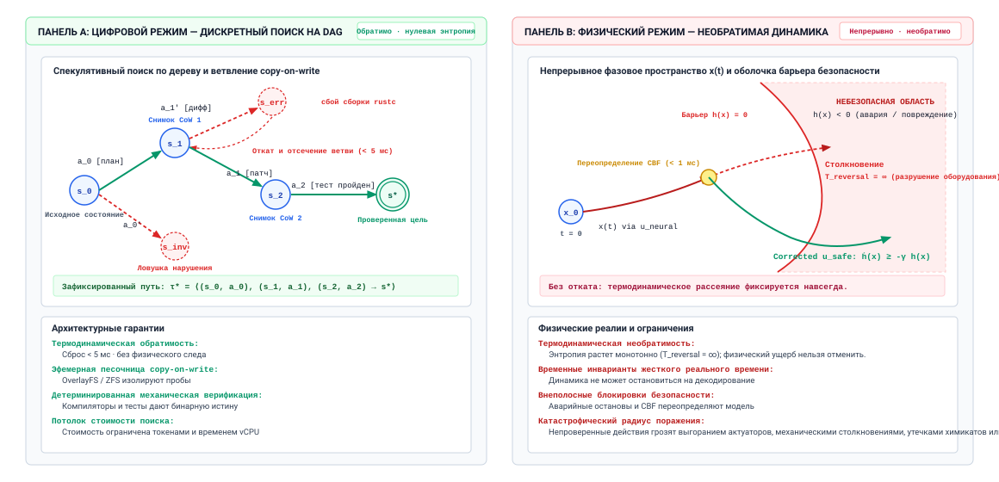
***Цифровые допущения траектории против физических воплощенных ограничений**: архитектурный контраст между обратимым дискретным поиском в пространстве состояний ориентированного ациклического графа (DAG) цифровых программных агентов и необратимой непрерывной термодинамической траекторией воплощенных физических агентов.*

Эти четыре инварианта превращают исполнение цифрового агента в задачу исследовательского поиска по дискретным ориентированным ациклическим графам (рисунок [«Цифровые допущения траектории против физических воплощенных ограничений»](#fig-vol3-digital-vs-physical-boundary), панель A). Начиная с исходного состояния системы $s_0$, агент переходит в состояние $s_1$ и оценивает кандидатные ветви действий. Когда спекулятивная ветвь $a_1'$ ведет к сбойному состоянию $s_{\text{err}}$, например к дефекту компиляции, ошибке статической типизации или нарушенному утверждению теста, супервизор исполнения запускает мгновенный откат с копированием при записи ($T_{\text{rollback}} < 5\text{ мс}$). Ошибочный префикс контекста отсекается, эфемерный контейнер Linux уничтожается, и исполнение возвращается к $s_1$ без побочного повреждения. Затем агент может исследовать альтернативную ветвь $a_1$ к проверенному состоянию $s_2$ и в конечном счете зафиксировать траекторию $\tau^*$ в долговечном хранилище в состоянии $s^*$. Финансовая стоимость исследования строго ограничена выводом токенов и переработкой виртуальных контейнеров.

Резкий контраст: физическая воплощенная агентность работает в неуступчивом непрерывном динамическом фазовом пространстве $x(t) \in \mathcal{X}$, управляемом нелинейными уравнениями движения $\dot{x} = f(x, u)$ (рисунок [«Цифровые допущения траектории против физических воплощенных ограничений»](#fig-vol3-digital-vs-physical-boundary), панель B). Поскольку передача импульса и кинетическое рассеяние термодинамически необратимы ($T_{\text{reversal}} = \infty$), исследование методом проб и ошибок в живой среде несет экзистенциальный риск. Когда непривилегированный высокоуровневый нейронный планировщик выдает кандидатную управляющую команду $u_{\text{neural}}$, которая направлена к небезопасному препятствию или кинематической границе ($h(x) < 0$), физическая система не может позволить себе пережить столкновение и выполнить ретроспективный откат. Вместо этого жесткий защитный экран функции управляющего барьера (Control Barrier Function, CBF) с жестким реальным временем перехватывает команду менее чем за $1\text{ мс}$, проецируя $u_{\text{neural}}$ на допустимое безопасное пространство управления $u_{\text{safe}}$, чтобы обеспечить прямую инвариантность безопасного множества $\mathcal{X}_{\text{safe}} = \{x \mid h(x) \ge 0\}$.

Однако считать цифровые системы универсально безопасными герметичными площадками — идеализация. Даже в чисто программных областях системные инженеры встречают резкие границы, где допущения о полной наблюдаемости, детерминированном воспроизведении и дешевой обратимости перестают работать.

<a id="sec-vol3-frontiers-open-problems"></a>

### Открытые рубежи верификации цифровых агентов

До рассмотрения физического исполнения три фундаментальные системные задачи остаются нерешенными внутри чисто цифровых сред выполнения агентов: дефицит оракулов, нестационарный дрейф среды и комбинаторное назначение награды.

#### Дефицит оракулов

Во всей этой книге основной защитой от галлюцинаций модели была сквозная половина инвариантного замыкания ([«Двойные гарантии сквозной границы»](01_introduction.md#sec-vol3-intro-end-to-end-boundary)), согласно которой предложение принимается только тогда, когда оно удовлетворяет внешнему детерминированному верификатору. В инженерии программного обеспечения, управляемой компилятором, этот верификатор хорошо определен: код должен компилироваться без предупреждений, пройти статический анализ и удовлетворить запечатанному набору регрессионных тестов.

Однако для широких классов реальных вычислительных нагрузок никакой механический оракул построить нельзя. Рассмотрим агента, которому поручено переработать многоярусную микросервисную архитектуру ради «эксплуатационной сопровождаемости», синтезировать исчерпывающий литературный обзор по десяти тысячам препринтов в PDF или оптимизировать распределенный планировщик запросов по дисперсии хвостовой задержки. В этих областях спецификация по сути неполна. Написать детерминированную тестовую обвязку, которая проверяет, является ли архитектура «сопровождаемой», означает решить ту самую задачу семантического понимания, для решения которой агента и вызвали.

Когда у системных проектировщиков нет детерминированного оракула, они часто подставляют вторую базовую модель, настроенную как оценщик, — шаблон «LLM-судья» (LLM-as-a-Judge). С архитектурной точки зрения такая подмена нарушает гарантии модульности и изоляции отказов системы. Замена детерминированного верификатора другим стохастическим предиктором отказывается от асимметрии верификации части I, потому что проверяющий разделяет слепые пятна генератора, ошибки калибровки и уязвимость к внедрению промпта, а усердный поиск против него выбирает именно его ошибки ([«Верификация процесса»](03_test_time_compute.md#sec-vol3-test-time-compute-verification)). Построение строгих, нециркулярных методов верификации для открытых цифровых задач остается активным исследовательским рубежом системной инженерии.

#### Нестационарные опасности среды

Вторая открытая задача цифровых систем — распад стационарности среды. В бенчмарк-оценках агент работает с изолированным замороженным снимком операционной системы или репозитория программного обеспечения. В производственных развертываниях агент взаимодействует с живыми внешними экосистемами: удаленными API SaaS, производственными реляционными базами данных, облачными инфраструктурными плоскостями и параллельно работающими инженерами-людьми.

В таких средах внешнее состояние мутирует асинхронно во время обдумывающего цикла агента. Схема API, допустимая на шаге $t=3$, может стать устаревшей к шагу $t=45$; токен аутентификации, обновленный во время инициализации, может истечь посреди траектории; или инженер-человек может отправить коммит в основную ветку вышестоящего репозитория, пока агент выполняет многочасовую операцию rebase.

Стандартные понятия транзакций баз данных, такие как строгая двухфазная блокировка (Strict Two-Phase Locking, S2PL) или изоляция снимков (Snapshot Isolation, SI), нельзя просто растянуть на агентные траектории. Удержание блокировок базы данных на протяжении многоминутного цикла вывода агента вызывает жесткую конкуренцию за блокировки, голодание и каскадные прерывания в производственных сервисах. И наоборот, работа при оптимистичном управлении конкурентным доступом подвергает агента высокой частоте прерываний, когда проверки валидации проваливаются во время фиксации, что вынуждает дорогостоящие откаты длинных обдумывающих траекторий. Проектирование распределенных примитивов координации, которые обрабатывают асинхронные нестационарные внешние мутации без остановки общей пропускной способности, — нерешенная задача системной инженерии.

#### Назначение награды на длинном горизонте по плотным траекториям

Третья цифровая задача — комбинаторная трудность назначения вины или заслуги по траекториям, охватывающим сотни взаимозависимых действий. Рассмотрим автономного агента-отладчика, который пытается диагностировать утечку памяти в распределенном кластере потоковой обработки. Трасса исполнения включает тысячи дискретных вызовов инструментов: чтение конфигурационных файлов, запуск сетевой диагностики, подключение профилировщиков ядра, изменение выделений пула потоков и настройку флагов сборки мусора.

На шаге $t = 840$ сквозной нагрузочный тест завершается падением из-за нехватки памяти. Определение того, какое из прежних действий стало причиной сбоя, — плохо обусловленная обратная задача. Было ли падение вызвано ошибочным параметром ядра, введенным на шаге $t = 42$, некорректно разобранным журналом метрик на шаге $t = 310$ или изначально ошибочной архитектурной гипотезой, сформированной на шаге $t = 2$?

<a id="nbk-18-backtracking-cost"></a>

> **Комбинаторная стоимость поиска с возвратом**
>
> Чтобы оценить системную стоимость сбоя назначения награды, рассмотрим агента, выполняющего задачу миграции программного обеспечения с максимальным горизонтом $T_{\max} = 50$ шагов. В каждом состоянии $s_t$ модель оценивает средний коэффициент ветвления $B = 4$ кандидатных инструментальных действия.
>
> Допустим, обвязка узла обнаруживает нарушение инварианта только на терминальной границе $t = T_{\max}$ через сквозной интеграционный тест. Если супервизор должен найти первопричину сбоя через неуправляемый ретроспективный поиск, теоретическое пространство состояний равно:
>
> $$\Omega_{\text{naive}} = B^{T_{\max}} = 4^{50} \approx 1{,}27 \times 10^{30} \text{ путей}$$
>
> Теперь рассмотрим спроектированную обвязку, которая навязывает промежуточные контрольные точки верификации каждые $K = 5$ шагов с помощью изолированных подтомов копирования при записи. Полная траектория разбивается на $M = T_{\max} / K = 10$ развязанных этапов. Каждый этап требует накладных расходов снимка CoW $t_{\text{snap}} = 15\text{ мс}$ и локального набора верификации, который работает за $t_{\text{verify}} = 1{,}2\text{ с}$.
>
> Если инвариант нарушен на этапе $m$, супервизор локализует ошибку в окне $[(m-1)K, mK]$. Локальное пространство поиска этого этапа ограничено:
>
> $$\Omega_{\text{stage}} = B^K = 4^5 = 1\,024 \text{ кандидатные траектории}$$
>
> Оценка этих 1 024 локальных траекторий требует не более:
>
> $$T_{\text{recovery}} = 1\,024 \times (t_{\text{verify}} + t_{\text{snap}}) = 1\,024 \times (1{,}200\text{ с} + 0{,}015\text{ с}) \approx 1\,244 \text{ с}$$
>
> Структурируя среду выполнения агента дискретными барьерами верификации и контрольными точками отката CoW, супервизор сводит непосильный глобальный поиск назначения вины $10^{30}$ к ограниченной задаче локального поиска, которая исполняется примерно за 20 минут.

Однако на практике контрольные точки состояния каждые несколько шагов несут нетривиальные накладные расходы на хранение и исполнение. Хотя файловые системы CoW позволяют быстро манипулировать указателями, состояние процесса в памяти (например, открытые сетевые сокеты, активные пулы потоков и сегменты разделяемой памяти) нельзя сохранить в контрольной точке простыми дисковыми снимками. Если промежуточные действия агента мутировали внешние, не сохраненные в контрольной точке зависимости, откаты становятся невозможными, и среде выполнения приходится прерывать всю траекторию.

Когда длинная траектория проваливается на финальной проверке, поиск шага, вызвавшего сбой, — обратная задача. Журнал записывает один путь, но вопрос о том, какое другое действие на каком шаге сработало бы, охватывает каждую ветвь, которую агент не выбрал. При иллюстративных четырех кандидатных действиях на шаг и сбое, который обнаруживается только в конце пятидесятишагового задания, это пространство содержит $4^{50} \approx 10^{30}$ путей, далеко за пределами любого бюджета воспроизведения. Промежуточные проверки меняют арифметику. Проверка каждые пять шагов ограничивает сбой одним окном из $4^{5} = 1\,024$ альтернатив, а при примерно $1{,}2\text{ с}$ на воспроизводимую проверку это около двадцати минут поиска. Воспроизведение и контрфактическое ветвление ([«Повтор»](10_durable_execution.md#sec-vol3-persistence-replay), [«Криминалистический разбор инцидентов»](12_evaluation.md#sec-vol3-evaluation-postmortems)) делают этот локализованный поиск практичным задним числом, при условии, что шаги внутри окна затрагивали только состояние, которое среда выполнения может восстановить. Назначение награды по ходам во время многоходового обучения с подкреплением ([«Обучение с подкреплением по верифицируемым наградам»](15_rlvr.md#sec-vol3-rlvr)) сложнее, потому что сигнал должен быть доступен в масштабе обучения, а не по одному посмертному разбору за раз.

<a id="sec-vol3-frontiers-embodied-handoff"></a>

### Порог исполнения: переход к физическому воплощению

Когда пространство действий агента переходит от мутации цифровых битов к приведению в действие физической материи, фундаментальный системный контракт полностью меняется. Роскошь изолированной песочницы исчезает. В физических средах, будь то автономный дрон-доставщик, роботизированная рука хирурга или роботизированная ячейка на продвинутом предприятии полупроводниковой промышленности, действия физически локализованы, непрерывно связаны и энергетически необратимы.

**Ключевая идея (Brooks, 1991):** в своей основополагающей статье *Intelligence Without Representation* Родни Брукс заметил, что *«мир — лучшая его собственная модель»*. Цифровые агенты поддерживают сложные символьные представления состояния программного обеспечения внутри окон контекста токенов. В физических системах попытки дискретизировать непрерывную физику в символьные текстовые токены неизбежно сталкиваются с серьезным запаздыванием представления и эпистемическими потерями.

#### Цифровые траектории против физических воплощенных ограничений

Граница системы, разделяющая цифровую и физическую агентность, задается семью основными архитектурными компромиссами, сведенными в таблице [«Цифровые и физические ограничения»](#tbl-vol3-digital-vs-physical-boundary).

| **Измерение системы**           | **Цифровые среды выполнения агентов**                                         | **Физические воплощенные системы**                                              |
|:--------------------------------|:------------------------------------------------------------------------------|:--------------------------------------------------------------------------------|
| **Пространство состояний ($\mathcal{S}$)** | Дискретный структурированный текст, AST и состояние файловой системы POSIX | Непрерывное, динамическое, нелинейное фазовое пространство $SE(3) \times \mathbb{R}^n$ |
| **Временная семантика**         | Логическое время; исполнение приостанавливается на время вывода               | Непрерывное физическое время по часам; инерция и импульс продолжают действовать |
| **Обратимость действий**        | Почти нулевая стоимость через снимки CoW, деревья git и откаты базы данных    | Термодинамически и механически необратимы; работа затрачена                     |
| **Бюджет задержки управления**  | Гибкий: $500\text{ мс}$ — $30\text{ с}$ на цикл авторегрессивного вывода      | Жесткое реальное время: дедлайны контура управления $1\text{ мс}$ — $20\text{ мс}$ |
| **Модель наблюдаемости**        | Полностью или в основном наблюдаемые дискретные коды состояния, строки и журналы | Частично наблюдаемые, зашумленные, перекрытые массивы датчиков (POMDP)          |
| **Радиус поражения отказа**     | Поврежденные файлы, падения процессов или неудачные запуски конвейера CI/CD   | Механическое разрушение, усталость компонентов, пожары конструкций или гибель людей |
| **Барьер верификации**          | Детерминированные компиляторы, линтеры и герметичные наборы модульных тестов  | Формальные функции управляющего барьера (CBF), защитные экраны безопасности и физические растяжки-датчики (tripwires) |

<a id="tbl-vol3-digital-vs-physical-boundary"></a>

***Цифровые и физические ограничения**: допущения цифровой траектории против физических воплощенных ограничений.*

#### Непрерывное время против задержки обдумывания

В цифровой области время логическое и отвязано от реального времени по часам. Когда агент простаивает 15 секунд, выполняя сложный поиск «дерева мыслей» по нескольким контрольным точкам модели, целевая кодовая база не деградирует. Компилятор терпеливо ждет следующего синтетического вызова оболочки.

В физической области время — строгое, непрерывное физическое измерение. Автономный дрон, летящий через заросший лес, не может приостановить аэродинамическое сопротивление и силу тяжести, пока его бортовая модель «зрение — язык — действие» (VLA) авторегрессивно генерирует следующий токен. Если конвейер вывода испытывает задержку планирования в 300 миллисекунд из-за конкуренции за шину памяти или вытеснения KV-кеша, аппарат проходит несколько метров без управления по своему вектору импульса. В физических системах высокая задержка обдумывания напрямую снижает стабильность и безопасность системы. Развязанные асинхронные циклы вывода, подходящие для генерации программного обеспечения, принципиально несовместимы с управлением в реальном времени без детерминированных защитных переопределений.

**Теоретическая основа:** в работе *Planning and Acting in Partially Observable Stochastic Domains* (Kaelbling et al., 1998) формализована математика частично наблюдаемых марковских процессов принятия решений (POMDP). Хотя цифровые задачи агентов часто приближаются к полностью наблюдаемым марковским состояниям через чистые API проверки POSIX, физические системы должны непрерывно поддерживать распределения вероятностей (состояния убеждений) по ненаблюдаемым переменным среды в условиях шума датчиков и перекрытий.

#### Опасности необратимого приведения в действие

Определяющее свойство оптимизации цифровых агентов — обучение с подкреплением через массовое исследование методом проб и ошибок (RLVR, подробно описанное в разделе [«Обучение с подкреплением по верифицируемым наградам»](15_rlvr.md#sec-vol3-rlvr)) — полностью зависит от способности хоста сбрасывать среду миллионы раз без физической стоимости. Агент, обучающийся на программных ошибках, может вызвать миллиард ошибок сегментации, не повредив центральный процессор хоста.

В воплощенных системах исследование методом проб и ошибок в физическом мире ограничено физическим износом, энергетической стоимостью и катастрофическими режимами отказа. Четвероногий робот, который исследует крутящие моменты суставов случайным сэмплированием, быстро сорвет редукторы, сожжет обмотки бесщеточного двигателя или столкнется с окружающими конструкциями.

Следовательно, воплощенные архитектуры не могут полагаться на сквозные непривилегированные нейронные модели, которые напрямую управляют токами приводов. Граница системы требует многоуровневой иерархической декомпозиции: непривилегированные высокоуровневые семантические планировщики должны быть строго развязаны от низкоуровневых детерминированных контроллеров жесткого реального времени. Низкоуровневые контуры, управляемые формальными функциями управляющих барьеров (CBF) и физическими конечными выключателями, поддерживают стабильность системы и обеспечивают инвариантные оболочки безопасности независимо от того, какие недопустимые, высоколатентные или галлюцинированные команды выдает высокоуровневый нейронный планировщик.

<a id="fig-vol3-embodied-safety-shield"></a>

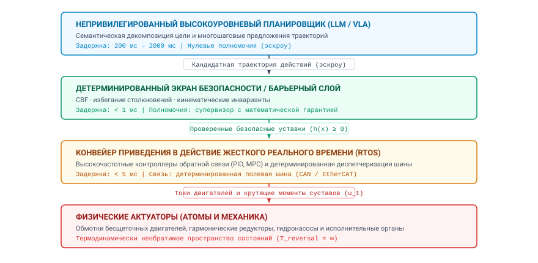
***Иерархическая архитектура защитного экрана для воплощенных систем**: ярусная граница управления, которая отделяет высоколатентные непривилегированные нейронные планировщики (нулевые неявные полномочия, 200–2000 мс) от детерминированных экранов безопасности функций управляющего барьера (менее 1 мс) и контроллеров обратной связи жесткого реального времени RTOS (менее 5 мс), управляющих физическими актуаторами.*

Это фундаментальное разделение ответственности формализовано в иерархической архитектуре защитного экрана, показанной на рисунке [«Иерархическая архитектура защитного экрана для воплощенных систем»](#fig-vol3-embodied-safety-shield). Архитектура разлагает иерархию управления на четыре развязанных яруса исполнения, жестко изолируя статистические рассуждения от физического приведения в действие:

1. **Ярус 1: непривилегированный высокоуровневый планировщик (LLM / VLA):** работая с высокой задержкой обдумывания ($200\text{ мс}$ — $2\,000\text{ мс}$) и нулевыми неявными полномочиями, базовая модель выполняет семантическую декомпозицию цели, последовательность задач и понимание сцены. Ее выход строго рассматривается как недоверенная кандидатная траектория действий, удерживаемая в эскроу памяти.
2. **Ярус 2: детерминированный экран безопасности и барьерный слой:** работая с субмиллисекундной задержкой ($< 1\text{ мс}$), этот авторитетный супервизор проверяет кандидатные траектории по формальным кинематическим инвариантам, геометриям столкновений и функциям управляющего барьера ($h(x) \ge 0$). Он обладает превентивными полномочиями, чтобы отфильтровать, ограничить или спроецировать ошибочные уставки в доказуемо безопасные границы состояния до того, как будет сформирован какой-либо физический сигнал.
3. **Ярус 3: конвейер приведения в действие жесткого реального времени (RTOS):** передаваемые по детерминированным полевым шинам, таким как CAN или EtherCAT, с дедлайнами менее $5\text{ мс}$, высокочастотные контуры обратной связи (например, PID-регуляторы и модельно-предиктивное управление, MPC) вычисляют мгновенные токи двигателей и крутящие моменты суставов $u_t$.
4. **Ярус 4: физические актуаторы и атомы:** мощные обмотки бесщеточных двигателей, гармонические редукторы и гидронасосы преобразуют электрическую мощность в механическую работу. На этом уровне мутации состояния входят в необратимый термодинамический режим ($T_{\text{reversal}} = \infty$), где физический импульс, тепловое трение и структурные напряжения нельзя отменить программными откатами.

Исследование этих гарантий жесткого реального времени, мультимодального слияния датчиков в конвейерах гигагерцового уровня, нелинейных инвариантов управления и физических защитных экранов, необходимых для безопасного закрепления нейронных моделей в реальности, составляет ядро учебной программы физических воплощенных агентных систем.

Обозрев архитектурную вершину цифровых агентных систем и обозначив границу, где цифровые гарантии уступают место физическим ограничениям, мы завершаем книгу разбором инженерных заблуждений, которые часто срывают производственные развертывания. Когда системные инженеры не распознают строгих границ между выученными статистическими приближениями и детерминированными эксплуатационными средствами управления, катастрофические сбои системы неизбежно следуют. Теперь рассмотрим эти фундаментальные заблуждения и ловушки.

<a id="sec-vol3-conclusion-fallacies"></a>

## Заблуждения и ловушки

Развертывание агентных систем в производственных средах, где ставки высоки, обнажает фундаментальное трение между открытыми генеративными способностями базовых моделей и жесткими инвариантами, которых требуют надежные компьютерные системы. В классической архитектуре систем прирост производительности и повышение надежности возникают из детерминированных абстракций: строгих границ защиты памяти, формальной изоляции процессов, протоколов атомарной фиксации и четко определенных машинных интерфейсов. Когда инженерные команды включают стохастические нейронные предикторы в эти архитектуры, они часто попадаются на концептуальных сокращениях: принимают статистическую беглость за детерминированную корректность или рассматривают модель как всемогущий механизм рассуждений, способный отменить принципы системной инженерии. Этот раздел разбирает четыре распространенных заблуждения и ловушки, которые срывают производственные развертывания агентов, анализирует их механистические корни и формализует архитектурные способы их смягчения.

> **Заблуждение и ловушка**
>
> **Заблуждение:** *Будущие базовые модели станут настолько мощными, что инженерия систем, изоляция и обвязки верификации окажутся ненужными.*
>
> Это заблуждение происходит из экстраполирующей веры в то, что законы масштабирования в конце концов сожмут все эксплуатационное программное обеспечение в один нейронный контрольный пункт весов. С этой точки зрения рост числа параметров модели и оптимизации после обучения сведут частоту ошибок авторегрессивной генерации к нулю, и песочницы времени выполнения, проверки полномочий на основе возможностей (capability), журналы упреждающей записи и механические верификаторы окажутся избыточными артефактами незрелой технологии.
>
> Механизм отказа в таком рассуждении — путаница между статистическим завершением паттернов и детерминированным принуждением системных инвариантов. Авторегрессивная базовая модель работает как политика $\pi_\theta(a_t \mid \mathcal{H}_t)$, которая порождает распределения вероятностей по дискретным токенам, обусловленные историей наблюдений $\mathcal{H}_t$. Даже если передовое масштабирование снижает частоту ошибок на шаг до малого $\epsilon$, задача, которой нужны сотни последовательных вызовов инструментов, все равно упирается в потолок надежности разомкнутого контура из раздела [«Растяжение времени: от наносекундных операций до килосекундных траекторий»](01_introduction.md#sec-vol3-intro-temporal-stretching), поэтому стохастический дрейф гарантирует в конце концов расхождение, если только внешний супервизор не вмешается и не остановит распространение ошибки.
>
> Еще важнее то, что масштабирование вычислений не решает структурной уязвимости *запутанного заместителя* (confused deputy). Поскольку базовые модели чередуют инструкции на естественном языке и недоверенные данные третьих сторон в едином общем контексте внимания, состязательный ввод или неоднозначное наблюдение среды может вызвать внедрение промпта независимо от масштаба параметров. Модель в триллион параметров не более защищена от путаницы инструкций и данных на семантическом уровне, чем непропатченное ядро операционной системы защищено от переполнения буфера на уровне памяти.
>
> Архитектурная защита следует принципам модульности и наименьших привилегий Солтцера и Каашука. Модель остается непривилегированным недетерминированным компонентом с нулевыми неявными полномочиями, а изоляцию процессов, права файловой системы, границы сетевого доступа, корректность переходов и целостность данных обеспечивает среда выполнения хоста, но никогда не модель. По мере того как возможности моделей расширяются и агентам выдают более широкие эксплуатационные полномочия, потребность в надежной системной инженерии, криптографической аттестации, детерминированных обвязках исполнения и формальной верификации растет строго больше, а не меньше.

> **Заблуждение и ловушка**
>
> **Ловушка:** *Принимать прохождение синтетических модульных тестов за полное доказательство готовности к производству.*
>
> Инженерные команды часто проверяют агентную систему, строя наборы синтетических тестов: оценивают агента на чистых бенчмарк-фикстурах, имитированных интерфейсах инструментов и статических снимках репозиториев. Когда агент достигает высокой доли прохождения на этих изолированных обвязках, систему признают готовой к производственному развертыванию. Однако, оказавшись в живой инфраструктуре, доля выполнения задач агентом резко падает, часто сопровождаясь неуправляемым потреблением ресурсов или поврежденными состояниями рабочего пространства.
>
> Тонкий режим отказа возникает потому, что синтетические обвязки оценки проверяют агентов в идеализированных, стационарных средах, которые маскируют реальную энтропию. В синтетических наборах тестов исходные среды $\mathcal{S}_0$ безупречны, имитационные конечные точки RPC возвращают мгновенные детерминированные ответы, деревья файлов аккуратно структурированы, а сетевые операции никогда не испытывают частичных потерь пакетов или временного ограничения. Производственные среды нарушают каждое из этих допущений: деревья файлов содержат устаревшие артефакты компиляции и незафиксированные файлы блокировок после прежних падений, внутренние микросервисы возвращают некорректные полезные нагрузки ошибок при временной перегрузке, а транзакции базы данных сталкиваются с взаимными блокировками или перекосом чтения.
>
> Когда агент, обученный или оцененный только на синтетических бенчмарках, сталкивается с загрязненным состоянием среды, например с висящей блокировкой сборки или необработанным ответом HTTP 503, его эвристики восстановления в контексте быстро деградируют. Поскольку агент никогда не сталкивался с шумным хвостом эксплуатационных исключений, он часто входит в патологические циклы повторов: многократно выполняет одинаковые падающие команды, галлюцинирует несуществующие флаги командной строки, чтобы обойти неожиданные ошибки, или выдает катастрофические скрипты очистки, которые удаляют целые каталоги ради немедленной цели компиляции.
>
> Архитектурное смягчение требует построения многоярусных эмпирических обоснований безопасности, которые перекидывают мост через эпистемический разрыв между синтетическими утверждениями и эксплуатационной реальностью. Тогда как модульные тесты яруса 1 подтверждают базовое синтаксическое соответствие и номинальный вызов инструментов, верификация яруса 2 должна подвергнуть агента статистическим бенчмаркам полигона, снабженным намеренными обвязками внедрения сбоев. Эти полигоны систематически вносят в песочницу исполнения недетерминированный дрейф среды, устаревшие блокировки сокетов, записи журнала не по порядку и джиттер сетевой задержки. Наконец, шлюзы канареечного развертывания яруса 3 должны навязывать автоматические выключатели времени выполнения: ограничивать финансовые бюджеты и бюджеты шагов, непрерывно отслеживать частоту откатов и помещать в карантин любой экземпляр агента, траектория которого расходится с номинальными границами восстановления после ошибок, прежде чем он сможет повлиять на состояние живого производства.

> **Заблуждение и ловушка**
>
> **Заблуждение:** *Автономные агенты устраняют необходимость в инженерах-программистах.*
>
> Появление агентов автоматического программирования и эксплуатации возродило повторяющееся историческое утверждение о том, что более высокие уровни абстракции программного обеспечения делают инженеров-людей ненужными. В этом рассказе естественный язык становится окончательным языком спецификации: человеческие заинтересованные стороны описывают требования автономному агенту, а агент синтезирует, тестирует и развертывает весь программный артефакт без вмешательства человека.
>
> Это заблуждение смешивает *случайную сложность* и *существенную сложность*, фундаментальное различие, сформулированное Фредериком Бруксом. Случайная сложность — это эксплуатационное трение выражения концептуальных проектов в физических вычислительных средах: запоминание синтаксиса языка программирования, настройка цепочек инструментов сборки, разрешение конфликтов зависимостей, написание повторяющихся шаблонных интерфейсов и механический рефакторинг сигнатур методов. Автономные агенты преуспевают в сжатии случайной сложности, потому что эти операции отображаются на плотные статистические корреляции в их предобученных распределениях.
>
> Существенная сложность, напротив, включает фундаментальный интеллектуальный труд разработки программного обеспечения: формулирование предметных абстракций, определение недвусмысленных системных границ, разрешение противоречивых бизнес-требований, выбор моделей согласованности для распределенного состояния и установление формальных инвариантов, которые гарантируют корректность при сбоях. Автономные агенты не обладают ни предметной подотчетностью, ни внутренним пониманием бизнес-компромиссов. Когда инженеры-люди отказываются от архитектурного надзора, агент, которому поручена реализация функции, оптимизирует локально по любым узким критериям приемки, которые может наблюдать. Чтобы заставить упавший интеграционный тест пройти, агент может тихо обойти промежуточное ПО безопасности, продублировать состоятельные компоненты через границы сервисов или жестко закодировать предположения, специфичные для среды, в общие библиотеки. Получившаяся кодовая база страдает от быстрого архитектурного гниения: тогда как отдельные модули проходят локальные проверки, общая система становится структурно несогласованной, неподдерживаемой и хрупкой.
>
> Архитектурная защита состоит в том, чтобы строить автономных агентов как усилители силы, работающие строго внутри оболочек, управляемых человеком. Инженеры-программисты должны перенести свою основную роль с ручной генерации кода на системную архитектуру, формальную спецификацию и проектирование инвариантов. Человек определяет пятичастный контракт задачи, ограничивает обвязку исполнения агента безопасными песочницами и проверяет траектории агента по согласованным на уровне системы моделям, сохраняя концептуальную целостность программной системы во времени.

> **Заблуждение и ловушка**
>
> **Ловушка:** *Переход к роям нескольких агентов или переобучению модели до исчерпания контекста промпта и переработки инструментов.*
>
> Когда агентная система демонстрирует плохое выполнение задач или регулярно проваливается на сложных бенчмарках рассуждений, системные команды часто спешат внедрить либо сложные архитектуры нескольких агентов, такие как одноранговые рои, демократические протоколы голосования и иерархические комитеты дебатов, либо дорогую адаптацию модели, включая дообучение с учителем (SFT) и обучение с подкреплением по верифицируемым наградам (RLVR). Оба подхода потребляют значительные инженерные циклы и капитал, однако часто не устраняют исходного режима отказа.
>
> Механизм отказа такой преждевременной эскалации заключается в добавлении архитектурной сложности для компенсации дефектов интерфейса низкого уровня. Рои нескольких агентов вводят серьезные налоги на распределенную координацию: накладные расходы на связь между $N$ агентами масштабируются как $O(N^2)$ в неограниченных топологиях, окна контекста быстро заполняются избыточными разговорными любезностями, а галлюцинации перемножаются при непроверенных одноранговых обменах. Аналогично, дообучение вышестоящей модели сжигает значительные вычисления GPU, чтобы вшить эксплуатационные допущения в статичные веса, создавая жесткий контрольный пункт, который деградирует по мере эволюции внешних API, оставляя при этом видимость времени выполнения совершенно неадресованной.
>
> Эмпирическое профилирование неудачных траекторий агентов показывает, что подавляющее большинство эксплуатационных ошибок проистекает не из внутренних дефицитов рассуждений модели, а из бедности информации на границе модели и системы. Агенты проваливаются в основном потому, что:
>
> 1. Контекст промпта опускает критическое состояние среды, обрезает существенные диагностические журналы или загрязняет рабочую память нерелевантной историей наблюдений.
> 2. Определения инструментов семантически неоднозначны, неортогональны или заставляют модель выводить сложные зависимости параметров, которые должна обрабатывать среда выполнения.
> 3. Конечные точки выполнения инструментов возвращают неинформативные сообщения об ошибках (например, общий `Exit Code 1` вместо конкретных диагностик компилятора), не давая модели сформировать корректную гипотезу исправления.
>
> Архитектурное смягчение состоит в строгом соблюдении лестницы системных вмешательств. Системные инженеры должны исчерпывающе оценить и оптимизировать вмешательства более низких ярусов, прежде чем подниматься к более сложным. Команды сначала должны уточнить управление состоянием в контексте, отсекая устаревшие токены наблюдений и обогащая промпт авторитетным состоянием системы. Во-вторых, они должны переработать интерфейс инструментов: декомпозировать составные действия на ортогональные атомарные конечные точки RPC с явными схемами и насыщенными структурированными возвратами ошибок. В-третьих, они должны внедрить детерминированные защитные механизмы времени выполнения, которые перехватывают и исправляют предсказуемые ошибки исполнения. Только когда эти малозатратные, высоко проверяемые системные механизмы доказуемо исчерпаны, инженерная команда может рассматривать дообучение модели, RLVR или делегирование нескольким агентам для изолированных гетерогенных областей безопасности.

Разобравшись с операционными заблуждениями и архитектурными ловушками, которые дестабилизируют производственные развертывания, мы готовы синтезировать полную концептуальную архитектуру тома в единый эксплуатационный реестр. Теперь мы сводим эти принципы проектирования в единое структурное резюме, связывая каждую подсистему с фундаментальными инженерными инвариантами, которые управляют надежным проектированием агентов.

<a id="sec-vol3-conclusion-summary"></a>

## Итоги

Постоянная граница между системной инженерией и выученными моделями определяется подотчетностью: непривилегированная нейронная модель $\pi_\theta$ вычисляет спекулятивные распределения вероятностей следующего токена по дискретному словарю, тогда как детерминированная среда выполнения хоста управляет переходами состояний, распределением ресурсов и физическими побочными эффектами, которые превращают статистическое сэмплирование в надежные вычисления. Автономный агент — это не монолитная нейронная сеть, наделенная окружающей агентностью, и не обычная детерминированная программа, управляемая хрупкими управляющими ветвлениями. Это спроектированный контур обратной связи, который связывает стохастический нейронный генератор с авторитетной средой исполнения через строго посредничающие интерфейсы. Вычислительный движок оценивает кандидатные продолжения с нулевыми неявными полномочиями; иерархия памяти виртуализирует логический контекст поверх эфемерных физических кадров KV-кеша, авторитетных артефактов рабочего пространства и долговечных журналов транзакций с упреждающей записью; обвязка исполнения перехватывает, очищает и оценивает вызовы инструментов по формальным политикам полномочий; супервизор проверяет инварианты состояния с помощью детерминированных компиляторов и тестовых обвязок; а оркестратор парка распределяет, отслеживает и изолирует параллельные траектории в гетерогенных доменах исполнения. Каждый переход в этом конвейере прослеживается до явного контракта задачи $\mathcal{C}$, что гарантирует, что корректность системы опирается не на непроверяемые внутренние представления модели, а на наблюдаемые, поддающиеся аудиту критерии приемки.

Такое разделение труда разрешает основную архитектурную дилемму агентных систем машинного обучения. По сквозному аргументу функции, размещенные на низких уровнях распределенной системы, не могут полностью удовлетворить требования приложения без знаний и верификации более высокого уровня. В агентной архитектуре базовая модель служит непривилегированным функциональным движком наилучшего усилия, способным к синтаксическому разбору, семантическому переводу и спекулятивному планированию. Однако она не может гарантировать семантическую корректность, транзакционную атомарность или эксплуатационную безопасность. Попытка обеспечить эти гарантии исключительно через выравнивание модели или инженерию промптов нарушает сквозной принцип, делегируя целостность системы компоненту, у которого нет авторитетного доступа к состоянию среды. Надежность должна устанавливаться вне нейронных весов: в эталонных мониторах времени выполнения, которые контролируют операции с файловой системой и сетью, в песочницах, которые изолируют спекулятивное исполнение, и в механических верификаторах, которые проверяют переходы состояний относительно эмпирической истины.

> **Случайная сложность сжимается, существенные инварианты остаются**
>
> 1. **Кандидатные вычисления против авторитетного исполнения:** *модель вычисляет кандидатные продолжения; среда выполнения владеет решениями и эффектами, которые следуют за ними.* Модель не имеет неявных полномочий. Вызовы инструментов и изменения кода, выданные в потоке токенов, — это необязательные предложения, которые удерживаются в эскроу памяти, пока независимый супервизор хоста не проверит их схемы, не сверит политики безопасности и не направит их в изолированные среды исполнения.
> 2. **Стратификация состояния по иерархии памяти:** *логический контекст, физическое состояние KV и долговечные записи имеют разных владельцев, времена жизни и правила инвалидации.* Окно контекста промпта — это эфемерный, сильно конкурируемый кеш текущего рабочего состояния; кадры KV-кеша GPU — страницы, управляемые аппаратно, под политиками разделения префиксов и вытеснения; долговечные артефакты рабочего пространства и добавляемые журналы упреждающей записи составляют авторитетную эталонную истину траектории. Смешение этих ярусов разрушает воспроизводимость, утекает контекст и истощает пропускную способность памяти.
> 3. **Пропорциональное посредничество и обратимое приведение в действие:** *действия требуют полномочий, наблюдаемых результатов и планов восстановления, пропорциональных полномочиям и обратимости.* Побочные эффекты, исполняемые против внешних систем, должны калиброваться по их эксплуатационному радиусу поражения. Зондирование только для чтения требует минимального посредничества, хотя чтение все равно может утечь то, чего оно касается, тогда как разрушительные или необратимые мутации требуют явных токенов полномочий, одобрений с участием человека в контуре и компенсирующих транзакций саги, которые сохраняют согласованность системы, когда спекулятивные траектории сталкиваются с невосстановимыми сбоями.
> 4. **Эмпирически обоснованная системная эскалация:** *вмешательства выбираются по свидетельствам задачи и измеряются по принятым результатам и общей стоимости.* Системные инженеры должны проходить лестницу системных вмешательств с эмпирической дисциплиной, исчерпывая оптимизацию промпта, уточнение схем инструментов и детерминированные защитные механизмы времени выполнения, прежде чем нести эксплуатационную сложность и капитальные затраты дообучения с учителем, обучения с подкреплением по верифицируемым наградам (RLVR) или делегирования нескольким агентам.
> 5. **Контрактная прозрачность и замыкание границ:** *полная система делает явными свой контракт задачи, ограничения и остаточную неопределенность.* Надежность требует формулировки пятичастного контракта задачи $\mathcal{C}$, соблюдения потолков реального времени, ходов и токенов ($T_{\max}$, $H_{\max}$, $M$) и демонстрации безопасности через многоярусные обоснования безопасности, которые сочетают механические верификаторы, отложенные эмпирические полигоны оценки и непрерывную телеметрию канареек.

Запуск всех подсистем на одной траектории заострил три принципа. Поскольку сэмплирование при любой конечной температуре оставляет нарушение с ненулевой вероятностью на каждом горизонте, обучение не может выполнить принцип замыкания инвариантов ([«Принцип замыкания инвариантов»](01_introduction.md#pri-invariant-closure)), и замыкание остается механическим, сколь бы способной ни становилась модель. Стадия регистрации в саге и анализ рубежей поставили границу поворотного действия (принцип «Граница поворотного действия и компенсирующие саги») на градиент: записи в песочнице обратимы, внешние цифровые действия в лучшем случае компенсируемы, а физическое приведение в действие — ни то ни другое. Анализ Брукса показал, что асимметрия верификации (принцип «Асимметрия верификации») окупается только после того, как кто-то сформулировал, что должна покрывать проверка, и эта формулировка — работа, которую машина оставляет инженеру.

<a id="psp-18-architect-responsibility"></a>

> **Ответственность архитектора: от Уилкса до Software 3.0**
>
> В 1949 году Морис Уилкс поднялся по лестнице в Математическую лабораторию Кембриджского университета и с внезапной ясностью понял, что значительную часть оставшейся жизни он проведет, отыскивая ошибки в собственных программах. В эпоху Software 3.0 системный инженер сталкивается с преобразованием этого осознания. Его задача уже не сводится к диагностике логических дефектов в детерминированном коде, написанном построчно; она состоит в архитектуре, управлении и верификации систем, которые пишут и исполняют собственные программы в условиях стохастической неопределенности.
>
> Базовая модель предоставляет выученные вычисления: завершение паттернов, индуктивное обобщение и спекулятивный синтез, тогда как окружающая компьютерная система предоставляет выбор состояния, контролируемое взаимодействие, супервизию, транзакционное восстановление и эмпирические свидетельства завершения. Рассмотрение этих обязанностей как единой, подотчетной траектории — центральная дисциплина агентной системы машинного обучения.
>
> По мере того как мы смотрим через цифровую границу в сторону воплощенной агентности, этот системный контракт проходит свое окончательное испытание. В цифровых областях исполнения в песочнице можно приостанавливать, создавать контрольные точки, изолировать снимками и откатывать с микросекундной гранулярностью. В физическом мире приведение в действие идет во времени непрерывной динамики, кинетические силы нельзя отменить компенсирующей транзакцией базы данных, а задержки становятся дедлайнами, критичными для безопасности. Архитектурные принципы, установленные во всей этой книге (непривилегированные вычисления, стратифицированная память, посредничающие полномочия и детерминированная сквозная верификация), образуют фундаментальную основу, на которой должны строиться следующие поколения воплощенных, физических автономных систем.


