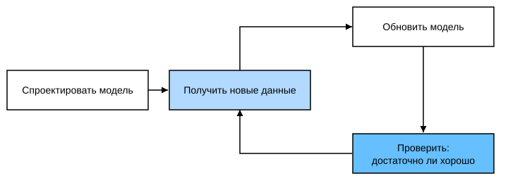
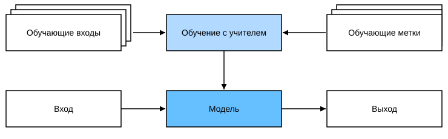
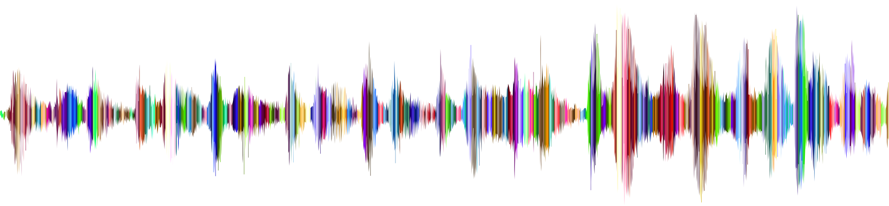
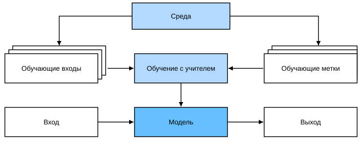
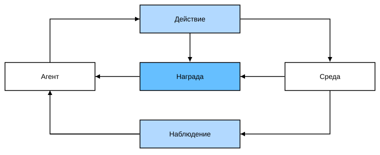

# 1. Введение

Ещё совсем недавно почти каждая компьютерная программа, с которой мы ежедневно сталкиваемся, создавалась разработчиками «с нуля». Допустим, нам нужно написать приложение для управления интернет-магазином. Несколько часов поломав голову у доски, мы, вероятно, набросали бы общие контуры решения примерно такого вида: сначала пользователь работает с приложением через интерфейс в веб-браузере или мобильном приложении; затем приложение обращается к движку базы данных, чтобы сохранять историю транзакций и отслеживать действия каждого пользователя. Главная часть такого приложения — «бизнес-логика», которая подробно описывает, что программа должна делать в каждой из возможных ситуаций.

Чтобы доработать бизнес-логику, разработчики должны продумать все пограничные случаи, которые могут возникнуть, и для каждого предусмотреть подходящее правило. Когда покупатель нажимает «добавить в корзину», приложение создаёт запись в таблице корзин, связывая идентификатор пользователя с идентификатором товара. Конечно, написать безупречное приложение с первой попытки почти невозможно, но в большинстве случаев разработчики могут опираться на бизнес-логику, писать соответствующий ей код и тестировать его до тех пор, пока он не начнёт удовлетворять потребности пользователей. Проектировать автоматизированные системы, которые управляют работой продуктов и сервисов, исходя из бизнес-логики, — выдающееся достижение человеческого мышления.

К счастью, для растущего сообщества специалистов по машинному обучению автоматизация многих задач уже не зависит от логики, которую человек способен заранее предусмотреть. Представим, что разработчику нужно решить одну из следующих задач:

* написать приложение, которое получает географические данные, спутниковые снимки и часть исторических метеорологических данных и предсказывает завтрашнюю погоду;
* написать приложение, которое принимает вопрос, сформулированный естественным языком, и правильно на него отвечает;
* написать приложение, которое принимает изображение, распознаёт на нём людей и обводит контуром каждого из них;
* написать приложение, которое рекомендует пользователю товары, которые ему, вероятно, понравятся, но которые он вряд ли найдёт при обычном просмотре.

В этих случаях даже сильнейшие программисты не смогут предложить идеальное решение, и причины могут быть разными. Иногда задача подчиняется закономерностям, которые меняются со временем, и программа должна подстраиваться автоматически. Иногда связи внутри задачи слишком сложны (например, связь между пикселями и абстрактными категориями) и требуют тысяч или миллионов вычислений. Даже когда человеческий глаз без усилий справляется с подобными задачами, вычисления, которые за этим стоят, недоступны человеческому осознанию.

*Машинное обучение* (machine learning, ML) — класс мощных методов, которые умеют учиться на опыте. Обычно алгоритм машинного обучения использует наблюдаемые данные или взаимодействие со средой, и по мере накопления опыта его качество растёт. Напротив, интернет-магазин из нашего примера, выполняющий одну и ту же бизнес-логику, не станет лучше, сколько бы опыта ни накопил, — если только разработчики не заметят проблему и не обновят программу. Эта книга проведёт читателя в мир машинного обучения и уделит особое внимание основам *глубокого обучения* (deep learning, DL). Глубокое обучение — мощный набор методов, который стимулирует прогресс в таких областях, как компьютерное зрение, обработка естественного языка, здравоохранение и геномика.

## 1.1 Машинное обучение в повседневной жизни

Машинное обучение окружает нас повсюду. Представим, что авторы этой книги вместе едут в кофейню. Астон достаёт iPhone и говорит: «Hey Siri!» — и система распознавания речи в телефоне просыпается. Затем Му Ли говорит Siri: «Поехали в кофейню Starbucks». Система распознавания речи автоматически переводит речь в текст и запускает приложение карт. Приложение, запустившись, отбирает несколько маршрутов и для каждого показывает расчётное время в пути…

Так видно, что машинное обучение пронизывает всю нашу жизнь: за несколько секунд взаимодействия с телефоном может одновременно работать сразу несколько моделей машинного обучения.

Теперь предположим, что нам нужно написать программу, которая реагирует на «ключевое слово пробуждения» — например, «Alexa», «Сяо Ай Тунсюэ» (小爱同学) или «Hey Siri». Попробуем написать её на компьютере обычным редактором кода, как показано на рис. 1.1. Задача кажется трудноразрешимой: микрофон собирает около 44 000 отсчётов в секунду, и каждый из них — измерение амплитуды звуковой волны. Но это измерение нельзя напрямую связать с ключевым словом. Как написать программу, которая по сырому аудиофрагменту с микрофона надёжно выдаёт предсказание из множества $\{\text{да}, \text{нет}\}$ — содержит ли фрагмент ключевое слово? Мы не знаем, как написать такую программу. Именно поэтому нужно машинное обучение.


**Рис. 1.1.** Распознавание ключевого слова

Как правило, даже если мы не знаем, как явно объяснить компьютеру, как по входу получить выход, наш мозг всё равно способен выполнять такие когнитивные функции. Иначе говоря, даже не зная, как написать программу, которая распознаёт слово «Alexa», наш мозг сам умеет его распознавать. Благодаря этой способности мы можем собрать *набор данных* (dataset) — большое количество аудиофрагментов, в которых помечено, есть ли в них ключевое слово. При использовании алгоритма машинного обучения нам не нужно «явно» конструировать систему, которая распознаёт ключевое слово. Вместо этого достаточно определить гибкую программную схему, поведение которой задаётся множеством *параметров* (parameter). Затем с помощью набора данных подбираются «наилучшие текущие значения параметров» — такие, при которых выбранная мера качества показывает наилучший результат выполнения задачи.

Что же такое параметры? Их можно представить как ручки настройки: поворачивая их, мы меняем поведение программы. Программа с конкретным набором настроенных параметров называется *моделью* (model). Совокупность всех различных программ (отображений «вход — выход», которые можно получить, меняя параметры) называется *семейством моделей*. Метапрограмма, которая использует набор данных, чтобы выбрать параметры, называется *алгоритмом обучения* (learning algorithm).

Прежде чем решать задачу с помощью алгоритма машинного обучения, мы должны точно её определить: установить, каковы *вход* (input) и *выход* (output), и выбрать подходящее семейство моделей. В нашем примере модель получает аудио в качестве входа и выдаёт выбор «да» или «нет». Если всё пойдёт хорошо, то после обучения модель обычно правильно предсказывает, содержит ли фрагмент ключевое слово.

Теперь модель каждый раз, когда слышит «Alexa», отвечает «да». Поскольку ключевое слово выбрано произвольно, нам может понадобиться достаточно богатое семейство моделей, чтобы в нём нашлись разные модели. Например, другая модель того же семейства будет отвечать «да» только на «Hey Siri». В идеале одно и то же семейство моделей должно подходить и для распознавания «Alexa», и для распознавания «Hey Siri», ведь интуитивно это похожие задачи. Однако если нам нужно работать с совершенно другими входами или выходами, например, преобразовывать изображение в подпись или текст с английского на китайский, может понадобиться совсем другое семейство моделей.

Но если все «кнопки» модели (её параметры) выставлены случайно, она вряд ли распознает «Alexa», «Hey Siri» или любое другое слово. В машинном обучении *обучение* (learning) — процесс тренировки модели. В ходе него мы находим правильный набор параметров, благодаря которому модель ведёт себя нужным образом. Иначе говоря, мы *обучаем* (train) модель на данных. Как показано на рис. 1.2, процесс обучения обычно включает следующие шаги:

1. Начинаем с модели со случайно заданными параметрами; такая модель пока ничего «не умеет».
2. Получаем примеры данных (например, аудиофрагменты и соответствующие метки «да» или «нет»).
3. Подстраиваем параметры так, чтобы модель лучше работала на этих примерах.
4. Повторяем шаги 2 и 3, пока работа модели над задачей не станет удовлетворительной.



**Рис. 1.2.** Типичный процесс обучения

Итак, вместо программы распознавания ключевого слова мы написали программу, которая *учится*. Если взять огромный размеченный набор данных, она, скорее всего, научится распознавать ключевое слово. Такой подход — «определять поведение программы с помощью набора данных» — можно назвать *программированием с данными* (programming with data). Например, можно сконструировать «детектор кошек», показав системе машинного обучения множество фотографий кошек и собак. Детектор в итоге научится выдавать очень большое положительное число для изображения кошки и очень маленькое отрицательное — для изображения собаки. Если же детектор не уверен, кошка или собака на снимке, он выдаст число, близкое к нулю…

Этот пример — лишь верхушка айсберга среди распространённых применений машинного обучения. *Глубокое обучение* — один из главных разделов машинного обучения, и далее в этом разделе мы разберём его подробнее.

## 1.2 Ключевые компоненты машинного обучения

Начнём с основных компонентов. Они присутствуют в любой задаче машинного обучения:

1. *данные* (data), которые можно использовать для обучения;
2. *модель* (model), которая преобразует данные;
3. *целевая функция* (objective function), которая количественно выражает эффективность модели;
4. *алгоритм* (algorithm), который подстраивает параметры модели для оптимизации целевой функции.

### 1.2.1 Данные

Без данных нет и науки о данных. Каждый набор данных состоит из отдельных *примеров* (example, sample), которые, как правило, подчиняются условию независимости и одинаковой распределённости (independently and identically distributed, i.i.d.). Примеры иногда называют *точками данных* (data point) или *экземплярами данных* (data instance). Обычно каждый пример описывается набором *признаков* (features, или *ковариат* (covariates)), на основе которых модель машинного обучения делает предсказания. В задачах обучения с учителем особый атрибут, который нужно предсказать, называется *меткой* (label, или *целевым значением* (target)).

При работе с изображениями каждая фотография — это пример, а её признаки задаются упорядоченным списком значений для каждого пикселя. Например, цветная фотография размером $200\times200$ состоит из $200\times200\times3=120000$ чисел, где «3» соответствует интенсивности красного, зелёного и синего каналов в каждой точке. Или возьмём медицинские данные: при заданном наборе стандартных признаков (возраста, жизненных показателей, диагнозов) по ним можно пытаться предсказать, выживет ли пациент.

Если у всех примеров одно и то же число признаков, то вектор признаков имеет фиксированную длину; эта длина называется *размерностью* (dimensionality) данных. Фиксированная длина вектора признаков — удобное свойство: она избавляет от лишних забот и позволяет единообразно обрабатывать большое количество примеров.

Однако не все данные можно представить векторами фиксированной длины. Например, если изображения получены со стандартного микроскопа, фиксированный размер разумен, но изображения из интернета вряд ли будут иметь одинаковое разрешение или форму. Можно обрезать их до стандартного размера, но этот приём ограничен и грозит потерей информации. Текстовые данные ещё меньше подходят под требование фиксированной длины: например, в отзывах покупателей на таких сайтах, как Amazon, одни тексты очень короткие («Отлично!»), а другие — длинные. По сравнению с традиционными методами машинного обучения одно из главных преимуществ глубокого обучения — способность работать с данными разной длины.

Как правило, чем больше данных, тем проще работать. Больше данных позволяет обучать более мощные модели и снижает зависимость от заранее сформулированных гипотез. Переход от небольших наборов данных к большим стал основой успеха современного глубокого обучения: без больших наборов данных многие захватывающие модели оказываются бесполезными. Даже если некоторые модели глубокого обучения работают на небольших наборах, по качеству они не превосходят традиционные методы.

Однако одних огромных объёмов данных недостаточно — нужны *правильные* данные. Если данные полны ошибок или их признаки не позволяют предсказать целевое значение, модель, скорее всего, окажется бесполезной. Эту мысль выражает известная поговорка: «Мусор на входе — мусор на выходе» («Garbage in, garbage out.»). Более того, плохие предсказания могут в разы усугубить последствия. В чувствительных приложениях — например, предиктивной полиции (predictive policing), отборе резюме и моделях кредитного риска — особенно важно помнить о последствиях «мусорных» данных.

Распространённая проблема — несбалансированные наборы данных: например, в медицинском обучающем наборе какие-то группы людей совсем не представлены. Представим, что мы хотим обучить модель распознавать рак кожи, но эта модель (на обучающем наборе) никогда не «видела» людей с тёмной кожей. Тогда она окажется беспомощной.

Другой пример: если обучить модель отбора резюме на «прошлых решениях о найме», модель может незаметно перенять исторические несправедливости и автоматизировать их. И всё это может происходить без чьего-либо ведома. Поэтому, когда данные недостаточно репрезентативны или содержат социальные предубеждения, модель с высокой вероятностью будет предвзятой.

### 1.2.2 Модель

Большинство задач машинного обучения связано с преобразованием данных. Например, система может по фотографии предсказывать, улыбается ли человек, или по набору показаний датчиков определять, насколько показания нормальны или аномальны. Простые модели справляются с такими задачами, но задачи, которые рассматриваются в этой книге, выходят за пределы возможностей классических методов. Главное отличие глубокого обучения от классических подходов в том, что оно опирается на мощные модели — сложные нейронные сети, в которых слои преобразований данных следуют один за другим; поэтому оно и называется *глубоким обучением* (deep learning). Обсуждая глубокие модели, мы также будем упоминать традиционные методы.

### 1.2.3 Целевая функция

Выше машинное обучение определялось как «обучение на опыте». Под «обучением» здесь понимается способность модели самостоятельно улучшать выполнение задачи. Но что считать настоящим улучшением?

В машинном обучении нужно определить меру того, насколько хороша или плоха модель. В большинстве случаев такую меру можно оптимизировать. Её называют *целевой функцией* (objective function).

Обычно целевую функцию задают так, чтобы её минимизировали, — ведь чем меньше, тем лучше. Поэтому такие функции иногда называют *функциями потерь* (loss function, или cost function). Но это лишь соглашение: можно взять и другую функцию и максимизировать её. Эти два подхода по сути эквивалентны и отличаются только знаком.

Когда задача состоит в предсказании числовых значений, самая распространённая функция потерь — *квадратичная ошибка* (squared error): квадрат разности между предсказанным и фактическим значениями. Для задач классификации чаще всего минимизируют *долю ошибок* — долю примеров, для которых предсказание не совпало с действительностью. Одни целевые функции (например, квадратичную ошибку) легко оптимизировать, а другие (например, долю ошибок) трудно оптимизировать напрямую из-за недифференцируемости или других сложностей. В таких случаях обычно оптимизируют *суррогатную цель* (surrogate objective).

Обычно функция потерь определяется через параметры модели и зависит от набора данных. На одном наборе данных мы можем найти наилучшие значения параметров, минимизируя суммарные потери. Набор данных, собранный для обучения, называется *обучающим набором данных* (training dataset, или *обучающим набором* (training set)). Однако модель, которая хорошо работает на обучающих данных, не обязательно покажет такой же результат на «новых данных». Эти новые данные обычно называют *тестовым набором данных* (test dataset, или *тестовым набором* (test set)).

Итак, доступные данные обычно делят на две части: обучающий набор, по которому подбираются параметры модели, и тестовый набор, по которому оценивается подобранная модель. Затем мы смотрим, как модель работает на каждой из этих частей.

Качество модели на обучающих данных можно сравнить с баллами ученика на пробном экзамене. Этот результат служит ориентиром перед настоящим экзаменом: даже если баллы обнадёживают, они не гарантируют успеха. Иначе говоря, результаты на тестовых данных могут заметно отличаться от результатов на обучающих. Модель, которая хорошо работает на обучающем наборе, но не переносит этот результат на тестовый, называют *переобученной* (overfitting). Как и в жизни: можно отлично написать пробный экзамен, но не обязательно так же сдать настоящий.

### 1.2.4 Алгоритм оптимизации

Когда у нас есть источник данных и их представление, модель и подходящая функция потерь, нужен алгоритм, который найдёт наилучшие значения параметров, минимизирующие функцию потерь.

В глубоком обучении большинство популярных алгоритмов оптимизации основано на базовом методе — *градиентном спуске* (gradient descent). Вкратце: на каждом шаге градиентный спуск проверяет каждый параметр и смотрит, в каком направлении изменится ошибка на обучающем наборе, если немного изменить именно этот параметр. Затем параметры смещаются в направлении, которое уменьшает потери.

## 1.3 Виды задач машинного обучения

Задача распознавания ключевого слова — лишь малая часть широкого спектра приложений машинного обучения. Ниже перечислены распространённые задачи и приложения, которые пригодятся нам дальше в книге. Мы будем часто ссылаться на введённые понятия: данные, модели и алгоритмы оптимизации.

### 1.3.1 Обучение с учителем

*Обучение с учителем* (supervised learning) хорошо справляется с предсказанием меток по заданным входным признакам. Каждая пара «признаки — метка» называется *примером* (example). Иногда, даже когда метка неизвестна, примером называют и просто входные признаки. Наша цель — построить модель, которая отображает любой вектор входных признаков в метку, то есть делает предсказание.

Приведём конкретный пример: пусть нужно предсказать, случится ли у пациента сердечный приступ. Тогда наблюдаемый исход — «приступ был» или «приступа не было» — станет меткой примера. Входными признаками могут быть жизненные показатели, например пульс, диастолическое и систолическое давление.

Обучение с учителем работает потому, что при подборе параметров мы предоставляем модели набор данных, в котором у каждого примера есть истинная метка. На языке теории вероятностей мы хотим предсказывать условную вероятность метки при заданных входных признаках.

Обучение с учителем — лишь один из нескольких классов задач машинного обучения, но в промышленности большинство успешных приложений использует именно его. Причина в том, что многие важные задачи можно чётко сформулировать как оценку неизвестной величины по имеющимся данным. Например:

* по снимку компьютерной томографии (КТ) опухоли определить, является ли она раковой;
* по английскому предложению предсказать правильный перевод на французский;
* по финансовым отчётам за текущий месяц спрогнозировать цену акций на следующий месяц.

Процесс обучения с учителем обычно делится на три большие части:

1. Случайным образом выбрать подмножество из большого набора известных примеров и получить для каждого из них истинную метку. Иногда метки уже есть (например, выздоровел ли пациент в течение года?), иногда их нужно разметить вручную (например, при классификации изображений). Входы вместе с соответствующими метками образуют обучающий набор данных.
2. Выбрать алгоритм обучения с учителем, который получает на вход обучающий набор данных и возвращает «обученную модель».
3. Подать на вход обученной модели признаки ранее не встречавшихся примеров и использовать её выход как предсказание соответствующей метки.

Весь процесс обучения с учителем показан на рис. 1.3.



**Рис. 1.3.** Обучение с учителем

Итак, даже если описать задачу как предсказание метки по заданным входным признакам, обучение с учителем может принимать самые разные формы моделей и требует множества решений, которые зависят от типа, размера и количества входов и выходов. Например, для обработки «последовательностей произвольной длины» и «последовательностей фиксированной длины» используются разные модели.

#### 1.3.1.1 Регрессия

*Регрессия* (regression) — одна из простейших задач обучения с учителем.

Допустим, есть таблица данных о продаже домов: каждая строка соответствует дому, каждый столбец — связанному с ним атрибуту, например площади, количеству спален, количеству ванных комнат, расстоянию пешком до центра города и т. д. Атрибуты каждой строки образуют вектор признаков одного дома. Если человек живёт в Нью-Йорке или в Сан-Франциско и он не является генеральным директором Amazon, Google, Microsoft или Facebook, то вектор признаков его дома (площадь, количество спален, количество ванных комнат, расстояние пешком) может выглядеть примерно так: $[600, 1, 1, 60]$. Если же человек живёт в Питтсбурге, вектор, скорее всего, будет ближе к $[3000, 4, 3, 10]$…

Когда человек ищет новое жильё, ему может понадобиться оценить справедливую рыночную стоимость дома. Почему это задача регрессии? Потому что выходом служит число — цена продажи (то есть метка). Когда метка может принимать любое числовое значение, мы говорим о задаче *регрессии*, и цель — построить модель, предсказания которой максимально близки к истинным значениям метки.

Многие задачи из жизни относятся к регрессии. Например, предсказание оценки, которую пользователь поставит фильму, — задача регрессии. Любопытный факт: в 2009 году тот, кто придумал отличный алгоритм предсказания оценок фильмов, мог бы выиграть [премию Netflix Prize в 1 миллион долларов](https://en.wikipedia.org/wiki/Netflix_Prize). Ещё один пример — предсказание того, сколько дней пациент пробудет в больнице.

В целом хорошее эмпирическое правило таково: если вопрос касается «сколько», скорее всего, перед нами задача регрессии. Например:

* сколько часов займёт эта операция;
* сколько миллиметров осадков выпадет в городе за следующие 6 часов.

Даже если вы никогда не использовали машинное обучение, вы, возможно, уже неявно решали задачи регрессии. Например, вы вызвали сантехника, он три часа чистил канализационную трубу и выставил счёт на 350 долларов. Ваш друг нанял того же мастера на 2 часа и получил счёт на 250 долларов. Если кто-то попросит вас оценить стоимость очистки от засора, вы можете предположить, что мастер берёт фиксированную плату за выезд и затем почасовую оплату. Если эти допущения верны, то, имея два примера, вы уже можете определить структуру его тарифов: 50 долларов за выезд и ещё 100 долларов в час. Таким образом, сами того не заметив, вы поняли и применили алгоритм линейной регрессии.

Однако эти допущения не всегда уместны. Например, некоторые различия могут объясняться несколькими факторами, помимо двух признаков. В таких случаях мы будем стараться обучить модель, которая минимизирует разницу между предсказанными и фактическими значениями меток. Большинство глав этой книги будет посвящено минимизации квадратичной функции потерь.

#### 1.3.1.2 Классификация

Хотя модели регрессии хорошо решают задачи «сколько», многие задачи такими не являются. Например, банк хочет добавить в своё мобильное приложение функцию фотографирования чеков. Приложение должно автоматически распознавать текст на изображении и сопоставлять рукописные символы с соответствующими известными символами.

Вопросы вида «какой именно» относятся к задачам *классификации* (classification). В задаче классификации модель предсказывает, к какой *категории* (category, формально — *классу* (class)) относится пример. Например, рукописные цифры могут относиться к 10 классам: метками будут числа от 0 до 9.

Простейший случай — когда классов всего два; это называется *бинарной классификацией* (binomial classification). Например, набор данных может состоять из изображений животных, а метки — из двух классов: {кошка, собака}. Регрессия обучает функцию, которая выдаёт число; классификация обучает классификатор, который выдаёт предсказанный класс.

Но как модель приходит к жёсткому предсказанию «да» или «нет»? Понять это можно через язык вероятностей: по признакам примера модель назначает каждому возможному классу вероятность. Например, в уже знакомом примере с кошками и собаками классификатор может выдать вероятность 0,9 того, что на изображении кошка. Что означает это число? Его можно понимать так: классификатор на 90% уверен, что изображена кошка. Величина вероятностей классов передаёт меру неопределённости модели; в последующих главах книги мы обсудим и другие алгоритмы, которые используют понятие неопределённости.

Когда классов больше двух, задача называется *многоклассовой классификацией* (multiclass classification). Распространённый пример — распознавание рукописных символов $\mathrm{\{0, 1, 2, ... 9, a, b, c, ...\}}$. В отличие от регрессии, стандартная функция потерь для задач классификации — *кросс-энтропия* (cross-entropy), которая подробно разбирается в разделе 3.4 «Softmax-регрессия».

Заметим, что самый частый класс не обязательно будет тем классом, который мы в итоге выбираем для принятия решения. Например, пусть на заднем дворе растёт гриб, как на рис. 1.4.


**Рис. 1.4.** Бледная поганка — есть нельзя!!

Теперь мы хотим обучить детектор ядовитых грибов, который по фотографии предсказывает, ядовит ли гриб. Предположим, классификатор выдаёт для гриба с рис. 1.4 вероятность 0,2 того, что это бледная поганка. Иначе говоря, классификатор на 80% уверен, что гриб не бледная поганка. Тем не менее мы его есть не станем: не стоит рисковать 20% вероятностью смерти. Неопределённость риска весит для нас гораздо больше, чем выгода. Поэтому в качестве функции потерь нужно использовать *ожидаемый риск*: вероятность каждого исхода умножить на связанный с ним выигрыш (или ущерб). В этом случае потери от употребления гриба равны $0.2 \times \infty + 0.8 \times 0 = \infty$, а потери от того, что мы его выбросим, равны $0.2 \times 0 + 0.8 \times 1 = 0.8$. Осторожность, как выясняется, была оправдана: гриб с рис. 1.4 действительно является бледной поганкой.

Классификация может быть гораздо сложнее двоичной или многоклассовой. Например, существуют варианты задач классификации, которые используют иерархию и предполагают наличие определённых связей между классами. Поэтому не все ошибки равноценны: люди предпочли бы ошибиться, отнеся объект к близкому классу, а не к далёкому. Это обычно называют *иерархической классификацией* (hierarchical classification). Ранний пример — [Карл Линней](https://en.wikipedia.org/wiki/Carl_Linnaeus), который построил иерархическую классификацию животных.

В классификации животных, например, принять ши-тцу за шнауцера может быть не так уж плохо. Но если модель спутает ши-тцу с динозавром, это будет нелепо. Насколько важна та или иная иерархическая связь, может зависеть от того, как пользователь собирается применять модель. Например, гремучник и безвредный уж могут быть близки по родству, но если спутать гремучника с ужом, последствия могут быть серьёзными, ведь гремучник ядовит, а уж — нет.

#### 1.3.1.3 Задачи разметки

Некоторые задачи классификации хорошо подходят для двоичной или многоклассовой классификации. Например, можно обучить обычный двоичный классификатор, который отличает кошек от собак. С помощью современных алгоритмов компьютерного зрения такую модель обучить несложно. Однако, как бы точна она ни была, при встрече с новым животным она может растеряться. Например, на рис. 1.5 показана иллюстрация к популярной немецкой сказке «Бременские музыканты»: на фоне деревьев изображены кот, петух, собака и осёл. В зависимости от того, что именно мы хотим делать с моделью, считать эту задачу двоичной классификацией может не иметь смысла. Вместо этого мы, возможно, захотим, чтобы модель описывала содержимое входного изображения: кот, петух, собака и осёл.


**Рис. 1.5.** Кот, петух, собака и осёл

Задачи предсказания нескольких *не исключающих друг друга* классов называются *многометочной классификацией* (multi-label classification). Например, метки, которые авторы технических блогов ставят своим постам: «машинное обучение», «технологии», «гаджеты», «языки программирования», «Linux», «облачные вычисления», «AWS». Типичная статья получает 5–10 меток, потому что эти понятия связаны между собой: пост об облачных вычислениях может упоминать AWS, а пост о машинном обучении — языки программирования.

Подобные задачи встречаются и при обработке биомедицинской литературы. Правильная разметка публикаций важна: она помогает исследователям эффективно просматривать литературу. В Национальной медицинской библиотеке США (The United States National Library of Medicine) специалисты-аннотаторы просматривают каждую статью, индексируемую в PubMed, и связывают её с соответствующими терминами из MeSH (MeSH — набор примерно из 28 000 меток). Это очень трудоёмкий процесс: между архивированием статьи и её разметкой обычно проходит год. Здесь алгоритмы машинного обучения могут выставлять предварительные метки, пока каждая статья не получит строгой ручной проверки. Кстати, в последние годы организация BioASQ [проводит соревнования](http://bioasq.org/) именно по этой задаче.

#### 1.3.1.4 Поиск

Иногда нам нужно не просто вывести класс или вещественное значение, а упорядочить набор объектов. В информационном поиске именно это и требуется. Например, в веб-поиске цель — не просто классифицировать пару «запрос — страница», а из огромного множества результатов найти те, которые нужнее всего пользователю. Порядок результатов тоже очень важен: алгоритм обучения должен выдавать упорядоченное подмножество элементов. Иначе говоря, если нужно вернуть первые 5 букв алфавита, ответы «A, B, C, D, E» и «C, A, B, E, D» различаются. Даже если набор результатов одинаков, порядок внутри него иногда оказывается важным.

Одно из возможных решений: сначала присвоить каждому элементу набора оценку релевантности, а затем выбрать элементы с наивысшими оценками. [PageRank](https://en.wikipedia.org/wiki/PageRank) — ранний пример такой системы оценок, с которой начинался поисковик Google; но её особенность в том, что она не зависит от конкретного запроса. В этом подходе поисковая система сначала применяет простой фильтр релевантности, чтобы выделить набор подходящих записей, а затем ранжирует результаты, содержащие условия запроса, по PageRank. Сегодня поисковые системы используют машинное обучение и модели поведения пользователей, чтобы получать оценки релевантности веб-страниц, и многие научные конференции посвящены этой теме.

#### 1.3.1.5 Рекомендательные системы

Другой класс задач, связанных с поиском и ранжированием, — *рекомендательные системы* (recommender systems). Их цель — персонализированные рекомендации конкретному пользователю. Например, для фильмов страницы рекомендаций у любителей научной фантастики и у любителей комедий могут сильно различаться. Похожие приложения встречаются в розничной торговле, музыке и новостях.

В некоторых приложениях клиенты дают явную обратную связь, выражая свою симпатию к товарам, например через оценки и отзывы на Amazon. В других случаях обратная связь неявная: например, если пользователь пропускает некоторые песни в плейлисте, это может говорить о том, что эти песни ему не подходят. В целом рекомендательная система оценивает соответствие пары «пользователь — объект»; эта оценка может быть предсказанным рейтингом или вероятностью покупки. Затем для каждого пользователя система выбирает объекты с наивысшими оценками и рекомендует их. Описанные алгоритмы просты; промышленные рекомендательные системы устроены гораздо сложнее и учитывают подробную активность пользователя и характеристики товаров. Алгоритмы таких систем настраиваются так, чтобы улавливать предпочтения человека.

Например, на рис. 1.6 показаны книги по глубокому обучению, которые Amazon рекомендует на основе персонализированного алгоритма; рекомендации точно уловили интересы автора.

> **Рис. 1.6.** Книги по глубокому обучению, рекомендованные Amazon на основе персонализированного алгоритма. Скриншот страницы стороннего сайта не включён в перевод

Несмотря на большую практическую ценность, использовать рекомендательные системы только как модели предсказания не всегда достаточно. Во-первых, наши данные содержат лишь *цензурированную обратную связь* (censored feedback): пользователи склонны оценивать то, что вызвало у них сильные эмоции. Например, в пятибалльной системе оценок фильмов будет много пятёрок и единиц, а троек — заметно меньше. Во-вторых, рекомендательные системы могут образовывать *петли обратной связи* (feedback loop). Система сначала продвигает товар с большими продажами (который, возможно, считается лучшим); пользователи затем покупают то, что им рекомендуют, и алгоритм обучения, не учитывая этого эффекта, будет рекомендовать такой товар ещё чаще. Итак, вопросы о том, как учитывать цензуру, стимулы и петли обратной связи, — важные открытые исследовательские проблемы.

#### 1.3.1.6 Обучение последовательностям

Большинство перечисленных выше задач имеют входы и выходы фиксированного размера. Например, при предсказании цены дома мы рассматриваем фиксированный набор признаков: площадь, количество спален, количество ванных комнат, время пешком до центра. В задаче классификации изображений вход — изображение фиксированного размера, а выход — фиксированное число вероятностей (по одной на каждый класс). В таких случаях модель использует вход только как «сырьё» для выхода и не «запоминает» конкретное содержимое входа.

Если примеры на входе не связаны между собой, такие модели могут работать идеально. Но если вход непрерывен, модели может понадобиться «память». Например, как обрабатывать видеоклип? Каждый клип может состоять из разного числа кадров. Зная предыдущий кадр, мы можем лучше предсказать происходящее в следующем. То же касается языка: входы и выходы машинного перевода — тоже последовательности слов.

В медицине последовательные входы и выходы важны ещё больше. Представим модель, которая следит за пациентами в реанимации и подаёт сигнал тревоги, если риск смерти в течение следующих 24 часов превышает пороговое значение. Нам совсем не хочется отбрасывать всю историю болезни пациента за каждый прошедший час и делать прогноз только по последним измерениям.

Эти задачи — примеры *обучения последовательностям* (sequence learning), одного из самых захватывающих направлений машинного обучения. Обучение последовательностям предполагает получение входной последовательности, выдачу выходной последовательности или и то, и другое. В частности, входы и выходы могут иметь переменную длину, как в машинном переводе или при расшифровке речи в текст. Невозможно рассмотреть все типы преобразования последовательностей, поэтому отметим несколько частных случаев.

**Разметка и синтаксический разбор.** Это аннотирование текстовой последовательности атрибутами. Иначе говоря, число входов и выходов в основном одинаково. Например, мы можем захотеть узнать, где находятся глагол и подлежащее, или какие слова являются именованными сущностями. Обычно цель — разобрать и аннотировать текст на основе структурных и грамматических предположений, чтобы получить какие-то аннотации. Это звучит гораздо сложнее, чем есть на самом деле. Ниже приведён очень простой пример: предложение аннотировано «метками», которые показывают, какие слова обозначают именованные сущности. Метка «Ent» — сокращение от *сущность* (entity).

```text
Том  ужинает  в  Вашингтоне  с  Салли
Ent  -        -  Ent         -  Ent
```

**Автоматическое распознавание речи.** В распознавании речи входная последовательность — запись речи говорящего (см. рис. 1.7), а выходная — текстовая расшифровка сказанного. Трудность в том, что аудиокадров значительно больше, чем слов в тексте: звук обычно оцифровывается с частотой 8 или 16 кГц. То есть соответствия 1:1 между аудио и текстом нет: тысячи отсчётов могут соответствовать одному слову. Это тоже задача «последовательность в последовательность», в которой выход гораздо короче входа.



**Рис. 1.7.** «-D-e-e-p- L-ea-r-ni-ng-» в записи

**Синтез речи (преобразование текста в речь).** Это обратная задача распознавания речи: входом является текст, а выходом — аудиофайл. В этом случае выход гораздо длиннее входа. Человеку несложно определить, что аудиозапись звучит неестественно, но для компьютера это не так просто.

**Машинный перевод.** В распознавании речи входы и выходы следуют в одном и том же порядке. В машинном переводе, напротив, порядок очень важен: мы по-прежнему преобразуем одну последовательность в другую, но количество входных и выходных элементов, как правило, не совпадает, и порядок соответствующих элементов тоже может различаться. Например, в примере ниже «неверное выравнивание» показывает характерную особенность немецкого синтаксиса — тенденцию ставить глагол в конец предложения.

```text
Немецкий:              Haben Sie sich schon dieses grossartige Lehrwerk angeschaut?
Английский:            Did you already check out this excellent tutorial?
Неверное выравнивание: Did you yourself already this excellent tutorial looked-at?
```

Другие задачи тоже используют обучение последовательностям. Например, определение порядка, в котором пользователь читает веб-страницу, — задача двумерного анализа макета. Диалоговые задачи сложнее: чтобы определить следующую реплику в диалоге, нужно учитывать историю беседы и знания о реальном мире… Все эти направления — горячие темы в исследованиях обучения последовательностям.

### 1.3.2 Обучение без учителя

До сих пор все примеры относились к обучению с учителем: модели требовалось предоставлять огромный набор данных, в котором каждый пример содержит признаки и соответствующее значение метки. В шутку можно сказать, что модель обучения с учителем похожа на сотрудника с очень специфической работой и очень скучным начальником. Начальник стоит за спиной и точно говорит, что делать в каждой ситуации, пока сотрудник не научится сопоставлять ситуации с действиями. Угодить такому начальнику легко: нужно как можно быстрее распознать закономерности и копировать его поведение.

Если же работа не имеет чёткой цели, приходится учиться «самостоятельно». Например, начальник может выдать большой массив данных и попросить провести по нему какое-то исследование в области науки о данных, не уточняя, каким должен быть результат. Задачи машинного обучения, в данных которых нет «целевого значения», обычно называют *обучением без учителя* (unsupervised learning); в последующих главах книги мы обсудим методы обучения без учителя. Итак, на какие вопросы может отвечать обучение без учителя? Рассмотрим несколько примеров.

* *Кластеризация* (clustering): можно ли разделить данные на группы без меток? Например, по набору фотографий разбить их на пейзажи, собак, младенцев, кошек и горные вершины. Или по истории просмотров веб-страниц пользователей выделить тех, чьё поведение похоже.
* *Метод главных компонент* (principal component analysis): можно ли найти небольшое число параметров, которые точно описывают линейно связанные свойства данных? Например, траекторию мяча можно описать его скоростью, диаметром и массой. Портные уже разработали небольшой набор параметров, довольно точно описывающих форму человеческого тела, чтобы подгонять одежду. Ещё один пример: существует ли в евклидовом пространстве представление объектов произвольной структуры, в котором символические свойства хорошо согласуются с отношениями между объектами? Такое представление может описывать сущности и их связи, например «Рим» $-$ «Италия» $+$ «Франция» $=$ «Париж».
* *Причинность* (causality) и *вероятностные графические модели* (probabilistic graphical models): можно ли описать первопричины многих наблюдаемых данных? Например, если у нас есть демографические данные о стоимости жилья, загрязнении, преступности, географии, образовании и зарплатах, можно ли выявить связи между ними, опираясь только на эмпирические данные?
* *Генеративно-состязательные сети* (generative adversarial networks): дают способ синтезировать данные, в том числе такие сложные неструктурированные данные, как изображения и аудио. Лежащий в основе статистический механизм — проверка, неотличимы ли настоящие данные от поддельных. Это ещё одна важная и захватывающая область обучения без учителя.

### 1.3.3 Взаимодействие со средой

Некоторые задаются вопросом: откуда берутся входные данные машинного обучения и куда направляются его выходы? До сих пор, будь то обучение с учителем или без, мы заранее получали большой объём данных, затем запускали модель и больше не взаимодействовали со средой. Всё обучение происходило отдельно от среды; такое обучение называют *офлайн-обучением* (offline learning).

Для обучения с учителем процесс сбора данных из среды выглядит так, как показано на рис. 1.8.



**Рис. 1.8.** Сбор данных из среды для обучения с учителем

У простого офлайн-обучения есть своя привлекательность: можно изолированно заниматься распознаванием образов, не отвлекаясь на другие задачи. Но недостаток в том, что круг решаемых задач довольно ограничен. Поэтому от искусственного интеллекта мы ожидаем не только предсказаний, но и взаимодействия с реальной средой. В отличие от предсказания, «взаимодействие со средой» действительно влияет на неё. Здесь ИИ — это «интеллектуальный агент», а не просто «модель предсказания». Значит, нужно учитывать, что его действия могут влиять на будущие наблюдения.

Рассмотрение взаимодействия со средой открывает целый ряд новых задач моделирования. Вот несколько примеров:

* Помнит ли среда, что мы делали раньше?
* Помогает ли среда нам в моделировании? Например, пользователь диктует текст в систему распознавания речи.
* Пытается ли среда обыграть модель? Например, в состязательных сценариях, таких как фильтрация спама или игры?
* Важна ли среда?
* Меняется ли среда? Например, будут ли будущие данные всегда похожи на прошлые или они меняются со временем — естественным образом или в ответ на наши автоматизированные инструменты?

Последний вопрос ведёт к проблеме *сдвига распределения* (distribution shift): обучающие и тестовые данные различаются. Далее кратко описана задача обучения с подкреплением — класс задач, которые явно учитывают взаимодействие со средой.

### 1.3.4 Обучение с подкреплением

Если вас интересует разработка систем, которые взаимодействуют со средой и выполняют действия, машинное обучение, скорее всего, приведёт вас к *обучению с подкреплением* (reinforcement learning). Оно может применяться в робототехнике, диалоговых системах и даже при создании ИИ для видеоигр. *Глубокое обучение с подкреплением* (deep reinforcement learning), в котором глубокое обучение применяется к задачам обучения с подкреплением, — очень популярная область исследований. Прорывными примерами стали глубокая *Q-сеть* (Q-network), которая победила людей в играх Atari, используя только визуальный вход, и программа AlphaGo, которая обыграла чемпиона мира по го.

В задаче обучения с подкреплением *агент* (agent) взаимодействует со средой в последовательности временных шагов. В каждый момент времени агент получает от среды *наблюдение* (observation) и должен выбрать *действие* (action), которое передаётся обратно в среду через некоторый механизм (его иногда называют исполнительным устройством). После этого агент получает от среды *награду* (reward). Затем начинается новый цикл: агент получает последующее наблюдение, выбирает следующее действие и т. д. Процесс обучения с подкреплением показан на рис. 1.9. Обратите внимание: цель обучения с подкреплением — получить хорошую *стратегию* (policy). Действие, которое выбирает агент, определяется стратегией — функцией, которая отображает наблюдения среды в действия.



**Рис. 1.9.** Взаимодействие обучения с подкреплением и среды

Схема обучения с подкреплением очень общая. Например, любую задачу обучения с учителем можно превратить в задачу обучения с подкреплением. Пусть у нас есть задача классификации: можно создать агента, у которого каждый класс соответствует «действию». Затем создаём среду, которая выдаёт агенту награду. Эта награда совпадает с функцией потерь исходной задачи обучения с учителем.

Конечно, обучение с подкреплением может решать и многие задачи, недоступные обучению с учителем. Например, в обучении с учителем мы всегда предполагаем, что входы связаны с правильными метками. В обучении с подкреплением нельзя рассчитывать, что среда подскажет агенту оптимальное действие для каждого наблюдения. Как правило, агент получает только награды. Более того, среда может даже не сообщать, какие именно действия привели к награде.

Рассмотрим пример: обучение с подкреплением в шахматах. Единственный настоящий сигнал награды появляется в конце партии: если агент выигрывает, он получает награду 1, если проигрывает — −1. Поэтому агент должен решить задачу *распределения заслуги* (credit assignment): определить, какие действия заслуживают поощрения, а какие — наказания. Это похоже на повышение сотрудника: оно, скорее всего, отражает множество действий за весь предыдущий год. Чтобы получить новое повышение в будущем, нужно понять, какие именно действия к нему привели.

Обучение с подкреплением может также столкнуться с проблемой *частичной наблюдаемости* (partial observability): текущее наблюдение может не содержать всей информации о текущем состоянии. Представим уборочного робота, который оказался в доме со множеством одинаковых кладовок. Чтобы вычислить точное положение робота (а значит, и его состояние), нужно учитывать предыдущие наблюдения, сделанные до того, как он зашёл в кладовку.

Наконец, в любой момент времени агент, обучающийся с подкреплением, может знать хорошую стратегию, но при этом существуют многие лучшие стратегии, которых он ещё не пробовал. Агент должен постоянно выбирать: использовать ли текущую лучшую стратегию или исследовать новое пространство стратегий, отказавшись от части краткосрочной награды ради знаний. Это дилемма *исследования и использования* (exploration vs. exploitation).

Общая задача обучения с подкреплением очень широка. Действия агента влияют на последующие наблюдения, а награда связана только с выбранными действиями. Среда может быть полностью или частично наблюдаемой; разобрать все эти сложности было бы слишком трудно даже исследователям. Кроме того, не каждая практическая задача обладает всеми этими сложностями. Поэтому учёные изучают частные случаи задач обучения с подкреплением.

Если среда полностью наблюдаема, задача обучения с подкреплением называется *марковским процессом принятия решений* (Markov decision process). Если состояние не зависит от предыдущих действий, задача называется *контекстуальным бандитом* (contextual bandit problem). Если состояний нет и есть лишь набор изначально неизвестных действий с неизвестными наградами, это классическая *задача многорукого бандита* (multi-armed bandit problem).

## 1.4 Истоки

Для решения самых разных задач машинного обучения глубокое обучение предлагает мощные инструменты. Хотя многие методы глубокого обучения совершили значительный прорыв лишь недавно, основные идеи использования данных и нейронных сетей развивались уже несколько столетий. Людям давно хотелось анализировать данные и предсказывать будущие результаты, и на этом желании во многом держатся естественные науки.

Например, распределение Бернулли названо в честь [Якоба Бернулли (1654–1705)](https://en.wikipedia.org/wiki/Jacob_Bernoulli). А нормальное распределение открыл [Карл Фридрих Гаусс (1777–1855)](https://en.wikipedia.org/wiki/Carl_Friedrich_Gauss): он изобрёл алгоритм наименьших квадратов, который до сих пор используется для решения множества задач — от страховых расчётов до медицинской диагностики. Эти инструменты породили экспериментальный подход в естественных науках: например, закон Ома для тока и напряжения на резисторе прекрасно описывается линейной моделью.

Даже в Средние века математики обладали тонким чутьём в вопросах *оценивания* (estimation). Например, [Якоб Кёбель (1460–1533)](https://www.maa.org/press/periodicals/convergence/mathematical-treasures-jacob-kobels-geometry) в своей книге по геометрии показывает, как через среднюю длину стоп 16 взрослых мужчин можно получить длину одного фута.


**Рис. 1.10.** Оценка длины одного фута

На рис. 1.10 показано, как работает эта оценка. Шестнадцать взрослых мужчин выстраиваются в ряд, ступня к ступне. Затем их общую длину делят на 16, получая оценку, которая и считается одним футом. Позднее алгоритм усовершенствовали, чтобы учесть стопы с необычными размерами: двух человек с самыми короткими и самыми длинными стопами исключают, а для остальных берут среднее. Это один из первых примеров *усечённого среднего* (trimmed mean estimate).

С накоплением и доступностью данных статистика по-настоящему расцвела. [Рональд Фишер (1890–1962)](https://en.wikipedia.org/wiki/Ronald_Fisher) внёс большой вклад в теорию статистики и её применение в генетике. Многие его алгоритмы (например, линейный дискриминантный анализ) и формулы (например, информационная матрица Фишера) до сих пор широко используются. Более того, набор данных об ирисах, который Фишер опубликовал в 1936 году, до сих пор иногда используется для проверки алгоритмов машинного обучения. Фишер также был сторонником евгеники, и это напоминает нам: этически сомнительное использование данных имеет такую же долгую историю, как и его продуктивное применение в промышленности и естественных науках.

Вторым источником влияния на машинное обучение стали [информационная теория Клода Шеннона (1916–2001)](https://en.wikipedia.org/wiki/Claude_Shannon) и [теория вычислений Алана Тьюринга (1912–1954)](https://en.wikipedia.org/wiki/Alan_Turing). В своей знаменитой статье «Вычислительные машины и разум» (Turing, 1950) Тьюринг поставил вопрос: «Могут ли машины мыслить?» В описанном им тесте машину можно считать «разумной», если человеку-оценщику трудно отличить её ответы в текстовом диалоге от ответов человека.

Другое влияние пришло из нейробиологии и психологии. Один из самых ранних алгоритмов появился в пионерской книге [Дональда Хебба (1904–1985)](https://en.wikipedia.org/wiki/Donald_O._Hebb) «Организация поведения» (Hebb, 1949). Хебб предположил, что нейроны обучаются через активное усиление связей. Этот принцип стал прототипом алгоритма обучения перцептрона Розенблатта и получил название «хеббовского обучения». Он также заложил основу многих алгоритмов стохастического градиентного спуска, которые используются в современном глубоком обучении: усиление желаемого поведения и ослабление нежелательного помогают получить в нейронной сети хорошие значения параметров.

*Нейронные сети* (neural networks) получили название по биологической аналогии. Более века назад (начиная с моделей Александра Бейна 1873 года и Джеймса Шеррингтона 1890 года) исследователи пытались собирать вычислительные схемы, похожие на сети взаимодействующих нейронов. Со временем биологические трактовки стали менее буквальными, но название сохранилось. В основе большинства современных сетей лежат несколько ключевых принципов:

* чередование линейных и нелинейных элементов обработки, которые обычно называют *слоями* (layers);
* использование правила цепочки (также называемого *обратным распространением ошибки* (backpropagation)) для одновременной настройки всех параметров сети.

После первого быстрого развития исследования нейронных сетей примерно с 1995 года застопорились и лишь в 2005 году начали понемногу оживать. Главных причин две. Во-первых, обучение сетей очень дорого в вычислительном отношении: в конце прошлого века оперативная память уже была достаточно вместительной, а вычислительной мощности не хватало. Во-вторых, наборы данных были относительно небольшими. Набор данных об ирисах Фишера был популярным инструментом проверки алгоритмов, а набор MNIST из 60 000 рукописных цифр считался огромным. С учётом нехватки данных и вычислительных ресурсов мощные статистические инструменты, такие как *ядерные методы* (kernel methods), *решающие деревья* (decision trees) и *графовые модели* (graph models), на практике показывали себя лучше. В отличие от нейронных сетей, эти алгоритмы не требуют недель обучения и обладают сильным теоретическим обоснованием, которое позволяет получать предсказуемые результаты.

## 1.5 Развитие глубокого обучения

Примерно с 2010 года нейросетевые алгоритмы, которые раньше казались вычислительно неосуществимыми, стали популярными. Причин две. Во-первых, появление интернет-компаний, обслуживающих сотни миллионов пользователей, сделало крупные наборы данных доступными. Во-вторых, распространение дешёвых и качественных датчиков, дешёвого хранения данных (закон Крайдера, Kryder's law) и дешёвых вычислений (закон Мура), особенно благодаря распространению GPU, сделало огромную вычислительную мощность доступной.

Это показано в таблице 1.1.

**Таблица 1.1.** Объём данных, памяти и вычислительной мощности по десятилетиям

| Год  | Объём данных           | Память | Производительность (FLOPS) |
| :--- | :--------------------- | :----- | :------------------------- |
| 1970 | 100 (ирисы Фишера)     | 1 KB   | 100 KF (Intel 8080)        |
| 1980 | 1 K (цены на жильё в Бостоне) | 100 KB | 1 MF (Intel 80186)  |
| 1990 | 10 K (распознавание рукописных символов) | 10 MB | 10 MF (Intel 80486) |
| 2000 | 10 M (веб-страницы)    | 100 MB | 1 GF (Intel Core)          |
| 2010 | 10 G (реклама)         | 1 GB   | 1 TF (Nvidia C2050)        |
| 2020 | 1 T (социальные сети)  | 100 GB | 1 PF (Nvidia DGX-2)        |

Очевидно, что оперативная память не поспевает за ростом данных. В то же время вычислительная мощность растёт быстрее, чем объём доступных данных. Это означает, что статистические модели должны становиться эффективнее по памяти (обычно этого добиваются добавлением нелинейности), а благодаря росту вычислительного бюджета могут тратить больше времени на оптимизацию параметров. Поэтому машинное обучение и статистика переместили внимание с (обобщённых) линейных моделей и ядерных методов на глубокие нейронные сети. Так появились многие «рабочие лошадки» глубокого обучения: многослойный перцептрон (McCulloch and Pitts, 1943), свёрточные нейронные сети (LeCun et al., 1998), долгая краткосрочная память (LSTM, Graves and Schmidhuber, 2005) и Q-обучение (Watkins and Dayan, 1992). После долгого периода забвения они были «открыты заново» в последнее десятилетие.

В последнее десятилетие прогресс в статистических моделях, приложениях и алгоритмах напоминает кембрийский взрыв — период стремительной эволюции видов в истории Земли. Самые передовые технологии — это не просто результат применения имеющихся ресурсов к алгоритмам полувековой давности. Ниже перечислены идеи, которые помогли исследователям за последнее десятилетие добиться огромного прогресса (хотя затронуты лишь самые заметные из них).

* Новые методы управления ёмкостью модели, например *исключение* (dropout) (Srivastava et al., 2014), помогают снизить риск переобучения. Это достигается внедрением шума во всю нейронную сеть (Bishop, 1995): на этапе обучения веса заменяются случайными величинами.
* Механизм внимания решает задачу, которая мучила статистику более века: как увеличить память и сложность системы, не увеличивая число обучаемых параметров. Исследователи нашли элегантное решение, используя обучаемые структуры-указатели (Bahdanau et al., 2014). Не нужно запоминать всю текстовую последовательность (например, для машинного перевода с представлением фиксированной размерности) — достаточно хранить указатели на промежуточные состояния процесса перевода. Это существенно повышает точность на длинных последовательностях, потому что модели больше не нужно помнить всю последовательность, прежде чем начать генерировать новую.
* Многоэтапные конструкции. Например, сети памяти (memory networks) (Sukhbaatar et al., 2015) и нейронные программисты-интерпретаторы (Reed and De Freitas, 2015). Они позволяют статистикам описывать итеративные методы вывода. Эти инструменты дают возможность многократно изменять внутреннее состояние глубокой нейронной сети и выполнять последующие шаги цепочки рассуждений — по аналогии с тем, как процессор меняет память в ходе вычислений.
* Ещё одно ключевое открытие — изобретение *генеративно-состязательных сетей* (generative adversarial networks) (Goodfellow et al., 2014). В традиционных моделях статистические методы оценки плотности и порождающих моделей были сосредоточены на поиске подходящего (обычно приближённого) вероятностного распределения и алгоритмов семплирования, поэтому их возможности сильно ограничивались гибкостью статистических моделей. Ключевое новшество GAN — замена семплера произвольным алгоритмом с дифференцируемыми параметрами. Эти параметры затем подстраиваются так, чтобы дискриминатор (по сути, двухвыборочный тест) не мог отличить поддельные данные от настоящих. Благодаря возможности генерировать данные произвольным алгоритмом эта идея открыла дорогу к оценке плотности для самых разных методов. Примеры — скачущие зебры (Zhu et al., 2017) и фальшивые лица знаменитостей (Karras et al., 2017). Даже любители-рисовальщики могут создавать фотореалистичные изображения по эскизам, описывающим расположение элементов сцены (Park et al., 2019).
* Во многих случаях одного GPU недостаточно для обработки огромных объёмов данных, доступных для обучения. За последнее десятилетие заметно выросли возможности построения параллельных и распределённых алгоритмов обучения. Одна из ключевых сложностей при разработке масштабируемых алгоритмов — рабочий инструмент оптимизации в глубоком обучении, стохастический градиентный спуск, опирается на относительно небольшие минибатчи данных. Однако минибатч ограничивает эффективность GPU. Например, обучение на 1024 GPU, если на каждом из них минибатч состоит из 32 изображений, эквивалентно минибатчу примерно из 32 000 изображений. Последние работы — сначала (Li, 2017), затем (You et al., 2017) и (Jia et al., 2018) — увеличили размер батча до 64 000 и сократили время обучения ResNet-50 на наборе ImageNet до менее чем 7 минут. Для сравнения: первоначально такое обучение занимало дни.
* Параллельные вычисления также внесли весомый вклад в прогресс обучения с подкреплением. Это привело к значительным успехам: компьютеры показывают сверхчеловеческие результаты в го, играх Atari, StarCraft и физических симуляциях (например, с MuJoCo). Описание того, как это было достигнуто в AlphaGo, см., например, в работе (Silver et al., 2016). Кратко: обучение с подкреплением работает лучше всего, когда доступно огромное количество троек «состояние, действие, награда», то есть когда можно пробовать очень многое, чтобы понять связи между ними. Симуляции дают такую возможность.
* Фреймворки глубокого обучения сыграли решающую роль в распространении идей. Инструменты первого поколения, которые позволяли легко строить модели, включали [Caffe](https://github.com/BVLC/caffe), [Torch](https://github.com/torch) и [Theano](https://github.com/Theano/Theano). Многие новаторские статьи были написаны с их помощью. Сейчас их вытеснили [TensorFlow](https://github.com/tensorflow/tensorflow) (часто используемый через высокоуровневый API [Keras](https://github.com/keras-team/keras)), [CNTK](https://github.com/Microsoft/CNTK), [Caffe 2](https://github.com/caffe2/caffe2) и [Apache MXNet](https://github.com/apache/incubator-mxnet). Инструменты третьего поколения — императивные фреймворки глубокого обучения — впервые появились, по-видимому, в [Chainer](https://github.com/chainer/chainer), который описывает модели с помощью синтаксиса, похожего на NumPy в Python. Эту идею переняли [PyTorch](https://github.com/pytorch/pytorch), [Gluon API](https://github.com/apache/incubator-mxnet) из MXNet и [JAX](https://github.com/google/jax).

Разделение труда между «системными исследователями, которые создают лучшие инструменты» и «исследователями статистического моделирования, которые создают лучшие нейронные сети» значительно упростило работу. Например, ещё в 2014 году обучение модели линейной регрессии было непростым домашним заданием для аспирантов по машинному обучению в Университете Карнеги — Меллона. Сейчас эта задача решается меньше чем в 10 строках кода, так что её может выполнить любой программист.

## 1.6 Успехи глубокого обучения

Искусственный интеллект давно умеет получать результаты, которых трудно добиться другими методами. Например, системы сортировки почты с оптическим распознаванием символов работают с 1990-х годов — ведь именно из этой задачи родился знаменитый набор рукописных цифр MNIST. То же относится к чтению банковских чеков и оценке кредитоспособности заявителей. Системы автоматически проверяют финансовые операции на мошенничество. Это стало опорой многих платёжных систем электронной коммерции, таких как PayPal, Stripe, Alipay, WeChat, Apple, Visa и Mastercard. Компьютерные программы для шахмат соревнуются уже десятилетия. Машинное обучение обеспечивает поиск, рекомендации, персонализацию и ранжирование в интернете. Иначе говоря, машинное обучение вездесуще, хотя часто остаётся незаметным.

Совсем недавно ИИ привлёк всеобщее внимание прежде всего благодаря решению задач, которые раньше считались неразрешимыми и напрямую связаны с потребителями. Многие такие прорывы обязаны глубокому обучению.

* *Интеллектуальные ассистенты*, такие как Siri от Apple, Alexa от Amazon и Google Assistant, довольно точно отвечают на устные вопросы. Это включает и простые задачи — например, включить свет (что особенно важно для людей с инвалидностью), записаться к парикмахеру или провести диалог со службой телефонной поддержки. Возможно, это самый заметный признак того, что ИИ уже влияет на нашу жизнь.
* Ключевой элемент цифровых ассистентов — точное распознавание речи. Постепенно в некоторых приложениях точность таких систем достигла уровня человека (Xiong et al., 2018).
* *Распознавание объектов* тоже сильно продвинулось. Определить объекты на изображении в 2010 году было довольно сложной задачей. В бенчмарке ImageNet исследователи из NEC Labs и Университета Иллинойса в Урбана — Шампейн получили ошибку Top-5, равную 28% (Lin et al., 2010). К 2017 году эта ошибка снизилась до 2,25% (Hu et al., 2018). Аналогично впечатляющие результаты получены при определении видов птиц и диагностике рака кожи.
* *Игры* долгое время были крепостью человеческого интеллекта. Начиная с TD-Gammon — программы для игры в нарды (backgammon), которая использовала обучение с временно́й разностью, прогресс алгоритмов и вычислений привёл к широкому распространению таких методов. В отличие от нард, в шахматах гораздо более сложное пространство состояний и набор действий. Deep Blue от IBM использовал массовый параллелизм, специализированное оборудование и эффективный поиск по дереву игры (Campbell et al., 2002), чтобы победить Гарри Каспарова. Го намного сложнее из-за огромного пространства состояний. AlphaGo в 2015 году достиг уровня человека в игре, используя глубокое обучение в сочетании с поиском по дереву методом Монте-Карло (Silver et al., 2016). В покере трудность в том, что пространство состояний велико и наблюдается не полностью (мы не знаем карт соперника). Программа Libratus (Brown and Sandholm, 2017) превзошла результаты людей в покере, используя эффективную структурированную стратегию. Это показывает, что в основе впечатляющего прогресса в играх лежат продвинутые алгоритмы.
* *Самоуправляемые автомобили и грузовики* — ещё одно свидетельство прогресса ИИ. Полностью автономные машины пока не стали повседневностью, но в этом направлении достигнуты серьёзные успехи: продукты таких компаний, как Tesla, NVIDIA и Waymo, обеспечивают как минимум частичную автономность. Полная автономия так трудна, потому что правильное вождение требует умения воспринимать среду, рассуждать и встраивать правила в систему. Сейчас глубокое обучение применяется в основном к компьютерному зрению этих задач, а остальное инженеры настраивают вручную.

Приведённый список лишь слегка затрагивает влияние машинного обучения на практические приложения. Например, недавние прорывы в робототехнике, логистике, вычислительной биологии, физике элементарных частиц и астрономии хотя бы частично обязаны машинному обучению. Поэтому машинное обучение становится необходимым инструментом инженеров и учёных.

В нетехнических статьях об ИИ часто поднимают вопрос о «сингулярности ИИ»: системы машинного обучения обретут сознание и независимо от своих создателей начнут принимать решения, которые непосредственно влияют на жизнь людей. До некоторой степени ИИ уже влияет на жизнь людей: автоматическая оценка кредитоспособности, автономное вождение автомобилей, автоматическое решение об освобождении под залог и т. д. Даже Alexa может включить для нас кофеварку.

К счастью, мы ещё очень далеки от разумной системы ИИ, способной контролировать своих создателей. Во-первых, системы ИИ проектируются, обучаются и внедряются определённым, целенаправленным образом. Хотя их поведение может создавать иллюзию универсального интеллекта, в основе их дизайна лежит сочетание правил, эвристик и статистических моделей. Во-вторых, пока не существует «искусственного общего интеллекта» — инструментов, которые могли бы самосовершенствоваться, самостоятельно рассуждать и, пытаясь решить общую задачу, менять, расширять и улучшать собственную архитектуру.

Более насущная проблема — применение ИИ в повседневной жизни. Многие рутинные работы водителей грузовиков и продавцов, вероятно, тоже будут автоматизированы. Сельскохозяйственные роботы, возможно, снизят стоимость органического земледелия, а также автоматизируют уборку урожая. Этот этап промышленной революции может глубоко повлиять на значительные части общества, поскольку водители грузовиков и продавцы — одни из самых распространённых профессий во многих странах. Кроме того, если статистические модели применять без должного внимания, они могут привести к расовым, гендерным или возрастным предубеждениям, а если такие модели автоматически управляют решениями, возникают обоснованные вопросы о справедливости программ. Важно убедиться, что эти алгоритмы применяются осторожно. По нашему нынешнему пониманию, это более насущная угроза, чем риск злонамеренного сверхразума, который уничтожит человечество.

## 1.7 Особенности

До сих пор мы в общих чертах говорили о машинном обучении — одновременно и разделе ИИ, и подходе к ИИ. Глубокое обучение — подмножество машинного обучения, но калейдоскоп алгоритмов и приложений затрудняет оценку того, что именно составляет специфику глубокого обучения. Это как пытаться определить состав пиццы: почти каждый ингредиент можно заменить.

Как уже говорилось, машинное обучение может использовать данные, чтобы выучить преобразование входов в выходы, например при распознавании речи — преобразование аудио в текст. При этом часто нужно представить данные так, чтобы алгоритму было удобно преобразовывать это представление в выход. Глубокое обучение «глубокое» потому, что модель изучает много «слоёв» преобразований, каждый из которых даёт свой уровень представления. Например, слои вблизи входа могут представлять низкоуровневые детали данных, а слои ближе к классифицирующему выходу — более абстрактные понятия, полезные для различения. Поскольку *обучение представлений* (representation learning) направлено на поиск самих представлений, глубокое обучение можно назвать «многоуровневым обучением представлений».

Задачи, рассмотренные выше, — обучение на сырых аудиосигналах, на исходных значениях пикселей изображения или отображение предложений произвольной длины в соответствующие предложения на иностранном языке, — это задачи, в которых глубокое обучение превосходит традиционные методы машинного обучения. Оказывается, эти многослойные модели способны обрабатывать низкоуровневые сенсорные данные так, как не могли предыдущие инструменты. Несомненно, самая заметная общая черта методов глубокого обучения — *сквозное обучение* (end-to-end training). То есть вместо того, чтобы собирать систему из отдельно настроенных компонентов, систему строят целиком и совместно настраивают её характеристики.

Например, в компьютерном зрении учёные привыкли отделять процесс конструирования признаков от построения модели машинного обучения. Детектор границ Canny (Canny, 1987) и извлекатель признаков SIFT (Lowe, 2004), которые отображают изображение в векторы признаков, в прошлом десятилетии занимали безраздельное господство. Раньше ключевой частью применения машинного обучения к этим задачам было придумывание вручную сконструированных признаков, которые преобразовывали бы данные в форму, подходящую для поверхностных моделей. Однако людям через конструирование признаков удаётся сделать очень немного по сравнению с миллионами выборов, которые алгоритм делает автоматически. С появлением глубокого обучения эти извлекатели признаков были заменены автоматически настраиваемыми фильтрами, что повысило точность.

Поэтому ключевое преимущество глубокого обучения в том, что оно заменяет не только поверхностные модели в конце традиционного конвейера обучения, но и трудоёмкий процесс конструирования признаков. Кроме того, заменяя большую часть предметной предобработки, глубокое обучение устраняет многие границы, которые раньше разделяли компьютерное зрение, распознавание речи, обработку естественного языка, медицинскую информатику и другие прикладные области, и предлагает единый набор инструментов для решения разнообразных задач.

Помимо сквозного обучения, мы наблюдаем переход от параметрических статистических описаний к полностью непараметрическим моделям. Когда данных мало, приходится полагаться на упрощённые предположения о реальности, чтобы получить полезные модели. Когда данных много, их можно заменить непараметрическими моделями, которые точнее подстраиваются под реальность. В каком-то смысле это отражает прогресс физики в середине прошлого века, когда появились компьютеры: вместо ручных параметрических приближений поведения электронов теперь можно опираться на численное моделирование соответствующих уравнений в частных производных. Это приводит к более точным моделям, хотя часто ценой интерпретируемости.

Другое отличие от прежних работ — готовность принимать субоптимальные решения, работать с невыпуклыми нелинейными задачами оптимизации и пробовать идеи до того, как они доказаны. Эмпиризм в решении статистических задач в сочетании с быстрым притоком талантов привёл к стремительному развитию практичных алгоритмов. Правда, во многих случаях это достигается ценой переделки и переизобретения инструментов, существовавших десятилетиями.

Наконец, сообщество глубокого обучения гордится тем, что его участники делятся инструментами между академией и бизнесом: публикуют множество отличных библиотек алгоритмов, статистических моделей и обученных открытых нейронных сетей. В этом духе данная книга распространяется и используется бесплатно. Мы стремимся снизить порог входа в глубокое обучение для каждого и надеемся, что читатели извлекут из неё пользу.

## Резюме

* Машинное обучение изучает, как компьютерные системы могут использовать опыт (обычно данные), чтобы повышать производительность в конкретных задачах. Оно объединяет идеи статистики, интеллектуального анализа данных и оптимизации. Обычно машинное обучение используется как средство создания решений в области ИИ.
* Обучение представлений как класс машинного обучения сосредоточено на том, как автоматически находить подходящие способы представления данных. Глубокое обучение — это многоуровневое обучение представлений, осуществляемое за счёт изучения многих уровней преобразований.
* Глубокое обучение заменяет не только поверхностные модели традиционного машинного обучения, но и трудоёмкое конструирование признаков.
* Многие недавние достижения в глубоком обучении вызваны в основном дешёвыми датчиками и огромными объёмами данных из интернет-приложений, а также прорывами в вычислениях (с помощью GPU).
* Оптимизация всей системы — ключевой фактор высокой производительности. Открытость эффективных фреймворков глубокого обучения сильно облегчает проектирование и реализацию такой оптимизации.

## Упражнения

1. Какие части кода, который вы сейчас пишете, могли бы «учиться», то есть улучшаться через обучение и автоматическое определение проектных решений, принятых в коде? Содержит ли ваш код эвристические проектные решения?
2. Для каких ваших задач есть много примеров решений, но нет конкретного автоматизированного способа? Это могут быть главные кандидаты для применения глубокого обучения.
3. Если рассматривать развитие ИИ как новую промышленную революцию, какова связь между алгоритмами и данными? Похожа ли она на связь паровой машины и угля? В чём фундаментальное различие?
4. В каких ещё областях можно применить сквозной метод обучения, например в задачах с рис. 1.2, в физике, инженерии и эконометрике?

[Обсуждение](https://discuss.d2l.ai/t/1744)

## Литература

* Bahdanau, D., Cho, K., & Bengio, Y. (2014). Neural machine translation by jointly learning to align and translate. *arXiv preprint arXiv:1409.0473*.
* Bishop, C. M. (1995). Training with noise is equivalent to Tikhonov regularization. *Neural Computation*, 7(1), 108–116.
* Brown, N., & Sandholm, T. (2017). Libratus: The superhuman AI for no-limit poker. In *IJCAI* (pp. 5226–5228).
* Campbell, M., Hoane Jr., A. J., & Hsu, F.-h. (2002). Deep Blue. *Artificial Intelligence*, 134(1–2), 57–83.
* Canny, J. (1987). A computational approach to edge detection. In *Readings in Computer Vision* (pp. 184–203). Elsevier.
* Goodfellow, I., Pouget-Abadie, J., Mirza, M., Xu, B., Warde-Farley, D., Ozair, S., Courville, A., & Bengio, Y. (2014). Generative adversarial nets. In *Advances in Neural Information Processing Systems* (pp. 2672–2680).
* Graves, A., & Schmidhuber, J. (2005). Framewise phoneme classification with bidirectional LSTM and other neural network architectures. *Neural Networks*, 18(5–6), 602–610.
* Hebb, D. O. (1949). *The organization of behavior*. Wiley.
* Hu, J., Shen, L., & Sun, G. (2018). Squeeze-and-excitation networks. In *Proceedings of the IEEE Conference on Computer Vision and Pattern Recognition* (pp. 7132–7141).
* Jia, X., Song, S., He, W., et al. (2018). Highly scalable deep learning training system with mixed-precision: Training ImageNet in four minutes. *arXiv preprint arXiv:1807.11205*.
* Karras, T., Aila, T., Laine, S., & Lehtinen, J. (2017). Progressive growing of GANs for improved quality, stability, and variation. *arXiv preprint arXiv:1710.10196*.
* LeCun, Y., Bottou, L., Bengio, Y., & Haffner, P. (1998). Gradient-based learning applied to document recognition. *Proceedings of the IEEE*, 86(11), 2278–2324.
* Li, M. (2017). *Scaling distributed machine learning with system and algorithm co-design* [PhD thesis]. Carnegie Mellon University.
* Lin, Y., Lv, F., Zhu, S., et al. (2010). ImageNet classification: Fast descriptor coding and large-scale SVM training. *Large Scale Visual Recognition Challenge*.
* Lowe, D. G. (2004). Distinctive image features from scale-invariant keypoints. *International Journal of Computer Vision*, 60(2), 91–110.
* McCulloch, W. S., & Pitts, W. (1943). A logical calculus of the ideas immanent in nervous activity. *The Bulletin of Mathematical Biophysics*, 5(4), 115–133.
* Park, T., Liu, M.-Y., Wang, T.-C., & Zhu, J.-Y. (2019). Semantic image synthesis with spatially-adaptive normalization. In *Proceedings of the IEEE/CVF Conference on Computer Vision and Pattern Recognition* (pp. 2337–2346).
* Reed, S., & De Freitas, N. (2015). Neural programmer-interpreters. *arXiv preprint arXiv:1511.06279*.
* Silver, D., Huang, A., Maddison, C. J., et al. (2016). Mastering the game of Go with deep neural networks and tree search. *Nature*, 529(7587), 484.
* Srivastava, N., Hinton, G., Krizhevsky, A., Sutskever, I., & Salakhutdinov, R. (2014). Dropout: A simple way to prevent neural networks from overfitting. *Journal of Machine Learning Research*, 15(1), 1929–1958.
* Sukhbaatar, S., Weston, J., Fergus, R., et al. (2015). End-to-end memory networks. In *Advances in Neural Information Processing Systems* (pp. 2440–2448).
* Turing, A. M. (1950). Computing machinery and intelligence. *Mind*, 59(236), 433–460.
* Watkins, C. J. C. H., & Dayan, P. (1992). Q-learning. *Machine Learning*, 8(3–4), 279–292.
* Xiong, W., Wu, L., Alleva, F., Droppo, J., Huang, X., & Stolcke, A. (2018). The Microsoft 2017 conversational speech recognition system. In *2018 IEEE International Conference on Acoustics, Speech and Signal Processing (ICASSP)* (pp. 5934–5938). IEEE.
* You, Y., Gitman, I., & Ginsburg, B. (2017). Large batch training of convolutional networks. *arXiv preprint arXiv:1708.03888*.
* Zhu, J.-Y., Park, T., Isola, P., & Efros, A. A. (2017). Unpaired image-to-image translation using cycle-consistent adversarial networks. In *Proceedings of the IEEE International Conference on Computer Vision* (pp. 2223–2232).
