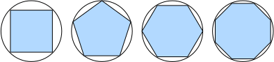

# 2.4 Математический анализ

2500 лет назад древние греки нашли способ вычислять площадь многоугольника: они разбивали его на треугольники и складывали их площади.
Чтобы найти площадь фигуры криволинейной формы (например, круга), древние греки вписывали в неё многоугольники.
Как показано на рис. 2.4.1, чем больше равных сторон у вписанного многоугольника, тем он ближе к кругу.
Этот процесс также называют *методом исчерпывания* (method of exhaustion).



*Рис. 2.4.1. Вычисление площади круга методом исчерпывания*

На самом деле метод исчерпывания — начало *интегрального исчисления* (integral calculus).
Более 2000 лет спустя появилась другая ветвь математического анализа — *дифференциальное исчисление* (differential calculus).
Важнейшее применение дифференциального исчисления — задачи оптимизации, то есть поиск наилучшего способа что-то сделать.
Как обсуждалось в разделе 2.3.10.1, такие задачи повсеместны в глубоком обучении.

В глубоком обучении мы «обучаем» модели, постоянно их обновляя, чтобы по мере поступления всё большего количества данных модели становились лучше.
Обычно «стать лучше» означает минимизацию *функции потерь* (loss function) — оценки того, насколько «плоха» модель.
В конечном счёте нас интересует создание модели, которая хорошо работает на данных, которых она никогда не видела.
Но «обучение» модели может лишь подогнать её под данные, которые мы реально видим.
Поэтому задачу подгонки модели можно разбить на две ключевые части:

* *оптимизация* (optimization): подгонка модели под наблюдаемые данные;
* *обобщение* (generalization): математические принципы и практический опыт, которые помогают получать модели, работающие на данных, выходящих за пределы обучающей выборки.

Чтобы помочь читателю лучше понять задачи и методы оптимизации в следующих главах, этот раздел содержит очень краткое введение, которое поможет быстро освоить дифференциальное исчисление, часто используемое в глубоком обучении.

## 2.4.1 Производные и дифференциалы

Начнём с вычисления производных — это ключевой шаг почти всех алгоритмов оптимизации в глубоком обучении.
В глубоком обучении обычно выбирают функции потерь, дифференцируемые по параметрам модели.
Проще говоря, для каждого параметра мы хотим знать, насколько быстро растёт или убывает потеря, если увеличить или уменьшить этот параметр на бесконечно малую величину.

Пусть есть функция $f: \mathbb{R} \rightarrow \mathbb{R}$, входные и выходные значения которой — скаляры.
**Если у $f$ существует *производная*, её определяет предел**

$$f'(x) = \lim_{h \rightarrow 0} \frac{f(x+h) - f(x)}{h}.\tag{2.4.1}$$

Если $f'(a)$ существует, то функция $f$ называется *дифференцируемой* (differentiable) в точке $a$.
Если $f$ дифференцируема в каждой точке некоторого интервала, то она дифференцируема на этом интервале.
Производную $f'(x)$ из формулы (2.4.1) можно интерпретировать как *мгновенную* (instantaneous) скорость изменения $f(x)$ по $x$.
Такая мгновенная скорость изменения вычисляется по изменению $h$ аргумента $x$ при стремлении $h$ к $0$.

Чтобы лучше понять производную, проведём эксперимент.
**Определим $u=f(x)=3x^2-4x$** следующим образом:

**MXNet:**

```python
%matplotlib inline
from d2l import mxnet as d2l
from matplotlib_inline import backend_inline
from mxnet import np, npx
npx.set_np()

def f(x):
    return 3 * x ** 2 - 4 * x
```

**PyTorch:**

```python
%matplotlib inline
from d2l import torch as d2l
from matplotlib_inline import backend_inline
import numpy as np

def f(x):
    return 3 * x ** 2 - 4 * x
```

**TensorFlow:**

```python
%matplotlib inline
from d2l import tensorflow as d2l
from matplotlib_inline import backend_inline
import numpy as np

def f(x):
    return 3 * x ** 2 - 4 * x
```

**PaddlePaddle:**

```python
%matplotlib inline
from d2l import paddle as d2l
from matplotlib_inline import backend_inline
import numpy as np

def f(x):
    return 3 * x ** 2 - 4 * x
```

Положив $x=1$ и устремив $h$ к $0$, **получим, что численное значение $\frac{f(x+h)-f(x)}{h}$ в формуле (2.4.1) приближается к $2$**.
Хотя этот эксперимент не является математическим доказательством, позже мы увидим, что при $x=1$ производная $u'$ действительно равна $2$.

```python
def numerical_lim(f, x, h):
    return (f(x + h) - f(x)) / h

h = 0.1
for i in range(5):
    print(f'h={h:.5f}, численный предел={numerical_lim(f, 1, h):.5f}')
    h *= 0.1
```

Познакомимся с несколькими эквивалентными обозначениями производной.
Для $y=f(x)$, где $x$ и $y$ — независимая и зависимая переменные функции $f$, следующие выражения эквивалентны:

$$f'(x) = y' = \frac{dy}{dx} = \frac{df}{dx} = \frac{d}{dx} f(x) = Df(x) = D_x f(x),$$

где символы $\frac{d}{dx}$ и $D$ — *операторы дифференцирования*, которые обозначают операцию *дифференцирования*.
Для дифференцирования распространённых функций можно пользоваться следующими правилами:

* $DC = 0$ ($C$ — константа)
* $Dx^n = nx^{n-1}$ (*степенное правило* (power rule), $n$ — любое действительное число)
* $De^x = e^x$
* $D\ln(x) = 1/x$

Чтобы продифференцировать функцию, составленную из простых функций, полезны следующие правила.
Пусть функции $f$ и $g$ дифференцируемы, а $C$ — константа. Тогда:

*Правило константного множителя*

$$\frac{d}{dx} [Cf(x)] = C \frac{d}{dx} f(x),$$

*Правило суммы*

$$\frac{d}{dx} [f(x) + g(x)] = \frac{d}{dx} f(x) + \frac{d}{dx} g(x),$$

*Правило произведения*

$$\frac{d}{dx} [f(x)g(x)] = f(x) \frac{d}{dx} [g(x)] + g(x) \frac{d}{dx} [f(x)],$$

*Правило частного*

$$\frac{d}{dx} \left[\frac{f(x)}{g(x)}\right] = \frac{g(x) \frac{d}{dx} [f(x)] - f(x) \frac{d}{dx} [g(x)]}{[g(x)]^2}.$$

Теперь применим эти правила, чтобы вычислить $u'=f'(x)=3\frac{d}{dx}x^2-4\frac{d}{dx}x=6x-4$.
При $x=1$ получаем $u'=2$: численный результат в эксперименте выше действительно близок к $2$.
При $x=1$ эта производная также равна угловому коэффициенту касательной к кривой $u=f(x)$.

**Чтобы наглядно изобразить эту интерпретацию производной, будем использовать `matplotlib`** — популярную библиотеку построения графиков на Python.
Чтобы настроить свойства графиков, создаваемых `matplotlib`, нужно **определить несколько вспомогательных функций**.
Функция `use_svg_display` указывает пакету `matplotlib` выводить графики в формате svg для более чёткого изображения.

Обратите внимание: комментарий `#@save` — специальная отметка, которая сохраняет соответствующую функцию, класс или оператор в пакете `d2l`.
Поэтому их можно вызывать напрямую (например, `d2l.use_svg_display()`), не определяя заново.

```python
def use_svg_display():  #@save
    """Показывает графики в формате svg в Jupyter"""
    backend_inline.set_matplotlib_formats('svg')
```

Функция `set_figsize` задаёт размер графиков.
Здесь можно напрямую использовать `d2l.plt`, поскольку импорт `from matplotlib import pyplot as plt` помечен для сохранения в пакете `d2l`.

```python
def set_figsize(figsize=(3.5, 2.5)):  #@save
    """Задаёт размер графика matplotlib"""
    use_svg_display()
    d2l.plt.rcParams['figure.figsize'] = figsize
```

Функция `set_axes` задаёт свойства осей графика, построенного с помощью `matplotlib`.

```python
#@save
def set_axes(axes, xlabel, ylabel, xlim, ylim, xscale, yscale, legend):
    """Задаёт оси графика matplotlib"""
    axes.set_xlabel(xlabel)
    axes.set_ylabel(ylabel)
    axes.set_xscale(xscale)
    axes.set_yscale(yscale)
    axes.set_xlim(xlim)
    axes.set_ylim(ylim)
    if legend:
        axes.legend(legend)
    axes.grid()
```

Имея эти три функции для настройки графика, определим функцию `plot`, которая позволяет кратко строить несколько кривых: в книге нам часто придётся визуализировать множество кривых.

```python
#@save
def plot(X, Y=None, xlabel=None, ylabel=None, legend=None, xlim=None,
         ylim=None, xscale='linear', yscale='linear',
         fmts=('-', 'm--', 'g-.', 'r:'), figsize=(3.5, 2.5), axes=None):
    """Строит точки данных"""
    if legend is None:
        legend = []

    set_figsize(figsize)
    axes = axes if axes else d2l.plt.gca()

    # Если у X одна ось, возвращаем True
    def has_one_axis(X):
        return (hasattr(X, "ndim") and X.ndim == 1 or isinstance(X, list)
                and not hasattr(X[0], "__len__"))

    if has_one_axis(X):
        X = [X]
    if Y is None:
        X, Y = [[]] * len(X), X
    elif has_one_axis(Y):
        Y = [Y]
    if len(X) != len(Y):
        X = X * len(Y)
    axes.cla()
    for x, y, fmt in zip(X, Y, fmts):
        if len(x):
            axes.plot(x, y, fmt)
        else:
            axes.plot(y, fmt)
    set_axes(axes, xlabel, ylabel, xlim, ylim, xscale, yscale, legend)
```

Теперь можем **построить график функции $u=f(x)$ и её касательной $y=2x-3$ в точке $x=1$**, где коэффициент $2$ — угловой коэффициент касательной.

```python
x = np.arange(0, 3, 0.1)
plot(x, [f(x), 2 * x - 3], 'x', 'f(x)', legend=['f(x)', 'Касательная (x=1)'])
```

## 2.4.2 Частные производные

До сих пор мы рассматривали дифференцирование только функций одной переменной.
В глубоком обучении функции обычно зависят от многих переменных.
Поэтому нужно обобщить идею дифференцирования на *функции многих переменных* (multivariate function).

Пусть $y = f(x_1, x_2, \ldots, x_n)$ — функция от $n$ переменных.
*Частная производная* (partial derivative) $y$ по $i$-му аргументу $x_i$ равна:

$$ \frac{\partial y}{\partial x_i} = \lim_{h \rightarrow 0} \frac{f(x_1, \ldots, x_{i-1}, x_i+h, x_{i+1}, \ldots, x_n) - f(x_1, \ldots, x_i, \ldots, x_n)}{h}.$$

Чтобы вычислить $\frac{\partial y}{\partial x_i}$, можно считать $x_1, \ldots, x_{i-1}, x_{i+1}, \ldots, x_n$ константами и найти производную $y$ по $x_i$.
Для обозначения частных производных следующие записи эквивалентны:

$$\frac{\partial y}{\partial x_i} = \frac{\partial f}{\partial x_i} = f_{x_i} = f_i = D_i f = D_{x_i} f.$$

## 2.4.3 Градиенты

Частные производные многомерной функции по всем её переменным можно собрать в вектор — *градиент* (gradient) функции.
Точнее, пусть функция $f:\mathbb{R}^n\rightarrow\mathbb{R}$ принимает $n$-мерный вектор $\mathbf{x}=[x_1,x_2,\ldots,x_n]^\top$ и возвращает скаляр.
Градиент функции $f(\mathbf{x})$ по $\mathbf{x}$ — это вектор из $n$ частных производных:

$$\nabla_{\mathbf{x}} f(\mathbf{x}) = \bigg[\frac{\partial f(\mathbf{x})}{\partial x_1}, \frac{\partial f(\mathbf{x})}{\partial x_2}, \ldots, \frac{\partial f(\mathbf{x})}{\partial x_n}\bigg]^\top,$$

где $\nabla_{\mathbf{x}} f(\mathbf{x})$ при отсутствии неоднозначности часто записывают как $\nabla f(\mathbf{x})$.

Пусть $\mathbf{x}$ — $n$-мерный вектор. При дифференцировании многомерных функций часто используются следующие правила:

* для всех $\mathbf{A} \in \mathbb{R}^{m \times n}$ справедливо $\nabla_{\mathbf{x}} \mathbf{A} \mathbf{x} = \mathbf{A}^\top$;
* для всех $\mathbf{A} \in \mathbb{R}^{n \times m}$ справедливо $\nabla_{\mathbf{x}} \mathbf{x}^\top \mathbf{A}  = \mathbf{A}$;
* для всех $\mathbf{A} \in \mathbb{R}^{n \times n}$ справедливо $\nabla_{\mathbf{x}} \mathbf{x}^\top \mathbf{A} \mathbf{x}  = (\mathbf{A} + \mathbf{A}^\top)\mathbf{x}$;
* $\nabla_{\mathbf{x}} \|\mathbf{x} \|^2 = \nabla_{\mathbf{x}} \mathbf{x}^\top \mathbf{x} = 2\mathbf{x}$.

Аналогично, для любой матрицы $\mathbf{X}$ справедливо $\nabla_{\mathbf{X}} \|\mathbf{X} \|_F^2 = 2\mathbf{X}$.
Как мы увидим дальше, градиенты играют важную роль при построении алгоритмов оптимизации в глубоком обучении.

## 2.4.4 Цепное правило

Однако описанные выше методы могут затруднить вычисление градиентов.
Дело в том, что в глубоком обучении многомерные функции обычно *составные* (composite), поэтому применить перечисленные выше правила к их дифференцированию трудно.
К счастью, для дифференцирования составных функций можно использовать *цепное правило* (chain rule).

Начнём с функций одной переменной. Пусть функции $y=f(u)$ и $u=g(x)$ дифференцируемы. Тогда по цепному правилу:

$$\frac{dy}{dx} = \frac{dy}{du} \frac{du}{dx}.$$

Теперь рассмотрим более общий случай, когда функция зависит от произвольного числа переменных.
Пусть дифференцируемая функция $y$ имеет аргументы $u_1, u_2, \ldots, u_m$, причём каждая дифференцируемая функция $u_i$ имеет аргументы $x_1, x_2, \ldots, x_n$.
Заметим, что $y$ — функция от $x_1, x_2, \ldots, x_n$.
Для любого $i = 1, 2, \ldots, n$ цепное правило даёт:

$$\frac{\partial y}{\partial x_i} = \frac{\partial y}{\partial u_1} \frac{\partial u_1}{\partial x_i} + \frac{\partial y}{\partial u_2} \frac{\partial u_2}{\partial x_i} + \cdots + \frac{\partial y}{\partial u_m} \frac{\partial u_m}{\partial x_i}$$

## Резюме

* Дифференцирование и интегрирование — две ветви математического анализа; первое применимо к задачам оптимизации в глубоком обучении.
* Производную можно интерпретировать как мгновенную скорость изменения функции по её переменной; она также равна угловому коэффициенту касательной к графику функции.
* Градиент — это вектор, компонентами которого служат частные производные многомерной функции по всем её переменным.
* Цепное правило позволяет дифференцировать составные функции.

## Упражнения

1. Постройте график функции $y = f(x) = x^3 - \frac{1}{x}$ и её касательной в точке $x = 1$.
2. Найдите градиент функции $f(\mathbf{x}) = 3x_1^2 + 5e^{x_2}$.
3. Чему равен градиент функции $f(\mathbf{x}) = \|\mathbf{x}\|_2$?
4. Запишите цепное правило для функции $u = f(x, y, z)$, где $x = x(a, b)$, $y = y(a, b)$, $z = z(a, b)$.

**Обсуждение:**

* MXNet: [discuss.d2l.ai/t/1755](https://discuss.d2l.ai/t/1755)
* PyTorch: [discuss.d2l.ai/t/1756](https://discuss.d2l.ai/t/1756)
* TensorFlow: [discuss.d2l.ai/t/1754](https://discuss.d2l.ai/t/1754)
* PaddlePaddle: [discuss.d2l.ai/t/11684](https://discuss.d2l.ai/t/11684)
