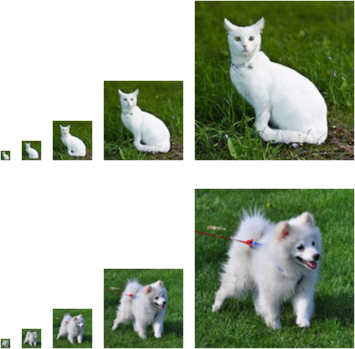

# 2.6 Вероятность

Попросту говоря, машинное обучение — это предсказание.

Например, по клинической истории пациента мы можем захотеть предсказать *вероятность* того, что у него случится сердечный приступ в следующем году.
При обнаружении аномалий в работе реактивного двигателя самолёта мы хотим оценить, насколько вероятно, что набор показаний двигателя соответствует нормальной работе.
В обучении с подкреплением мы хотим, чтобы агент (agent) разумно действовал в среде.
Это означает, что нужно учитывать вероятность получить высокую награду при каждом из возможных действий.
При построении рекомендательных систем тоже нужно учитывать вероятности.
Например, если мы работаем в большом интернет-магазине книг, нам может понадобиться оценить вероятность того, что определённый пользователь купит определённую книгу.
Для этого нам нужна теория вероятностей.
Существуют целые курсы, специализации, научные статьи, профессии и даже факультеты, посвящённые теории вероятностей.
Поэтому цель этого раздела — не изучить всю дисциплину целиком.
Скорее, мы хотим дать читателю базовые сведения о вероятности, чтобы он мог начать строить первые модели глубокого обучения и самостоятельно их исследовать.

Теперь рассмотрим более внимательно первый пример: различение кошек и собак по фотографиям.
На первый взгляд это может казаться простой задачей, но для машины она может оказаться серьёзным испытанием.
Прежде всего, сложность задачи может зависеть от разрешения изображения.



**Рис. 2.6.1.** Изображения разного разрешения ($10 \times 10$, $20 \times 20$, $40 \times 40$, $80 \times 80$ и $160 \times 160$ пикселей)

Как видно на рис. 2.6.1, хотя человек легко распознаёт кошек и собак при разрешении $160 \times 160$ пикселей, при $40\times40$ пикселях это становится трудной задачей, а при $10 \times 10$ пикселях почти невозможно.
Иначе говоря, наша способность различать кошек и собак на большом расстоянии (а значит, при меньшем разрешении) может превратиться в простое угадывание.
Теория вероятностей даёт нам формальный способ выразить степень нашей уверенности.
Если мы полностью уверены, что на изображении кошка, то вероятность того, что метка $y$ — «кошка», то есть $P(y=\text{кошка})$, равна $1$.
Если у нас нет никаких доказательств того, что $y=\text{кошка}$ или $y=\text{собака}$, то можно считать эти два варианта равновероятными: $P(y=\text{кошка})=P(y=\text{собака})=0.5$.
Если мы не очень уверены, что на изображении кошка, можно приписать вероятности значение $0.5<P(y=\text{кошка})<1$.

Теперь второй пример: по данным метеонаблюдений мы хотим предсказать вероятность того, что завтра в Пекине будет дождь.
Если сейчас лето, вероятность дождя равна 0,5.

В обоих случаях результат нам неизвестен, но между ними есть ключевое различие.
В первом случае изображение на самом деле либо кошка, либо собака.
Во втором результат действительно является случайным событием.
Таким образом, вероятность — гибкий язык для выражения степени нашей уверенности, и его можно эффективно применять в самых разных областях.

## 2.6.1 Основы теории вероятностей

Допустим, мы бросаем кубик и хотим узнать, какова вероятность выпадения единицы, а не какого-либо другого числа.
Если кубик честный, то все шесть исходов $\{1, \ldots, 6\}$ равновозможны, и поэтому можно сказать, что вероятность выпадения $1$ равна $\frac{1}{6}$.

Однако для реального кубика, полученного с завода, нужно проверить, нет ли в нём дефекта.
Единственный способ сделать это — бросить его много раз и записать результаты.
Каждый бросок даёт одно значение из $\{1, \ldots, 6\}$.
Для каждого значения естественный способ — разделить число его появлений на общее число бросков.
Так мы получаем *оценку* вероятности этого *события* (event).
*Закон больших чисел* (law of large numbers) утверждает: по мере увеличения числа бросков эта оценка будет всё ближе к истинной вероятности.
Попробуем это на коде!

Сначала импортируем необходимые пакеты.

**MXNet:**

```python
%matplotlib inline
from d2l import mxnet as d2l
from mxnet import np, npx
import random
npx.set_np()
```

**PyTorch:**

```python
%matplotlib inline
from d2l import torch as d2l
import torch
from torch.distributions import multinomial
```

**TensorFlow:**

```python
%matplotlib inline
from d2l import tensorflow as d2l
import tensorflow as tf
import tensorflow_probability as tfp
import numpy as np
```

**PaddlePaddle:**

```python
%matplotlib inline
from d2l import paddle as d2l
import warnings
warnings.filterwarnings("ignore")
import paddle
import random
import numpy as np
```

В статистике процесс извлечения выборки из распределения вероятностей называют *выборкой* (sampling).
Грубо говоря, *распределение* (distribution) можно считать присвоением вероятностей событиям; более строгое определение мы дадим позже.
Распределение, которое присваивает вероятности некоторому набору дискретных вариантов, называют *мультиномиальным распределением* (multinomial distribution).

Чтобы извлечь выборку, то есть бросить кубик, достаточно передать вектор вероятностей.
Результат — другой вектор той же длины: его значение с индексом $i$ — это число раз, когда в выборке выпал исход $i$.

**MXNet:**

```python
fair_probs = [1.0 / 6] * 6
np.random.multinomial(1, fair_probs)
```

**PyTorch:**

```python
fair_probs = torch.ones([6]) / 6
multinomial.Multinomial(1, fair_probs).sample()
```

**TensorFlow:**

```python
fair_probs = tf.ones(6) / 6
tfp.distributions.Multinomial(1, fair_probs).sample()
```

**PaddlePaddle:**

```python
fair_probs = [1.0 / 6] * 6
paddle.distribution.Multinomial(1, paddle.to_tensor(fair_probs)).sample()
```

Когда мы оцениваем честность кубика, нужно сгенерировать много выборок из одного и того же распределения.
Если делать это циклом `for` на Python, работа будет невероятно медленной.
Поэтому мы используем функции фреймворка глубокого обучения, которые извлекают сразу несколько выборок и возвращают независимые выборки нужной формы.

**MXNet:**

```python
np.random.multinomial(10, fair_probs)
```

**PyTorch:**

```python
multinomial.Multinomial(10, fair_probs).sample()
```

**TensorFlow:**

```python
tfp.distributions.Multinomial(10, fair_probs).sample()
```

**PaddlePaddle:**

```python
paddle.distribution.Multinomial(10, paddle.to_tensor(fair_probs)).sample()
```

Теперь, когда мы умеем извлекать выборки для кубика, можно смоделировать 1000 бросков.
Затем подсчитаем, сколько раз выпала каждая грань.
Конкретно: вычислим относительные частоты, которые и будут оценками истинных вероятностей.

**MXNet:**

```python
counts = np.random.multinomial(1000, fair_probs).astype(np.float32)
counts / 1000
```

**PyTorch:**

```python
# Сохраняем результаты как 32-битные числа с плавающей точкой для деления
counts = multinomial.Multinomial(1000, fair_probs).sample()
counts / 1000  # Относительная частота как оценка
```

**TensorFlow:**

```python
counts = tfp.distributions.Multinomial(1000, fair_probs).sample()
counts / 1000
```

**PaddlePaddle:**

```python
counts = paddle.distribution.Multinomial(1000, paddle.to_tensor(fair_probs)).sample()
counts / 1000
```

Поскольку данные получены с честного кубика, мы знаем, что истинная вероятность каждого исхода равна $\frac{1}{6}$, примерно $0.167$, поэтому оценки, полученные выше, выглядят разумно.

Мы также можем увидеть, как эти вероятности со временем сходятся к истинным.
Проведём 500 групп экспериментов, в каждой из которых возьмём по 10 выборок.

**MXNet:**

```python
counts = np.random.multinomial(10, fair_probs, size=500)
cum_counts = counts.astype(np.float32).cumsum(axis=0)
estimates = cum_counts / cum_counts.sum(axis=1, keepdims=True)

d2l.set_figsize((6, 4.5))
for i in range(6):
    d2l.plt.plot(estimates[:, i].asnumpy(),
                 label=("P(кубик=" + str(i + 1) + ")"))
d2l.plt.axhline(y=0.167, color='black', linestyle='dashed')
d2l.plt.gca().set_xlabel('Группы экспериментов')
d2l.plt.gca().set_ylabel('Оценка вероятности')
d2l.plt.legend();
```

**PyTorch:**

```python
counts = multinomial.Multinomial(10, fair_probs).sample((500,))
cum_counts = counts.cumsum(dim=0)
estimates = cum_counts / cum_counts.sum(dim=1, keepdims=True)

d2l.set_figsize((6, 4.5))
for i in range(6):
    d2l.plt.plot(estimates[:, i].numpy(),
                 label=("P(кубик=" + str(i + 1) + ")"))
d2l.plt.axhline(y=0.167, color='black', linestyle='dashed')
d2l.plt.gca().set_xlabel('Группы экспериментов')
d2l.plt.gca().set_ylabel('Оценка вероятности')
d2l.plt.legend();
```

**TensorFlow:**

```python
counts = tfp.distributions.Multinomial(10, fair_probs).sample(500)
cum_counts = tf.cumsum(counts, axis=0)
estimates = cum_counts / tf.reduce_sum(cum_counts, axis=1, keepdims=True)

d2l.set_figsize((6, 4.5))
for i in range(6):
    d2l.plt.plot(estimates[:, i].numpy(),
                 label=("P(кубик=" + str(i + 1) + ")"))
d2l.plt.axhline(y=0.167, color='black', linestyle='dashed')
d2l.plt.gca().set_xlabel('Группы экспериментов')
d2l.plt.gca().set_ylabel('Оценка вероятности')
d2l.plt.legend();
```

**PaddlePaddle:**

```python
counts = paddle.distribution.Multinomial(10, paddle.to_tensor(fair_probs)).sample((500,1))
cum_counts = counts.cumsum(axis=0)
cum_counts = cum_counts.squeeze(axis=1)
estimates = cum_counts / cum_counts.sum(axis=1, keepdim=True)

d2l.set_figsize((6, 4.5))
for i in range(6):
    d2l.plt.plot(estimates[:, i],
                 label=("P(кубик=" + str(i + 1) + ")"))
d2l.plt.axhline(y=0.167, color='black', linestyle='dashed')
d2l.plt.gca().set_xlabel('Группы экспериментов')
d2l.plt.gca().set_ylabel('Оценка вероятности')
d2l.plt.legend()
```

Каждая сплошная линия соответствует одной из шести граней кубика и показывает оценку вероятности выпадения этой грани после каждой группы экспериментов.
По мере того как мы получаем больше данных, эти 6 кривых сходятся к истинным вероятностям.

### 2.6.1.1 Аксиомы теории вероятностей

В случае с бросанием кубика множество $\mathcal{S} = \{1, 2, 3, 4, 5, 6\}$ называют *пространством выборки* (sample space) или *пространством исходов* (outcome space), а каждый его элемент — *исходом* (outcome).
*Событие* (event) — это набор исходов из пространства выборки.
Например, «выпала $5$» ($\{5\}$) и «выпало нечётное число» ($\{1, 3, 5\}$) — допустимые события при бросании кубика.
Заметим, что если исход случайного эксперимента принадлежит $\mathcal{A}$, то событие $\mathcal{A}$ произошло.
То есть если выпала $3$, то, поскольку $3 \in \{1, 3, 5\}$, можно сказать, что событие «выпало нечётное число» произошло.

*Вероятность* (probability) можно рассматривать как функцию, которая сопоставляет множествам действительные значения.
В заданном пространстве выборки $\mathcal{S}$ вероятность события $\mathcal{A}$, обозначаемая $P(\mathcal{A})$, обладает следующими свойствами:

* для любого события $\mathcal{A}$ его вероятность никогда не бывает отрицательной: $P(\mathcal{A}) \geq 0$;
* вероятность всего пространства выборки равна $1$: $P(\mathcal{S}) = 1$;
* для любой счётной последовательности *несовместных* (mutually exclusive) событий $\mathcal{A}_1, \mathcal{A}_2, \ldots$, то есть таких, что $\mathcal{A}_i \cap \mathcal{A}_j = \emptyset$ для всех $i \neq j$, вероятность того, что произойдёт одно из них, равна сумме их вероятностей: $P(\bigcup_{i=1}^{\infty} \mathcal{A}_i) = \sum_{i=1}^{\infty} P(\mathcal{A}_i)$.

Перечисленные свойства — аксиомы теории вероятностей, которые предложил Колмогоров в 1933 году.
С помощью этой системы аксиом можно обойти философские споры о случайности и вместо этого строго рассуждать на языке математики.
Например, пусть событие $\mathcal{A}_1$ — всё пространство выборки, а для всех $i > 1$ выполнено $\mathcal{A}_i = \emptyset$.
Тогда можно доказать, что $P(\emptyset) = 0$, то есть вероятность невозможного события равна $0$.

### 2.6.1.2 Случайные величины

В нашем эксперименте с бросанием кубика мы ввели понятие *случайной величины* (random variable).
Случайная величина может быть почти любой величиной, и она принимает одно из значений, возможных в случайном эксперименте.
Рассмотрим случайную величину $X$, значения которой принадлежат пространству выборки кубика $\mathcal{S}=\{1,2,3,4,5,6\}$.
Событие «выпала $5$» можно записать как $\{X=5\}$ или $X=5$, а его вероятность — как $P(\{X=5\})$ или $P(X=5)$.
Записью $P(X=a)$ мы отличаем случайную величину $X$ от значений $a$, которые она может принимать.
Однако такая запись может быть громоздкой.
Чтобы упростить обозначения, с одной стороны, $P(X)$ можно записывать как *распределение* (distribution) случайной величины $X$: оно сообщает, с какой вероятностью $X$ принимает то или иное значение.
С другой стороны, можно просто писать $P(a)$ для вероятности того, что случайная величина принимает значение $a$.
Поскольку события в теории вероятностей — это наборы исходов из пространства выборки, можно задавать диапазоны значений случайной величины.
Например, $P(1 \leq X \leq 3)$ обозначает событие $\{1 \leq X \leq 3\}$, то есть вероятность того, что $X$ принимает значение $1$, $2$ или $3$.
Эквивалентно, $P(1 \leq X \leq 3)$ — это вероятность того, что случайная величина $X$ принимает значения из $\{1, 2, 3\}$.

Обратите внимание на различие между *дискретными* (discrete) случайными величинами (например, гранями кубика) и *непрерывными* (continuous) случайными величинами (например, весом и ростом человека).
В реальной жизни не имеет особого смысла измерять, совпадает ли рост двух людей в точности.
Если производить измерения достаточно точно, окажется, что на Земле нет двух людей с одинаковым ростом.
В таких случаях осмысленнее спрашивать, попадает ли рост человека в заданный интервал, например между 1,79 м и 1,81 м.
В подобных ситуациях возможность получить то или иное значение выражают через *плотность* (density).
Вероятность того, что рост в точности равен 1,80 м, равна 0, но плотность не равна 0.
На любом интервале между двумя разными ростами вероятность ненулевая.
В оставшейся части раздела мы будем рассматривать вероятности в дискретном пространстве.
Вероятности непрерывных случайных величин можно найти в разделе о случайных величинах [математического приложения](https://d2l.ai/chapter_appendix-mathematics-for-deep-learning/random-variables.html) к книге.

## 2.6.2 Работа с несколькими случайными величинами

Во многих случаях нам приходится рассматривать несколько случайных величин.
Например, нам может понадобиться смоделировать связь между болезнями и симптомами.
Для заданной болезни и симптома, например «грипп» и «кашель», у пациента каждое из них с некоторой вероятностью присутствует или отсутствует.
Нам нужно оценить эти вероятности и связи между ними, чтобы использовать выводы для улучшения медицинской помощи.

Ещё более сложный пример: изображение содержит миллионы пикселей, а значит, миллионы случайных величин.
Во многих случаях к изображению прилагается *метка* (label), указывающая объект на изображении; метку тоже можно рассматривать как случайную величину.
Можно даже считать случайными величинами все метаданные: положение, время, диафрагму, фокусное расстояние, ISO, расстояние фокусировки и тип камеры.
Все эти величины случайны и встречаются совместно.
Когда мы работаем с несколькими случайными величинами, нас интересует сразу несколько из них.

### 2.6.2.1 Совместная вероятность

Первое понятие — *совместная вероятность* (joint probability) $P(A=a,B=b)$.
Для любых значений $a$ и $b$ совместная вероятность отвечает на вопрос: какова вероятность того, что одновременно выполняются $A=a$ и $B=b$?
Заметим, что для любых значений $a$ и $b$ выполняется $P(A = a, B=b) \leq P(A=a)$.
Это очевидно: чтобы одновременно произошли $A=a$ и $B=b$, должно произойти $A=a$, и должно произойти $B=b$ (и наоборот).
Поэтому вероятность одновременного наступления $A=a$ и $B=b$ не превышает вероятности наступления каждого из этих событий по отдельности.

### 2.6.2.2 Условная вероятность

Из неравенства для совместной вероятности следует интересное соотношение: $0 \leq \frac{P(A=a, B=b)}{P(A=a)} \leq 1$.
Это отношение называют *условной вероятностью* (conditional probability) и обозначают $P(B=b \mid A=a)$: это вероятность того, что $B=b$, при условии, что $A=a$ уже произошло.

### 2.6.2.3 Теорема Байеса

Из определения условной вероятности можно вывести одно из самых полезных уравнений статистики — *теорему Байеса* (Bayes' theorem).
По *правилу умножения* (multiplication rule) имеем $P(A, B) = P(B \mid A) P(A)$.
По симметрии получаем $P(A, B) = P(A \mid B) P(B)$.
Предполагая, что $P(B)>0$, и выражая одну из условных вероятностей, получаем

$$P(A \mid B) = \frac{P(B \mid A) P(A)}{P(B)}.$$

Здесь мы используем компактную запись: $P(A, B)$ — *совместное распределение* (joint distribution), а $P(A \mid B)$ — *условное распределение* (conditional distribution).
Такое распределение можно вычислить при заданных значениях $A = a, B=b$.

### 2.6.2.4 Маргинализация

Чтобы складывать вероятности событий, нужно *правило суммы* (sum rule): вероятность $B$ равна сумме совместных вероятностей $B$ со всеми возможными значениями $A$:

$$P(B) = \sum_{A} P(A, B),$$

Это называется *маргинализацией* (marginalization).
Вероятность или распределение, полученное в результате маргинализации, называют *маргинальной вероятностью* (marginal probability) или *маргинальным распределением* (marginal distribution).

### 2.6.2.5 Независимость

Другое полезное свойство — *зависимость* (dependence) и *независимость* (independence).
Если две случайные величины $A$ и $B$ независимы, то наступление события $A$ не зависит от наступления события $B$.
В этом случае статистики обычно записывают $A \perp B$.
По теореме Байеса сразу получаем и $P(A \mid B) = P(A)$.
Во всех остальных случаях мы называем $A$ и $B$ зависимыми.
Например, два последовательных броска кубика — независимые события.
В отличие от них, положение выключателя и яркость комнаты не независимы (потому что возможны перегорание лампочки, перебой электропитания или поломка выключателя).

Поскольку $P(A \mid B) = \frac{P(A, B)}{P(B)} = P(A)$ равносильно $P(A, B) = P(A)P(B)$, две случайные величины независимы тогда и только тогда, когда их совместное распределение равно произведению их отдельных распределений.
Аналогично, при заданной третьей случайной величине $C$ две величины $A$ и $B$ *условно независимы* (conditionally independent) тогда и только тогда, когда $P(A, B \mid C) = P(A \mid C)P(B \mid C)$.
Это записывают как $A \perp B \mid C$.

### 2.6.2.6 Применение

Разберём пример!
Предположим, врач проводит пациенту тест на ВИЧ (вирус иммунодефицита человека).
Тест довольно точен: если пациент здоров, вероятность ложного положительного результата составляет всего 1%; если пациент действительно инфицирован ВИЧ, тест никогда не даёт отрицательного результата.
Обозначим через $D_1$ результат диагностики ($1$ — положительный, $0$ — отрицательный), а через $H$ — статус ВИЧ-инфекции ($1$ — инфицирован, $0$ — нет).
Условные вероятности приведены в таблице 2.6.1.

**Таблица 2.6.1.** Условная вероятность $P(D_1 \mid H)$

| Условная вероятность | $H=1$ | $H=0$ |
|---|---|---|
| $P(D_1 = 1 \mid H)$ | 1 | 0.01 |
| $P(D_1 = 0 \mid H)$ | 0 | 0.99 |

Заметим, что сумма по каждому столбцу равна 1 (а по строкам — нет), поскольку условные вероятности, как и вероятности, должны в сумме давать 1.
Вычислим вероятность того, что пациент инфицирован ВИЧ, если тест положителен, то есть $P(H = 1 \mid D_1 = 1)$.
Очевидно, что ответ зависит от того, насколько распространено заболевание, поскольку это влияет на число ложных срабатываний.
Предположим, что население в целом здорово, например $P(H=1) = 0.0015$.
Чтобы применить теорему Байеса, нужно с помощью маргинализации и правила умножения найти

$$\begin{aligned}
&P(D_1 = 1) \\
=& P(D_1=1, H=0) + P(D_1=1, H=1)  \\
=& P(D_1=1 \mid H=0) P(H=0) + P(D_1=1 \mid H=1) P(H=1) \\
=& 0.011485.
\end{aligned}
$$

Значит,

$$\begin{aligned}
&P(H = 1 \mid D_1 = 1)\\ =& \frac{P(D_1=1 \mid H=1) P(H=1)}{P(D_1=1)} \\ =& 0.1306 \end{aligned}.$$

Иными словами, несмотря на очень точный тест, вероятность того, что пациент действительно инфицирован ВИЧ, составляет лишь 13,06%.
Как видим, вероятности могут противоречить интуиции.

Что делать пациенту после такого тревожного известия?
Скорее всего, он попросит врача провести повторный тест, чтобы уточнить диагноз.
Второй тест обладает другими характеристиками: он не так точен, как первый, как показано в таблице 2.6.2.

**Таблица 2.6.2.** Условная вероятность $P(D_2 \mid H)$

| Условная вероятность | $H=1$ | $H=0$ |
|---|---|---|
| $P(D_2 = 1 \mid H)$ | 0.98 | 0.03 |
| $P(D_2 = 0 \mid H)$ | 0.02 | 0.97 |

К сожалению, второй тест тоже даёт положительный результат.
Вычислим необходимые вероятности для применения теоремы Байеса, предполагая условную независимость:

$$\begin{aligned}
&P(D_1 = 1, D_2 = 1 \mid H = 0) \\
=& P(D_1 = 1 \mid H = 0) P(D_2 = 1 \mid H = 0)  \\
=& 0.0003,
\end{aligned}
$$

$$\begin{aligned}
&P(D_1 = 1, D_2 = 1 \mid H = 1) \\
=& P(D_1 = 1 \mid H = 1) P(D_2 = 1 \mid H = 1)  \\
=& 0.98.
\end{aligned}
$$

Теперь можно применить маргинализацию и правило умножения:

$$\begin{aligned}
&P(D_1 = 1, D_2 = 1) \\
=& P(D_1 = 1, D_2 = 1, H = 0) + P(D_1 = 1, D_2 = 1, H = 1)  \\
=& P(D_1 = 1, D_2 = 1 \mid H = 0)P(H=0) + P(D_1 = 1, D_2 = 1 \mid H = 1)P(H=1)\\
=& 0.00176955.
\end{aligned}
$$

Наконец, при двух положительных тестах вероятность того, что пациент инфицирован, равна

$$\begin{aligned}
&P(H = 1 \mid D_1 = 1, D_2 = 1)\\
=& \frac{P(D_1 = 1, D_2 = 1 \mid H=1) P(H=1)}{P(D_1 = 1, D_2 = 1)} \\
=& 0.8307.
\end{aligned}
$$

Таким образом, второй тест позволяет с большей уверенностью судить о наличии заболевания.
Хотя второй тест гораздо менее точен, чем первый, он всё же заметно повышает наш прогноз вероятности.

## 2.6.3 Математическое ожидание и дисперсия

Чтобы охарактеризовать основные свойства распределения вероятностей, нужны количественные меры.
*Математическое ожидание* (expectation, или среднее значение (average)) случайной величины $X$ записывается как

$$E[X] = \sum_{x} x P(X = x).$$

Если аргумент функции $f(x)$ — случайная величина, взятая из распределения $P$, то математическое ожидание $f(x)$ равно

$$E_{x \sim P}[f(x)] = \sum_x f(x) P(x).$$

Во многих случаях нам хочется измерить, насколько случайная величина $X$ отклоняется от своего математического ожидания.
Это можно выразить через *дисперсию* (variance):

$$\mathrm{Var}[X] = E\left[(X - E[X])^2\right] =
E[X^2] - E[X]^2.$$

Квадратный корень из дисперсии называют *стандартным отклонением* (standard deviation).
Дисперсия функции случайной величины показывает, насколько значения функции отклоняются от её математического ожидания при выборке различных значений $x$ из распределения случайной величины:

$$\mathrm{Var}[f(x)] = E\left[\left(f(x) - E[f(x)]\right)^2\right].$$

## Резюме

* Из распределения вероятностей можно извлекать выборки.
* Для анализа нескольких случайных величин можно использовать совместные распределения, условные распределения, теорему Байеса, маргинализацию и предположения о независимости.
* Математическое ожидание и дисперсия — практичные меры, с помощью которых можно обобщённо описать ключевые характеристики распределений вероятностей.

## Упражнения

1. Проведите $m=500$ групп экспериментов, в каждой из которых берётся $n=10$ выборок. Меняйте $m$ и $n$, наблюдайте и анализируйте результаты экспериментов.
2. Даны два события с вероятностями $P(\mathcal{A})$ и $P(\mathcal{B})$. Вычислите верхнюю и нижнюю границы для $P(\mathcal{A} \cup \mathcal{B})$ и $P(\mathcal{A} \cap \mathcal{B})$. (Подсказка: используйте [диаграмму Венна](https://en.wikipedia.org/wiki/Venn_diagram), чтобы показать эти случаи.)
3. Предположим, что у нас есть последовательность случайных величин, например $A$, $B$ и $C$, где $B$ зависит только от $A$, а $C$ зависит только от $B$. Можно ли упростить совместную вероятность $P(A, B, C)$? (Подсказка: это [цепь Маркова](https://en.wikipedia.org/wiki/Markov_chain).)
4. В разделе 2.6.2.6 первый тест точнее. Почему бы не провести первый тест дважды вместо того, чтобы проводить первый и второй тесты?

**MXNet:**
[Обсуждение](https://discuss.d2l.ai/t/1761)

**PyTorch:**
[Обсуждение](https://discuss.d2l.ai/t/1762)

**TensorFlow:**
[Обсуждение](https://discuss.d2l.ai/t/1760)

**PaddlePaddle:**
[Обсуждение](https://discuss.d2l.ai/t/11685)
