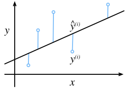
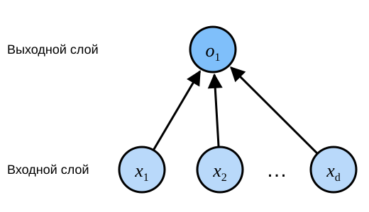
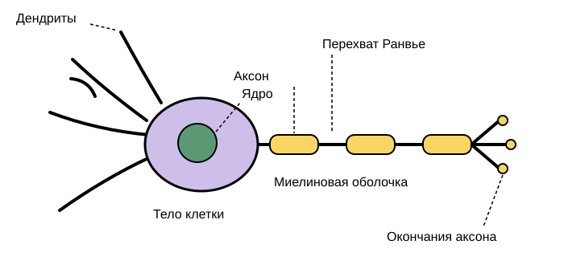

# 3.1 Линейная регрессия

*Регрессия* (regression) — это класс методов, которые описывают связь между одной или несколькими независимыми переменными и зависимой переменной.
В естественных и социальных науках регрессия часто используется для описания зависимости выхода от входов.

В большинстве задач машинного обучения речь идёт о *предсказании* (prediction).
Если нужно предсказать числовое значение, мы имеем дело с задачей регрессии.
Типичные примеры: предсказание цены (недвижимости, акций и т. п.), предсказание времени пребывания пациента в стационаре, предсказание спроса (например, объёма продаж в розничной торговле).
Но не всякое *предсказание* — задача регрессии.
В следующих разделах мы рассмотрим задачи классификации, в которых цель состоит в том, чтобы определить, к какой из категорий относятся данные.

## 3.1.1 Основные элементы линейной регрессии

*Линейная регрессия* (linear regression) появилась в начале XIX века.
Это самый простой и самый распространённый из стандартных инструментов регрессии.
Она опирается на несколько базовых предположений.
Во-первых, связь между признаками $\mathbf{x}$ и целевой величиной $y$ линейна: $y$ можно представить как взвешенную сумму элементов $\mathbf{x}$, и при этом допускается небольшой шум в наблюдениях.
Во-вторых, шум считается «обычным», например распределённым по нормальному закону.

Чтобы объяснить линейную регрессию, рассмотрим практический пример.
Допустим, мы хотим оценивать стоимость дома (в долларах) по его площади (в квадратных футах) и возрасту (в годах).
Для построения модели, которая предсказывает цену, нужен реальный набор данных.
Он включает цену продажи, площадь и возраст каждого дома.
В терминах машинного обучения такой набор называется *обучающей выборкой* (training data set) или *обучающим набором* (training set).
Каждая строка данных (например, сведения об одной сделке с домом) называется *образцом* (sample), или *точкой данных* (data point), или *экземпляром данных* (data instance).
Величину, которую мы хотим предсказать (в нашем примере — цену), называют *меткой* (label) или *целевой величиной* (target).
Признаки, по которым делается предсказание (площадь и возраст), называются *признаками* (feature) или *ковариатами* (covariate).

Количество образцов в наборе данных обозначим через $n$.
Вход образца с индексом $i$ запишем как $\mathbf{x}^{(i)} = [x_1^{(i)}, x_2^{(i)}]^\top$, а соответствующую метку — как $y^{(i)}$.

### 3.1.1.1 Линейная модель

Предположение о линейности означает, что целевую величину (цену дома) можно выразить как взвешенную сумму признаков (площади и возраста):

$$\mathrm{price} = w_{\mathrm{area}} \cdot \mathrm{area} + w_{\mathrm{age}} \cdot \mathrm{age} + b.\tag{3.1.1}$$

В формуле (3.1.1) $w_{\mathrm{area}}$ и $w_{\mathrm{age}}$ называются *весами* (weight); они определяют, насколько каждый признак влияет на предсказание.
Величина $b$ называется *смещением* (bias), *сдвигом* (offset) или *свободным членом* (intercept).
Смещение задаёт предсказание в случае, когда все признаки равны нулю.
В реальности у дома не бывает нулевой площади, и возраст ровно в ноль лет тоже встречается редко, но смещение всё равно необходимо: без него выразительность модели была бы ограничена.
Строго говоря, формула (3.1.1) задаёт *аффинное преобразование* (affine transformation) входных признаков.
Оно состоит из линейного преобразования, которое даёт взвешенная сумма признаков, и *сдвига* (translation) на величину смещения.

Задача состоит в том, чтобы по обучающим данным найти веса $\mathbf{w}$ и смещение $b$, при которых предсказанные цены в среднем близки к реальным.
Выход модели определяется аффинным преобразованием входных признаков; параметры этого преобразования задаются выбранными весами и смещением.

В машинном обучении мы обычно работаем с данными высокой размерности, поэтому модель удобно записывать в обозначениях линейной алгебры.
Если входные данные содержат $d$ признаков, предсказание $\hat{y}$ (символ «крышка» обозначает оценку величины $y$) записывается так:

$$\hat{y} = w_1  x_1 + ... + w_d  x_d + b.$$

Соберём все признаки в вектор $\mathbf{x} \in \mathbb{R}^d$, а все веса — в вектор $\mathbf{w} \in \mathbb{R}^d$.
Тогда модель записывается компактно через скалярное произведение:

$$\hat{y} = \mathbf{w}^\top \mathbf{x} + b.\tag{3.1.2}$$

В формуле (3.1.2) вектор $\mathbf{x}$ соответствует признакам одного образца.
Для всего набора из $n$ образцов удобно использовать матрицу $\mathbf{X} \in \mathbb{R}^{n \times d}$: каждая её строка — это образец, а каждый столбец — отдельный признак.

Для всей матрицы признаков $\mathbf{X}$ вектор предсказаний $\hat{\mathbf{y}} \in \mathbb{R}^n$ вычисляется как произведение матрицы на вектор:

$${\hat{\mathbf{y}}} = \mathbf{X} \mathbf{w} + b$$

Прибавление смещения $b$ к каждому элементу выполняется по правилу *broadcasting* (подробно о нём см. в разделе 2.1.3).
Имея обучающие признаки $\mathbf{X}$ и известные метки $\mathbf{y}$, линейная регрессия ищет такие веса $\mathbf{w}$ и смещение $b$, при которых для новых образцов из того же распределения, что и $\mathbf{X}$, ошибка предсказания будет минимальной.

Мы считаем, что наилучшая модель для предсказания $y$ по $\mathbf{x}$ линейна, но найти реальный набор из $n$ образцов, для которого при всех $1 \leq i \leq n$ выполняется точное равенство $y^{(i)} = \mathbf{w}^\top \mathbf{x}^{(i)} + b$, практически невозможно.
Какими бы способами мы ни измеряли признаки $\mathbf{X}$ и метки $\mathbf{y}$, небольшие ошибки наблюдений неизбежны.
Поэтому даже когда связь между признаками и метками считается линейной, в модель добавляют шумовой член, который учитывает ошибки наблюдений.

Прежде чем искать наилучшие *параметры модели* (model parameters) $\mathbf{w}$ и $b$, нам нужны две вещи:
(1) способ измерить качество модели;
(2) способ обновлять модель так, чтобы её предсказания становились лучше.

### 3.1.1.2 Функция потерь

Прежде чем подгонять модель под данные, нужно определить меру качества подгонки.
*Функция потерь* (loss function) измеряет расхождение между *истинным* значением целевой величины и *предсказанным*.
Обычно потери выбирают неотрицательными: чем меньше потери, тем лучше, а при идеальном предсказании потери равны нулю.
В задачах регрессии чаще всего используют квадратичную функцию потерь.
Если для образца $i$ предсказание равно $\hat{y}^{(i)}$, а истинная метка — $y^{(i)}$, квадратичная ошибка задаётся формулой:

$$l^{(i)}(\mathbf{w}, b) = \frac{1}{2} \left(\hat{y}^{(i)} - y^{(i)}\right)^2.\tag{3.1.3}$$

Множитель $\frac{1}{2}$ принципиально ничего не меняет, но упрощает формулы: при дифференцировании он сокращается с показателем степени 2.
Поскольку обучающий набор не находится под нашим контролем, эмпирическая ошибка зависит только от параметров модели.
Чтобы это стало нагляднее, рассмотрим задачу регрессии с одним признаком.
График на рис. 3.1.1 показывает данные и подогнанную к ним линейную модель.



Из-за квадратичного члена большое расхождение между предсказанием $\hat{y}^{(i)}$ и наблюдением $y^{(i)}$ даёт большие потери.
Чтобы оценить качество модели на всём наборе данных, нужно усреднить потери по $n$ обучающим образцам:

$$L(\mathbf{w}, b) =\frac{1}{n}\sum_{i=1}^n l^{(i)}(\mathbf{w}, b) =\frac{1}{n} \sum_{i=1}^n \frac{1}{2}\left(\mathbf{w}^\top \mathbf{x}^{(i)} + b - y^{(i)}\right)^2.$$

При обучении мы ищем параметры ($\mathbf{w}^*, b^*$), которые минимизируют суммарные потери по всем обучающим образцам:

$$\mathbf{w}^*, b^* = \operatorname*{argmin}_{\mathbf{w}, b}\  L(\mathbf{w}, b).$$

### 3.1.1.3 Аналитическое решение

Линейная регрессия — очень простая задача оптимизации.
В отличие от большинства моделей, которые будут рассмотрены в книге, её решение можно записать одной формулой.
Такое решение называют *аналитическим* (analytical solution).
Сначала включим смещение $b$ в вектор параметров $\mathbf{w}$, добавив к матрице признаков столбец из единиц.
Тогда задача предсказания сводится к минимизации $\|\mathbf{y} - \mathbf{X}\mathbf{w}\|^2$.
У этой функции есть единственная критическая точка, которая соответствует минимуму потерь на всей области определения.
Приравняв производную потерь по $\mathbf{w}$ нулю, получаем аналитическое решение:

$$\mathbf{w}^* = (\mathbf X^\top \mathbf X)^{-1}\mathbf X^\top \mathbf{y}.$$

Простые задачи, такие как линейная регрессия, имеют аналитическое решение, но многие задачи его не имеют.
Аналитическое решение удобно для математического анализа, однако оно слишком сильно ограничено по применимости и поэтому почти не используется в глубоком обучении.

### 3.1.1.4 Стохастический градиентный спуск по мини-батчам

Даже когда аналитического решения нет, модель можно эффективно обучать.
В книге мы будем использовать *градиентный спуск* (gradient descent) — метод, который подходит почти для любой модели глубокого обучения.
Он постепенно уменьшает ошибку, сдвигая параметры в направлении убывания функции потерь.

Самый простой вариант градиентного спуска: вычислить производную функции потерь (средних потерь по всему набору данных) по параметрам модели, то есть градиент.
Но на практике это может быть очень медленно, потому что перед каждым обновлением параметров пришлось бы проходить весь набор данных.
Поэтому обычно на каждом шаге случайно выбирают небольшой *мини-батч* образцов.
Такой вариант называется *стохастическим градиентным спуском по мини-батчам* (minibatch stochastic gradient descent).

На каждой итерации сначала случайно выбирается мини-батч $\mathcal{B}$, состоящий из фиксированного числа обучающих образцов.
Затем вычисляется градиент средних потерь мини-батча по параметрам модели.
Наконец, градиент умножается на заранее заданное положительное число $\eta$ и вычитается из текущих значений параметров.

Это обновление записывается формулой ($\partial$ обозначает частную производную):

$$(\mathbf{w},b) \leftarrow (\mathbf{w},b) - \frac{\eta}{|\mathcal{B}|} \sum_{i \in \mathcal{B}} \partial_{(\mathbf{w},b)} l^{(i)}(\mathbf{w},b).$$

Итак, алгоритм состоит из следующих шагов:
(1) инициализировать параметры модели, например случайными значениями;
(2) многократно выбирать случайный мини-батч образцов и сдвигать параметры в направлении антиградиента.
Для квадратичных потерь и аффинного преобразования обновления можно записать явно:

$$\begin{aligned} \mathbf{w} &\leftarrow \mathbf{w} -   \frac{\eta}{|\mathcal{B}|} \sum_{i \in \mathcal{B}} \partial_{\mathbf{w}} l^{(i)}(\mathbf{w}, b) = \mathbf{w} - \frac{\eta}{|\mathcal{B}|} \sum_{i \in \mathcal{B}} \mathbf{x}^{(i)} \left(\mathbf{w}^\top \mathbf{x}^{(i)} + b - y^{(i)}\right),\\ b &\leftarrow b -  \frac{\eta}{|\mathcal{B}|} \sum_{i \in \mathcal{B}} \partial_b l^{(i)}(\mathbf{w}, b)  = b - \frac{\eta}{|\mathcal{B}|} \sum_{i \in \mathcal{B}} \left(\mathbf{w}^\top \mathbf{x}^{(i)} + b - y^{(i)}\right). \end{aligned}\tag{3.1.4}$$

В формуле (3.1.4) $\mathbf{w}$ и $\mathbf{x}$ — векторы.
Такая векторная запись понятнее, чем поэлементная запись через $w_1, w_2, \ldots, w_d$.
$|\mathcal{B}|$ — количество образцов в мини-батче, то есть *размер батча* (batch size).
$\eta$ — *скорость обучения* (learning rate).
Размер батча и скорость обучения обычно задаются заранее вручную, а не выучиваются моделью.
Такие величины, которые можно настраивать, но которые не обновляются в процессе обучения, называются *гиперпараметрами* (hyperparameter).
*Подбор гиперпараметров* (hyperparameter tuning) — это процесс их выбора.
Гиперпараметры обычно подбирают по результатам обучения, оценивая качество модели на отдельном *проверочном наборе данных* (validation dataset).

После заданного числа итераций (или при выполнении другого условия остановки) мы фиксируем оценки параметров $\hat{\mathbf{w}}, \hat{b}$.
Но даже если функция действительно линейна и без шума, эти оценки не будут точно совпадать с минимумом функции потерь.
Алгоритм постепенно приближается к минимуму, но за конечное число шагов не может достичь его абсолютно точно.

Линейная регрессия — задача, у которой на всей области есть только один минимум.
Однако для сложных моделей, таких как глубокие нейронные сети, поверхность функции потерь обычно содержит много минимумов.
Практики глубокого обучения редко тратят много усилий на то, чтобы найти набор параметров с наименьшими потерями на *обучающем наборе*.
Гораздо сложнее найти параметры, которые дают небольшие потери на данных, которых модель никогда не видела.
Эта задача называется *обобщением* (generalization).

### 3.1.1.5 Предсказания с помощью обученной модели

Имея обученную линейную модель $\hat{\mathbf{w}}^\top \mathbf{x} + \hat{b}$, мы можем оценить цену нового дома, которого не было в обучающих данных, по его площади $x_1$ и возрасту $x_2$.
Процесс получения оценки целевой величины по признакам называется *предсказанием* (prediction) или *выводом* (inference).

В этой книге мы стараемся придерживаться термина *предсказание*.
Термин *вывод* уже стал стандартным в глубоком обучении, но он не вполне точен: в статистике *выводом* (inference) называют оценку параметров по данным.
Поэтому в разговоре со статистиками путаница в терминах иногда приводит к недоразумениям.

## 3.1.2 Векторизация для ускорения вычислений

При обучении модели мы часто хотим обрабатывать сразу весь мини-батч образцов.
Для этого нужно векторизовать вычисления и использовать библиотеки линейной алгебры, а не писать медленные циклы `for` на Python.

Чтобы показать, насколько это важно, сравним **два способа сложения векторов**.
Создадим два вектора из единиц длины 10000.
В первом способе будем обходить векторы циклом `for` на Python; во втором — воспользуемся перегруженным оператором `+`.

**MXNet:**

```python
%matplotlib inline
from d2l import mxnet as d2l
import math
from mxnet import np
import time
```

**PyTorch:**

```python
%matplotlib inline
from d2l import torch as d2l
import math
import torch
import numpy as np
import time
```

**TensorFlow:**

```python
%matplotlib inline
from d2l import tensorflow as d2l
import math
import tensorflow as tf
import numpy as np
import time
```

**PaddlePaddle:**

```python
%matplotlib inline
from d2l import paddle as d2l
import warnings
warnings.filterwarnings("ignore")
import math
import numpy as np
import time
import paddle
```

```python
n = 10000
a = d2l.ones([n])
b = d2l.ones([n])
```

Так как в книге мы будем часто измерять время работы кода, **определим таймер**:

```python
class Timer:  #@save
    """Запись времени выполнения нескольких запусков"""
    def __init__(self):
        self.times = []
        self.start()

    def start(self):
        """Запуск таймера"""
        self.tik = time.time()

    def stop(self):
        """Остановка таймера и запись времени в список"""
        self.times.append(time.time() - self.tik)
        return self.times[-1]

    def avg(self):
        """Возврат среднего времени"""
        return sum(self.times) / len(self.times)

    def sum(self):
        """Возврат суммарного времени"""
        return sum(self.times)

    def cumsum(self):
        """Возврат накопленного времени"""
        return np.array(self.times).cumsum().tolist()
```

Теперь можно измерить время работы.

Сначала **используем цикл `for`, складывая элементы по одному**.

**MXNet, PyTorch:**

```python
c = d2l.zeros(n)
timer = Timer()
for i in range(n):
    c[i] = a[i] + b[i]
f'{timer.stop():.5f} сек'
```

**TensorFlow:**

```python
c = tf.Variable(d2l.zeros(n))
timer = Timer()
for i in range(n):
    c[i].assign(a[i] + b[i])
f'{timer.stop():.5f} сек'
```

**PaddlePaddle:**

```python
c = d2l.zeros([n])
timer = Timer()
for i in range(n):
    c[i] = a[i] + b[i]
f'{timer.stop():.5f} сек'
```

Теперь **используем перегруженный оператор `+` для поэлементного сложения**.

```python
timer.start()
d = a + b
f'{timer.stop():.5f} сек'
```

Результат очевиден: второй способ значительно быстрее первого.
Векторизованный код обычно даёт ускорение на порядки.
Кроме того, мы переносим больше математических операций в библиотеку и меньше пишем вычислений вручную, что снижает вероятность ошибок.

## 3.1.3 Нормальное распределение и квадратичные потери

Далее объясним функцию потерь, исходя из предположения о распределении шума.

Нормальное распределение тесно связано с линейной регрессией.
Нормальное распределение (normal distribution), также называемое *гауссовым* (Gaussian distribution), впервые применил в астрономии немецкий математик Гаусс.
Если случайная величина $x$ имеет среднее значение $\mu$ и дисперсию $\sigma^2$ (стандартное отклонение $\sigma$), то её плотность вероятности задаётся формулой:

$$p(x) = \frac{1}{\sqrt{2 \pi \sigma^2}} \exp\left(-\frac{1}{2 \sigma^2} (x - \mu)^2\right).$$

Теперь **определим функцию Python для нормального распределения**.

```python
def normal(x, mu, sigma):
    p = 1 / math.sqrt(2 * math.pi * sigma**2)
    return p * np.exp(-0.5 / sigma**2 * (x - mu)**2)
```

Теперь **построим график нормального распределения**.

**MXNet:**

```python
# Снова используем numpy для построения графика
x = np.arange(-7, 7, 0.01)
# Пары среднего значения и стандартного отклонения
params = [(0, 1), (0, 2), (3, 1)]
d2l.plot(x.asnumpy(), [normal(x, mu, sigma).asnumpy() for mu, sigma in params], xlabel='x',
         ylabel='p(x)', figsize=(4.5, 2.5),
         legend=[f'среднее {mu}, ст. откл. {sigma}' for mu, sigma in params])
```

**PyTorch, TensorFlow, PaddlePaddle:**

```python
# Снова используем numpy для построения графика
x = np.arange(-7, 7, 0.01)

# Пары среднего значения и стандартного отклонения
params = [(0, 1), (0, 2), (3, 1)]
d2l.plot(x, [normal(x, mu, sigma) for mu, sigma in params], xlabel='x',
         ylabel='p(x)', figsize=(4.5, 2.5),
         legend=[f'среднее {mu}, ст. откл. {sigma}' for mu, sigma in params])
```

Как видно, изменение среднего значения сдвигает распределение вдоль оси $x$, а увеличение дисперсии делает распределение более пологим и снижает его пик.

Квадратичные потери (среднеквадратичная ошибка) можно использовать в линейной регрессии потому, что мы считаем шум в наблюдениях нормально распределённым.
Наблюдения описываются моделью с шумом:

$$y = \mathbf{w}^\top \mathbf{x} + b + \epsilon,$$

где $\epsilon \sim \mathcal{N}(0, \sigma^2)$.

Теперь можно записать *правдоподобие* (likelihood) того, что при данном $\mathbf{x}$ наблюдается конкретное значение $y$:

$$P(y \mid \mathbf{x}) = \frac{1}{\sqrt{2 \pi \sigma^2}} \exp\left(-\frac{1}{2 \sigma^2} (y - \mathbf{w}^\top \mathbf{x} - b)^2\right).$$

По принципу максимального правдоподобия оптимальные значения $\mathbf{w}$ и $b$ — это те, при которых правдоподобие всего набора данных максимально:

$$P(\mathbf y \mid \mathbf X) = \prod_{i=1}^{n} p(y^{(i)}|\mathbf{x}^{(i)}).$$

Оценка, полученная по принципу максимального правдоподобия, называется *оценкой максимального правдоподобия* (maximum likelihood estimator).
Максимизировать произведение большого числа экспонент сложно, но можно не менять задачу, а максимизировать логарифм правдоподобия.
По историческим причинам задачи оптимизации обычно формулируют как минимизацию, поэтому вместо максимизации мы *минимизируем отрицательный логарифм правдоподобия* $-\log P(\mathbf y \mid \mathbf X)$.
Получаем:

$$-\log P(\mathbf y \mid \mathbf X) = \sum_{i=1}^n \frac{1}{2} \log(2 \pi \sigma^2) + \frac{1}{2 \sigma^2} \left(y^{(i)} - \mathbf{w}^\top \mathbf{x}^{(i)} - b\right)^2.$$

Если считать $\sigma$ фиксированной константой, первое слагаемое можно отбросить, потому что оно не зависит от $\mathbf{w}$ и $b$.
Второе слагаемое с точностью до константного множителя $\frac{1}{\sigma^2}$ совпадает с уже введённой среднеквадратичной ошибкой.
К тому же решение задачи не зависит от $\sigma$.
Итак, при гауссовом шуме минимизация среднеквадратичной ошибки эквивалентна оценке линейной модели по принципу максимального правдоподобия.

## 3.1.4 От линейной регрессии к глубоким сетям

До сих пор мы говорили только о линейных моделях.
Нейронные сети описывают гораздо более широкий класс моделей, и линейную модель тоже можно описать языком нейронных сетей, то есть рассматривать её как простейшую нейронную сеть.
Начнём с того, что перепишем модель в «слоевых» обозначениях.

### 3.1.4.1 Диаграмма нейронной сети

Специалисты по глубокому обучению любят рисовать схемы, чтобы наглядно показывать происходящее в модели.
На рис. 3.1.2 линейная регрессия изображена в виде нейронной сети.
Схема показывает только структуру связей, то есть какой вход соединён с каким выходом, а значения весов и смещения на ней не отражены.



В сети с рис. 3.1.2 входами служат $x_1, \ldots, x_d$, поэтому *число входов* (или *размерность признаков*, feature dimensionality) входного слоя равно $d$.
Выход сети — $o_1$, значит, число выходов выходного слоя равно 1.
Входные значения заданы, а вычислительный нейрон здесь один.
Поскольку вычисления происходят в нейронах, при подсчёте числа слоёв входной слой обычно не учитывают.
Поэтому у сети с рис. 3.1.2 *один слой*.
Линейную регрессию можно рассматривать как нейронную сеть, состоящую из одного искусственного нейрона, или как однослойную нейронную сеть.

В линейной регрессии каждый вход соединён с каждым выходом (в данном случае выход один).
Такое преобразование (выходной слой на рис. 3.1.2) называют *полносвязным слоем* (fully-connected layer), или *плотным слоем* (dense layer).
Сети, построенные из таких слоёв, подробно рассматриваются в следующей главе.

### 3.1.4.2 Биология

Линейная регрессия была придумана в 1795 году, задолго до вычислительной нейробиологии, поэтому описывать её как нейронную сеть может показаться неуместным.
Однако когда специалисты по кибернетике и нейробиологии Уоррен Маккаллок и Уолтер Питтс начали разрабатывать модель искусственного нейрона, почему они взяли в качестве отправной точки именно линейную модель?
Посмотрим на рис. 3.1.3: это изображение биологического нейрона.
На нём видны *дендриты* (входные окончания), *ядро* (аналог центрального процессора), *аксон* (выходное волокно) и *концевые разветвления аксона* (выходные окончания).
Аксон соединяется с другими нейронами через *синапсы*.



Дендриты получают информацию $x_i$ от других нейронов (или от сенсоров окружающей среды, например сетчатки).
Эта информация взвешивается *синаптическими весами* $w_i$, которые определяют силу воздействия входа: произведение $x_i w_i$ может возбуждать или подавлять нейрон.
Взвешенные входы из разных источников суммируются в ядре в виде $y = \sum_i x_i w_i + b$; затем сигнал передаётся по аксону $y$ для дальнейшей обработки, обычно с некоторым нелинейным преобразованием $\sigma(y)$.
После этого сигнал либо достигает цели (например, мышцы), либо через дендриты передаётся другому нейрону.

Конечно, многие такие элементы можно соединить между собой и обучить подходящим алгоритмом.
Тогда поведение всей системы окажется гораздо богаче и сложнее поведения одного нейрона.
Эта идея выросла из изучения настоящих биологических нервных систем.

Сегодняшние исследования в глубоком обучении почти не черпают вдохновение напрямую из нейронауки.
Стюарт Рассел и Питер Норвиг в своём классическом учебнике по искусственному интеллекту *Artificial Intelligence: A Modern Approach* (Russell and Norvig, 2016) сравнивают это с авиацией: хотя самолёты, возможно, и вдохновлены птицами, на протяжении веков орнитология не была главным двигателем авиационных инноваций.
Точно так же современное глубокое обучение вдохновляется в первую очередь математикой, статистикой и информатикой, а не только биологией.

## Резюме

* Ключевые элементы модели машинного обучения — обучающие данные, функция потерь, алгоритм оптимизации и сама модель.
* Векторизация делает математические выражения короче и ускоряет вычисления.
* Минимизация целевой функции и оценка по принципу максимального правдоподобия — по сути одна и та же задача.
* Модель линейной регрессии тоже можно рассматривать как простую нейронную сеть.

## Упражнения

1. Предположим, у нас есть данные $x_1, \ldots, x_n \in \mathbb{R}$. Нужно найти константу $b$, которая минимизирует $\sum_i (x_i - b)^2$.
    1. Найдите аналитическое решение для оптимального $b$.
    1. Как эта задача и её решение связаны с нормальным распределением?
1. Выведите аналитическое решение задачи линейной регрессии с квадратичной ошибкой. Для упрощения можно опустить смещение $b$ (его можно учесть, добавив к $\mathbf X$ столбец из единиц).
    1. Запишите задачу оптимизации в матричной и векторной форме (все данные — одна матрица, все целевые значения — один вектор).
    1. Вычислите градиент функции потерь по $w$.
    1. Найдите аналитическое решение, приравняв градиент нулю и решив матричное уравнение.
    1. Когда такой подход может оказаться лучше стохастического градиентного спуска? Когда он может не работать?
1. Пусть шум $\epsilon$ в модели распределён по экспоненциальному закону: $p(\epsilon) = \frac{1}{2} \exp(-|\epsilon|)$.
    1. Запишите отрицательный логарифм правдоподобия данных $-\log P(\mathbf y \mid \mathbf X)$ для этой модели.
    1. Попробуйте записать аналитическое решение.
    1. Предложите алгоритм стохастического градиентного спуска для этой задачи. Где могут возникнуть проблемы? (Подсказка: что происходит с параметрами при многократных обновлениях вблизи стационарной точки?) Попробуйте решить эту проблему.

* MXNet: [discuss.d2l.ai/t/1774](https://discuss.d2l.ai/t/1774)
* PyTorch: [discuss.d2l.ai/t/1775](https://discuss.d2l.ai/t/1775)
* TensorFlow: [discuss.d2l.ai/t/1776](https://discuss.d2l.ai/t/1776)
* PaddlePaddle: [discuss.d2l.ai/t/11688](https://discuss.d2l.ai/t/11688)
