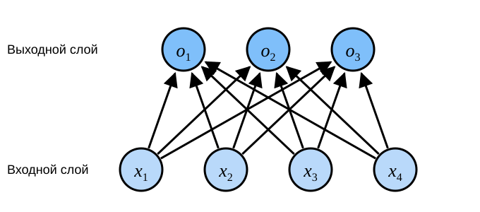

# 3.4 Softmax-регрессия

В разделе 3.1 мы ввели линейную регрессию.
Затем в разделе 3.2 мы реализовали её с нуля, а в разделе 3.3 — кратко, с помощью высокоуровневого API фреймворка.

Регрессия подходит для задач, в которых нужно предсказать *сколько*: например, цену, по которой продастся дом, число побед бейсбольной команды или количество дней пребывания пациента в больнице.

Но нас также интересуют задачи *классификации*. В них спрашивают не «сколько», а «какой»:

* попадёт ли письмо в папку «Спам»?
* подпишется ли пользователь на сервис или нет?
* на изображении осёл, собака, кошка или курица?
* какой фильм пользователь, скорее всего, посмотрит дальше?

Специалисты по машинному обучению употребляют слово «классификация» для двух близких, но различных задач:

1. нас интересует только «жёсткая» категория — к какому классу относится образец;
2. нас интересует «мягкая» категория — вероятность принадлежности образца каждому классу.

Граница между ними часто размыта.
Одна из причин в том, что даже если нас интересует только жёсткая категория, мы всё равно нередко используем модели, которые выдают мягкие категории.

## 3.4.1 Задача классификации

Начнём с задачи классификации изображений.
Пусть каждый вход — полутоновое изображение размером $2\times2$.
Значение каждого пикселя мы запишем одним числом, поэтому каждому изображению соответствуют четыре признака $x_1, x_2, x_3, x_4$.
Кроме того, будем считать, что каждое изображение относится к одному из классов: «кошка», «курица» или «собака».

Теперь нужно выбрать способ записи меток.
Есть два очевидных варианта.
Самая прямая идея — взять $y \in \{1, 2, 3\}$, где целые числа соответствуют классам $\{\text{собака}, \text{кошка}, \text{курица}\}$.
Это эффективный способ хранения такой информации на компьютере.
Если между классами есть естественный порядок — например, при предсказании возрастной группы $\{\text{младенец}, \text{ребёнок}, \text{подросток}, \text{молодой взрослый}, \text{взрослый средних лет}, \text{пожилой человек}\}$ — то имеет смысл свести задачу к регрессии и сохранить этот порядок.

Но в общей задаче классификации порядок классов не связан с их смыслом.
К счастью, статистики давно придумали простой способ записи категориальных данных: *прямое кодирование* (one-hot encoding).
Это вектор, размерность которого равна числу классов.
Компонента, соответствующая классу, равна 1, а все остальные компоненты равны 0.
В нашем примере метка $y$ — трёхмерный вектор: $(1, 0, 0)$ соответствует «кошке», $(0, 1, 0)$ — «курице», $(0, 0, 1)$ — «собаке»:

$$y \in \{(1, 0, 0), (0, 1, 0), (0, 0, 1)\}.$$

## 3.4.2 Архитектура сети

Чтобы оценить условные вероятности для всех возможных классов, нужна модель с несколькими выходами — по одному на каждый класс.
Чтобы решить задачу классификации линейной моделью, нужно столько аффинных функций, сколько выходов: каждый выход имеет собственную аффинную функцию.
В нашем примере четыре признака и три возможных класса, поэтому понадобятся 12 скалярных весов (с индексами у $w$) и 3 скалярных смещения (с индексами у $b$).
Для каждого входа вычислим три *ненормированных предсказания* (логиты) $o_1$, $o_2$ и $o_3$:

$$
\begin{aligned}
o_1 &= x_1 w_{11} + x_2 w_{12} + x_3 w_{13} + x_4 w_{14} + b_1,\\
o_2 &= x_1 w_{21} + x_2 w_{22} + x_3 w_{23} + x_4 w_{24} + b_2,\\
o_3 &= x_1 w_{31} + x_2 w_{32} + x_3 w_{33} + x_4 w_{34} + b_3.
\end{aligned}
$$

Этот процесс вычисления можно изобразить в виде нейронной сети (рис. 3.4.1).
Как и линейная регрессия, softmax-регрессия — однослойная нейронная сеть.
Поскольку каждый из выходов $o_1$, $o_2$ и $o_3$ зависит от всех входов $x_1$, $x_2$, $x_3$ и $x_4$, выходной слой softmax-регрессии тоже является полносвязным.

Для краткости по-прежнему используем обозначения линейной алгебры: $\mathbf{o} = \mathbf{W} \mathbf{x} + \mathbf{b}$.
Эта форма удобна и для математической записи, и для кода.
Все веса мы собираем в матрицу размера $3 \times 4$.
Для признаков $\mathbf{x}$ данного образца выход получается умножением матрицы весов на вектор признаков с последующим прибавлением смещения $\mathbf{b}$.

## 3.4.3 Затраты параметров полносвязных слоёв

Как мы увидим в следующих главах, полносвязные слои встречаются в глубоком обучении повсеместно.
Однако, как следует из названия, полносвязный слой «полностью» связан со входами и может содержать очень много обучаемых параметров.
Точнее, для полносвязного слоя с $d$ входами и $q$ выходами число параметров составляет $\mathcal{O}(dq)$.
На практике это число может оказаться непомерно большим.
К счастью, стоимость преобразования $d$ входов в $q$ выходов можно снизить до $\mathcal{O}(\frac{dq}{n})$, где гиперпараметр $n$ можно задавать гибко, чтобы найти баланс между экономией параметров и качеством модели (Zhang et al., 2021).

## 3.4.4 Операция softmax

Теперь оптимизируем параметры так, чтобы максимизировать вероятность наблюдаемых данных.
Чтобы получить предсказание, зададим правило выбора, например: взять метку с наибольшей вероятностью.

Мы хотим, чтобы выход модели $\hat{y}_j$ можно было понимать как вероятность принадлежности классу $j$, а в качестве предсказания выбирать класс с наибольшим значением $\operatorname*{argmax}_j y_j$.
Например, если $\hat{y}_1$, $\hat{y}_2$ и $\hat{y}_3$ равны 0.1, 0.8 и 0.1 соответственно, то мы предсказываем класс 2, в нашем примере — «курицу».

Можно ли напрямую считать ненормированные предсказания $o$ искомыми вероятностями?
Нет, по двум причинам.
Во-первых, сумма выходов линейного слоя ничем не ограничена, и она не обязана равняться 1.
Во-вторых, в зависимости от входа выходы могут быть отрицательными.
Это нарушает базовые аксиомы вероятности, о которых шла речь в разделе 2.6.

Чтобы интерпретировать выход как вероятности, нужно гарантировать, что на любых данных выход неотрицателен и в сумме равен 1.
Кроме того, нужна целевая функция, которая побуждает модель точно оценивать вероятности.
Например, среди всех образцов, для которых классификатор выдаёт вероятность 0.5, половина должна действительно принадлежать предсказанному классу.
Это свойство называется *калибровкой* (calibration).

*Функция softmax* делает именно это.
Её предложил в 1959 году социолог Дункан Люс на основе теории *моделей выбора* (choice model).
Softmax преобразует ненормированные предсказания в неотрицательные числа с суммой 1, сохраняя при этом дифференцируемость.
Для этого сначала каждое ненормированное предсказание возводится в экспоненту (это гарантирует неотрицательность), а затем каждый результат делится на сумму всех результатов (это гарантирует, что сумма равна 1):

$$\hat{\mathbf{y}} = \mathrm{softmax}(\mathbf{o})\quad \text{где}\quad \hat{y}_j = \frac{\exp(o_j)}{\sum_k \exp(o_k)}\tag{3.4.1}$$

Для всех $j$ выполняется $0 \leq \hat{y}_j \leq 1$.
Поэтому $\hat{\mathbf{y}}$ можно считать корректным распределением вероятностей.
Операция softmax не меняет порядка ненормированных предсказаний $\mathbf{o}$, а только определяет вероятности, которые получает каждый класс.
Поэтому при предсказании по-прежнему можно выбирать наиболее вероятный класс:

$$
\operatorname*{argmax}_j \hat y_j = \operatorname*{argmax}_j o_j.
$$

Хотя softmax — нелинейная функция, выход softmax-регрессии по-прежнему определяется аффинным преобразованием входных признаков.
Поэтому softmax-регрессия — это *линейная модель* (linear model).

## 3.4.5 Векторизация для минибатчей

Чтобы повысить эффективность вычислений и полностью загрузить GPU, векторные вычисления обычно выполняют на минибатчах.
Пусть прочитан батч образцов $\mathbf{X}$ с размерностью признаков (числом входов) $d$ и размером батча $n$, а число выходных классов равно $q$.
Тогда признаки минибатча $\mathbf{X} \in \mathbb{R}^{n \times d}$, веса $\mathbf{W} \in \mathbb{R}^{d \times q}$, смещение $\mathbf{b} \in \mathbb{R}^{1\times q}$.
Векторная запись softmax-регрессии выглядит так:

$$ \begin{aligned} \mathbf{O} &= \mathbf{X} \mathbf{W} + \mathbf{b}, \\ \hat{\mathbf{Y}} & = \mathrm{softmax}(\mathbf{O}). \end{aligned} \tag{3.4.2} $$

По сравнению с обработкой одного образца за раз векторизация минибатча ускоряет умножение матрицы $\mathbf{X}$ на матрицу $\mathbf{W}$.
Поскольку каждая строка $\mathbf{X}$ соответствует одному образцу, операцию softmax можно выполнять *построчно* (rowwise): для каждой строки $\mathbf{O}$ сначала берём экспоненты всех элементов, а затем нормируем их суммой.
В формуле (3.4.2) сложение $\mathbf{X} \mathbf{W} + \mathbf{b}$ выполняется по правилу broadcasting.
Минибатч ненормированных предсказаний $\mathbf{O}$ и выходных вероятностей $\hat{\mathbf{Y}}$ — это матрицы размера $n \times q$.

## 3.4.6 Функция потерь

Далее нам нужна функция потерь, которая измеряет качество предсказаний.
Мы будем использовать оценку максимального правдоподобия — тот же подход, что и в линейной регрессии (раздел 3.1.3).

### 3.4.6.1 Логарифмическое правдоподобие

Функция softmax даёт вектор $\hat{\mathbf{y}}$, который можно интерпретировать как «условную вероятность каждого класса при заданном входе $\mathbf{x}$».
Например, $\hat{y}_1 = P(y=\text{кошка} \mid \mathbf{x})$.
Пусть весь набор данных $\{\mathbf{X}, \mathbf{Y}\}$ содержит $n$ образцов, где образец с индексом $i$ состоит из вектора признаков $\mathbf{x}^{(i)}$ и вектора-метки прямого кодирования $\mathbf{y}^{(i)}$.
Сравним предсказания с истинными значениями:

$$
P(\mathbf{Y} \mid \mathbf{X}) = \prod_{i=1}^n P(\mathbf{y}^{(i)} \mid \mathbf{x}^{(i)}).
$$

По принципу максимального правдоподобия мы максимизируем $P(\mathbf{Y} \mid \mathbf{X})$, что эквивалентно минимизации отрицательного логарифма правдоподобия:

$$
-\log P(\mathbf{Y} \mid \mathbf{X}) = \sum_{i=1}^n -\log P(\mathbf{y}^{(i)} \mid \mathbf{x}^{(i)})
= \sum_{i=1}^n l(\mathbf{y}^{(i)}, \hat{\mathbf{y}}^{(i)}),
$$

где для любой метки $\mathbf{y}$ и предсказания модели $\hat{\mathbf{y}}$ функция потерь имеет вид:

$$ l(\mathbf{y}, \hat{\mathbf{y}}) = - \sum_{j=1}^q y_j \log \hat{y}_j. \tag{3.4.3} $$

Функция потерь (3.4.3) обычно называется *кросс-энтропийной потерей* (cross-entropy loss), как будет показано ниже.
Поскольку $\mathbf{y}$ — прямое кодирование вектора длины $q$, все слагаемые, кроме одного, обращаются в нуль.
Все $\hat{y}_j$ — предсказанные вероятности, поэтому их логарифмы никогда не превышают 0.
Значит, если модель правильно предсказывает истинную метку, то есть $P(\mathbf{y} \mid \mathbf{x})=1$, потери уже нельзя уменьшить.
Однако на практике этого часто не добиться.
Например, в наборе данных могут встречаться шумные метки (некоторые образцы размечены ошибочно), или входные признаки могут не содержать достаточно информации для идеальной классификации каждого образца.

### 3.4.6.2 Softmax и его производные

Поскольку softmax и связанная с ним функция потерь встречаются очень часто, полезно понимать, как они вычисляются.
Подставим (3.4.1) в потерю (3.4.3) и воспользуемся определением softmax:

$$
\begin{aligned}
l(\mathbf{y}, \hat{\mathbf{y}}) &=  - \sum_{j=1}^q y_j \log \frac{\exp(o_j)}{\sum_{k=1}^q \exp(o_k)} \\
&= \sum_{j=1}^q y_j \log \sum_{k=1}^q \exp(o_k) - \sum_{j=1}^q y_j o_j\\
&= \log \sum_{k=1}^q \exp(o_k) - \sum_{j=1}^q y_j o_j.
\end{aligned}
$$

Найдём производную по произвольному ненормированному предсказанию $o_j$:

$$
\partial_{o_j} l(\mathbf{y}, \hat{\mathbf{y}}) = \frac{\exp(o_j)}{\sum_{k=1}^q \exp(o_k)} - y_j = \mathrm{softmax}(\mathbf{o})_j - y_j.
$$

Иными словами, производная — это разность между вероятностью, которую softmax-модель назначила классу, и тем, что произошло на самом деле (выраженным прямым кодированием метки).
В этом смысле результат очень похож на то, что мы видели в регрессии, где градиент — это разность между наблюдаемым значением $y$ и оценкой $\hat{y}$.
Это не случайное совпадение: для любой модели из экспоненциального семейства распределений (см. [раздел приложения о математических распределениях](https://d2l.ai/chapter_appendix-mathematics-for-deep-learning/distributions.html)) градиент логарифма правдоподобия выражается именно так.
Это значительно упрощает вычисление градиентов на практике.

### 3.4.6.3 Кросс-энтропийная потеря

Теперь рассмотрим ситуацию, когда наблюдается не один исход, а целое распределение исходов.
Метку $\mathbf{y}$ можно записать в той же форме, что и раньше, только теперь это вектор вероятностей, например $(0.1, 0.2, 0.7)$, а не бинарный вектор $(0, 0, 1)$.
Потерю $l$ определяем формулой (3.4.3): она представляет собой ожидаемое значение потерь по всем распределениям меток.
Эта потеря называется *кросс-энтропийной потерей* (cross-entropy loss) и относится к самым распространённым функциям потерь в задачах классификации.
Чтобы её понять, введём основы теории информации.
Подробности можно найти в [разделе приложения о теории информации](https://d2l.ai/chapter_appendix-mathematics-for-deep-learning/information-theory.html).

## 3.4.7 Основы теории информации

*Теория информации* (information theory) изучает кодирование, декодирование, передачу информации и её наиболее краткое представление.

### 3.4.7.1 Энтропия

Центральная идея теории информации — количественно оценить информационное содержание данных.
В теории информации эта величина называется *энтропией* (entropy) распределения $P$ и вычисляется по формуле:

$$H[P] = \sum_j - P(j) \log P(j).\tag{3.4.4}$$

Одна из основных теорем теории информации гласит: чтобы закодировать данные, случайно извлечённые из распределения $P$, нужно как минимум $H[P]$ «нат» (nat).
«Нат» — аналог бита, только логарифм берётся по основанию $e$, а не 2.
Таким образом, один нат равен $\frac{1}{\log(2)} \approx 1.44$ бита.

### 3.4.7.2 Информационное содержание

Какая связь между сжатием и предсказанием?
Представим поток данных, который мы хотим сжать.
Если каждый следующий элемент легко предсказать, такой поток легко сжать.
Крайний пример: если все элементы потока одинаковы, поток очень скучен — мы всегда знаем следующий элемент, поэтому передавать ничего не нужно.
Событие «следующий элемент — это XX» не несёт никакой информации.

Но если мы не можем полностью предсказать каждое событие, то иногда будем «удивляться».
Клод Шеннон предложил измерять степень этого удивления *информационным содержанием* $\log \frac{1}{P(j)} = -\log P(j)$.
Это величина для наблюдения события $j$, которому приписана (субъективная) вероятность $P(j)$.
Чем меньше вероятность события, тем сильнее удивление и тем больше его информационное содержание.
Энтропия, определённая формулой (3.4.4), — это математическое ожидание информационного содержания при условии, что назначенные вероятности точно соответствуют процессу порождения данных.

### 3.4.7.3 Повторный взгляд на кросс-энтропию

Если представить энтропию $H(P)$ как «степень удивления того, кто знает истинные вероятности», то что такое кросс-энтропия?
Кросс-энтропия *от* $P$ *к* $Q$ обозначается $H(P, Q)$.
Её можно понимать как «ожидаемое удивление наблюдателя с субъективными вероятностями $Q$, когда он видит данные, порождённые вероятностями $P$».
Кросс-энтропия минимальна при $P=Q$.
В этом случае кросс-энтропия от $P$ к $Q$ равна $H(P, P)= H(P)$.

Итак, кросс-энтропийную цель классификации можно рассматривать двумя способами:
(i) максимизация правдоподобия наблюдаемых данных;
(ii) минимизация удивления, необходимого для передачи метки.

## 3.4.8 Предсказания модели и их оценка

После обучения softmax-регрессии для любого образца можно предсказать вероятность каждого выходного класса.
Обычно в качестве итогового класса берут класс с наибольшей предсказанной вероятностью.
Если предсказание совпадает с фактическим классом (меткой), то оно верно.
В дальнейших экспериментах качество модели мы будем оценивать по *точности* (accuracy) — отношению числа правильных предсказаний к общему числу предсказаний.

## Резюме

* Операция softmax преобразует вектор в распределение вероятностей.
* Softmax-регрессия подходит для задач классификации: она использует распределение вероятностей по классам, которое даёт операция softmax.
* Кросс-энтропия — хорошая мера различия между двумя распределениями вероятностей: она показывает, сколько битов нужно для кодирования данных при использовании модели.

## Упражнения

1. Углубимся в связь между экспоненциальным семейством и softmax.
    1. Вычислите вторую производную функции кросс-энтропийной потери softmax $l(\mathbf{y},\hat{\mathbf{y}})$.
    1. Вычислите дисперсию распределения, заданного $\mathrm{softmax}(\mathbf{o})$, и сравните её со второй производной из предыдущего пункта.
1. Предположим, что три класса имеют одинаковую вероятность, то есть вектор вероятностей равен $(\frac{1}{3}, \frac{1}{3}, \frac{1}{3})$.
    1. Какие проблемы возникнут, если попытаться построить для них двоичный код?
    1. Постройте более удачный код. Подсказка: что будет, если кодировать два независимых наблюдения? Что будет, если закодировать $n$ наблюдений совместно?
1. Название softmax на самом деле не совсем точно описывает введённое отображение (хотя многие в глубоком обучении используют именно это название). Настоящий softmax определяется как $\mathrm{RealSoftMax}(a, b) = \log (\exp(a) + \exp(b))$.
    1. Докажите, что $\mathrm{RealSoftMax}(a, b) > \mathrm{max}(a, b)$.
    1. Докажите, что $\lambda^{-1} \mathrm{RealSoftMax}(\lambda a, \lambda b) > \mathrm{max}(a, b)$ выполняется при $\lambda > 0$.
    1. Докажите, что для $\lambda \to \infty$ выполняется $\lambda^{-1} \mathrm{RealSoftMax}(\lambda a, \lambda b) \to \mathrm{max}(a, b)$.
    1. Как выглядел бы soft-min?
    1. Обобщите это на больше чем два числа.

* Обсуждение: [discuss.d2l.ai/t/1785](https://discuss.d2l.ai/t/1785)
