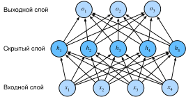

# 4.1 Многослойный перцептрон

В главе 3 мы ввели softmax-регрессию (раздел 3.4), затем реализовали её с нуля (раздел 3.6) и с помощью высокоуровневого API (раздел 3.7).
Этот алгоритм обучал классификатор распознавать 10 классов одежды по изображениям низкого разрешения.
При этом мы научились подготавливать данные, преобразовывать выход в корректное распределение вероятностей и применять подходящую функцию потерь, чтобы минимизировать её по параметрам модели.
Мы освоили всё это в контексте простой линейной модели.
Теперь можно перейти к глубоким нейронным сетям, которым и посвящена основная часть книги.

## 4.1.1 Скрытые слои

В разделе 3.1.1 мы описали аффинное преобразование: линейное преобразование с добавлением смещения.
Вспомним архитектуру softmax-регрессии (рис. 3.4.1).
Эта модель напрямую отображает входы в выходы одним аффинным преобразованием, после чего применяет softmax.
Если метки действительно связаны с входными данными аффинным преобразованием, такого подхода достаточно.
Однако *линейность* аффинного преобразования — очень сильное допущение.

### 4.1.1.1 Линейные модели могут ошибаться

Например, линейность подразумевает *монотонность*: увеличение любого признака всегда приводит к увеличению выхода модели (если соответствующий вес положителен) или к его уменьшению (если вес отрицателен).
Иногда это разумно.
Допустим, мы хотим предсказать, вернёт ли человек кредит.
При прочих равных заёмщик с более высоким доходом, скорее всего, вернёт кредит, чем заёмщик с более низким доходом.
Но хотя доход и вероятность возврата связаны монотонно, связь эта не линейна.
Рост дохода с 0 до 50 тысяч может повысить вероятность возврата сильнее, чем рост с 1 миллиона до 1 миллиона 50 тысяч.
Один из способов справиться с этим — предварительно обработать данные так, чтобы линейность стала более уместной, например взять в качестве признака логарифм дохода.

Однако легко найти и примеры, где монотонность нарушается.
Допустим, мы хотим предсказать смертность по температуре тела.
Для людей с температурой выше 37 градусов Цельсия риск растёт вместе с температурой.
А для людей с температурой ниже 37 градусов, напротив, чем выше температура, тем ниже риск.
И в этом случае проблему можно решить подходящей предобработкой: например, использовать в качестве признака расстояние до 37 градусов.

Но как классифицировать изображения кошек и собак?
Увеличение яркости пикселя в позиции $(13, 17)$ всегда повышает (или всегда понижает) вероятность того, что на изображении собака?
Опора на линейную модель неявно предполагает, что различать кошек и собак достаточно, оценивая яркость отдельных пикселей.
В мире, где классы не меняются при переворачивании изображения, такой подход обречён на провал.

По сравнению с предыдущим примером здесь линейность абсурдна, и простой предобработкой с этой проблемой не справиться.
Дело в том, что важность любого пикселя сложным образом зависит от его окружения, то есть от значений соседних пикселей.
Нам нужно представление данных, которое учитывает взаимодействия между признаками.
Линейную модель над таким представлением построить было бы разумно, но вручную вычислить его мы не умеем.
В глубоких нейронных сетях мы по наблюдаемым данным одновременно обучаем и скрытое представление, и линейный предсказатель, применяемый к этому представлению.

### 4.1.1.2 Добавление скрытых слоёв в сеть

Ограничения линейной модели можно преодолеть, добавив в сеть один или несколько скрытых слоёв, что позволяет моделировать более общие функциональные зависимости.
Самый простой способ — последовательно соединить несколько полносвязных слоёв.
Каждый слой передаёт свой выход следующему, пока не будет получен окончательный выход.
Первые $L-1$ слоёв можно считать представлением, а последний слой — линейным предсказателем.
Такая архитектура обычно называется *многослойным перцептроном* (multilayer perceptron, *MLP*).
Ниже многослойный перцептрон показан на схеме (рис. 4.1.1).



**Рис. 4.1.1.** Многослойный перцептрон с одним скрытым слоем из 5 скрытых нейронов

Этот многослойный перцептрон имеет 4 входа и 3 выхода, а его скрытый слой содержит 5 скрытых нейронов.
Входной слой не выполняет вычислений, поэтому для получения выхода от сети нужно вычислить только скрытый и выходной слои.
Значит, у этого многослойного перцептрона два слоя.
Обратите внимание, что оба слоя полносвязные.
Каждый вход влияет на каждый нейрон скрытого слоя, а каждый нейрон скрытого слоя, в свою очередь, влияет на каждый нейрон выходного слоя.

Однако, как сказано в разделе 3.4.3, число параметров у многослойного перцептрона с полносвязными слоями может оказаться непомерно большим.
Даже если не менять размер входа или выхода, между экономией параметров и эффективностью модели можно найти компромисс (Zhang et al., 2021).

### 4.1.1.3 От линейности к нелинейности

Как и в предыдущих главах, мы представляем минибатч из $n$ примеров матрицей $\mathbf{X} \in \mathbb{R}^{n \times d}$, где каждый пример имеет $d$ входных признаков.
Для многослойного перцептрона с одним скрытым слоем из $h$ скрытых нейронов выход скрытого слоя обозначим $\mathbf{H} \in \mathbb{R}^{n \times h}$.
Его называют *скрытым представлением* (hidden representations).
В формулах и в коде $\mathbf{H}$ также называют *переменной скрытого слоя* (hidden-layer variable) или *скрытой переменной* (hidden variable).
Поскольку скрытый и выходной слои полносвязные, есть веса скрытого слоя $\mathbf{W}^{(1)} \in \mathbb{R}^{d \times h}$, смещения скрытого слоя $\mathbf{b}^{(1)} \in \mathbb{R}^{1 \times h}$, веса выходного слоя $\mathbf{W}^{(2)} \in \mathbb{R}^{h \times q}$ и смещения выходного слоя $\mathbf{b}^{(2)} \in \mathbb{R}^{1 \times q}$.
Формально выход многослойного перцептрона с одним скрытым слоем $\mathbf{O} \in \mathbb{R}^{n \times q}$ вычисляется так:

$$
\begin{aligned}
    \mathbf{H} & = \mathbf{X} \mathbf{W}^{(1)} + \mathbf{b}^{(1)}, \\
    \mathbf{O} & = \mathbf{H}\mathbf{W}^{(2)} + \mathbf{b}^{(2)}.
\end{aligned}
$$

Обратите внимание: после добавления скрытого слоя модели приходится отслеживать и обновлять дополнительные параметры.
Но что мы получаем взамен? В определённой выше модели — ничего!
Причина проста: скрытые нейроны заданы аффинными функциями входа, а выход (до применения softmax) — аффинная функция скрытых нейронов.
Аффинная функция от аффинной функции сама является аффинной, а линейная модель, которую мы уже рассматривали, и так могла представить любую аффинную функцию.

Эту эквивалентность можно показать: при любых значениях весов скрытый слой можно «свернуть» и получить эквивалентную однослойную модель с параметрами
$\mathbf{W} = \mathbf{W}^{(1)}\mathbf{W}^{(2)}$ и $\mathbf{b} = \mathbf{b}^{(1)} \mathbf{W}^{(2)} + \mathbf{b}^{(2)}$:

$$
\mathbf{O} = (\mathbf{X} \mathbf{W}^{(1)} + \mathbf{b}^{(1)})\mathbf{W}^{(2)} + \mathbf{b}^{(2)} = \mathbf{X} \mathbf{W}^{(1)}\mathbf{W}^{(2)} + \mathbf{b}^{(1)} \mathbf{W}^{(2)} + \mathbf{b}^{(2)} = \mathbf{X} \mathbf{W} + \mathbf{b}.
$$

Чтобы раскрыть потенциал многослойной архитектуры, нужен ещё один ключевой элемент: после аффинного преобразования к каждому скрытому нейрону применяется нелинейная *функция активации* (activation function) $\sigma$.
Выход функции активации (то есть $\sigma(\cdot)$) называют *активацией* (activations).
В общем случае с функцией активации невозможно свести многослойный перцептрон к линейной модели:

$$
\begin{aligned}
    \mathbf{H} & = \sigma(\mathbf{X} \mathbf{W}^{(1)} + \mathbf{b}^{(1)}), \\
    \mathbf{O} & = \mathbf{H}\mathbf{W}^{(2)} + \mathbf{b}^{(2)}.\\
\end{aligned}
$$

Каждая строка $\mathbf{X}$ соответствует одному примеру минибатча.
Для удобства записи мы определяем нелинейную функцию $\sigma$ как действующую на вход построчно, то есть по одному примеру за раз.
Так же мы записывали softmax в разделе 3.4.5.
Однако функции активации, применяемые к скрытым слоям в этом разделе, обычно действуют не только построчно, но и поэлементно.
Это означает, что после вычисления линейной части слоя каждую активацию можно вычислить, не глядя на значения других скрытых нейронов.
Так устроено большинство функций активации.

Чтобы построить более общий многослойный перцептрон, можно продолжить наращивать такие скрытые слои, например $\mathbf{H}^{(1)} = \sigma_1(\mathbf{X} \mathbf{W}^{(1)} + \mathbf{b}^{(1)})$ и $\mathbf{H}^{(2)} = \sigma_2(\mathbf{H}^{(1)} \mathbf{W}^{(2)} + \mathbf{b}^{(2)})$, слой за слоем, что даёт более выразительную модель.

### 4.1.1.4 Универсальная аппроксимационная теорема

Многослойный перцептрон может улавливать сложные взаимодействия входов через скрытые нейроны, активность которых зависит от значений входов.
Скрытые узлы несложно настроить так, чтобы они выполняли произвольные вычисления.
Например, многослойный перцептрон способен аппроксимировать любую логическую операцию над парой входов.
Даже с одним скрытым слоем при достаточном числе нейронов и правильных весах можно смоделировать любую функцию, хотя на практике такую функцию выучить трудно.
Нейронные сети немного похожи на язык C.
Как и любой современный язык программирования, C может выразить любую вычислимую программу.
Но на практике самая трудная часть — придумать программу, которая соответствует спецификации.

Более того, хотя один скрытый слой позволяет обучить любую функцию, это не значит, что нужно решать все задачи с помощью сети с одним скрытым слоем.
На деле за счёт более глубоких (а не более широких) сетей многие функции можно аппроксимировать гораздо проще.
Мы вернёмся к этому подробнее в последующих главах.

## 4.1.2 Функции активации

*Функция активации* (activation function) определяет, должен ли нейрон активироваться, вычисляя взвешенную сумму и добавляя смещение.
Она преобразует входной сигнал в выход и является дифференцируемой операцией.
Большинство функций активации нелинейны.
Поскольку функции активации лежат в основе глубокого обучения, кратко рассмотрим некоторые из них.

**MXNet:**
```python
%matplotlib inline
from d2l import mxnet as d2l
from mxnet import autograd, np, npx
npx.set_np()
```

**PyTorch:**
```python
%matplotlib inline
from d2l import torch as d2l
import torch
```

**TensorFlow:**
```python
%matplotlib inline
from d2l import tensorflow as d2l
import tensorflow as tf
```

**PaddlePaddle:**
```python
%matplotlib inline
from d2l import paddle as d2l
import warnings
warnings.filterwarnings("ignore")
import paddle
```

### 4.1.2.1 Функция ReLU

Самая популярная функция активации — *выпрямленный линейный блок* (rectified linear unit, *ReLU*).
Она проста в реализации и хорошо работает во многих задачах предсказания.
**ReLU задаёт очень простое нелинейное преобразование**.
Для элемента $x$ функция ReLU определяется как максимум из этого элемента и $0$:

$$\operatorname{ReLU}(x) = \max(x, 0).$$

Проще говоря, ReLU оставляет только положительные элементы и обнуляет отрицательные, то есть обнуляет соответствующие активации.
Чтобы получить наглядное представление, построим график функции.
Как видно из графика, функция активации кусочно-линейна.

**MXNet:**
```python
x = np.arange(-8.0, 8.0, 0.1)
x.attach_grad()
with autograd.record():
    y = npx.relu(x)
d2l.plot(x, y, 'x', 'relu(x)', figsize=(5, 2.5))
```

**PyTorch:**
```python
x = torch.arange(-8.0, 8.0, 0.1, requires_grad=True)
y = torch.relu(x)
d2l.plot(x.detach(), y.detach(), 'x', 'relu(x)', figsize=(5, 2.5))
```

**TensorFlow:**
```python
x = tf.Variable(tf.range(-8.0, 8.0, 0.1), dtype=tf.float32)
y = tf.nn.relu(x)
d2l.plot(x.numpy(), y.numpy(), 'x', 'relu(x)', figsize=(5, 2.5))
```

**PaddlePaddle:**
```python
x = paddle.arange(-8.0, 8.0, 0.1, dtype='float32')
x.stop_gradient = False
y = paddle.nn.functional.relu(x)
d2l.plot(x.detach().numpy(), y.detach().numpy(), 'x', 'relu(x)', figsize=(5, 2.5))
```

Производная ReLU равна 0, когда вход отрицателен, и 1, когда вход положителен.
Заметим, что в точке, где вход в точности равен 0, ReLU не дифференцируема.
В этом случае по умолчанию используем левую производную: при входе 0 производная равна 0.
Этим случаем можно пренебречь, поскольку вход почти никогда в точности не равен 0.
Здесь уместна старая поговорка: «Если тонкие граничные условия важны, мы, скорее всего, занимаемся математикой, а не инженерией».
Теперь построим производную ReLU.

**MXNet:**
```python
y.backward()
d2l.plot(x, x.grad, 'x', 'grad of relu', figsize=(5, 2.5))
```

**PyTorch:**
```python
y.backward(torch.ones_like(x), retain_graph=True)
d2l.plot(x.detach(), x.grad, 'x', 'grad of relu', figsize=(5, 2.5))
```

**TensorFlow:**
```python
with tf.GradientTape() as t:
    y = tf.nn.relu(x)
d2l.plot(x.numpy(), t.gradient(y, x).numpy(), 'x', 'grad of relu',
         figsize=(5, 2.5))
```

**PaddlePaddle:**
```python
y.backward(paddle.ones_like(x), retain_graph=True)
d2l.plot(x.detach().numpy(), x.grad.numpy(), 'x', 'grad of relu', figsize=(5, 2.5))
```

ReLU используют потому, что с ней очень хорошо работать при дифференцировании: она либо полностью пропускает параметр, либо полностью его обнуляет.
Это улучшает оптимизацию и смягчает проблему затухающих градиентов, которая мешала ранним нейронным сетям (подробнее об этом позже).

Существует много вариантов ReLU, в том числе *параметрический ReLU* (parameterized ReLU, *pReLU*) (He et al., 2015).
Эта версия добавляет к ReLU линейный член, поэтому часть информации проходит даже при отрицательных значениях параметра:

$$\operatorname{pReLU}(x) = \max(0, x) + \alpha \min(0, x).$$

### 4.1.2.2 Сигмоидная функция

**Для входа, заданного на $\mathbb{R}$, *сигмоидная функция* (sigmoid) преобразует вход в выход на интервале (0, 1)**.
Поэтому сигмоиду часто называют *функцией сжатия* (squashing function): она сжимает любой вход из диапазона (-inf, inf) в значение из интервала (0, 1):

$$\operatorname{sigmoid}(x) = \frac{1}{1 + \exp(-x)}.$$

В ранних нейронных сетях учёных интересовала модель биологического нейрона, который либо «возбуждается», либо нет.
Поэтому пионеры этой области, начиная с создателей искусственного нейрона Маккаллока и Питтса, работали с пороговыми элементами.
Пороговый элемент выдаёт 0, если вход ниже некоторого порога, и 1, если вход превышает порог.

Когда внимание исследователей обратилось к обучению на основе градиентов, сигмоида стала естественным выбором, потому что она является гладким, дифференцируемым приближением к пороговому элементу.
Когда мы хотим трактовать выход как вероятность для задачи бинарной классификации, сигмоида по-прежнему широко используется как функция активации выходного нейрона (сигмоиду можно рассматривать как частный случай softmax).
Однако в скрытых слоях её применяют сейчас гораздо реже: её чаще заменяет более простая и легче обучаемая ReLU.
В последующих главах о рекуррентных нейронных сетях мы опишем архитектуры, в которых сигмоидные элементы управляют потоком временной информации.

Теперь построим сигмоиду.
Заметим, что при входах, близких к 0, сигмоида почти линейна.

**MXNet:**
```python
with autograd.record():
    y = npx.sigmoid(x)
d2l.plot(x, y, 'x', 'sigmoid(x)', figsize=(5, 2.5))
```

**PyTorch:**
```python
y = torch.sigmoid(x)
d2l.plot(x.detach(), y.detach(), 'x', 'sigmoid(x)', figsize=(5, 2.5))
```

**TensorFlow:**
```python
y = tf.nn.sigmoid(x)
d2l.plot(x.numpy(), y.numpy(), 'x', 'sigmoid(x)', figsize=(5, 2.5))
```

**PaddlePaddle:**
```python
y = paddle.nn.functional.sigmoid(x)
d2l.plot(x.detach().numpy(), y.detach().numpy(), 'x', 'sigmoid(x)', figsize=(5, 2.5))
```

Производная сигмоиды задаётся формулой:

$$\frac{d}{dx} \operatorname{sigmoid}(x) = \frac{\exp(-x)}{(1 + \exp(-x))^2} = \operatorname{sigmoid}(x)\left(1-\operatorname{sigmoid}(x)\right).$$

График производной сигмоиды показан ниже.
Заметим, что при входе 0 производная сигмоиды достигает максимума 0.25;
по мере удаления входа от 0 в любую сторону производная приближается к 0.

**MXNet:**
```python
y.backward()
d2l.plot(x, x.grad, 'x', 'grad of sigmoid', figsize=(5, 2.5))
```

**PyTorch:**
```python
# Очистить предыдущие градиенты
x.grad.data.zero_()
y.backward(torch.ones_like(x),retain_graph=True)
d2l.plot(x.detach(), x.grad, 'x', 'grad of sigmoid', figsize=(5, 2.5))
```

**TensorFlow:**
```python
with tf.GradientTape() as t:
    y = tf.nn.sigmoid(x)
d2l.plot(x.numpy(), t.gradient(y, x).numpy(), 'x', 'grad of sigmoid',
         figsize=(5, 2.5))
```

**PaddlePaddle:**
```python
# Очистить предыдущие градиенты.
x.clear_gradient()
y.backward(paddle.ones_like(x), retain_graph=True)
d2l.plot(x.detach().numpy(), x.grad.numpy(), 'x', 'grad of sigmoid', figsize=(5, 2.5))
```

### 4.1.2.3 Функция tanh

Как и сигмоида, **функция tanh (гиперболический тангенс) также сжимает вход в интервал (-1, 1)**.
Формула функции tanh:

$$\operatorname{tanh}(x) = \frac{1 - \exp(-2x)}{1 + \exp(-2x)}.$$

Теперь построим tanh.
Заметим, что при входах, близких к 0, tanh почти линейна.
Форма графика похожа на сигмоиду, но tanh симметрична относительно начала координат.

**MXNet:**
```python
with autograd.record():
    y = np.tanh(x)
d2l.plot(x, y, 'x', 'tanh(x)', figsize=(5, 2.5))
```

**PyTorch:**
```python
y = torch.tanh(x)
d2l.plot(x.detach(), y.detach(), 'x', 'tanh(x)', figsize=(5, 2.5))
```

**TensorFlow:**
```python
y = tf.nn.tanh(x)
d2l.plot(x.numpy(), y.numpy(), 'x', 'tanh(x)', figsize=(5, 2.5))
```

**PaddlePaddle:**
```python
y = paddle.tanh(x)
d2l.plot(x.detach().numpy(), y.detach().numpy(), 'x', 'tanh(x)', figsize=(5, 2.5))
```

Производная tanh равна:

$$\frac{d}{dx} \operatorname{tanh}(x) = 1 - \operatorname{tanh}^2(x).$$

График производной tanh показан ниже.
При входе, близком к 0, производная tanh близка к максимуму 1.
Как и в случае сигмоиды, по мере удаления входа от 0 в любую сторону производная приближается к 0.

**MXNet:**
```python
y.backward()
d2l.plot(x, x.grad, 'x', 'grad of tanh', figsize=(5, 2.5))
```

**PyTorch:**
```python
# Очистить предыдущие градиенты
x.grad.data.zero_()
y.backward(torch.ones_like(x),retain_graph=True)
d2l.plot(x.detach(), x.grad, 'x', 'grad of tanh', figsize=(5, 2.5))
```

**TensorFlow:**
```python
with tf.GradientTape() as t:
    y = tf.nn.tanh(x)
d2l.plot(x.numpy(), t.gradient(y, x).numpy(), 'x', 'grad of tanh',
         figsize=(5, 2.5))
```

**PaddlePaddle:**
```python
# Очистить предыдущие градиенты.
x.clear_gradient()
y.backward(paddle.ones_like(x), retain_graph=True)
d2l.plot(x.detach().numpy(), x.grad.numpy(), 'x', 'grad of tanh', figsize=(5, 2.5))
```

Итак, мы разобрали, как сочетание нелинейных функций позволяет строить многослойные нейронные сети с большей выразительной способностью.
Кстати, этих знаний уже достаточно, чтобы владеть инструментарием, которым пользовались специалисты по глубокому обучению примерно в 1990 году.
В некоторых отношениях вы даже в выгодном положении по сравнению с работавшими в 1990-х: вы можете опираться на мощные открытые фреймворки глубокого обучения и строить модели в несколько строк кода, тогда как раньше обучение таких сетей требовало тысяч строк на C или Fortran.

## Резюме

* Многослойный перцептрон добавляет один или несколько полносвязных скрытых слоёв между входным и выходным слоями и преобразует выход скрытых слоёв с помощью функции активации.
* Распространённые функции активации: ReLU, сигмоида и tanh.

## Упражнения

1. Вычислите производную функции активации pReLU.
1. Докажите, что многослойный перцептрон, использующий только ReLU (или pReLU), строит непрерывную кусочно-линейную функцию.
1. Докажите, что $\operatorname{tanh}(x) + 1 = 2 \operatorname{sigmoid}(2x)$.
1. Предположим, что мы применяем нелинейный элемент к минибатчу данных по одному примеру за раз. Какие проблемы это вызовет?

**MXNet:**
[Обсуждение](https://discuss.d2l.ai/t/1797)

**PyTorch:**
[Обсуждение](https://discuss.d2l.ai/t/1796)

**TensorFlow:**
[Обсуждение](https://discuss.d2l.ai/t/1795)

**PaddlePaddle:**
[Обсуждение](https://discuss.d2l.ai/t/11768)

## Литература

* He, K., Zhang, X., Ren, S., & Sun, J. (2015). Delving deep into rectifiers: Surpassing human-level performance on ImageNet classification. *Proceedings of the IEEE International Conference on Computer Vision*, 1026–1034.
