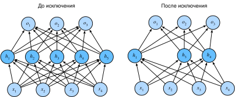

# 4.6 Исключение (dropout)

В разделе 4.5 мы познакомились с классическим методом регуляризации статистических моделей: штрафом за $L_2$-норму весов.
С вероятностной точки зрения обоснование этого метода такое: мы уже предполагали априорное распределение, согласно которому значения весов берутся из гауссова распределения с нулевым математическим ожиданием.
Более наглядно: мы хотим, чтобы модель извлекала признаки глубже, то есть распределяла веса между многими признаками, а не слишком полагалась на несколько потенциально ложных связей.

## 4.6.1 Переосмысление переобучения

Когда признаков много, а примеров мало, линейные модели склонны к переобучению.
И наоборот: когда примеров больше, чем признаков, линейные модели обычно не переобучаются.
К сожалению, надёжность обобщения линейных моделей имеет свою цену.
Проще говоря, линейные модели не учитывают взаимодействия между признаками.
Для каждого признака линейная модель должна задать положительный или отрицательный вес, не обращая внимания на остальные признаки.

Этот фундаментальный компромисс между обобщающей способностью и гибкостью называют *компромиссом между смещением и дисперсией* (bias-variance tradeoff).
Линейные модели имеют большое смещение: они способны представлять лишь небольшой класс функций.
Однако дисперсия таких моделей мала: на разных случайных выборках данных они дают похожие результаты.

Глубокие нейронные сети находятся на другом конце спектра смещения и дисперсии.
В отличие от линейных моделей, нейронные сети не ограничиваются тем, что рассматривают каждый признак по отдельности, а выучивают взаимодействия между признаками.
Например, нейронная сеть может вывести, что сочетание слов «Нигерия» и «Western Union» в письме указывает на спам, хотя по отдельности эти слова спамом не являются.

Даже когда примеров гораздо больше, чем признаков, глубокая нейронная сеть может переобучиться.
В 2017 году группа исследователей обучила глубокие сети на изображениях со случайными метками.
Это продемонстрировало огромную гибкость нейронных сетей: людям трудно связать входы со случайными выходными метками, но нейронная сеть, оптимизируемая стохастическим градиентным спуском, может безошибочно пометить каждое изображение обучающего набора.
Что это означает? Предположим, метки распределены равномерно случайно и есть 10 классов.
Тогда классификатор на тестовых данных едва ли сможет превзойти точность 10%, так что разрыв в обобщении составит 90%, то есть переобучение будет очень сильным.

Свойства обобщения глубоких сетей остаются загадкой, а математические основы этого явления — открытым исследовательским вопросом.
Читателей, которым интересна теория, мы призываем изучить эту тему глубже.
В этом разделе мы сосредоточимся на практических инструментах, которые помогают улучшить обобщающую способность глубоких сетей.

## 4.6.2 Устойчивость к возмущениям

Прежде чем разбираться в обобщающей способности, определим, что такое «хорошая» модель предсказания.
Мы ожидаем, что хорошая модель будет хорошо работать на неизвестных данных.
Классическая теория обобщения утверждает, что для сокращения разрыва между результатами на обучении и на тесте нужно ориентироваться на простые модели.
Простота может проявляться в малой размерности; мы обсуждали это в разделе 4.4, рассматривая одночлены в линейных моделях.
Кроме того, как мы видели в разделе 4.5, при обсуждении затухания весов ($L_2$-регуляризации), норма параметров тоже служит полезной мерой простоты.

Ещё один взгляд на простоту — гладкость: функция не должна быть чувствительна к малым изменениям входа.
Например, при классификации изображений мы ожидаем, что добавление случайного шума к пикселям практически не повлияет на результат.
В 1995 году Кристофер Бишоп показал, что обучение с входным шумом эквивалентно регуляризации Тихонова (Bishop, 1995).
Эта работа математически подтвердила связь между требованием гладкости функции и требованием её устойчивости к случайному шуму на входе.

Затем в 2014 году Сривастава и соавторы (Srivastava et al., 2014) предложили, как применить идею Бишопа к внутренним слоям сети.
Их идея: во время обучения вводить шум в каждый слой сети перед вычислением последующих слоёв.
Ведь при обучении глубокой сети с несколькими слоями введение шума лишь усиливает гладкость отображения «вход — выход».

Этот приём получил название *исключение* (dropout).
Исключение во время прямого распространения вводит шум при вычислении каждого внутреннего слоя; сейчас это распространённый приём обучения нейронных сетей.
Метод назвали *исключением*, потому что в ходе обучения мы как бы отбрасываем (drop out) некоторые нейроны.
На каждой итерации обучения стандартное исключение заключается в том, что перед вычислением следующего слоя часть узлов текущего слоя обнуляется.

Стоит отметить, что в оригинальной статье об исключении приводится аналогия с половым размножением.
Переобучение нейронных сетей связано с тем, что каждый слой зависит от активаций предыдущего слоя; такое состояние авторы называют «коадаптацией».
По их мнению, исключение разрушает коадаптацию так же, как половое размножение разрушает коадаптированные гены.

Тогда ключевая задача — понять, как именно вводить такой шум.
Одна из идей — вводить шум *несмещённым* (unbiased) образом.
Тогда при фиксированных остальных слоях математическое ожидание каждого слоя совпадает с его значением без шума.

В работе Бишопа к входам линейной модели добавляли гауссов шум.
На каждой итерации обучения к входу $\mathbf{x}$ добавлялся шум $\epsilon \sim \mathcal{N}(0,\sigma^2)$, распределённый с нулевым математическим ожиданием.
Так получается возмущённая точка $\mathbf{x}' = \mathbf{x} + \epsilon$, для которой математическое ожидание $E[\mathbf{x}'] = \mathbf{x}$.

В стандартной регуляризации исключением смещение каждого слоя устраняется нормировкой на долю сохранённых (не отброшенных) узлов.
Иными словами, каждая промежуточная активация $h$ с *вероятностью исключения* $p$ заменяется случайной величиной $h'$ следующим образом:

$$
\begin{aligned}
h' =
\begin{cases}
    0 & \text{ с вероятностью } p \\
    \frac{h}{1-p} & \text{ в остальных случаях}
\end{cases}
\end{aligned}
$$

По построению математическое ожидание такой модели не меняется: $E[h'] = h$.

## 4.6.3 Исключение на практике

Вспомним многослойный перцептрон с одним скрытым слоем и пятью скрытыми нейронами (рис. 4.1.1).
Если применить исключение к скрытому слою, обнуляя скрытые нейроны с вероятностью $p$, результат можно рассматривать как сеть, состоящую только из подмножества исходных нейронов.
Например, на рис. 4.6.1 удалены $h_2$ и $h_5$, поэтому вычисление выхода больше не зависит от $h_2$ и $h_5$, а их градиенты при обратном распространении тоже обнуляются.
Так слой выходов не может чрезмерно полагаться ни на один из элементов $h_1, \ldots, h_5$.



**Рис. 4.6.1.** Многослойный перцептрон до и после исключения (dropout)

Обычно при тестировании исключение не применяют.
Для обученной модели и нового примера мы не отбрасываем никаких узлов, поэтому нормировка не нужна.
Однако есть исключения: некоторые исследователи применяют исключение и на этапе тестирования, чтобы оценить «неопределённость» предсказаний нейронной сети.
Если предсказания, полученные при множестве различных масок исключения, совпадают, можно сказать, что сеть работает стабильнее.

## 4.6.4 Реализация с нуля

Чтобы реализовать функцию исключения для одного слоя, мы берём выборку из равномерного распределения $U[0, 1]$ размером, равным размерности слоя нейронной сети.
Затем сохраняем узлы, для которых значение выборки больше $p$, а остальные отбрасываем.

В приведённом ниже коде **мы реализуем функцию `dropout_layer`, которая отбрасывает элементы тензора входа `X` с вероятностью `dropout`**, а оставшиеся элементы масштабирует, деля их на `1.0-dropout`.

**MXNet:**
```python
from d2l import mxnet as d2l
from mxnet import autograd, gluon, init, np, npx
from mxnet.gluon import nn
npx.set_np()

def dropout_layer(X, dropout):
    assert 0 <= dropout <= 1
    # В этом случае все элементы отбрасываются
    if dropout == 1:
        return np.zeros_like(X)
    # В этом случае все элементы сохраняются
    if dropout == 0:
        return X
    mask = np.random.uniform(0, 1, X.shape) > dropout
    return mask.astype(np.float32) * X / (1.0 - dropout)
```

**PyTorch:**
```python
from d2l import torch as d2l
import torch
from torch import nn

def dropout_layer(X, dropout):
    assert 0 <= dropout <= 1
    # В этом случае все элементы отбрасываются
    if dropout == 1:
        return torch.zeros_like(X)
    # В этом случае все элементы сохраняются
    if dropout == 0:
        return X
    mask = (torch.rand(X.shape) > dropout).float()
    return mask * X / (1.0 - dropout)
```

**TensorFlow:**
```python
from d2l import tensorflow as d2l
import tensorflow as tf

def dropout_layer(X, dropout):
    assert 0 <= dropout <= 1
    # В этом случае все элементы отбрасываются
    if dropout == 1:
        return tf.zeros_like(X)
    # В этом случае все элементы сохраняются
    if dropout == 0:
        return X
    mask = tf.random.uniform(
        shape=tf.shape(X), minval=0, maxval=1) < 1 - dropout
    return tf.cast(mask, dtype=tf.float32) * X / (1.0 - dropout)
```

**PaddlePaddle:**
```python
import warnings
warnings.filterwarnings(action='ignore')
import paddle
from paddle import nn
import random

warnings.filterwarnings("ignore", category=DeprecationWarning)
from d2l import paddle as d2l

def dropout_layer(X, dropout):
    assert 0 <= dropout <= 1
    # В этом случае все элементы отбрасываются.
    if dropout == 1:
        return paddle.zeros_like(X)
    # В этом случае все элементы сохраняются.
    if dropout == 0:
        return X
    
    mask = (paddle.to_tensor(paddle.uniform(X.shape)) > dropout).astype('float32')
    return mask * X / (1.0 - dropout)
```

Проверим функцию `dropout_layer` на нескольких примерах.
Пропустим вход `X` через исключение с вероятностями 0, 0.5 и 1.

**MXNet:**
```python
X = np.arange(16).reshape(2, 8)
print(dropout_layer(X, 0))
print(dropout_layer(X, 0.5))
print(dropout_layer(X, 1))
```

**PyTorch:**
```python
X= torch.arange(16, dtype = torch.float32).reshape((2, 8))
print(X)
print(dropout_layer(X, 0.))
print(dropout_layer(X, 0.5))
print(dropout_layer(X, 1.))
```

**TensorFlow:**
```python
X = tf.reshape(tf.range(16, dtype=tf.float32), (2, 8))
print(X)
print(dropout_layer(X, 0.))
print(dropout_layer(X, 0.5))
print(dropout_layer(X, 1.))
```

**PaddlePaddle:**
```python
X= paddle.arange(16, dtype = paddle.float32).reshape((2, 8))
print(X)
print(dropout_layer(X, 0.))
print(dropout_layer(X, 0.5))
print(dropout_layer(X, 1.))
```

### 4.6.4.1 Определение параметров модели

Как и раньше, используем набор данных Fashion-MNIST, введённый в разделе 3.5.
**Определим многослойный перцептрон с двумя скрытыми слоями, каждый из которых содержит 256 элементов**.

**MXNet:**
```python
num_inputs, num_outputs, num_hiddens1, num_hiddens2 = 784, 10, 256, 256

W1 = np.random.normal(scale=0.01, size=(num_inputs, num_hiddens1))
b1 = np.zeros(num_hiddens1)
W2 = np.random.normal(scale=0.01, size=(num_hiddens1, num_hiddens2))
b2 = np.zeros(num_hiddens2)
W3 = np.random.normal(scale=0.01, size=(num_hiddens2, num_outputs))
b3 = np.zeros(num_outputs)

params = [W1, b1, W2, b2, W3, b3]
for param in params:
    param.attach_grad()
```

**PyTorch, PaddlePaddle:**
```python
num_inputs, num_outputs, num_hiddens1, num_hiddens2 = 784, 10, 256, 256
```

**TensorFlow:**
```python
num_outputs, num_hiddens1, num_hiddens2 = 10, 256, 256
```

### 4.6.4.2 Определение модели

Исключение можно применять к выходу каждого скрытого слоя (после функции активации), и вероятность исключения можно задавать для каждого слоя отдельно.
Распространённый приём — ставить меньшую вероятность исключения ближе ко входному слою.
Ниже модель задаёт вероятность исключения 0.2 для первого скрытого слоя и 0.5 для второго; исключение действует только при обучении.

**MXNet:**
```python
dropout1, dropout2 = 0.2, 0.5

def net(X):
    X = X.reshape(-1, num_inputs)
    H1 = npx.relu(np.dot(X, W1) + b1)
    # Dropout используется только при обучении модели
    if autograd.is_training():
        # Добавить слой dropout после первого полносвязного слоя
        H1 = dropout_layer(H1, dropout1)
    H2 = npx.relu(np.dot(H1, W2) + b2)
    if autograd.is_training():
        # Добавить слой dropout после второго полносвязного слоя
        H2 = dropout_layer(H2, dropout2)
    return np.dot(H2, W3) + b3
```

**PyTorch:**
```python
dropout1, dropout2 = 0.2, 0.5

class Net(nn.Module):
    def __init__(self, num_inputs, num_outputs, num_hiddens1, num_hiddens2,
                 is_training = True):
        super(Net, self).__init__()
        self.num_inputs = num_inputs
        self.training = is_training
        self.lin1 = nn.Linear(num_inputs, num_hiddens1)
        self.lin2 = nn.Linear(num_hiddens1, num_hiddens2)
        self.lin3 = nn.Linear(num_hiddens2, num_outputs)
        self.relu = nn.ReLU()

    def forward(self, X):
        H1 = self.relu(self.lin1(X.reshape((-1, self.num_inputs))))
        # Dropout используется только при обучении модели
        if self.training == True:
            # Добавить слой dropout после первого полносвязного слоя
            H1 = dropout_layer(H1, dropout1)
        H2 = self.relu(self.lin2(H1))
        if self.training == True:
            # Добавить слой dropout после второго полносвязного слоя
            H2 = dropout_layer(H2, dropout2)
        out = self.lin3(H2)
        return out


net = Net(num_inputs, num_outputs, num_hiddens1, num_hiddens2)
```

**TensorFlow:**
```python
dropout1, dropout2 = 0.2, 0.5

class Net(tf.keras.Model):
    def __init__(self, num_outputs, num_hiddens1, num_hiddens2):
        super().__init__()
        self.input_layer = tf.keras.layers.Flatten()
        self.hidden1 = tf.keras.layers.Dense(num_hiddens1, activation='relu')
        self.hidden2 = tf.keras.layers.Dense(num_hiddens2, activation='relu')
        self.output_layer = tf.keras.layers.Dense(num_outputs)

    def call(self, inputs, training=None):
        x = self.input_layer(inputs)
        x = self.hidden1(x)
        # Dropout используется только при обучении модели
        if training:
            # Добавить слой dropout после первого полносвязного слоя
            x = dropout_layer(x, dropout1)
        x = self.hidden2(x)
        if training:
            # Добавить слой dropout после второго полносвязного слоя
            x = dropout_layer(x, dropout2)
        x = self.output_layer(x)
        return x

net = Net(num_outputs, num_hiddens1, num_hiddens2)
```

**PaddlePaddle:**
```python
dropout1, dropout2 = 0.2, 0.5

class Net(nn.Layer):
    def __init__(self, num_inputs, num_outputs, num_hiddens1, num_hiddens2,
                 is_training = True):
        super(Net, self).__init__()
        self.num_inputs = num_inputs
        self.training = is_training
        self.lin1 = nn.Linear(num_inputs, num_hiddens1)
        self.lin2 = nn.Linear(num_hiddens1, num_hiddens2)
        self.lin3 = nn.Linear(num_hiddens2, num_outputs)
        self.relu = nn.ReLU()

    def forward(self, X):
        H1 = self.relu(self.lin1(X.reshape((-1, self.num_inputs))))
        # Dropout используется только при обучении модели
        if self.training == True:
            # Добавить слой dropout после первого полносвязного слоя
            H1 = dropout_layer(H1, dropout1)
        H2 = self.relu(self.lin2(H1))
        if self.training == True:
            # Добавить слой dropout после второго полносвязного слоя
            H2 = dropout_layer(H2, dropout2)
        out = self.lin3(H2)
        return out

net = Net(num_inputs, num_outputs, num_hiddens1, num_hiddens2)
```

### 4.6.4.3 Обучение и тестирование

Это похоже на обучение и тестирование многослойного перцептрона, описанные выше.

**MXNet:**
```python
num_epochs, lr, batch_size = 10, 0.5, 256
loss = gluon.loss.SoftmaxCrossEntropyLoss()
train_iter, test_iter = d2l.load_data_fashion_mnist(batch_size)
d2l.train_ch3(net, train_iter, test_iter, loss, num_epochs,
              lambda batch_size: d2l.sgd(params, lr, batch_size))
```

**PyTorch:**
```python
num_epochs, lr, batch_size = 10, 0.5, 256
loss = nn.CrossEntropyLoss(reduction='none')
train_iter, test_iter = d2l.load_data_fashion_mnist(batch_size)
trainer = torch.optim.SGD(net.parameters(), lr=lr)
d2l.train_ch3(net, train_iter, test_iter, loss, num_epochs, trainer)
```

**TensorFlow:**
```python
num_epochs, lr, batch_size = 10, 0.5, 256
loss = tf.keras.losses.SparseCategoricalCrossentropy(from_logits=True)
train_iter, test_iter = d2l.load_data_fashion_mnist(batch_size)
trainer = tf.keras.optimizers.SGD(learning_rate=lr)
d2l.train_ch3(net, train_iter, test_iter, loss, num_epochs, trainer)
```

**PaddlePaddle:**
```python
num_epochs, lr, batch_size = 10, 0.5, 256
loss = nn.CrossEntropyLoss(reduction='none')
train_iter, test_iter = d2l.load_data_fashion_mnist(batch_size)
trainer = paddle.optimizer.SGD(learning_rate=lr, parameters=net.parameters())
d2l.train_ch3(net, train_iter, test_iter, loss, num_epochs, trainer)
```

## 4.6.5 Краткая реализация

В высокоуровневом API фреймворков достаточно добавить слой `Dropout` после каждого полносвязного слоя и передать вероятность исключения единственным аргументом конструктора.
При обучении слой `Dropout` случайным образом отбрасывает выход предыдущего слоя (то есть вход следующего слоя) с заданной вероятностью.
При тестировании слой `Dropout` только передаёт данные дальше.

**MXNet:**
```python
net = nn.Sequential()
net.add(nn.Dense(256, activation="relu"),
        # Добавить слой dropout после первого полносвязного слоя
        nn.Dropout(dropout1),
        nn.Dense(256, activation="relu"),
        # Добавить слой dropout после второго полносвязного слоя
        nn.Dropout(dropout2),
        nn.Dense(10))
net.initialize(init.Normal(sigma=0.01))
```

**PyTorch:**
```python
net = nn.Sequential(nn.Flatten(),
        nn.Linear(784, 256),
        nn.ReLU(),
        # Добавить слой dropout после первого полносвязного слоя
        nn.Dropout(dropout1),
        nn.Linear(256, 256),
        nn.ReLU(),
        # Добавить слой dropout после второго полносвязного слоя
        nn.Dropout(dropout2),
        nn.Linear(256, 10))

def init_weights(m):
    if type(m) == nn.Linear:
        nn.init.normal_(m.weight, std=0.01)

net.apply(init_weights);
```

**TensorFlow:**
```python
net = tf.keras.models.Sequential([
    tf.keras.layers.Flatten(),
    tf.keras.layers.Dense(256, activation=tf.nn.relu),
    # Добавить слой dropout после первого полносвязного слоя
    tf.keras.layers.Dropout(dropout1),
    tf.keras.layers.Dense(256, activation=tf.nn.relu),
    # Добавить слой dropout после второго полносвязного слоя
    tf.keras.layers.Dropout(dropout2),
    tf.keras.layers.Dense(10),
])
```

**PaddlePaddle:**
```python
weight_attr = paddle.ParamAttr(initializer=paddle.nn.initializer.Normal(std=0.01)) 

net = nn.Sequential(nn.Flatten(),
        nn.Linear(784, 256, weight_attr=weight_attr),
        nn.ReLU(),
        # Добавить слой dropout после первого полносвязного слоя
        nn.Dropout(dropout1),
        nn.Linear(256, 256, weight_attr=weight_attr),
        nn.ReLU(),
        # Добавить слой dropout после второго полносвязного слоя
        nn.Dropout(dropout2),
        nn.Linear(256, 10, weight_attr=weight_attr))
```

Далее **обучим и протестируем модель**.

**MXNet:**
```python
trainer = gluon.Trainer(net.collect_params(), 'sgd', {'learning_rate': lr})
d2l.train_ch3(net, train_iter, test_iter, loss, num_epochs, trainer)
```

**PyTorch:**
```python
trainer = torch.optim.SGD(net.parameters(), lr=lr)
d2l.train_ch3(net, train_iter, test_iter, loss, num_epochs, trainer)
```

**TensorFlow:**
```python
trainer = tf.keras.optimizers.SGD(learning_rate=lr)
d2l.train_ch3(net, train_iter, test_iter, loss, num_epochs, trainer)
```

**PaddlePaddle:**
```python
trainer = paddle.optimizer.SGD(learning_rate=0.5, parameters=net.parameters())
d2l.train_ch3(net, train_iter, test_iter, loss, num_epochs, trainer)
```

## Резюме

* Исключение в прямом распространении отбрасывает часть нейронов при вычислении каждого внутреннего слоя.
* Исключение помогает избежать переобучения; обычно его используют вместе с методами, которые контролируют размерность и размер весовых векторов.
* Исключение заменяет активацию $h$ случайной величиной с математическим ожиданием $h$.
* Исключение применяется только при обучении.

## Упражнения

1. Что произойдёт, если изменить вероятности исключения для первого и второго слоёв? В частности, что будет, если поменять эти слои местами? Спроектируйте эксперимент, чтобы ответить на эти вопросы, количественно опишите результат и сформулируйте качественные выводы.
1. Увеличьте число эпох обучения и сравните результаты с исключением и без него.
1. Какова дисперсия активаций в каждом скрытом слое при применении и без применения исключения? Постройте график того, как дисперсия активаций каждого скрытого слоя меняется со временем для обеих моделей.
1. Почему при тестировании обычно не используют исключение?
1. Возьмите модель из этого раздела в качестве примера и сравните эффекты исключения и затухания весов. Что произойдёт, если использовать исключение и затухание весов одновременно? Складываются ли их эффекты? Уменьшается ли выигрыш (или становится хуже)? Они взаимно компенсируют друг друга?
1. Что произойдёт, если применять исключение к отдельным весам матрицы весов, а не к активациям?
1. Придумайте другой метод введения случайного шума в каждый слой, отличный от стандартного исключения. Попробуйте разработать метод, который при фиксированной архитектуре на наборе Fashion-MNIST работает лучше исключения.

**MXNet:**
[Обсуждение](https://discuss.d2l.ai/t/1812)

**PyTorch:**
[Обсуждение](https://discuss.d2l.ai/t/1813)

**TensorFlow:**
[Обсуждение](https://discuss.d2l.ai/t/1811)

**PaddlePaddle:**
[Обсуждение](https://discuss.d2l.ai/t/11774)
