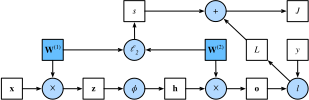

# 4.7 Прямое распространение, обратное распространение и вычислительные графы

Мы уже знаем, как обучать модель с помощью минибатчевого стохастического градиентного спуска.
Однако при реализации этого алгоритма мы учитывали только вычисления, связанные с *прямым распространением* (forward propagation).
При вычислении градиентов мы лишь вызывали функцию обратного распространения, предоставляемую фреймворком глубокого обучения, не вдаваясь в детали.

Автоматическое вычисление градиентов (автоматическое дифференцирование) сильно упрощает реализацию алгоритмов глубокого обучения.
До появления автоматического дифференцирования даже небольшая корректировка сложной модели требовала пересчёта громоздких производных, а научным статьям приходилось тратить много страниц на вывод правил обновления.
В этом разделе на основе базовой математики и вычислительных графов мы подробно рассмотрим *обратное распространение ошибки*.
Для начала сосредоточимся на многослойном перцептроне с одним скрытым слоем и затуханием весов ($L_2$-регуляризацией).

## 4.7.1 Прямое распространение

*Прямое распространение* (forward propagation, или forward pass) — это последовательное, от входного слоя к выходному, вычисление и сохранение результатов каждого слоя нейронной сети.

Разберём шаг за шагом механику нейронной сети с одним скрытым слоем.
Для простоты будем считать, что входной пример $\mathbf{x}\in \mathbb{R}^d$, а скрытый слой не содержит смещения.
Промежуточная переменная здесь:

$$\mathbf{z}= \mathbf{W}^{(1)} \mathbf{x},$$

где $\mathbf{W}^{(1)} \in \mathbb{R}^{h \times d}$ — веса скрытого слоя.
Пропустив промежуточную переменную $\mathbf{z}\in \mathbb{R}^h$ через функцию активации $\phi$, получаем вектор скрытых активаций длины $h$:

$$\mathbf{h}= \phi (\mathbf{z}).$$

Скрытая переменная $\mathbf{h}$ тоже является промежуточной.
Пусть параметры выходного слоя состоят только из весов $\mathbf{W}^{(2)} \in \mathbb{R}^{q \times h}$.
Тогда выходная переменная — вектор длины $q$:

$$\mathbf{o}= \mathbf{W}^{(2)} \mathbf{h}.$$

Пусть функция потерь равна $l$, а метка примера — $y$.
Тогда можно вычислить потери для одного примера данных:

$$L = l(\mathbf{o}, y).$$

По определению $L_2$-регуляризации при заданном гиперпараметре $\lambda$ регуляризационный член равен

$$s = \frac{\lambda}{2} \left(\|\mathbf{W}^{(1)}\|_F^2 + \|\mathbf{W}^{(2)}\|_F^2\right),\tag{4.7.1}$$

где норма Фробениуса матрицы — это $L_2$-норма, применённая к матрице, развёрнутой в вектор.
Наконец, регуляризованные потери модели на данном примере данных равны:

$$J = L + s.$$

В дальнейшем обсуждении $J$ будем называть *целевой функцией* (objective function).

## 4.7.2 Вычислительный граф прямого распространения

Построение *вычислительного графа* помогает наглядно представить зависимости между операторами и переменными в вычислении.
На рис. 4.7.1 показан вычислительный граф для описанной простой сети.
Квадраты обозначают переменные, а круги — операторы.
Входы находятся в левом нижнем углу, а выходы — в правом верхнем.
Обратите внимание, что стрелки, показывающие поток данных, направлены в основном вправо и вверх.

**Рис. 4.7.1.** Вычислительный граф прямого распространения

## 4.7.3 Обратное распространение ошибки

*Обратное распространение ошибки* (backward propagation, или backpropagation) — это метод вычисления градиентов параметров нейронной сети.
Коротко говоря, метод по правилу цепочки из математического анализа обходит сеть в обратном порядке: от выходного слоя к входному.
Алгоритм сохраняет все промежуточные переменные (частные производные), которые нужны для вычисления градиентов некоторых параметров.
Пусть даны функции $\mathsf{Y}=f(\mathsf{X})$ и $\mathsf{Z}=g(\mathsf{Y})$, где входы и выходы $\mathsf{X}, \mathsf{Y}, \mathsf{Z}$ — тензоры произвольной формы.
По правилу цепочки можно вычислить производную $\mathsf{Z}$ по $\mathsf{X}$:

$$\frac{\partial \mathsf{Z}}{\partial \mathsf{X}} = \text{prod}\left(\frac{\partial \mathsf{Z}}{\partial \mathsf{Y}}, \frac{\partial \mathsf{Y}}{\partial \mathsf{X}}\right).$$

Здесь оператор $\text{prod}$ перемножает свои аргументы после выполнения необходимых операций (транспонирования и перестановки аргументов).
Для векторов всё просто: это обычное умножение матрицы на матрицу.
Для тензоров высокой размерности используются соответствующие оси.
Оператор $\text{prod}$ объединяет все эти случаи.

Напомним, что параметрами простой сети с одним скрытым слоем из вычислительного графа (рис. 4.7.1) являются $\mathbf{W}^{(1)}$ и $\mathbf{W}^{(2)}$.
Цель обратного распространения — вычислить градиенты $\partial J/\partial \mathbf{W}^{(1)}$ и $\partial J/\partial \mathbf{W}^{(2)}$.
Для этого мы последовательно применяем правило цепочки и вычисляем градиенты каждой промежуточной переменной и параметра.
Порядок вычислений противоположен порядку прямого распространения, потому что мы начинаем с результата вычислительного графа и движемся к параметрам.
Первый шаг — вычислить градиенты целевой функции $J=L+s$ по слагаемым $L$ и $s$:

$$\frac{\partial J}{\partial L} = 1 \; \text{и} \; \frac{\partial J}{\partial s} = 1.$$

Далее по правилу цепочки вычисляем градиент целевой функции по выходной переменной $\mathbf{o}$:

$$
\frac{\partial J}{\partial \mathbf{o}}
= \text{prod}\left(\frac{\partial J}{\partial L}, \frac{\partial L}{\partial \mathbf{o}}\right)
= \frac{\partial L}{\partial \mathbf{o}}
\in \mathbb{R}^q.
$$

Затем вычисляем градиенты регуляризационного члена по двум параметрам:

$$\frac{\partial s}{\partial \mathbf{W}^{(1)}} = \lambda \mathbf{W}^{(1)}
\; \text{и} \;
\frac{\partial s}{\partial \mathbf{W}^{(2)}} = \lambda \mathbf{W}^{(2)}.$$

Теперь можно вычислить градиент параметров, ближайших к выходному слою, $\partial J/\partial \mathbf{W}^{(2)} \in \mathbb{R}^{q \times h}$.
По правилу цепочки получаем:

$$\frac{\partial J}{\partial \mathbf{W}^{(2)}}= \text{prod}\left(\frac{\partial J}{\partial \mathbf{o}}, \frac{\partial \mathbf{o}}{\partial \mathbf{W}^{(2)}}\right) + \text{prod}\left(\frac{\partial J}{\partial s}, \frac{\partial s}{\partial \mathbf{W}^{(2)}}\right)= \frac{\partial J}{\partial \mathbf{o}} \mathbf{h}^\top + \lambda \mathbf{W}^{(2)}.\tag{4.7.2}$$

Чтобы получить градиент по $\mathbf{W}^{(1)}$, нужно продолжить обратное распространение от выходного слоя к скрытому.
Градиент по выходу скрытого слоя $\partial J/\partial \mathbf{h} \in \mathbb{R}^h$ задаётся формулой:

$$
\frac{\partial J}{\partial \mathbf{h}}
= \text{prod}\left(\frac{\partial J}{\partial \mathbf{o}}, \frac{\partial \mathbf{o}}{\partial \mathbf{h}}\right)
= {\mathbf{W}^{(2)}}^\top \frac{\partial J}{\partial \mathbf{o}}.
$$

Поскольку функция активации $\phi$ применяется поэлементно, для вычисления градиента промежуточной переменной $\mathbf{z}$, $\partial J/\partial \mathbf{z} \in \mathbb{R}^h$, нужно использовать поэлементное умножение, которое обозначим $\odot$:

$$
\frac{\partial J}{\partial \mathbf{z}}
= \text{prod}\left(\frac{\partial J}{\partial \mathbf{h}}, \frac{\partial \mathbf{h}}{\partial \mathbf{z}}\right)
= \frac{\partial J}{\partial \mathbf{h}} \odot \phi'\left(\mathbf{z}\right).
$$

Наконец, получаем градиент параметров, ближайших к входному слою, $\partial J/\partial \mathbf{W}^{(1)} \in \mathbb{R}^{h \times d}$.
По правилу цепочки:

$$
\frac{\partial J}{\partial \mathbf{W}^{(1)}}
= \text{prod}\left(\frac{\partial J}{\partial \mathbf{z}}, \frac{\partial \mathbf{z}}{\partial \mathbf{W}^{(1)}}\right) + \text{prod}\left(\frac{\partial J}{\partial s}, \frac{\partial s}{\partial \mathbf{W}^{(1)}}\right)
= \frac{\partial J}{\partial \mathbf{z}} \mathbf{x}^\top + \lambda \mathbf{W}^{(1)}.
$$

## 4.7.4 Обучение нейронных сетей

При обучении нейронной сети прямое и обратное распространение зависят друг от друга.
При прямом распространении мы проходим вычислительный граф в направлении зависимостей и вычисляем все переменные на пути.
Затем эти значения используются при обратном распространении, где порядок вычислений противоположен.

Рассмотрим нашу простую сеть.
С одной стороны, при прямом распространении регуляризационный член $s$ (формула (4.7.1)) зависит от текущих значений параметров модели $\mathbf{W}^{(1)}$ и $\mathbf{W}^{(2)}$.
Эти значения задаёт алгоритм оптимизации по результатам обратного распространения на последней итерации.
С другой стороны, при обратном распространении вычисление градиентов параметров (формула (4.7.2)) зависит от текущего значения скрытой переменной $\mathbf{h}$, которое задаёт прямое распространение.

Поэтому при обучении нейронной сети, после инициализации параметров модели, мы чередуем прямое и обратное распространение, используя градиенты, полученные при обратном распространении, для обновления параметров модели.
Обратите внимание, что обратное распространение повторно использует промежуточные значения, сохранённые при прямом распространении, чтобы не вычислять их заново.
Одно из следствий: промежуточные значения нужно хранить до завершения обратного распространения.
Это одна из причин, почему обучение требует больше памяти (видеопамяти), чем одно только предсказание.
Кроме того, размер этих промежуточных значений примерно пропорционален числу слоёв сети и размеру батча.
Поэтому обучение глубоких сетей на больших батчах легче приводит к ошибке *нехватки памяти* (out of memory).

## Резюме

* Прямое распространение последовательно вычисляет и сохраняет промежуточные переменные в вычислительном графе, определённом нейронной сетью, от входного слоя к выходному.
* Обратное распространение ошибки последовательно, в обратном порядке (от выходного слоя к входному), вычисляет и сохраняет градиенты промежуточных переменных и параметров нейронной сети.
* При обучении моделей глубокого обучения прямое и обратное распространение зависят друг от друга.
* Обучение требует больше памяти, чем предсказание.

## Упражнения

1. Пусть для скалярной функции $f$ аргумент $\mathbf{X}$ — матрица размера $n \times m$. Какова размерность градиента $f$ по $\mathbf{X}$?
1. Добавьте смещение в скрытый слой модели, описанной в этом разделе (в регуляризационный член смещение включать не нужно).
    1. Нарисуйте соответствующий вычислительный граф.
    1. Выведите уравнения прямого и обратного распространения.
1. Вычислите объём памяти, необходимый для обучения и предсказания модели, описанной в этом разделе.
1. Предположим, что нужно вычислить вторую производную. Что произойдёт с вычислительным графом? Сколько времени, по вашей оценке, займут вычисления?
1. Предположим, что вычислительный граф слишком велик для имеющегося у вас GPU.
    1. Попробуйте разделить его между несколькими GPU.
    1. Каковы преимущества и недостатки по сравнению с обучением на минибатчах?

[Обсуждение](https://discuss.d2l.ai/t/5769)
