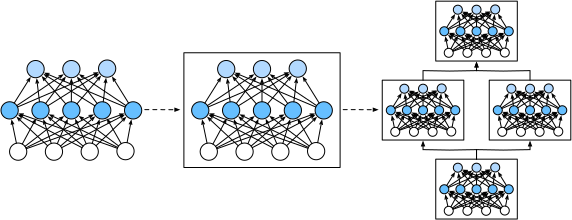

# 5.1 Слои и блоки

Когда мы впервые знакомились с нейронными сетями, мы рассматривали линейные модели с одним выходом.
Здесь вся модель состоит всего из одного нейрона.
Обратите внимание, что отдельный нейрон
(i) принимает некоторый набор входов;
(ii) генерирует соответствующий скалярный выход;
(iii) имеет набор связанных *параметров* (parameters), которые можно обновлять, чтобы оптимизировать некоторую целевую функцию.

Затем, когда мы стали рассматривать сети с несколькими выходами, мы воспользовались векторизованными вычислениями, чтобы описать целый слой нейронов.
Как и отдельные нейроны, слои (i) принимают набор входов,
(ii) генерируют соответствующие выходы
и (iii) описываются набором настраиваемых параметров.
Когда мы работали с softmax-регрессией, один слой сам по себе был моделью.
Однако даже позднее, когда мы ввели многослойные перцептроны, мы по-прежнему могли считать, что модель сохраняет ту же базовую структуру.

Интересно, что для многослойных перцептронов и вся модель, и составляющие её слои обладают этой структурой.
Вся модель принимает исходные входные данные (признаки), генерирует выходы (предсказания) и содержит некоторые параметры (совокупность параметров всех составляющих слоёв).
Аналогично, каждый отдельный слой получает входные данные (от предыдущего слоя), генерирует выходы (входы для следующего слоя) и имеет набор настраиваемых параметров, которые обновляются на основе сигнала, распространяющегося назад от следующего слоя.

Оказывается, полезнее рассматривать компоненты, которые «больше одного слоя», но «меньше всей модели».
Например, архитектура ResNet-152, широко распространённая в компьютерном зрении, насчитывает сотни слоёв, которые организованы как повторяющиеся шаблоны из *групп слоёв* (groups of layers).
Эта архитектура ResNet выиграла задачи распознавания и обнаружения на соревнованиях ImageNet и COCO 2015 года (He et al., 2016).
До сих пор архитектура ResNet остаётся предпочтительной для многих задач компьютерного зрения.
В других областях, например в обработке естественного языка и речи, похожие архитектуры, в которых группы слоёв чередуются по повторяющимся шаблонам, также широко распространены.

Для реализации таких сложных сетей мы вводим понятие *блока* нейронной сети.
*Блок* (block) может описывать отдельный слой, компонент из нескольких слоёв или всю модель целиком.
Использование блоков для абстракции удобно тем, что несколько блоков можно объединять в более крупный компонент, и этот процесс обычно рекурсивен, как показано на рис. 5.1.1.
Определив код, который порождает блоки по требованию, мы можем реализовать сложную нейронную сеть короткой программой.



С точки зрения программирования блок представлен *классом* (class).
Любой его подкласс должен определять функцию прямого распространения (forward propagation), которая преобразует входы в выходы, и должен хранить все необходимые параметры.
Обратите внимание, что некоторым блокам параметры вовсе не нужны.
Наконец, для вычисления градиентов блок должен иметь функцию обратного распространения.
При определении собственных блоков обратное распространение обеспечивается автоматическим дифференцированием (введённым в разделе 2.5), поэтому нам достаточно продумать функцию прямого распространения и необходимые параметры.

Прежде чем создавать собственный блок, **вспомним код многослойного перцептрона** (раздел 4.3).
Следующий код создаёт сеть, в которой есть полносвязный скрытый слой из 256 элементов с функцией активации ReLU и полносвязный выходной слой из 10 элементов без функции активации.

**MXNet:**
```python
from mxnet import np, npx
from mxnet.gluon import nn
npx.set_np()

net = nn.Sequential()
net.add(nn.Dense(256, activation='relu'))
net.add(nn.Dense(10))
net.initialize()

X = np.random.uniform(size=(2, 20))
net(X)
```

**PyTorch:**
```python
import torch
from torch import nn
from torch.nn import functional as F

net = nn.Sequential(nn.Linear(20, 256), nn.ReLU(), nn.Linear(256, 10))

X = torch.rand(2, 20)
net(X)
```

**TensorFlow:**
```python
import tensorflow as tf

net = tf.keras.models.Sequential([
    tf.keras.layers.Dense(256, activation=tf.nn.relu),
    tf.keras.layers.Dense(10),
])

X = tf.random.uniform((2, 20))
net(X)
```

**PaddlePaddle:**
```python
import warnings
warnings.filterwarnings(action='ignore')
import paddle
from paddle import nn
from paddle.nn import functional as F

net = nn.Sequential(nn.Linear(20, 256), nn.ReLU(), nn.Linear(256, 10))

X = paddle.rand([2, 20])
net(X)
```

**MXNet:** В этом примере мы строим модель, создавая экземпляр `nn.Sequential`, а возвращённый объект присваиваем переменной `net`.
Затем мы многократно вызываем функцию `add` у переменной `net`, добавляя слои в порядке их выполнения.
Проще говоря, `nn.Sequential` задаёт особый тип `Block`, то есть класс, который в Gluon представляет блок, и хранит упорядоченный список `Block`.
Функция `add` добавляет каждый последующий `Block` в этот список.
Заметьте, что каждый слой является экземпляром класса `Dense`, а сам класс `Dense` является подклассом `Block`.
До сих пор мы получали выход модели, вызывая `net(X)`.
Это по сути сокращение для `net.forward(X)`, и такая возможность реализована через функцию `__call__` класса `Block`, что является приёмом Python.
Функция прямого распространения очень проста: она соединяет каждый `Block` из списка, передавая выход каждого блока на вход следующему.

**PyTorch:** В этом примере мы строим модель, создавая экземпляр `nn.Sequential`, а порядок выполнения слоёв передаём ему как аргументы.
Проще говоря, **`nn.Sequential` задаёт особый тип `Module`**, то есть класс, который в PyTorch представляет блок, и хранит упорядоченный список `Module`.
Обратите внимание, что оба полносвязных слоя являются экземплярами класса `Linear`, который сам является подклассом `Module`.
Кроме того, до сих пор мы получали выход модели, вызывая `net(X)`.
Это сокращение для `net.__call__(X)`.
Эта функция прямого распространения очень проста: она соединяет каждый блок из списка, передавая выход каждого блока на вход следующего.

**TensorFlow:** В этом примере мы строим модель, создавая экземпляр `keras.models.Sequential`, а порядок выполнения слоёв передаём ему как аргументы.
Проще говоря, `Sequential` задаёт особый тип `keras.Model`, то есть класс, который в Keras представляет блок.
Он хранит упорядоченный список `Model`.
Оба полносвязных слоя являются экземплярами класса `Model`, который сам является подклассом `Model`.
Функция прямого распространения (`call`) также очень проста: она соединяет каждый блок из списка, передавая выход каждого блока на вход следующего.
Заметьте, что до сих пор мы получали выход модели, вызывая `net(X)`.
Это сокращение для `net.call(X)`, и такая возможность реализована через функцию `__call__` класса `Block`, что является приёмом Python.

**PaddlePaddle:** В этом примере мы строим модель, создавая экземпляр `nn.Sequential`, а порядок выполнения слоёв передаём ему как аргументы.
Проще говоря, **`nn.Sequential` задаёт особый тип `Layer`**, то есть класс, который в PaddlePaddle представляет блок.
Он хранит упорядоченный список `Layer`.
Обратите внимание, что оба полносвязных слоя являются экземплярами класса `Linear`, который сам является подклассом `Layer`.
Кроме того, до сих пор мы получали выход модели, вызывая `net(X)`.
Это сокращение для `net.__call__(X)`.
Эта функция прямого распространения очень проста: она соединяет каждый блок из списка, передавая выход каждого блока на вход следующего.

## 5.1.1 Пользовательские блоки

Чтобы интуитивно понять, как работают блоки, проще всего реализовать блок самостоятельно.
Прежде чем реализовывать собственный блок, кратко перечислим базовые функции, которые должен предоставлять каждый блок.

**MXNet, TensorFlow:**

1. Принимать входные данные в качестве аргумента функции прямого распространения.
1. Генерировать выход с помощью функции прямого распространения. Обратите внимание, что форма выхода может отличаться от формы входа. Например, первый полносвязный слой нашей модели выше принимает входные данные произвольной размерности, но возвращает выход размерности 256.
1. Вычислять градиент выхода по входу, доступ к которому обеспечивает функция обратного распространения. Обычно это происходит автоматически.
1. Хранить и предоставлять доступ к параметрам, необходимым для вычисления прямого распространения.
1. При необходимости инициализировать параметры модели.

**PyTorch, PaddlePaddle:**

1. Принимать входные данные в качестве аргумента функции прямого распространения.
1. Генерировать выход с помощью функции прямого распространения. Обратите внимание, что форма выхода может отличаться от формы входа. Например, первый полносвязный слой нашей модели выше принимает 20-мерный вход, но возвращает выход размерности 256.
1. Вычислять градиент выхода по входу, доступ к которому обеспечивает функция обратного распространения. Обычно это происходит автоматически.
1. Хранить и предоставлять доступ к параметрам, необходимым для вычисления прямого распространения.
1. При необходимости инициализировать параметры модели.

В приведённом ниже фрагменте кода мы пишем блок с нуля.
Он содержит многослойный перцептрон со скрытым слоем из 256 элементов и выходным слоем размерности 10.
Обратите внимание, что класс `MLP` ниже наследуется от класса, представляющего блок.
Нам нужно предоставить только собственный конструктор (функцию `__init__` в Python) и функцию прямого распространения.

**MXNet:**
```python
class MLP(nn.Block):
    # Объявляем слои с параметрами. Здесь объявляем два полносвязных слоя
    def __init__(self, **kwargs):
        # Вызываем конструктор родительского класса Block у MLP, чтобы выполнить необходимую инициализацию.
        # Так при создании экземпляра можно также передавать другие аргументы функции, например параметры модели params (будут описаны далее)
        super().__init__(**kwargs)
        self.hidden = nn.Dense(256, activation='relu')  # Скрытый слой
        self.out = nn.Dense(10)  # Выходной слой

    # Определяем прямое распространение модели: как по входу X получить нужный выход модели
    def forward(self, X):
        return self.out(self.hidden(X))
```

**PyTorch:**
```python
class MLP(nn.Module):
    # Объявляем слои с параметрами. Здесь объявляем два полносвязных слоя
    def __init__(self):
        # Вызываем конструктор родительского класса Module у MLP, чтобы выполнить необходимую инициализацию.
        # Так при создании экземпляра можно также передавать другие аргументы функции, например параметры модели params (будут описаны далее)
        super().__init__()
        self.hidden = nn.Linear(20, 256)  # Скрытый слой
        self.out = nn.Linear(256, 10)  # Выходной слой

    # Определяем прямое распространение модели: как по входу X получить нужный выход модели
    def forward(self, X):
        # Обратите внимание, что здесь мы используем функциональную версию ReLU, которая определена в модуле nn.functional.
        return self.out(F.relu(self.hidden(X)))
```

**TensorFlow:**
```python
class MLP(tf.keras.Model):
    # Объявляем слои с параметрами. Здесь объявляем два полносвязных слоя
    def __init__(self):
        # Вызываем конструктор родительского класса Model у MLP, чтобы выполнить необходимую инициализацию.
        # Так при создании экземпляра можно также передавать другие аргументы функции, например параметры модели params (будут описаны далее)
        super().__init__()
        # Скрытый слой
        self.hidden = tf.keras.layers.Dense(units=256, activation=tf.nn.relu)
        self.out = tf.keras.layers.Dense(units=10)  # Выходной слой

    # Определяем прямое распространение модели: как по входу X получить нужный выход модели
    def call(self, X):
        return self.out(self.hidden((X)))
```

**PaddlePaddle:**
```python
class MLP(nn.Layer):
    # Объявляем слои с параметрами. Здесь объявляем два полносвязных слоя
    def __init__(self):
        # Вызываем конструктор родительского класса Layer у MLP, чтобы выполнить необходимую инициализацию.
        # Так при создании экземпляра можно также передавать другие аргументы функции, например параметры модели `params` (будут описаны далее)
        super().__init__()
        self.hidden = nn.Linear(20, 256)  # Скрытый слой
        self.out = nn.Linear(256, 10)  # Выходной слой

    # Определяем прямое распространение модели: как по входу `X` получить нужный выход модели
    def forward(self, X):
        # Обратите внимание, что здесь мы используем функциональную версию ReLU, которая определена в модуле nn.functional.
        return self.out(F.relu(self.hidden(X)))
```

Сначала посмотрим на функцию прямого распространения.
Она принимает `X` в качестве входа, вычисляет скрытое представление с функцией активации и возвращает ненормированный выход.
В этой реализации `MLP` оба слоя являются переменными экземпляра.
Чтобы понять, почему это разумно, представьте, что мы создали два многослойных перцептрона (`net1` и `net2`) и обучаем их на разных данных.
Естественно ожидать, что они выучат две разные модели.

Теперь мы **создаём слои многослойного перцептрона и затем вызываем их при каждом вызове функции прямого распространения**.
Обратите внимание на несколько ключевых деталей.
Во-первых, наша функция `__init__` вызывает конструктор родительского класса через `super().__init__()`,
что избавляет от необходимости писать повторяющийся шаблонный код.
Затем мы создаём два полносвязных слоя: `self.hidden` и `self.out`.
Заметьте, что, если только мы не реализуем новый оператор, нам не нужно беспокоиться о функции обратного распространения или инициализации параметров: система сгенерирует их автоматически.

Проверим, как работает эта функция:

**MXNet:**
```python
net = MLP()
net.initialize()
net(X)
```

**PyTorch, PaddlePaddle:**
```python
net = MLP()
net(X)
```

**TensorFlow:**
```python
net = MLP()
net(X)
```

Главное достоинство блоков — их универсальность.
Мы можем создавать подклассы блоков, чтобы получить слои (например, класс для полносвязного слоя), целые модели (например, класс `MLP` выше) или компоненты средней сложности.
Эту универсальность мы активно используем в следующих главах, например при работе со свёрточными нейронными сетями.

## 5.1.2 Последовательный блок

Теперь можно внимательнее рассмотреть, как работает класс `Sequential`.
Напомним, что `Sequential` предназначен для последовательного соединения других модулей.
Чтобы построить собственный упрощённый `MySequential`, нам достаточно определить две ключевые функции:

1. функцию, которая добавляет блоки в список по одному;
1. функцию прямого распространения, которая передаёт входные данные через цепочку блоков в порядке их добавления.

Приведённый ниже класс `MySequential` обеспечивает ту же функциональность, что и стандартный класс `Sequential`.

**MXNet:**
```python
class MySequential(nn.Block):
    def add(self, block):
    # Здесь block — экземпляр подкласса Block, и мы предполагаем, что у него есть уникальное имя. Мы сохраняем его
    # в переменной-члене _children класса Block. Тип block — OrderedDict.
    # Когда экземпляр MySequential вызывает функцию initialize, система автоматически инициализирует
    # все члены _children
        self._children[block.name] = block

    def forward(self, X):
        # OrderedDict гарантирует обход членов в порядке их добавления
        for block in self._children.values():
            X = block(X)
        return X
```

**PyTorch:**
```python
class MySequential(nn.Module):
    def __init__(self, *args):
        super().__init__()
        for idx, module in enumerate(args):
            # Здесь module — экземпляр подкласса Module. Мы сохраняем его в переменной-члене
            # _modules класса Module. Тип _modules — OrderedDict
            self._modules[str(idx)] = module

    def forward(self, X):
        # OrderedDict гарантирует обход членов в порядке их добавления
        for block in self._modules.values():
            X = block(X)
        return X
```

**TensorFlow:**
```python
class MySequential(tf.keras.Model):
    def __init__(self, *args):
        super().__init__()
        self.modules = []
        for block in args:
            # Здесь block — экземпляр подкласса tf.keras.layers.Layer
            self.modules.append(block)

    def call(self, X):
        for module in self.modules:
            X = module(X)
        return X
```

**PaddlePaddle:**
```python
class MySequential(nn.Layer):
    def __init__(self, *layers):
        super(MySequential, self).__init__()
        # Если передан кортеж
        if len(layers) > 0 and isinstance(layers[0], tuple): 
            for name, layer in layers:
                # Метод add_sublayer добавляет layer в self._sub_layers (кортеж)
                self.add_sublayer(name, layer)  
        else:
            for idx, layer in enumerate(layers):
                self.add_sublayer(str(idx), layer)

    def forward(self, X):
        # OrderedDict гарантирует обход членов в порядке их добавления
        for layer in self._sub_layers.values():
            X = layer(X)
        return X
```

**MXNet:** Функция `add` добавляет блок в упорядоченный словарь `_children`.
Читатель может спросить, зачем у каждого `Block` в Gluon есть атрибут `_children` и почему мы используем его, а не собственный список Python.
Проще говоря, главное преимущество `_children` в том,
что при инициализации параметров блока Gluon знает, что нужно искать вложенные блоки, которым требуется инициализация параметров, в словаре `_children`.

**PyTorch:** Функция `__init__` добавляет каждый модуль в упорядоченный словарь `_modules` по одному.
Читатель может спросить, зачем у каждого `Module` есть атрибут `_modules` и почему мы используем его, а не собственный список Python.
Проще говоря, главное преимущество `_modules` в том,
что при инициализации параметров модуля система знает, что нужно искать вложенные блоки, которым требуется инициализация параметров, в словаре `_modules`.

**PaddlePaddle:** Функция `__init__` добавляет каждый модуль в упорядоченный словарь `_sub_layers` по одному.
Читатель может спросить, зачем у каждого `Layer` есть атрибут `_sub_layers` и почему мы используем его, а не собственный список Python.
Проще говоря, главное преимущество `_sub_layers` в том,
что при инициализации параметров модуля система знает, что нужно искать вложенные блоки, которым требуется инициализация параметров, в словаре `_sub_layers`.

Когда вызывается функция прямого распространения `MySequential`,
каждый добавленный блок выполняется в том порядке, в котором он был добавлен.
Теперь мы можем переписать многослойный перцептрон, используя наш класс `MySequential`.

**MXNet:**
```python
net = MySequential()
net.add(nn.Dense(256, activation='relu'))
net.add(nn.Dense(10))
net.initialize()
net(X)
```

**PyTorch, PaddlePaddle:**
```python
net = MySequential(nn.Linear(20, 256), nn.ReLU(), nn.Linear(256, 10))
net(X)
```

**TensorFlow:**
```python
net = MySequential(
    tf.keras.layers.Dense(units=256, activation=tf.nn.relu),
    tf.keras.layers.Dense(10))
net(X)
```

Обратите внимание, что использование `MySequential` совпадает с использованием `Sequential` из предыдущего кода
(как описано в разделе 4.3).

## 5.1.3 Выполнение кода в функции прямого распространения

Класс `Sequential` упрощает конструирование моделей:
он позволяет составлять новые архитектуры, не определяя собственный класс.
Однако не все архитектуры являются простыми последовательными.
Когда нужна большая гибкость, приходится определять собственные блоки.
Например, мы можем захотеть использовать управляющие конструкции Python в функции прямого распространения.
Кроме того, нам может понадобиться выполнять произвольные математические операции, а не только полагаться на заранее определённые слои нейронной сети.

До сих пор
все операции в нашей сети работали с активациями сети и её параметрами.
Однако иногда нам может понадобиться включить в вычисления величину, которая не является результатом предыдущего слоя и не является обновляемым параметром.
Назовём такую величину *постоянным параметром* (constant parameter).
Например, нам нужна функция слоя
$f(\mathbf{x},\mathbf{w}) = c \cdot \mathbf{w}^\top \mathbf{x}$,
где $\mathbf{x}$ — вход,
$\mathbf{w}$ — параметр,
а $c$ — заданная константа, которая не обновляется в процессе оптимизации.
Поэтому мы реализуем класс `FixedHiddenMLP`, как показано ниже:

**MXNet:**
```python
class FixedHiddenMLP(nn.Block):
    def __init__(self, **kwargs):
        super().__init__(**kwargs)
        # Случайные весовые параметры, созданные функцией get_constant, не обновляются во время обучения (то есть это постоянные параметры)
        self.rand_weight = self.params.get_constant(
            'rand_weight', np.random.uniform(size=(20, 20)))
        self.dense = nn.Dense(20, activation='relu')

    def forward(self, X):
        X = self.dense(X)
        # Используем созданный постоянный параметр, а также функции relu и dot
        X = npx.relu(np.dot(X, self.rand_weight.data()) + 1)
        # Повторно используем полносвязный слой. Это равносильно тому, что два полносвязных слоя разделяют параметры
        X = self.dense(X)
        # Управляющая конструкция
        while np.abs(X).sum() > 1:
            X /= 2
        return X.sum()
```

**PyTorch:**
```python
class FixedHiddenMLP(nn.Module):
    def __init__(self):
        super().__init__()
        # Случайный весовой параметр без вычисления градиента. Поэтому во время обучения он остаётся неизменным
        self.rand_weight = torch.rand((20, 20), requires_grad=False)
        self.linear = nn.Linear(20, 20)

    def forward(self, X):
        X = self.linear(X)
        # Используем созданный постоянный параметр, а также функции relu и mm
        X = F.relu(torch.mm(X, self.rand_weight) + 1)
        # Повторно используем полносвязный слой. Это равносильно тому, что два полносвязных слоя разделяют параметры
        X = self.linear(X)
        # Управляющая конструкция
        while X.abs().sum() > 1:
            X /= 2
        return X.sum()
```

**TensorFlow:**
```python
class FixedHiddenMLP(tf.keras.Model):
    def __init__(self):
        super().__init__()
        self.flatten = tf.keras.layers.Flatten()
        # Случайный весовой параметр, созданный функцией tf.constant, не обновляется во время обучения (то есть это постоянный параметр)
        self.rand_weight = tf.constant(tf.random.uniform((20, 20)))
        self.dense = tf.keras.layers.Dense(20, activation=tf.nn.relu)

    def call(self, inputs):
        X = self.flatten(inputs)
        # Используем созданный постоянный параметр, а также функции relu и matmul
        X = tf.nn.relu(tf.matmul(X, self.rand_weight) + 1)
        # Повторно используем полносвязный слой. Это равносильно тому, что два полносвязных слоя разделяют параметры.
        X = self.dense(X)
        # Управляющая конструкция
        while tf.reduce_sum(tf.math.abs(X)) > 1:
            X /= 2
        return tf.reduce_sum(X)
```

**PaddlePaddle:**
```python
class FixedHiddenMLP(nn.Layer):
    def __init__(self):
        super().__init__()
        # Случайный весовой параметр без вычисления градиента. Поэтому во время обучения он остаётся неизменным.
        self.rand_weight = paddle.rand([20, 20])
        self.linear = nn.Linear(20, 20)

    def forward(self, X):
        X = self.linear(X)
        # Используем созданный постоянный параметр, а также функции relu и mm.
        X = F.relu(paddle.tensor.mm(X, self.rand_weight) + 1)
        # Повторно используем полносвязный слой. Это равносильно тому, что два полносвязных слоя разделяют параметры.
        X = self.linear(X)
        # Управляющая конструкция
        while X.abs().sum() > 1:
            X /= 2
        return X.sum()
```

В этой модели `FixedHiddenMLP` мы реализовали скрытый слой,
весовой параметр которого (`self.rand_weight`) случайно инициализируется при создании экземпляра и после этого остаётся постоянным.
Этот весовой параметр не является параметром модели, поэтому он никогда не обновляется при обратном распространении.
Затем нейронная сеть пропускает выход этого фиксированного слоя через полносвязный слой.

Обратите внимание, что перед возвратом выхода модель делает кое-что необычное:
она выполняет цикл `while`, в котором делит выходной вектор на $2$, пока норма $L_1$ больше $1$.
Наконец, модель возвращает сумму всех элементов `X`.
Заметим, что такая операция, скорее всего, не встречается в практических задачах:
мы лишь показываем, как произвольный код можно включить в вычислительный поток нейронной сети.

**MXNet:**
```python
net = FixedHiddenMLP()
net.initialize()
net(X)
```

**PyTorch, TensorFlow, PaddlePaddle:**
```python
net = FixedHiddenMLP()
net(X)
```

Мы можем **свободно комбинировать различные способы сборки блоков**.
В следующем примере мы вкладываем блоки друг в друга несколькими способами.

**MXNet:**
```python
class NestMLP(nn.Block):
    def __init__(self, **kwargs):
        super().__init__(**kwargs)
        self.net = nn.Sequential()
        self.net.add(nn.Dense(64, activation='relu'),
                     nn.Dense(32, activation='relu'))
        self.dense = nn.Dense(16, activation='relu')

    def forward(self, X):
        return self.dense(self.net(X))

chimera = nn.Sequential()
chimera.add(NestMLP(), nn.Dense(20), FixedHiddenMLP())
chimera.initialize()
chimera(X)
```

**PyTorch:**
```python
class NestMLP(nn.Module):
    def __init__(self):
        super().__init__()
        self.net = nn.Sequential(nn.Linear(20, 64), nn.ReLU(),
                                 nn.Linear(64, 32), nn.ReLU())
        self.linear = nn.Linear(32, 16)

    def forward(self, X):
        return self.linear(self.net(X))

chimera = nn.Sequential(NestMLP(), nn.Linear(16, 20), FixedHiddenMLP())
chimera(X)
```

**TensorFlow:**
```python
class NestMLP(tf.keras.Model):
    def __init__(self):
        super().__init__()
        self.net = tf.keras.Sequential()
        self.net.add(tf.keras.layers.Dense(64, activation=tf.nn.relu))
        self.net.add(tf.keras.layers.Dense(32, activation=tf.nn.relu))
        self.dense = tf.keras.layers.Dense(16, activation=tf.nn.relu)

    def call(self, inputs):
        return self.dense(self.net(inputs))

chimera = tf.keras.Sequential()
chimera.add(NestMLP())
chimera.add(tf.keras.layers.Dense(20))
chimera.add(FixedHiddenMLP())
chimera(X)
```

**PaddlePaddle:**
```python
class NestMLP(nn.Layer):
    def __init__(self):
        super().__init__()
        self.net = nn.Sequential(nn.Linear(20, 64), nn.ReLU(),
                                 nn.Linear(64, 32), nn.ReLU())
        self.linear = nn.Linear(32, 16)

    def forward(self, X):
        return self.linear(self.net(X))

chimera = nn.Sequential(NestMLP(), nn.Linear(16, 20), FixedHiddenMLP())
chimera(X)
```

## 5.1.4 Эффективность

**MXNet:** Читатель может начать беспокоиться об эффективности.
Ведь мы выполняем много обращений к словарям, исполняем код и много других операций на Python внутри высокопроизводительной библиотеки глубокого обучения.
Проблема [глобальной блокировки интерпретатора](https://wiki.python.org/moin/GlobalInterpreterLock) в Python хорошо известна.
В контексте глубокого обучения мы опасаемся, что чрезвычайно быстрый GPU будет простаивать, ожидая, пока CPU выполнит код на Python, прежде чем запустить следующую задачу.

Лучший способ ускорить Python — полностью избежать его использования.
Gluon делает это, позволяя использовать *гибридное программирование* (hybridization), которое будет описано позднее.
Интерпретатор Python выполняет блок при первом вызове.
Среда выполнения Gluon запоминает происходящее, и при следующем вызове она ускоряет вычисления, минуя Python.
В некоторых случаях это может значительно ускорить работу,
но когда управляющая конструкция (как описано выше) направляет выполнение по разным ветвям сети, нужна особая осторожность.
Мы рекомендуем заинтересованным читателям после прочтения этой главы изучить раздел о гибридном программировании (раздел 12.1), чтобы разобраться в компиляции.

**PyTorch:** Читатель может начать беспокоиться об эффективности.
Ведь мы выполняем много обращений к словарям, исполняем код и много других операций на Python внутри высокопроизводительной библиотеки глубокого обучения.
Проблема [глобальной блокировки интерпретатора](https://wiki.python.org/moin/GlobalInterpreterLock) в Python хорошо известна.
В контексте глубокого обучения мы опасаемся, что чрезвычайно быстрый GPU будет простаивать, ожидая, пока CPU выполнит код на Python, прежде чем запустить следующую задачу.

**TensorFlow:** Читатель может начать беспокоиться об эффективности.
Ведь мы выполняем много обращений к словарям, исполняем код и много других операций на Python внутри высокопроизводительной библиотеки глубокого обучения.
Проблема [глобальной блокировки интерпретатора](https://wiki.python.org/moin/GlobalInterpreterLock) в Python хорошо известна.
В контексте глубокого обучения мы опасаемся, что чрезвычайно быстрый GPU будет простаивать, ожидая, пока CPU выполнит код на Python, прежде чем запустить следующую задачу.

**PaddlePaddle:** Читатель может начать беспокоиться об эффективности.
Ведь мы выполняем много обращений к словарям, исполняем код и много других операций на Python внутри высокопроизводительной библиотеки глубокого обучения.
Проблема [глобальной блокировки интерпретатора](https://wiki.python.org/moin/GlobalInterpreterLock) в Python хорошо известна.
В контексте глубокого обучения мы опасаемся, что чрезвычайно быстрый GPU будет простаивать, ожидая, пока CPU выполнит код на Python, прежде чем запустить следующую задачу.

## Резюме

* Блок может состоять из множества слоёв; блок может состоять из множества блоков.
* Блоки могут содержать код.
* Блоки отвечают за большой объём внутренней обработки, включая инициализацию параметров и обратное распространение.
* Последовательное соединение слоёв и блоков обеспечивает блок `Sequential`.

## Упражнения

1. Какие проблемы возникнут, если хранить блоки в `MySequential` в виде списка Python?
1. Реализуйте блок, который принимает два блока, например `net1` и `net2`, и возвращает конкатенацию выходов обеих сетей при прямом распространении. Это называется параллельным блоком.
1. Допустим, мы хотим соединить несколько экземпляров одной и той же сети. Реализуйте функцию, которая создаёт несколько экземпляров одного и того же блока и на их основе строит более крупную сеть.

**MXNet:**
[Обсуждение](https://discuss.d2l.ai/t/1828)

**PyTorch:**
[Обсуждение](https://discuss.d2l.ai/t/1827)

**TensorFlow:**
[Обсуждение](https://discuss.d2l.ai/t/1826)

**PaddlePaddle:**
[Обсуждение](https://discuss.d2l.ai/t/11777)
