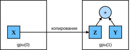

# 5.6 Графические процессоры (GPU)

В таблице 1.1 мы рассмотрели быстрый рост вычислительной мощности за последние 20 лет.
Вкратце: с 2000 года производительность GPU возрастает в 1000 раз каждые десять лет.

В этом разделе мы обсудим, как использовать эту вычислительную мощность в исследованиях.
Сначала рассмотрим работу с одним GPU, а затем — работу с несколькими GPU и с несколькими серверами (каждый из которых имеет несколько GPU).

Сначала рассмотрим, как использовать один GPU NVIDIA для вычислений.
Прежде всего убедитесь, что установлен как минимум один GPU NVIDIA.
Затем загрузите [драйвер NVIDIA и CUDA](https://developer.nvidia.com/cuda-downloads)
и следуйте инструкциям по настройке нужных путей.
Когда эти подготовительные шаги выполнены, можно использовать команду `nvidia-smi`, чтобы **посмотреть информацию о видеокарте.**

```python
!nvidia-smi
```

**MXNet:** Читатель, возможно, заметил, что тензоры MXNet почти совпадают с `ndarray` NumPy.
Но есть и важные отличия, одно из которых — MXNet поддерживает разные аппаратные устройства.

В MXNet у каждого массива есть контекст (context).
По умолчанию все переменные и связанные с ними вычисления выделяются процессору CPU.
Иногда контекстом может быть GPU.
Когда мы распределяем задачи по нескольким серверам, всё становится сложнее.
Разумно сопоставляя массивы с контекстами, можно минимизировать время передачи данных между устройствами.
Например, при обучении нейронной сети на сервере с GPU мы обычно хотим, чтобы параметры модели находились на GPU.

Далее нужно убедиться, что установлена версия MXNet с поддержкой GPU.
Если установлена версия MXNet для CPU, её сначала нужно удалить.
Например, командой `pip uninstall mxnet`, а затем установить версию MXNet с поддержкой GPU, соответствующую версии CUDA.
Например, если установлена CUDA 10.0, можно установить MXNet для CUDA 10.0 командой `pip install mxnet-cu100`.

**PyTorch:** В PyTorch у каждого массива есть устройство (device), которое обычно называют контекстом (context).
По умолчанию все переменные и связанные с ними вычисления выделяются CPU.
Иногда контекстом может быть GPU.
Когда мы распределяем задачи по нескольким серверам, всё становится сложнее.
Разумно сопоставляя массивы с контекстами, можно минимизировать время передачи данных между устройствами.
Например, при обучении нейронной сети на сервере с GPU мы обычно хотим, чтобы параметры модели находились на GPU.

**PaddlePaddle:** В PaddlePaddle у каждого тензора есть устройство (device), которое обычно называют контекстом (context).
По умолчанию все переменные и связанные с ними вычисления выделяются CPU.
Иногда контекстом может быть GPU.
Когда мы распределяем задачи по нескольким серверам, всё становится сложнее.
Разумно сопоставляя массивы с контекстами, можно минимизировать время передачи данных между устройствами.
Например, при обучении нейронной сети на сервере с GPU мы обычно хотим, чтобы параметры модели находились на GPU.

Далее нужно убедиться, что установлена версия PaddlePaddle с поддержкой GPU.
Если установлена версия PaddlePaddle для CPU, её сначала нужно удалить.
Затем установите версию PaddlePaddle с поддержкой GPU, соответствующую вашей версии CUDA.
Например, если у вас установлена CUDA 10.1, можно установить PaddlePaddle для CUDA 10.1 командой
`conda install paddlepaddle-gpu==2.2.2 cudatoolkit=10.1 --channel https://mirrors.tuna.tsinghua.edu.cn/anaconda/cloud/Paddle/`.

Чтобы выполнить программы из этого раздела, нужно как минимум два GPU.
Заметим, что для большинства настольных компьютеров это может быть роскошью, но в облаке такие ресурсы легко получить.
Например, можно использовать многопроцессорные экземпляры AWS EC2 с несколькими GPU.
Остальные главы книги в основном не требуют нескольких GPU,
а этот раздел лишь показывает, как данные передаются между разными устройствами.

## 5.6.1 Вычислительные устройства

Мы можем указать устройства, которые используются для хранения и вычислений, например CPU или GPU.
По умолчанию тензоры создаются в оперативной памяти, а затем вычисляются на CPU.

**MXNet:** В MXNet CPU и GPU обозначаются как `cpu()` и `gpu()`.
Важно понимать, что `cpu()` (или любое целое число в скобках) обозначает все физические CPU и память,
то есть вычисления MXNet будут пытаться использовать все ядра CPU.
Однако `gpu()` представляет только одну карту и соответствующую видеопамять.
Если GPU несколько, для обозначения i-го GPU (i начинается с 0) используется `gpu(i)`.
Кроме того, `gpu(0)` и `gpu()` эквивалентны.

**PyTorch:** В PyTorch CPU и GPU обозначаются как `torch.device('cpu')` и `torch.device('cuda')`.
Важно понимать, что устройство `cpu` означает все физические CPU и память,
то есть вычисления PyTorch будут пытаться использовать все ядра CPU.
Однако устройство `gpu` представляет только одну карту и соответствующую видеопамять.
Если GPU несколько, для обозначения i-го GPU (i начинается с 0) используется `torch.device(f'cuda:{i}')`.
Кроме того, `cuda:0` и `cuda` эквивалентны.

**PaddlePaddle:** В PaddlePaddle CPU и GPU обозначаются как `paddle.device.set_device('cpu')` и `paddle.device.set_device('gpu')`.
Важно понимать, что устройство `cpu` означает все физические CPU и память,
то есть вычисления PaddlePaddle будут пытаться использовать все ядра CPU.
Однако устройство `gpu` представляет только одну карту и соответствующую видеопамять.
Если GPU несколько, используется `paddle.device.get_device()`, где выведенное число — это номер карты
(например, `gpu:3` означает карту 3; учтите, что нумерация GPU начинается с 0).
Кроме того, `gpu:0` и `gpu` эквивалентны.

**MXNet:**
```python
from mxnet import np, npx
from mxnet.gluon import nn
npx.set_np()

npx.cpu(), npx.gpu(), npx.gpu(1)
```

**PyTorch:**
```python
import torch
from torch import nn

torch.device('cpu'), torch.device('cuda'), torch.device('cuda:1')
```

**TensorFlow:**
```python
import tensorflow as tf

tf.device('/CPU:0'), tf.device('/GPU:0'), tf.device('/GPU:1')
```

**PaddlePaddle:**
```python
import paddle
from paddle import nn

paddle.device.set_device("cpu"), paddle.CUDAPlace(0), paddle.CUDAPlace(1)
```

Мы можем **узнать количество доступных GPU.**

**MXNet:**
```python
npx.num_gpus()
```

**PyTorch:**
```python
torch.cuda.device_count()
```

**TensorFlow:**
```python
len(tf.config.experimental.list_physical_devices('GPU'))
```

**PaddlePaddle:**
```python
paddle.device.cuda.device_count()
```

Теперь определим две удобные функции,
**которые позволяют запускать код даже при отсутствии всех нужных GPU.**

**MXNet:**
```python
def try_gpu(i=0):  #@save
    """Если существует, возвращает gpu(i), иначе cpu()"""
    return npx.gpu(i) if npx.num_gpus() >= i + 1 else npx.cpu()

def try_all_gpus():  #@save
    """Возвращает все доступные GPU; если GPU нет, возвращает [cpu()]"""
    devices = [npx.gpu(i) for i in range(npx.num_gpus())]
    return devices if devices else [npx.cpu()]

try_gpu(), try_gpu(10), try_all_gpus()
```

**PyTorch:**
```python
def try_gpu(i=0):  #@save
    """Если существует, возвращает gpu(i), иначе cpu()"""
    if torch.cuda.device_count() >= i + 1:
        return torch.device(f'cuda:{i}')
    return torch.device('cpu')

def try_all_gpus():  #@save
    """Возвращает все доступные GPU; если GPU нет, возвращает [cpu(),]"""
    devices = [torch.device(f'cuda:{i}')
             for i in range(torch.cuda.device_count())]
    return devices if devices else [torch.device('cpu')]

try_gpu(), try_gpu(10), try_all_gpus()
```

**TensorFlow:**
```python
def try_gpu(i=0):  #@save
    """Если существует, возвращает gpu(i), иначе cpu()"""
    if len(tf.config.experimental.list_physical_devices('GPU')) >= i + 1:
        return tf.device(f'/GPU:{i}')
    return tf.device('/CPU:0')

def try_all_gpus():  #@save
    """Возвращает все доступные GPU; если GPU нет, возвращает [cpu(),]"""
    num_gpus = len(tf.config.experimental.list_physical_devices('GPU'))
    devices = [tf.device(f'/GPU:{i}') for i in range(num_gpus)]
    return devices if devices else [tf.device('/CPU:0')]

try_gpu(), try_gpu(10), try_all_gpus()
```

**PaddlePaddle:**
```python
#@save
def try_gpu(i=0):  
    """Если существует, возвращает gpu(i), иначе cpu()."""
    if paddle.device.cuda.device_count() >= i + 1:
        return paddle.CUDAPlace(i)
    return paddle.CPUPlace()

#@save
def try_all_gpus():  
    """Возвращает все доступные GPU; если GPU нет, возвращает [cpu(),]."""
    devices = [paddle.CUDAPlace(i)
               for i in range(paddle.device.cuda.device_count())]
    return devices if devices else paddle.CPUPlace()

try_gpu(),try_gpu(10),try_all_gpus()
```

## 5.6.2 Тензоры и GPU

Мы можем **определить, на каком устройстве находится тензор.**
По умолчанию тензоры создаются на CPU.

**MXNet:**
```python
x = np.array([1, 2, 3])
x.ctx
```

**PyTorch:**
```python
x = torch.tensor([1, 2, 3])
x.device
```

**TensorFlow:**
```python
x = tf.constant([1, 2, 3])
x.device
```

**PaddlePaddle:**
```python
x = paddle.to_tensor([1, 2, 3])
x.place
```

Важно помнить, что когда мы выполняем операции над несколькими объектами, они должны находиться на одном и том же устройстве.
Например, если мы складываем два тензора, нужно убедиться, что оба тензора находятся на одном устройстве.
В противном случае фреймворк не будет знать, где сохранить результат и даже где выполнить вычисления.

### 5.6.2.1 Хранение на GPU

Есть несколько способов хранить тензоры на GPU.
Например, мы можем указать устройство хранения при создании тензора.
Далее мы создаём тензорную переменную `X` на первом `gpu`.
Тензор, созданный на GPU, занимает видеопамять только этого GPU.
Использование памяти можно посмотреть командой `nvidia-smi`.
В общем случае нужно следить за тем, чтобы не создавать данные, которые превышают объём видеопамяти GPU.

**MXNet:**
```python
X = np.ones((2, 3), ctx=try_gpu())
X
```

**PyTorch:**
```python
X = torch.ones(2, 3, device=try_gpu())
X
```

**TensorFlow:**
```python
with try_gpu():
    X = tf.ones((2, 3))
X
```

**PaddlePaddle:**
```python
X = paddle.to_tensor(paddle.ones(shape=[2, 3]), place=try_gpu())
X
```

Предположим, что у нас есть как минимум два GPU. Тогда следующий код **создаст случайный тензор на втором GPU.**

**MXNet:**
```python
Y = np.random.uniform(size=(2, 3), ctx=try_gpu(1))
Y
```

**PyTorch:**
```python
Y = torch.rand(2, 3, device=try_gpu(1))
Y
```

**TensorFlow:**
```python
with try_gpu(1):
    Y = tf.random.uniform((2, 3))
Y
```

**PaddlePaddle:**
```python
Y = paddle.to_tensor(paddle.rand([2, 3]), place=try_gpu(1))
Y
```

### 5.6.2.2 Копирование

Если мы **хотим вычислить `X + Y`, нужно решить, где выполнить эту операцию.**
Например, как показано на рис. 5.6.1, мы можем передать `X` на второй GPU и выполнить операцию там.
*Не* нужно просто складывать `X` и `Y`, так как это приведёт к исключению:
среда выполнения не знает, что делать, и не может найти данные на одном устройстве.
Поскольку `Y` находится на втором GPU, нам нужно сначала переместить туда `X`, и только затем выполнить сложение.



**MXNet:**
```python
Z = X.copyto(try_gpu(1))
print(X)
print(Z)
```

**PyTorch, PaddlePaddle:**
```python
Z = X.cuda(1)
print(X)
print(Z)
```

**TensorFlow:**
```python
with try_gpu(1):
    Z = X
print(X)
print(Z)
```

Теперь данные находятся на одном GPU (`Z` и `Y` находятся на нём), и мы можем **их сложить.**

```python
Y + Z
```

**MXNet:** Предположим, что переменная `Z` уже находится на втором GPU.
Если теперь вызвать `Z.copyto(gpu(1))`, что произойдёт?
Даже если переменная уже находится на целевом устройстве (втором GPU), она всё равно будет скопирована и сохранена в новом выделенном участке видеопамяти.
Иногда мы хотим копировать переменную, только если она находится на другом устройстве.
В таком случае можно вызвать `as_in_ctx`.
Если переменная уже находится на указанном устройстве, эта функция ничего не делает.
Выбирайте `as_in_ctx`, если только вам специально не нужна копия.

**PyTorch:** Предположим, что переменная `Z` уже находится на втором GPU.
Если мы всё равно вызовем `Z.cuda(1)`, что произойдёт?
Она вернёт `Z`, не копируя данные и не выделяя новую память.

**TensorFlow:** Предположим, что переменная `Z` уже находится на втором GPU.
Если мы по-прежнему вызовем `Z2 = Z` в той же области устройства, что произойдёт?
Она вернёт `Z`, не копируя данные и не выделяя новую память.

**MXNet:**
```python
Z.as_in_ctx(try_gpu(1)) is Z
```

**PyTorch, PaddlePaddle:**
```python
Z.cuda(1) is Z
```

**TensorFlow:**
```python
with try_gpu(1):
    Z2 = Z
Z2 is Z
```

### 5.6.2.3 Дополнительные замечания

GPU используют для машинного обучения, поскольку отдельный GPU работает сравнительно быстро.
Однако передача данных между устройствами (CPU, GPU и другими машинами) занимает гораздо больше времени, чем вычисления.
Это также усложняет распараллеливание, потому что приходится ждать, пока данные будут отправлены (или получены),
прежде чем выполнять дальнейшие операции.
Поэтому операции копирования требуют особой осторожности.
Как правило, много мелких операций гораздо хуже одной крупной.
Кроме того, выполнять несколько операций за раз лучше, чем множество отдельных операций, разбросанных по коду.
Если одно устройство должно ждать другое, чтобы выполнить следующую операцию, такая операция может блокироваться.
Это немного похоже на заказ кофе в очереди, а не по телефону заранее:
когда гость приходит в кафе, кофе уже готов.

Наконец, когда мы выводим тензор или преобразуем его в формат NumPy, а данных в оперативной памяти нет,
фреймворк сначала копирует их в память, что создаёт дополнительные накладные расходы на передачу.
Хуже того, такие операции подчиняются глобальной блокировке интерпретатора, и всё вынуждено ждать, пока Python завершит работу.

## 5.6.3 Нейронные сети и GPU

Аналогично нейронные сети тоже могут задавать устройство.
Приведённый ниже код размещает параметры модели на GPU.

**MXNet:**
```python
net = nn.Sequential()
net.add(nn.Dense(1))
net.initialize(ctx=try_gpu())
```

**PyTorch:**
```python
net = nn.Sequential(nn.Linear(3, 1))
net = net.to(device=try_gpu())
```

**TensorFlow:**
```python
strategy = tf.distribute.MirroredStrategy()
with strategy.scope():
    net = tf.keras.models.Sequential([
        tf.keras.layers.Dense(1)])
```

**PaddlePaddle:**
```python
net = nn.Sequential(nn.Linear(3, 1))
net=net.to(try_gpu())
```

В следующих главах мы увидим больше примеров запуска моделей на GPU,
так как вычисления там станут более ресурсоёмкими.

Когда входные данные являются тензорами на GPU, модель будет вычислять результат на том же GPU.

```python
net(X)
```

Убедимся, что **параметры модели хранятся на том же GPU.**

**MXNet:**
```python
net[0].weight.data().ctx
```

**PyTorch:**
```python
net[0].weight.data.device
```

**TensorFlow:**
```python
net.layers[0].weights[0].device, net.layers[0].weights[1].device
```

**PaddlePaddle:**
```python
net[0].weight.place
```

Итак, пока все данные и параметры находятся на одном устройстве, мы можем эффективно обучать модель.
В следующих разделах мы увидим несколько таких примеров.

## Резюме

* Можно указать устройство для хранения и вычислений, например CPU или GPU. По умолчанию данные создаются в основной памяти, а затем вычисляются на CPU.
* Фреймворки глубокого обучения требуют, чтобы все входные данные для вычислений находились на одном устройстве, будь то CPU или GPU.
* Неосторожное перемещение данных может значительно снизить производительность. Типичная ошибка выглядит так: вычисляется потеря на GPU для каждого мини-батча, а затем она выводится пользователю в командной строке (или записывается в `ndarray` NumPy). Это вызывает глобальную блокировку интерпретатора и блокирует все GPU. Лучше выделить память на GPU под журнал и переносить только крупные порции данных.

## Упражнения

1. Попробуйте более ресурсоёмкую задачу, например перемножение больших матриц, и сравните скорость CPU и GPU. А что получится для задачи с небольшим объёмом вычислений?
1. Как нам читать и записывать параметры модели на GPU?
1. Замерьте время, необходимое для перемножения 1000 матриц размера $100 \times 100$, и запишите норму Фробениуса выходной матрицы после каждого результата, а не сохраняйте журнал на GPU и не передавайте только итоговый результат.
1. Замерьте время одновременного выполнения двух умножений матриц на двух GPU и последовательного выполнения тех же двух умножений на одном GPU. Подсказка: должно получиться почти линейное масштабирование.

**MXNet:**
[Обсуждение](https://discuss.d2l.ai/t/1843)

**PyTorch:**
[Обсуждение](https://discuss.d2l.ai/t/1841)

**TensorFlow:**
[Обсуждение](https://discuss.d2l.ai/t/1842)

**PaddlePaddle:**
[Обсуждение](https://discuss.d2l.ai/t/11782)
