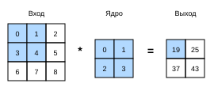

# 6.2 Свёртки для изображений

В предыдущем разделе мы разобрали принцип работы свёрточного слоя, теперь посмотрим, как он применяется на практике. Поскольку свёрточные нейронные сети созданы для анализа данных изображений, в этом разделе мы будем рассматривать именно изображения.

## 6.2.1 Операция взаимной корреляции

Строго говоря, название «свёрточный слой» некорректно, поскольку на самом деле он выполняет *взаимную корреляцию* (cross-correlation), а не свёртку. Как описано в разделе 6.1, в свёрточном слое входной тензор и ядро свёртки с помощью **взаимной корреляции** дают выходной тензор.

Сначала временно отвлечёмся от каналов (третьего измерения) и посмотрим, как обрабатывать двумерные данные изображения и скрытые представления. На рис. 6.2.1 входом служит двумерный тензор высотой $3$ и шириной $3$ (то есть формы $3 \times 3$). Высота и ширина ядра свёртки равны $2$, а форма окна свёртки (или окна ядра) определяется высотой и шириной ядра, то есть равна $2 \times 2$.



В двумерной взаимной корреляции окно свёртки начинает движение из левого верхнего угла входного тензора и скользит слева направо и сверху вниз. Когда окно переходит в новое положение, входящая в него часть тензора поэлементно умножается на ядро, полученные произведения суммируются в одно скалярное значение, и это значение становится элементом выходного тензора в данной позиции. В приведённом примере четыре элемента выходного тензора получаются двумерной взаимной корреляцией; выход имеет высоту $2$ и ширину $2$:

$$
0\times0+1\times1+3\times2+4\times3=19,\\
1\times0+2\times1+4\times2+5\times3=25,\\
3\times0+4\times1+6\times2+7\times3=37,\\
4\times0+5\times1+7\times2+8\times3=43.
$$

Обратите внимание, что выход немного меньше входа. Это происходит потому, что ширина и высота ядра больше 1, а ядро выполняет взаимную корреляцию только в тех позициях изображения, где оно полностью помещается. Таким образом, размер выхода равен размеру входа $n_h \times n_w$, уменьшенному на размер ядра $k_h \times k_w$, то есть:

$$(n_h-k_h+1) \times (n_w-k_w+1).$$

Это связано с тем, что ядру нужно достаточно места, чтобы «двигаться» по изображению. Позже мы увидим, как дополнять границы изображения нулями, чтобы обеспечить место для движения ядра и сохранить размер выхода. А сейчас реализуем описанный процесс в функции `corr2d`, которая принимает входной тензор `X` и ядерный тензор `K` и возвращает выходной тензор `Y`.

**MXNet:**
```python
from d2l import mxnet as d2l
from mxnet import autograd, np, npx
from mxnet.gluon import nn
npx.set_np()
```

**PyTorch:**
```python
from d2l import torch as d2l
import torch
from torch import nn
```

**PaddlePaddle:**
```python
from d2l import paddle as d2l
import warnings
warnings.filterwarnings("ignore")
import paddle
from paddle import nn
```

**MXNet, PyTorch, PaddlePaddle:**
```python
def corr2d(X, K):  #@save
    """Вычисляет двумерную взаимную корреляцию"""
    h, w = K.shape
    Y = d2l.zeros((X.shape[0] - h + 1, X.shape[1] - w + 1))
    for i in range(Y.shape[0]):
        for j in range(Y.shape[1]):
            Y[i, j] = d2l.reduce_sum((X[i: i + h, j: j + w] * K))
    return Y
```

**TensorFlow:**
```python
from d2l import tensorflow as d2l
import tensorflow as tf

def corr2d(X, K):  #@save
    """Вычисляет двумерную взаимную корреляцию"""
    h, w = K.shape
    Y = tf.Variable(tf.zeros((X.shape[0] - h + 1, X.shape[1] - w + 1)))
    for i in range(Y.shape[0]):
        for j in range(Y.shape[1]):
            Y[i, j].assign(tf.reduce_sum(
                X[i: i + h, j: j + w] * K))
    return Y
```

Используя входной тензор `X` и ядерный тензор `K` с рис. 6.2.1, **проверим результат описанной двумерной взаимной корреляции**.

```python
X = d2l.tensor([[0.0, 1.0, 2.0], [3.0, 4.0, 5.0], [6.0, 7.0, 8.0]])
K = d2l.tensor([[0.0, 1.0], [2.0, 3.0]])
corr2d(X, K)
```

## 6.2.2 Свёрточные слои

Свёрточный слой выполняет взаимную корреляцию входа и весов ядра и после добавления скалярного смещения формирует выход. Поэтому у свёрточного слоя два обучаемых параметра: веса ядра и скалярное смещение. Как и полносвязные слои ранее, при обучении моделей на основе свёрточных слоёв веса ядра мы инициализируем случайными значениями.

Опираясь на функцию `corr2d`, определённую выше, **реализуем двумерный свёрточный слой**. В конструкторе `__init__` объявляем `weight` и `bias` как два параметра модели. Функция прямого распространения вызывает `corr2d` и добавляет смещение.

**MXNet:**
```python
class Conv2D(nn.Block):
    def __init__(self, kernel_size, **kwargs):
        super().__init__(**kwargs)
        self.weight = self.params.get('weight', shape=kernel_size)
        self.bias = self.params.get('bias', shape=(1,))

    def forward(self, x):
        return corr2d(x, self.weight.data()) + self.bias.data()
```

**PyTorch:**
```python
class Conv2D(nn.Module):
    def __init__(self, kernel_size):
        super().__init__()
        self.weight = nn.Parameter(torch.rand(kernel_size))
        self.bias = nn.Parameter(torch.zeros(1))

    def forward(self, x):
        return corr2d(x, self.weight) + self.bias
```

**TensorFlow:**
```python
class Conv2D(tf.keras.layers.Layer):
    def __init__(self):
        super().__init__()

    def build(self, kernel_size):
        initializer = tf.random_normal_initializer()
        self.weight = self.add_weight(name='w', shape=kernel_size,
                                      initializer=initializer)
        self.bias = self.add_weight(name='b', shape=(1, ),
                                    initializer=initializer)

    def call(self, inputs):
        return corr2d(inputs, self.weight) + self.bias
```

**PaddlePaddle:**
```python
class Conv2D(nn.Layer):
    def __init__(self, kernel_size):
        super().__init__()
        self.weight = paddle.ParamAttr(paddle.rand(kernel_size))
        self.bias = paddle.ParamAttr(paddle.zeros(1))

    def forward(self, x):
        return corr2d(x, self.weight) + self.bias
```

Ядро с высотой $h$ и шириной $w$ называют свёрткой $h \times w$ или ядром $h \times w$. Свёрточный слой с ядром $h \times w$ также называем слоем $h \times w$.

## 6.2.3 Обнаружение границ объектов на изображении

Ниже приведён **простой пример применения свёрточного слоя**: по местам, где меняются пиксели, мы **обнаруживаем границы разных цветов** на изображении. Сначала построим чёрно-белое изображение размером $6\times 8$ пикселей. Четыре средних столбца чёрные ($0$), остальные пиксели белые ($1$).

**MXNet, PyTorch, PaddlePaddle:**
```python
X = d2l.ones((6, 8))
X[:, 2:6] = 0
X
```

**TensorFlow:**
```python
X = tf.Variable(tf.ones((6, 8)))
X[:, 2:6].assign(tf.zeros(X[:, 2:6].shape))
X
```

Далее построим ядро `K` высотой $1$ и шириной $2$. При взаимной корреляции выход равен нулю, если два горизонтально соседних элемента одинаковы, и отличен от нуля в противном случае.

```python
K = d2l.tensor([[1.0, -1.0]])
```

Теперь выполним взаимную корреляцию входа `X` и ядра `K`. Как видно ниже, **единица в выходе `Y` соответствует границе от белого к чёрному, а −1 — границе от чёрного к белому**; в остальных случаях выход равен $0$.

```python
Y = corr2d(X, K)
Y
```

Теперь транспонируем входное изображение и снова выполним ту же взаимную корреляцию. Результат показан ниже: вертикальные границы, которые мы обнаружили раньше, исчезли. Неудивительно: **ядро `K` умеет обнаруживать только вертикальные границы** и не замечает горизонтальных.

```python
corr2d(d2l.transpose(X), K)
```

## 6.2.4 Изучение ядра свёртки

Если нам нужны только чёрно-белые границы, детектора `[1, -1]` достаточно. Однако когда ядра имеют более сложные значения или когда слоёв свёртки много, вручную проектировать фильтры невозможно. Можно ли **выучить ядро, которое по `X` получает `Y`**?

Проверим, можно ли выучить ядро, которое по `X` даёт `Y`, опираясь только на пары «вход — выход». Сначала построим свёрточный слой и инициализируем его ядро случайным тензором. Затем на каждой итерации сравниваем квадратичную ошибку между `Y` и выходом свёрточного слоя и вычисляем градиенты для обновления ядра. Для простоты используем встроенный двумерный свёрточный слой и не будем учитывать смещение.

**MXNet:**
```python
# Строим двумерный свёрточный слой с 1 выходным каналом и ядром формы (1, 2)
conv2d = nn.Conv2D(1, kernel_size=(1, 2), use_bias=False)
conv2d.initialize()

# Этот двумерный свёрточный слой использует четырёхмерный формат входа и выхода
# (размер пакета, канал, высота, ширина), где размер пакета и количество каналов равны 1


X = X.reshape(1, 1, 6, 8)
Y = Y.reshape(1, 1, 6, 7)
lr = 3e-2  # Скорость обучения

for i in range(10):
    with autograd.record():
        Y_hat = conv2d(X)
        l = (Y_hat - Y) ** 2
    l.backward()
    # Обновляем ядро свёртки
    conv2d.weight.data()[:] -= lr * conv2d.weight.grad()
    if (i + 1) % 2 == 0:
        print(f'эпоха {i+1}, потери {float(l.sum()):.3f}')
```

**PyTorch:**
```python
# Строим двумерный свёрточный слой с 1 выходным каналом и ядром формы (1, 2)
conv2d = nn.Conv2d(1,1, kernel_size=(1, 2), bias=False)

# Этот двумерный свёрточный слой использует четырёхмерный формат входа и выхода
# (размер пакета, канал, высота, ширина), где размер пакета и количество каналов равны 1
X = X.reshape((1, 1, 6, 8))
Y = Y.reshape((1, 1, 6, 7))
lr = 3e-2  # Скорость обучения

for i in range(10):
    Y_hat = conv2d(X)
    l = (Y_hat - Y) ** 2
    conv2d.zero_grad()
    l.sum().backward()
    # Обновляем ядро свёртки
    conv2d.weight.data[:] -= lr * conv2d.weight.grad
    if (i + 1) % 2 == 0:
        print(f'эпоха {i+1}, потери {l.sum():.3f}')
```

**TensorFlow:**
```python
# Строим двумерный свёрточный слой с 1 выходным каналом и ядром формы (1, 2)
conv2d = tf.keras.layers.Conv2D(1, (1, 2), use_bias=False)

# Этот двумерный свёрточный слой использует четырёхмерный формат входа и выхода
# (размер пакета, высота, ширина, канал), где размер пакета и количество каналов равны 1
X = tf.reshape(X, (1, 6, 8, 1))
Y = tf.reshape(Y, (1, 6, 7, 1))
lr = 3e-2  # Скорость обучения

Y_hat = conv2d(X)
for i in range(10):
    with tf.GradientTape(watch_accessed_variables=False) as g:
        g.watch(conv2d.weights[0])
        Y_hat = conv2d(X)
        l = (abs(Y_hat - Y)) ** 2
        # Обновляем ядро свёртки
        update = tf.multiply(lr, g.gradient(l, conv2d.weights[0]))
        weights = conv2d.get_weights()
        weights[0] = conv2d.weights[0] - update
        conv2d.set_weights(weights)
        if (i + 1) % 2 == 0:
            print(f'эпоха {i+1}, потери {tf.reduce_sum(l):.3f}')
```

**PaddlePaddle:**
```python
# Строим двумерный свёрточный слой с 1 выходным каналом и ядром формы (1, 2)
conv2d = nn.Conv2D(1, 1, kernel_size=(1, 2))

# Этот двумерный свёрточный слой использует четырёхмерный формат входа и выхода
# (размер пакета, канал, высота, ширина), где размер пакета и количество каналов равны 1
X = X.reshape((1, 1, 6, 8))
Y = Y.reshape((1, 1, 6, 7))
lr = 3e-2  # Скорость обучения

for i in range(10):
    Y_hat = conv2d(X)
    l = (Y_hat - Y) ** 2
    conv2d.clear_gradients()
    l.sum().backward()
    # Обновляем ядро свёртки
    with paddle.no_grad():
        conv2d.weight[:] -= lr * conv2d.weight.grad
    if (i + 1) % 2 == 0:
        print(f'эпоха {i+1}, потери {l.sum().item():.3f}')
```

После $10$ итераций ошибка стала достаточно малой. Теперь посмотрим на **весовой тензор выученного ядра**.

**MXNet:**
```python
d2l.reshape(conv2d.weight.data(), (1, 2))
```

**PyTorch:**
```python
d2l.reshape(conv2d.weight.data, (1, 2))
```

**TensorFlow:**
```python
d2l.reshape(conv2d.get_weights()[0], (1, 2))
```

**PaddlePaddle:**
```python
d2l.reshape(conv2d.weight, (1, 2))
```

Внимательный читатель наверняка заметит, что выученные веса ядра очень близки к ядру `K`, которое мы определили ранее.

## 6.2.5 Взаимная корреляция и свёртка

Вспомним соответствие между взаимной корреляцией и свёрткой, которое мы наблюдали в разделе 6.1. Чтобы получить результат формальной *свёртки*, нужно выполнить строгую свёртку, определённую в формуле (6.1.2), а не взаимную корреляцию. К счастью, разница невелика: достаточно отразить двумерный ядерный тензор по горизонтали и по вертикали, а затем выполнить *взаимную корреляцию* входного тензора.

Стоит заметить, что ядро выучивается из данных, поэтому выход свёрточного слоя не меняется, выполняет ли слой строгую свёртку или взаимную корреляцию. Чтобы это показать, предположим, что слой выполняет *взаимную корреляцию* и выучивает ядро с рис. 6.2.1, которое здесь обозначено матрицей $\mathbf{K}$. При прочих равных условиях, если тот же слой выполняет строгую *свёртку*, выученное ядро $\mathbf{K}'$ после горизонтального и вертикального отражения будет совпадать с $\mathbf{K}$. Иными словами, если свёрточный слой применит строгую *свёртку* к входу с рис. 6.2.1 и ядру $\mathbf{K}'$, он получит тот же выход, что и при взаимной корреляции на рис. 6.2.1.

Чтобы соответствовать стандартной терминологии литературы по глубокому обучению, мы и дальше будем называть «взаимную корреляцию» свёрткой, хотя строго говоря это разные операции. Кроме того, веса ядерного тензора будем называть его *элементами*.

## 6.2.6 Карты признаков и рецептивные поля

Как говорилось в разделе 6.1.4.1, выход свёрточного слоя с рис. 6.2.1 иногда называют *картой признаков* (feature map): его можно рассматривать как преобразование, которое переводит вход в пространственное представление для следующего слоя. В свёрточной нейронной сети для любого элемента $x$ некоторого слоя *рецептивное поле* (receptive field) — это все элементы (из всех предыдущих слоёв), которые могут влиять на вычисление $x$ в ходе прямого распространения.

Обратите внимание, что рецептивное поле может быть больше самого входа. Поясним это на примере с рис. 6.2.1: при ядре $2 \times 2$ рецептивное поле затенённого выходного элемента со значением $19$ — это четыре элемента затенённой части входа. Пусть предыдущий выход $\mathbf{Y}$ имеет размер $2 \times 2$, и за ним следует свёрточный слой, который получает $\mathbf{Y}$ и выдаёт один элемент $z$. В этом случае рецептивное поле $z$ на $\mathbf{Y}$ включает все четыре элемента $\mathbf{Y}$, а рецептивное поле на входе включает все девять входных элементов. Поэтому, когда какому-либо элементу карты признаков нужно уловить признаки более широкой области входа, можно строить более глубокую сеть.

## Резюме

* Ядром двумерного свёрточного слоя является двумерная взаимная корреляция. В простейшем случае она выполняется над двумерным входом и ядром, после чего добавляется смещение.
* Мы можем спроектировать ядро свёртки, которое обнаруживает границы на изображении.
* Параметры ядра можно выучить из данных.
* При обучении ядра выход свёрточного слоя почти не зависит от того, выполняется ли строгая свёртка или взаимная корреляция.
* Чтобы выявить признаки на более широкой области входа, можно строить более глубокие свёрточные сети.

## Упражнения

1. Постройте изображение `X` с диагональными границами.
    1. Что произойдёт, если применить к `X` ядро `K` из этого раздела?
    1. Что произойдёт при транспонировании `X`?
    1. Что произойдёт при транспонировании `K`?
1. Какое сообщение об ошибке появляется при автоматическом дифференцировании созданного нами `Conv2D`?
1. Как, изменяя входной и ядерный тензоры, представить взаимную корреляцию в виде матричного умножения?
1. Вручную спроектируйте несколько ядер свёртки.
    1. Каков вид ядра для второй производной?
    1. Каков вид ядра для интегрирования?
    1. Каков минимальный размер ядра для вычисления производной порядка $d$?

**MXNet:**
[Обсуждение](https://discuss.d2l.ai/t/1849)

**PyTorch:**
[Обсуждение](https://discuss.d2l.ai/t/1848)

**TensorFlow:**
[Обсуждение](https://discuss.d2l.ai/t/1847)

**PaddlePaddle:**
[Обсуждение](https://discuss.d2l.ai/t/11783)
