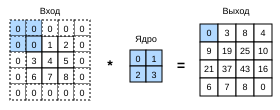
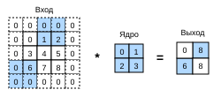

# 6.3 Заполнение и шаг

В предыдущем примере (рис. 6.2.1) высота и ширина входа равны $3$, высота и ширина ядра — $2$, а выход имеет размерность $2\times2$.
Как мы обобщили в разделе 6.2, если форма входа равна $n_h\times n_w$, а форма ядра — $k_h\times k_w$, то форма выхода равна $(n_h-k_h+1) \times (n_w-k_w+1)$.
Таким образом, форма выхода свёртки зависит от формы входа и формы ядра.

Что ещё влияет на размер выхода? В этом разделе мы рассмотрим *заполнение* (padding) и *шаг* (stride). Рассмотрим такой сценарий. Иногда после нескольких последовательных свёрток выход оказывается заметно меньше входа. Это происходит потому, что высота и ширина ядра обычно больше $1$. Например, изображение $240 \times 240$ пикселей после $10$ свёрточных слоёв $5 \times 5$ уменьшится до $200 \times 200$ пикселей. Так граничные пиксели исходного изображения теряют много полезной информации. *Заполнение* — самый эффективный способ решить эту проблему. Иногда же нам может понадобиться существенно уменьшить высоту и ширину изображения, например если исходное разрешение входа избыточно. В таких случаях помогает *шаг* (stride).

## 6.3.1 Заполнение

Как уже говорилось, при последовательном применении нескольких свёрток мы часто теряем пиксели по краям. Поскольку ядра обычно малы, одна свёртка теряет лишь несколько пикселей, но при большом числе последовательных свёрточных слоёв потери накапливаются. Простой способ решить эту проблему — *заполнение* (padding): по границам входного изображения добавляют элементы, обычно нулевые. Например, на рис. 6.3.1 вход $3 \times 3$ дополнен до $5 \times 5$, поэтому выход увеличивается до $4 \times 4$. Затенённая часть — первый элемент выхода и элементы входного и ядерного тензоров, использованные для его вычисления: $0\times0+0\times1+0\times2+0\times3=0$.



В общем случае, если добавить $p_h$ строк заполнения (примерно половину сверху и половину снизу) и $p_w$ столбцов (примерно половину слева и половину справа), форма выхода будет равна

$$(n_h-k_h+p_h+1)\times(n_w-k_w+p_w+1).$$

Это означает, что высота и ширина выхода увеличиваются соответственно на $p_h$ и $p_w$.

Во многих случаях нужно задать $p_h=k_h-1$ и $p_w=k_w-1$, чтобы вход и выход имели одинаковую высоту и ширину. Это упрощает предсказание формы выхода каждого слоя при построении сети. Пусть $k_h$ нечётно: тогда мы заполняем по $p_h/2$ строк с обеих сторон по высоте. Если же $k_h$ чётно, один из вариантов — добавить $\lceil p_h/2\rceil$ строк сверху входа и $\lfloor p_h/2\rfloor$ строк снизу. Ширину заполняем аналогично.

Высота и ширина ядер в свёрточных нейронных сетях обычно нечётны, например 1, 3, 5 или 7. Преимущество нечётных размеров в том, что при сохранении пространственных размеров мы можем добавлять одинаковое количество строк сверху и снизу и одинаковое количество столбцов слева и справа.

Кроме того, нечётные размеры ядра и заполнения удобны и в записи. Для любого двумерного тензора `X` при выполнении условий:

1. размер ядра нечётный;
2. число строк и столбцов заполнения одинаково с каждой стороны;
3. выход имеет ту же высоту и ширину, что и вход;

можно утверждать: выход `Y[i, j]` получается взаимной корреляцией ядра с окрестностью входа `X`, центр которой находится в `X[i, j]`.

Например, в примере ниже мы создаём двумерный свёрточный слой с высотой и шириной $3$ и **добавляем по 1 пикселю заполнения со всех сторон**. При входе высотой и шириной $8$ выход тоже имеет высоту и ширину $8$.

**MXNet:**
```python
from mxnet import np, npx
from mxnet.gluon import nn
npx.set_np()

# Для удобства определим функцию, которая вычисляет свёрточный слой.
# Эта функция инициализирует веса свёрточного слоя и добавляет или убирает
# нужные размерности у входа и выхода
def comp_conv2d(conv2d, X):
    conv2d.initialize()
    # Здесь (1, 1) означает, что размер пакета и количество каналов равны 1
    X = X.reshape((1, 1) + X.shape)
    Y = conv2d(X)
    # Опускаем первые два измерения: размер пакета и каналы
    return Y.reshape(Y.shape[2:])

# Обратите внимание: с каждой стороны добавлена 1 строка или столбец,
# поэтому всего добавлено 2 строки или 2 столбца
conv2d = nn.Conv2D(1, kernel_size=3, padding=1)
X = np.random.uniform(size=(8, 8))
comp_conv2d(conv2d, X).shape
```

**PyTorch:**
```python
import torch
from torch import nn

# Для удобства определим функцию, которая вычисляет свёрточный слой.
# Эта функция инициализирует веса свёрточного слоя и добавляет или убирает
# нужные размерности у входа и выхода
def comp_conv2d(conv2d, X):
    # Здесь (1, 1) означает, что размер пакета и количество каналов равны 1
    X = X.reshape((1, 1) + X.shape)
    Y = conv2d(X)
    # Опускаем первые два измерения: размер пакета и каналы
    return Y.reshape(Y.shape[2:])

# Обратите внимание: с каждой стороны добавлена 1 строка или столбец,
# поэтому всего добавлено 2 строки или 2 столбца
conv2d = nn.Conv2d(1, 1, kernel_size=3, padding=1)
X = torch.rand(size=(8, 8))
comp_conv2d(conv2d, X).shape
```

**TensorFlow:**
```python
import tensorflow as tf

# Для удобства определим функцию, которая вычисляет свёрточный слой.
# Эта функция инициализирует веса свёрточного слоя и добавляет или убирает
# нужные размерности у входа и выхода
def comp_conv2d(conv2d, X):
    # Здесь (1, 1) означает, что размер пакета и количество каналов равны 1
    X = tf.reshape(X, (1, ) + X.shape + (1, ))
    Y = conv2d(X)
    # Опускаем первые два измерения: размер пакета и каналы
    return tf.reshape(Y, Y.shape[1:3])

# Обратите внимание: с каждой стороны добавлена 1 строка или столбец,
# поэтому всего добавлено 2 строки или 2 столбца
conv2d = tf.keras.layers.Conv2D(1, kernel_size=3, padding='same')
X = tf.random.uniform(shape=(8, 8))
comp_conv2d(conv2d, X).shape
```

**PaddlePaddle:**
```python
import warnings
warnings.filterwarnings(action='ignore')
import paddle
from paddle import nn

# Для удобства определим функцию, которая вычисляет свёрточный слой.
# Эта функция инициализирует веса свёрточного слоя и добавляет или убирает
# нужные размерности у входа и выхода
def comp_conv2d(conv2d, X):
    # Здесь (1, 1) означает, что размер пакета и количество каналов равны 1
    X = paddle.reshape(X, [1, 1] + X.shape)
    Y = conv2d(X)
    return Y.reshape(Y.shape[2:])  # Отбрасываем ненужные первые два измерения: пакет и каналы

# Обратите внимание: с каждой стороны добавлена 1 строка или столбец,
# поэтому всего добавлено 2 строки или 2 столбца
conv2d = nn.Conv2D(in_channels=1, out_channels=1, kernel_size=3, padding=1)
X = paddle.rand((8, 8))
comp_conv2d(conv2d, X).shape
```

Если высота и ширина ядра различаются, мы можем **заполнять по высоте и ширине по-разному**, чтобы выход и вход имели одинаковые высоту и ширину. В следующем примере используется ядро высотой $5$ и шириной $3$; заполнение по высоте равно $2$, по ширине — $1$.

**MXNet:**
```python
conv2d = nn.Conv2D(1, kernel_size=(5, 3), padding=(2, 1))
comp_conv2d(conv2d, X).shape
```

**PyTorch:**
```python
conv2d = nn.Conv2d(1, 1, kernel_size=(5, 3), padding=(2, 1))
comp_conv2d(conv2d, X).shape
```

**TensorFlow:**
```python
conv2d = tf.keras.layers.Conv2D(1, kernel_size=(5, 3), padding='same')
comp_conv2d(conv2d, X).shape
```

**PaddlePaddle:**
```python
conv2d = nn.Conv2D(in_channels=1, out_channels=1, kernel_size=(5, 3), padding=(2, 1))
comp_conv2d(conv2d, X).shape
```

## 6.3.2 Шаг

При вычислении взаимной корреляции окно свёртки начинает движение из левого верхнего угла входного тензора и сдвигается вниз и вправо. В предыдущих примерах мы по умолчанию сдвигали окно на один элемент за раз. Однако иногда ради эффективности вычислений или для уменьшения числа выборок окно может пропускать промежуточные положения и сдвигаться сразу на несколько элементов.

Количество элементов, на которое окно сдвигается за один шаг, называют *шагом* (stride). До сих пор мы использовали шаг по высоте и ширине, равный $1$. Как же устроен шаг больше единицы? На рис. 6.3.2 показана двумерная взаимная корреляция с вертикальным шагом $3$ и горизонтальным шагом $2$. Затенённая часть — выходные элементы, а также элементы входного и ядерного тензоров, используемые для их вычисления: $0\times0+0\times1+1\times2+2\times3=8$ и $0\times0+6\times1+0\times2+0\times3=6$.

Видно, что для вычисления второго элемента первого столбца выхода окно свёртки сдвигается вниз на три строки, а для второго элемента первой строки — вправо на два столбца. Когда же окно продолжает сдвигаться вправо ещё на два столбца, выхода нет: входные элементы не могут заполнить окно (если только мы не добавим ещё один столбец заполнения).



В общем случае при вертикальном шаге $s_h$ и горизонтальном шаге $s_w$ форма выхода равна

$$\lfloor(n_h-k_h+p_h+s_h)/s_h\rfloor \times \lfloor(n_w-k_w+p_w+s_w)/s_w\rfloor.$$

Если задать $p_h=k_h-1$ и $p_w=k_w-1$, форма выхода упрощается до $\lfloor(n_h+s_h-1)/s_h\rfloor \times \lfloor(n_w+s_w-1)/s_w\rfloor$. Более того, если высота и ширина входа делятся на вертикальный и горизонтальный шаги, форма выхода равна $(n_h/s_h) \times (n_w/s_w)$.

Теперь **зададим шаг по высоте и ширине равным 2**, что уменьшит высоту и ширину входа вдвое.

**MXNet:**
```python
conv2d = nn.Conv2D(1, kernel_size=3, padding=1, strides=2)
comp_conv2d(conv2d, X).shape
```

**PyTorch:**
```python
conv2d = nn.Conv2d(1, 1, kernel_size=3, padding=1, stride=2)
comp_conv2d(conv2d, X).shape
```

**TensorFlow:**
```python
conv2d = tf.keras.layers.Conv2D(1, kernel_size=3, padding='same', strides=2)
comp_conv2d(conv2d, X).shape
```

**PaddlePaddle:**
```python
conv2d = nn.Conv2D(1, 1, kernel_size=3, padding=1, stride=2)
comp_conv2d(conv2d, X).shape
```

Теперь рассмотрим **чуть более сложный пример**.

**MXNet:**
```python
conv2d = nn.Conv2D(1, kernel_size=(3, 5), padding=(0, 1), strides=(3, 4))
comp_conv2d(conv2d, X).shape
```

**PyTorch:**
```python
conv2d = nn.Conv2d(1, 1, kernel_size=(3, 5), padding=(0, 1), stride=(3, 4))
comp_conv2d(conv2d, X).shape
```

**TensorFlow:**
```python
conv2d = tf.keras.layers.Conv2D(1, kernel_size=(3,5), padding='valid',
                                strides=(3, 4))
comp_conv2d(conv2d, X).shape
```

**PaddlePaddle:**
```python
conv2d = nn.Conv2D(1, 1, kernel_size=(3, 5), padding=(0, 1), stride=(3, 4))
comp_conv2d(conv2d, X).shape
```

Для краткости, если число заполняемых строк и столбцов по высоте и ширине входа равно $p_h$ и $p_w$ соответственно, будем называть это заполнением $(p_h, p_w)$. При $p_h = p_w = p$ заполнение равно $p$. Аналогично, если шаги по высоте и ширине равны $s_h$ и $s_w$, будем говорить о шаге $(s_h, s_w)$. В частном случае $s_h = s_w = s$ шаг равен $s$. По умолчанию заполнение равно 0, а шаг равен 1. На практике мы редко используем несогласованные шаги или заполнение, то есть обычно $p_h = p_w$ и $s_h = s_w$.

## Резюме

* Заполнение увеличивает высоту и ширину выхода. Его часто используют, чтобы выход имел ту же высоту и ширину, что и вход.
* Шаг уменьшает высоту и ширину выхода; например, высота и ширина выхода составляют лишь $1/n$ от высоты и ширины входа ($n$ — целое число больше $1$).
* Заполнение и шаг можно использовать для эффективной настройки размерности данных.

## Упражнения

1. Для последнего примера этого раздела вычислите форму выхода и проверьте, совпадает ли она с результатом эксперимента.
1. В экспериментах этого раздела попробуйте другие комбинации заполнения и шага.
1. Что означает шаг $2$ для аудиосигнала?
1. В чём вычислительное преимущество шага больше $1$?

**MXNet:**
[Обсуждение](https://discuss.d2l.ai/t/1852)

**PyTorch:**
[Обсуждение](https://discuss.d2l.ai/t/1851)

**TensorFlow:**
[Обсуждение](https://discuss.d2l.ai/t/1850)

**PaddlePaddle:**
[Обсуждение](https://discuss.d2l.ai/t/11784)
