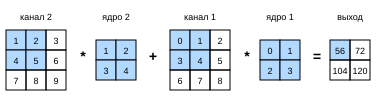
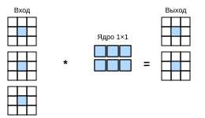

# 6.4 Многоканальные входы и выходы

В разделе 6.1.4.1 мы говорили о том, что каждое изображение состоит из нескольких каналов и что свёрточных слоёв может быть много. Например, цветное изображение имеет стандартные RGB-каналы — красный, зелёный и синий. Однако до сих пор мы рассматривали лишь упрощённый пример с одним входным и одним выходным каналом. Это позволяло считать вход, ядро и выход двумерными тензорами.

Когда мы добавляем каналы, и входы, и скрытые представления становятся трёхмерными тензорами. Например, каждое входное RGB-изображение имеет форму $3\times h\times w$. Ось размером $3$ мы называем измерением *канала* (channel). В этом разделе мы подробнее рассмотрим ядра с несколькими входными и выходными каналами.

## 6.4.1 Несколько входных каналов

Когда вход содержит несколько каналов, нужно построить ядро с таким же числом входных каналов, как у входных данных, чтобы выполнять взаимную корреляцию. Пусть число входных каналов равно $c_i$; тогда у ядра тоже должно быть $c_i$ входных каналов. Если форма окна ядра равна $k_h\times k_w$, то при $c_i=1$ ядро можно считать двумерным тензором формы $k_h\times k_w$.

Однако при $c_i>1$ каждый входной канал ядра содержит тензор формы $k_h\times k_w$. Если объединить $c_i$ таких тензоров, получим ядро формы $c_i\times k_h\times k_w$. Поскольку и вход, и ядро имеют по $c_i$ каналов, мы можем выполнить двумерную взаимную корреляцию двумерного тензора каждого входного канала с двумерным тензором соответствующего канала ядра, а затем просуммировать результаты по каналам (складываем $c_i$ результатов), получив один двумерный тензор. Это и есть результат двумерной взаимной корреляции для многоканального входа и ядра с несколькими входными каналами.

На рис. 6.4.1 показан пример двумерной взаимной корреляции с двумя входными каналами. Затенённая часть — первый элемент выхода, а также элементы входа и ядра, используемые для его вычисления: $(1\times1+2\times2+4\times3+5\times4)+(0\times0+1\times1+3\times2+4\times3)=56$.



**Рис. 6.4.1.** Взаимная корреляция для двух входных каналов

Чтобы лучше понять эту операцию, **реализуем многоканальную взаимную корреляцию**. Коротко говоря, мы выполняем взаимную корреляцию для каждого канала и затем складываем результаты.

**MXNet:**
```python
from d2l import mxnet as d2l
from mxnet import np, npx
npx.set_np()
```

**PyTorch:**
```python
from d2l import torch as d2l
import torch
```

**PaddlePaddle:**
```python
from d2l import paddle as d2l
import warnings
warnings.filterwarnings("ignore")
import paddle
```

**MXNet, PyTorch, PaddlePaddle:**
```python
def corr2d_multi_in(X, K):
    # Перебираем нулевое измерение «X» и «K» (измерение каналов), затем складываем результаты
    return sum(d2l.corr2d(x, k) for x, k in zip(X, K))
```

**TensorFlow:**
```python
from d2l import tensorflow as d2l
import tensorflow as tf

def corr2d_multi_in(X, K):
    # Перебираем нулевое измерение «X» и «K» (измерение каналов), затем складываем результаты
    return tf.reduce_sum([d2l.corr2d(x, k) for x, k in zip(X, K)], axis=0)
```

Построим входной тензор `X` и ядерный тензор `K`, соответствующие значениям с рис. 6.4.1, и **проверим результат взаимной корреляции**.

```python
X = d2l.tensor([[[0.0, 1.0, 2.0], [3.0, 4.0, 5.0], [6.0, 7.0, 8.0]],
               [[1.0, 2.0, 3.0], [4.0, 5.0, 6.0], [7.0, 8.0, 9.0]]])
K = d2l.tensor([[[0.0, 1.0], [2.0, 3.0]], [[1.0, 2.0], [3.0, 4.0]]])

corr2d_multi_in(X, K)
```

## 6.4.2 Несколько выходных каналов

До сих пор, сколько бы входных каналов ни было, выходной канал у нас был один. Однако, как мы обсуждали в разделе 6.1.4.1, на каждом слое необходимо несколько выходных каналов. В самых популярных архитектурах нейронных сетей по мере углубления сети число выходных каналов часто увеличивают, одновременно уменьшая пространственное разрешение, чтобы получить большую глубину по каналам. Интуитивно можно считать каждый канал откликом на определённый признак. Реальность, впрочем, сложнее: каналы не обучаются независимо, а оптимизируются для совместного использования. Поэтому несколько выходных каналов — это не просто обучение нескольких одноканальных детекторов.

Обозначим число входных и выходных каналов через $c_i$ и $c_o$, а высоту и ширину ядра — через $k_h$ и $k_w$. Чтобы получить выход с несколькими каналами, для каждого выходного канала создадим ядерный тензор формы $c_i\times k_h\times k_w$; таким образом, ядро имеет форму $c_o\times c_i\times k_h\times k_w$. При взаимной корреляции каждый выходной канал сначала получает все входные каналы, а затем результат вычисляется с помощью ядра, соответствующего этому выходному каналу.

Ниже реализуем **функцию взаимной корреляции, вычисляющую выход с несколькими каналами**.

```python
def corr2d_multi_in_out(X, K):
    # Перебираем нулевое измерение «K» и для каждого ядра выполняем взаимную корреляцию с входом «X».
    # Затем объединяем все результаты в один тензор
    return d2l.stack([corr2d_multi_in(X, k) for k in K], 0)
```

Соединив ядерный тензор `K` с `K+1` (каждый элемент `K` увеличен на $1$) и `K+2`, построим ядро с $3$ выходными каналами.

```python
K = d2l.stack((K, K + 1, K + 2), 0)
K.shape
```

Теперь выполним взаимную корреляцию входного тензора `X` и ядерного тензора `K`. Выход теперь содержит $3$ канала; результат первого канала совпадает с ранее полученным результатом для входа `X` с несколькими входными и одним выходным каналом.

```python
corr2d_multi_in_out(X, K)
```

## 6.4.3 Свёрточные слои $1\times 1$

Свёртка $1 \times 1$, то есть при $k_h = k_w = 1$, на первый взгляд кажется бессмысленной. Ведь суть свёртки — эффективно выделять корреляции между соседними пикселями, а свёртка $1 \times 1$ этим явно не занимается. Тем не менее она очень популярна и часто входит в проекты сложных глубоких сетей. Разберём подробнее, какую роль она играет.

Поскольку окно минимально, свёртка $1\times 1$ утрачивает присущую свёрточным слоям способность выявлять взаимодействие соседних элементов по высоте и ширине. Фактически все вычисления свёртки $1\times 1$ происходят по каналам.

На рис. 6.4.2 показана взаимная корреляция с ядром $1\times 1$ при $3$ входных и $2$ выходных каналах. Здесь вход и выход имеют одинаковые высоту и ширину, а каждый элемент выхода — линейная комбинация элементов входа в той же позиции. Свёрточный слой $1\times 1$ можно рассматривать как полносвязный слой, применяемый в каждой позиции пикселя, который преобразует $c_i$ входных значений в $c_o$ выходных. Поскольку это по-прежнему свёрточный слой, веса одинаковы для всех пикселей. При этом свёрточный слой $1\times 1$ требует весов размерности $c_o\times c_i$ и, кроме того, смещения.



**Рис. 6.4.2.** Взаимная корреляция с ядром $1\times 1$ при 3 входных и 2 выходных каналах. Вход и выход имеют одинаковые высоту и ширину

Теперь реализуем свёртку $1 \times 1$ с помощью полносвязного слоя. Обратите внимание, что нам нужно изменить форму входных и выходных данных.

```python
def corr2d_multi_in_out_1x1(X, K):
    c_i, h, w = X.shape
    c_o = K.shape[0]
    X = d2l.reshape(X, (c_i, h * w))
    K = d2l.reshape(K, (c_o, c_i))
    # Матричное умножение, как в полносвязном слое
    Y = d2l.matmul(K, X)
    return d2l.reshape(Y, (c_o, h, w))
```

При выполнении свёртки $1\times 1$ приведённая функция эквивалентна ранее реализованной функции взаимной корреляции `corr2d_multi_in_out`. Проверим это на примере данных.

**MXNet, PyTorch, PaddlePaddle:**
```python
X = d2l.normal(0, 1, (3, 3, 3))
K = d2l.normal(0, 1, (2, 3, 1, 1))
```

**TensorFlow:**
```python
X = d2l.normal((3, 3, 3), 0, 1)
K = d2l.normal((2, 3, 1, 1), 0, 1)
```

```python
Y1 = corr2d_multi_in_out_1x1(X, K)
Y2 = corr2d_multi_in_out(X, K)
assert float(d2l.reduce_sum(d2l.abs(Y1 - Y2))) < 1e-6
```

## Резюме

* Несколько входных и выходных каналов позволяют расширять модель свёрточного слоя.
* При применении к каждому пикселю свёрточный слой $1\times 1$ эквивалентен полносвязному слою.
* Свёрточные слои $1\times 1$ обычно используют, чтобы менять число каналов в слое сети и управлять сложностью модели.

## Упражнения

1. Предположим, что у нас есть две свёрточные операции с ядрами размеров $k_1$ и $k_2$ (без нелинейной функции активации между ними).
    1. Докажите, что эти операции можно представить одной свёрткой.
    1. Какова размерность эквивалентного одного ядра?
    1. А верно ли обратное?
1. Пусть вход имеет форму $c_i\times h\times w$, ядро — $c_o\times c_i\times k_h\times k_w$, заполнение — $(p_h, p_w)$, шаг — $(s_h, s_w)$.
    1. Каковы вычислительные затраты прямого распространения (умножения и сложения)?
    1. Каков объём занимаемой памяти?
    1. Каков объём памяти при обратном распространении?
    1. Каковы вычислительные затраты обратного распространения?
1. Если удвоить число входных $c_i$ и выходных $c_o$ каналов, насколько вырастет число вычислений? А что, если удвоить заполнение?
1. Если высота и ширина ядра равны $k_h=k_w=1$, какова вычислительная сложность прямого распространения?
1. Совпадают ли полностью переменные `Y1` и `Y2` из последнего примера этого раздела? Почему?
1. Как реализовать свёртку через матричное умножение, если окно свёртки не $1\times 1$?

**MXNet:**
[Обсуждение](https://discuss.d2l.ai/t/1855)

**PyTorch:**
[Обсуждение](https://discuss.d2l.ai/t/1854)

**TensorFlow:**
[Обсуждение](https://discuss.d2l.ai/t/1853)

**PaddlePaddle:**
[Обсуждение](https://discuss.d2l.ai/t/11785)
