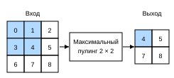

# 6.5 Слои пулинга

Обычно при обработке изображений мы хотим постепенно уменьшать пространственное разрешение скрытых представлений и агрегировать информацию. Тогда по мере подъёма по слоям нейронной сети рецептивное поле (входная область), к которому чувствителен каждый нейрон, становится всё больше.

Задачи машинного обучения часто связаны с глобальным содержимым изображения (например, «есть ли на изображении кот?»), поэтому нейроны последнего слоя должны быть чувствительны ко всему входу. Постепенно агрегируя информацию и получая всё более грубые карты, мы в итоге приходим к глобальному представлению, сохраняя при этом все преимущества свёрточных слоёв на промежуточных уровнях.

Кроме того, при обнаружении низкоуровневых признаков (например, границ из раздела 6.2) мы обычно хотим, чтобы эти признаки сохраняли некоторую степень инвариантности к сдвигу. Например, если мы возьмём чёрно-белое изображение `X` с чёткими контурами и сдвинем всё изображение на один пиксель вправо, то есть `Z[i, j] = X[i, j + 1]`, то выход для нового изображения `Z` может сильно отличаться. На практике же при смене ракурса съёмки положение объектов почти никогда не совпадает в точности по пикселям. Даже при съёмке неподвижного объекта со штатива вибрация камеры из-за движения затвора может сдвинуть все объекты влево или вправо на один пиксель (кроме дорогих камер, в которых есть специальные средства против этого).

В этом разделе мы рассмотрим *слои пулинга* (pooling), которые решают две задачи: снижают чувствительность свёрточного слоя к положению и уменьшают чувствительность к пространственному понижению разрешения представления.

## 6.5.1 Максимальный и средний пулинг

Как и свёрточный слой, оператор пулинга состоит из окна фиксированной формы, которое скользит по всем областям входа с заданным шагом, и для каждой позиции, пройденной окном (его иногда называют *окном пулинга*), вычисляет выход. Однако в отличие от взаимной корреляции входа и ядра в свёрточном слое слой пулинга не содержит параметров. Вместо этого операция пулинга детерминирована: обычно мы вычисляем максимум или среднее всех элементов в окне пулинга. Эти операции называют *слоем максимального пулинга* (maximum pooling) и *слоем среднего пулинга* (average pooling) соответственно.

В обоих случаях, как и при взаимной корреляции, окно пулинга начинает движение из левого верхнего угла входного тензора и скользит слева направо и сверху вниз. В каждой позиции окна вычисляется максимум или среднее входного подтензора внутри окна — в зависимости от того, используется ли максимальный или средний пулинг.



Выходной тензор на рис. 6.5.1 имеет высоту $2$ и ширину $2$. Четыре его элемента — максимумы в каждом окне пулинга:

$$
\max(0, 1, 3, 4)=4,\\
\max(1, 2, 4, 5)=5,\\
\max(3, 4, 6, 7)=7,\\
\max(4, 5, 7, 8)=8.\\
$$

Слой пулинга с окном формы $p \times q$ называют слоем пулинга $p \times q$, а саму операцию — пулингом $p \times q$.

Вернёмся к примеру с обнаружением границ объектов из начала этого раздела: теперь используем выход свёрточного слоя как вход для максимального пулинга $2\times 2$. Пусть вход свёрточного слоя — `X`, а выход пулинга — `Y`. Независимо от того, равны ли `X[i, j]` и `X[i, j + 1]` или `X[i, j + 1]` и `X[i, j + 2]`, слой пулинга всегда выдаёт `Y[i, j] = 1`. То есть при максимальном пулинге $2\times 2$ свёрточный слой по-прежнему распознаёт нужный шаблон, даже если он сдвинут на один элемент по высоте или ширине.

В приведённом ниже коде функция `pool2d` **реализует прямое распространение слоя пулинга**. Она похожа на функцию `corr2d` из раздела 6.2. Однако здесь у нас нет ядра, а выход — это максимум или среднее значение в каждой области входа.

**MXNet:**
```python
from d2l import mxnet as d2l
from mxnet import np, npx
from mxnet.gluon import nn
npx.set_np()
```

**PyTorch:**
```python
from d2l import torch as d2l
import torch
from torch import nn
```

**PaddlePaddle:**
```python
from d2l import paddle as d2l
import warnings
warnings.filterwarnings("ignore")
import paddle
from paddle import nn
```

**MXNet, PyTorch, PaddlePaddle:**
```python
def pool2d(X, pool_size, mode='max'):
    p_h, p_w = pool_size
    Y = d2l.zeros((X.shape[0] - p_h + 1, X.shape[1] - p_w + 1))
    for i in range(Y.shape[0]):
        for j in range(Y.shape[1]):
            if mode == 'max':
                Y[i, j] = X[i: i + p_h, j: j + p_w].max()
            elif mode == 'avg':
                Y[i, j] = X[i: i + p_h, j: j + p_w].mean()
    return Y
```

**TensorFlow:**
```python
import tensorflow as tf

def pool2d(X, pool_size, mode='max'):
    p_h, p_w = pool_size
    Y = tf.Variable(tf.zeros((X.shape[0] - p_h + 1, X.shape[1] - p_w +1)))
    for i in range(Y.shape[0]):
        for j in range(Y.shape[1]):
            if mode == 'max':
                Y[i, j].assign(tf.reduce_max(X[i: i + p_h, j: j + p_w]))
            elif mode =='avg':
                Y[i, j].assign(tf.reduce_mean(X[i: i + p_h, j: j + p_w]))
    return Y
```

Построим входной тензор `X` из рис. 6.5.1 и **проверим выход двумерного максимального пулинга**.

```python
X = d2l.tensor([[0.0, 1.0, 2.0], [3.0, 4.0, 5.0], [6.0, 7.0, 8.0]])
pool2d(X, (2, 2))
```

Кроме того, **проверим средний пулинг**.

```python
pool2d(X, (2, 2), 'avg')
```

## 6.5.2 Заполнение и шаг

Как и свёрточный слой, слой пулинга может менять форму выхода. Как и раньше, мы можем использовать заполнение и шаг, чтобы получить нужную форму выхода. Ниже мы используем встроенный в фреймворк двумерный слой максимального пулинга, чтобы показать работу заполнения и шага в пулинге. Сначала построим входной тензор `X` с четырьмя измерениями, где число примеров и число каналов равны 1.

**TensorFlow:** обратите внимание, что TensorFlow использует синтаксис «канал последним» (channels-last) и оптимизирован под него: в TensorFlow последнее измерение входа — это канал.

**MXNet, PyTorch:**
```python
X = d2l.reshape(d2l.arange(16, dtype=d2l.float32), (1, 1, 4, 4))
X
```

**TensorFlow:**
```python
X = d2l.reshape(d2l.arange(16, dtype=d2l.float32), (1, 4, 4, 1))
X
```

**PaddlePaddle:**
```python
X = paddle.arange(16, dtype="float32").reshape((1, 1, 4, 4))
X
```

По умолчанию **шаг в фреймворках совпадает с размером окна пулинга**. Поэтому если мы используем окно формы `(3, 3)`, то по умолчанию получаем шаг формы `(3, 3)`.

**MXNet:**
```python
pool2d = nn.MaxPool2D(3)
# Слой пулинга не содержит параметров, поэтому нет необходимости вызывать функцию инициализации
pool2d(X)
```

**PyTorch:**
```python
pool2d = nn.MaxPool2d(3)
pool2d(X)
```

**TensorFlow:**
```python
pool2d = tf.keras.layers.MaxPool2D(pool_size=[3, 3])
pool2d(X)
```

**PaddlePaddle:**
```python
pool2d = nn.MaxPool2D(3, stride=3)
pool2d(X)
```

**Заполнение и шаг можно задать вручную.**

**MXNet:**
```python
pool2d = nn.MaxPool2D(3, padding=1, strides=2)
pool2d(X)
```

**PyTorch:**
```python
pool2d = nn.MaxPool2d(3, padding=1, stride=2)
pool2d(X)
```

**TensorFlow:**
```python
paddings = tf.constant([[0, 0], [1,0], [1,0], [0,0]])
X_padded = tf.pad(X, paddings, "CONSTANT")
pool2d = tf.keras.layers.MaxPool2D(pool_size=[3, 3], padding='valid',
                                   strides=2)
pool2d(X_padded)
```

**PaddlePaddle:**
```python
pool2d = nn.MaxPool2D(3, padding=1, stride=2)
pool2d(X)
```

Конечно, мы можем задать прямоугольное окно пулинга произвольного размера и отдельно задать высоту и ширину заполнения и шага.

**MXNet:**
```python
pool2d = nn.MaxPool2D((2, 3), padding=(0, 1), strides=(2, 3))
pool2d(X)
```

**PyTorch:**
```python
pool2d = nn.MaxPool2d((2, 3), stride=(2, 3), padding=(0, 1))
pool2d(X)
```

**TensorFlow:**
```python
paddings = tf.constant([[0, 0], [0, 0], [1, 1], [0, 0]])
X_padded = tf.pad(X, paddings, "CONSTANT")
pool2d = tf.keras.layers.MaxPool2D(pool_size=[2, 3], padding='valid',
                                   strides=(2, 3))
pool2d(X_padded)
```

**PaddlePaddle:**
```python
pool2d = nn.MaxPool2D((2, 3), padding=(0, 1), stride=(2, 3))
pool2d(X)
```

## 6.5.3 Несколько каналов

При обработке многоканальных входных данных **слой пулинга работает с каждым входным каналом отдельно**, а не суммирует входы по каналам, как свёрточный слой. Это значит, что число выходных каналов слоя пулинга совпадает с числом входных каналов. Ниже объединим тензоры `X` и `X + 1` по измерению каналов, чтобы построить вход с 2 каналами.

**TensorFlow:** так как в TensorFlow используется синтаксис «канал последним», нам нужно объединять тензоры по последнему измерению входа.

**MXNet, PyTorch, PaddlePaddle:**
```python
X = d2l.concat((X, X + 1), 1)
X
```

**TensorFlow:**
```python
X = tf.concat([X, X + 1], 3)
```

Как видно ниже, после пулинга число выходных каналов по-прежнему равно 2.

**MXNet:**
```python
pool2d = nn.MaxPool2D(3, padding=1, strides=2)
pool2d(X)
```

**PyTorch:**
```python
pool2d = nn.MaxPool2d(3, padding=1, stride=2)
pool2d(X)
```

**TensorFlow:**
```python
paddings = tf.constant([[0, 0], [1,0], [1,0], [0,0]])
X_padded = tf.pad(X, paddings, "CONSTANT")
pool2d = tf.keras.layers.MaxPool2D(pool_size=[3, 3], padding='valid',
                                   strides=2)
pool2d(X_padded)
```

**PaddlePaddle:**
```python
pool2d = paddle.nn.MaxPool2D(3, padding=1, stride=2)
pool2d(X)
```

**TensorFlow:** результат выше на первый взгляд выглядит иначе, но выходы MXNet и PyTorch численно совпадают. Различие только в размерностях: если читать выход по вертикали, он даёт тот же результат, что и в других реализациях.

## Резюме

* Для заданного входного элемента максимальный пулинг возвращает максимум в своём окне, а средний пулинг — среднее значение в окне.
* Одно из главных преимуществ слоя пулинга — уменьшение чрезмерной чувствительности свёрточного слоя к положению.
* Для слоя пулинга можно задать заполнение и шаг.
* Использование максимального пулинга с шагом больше 1 позволяет уменьшить пространственные размерности (высоту и ширину).
* Число выходных каналов слоя пулинга совпадает с числом входных каналов.

## Упражнения

1. Попробуйте реализовать средний пулинг как частный случай свёрточного слоя.
1. Попробуйте реализовать максимальный пулинг как частный случай свёрточного слоя.
1. Пусть вход слоя пулинга имеет размер $c\times h\times w$, окно пулинга — $p_h\times p_w$, заполнение — $(p_h, p_w)$, шаг — $(s_h, s_w)$. Каковы вычислительные затраты этого слоя пулинга?
1. Почему максимальный и средний пулинг работают по-разному?
1. Нужен ли нам минимальный пулинг? Можно ли заменить его известной функцией?
1. Помимо среднего и максимального пулинга, есть ли другие функции, которые стоит рассмотреть (подсказка: вспомните `softmax`)? Почему они не получили распространения?

**MXNet:**
[Обсуждение](https://discuss.d2l.ai/t/1858)

**PyTorch:**
[Обсуждение](https://discuss.d2l.ai/t/1857)

**TensorFlow:**
[Обсуждение](https://discuss.d2l.ai/t/1856)

**PaddlePaddle:**
[Обсуждение](https://discuss.d2l.ai/t/11786)
