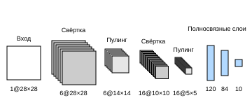
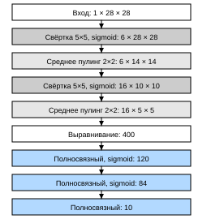

# 6.6 Свёрточные нейронные сети (LeNet)

В предыдущих разделах мы изучили все компоненты, необходимые для построения полноценной свёрточной нейронной сети. Вспомним, что ранее мы применяли модель softmax-регрессии (раздел 3.6) и многослойный перцептрон (раздел 4.2) к изображениям одежды из набора Fashion-MNIST. Чтобы использовать softmax-регрессию и многослойный перцептрон, мы сначала разворачивали каждое изображение размером $28\times28$ в одномерный вектор фиксированной длины из 784 элементов, а затем обрабатывали его полносвязными слоями. Теперь же, когда мы освоили свёрточные слои, мы можем сохранить пространственную структуру изображения. Кроме того, замена полносвязных слоёв свёрточными даёт ещё одно преимущество: модель становится проще и требует меньше параметров.

В этом разделе мы рассмотрим LeNet — одну из первых опубликованных свёрточных нейронных сетей, которая привлекла большое внимание благодаря высокой эффективности в задачах компьютерного зрения. Модель была предложена в 1989 году Яном Лекуном (Yann LeCun), исследователем из лабораторий AT&T Bell, в честь которого она и названа. Её целью было распознавание рукописных цифр на изображениях (LeCun et al., 1998). Тогда Лекун опубликовал первую работу, в которой свёрточная нейронная сеть была успешно обучена методом обратного распространения ошибки; эта работа стала итогом более чем десятилетия развития нейронных сетей.

В то время LeNet показывала результаты, сравнимые с результатами метода опорных векторов (support vector machines), и стала одним из ведущих методов обучения с учителем. LeNet широко применялась в банкоматах (ATM) для распознавания цифр на чеках. И даже сегодня некоторые банкоматы работают с кодом, который Ян Лекун и его коллега Леон Ботту написали в 1990-х годах!

## 6.6.1 LeNet

В целом **LeNet (LeNet-5) состоит из двух частей:**

* свёрточный кодировщик: состоит из двух свёрточных слоёв;
* блок полносвязных слоёв: состоит из трёх полносвязных слоёв.

Архитектура показана на рис. 6.6.1.



**Рис. 6.6.1.** Поток данных в LeNet. На входе — рукописная цифра, на выходе — вероятности 10 возможных результатов

Базовый элемент каждого свёрточного блока — свёрточный слой, функция активации sigmoid и слой среднего пулинга. Заметьте: хотя ReLU и максимальный пулинг работают эффективнее, в 1990-х годах их ещё не было. Каждый свёрточный слой использует ядро $5\times 5$ и активацию sigmoid. Эти слои отображают вход в несколько двумерных карт признаков, обычно одновременно увеличивая число каналов. Первый свёрточный слой имеет 6 выходных каналов, второй — 16. Каждая операция пулинга $2\times2$ (шаг 2) за счёт пространственного понижения разрешения уменьшает размерность в 4 раза. Форма выхода свёртки определяется размером батча, числом каналов, высотой и шириной.

Чтобы передать выход свёрточных блоков в блок полносвязных слоёв, нужно развернуть каждый пример в минибатче. Иными словами, мы преобразуем четырёхмерный вход в двумерный, который ожидают полносвязные слои. Первое измерение этого двумерного представления индексирует примеры в минибатче, а второе задаёт плоский векторный вид каждого примера. Блок полносвязных слоёв LeNet содержит три полносвязных слоя с 120, 84 и 10 выходами. Поскольку мы решаем задачу классификации, 10-мерный выход соответствует числу результатов классификации.

Из приведённого ниже кода LeNet видно, что реализовать такую модель во фреймворке глубокого обучения очень просто: достаточно создать блок `Sequential` и соединить в нём нужные слои.

**MXNet:**
```python
from d2l import mxnet as d2l
from mxnet import autograd, gluon, init, np, npx
from mxnet.gluon import nn
npx.set_np()

net = nn.Sequential()
net.add(nn.Conv2D(channels=6, kernel_size=5, padding=2, activation='sigmoid'),
        nn.AvgPool2D(pool_size=2, strides=2),
        nn.Conv2D(channels=16, kernel_size=5, activation='sigmoid'),
        nn.AvgPool2D(pool_size=2, strides=2),
        # По умолчанию «Dense» автоматически преобразует вход формы
        # (размер батча, количество каналов, высота, ширина) во вход формы
        # (размер батча, количество каналов × высота × ширина)
        nn.Dense(120, activation='sigmoid'),
        nn.Dense(84, activation='sigmoid'),
        nn.Dense(10))
```

**PyTorch:**
```python
from d2l import torch as d2l
import torch
from torch import nn

net = nn.Sequential(
    nn.Conv2d(1, 6, kernel_size=5, padding=2), nn.Sigmoid(),
    nn.AvgPool2d(kernel_size=2, stride=2),
    nn.Conv2d(6, 16, kernel_size=5), nn.Sigmoid(),
    nn.AvgPool2d(kernel_size=2, stride=2),
    nn.Flatten(),
    nn.Linear(16 * 5 * 5, 120), nn.Sigmoid(),
    nn.Linear(120, 84), nn.Sigmoid(),
    nn.Linear(84, 10))
```

**TensorFlow:**
```python
from d2l import tensorflow as d2l
import tensorflow as tf

def net():
    return tf.keras.models.Sequential([
        tf.keras.layers.Conv2D(filters=6, kernel_size=5, activation='sigmoid',
                               padding='same'),
        tf.keras.layers.AvgPool2D(pool_size=2, strides=2),
        tf.keras.layers.Conv2D(filters=16, kernel_size=5,
                               activation='sigmoid'),
        tf.keras.layers.AvgPool2D(pool_size=2, strides=2),
        tf.keras.layers.Flatten(),
        tf.keras.layers.Dense(120, activation='sigmoid'),
        tf.keras.layers.Dense(84, activation='sigmoid'),
        tf.keras.layers.Dense(10)])
```

**PaddlePaddle:**
```python
from d2l import paddle as d2l
import warnings
warnings.filterwarnings("ignore")
import paddle
from paddle import nn, optimizer

net = nn.Sequential(
    nn.Conv2D(1, 6, kernel_size=5, padding=2), nn.Sigmoid(),
    nn.AvgPool2D(kernel_size=2, stride=2),
    nn.Conv2D(6, 16, kernel_size=5), nn.Sigmoid(),
    nn.AvgPool2D(kernel_size=2, stride=2),
    nn.Flatten(),
    nn.Linear(16 * 5 * 5, 120), nn.Sigmoid(),
    nn.Linear(120, 84), nn.Sigmoid(),
    nn.Linear(84, 10))
```

Мы внесли небольшое изменение в исходную модель: убрали гауссову активацию последнего слоя. В остальном эта сеть совпадает с исходной LeNet-5.

Теперь пропустим через LeNet одноканальное (чёрно-белое) изображение размером $28 \times 28$. Печатая форму выхода каждого слоя, мы можем **проверить модель** и убедиться, что она работает так, как мы ожидаем, — см. рис. 6.6.2.



**Рис. 6.6.2.** Упрощённая схема LeNet

**MXNet:**
```python
X = np.random.uniform(size=(1, 1, 28, 28))
net.initialize()
for layer in net:
    X = layer(X)
    print(layer.name, 'форма выхода:\t', X.shape)
```

**PyTorch:**
```python
X = torch.rand(size=(1, 1, 28, 28), dtype=torch.float32)
for layer in net:
    X = layer(X)
    print(layer.__class__.__name__,'форма выхода: \t',X.shape)
```

**TensorFlow:**
```python
X = tf.random.uniform((1, 28, 28, 1))
for layer in net().layers:
    X = layer(X)
    print(layer.__class__.__name__, 'форма выхода: \t', X.shape)
```

**PaddlePaddle:**
```python
X = paddle.rand((1, 1, 28, 28), 'float32')
for layer in net:
    X = layer(X)
    print(layer.__class__.__name__, 'форма выхода: \t', X.shape)
```

Обратите внимание: во всём свёрточном блоке высота и ширина признаков уменьшаются по сравнению с предыдущим слоем. Первый свёрточный слой использует заполнение в 2 пикселя, чтобы компенсировать уменьшение признаков из-за ядра $5 \times 5$. Второй же свёрточный слой заполнения не имеет, поэтому его высота и ширина уменьшаются на 4 пикселя. По мере подъёма по слоям число каналов растёт: с 1 на входе до 6 после первого свёрточного слоя и до 16 после второго. Одновременно высота и ширина каждого слоя пулинга уменьшаются вдвое. Наконец, каждый полносвязный слой уменьшает размерность, и в итоге получается выход, размерность которого совпадает с числом классов.

## 6.6.2 Обучение модели

Теперь, когда LeNet реализована, посмотрим, **как LeNet показывает себя на наборе данных Fashion-MNIST**.

```python
batch_size = 256
train_iter, test_iter = d2l.load_data_fashion_mnist(batch_size=batch_size)
```

Хотя у свёрточных сетей параметров немного, их вычислительная стоимость всё равно высока по сравнению с глубокими многослойными перцептронами, поскольку каждый параметр участвует в большем числе умножений. Ускорить обучение можно с помощью GPU.

**MXNet, PyTorch:** для оценки нам нужно **немного изменить функцию `evaluate_accuracy`** из раздела 3.6. Поскольку весь набор данных находится в оперативной памяти, перед вычислениями на GPU его нужно скопировать в память GPU.

**MXNet:**
```python
def evaluate_accuracy_gpu(net, data_iter, device=None):  #@save
    """Вычисляет точность модели на наборе данных с помощью GPU"""
    if not device:  # Определяем устройство, на котором находится первый параметр
        device = list(net.collect_params().values())[0].list_ctx()[0]
    metric = d2l.Accumulator(2)  # Количество верных предсказаний, общее количество предсказаний
    for X, y in data_iter:
        X, y = X.as_in_ctx(device), y.as_in_ctx(device)
        metric.add(d2l.accuracy(net(X), y), d2l.size(y))
    return metric[0] / metric[1]
```

**PyTorch:**
```python
def evaluate_accuracy_gpu(net, data_iter, device=None): #@save
    """Вычисляет точность модели на наборе данных с помощью GPU"""
    if isinstance(net, nn.Module):
        net.eval()  # Переводим модель в режим оценки
        if not device:
            device = next(iter(net.parameters())).device
    # Количество верных предсказаний, общее количество предсказаний
    metric = d2l.Accumulator(2)
    with torch.no_grad():
        for X, y in data_iter:
            if isinstance(X, list):
                # Нужно для дообучения BERT (будет рассмотрено позже)
                X = [x.to(device) for x in X]
            else:
                X = X.to(device)
            y = y.to(device)
            metric.add(d2l.accuracy(net(X), y), d2l.size(y))
    return metric[0] / metric[1]
```

**PaddlePaddle:**
```python
def evaluate_accuracy_gpu(net, data_iter, device=None):     #@save
    """Вычисляет точность модели на наборе данных с помощью GPU"""
    if isinstance(net, nn.Layer):
        net.eval()  # Переводим модель в режим оценки
        if not device:
            device = next(iter(net.parameters())).place
    paddle.set_device("gpu:{}".format(str(device)[-2]))
    # Количество верных предсказаний, общее количество предсказаний
    metric = d2l.Accumulator(2)
    with paddle.no_grad():
        for X, y in data_iter:
            if isinstance(X, list):
                # Нужно для дообучения BERT
                X = [paddle.to_tensor(x, place=device) for x in X]
            else:
                X = paddle.to_tensor(X, place=device)
            y = paddle.to_tensor(y, place=device)
            metric.add(d2l.accuracy(net(X), y), d2l.size(y))
    return metric[0] / metric[1]
```

**Для использования GPU нужна небольшая доработка.** В отличие от функции `train_epoch_ch3`, определённой в разделе 3.6, перед прямым и обратным распространением каждый минибатч нужно переместить на заданное устройство (например, GPU).

Как показано ниже, функция обучения `train_ch6` похожа на `train_ch3` из раздела 3.6. Поскольку мы реализуем многослойную нейронную сеть, мы в основном будем пользоваться высокоуровневым API. Приведённая ниже функция обучения принимает на вход модель, созданную высокоуровневым API, и выполняет соответствующую оптимизацию. Параметры модели мы инициализируем методом Xavier, описанным в разделе 4.8. Как и для полносвязных слоёв, используем функцию потерь кросс-энтропии и минибатчевый стохастический градиентный спуск.

**MXNet:**
```python
#@save
def train_ch6(net, train_iter, test_iter, num_epochs, lr, device):
    """Обучает модель на GPU (определено в главе 6)"""
    net.initialize(force_reinit=True, ctx=device, init=init.Xavier())
    loss = gluon.loss.SoftmaxCrossEntropyLoss()
    trainer = gluon.Trainer(net.collect_params(),
                            'sgd', {'learning_rate': lr})
    animator = d2l.Animator(xlabel='эпоха', xlim=[1, num_epochs],
                            legend=['потери (обучение)', 'точность (обучение)',
                                    'точность (тест)'])
    timer, num_batches = d2l.Timer(), len(train_iter)
    for epoch in range(num_epochs):
        metric = d2l.Accumulator(3)  # Сумма потерь на обучении, сумма точности, количество примеров
        for i, (X, y) in enumerate(train_iter):
            timer.start()
            # Ниже — основное отличие от «d2l.train_epoch_ch3»
            X, y = X.as_in_ctx(device), y.as_in_ctx(device)
            with autograd.record():
                y_hat = net(X)
                l = loss(y_hat, y)
            l.backward()
            trainer.step(X.shape[0])
            metric.add(l.sum(), d2l.accuracy(y_hat, y), X.shape[0])
            timer.stop()
            train_l = metric[0] / metric[2]
            train_acc = metric[1] / metric[2]
            if (i + 1) % (num_batches // 5) == 0 or i == num_batches - 1:
                animator.add(epoch + (i + 1) / num_batches,
                             (train_l, train_acc, None))
        test_acc = evaluate_accuracy_gpu(net, test_iter)
        animator.add(epoch + 1, (None, None, test_acc))
    print(f'потери {train_l:.3f}, точность на обучении {train_acc:.3f}, '
          f'точность на тесте {test_acc:.3f}')
    print(f'{metric[2] * num_epochs / timer.sum():.1f} примеров/с '
          f'на {str(device)}')
```

**PyTorch:**
```python
#@save
def train_ch6(net, train_iter, test_iter, num_epochs, lr, device):
    """Обучает модель на GPU (определено в главе 6)"""
    def init_weights(m):
        if type(m) == nn.Linear or type(m) == nn.Conv2d:
            nn.init.xavier_uniform_(m.weight)
    net.apply(init_weights)
    print('обучение на', device)
    net.to(device)
    optimizer = torch.optim.SGD(net.parameters(), lr=lr)
    loss = nn.CrossEntropyLoss()
    animator = d2l.Animator(xlabel='эпоха', xlim=[1, num_epochs],
                            legend=['потери (обучение)', 'точность (обучение)',
                                    'точность (тест)'])
    timer, num_batches = d2l.Timer(), len(train_iter)
    for epoch in range(num_epochs):
        # Сумма потерь на обучении, сумма точности, количество примеров
        metric = d2l.Accumulator(3)
        net.train()
        for i, (X, y) in enumerate(train_iter):
            timer.start()
            optimizer.zero_grad()
            X, y = X.to(device), y.to(device)
            y_hat = net(X)
            l = loss(y_hat, y)
            l.backward()
            optimizer.step()
            with torch.no_grad():
                metric.add(l * X.shape[0], d2l.accuracy(y_hat, y), X.shape[0])
            timer.stop()
            train_l = metric[0] / metric[2]
            train_acc = metric[1] / metric[2]
            if (i + 1) % (num_batches // 5) == 0 or i == num_batches - 1:
                animator.add(epoch + (i + 1) / num_batches,
                             (train_l, train_acc, None))
        test_acc = evaluate_accuracy_gpu(net, test_iter)
        animator.add(epoch + 1, (None, None, test_acc))
    print(f'потери {train_l:.3f}, точность на обучении {train_acc:.3f}, '
          f'точность на тесте {test_acc:.3f}')
    print(f'{metric[2] * num_epochs / timer.sum():.1f} примеров/с '
          f'на {str(device)}')
```

**TensorFlow:**
```python
class TrainCallback(tf.keras.callbacks.Callback):  #@save
    """Обратный вызов, который визуализирует ход обучения"""
    def __init__(self, net, train_iter, test_iter, num_epochs, device_name):
        self.timer = d2l.Timer()
        self.animator = d2l.Animator(
            xlabel='эпоха', xlim=[1, num_epochs], legend=[
                'потери (обучение)', 'точность (обучение)', 'точность (тест)'])
        self.net = net
        self.train_iter = train_iter
        self.test_iter = test_iter
        self.num_epochs = num_epochs
        self.device_name = device_name

    def on_epoch_begin(self, epoch, logs=None):
        self.timer.start()

    def on_epoch_end(self, epoch, logs):
        self.timer.stop()
        test_acc = self.net.evaluate(
            self.test_iter, verbose=0, return_dict=True)['accuracy']
        metrics = (logs['loss'], logs['accuracy'], test_acc)
        self.animator.add(epoch + 1, metrics)
        if epoch == self.num_epochs - 1:
            batch_size = next(iter(self.train_iter))[0].shape[0]
            num_examples = batch_size * tf.data.experimental.cardinality(
                self.train_iter).numpy()
            print(f'потери {metrics[0]:.3f}, точность на обучении {metrics[1]:.3f}, '
                  f'точность на тесте {metrics[2]:.3f}')
            print(f'{num_examples / self.timer.avg():.1f} примеров/с на '
                  f'{str(self.device_name)}')

#@save
def train_ch6(net_fn, train_iter, test_iter, num_epochs, lr, device):
    """Обучает модель на GPU (определено в главе 6)"""
    device_name = device._device_name
    strategy = tf.distribute.OneDeviceStrategy(device_name)
    with strategy.scope():
        optimizer = tf.keras.optimizers.SGD(learning_rate=lr)
        loss = tf.keras.losses.SparseCategoricalCrossentropy(from_logits=True)
        net = net_fn()
        net.compile(optimizer=optimizer, loss=loss, metrics=['accuracy'])
    callback = TrainCallback(net, train_iter, test_iter, num_epochs,
                             device_name)
    net.fit(train_iter, epochs=num_epochs, verbose=0, callbacks=[callback])
    return net
```

**PaddlePaddle:**
```python
#@save
def train_ch6(net, train_iter, test_iter, num_epochs, lr, device):
    """Обучает модель на GPU (определено в главе 6)"""
    def init_weights(m):
        if type(m) == nn.Linear or type(m) == nn.Conv2D:
            nn.initializer.XavierUniform(m.weight)
    net.apply(init_weights)
    print('обучение на', device)
    net.to(device)
    optimizer = paddle.optimizer.SGD(learning_rate=lr, parameters=net.parameters())
    loss = nn.CrossEntropyLoss()
    animator = d2l.Animator(xlabel='эпоха', xlim=[1, num_epochs],
                            legend=['потери (обучение)', 'точность (обучение)',
                                    'точность (тест)'])
    timer, num_batches = d2l.Timer(), len(train_iter)
    for epoch in range(num_epochs):
        # Сумма потерь на обучении, сумма точности, количество примеров
        metric = d2l.Accumulator(3)
        net.train()
        for i, (X, y) in enumerate(train_iter):
            timer.start()
            optimizer.clear_grad()
            X, y = paddle.to_tensor(X, place=device), paddle.to_tensor(y, place=device)
            y_hat = net(X)
            l = loss(y_hat, y)
            l.backward()
            optimizer.step()
            with paddle.no_grad():
                metric.add(l * X.shape[0], d2l.accuracy(y_hat, y), X.shape[0])
            timer.stop()
            train_l = metric[0] / metric[2]
            train_acc = metric[1] / metric[2]
            if (i + 1) % (num_batches // 5) == 0 or i == num_batches - 1:
                animator.add(epoch + (i + 1) / num_batches,
                             (train_l, train_acc, None))
        test_acc = evaluate_accuracy_gpu(net, test_iter)
        animator.add(epoch + 1, (None, None, test_acc))
    print(f'потери {train_l:.3f}, точность на обучении {train_acc:.3f}, '
          f'точность на тесте {test_acc:.3f}')
    print(f'{metric[2] * num_epochs / timer.sum():.1f} примеров/с '
          f'на {str(device)}')
```

Теперь **обучим и оценим модель LeNet-5**.

```python
lr, num_epochs = 0.9, 10
train_ch6(net, train_iter, test_iter, num_epochs, lr, d2l.try_gpu())
```

## Резюме

* Свёрточная нейронная сеть (CNN) — это сеть, использующая свёрточные слои.
* В свёрточной нейронной сети свёрточные слои, нелинейные функции активации и слои пулинга комбинируются.
* Чтобы построить высокопроизводительную свёрточную сеть, обычно располагают свёрточные слои так, чтобы постепенно уменьшать пространственное разрешение представления и одновременно увеличивать число каналов.
* В традиционных свёрточных сетях представление, полученное свёрточным блоком, перед выходом обрабатывается одним или несколькими полносвязными слоями.
* LeNet — одна из первых опубликованных свёрточных нейронных сетей.

## Упражнения

1. Что произойдёт, если заменить средний пулинг на максимальный?
1. Попробуйте построить более сложную сеть на основе LeNet, чтобы повысить её точность.
    1. Измените размер окна свёртки.
    1. Измените число выходных каналов.
    1. Измените функцию активации (например, на ReLU).
    1. Измените число свёрточных слоёв.
    1. Измените число полносвязных слоёв.
    1. Подберите скорость обучения и другие детали обучения (например, инициализацию и число эпох).
1. Попробуйте улучшенную сеть на наборе данных MNIST.
1. Покажите значения активаций первого и второго слоёв LeNet для разных входов (например, свитера и пальто).

**MXNet:**
[Обсуждение](https://discuss.d2l.ai/t/1861)

**PyTorch:**
[Обсуждение](https://discuss.d2l.ai/t/1860)

**TensorFlow:**
[Обсуждение](https://discuss.d2l.ai/t/1859)

**PaddlePaddle:**
[Обсуждение](https://discuss.d2l.ai/t/11787)

## Литература

* LeCun, Y., Bottou, L., Bengio, Y., & Haffner, P. (1998). Gradient-based learning applied to document recognition. *Proceedings of the IEEE*, 86(11), 2278–2324.
