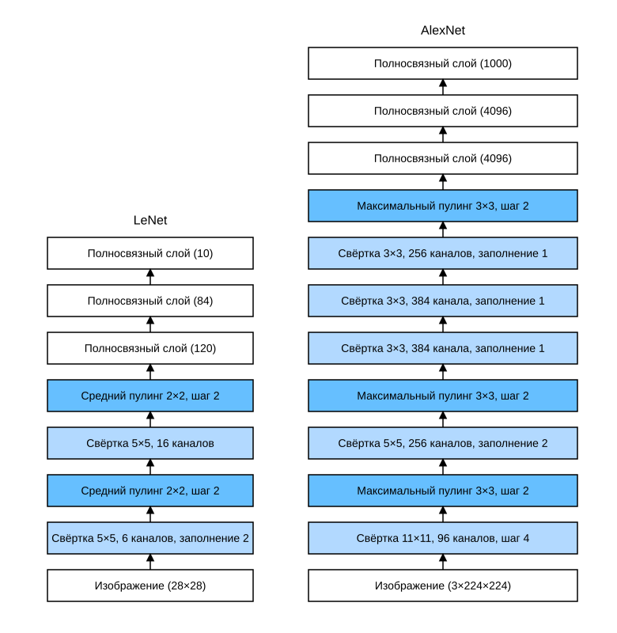

# 7.1 Глубокие свёрточные нейронные сети (AlexNet)

После появления LeNet свёрточные нейронные сети приобрели известность в компьютерном зрении и машинном обучении. Однако они не стали доминирующим подходом в этих областях. Дело в том, что LeNet хорошо работала на небольших наборах данных, но вопрос о производительности и осуществимости обучения свёрточных сетей на более крупных и реалистичных данных оставался открытым. Фактически с начала 1990-х до 2012 года нейронные сети в основном уступали другим методам машинного обучения, например методу опорных векторов (support vector machines).

В компьютерном зрении сравнивать нейронные сети напрямую с другими методами машинного обучения, пожалуй, некорректно. Входом свёрточной сети служат исходные значения пикселей или значения, прошедшие простую предобработку (например, центрирование и масштабирование). Но когда речь идёт о традиционных методах машинного обучения, никто не подаёт на вход сырые пиксели. В традиционном конвейере компьютерного зрения признаки тщательно конструировались вручную. Для таких методов основной прогресс достигался за счёт более удачных идей о признаках, а сами обученные алгоритмы часто были лишь объяснением уже достигнутого результата.

Хотя в 1990-е годы уже существовали аппаратные ускорители для нейронных сетей, одних только они не хватало, чтобы создать глубокие многоканальные многослойные свёрточные сети с большим числом параметров. Кроме того, наборы данных тогда оставались относительно небольшими. Помимо этих препятствий, в арсенале не хватало ключевых приёмов обучения нейронных сетей: эвристической инициализации параметров, вариантов стохастического градиентного спуска, функций активации без «сжатия» сигнала (non-squashing) и эффективных методов регуляризации.

Поэтому вместо обучения *сквозной* системы (от пикселей до результата классификации) классический конвейер машинного обучения выглядел примерно так:

1. Получить интересный набор данных. На ранних этапах сбор таких наборов требовал дорогих датчиков (лучшие изображения того времени имели около миллиона пикселей).
2. На основе оптики, геометрии, других знаний и случайных открытий вручную предобработать набор признаков.
3. Извлечь признаки стандартными алгоритмами, такими как SIFT (масштабно-инвариантное преобразование признаков) (Lowe, 2004) и SURF (ускоренные устойчивые признаки) (Bay et al., 2006), или другими вручную настраиваемыми конвейерами.
4. Подать извлечённые признаки в любимый классификатор (например, линейную модель или другой метод на основе ядер) и обучить его.

Если поговорить с исследователями машинного обучения, выяснится, что они считают машинное обучение одновременно важным и красивым: элегантные теории доказывают свойства различных моделей. Машинное обучение — быстро развивающаяся, строгая и очень полезная область. Однако разговор с исследователями компьютерного зрения даст совсем другую картину. Они скажут о неудобной истине: двигателем прогресса в их области являются признаки данных, а не алгоритмы обучения. По их мнению, для итоговой точности модели большие или более чистые наборы данных либо чуть лучшее извлечение признаков дают гораздо больший выигрыш, чем любой алгоритм обучения.

## 7.1.1 Изучение представлений

Другой способ предсказать развитие этой области — посмотреть, как извлекаются признаки изображений. До 2012 года признаки изображений вычислялись вручную. Фактически разработка новой функции признаков, улучшение результатов и публикация статьи были излюбленным занятием исследователей. Доминировали SIFT (Lowe, 2004), SURF (Bay et al., 2006), HOG (гистограммы направленных градиентов) (Dalal and Triggs, 2005), [«мешки визуальных слов» (bags of visual words)](https://en.wikipedia.org/wiki/Bag-of-words_model_in_computer_vision) и подобные методы извлечения признаков.

Другая группа исследователей, в которую входили Ян ЛеКун (Yann LeCun), Джефф Хинтон (Geoff Hinton), Йошуа Бенджио (Yoshua Bengio), Эндрю Ын (Andrew Ng), Амари Сюнъити (Shun'ichi Amari) и Юрген Шмидхубер (Juergen Schmidhuber), придерживалась иного взгляда: признаки сами должны обучаться. Более того, они считали, что при разумной сложности признаки должны строиться из нескольких совместно обучаемых слоёв нейронной сети, каждый из которых имеет обучаемые параметры. В машинном зрении нижние слои могут обнаруживать границы, цвета и текстуры. Так, Алекс Крижевский (Alex Krizhevsky), Илья Суцкевер (Ilya Sutskever) и Джефф Хинтон предложили новый вариант свёрточной нейронной сети — *AlexNet*, который произвёл сенсацию на соревновании ImageNet в 2012 году. Название AlexNet происходит от имени Алекса Крижевского, первого автора статьи (Krizhevsky et al., 2012).

Интересно, что в нижних слоях сети модель выучивает извлекатели признаков, похожие на традиционные фильтры. Иллюстрация этих признаков из статьи AlexNet (Krizhevsky et al., 2012) в книгу не включена: это рисунок стороннего издания, его можно посмотреть в оригинальной статье.

Верхние слои AlexNet опираются на эти низкоуровневые представления и строят более крупные признаки: глаза, носы, травинки и т. д. Ещё выше слои могут распознавать целые объекты: людей, самолёты, собак или фрисби. Итоговые скрытые нейроны могут выучивать комплексное представление изображения, благодаря которому объекты разных классов легко различать. Долгое время группа упорных исследователей пыталась выучить послойные представления визуальных данных, однако эти попытки долго не давали прорыва. Прорыв в глубоких свёрточных сетях произошёл в 2012 году. Его можно объяснить двумя ключевыми факторами.

### 7.1.1.1 Недостающий компонент: данные

Глубоким моделям с большим числом признаков нужно много размеченных данных, чтобы заметно превзойти традиционные методы, основанные на выпуклой оптимизации (например, линейные методы и методы на основе ядер).

Однако из-за ограниченной памяти ранних компьютеров и скромных исследовательских бюджетов 1990-х годов большинство работ опиралось на небольшие открытые наборы данных. Например, многие статьи использовали несколько публичных наборов Калифорнийского университета в Ирвайне (UCI), и многие из них содержали лишь несколько сотен или тысяч изображений, снятых в неестественных условиях и с низким разрешением. Ситуацию улучшила волна больших данных примерно с 2010 года. В 2009 году был опубликован набор данных ImageNet и запущено соревнование ImageNet Challenge: исследователям предлагалось обучать модели на 1 миллионе примеров, чтобы различать 1000 классов объектов. Набор ImageNet разработала группа исследователей под руководством профессора Фэй-Фэй Ли из Стэнфорда. Изображения каждого класса предварительно отбирались с помощью Google Image Search, а метки проставлялись через Amazon Mechanical Turk. Масштаб был беспрецедентным. Соревнование ImageNet Challenge стимулировало исследования в компьютерном зрении и машинном обучении: оно позволяло выяснить, какие модели лучше всего работают на данных большого масштаба.

### 7.1.1.2 Недостающий компонент: аппаратное обеспечение

Глубокое обучение очень требовательно к вычислительным ресурсам: обучение может занимать сотни эпох, и на каждой эпохе данные проходят через дорогостоящие слои линейной алгебры. Именно поэтому в 1990-е и в начале 2000-х исследователи предпочитали простые алгоритмы оптимизации выпуклых целевых функций. Однако обучение нейронных сетей на GPU изменило эту картину. *Графические процессоры* (Graphics Processing Unit, GPU) изначально создавались для ускорения обработки графики, что приносило пользу любителям компьютерных игр. GPU оптимизированы для высокопроизводительного умножения матриц $4 \times 4$ и векторов, что служит базовым графическим задачам. К счастью, эти математические операции удивительно похожи на вычисления в свёрточных слоях. Поэтому NVIDIA и ATI начали оптимизировать GPU для вычислений общего назначения и даже продавать их как *GPU общего назначения* (general-purpose GPU, GPGPU).

Чем же GPU превосходят CPU?

Для начала разберёмся, что такое *ядро* центрального процессора (Central Processing Unit, CPU).
Каждое ядро CPU обладает высокой тактовой частотой и кэшем третьего уровня (L3) объёмом до нескольких мегабайт.
Ядра CPU хорошо подходят для выполнения самых разных инструкций: у них есть предсказатели ветвлений, глубокий конвейер и другие функции, благодаря которым процессор может выполнять самые разные программы.
Однако это очевидное преимущество оборачивается слабым местом: универсальные ядра очень дорого производить.
Им нужна большая площадь кристалла, сложные вспомогательные структуры (интерфейсы памяти, логика кэша между ядрами, высокоскоростные соединения и т. д.), при этом производительность каждой отдельной задачи у них довольно низкая.
Современные ноутбуки имеют до 4 ядер, а даже в мощных серверах их редко бывает больше 64, потому что по соотношению цены и производительности это невыгодно.

В отличие от CPU, GPU состоит из $100 \sim 1000$ небольших вычислительных блоков (детали различаются у NVIDIA, ATI, ARM и других производителей чипов), которые обычно объединяются в группы побольше (NVIDIA называет их warp).
Каждое ядро GPU довольно слабое, иногда работает на частоте ниже 1 ГГц, но их огромное количество делает GPU быстрее CPU на несколько порядков.
Например, архитектура NVIDIA Ampere последнего поколения обеспечивает до 312 TFlops производительности операций с плавающей точкой на один чип, тогда как производительность CPU с плавающей точкой пока не превышает 1 TFlops.
Причина такого разрыва на самом деле проста. Во-первых, энергопотребление часто растёт квадратично с тактовой частотой. Допустим, ядро CPU работает в 4 раза быстрее ядра GPU, но вместо него можно использовать 16 ядер GPU; тогда суммарная производительность GPU будет в $16 \times 1/4 = 4$ раза выше, чем у CPU.
Во-вторых, ядра GPU устроены гораздо проще, поэтому они энергоэффективнее.
Кроме того, многим операциям глубокого обучения нужна относительно высокая пропускная способность памяти, а у GPU она примерно в 10 раз выше, чем у CPU.

Вернёмся к прорыву 2012 года. Он произошёл, когда Алекс Крижевский и Илья Суцкевер реализовали глубокую свёрточную сеть, способную работать на GPU. Они увидели узкое место в вычислениях свёрточных сетей: свёртка и умножение матриц — операции, которые можно распараллелить на аппаратном уровне.
Для быстрых свёрточных вычислений они использовали две видеокарты NVIDIA GTX 580 с 3 ГБ памяти каждая. Их разработка [cuda-convnet](https://code.google.com/archive/p/cuda-convnet/) несколько лет оставалась отраслевым стандартом и подхлестнула бум глубокого обучения.

## 7.1.2 AlexNet

В 2012 году появилась AlexNet. Она впервые показала, что признаки, выученные сетью, могут превосходить признаки, сконструированные вручную. Одним махом она переломила сложившуюся картину в исследованиях компьютерного зрения.
AlexNet использует восемь слоёв свёрточной нейронной сети и с большим отрывом выиграла соревнование ImageNet 2012 года.

Архитектуры AlexNet и LeNet очень похожи, как показано на рис. 7.1.1.
Обратите внимание: в книге приведена немного упрощённая версия AlexNet, без особенностей, которые в своё время требовали двух маломощных GPU для параллельной работы.



**Рис. 7.1.1.** От LeNet (слева) к AlexNet (справа)

Идеи AlexNet и LeNet очень похожи, но есть и заметные различия.

1. AlexNet намного глубже сравнительно небольшой LeNet-5. AlexNet состоит из восьми слоёв: пяти свёрточных слоёв, двух полносвязных скрытых слоёв и одного полносвязного выходного слоя.
2. AlexNet использует ReLU вместо sigmoid в качестве функции активации.

Ниже мы подробнее рассмотрим устройство AlexNet.

### 7.1.2.1 Проектирование модели

В первом слое AlexNet окно свёртки имеет форму $11\times11$. Поскольку большинство изображений ImageNet по ширине и высоте более чем в 10 раз больше изображений MNIST, для захвата объектов нужно окно свёртки побольше.
Во втором слое форма окна уменьшается до $5\times5$, а затем до $3\times3$. Кроме того, после первого, второго и пятого свёрточных слоёв добавлены слои максимального пулинга с окном $3\times3$ и шагом 2.
Также число каналов свёртки в AlexNet в 10 раз больше, чем в LeNet.

После последнего свёрточного слоя идут два полносвязных слоя с 4096 выходами каждый. Эти два огромных полносвязных слоя содержат почти 1 ГБ параметров модели. Из-за ограниченной памяти ранних GPU исходная AlexNet использовала двухпоточную схему: каждый GPU хранил и вычислял только половину параметров модели. К счастью, сейчас в GPU памяти достаточно, поэтому модель обычно не приходится делить между несколькими GPU (поэтому AlexNet в этой книге несколько отличается от оригинальной статьи).

### 7.1.2.2 Функция активации

Кроме того, AlexNet заменила функцию активации sigmoid более простой ReLU.
С одной стороны, вычисление ReLU проще: ей не нужны сложные операции возведения в степень, как у sigmoid. С другой стороны, при разных способах инициализации параметров ReLU делает обучение модели проще. Когда выход sigmoid очень близок к 0 или 1, градиент на этих участках почти нулевой, поэтому обратное распространение перестаёт обновлять некоторые параметры модели. Напротив, ReLU на положительной полуоси всегда имеет градиент, равный 1. Поэтому, если параметры модели инициализированы неправильно, sigmoid может на положительной полуоси получить почти нулевой градиент, и модель не сможет нормально обучаться.

### 7.1.2.3 Контроль ёмкости и предобработка

AlexNet контролирует сложность полносвязных слоёв с помощью исключения (dropout, раздел 4.6), тогда как LeNet использовала только затухание весов.
Чтобы расширить данные, AlexNet во время обучения применяет большое количество аугментаций изображений: отражения, обрезку и изменение цвета.
Это делает модель устойчивее, а больший объём выборки эффективно снижает переобучение.
Подробнее об аугментации данных см. раздел 13.1.

```python
from d2l import mxnet as d2l
from mxnet import np, npx
from mxnet.gluon import nn
npx.set_np()

net = nn.Sequential()

net.add(
    # Здесь используем окно побольше, 11×11, чтобы захватывать объекты.
    # Шаг 4 одновременно уменьшает высоту и ширину выхода.
    # Кроме того, число выходных каналов намного больше, чем в LeNet
    nn.Conv2D(96, kernel_size=11, strides=4, activation='relu'),
    nn.MaxPool2D(pool_size=3, strides=2),
    # Уменьшаем окно свёртки, используем заполнение 2, чтобы высота и ширина входа и выхода совпадали, и увеличиваем число выходных каналов
    nn.Conv2D(256, kernel_size=5, padding=2, activation='relu'),
    nn.MaxPool2D(pool_size=3, strides=2),
    # Используем три последовательных свёрточных слоя с небольшим окном свёртки.
    # Кроме последнего свёрточного слоя, число выходных каналов продолжает расти.
    # После первых двух свёрточных слоёв пулинг не используется для уменьшения высоты и ширины входа
    nn.Conv2D(384, kernel_size=3, padding=1, activation='relu'),
    nn.Conv2D(384, kernel_size=3, padding=1, activation='relu'),
    nn.Conv2D(256, kernel_size=3, padding=1, activation='relu'),
    nn.MaxPool2D(pool_size=3, strides=2),
    # Здесь выходов полносвязных слоёв в несколько раз больше, чем в LeNet. Слои dropout снижают переобучение
    nn.Dense(4096, activation='relu'), nn.Dropout(0.5),
    nn.Dense(4096, activation='relu'), nn.Dropout(0.5),
    # Последний — выходной слой. Здесь используется Fashion-MNIST, поэтому число классов равно 10, а не 1000, как в статье
    nn.Dense(10))
```

**PyTorch:**
```python
from d2l import torch as d2l
import torch
from torch import nn

net = nn.Sequential(
    # Здесь используем окно побольше, 11×11, чтобы захватывать объекты.
    # Шаг 4 одновременно уменьшает высоту и ширину выхода.
    # Кроме того, число выходных каналов намного больше, чем в LeNet
    nn.Conv2d(1, 96, kernel_size=11, stride=4, padding=1), nn.ReLU(),
    nn.MaxPool2d(kernel_size=3, stride=2),
    # Уменьшаем окно свёртки, используем заполнение 2, чтобы высота и ширина входа и выхода совпадали, и увеличиваем число выходных каналов
    nn.Conv2d(96, 256, kernel_size=5, padding=2), nn.ReLU(),
    nn.MaxPool2d(kernel_size=3, stride=2),
    # Используем три последовательных свёрточных слоя с небольшим окном свёртки.
    # Кроме последнего свёрточного слоя, число выходных каналов продолжает расти.
    # После первых двух свёрточных слоёв пулинг не используется для уменьшения высоты и ширины входа
    nn.Conv2d(256, 384, kernel_size=3, padding=1), nn.ReLU(),
    nn.Conv2d(384, 384, kernel_size=3, padding=1), nn.ReLU(),
    nn.Conv2d(384, 256, kernel_size=3, padding=1), nn.ReLU(),
    nn.MaxPool2d(kernel_size=3, stride=2),
    nn.Flatten(),
    # Здесь выходов полносвязных слоёв в несколько раз больше, чем в LeNet. Слои dropout снижают переобучение
    nn.Linear(6400, 4096), nn.ReLU(),
    nn.Dropout(p=0.5),
    nn.Linear(4096, 4096), nn.ReLU(),
    nn.Dropout(p=0.5),
    # Последний — выходной слой. Здесь используется Fashion-MNIST, поэтому число классов равно 10, а не 1000, как в статье
    nn.Linear(4096, 10))
```

**TensorFlow:**
```python
from d2l import tensorflow as d2l
import tensorflow as tf

def net():
    return tf.keras.models.Sequential([
        # Здесь используем окно побольше, 11×11, чтобы захватывать объекты.
        # Шаг 4 одновременно уменьшает высоту и ширину выхода.
        # Кроме того, число выходных каналов намного больше, чем в LeNet
        tf.keras.layers.Conv2D(filters=96, kernel_size=11, strides=4,
                               activation='relu'),
        tf.keras.layers.MaxPool2D(pool_size=3, strides=2),
        # Уменьшаем окно свёртки, используем заполнение 2, чтобы высота и ширина входа и выхода совпадали, и увеличиваем число выходных каналов
        tf.keras.layers.Conv2D(filters=256, kernel_size=5, padding='same',
                               activation='relu'),
        tf.keras.layers.MaxPool2D(pool_size=3, strides=2),
        # Используем три последовательных свёрточных слоя с небольшим окном свёртки.
        # Кроме последнего свёрточного слоя, число выходных каналов продолжает расти.
        # После первых двух свёрточных слоёв пулинг не используется для уменьшения высоты и ширины входа
        tf.keras.layers.Conv2D(filters=384, kernel_size=3, padding='same',
                               activation='relu'),
        tf.keras.layers.Conv2D(filters=384, kernel_size=3, padding='same',
                               activation='relu'),
        tf.keras.layers.Conv2D(filters=256, kernel_size=3, padding='same',
                               activation='relu'),
        tf.keras.layers.MaxPool2D(pool_size=3, strides=2),
        tf.keras.layers.Flatten(),
        # Здесь выходов полносвязных слоёв в несколько раз больше, чем в LeNet. Слои dropout снижают переобучение
        tf.keras.layers.Dense(4096, activation='relu'),
        tf.keras.layers.Dropout(0.5),
        tf.keras.layers.Dense(4096, activation='relu'),
        tf.keras.layers.Dropout(0.5),
        # Последний — выходной слой. Здесь используется Fashion-MNIST, поэтому число классов равно 10, а не 1000, как в статье
        tf.keras.layers.Dense(10)
    ])
```

**PaddlePaddle:**
```python
from d2l import paddle as d2l
import warnings
warnings.filterwarnings("ignore")
import paddle
import paddle.nn as nn

net = nn.Sequential(
    # Здесь используем окно побольше, 11×11, чтобы захватывать объекты.
    # Шаг 4 одновременно уменьшает высоту и ширину выхода.
    # Кроме того, число выходных каналов намного больше, чем в LeNet
    nn.Conv2D(1, 96, kernel_size=11, stride=4, padding=1), nn.ReLU(),
    nn.MaxPool2D(kernel_size=3, stride=2),
    # Уменьшаем окно свёртки, используем заполнение 2, чтобы высота и ширина входа и выхода совпадали, и увеличиваем число выходных каналов
    nn.Conv2D(96, 256, kernel_size=5, padding=2), nn.ReLU(),
    nn.MaxPool2D(kernel_size=3, stride=2),
    # Используем три последовательных свёрточных слоя с небольшим окном свёртки.
    # Кроме последнего свёрточного слоя, число выходных каналов продолжает расти.
    # После первых двух свёрточных слоёв слой пулинга не используется для уменьшения высоты и ширины входа
    nn.Conv2D(256, 384, kernel_size=3, padding=1), nn.ReLU(),
    nn.Conv2D(384, 384, kernel_size=3, padding=1), nn.ReLU(),
    nn.Conv2D(384, 256, kernel_size=3, padding=1), nn.ReLU(),
    nn.MaxPool2D(kernel_size=3, stride=2), nn.Flatten(),
    # Здесь выходов полносвязных слоёв в несколько раз больше, чем в LeNet. Слои dropout снижают переобучение
    nn.Linear(6400, 4096), nn.ReLU(), nn.Dropout(p=0.5),
    nn.Linear(4096, 4096), nn.ReLU(), nn.Dropout(p=0.5),
    # Последний — выходной слой. Здесь используется Fashion-MNIST, поэтому число классов равно 10, а не 1000, как в статье
    nn.Linear(4096, 10)
)
```

Построим **одноканальные данные высотой и шириной 224**, чтобы посмотреть форму выхода каждого слоя. Это соответствует архитектуре AlexNet с рис. 7.1.1.

**MXNet:**
```python
X = np.random.uniform(size=(1, 1, 224, 224))
net.initialize()
for layer in net:
    X = layer(X)
    print(layer.name, 'форма выхода:\t', X.shape)
```

**PyTorch:**
```python
X = torch.randn(1, 1, 224, 224)
for layer in net:
    X=layer(X)
    print(layer.__class__.__name__,'форма выхода:\t',X.shape)
```

**TensorFlow:**
```python
X = tf.random.uniform((1, 224, 224, 1))
for layer in net().layers:
    X = layer(X)
    print(layer.__class__.__name__, 'форма выхода:\t', X.shape)
```

**PaddlePaddle:**
```python
X = paddle.randn(shape=(1, 1, 224, 224))
for layer in net:
    X=layer(X)
    print(layer.__class__.__name__,'форма выхода:\t',X.shape)
```

## 7.1.3 Чтение набора данных

Хотя в оригинальной статье AlexNet обучалась на ImageNet, в этой книге используется набор Fashion-MNIST: даже на современных GPU обучение модели на ImageNet до сходимости может занимать часы или дни.
Главная проблема применения AlexNet к Fashion-MNIST в том, что **разрешение изображений Fashion-MNIST** ($28 \times 28$ пикселей) **ниже, чем у изображений ImageNet**. Чтобы это исправить, **мы увеличим их до $224 \times 224$** (обычно так делать неразумно, но здесь это сделано, чтобы эффективно использовать архитектуру AlexNet). Для такого изменения размера используется параметр `resize` функции `d2l.load_data_fashion_mnist`.

```python
batch_size = 128
train_iter, test_iter = d2l.load_data_fashion_mnist(batch_size, resize=224)
```

## 7.1.4 Обучение AlexNet

Теперь AlexNet можно обучать. По сравнению с LeNet из раздела 6.6 основное отличие в том, что обучение идёт с меньшей скоростью обучения: сеть глубже и шире, изображения имеют более высокое разрешение, поэтому обучение свёрточных сетей здесь обходится дороже.

```python
lr, num_epochs = 0.01, 10
d2l.train_ch6(net, train_iter, test_iter, num_epochs, lr, d2l.try_gpu())
```

## Резюме

* Архитектура AlexNet похожа на LeNet, но использует больше свёрточных слоёв и больше параметров для работы с крупным набором данных ImageNet.
* Сегодня AlexNet уже превзойдена более эффективными архитектурами, но она стала ключевым шагом от мелких сетей к глубоким.
* Хотя код AlexNet всего на несколько строк длиннее кода LeNet, научному сообществу понадобились годы, чтобы принять концепцию глубокого обучения и начать применять её выдающиеся экспериментальные результаты. Свою роль сыграла и нехватка эффективных вычислительных инструментов.
* Dropout, ReLU и предобработка — другие ключевые приёмы, повышающие качество решения задач компьютерного зрения.

## Упражнения

1. Попробуйте увеличить число эпох обучения. Чем результаты отличаются от результатов LeNet? Почему?
1. AlexNet, вероятно, слишком сложна для набора Fashion-MNIST.
    1. Попробуйте упростить модель, чтобы ускорить обучение и при этом не допустить заметного падения точности.
    1. Разработайте лучшую модель, которая сможет работать непосредственно с изображениями $28 \times 28$.
1. Измените размер батча и понаблюдайте, как меняются точность модели и использование памяти GPU.
1. Проанализируйте вычислительную производительность AlexNet.
    1. Какая часть AlexNet занимает больше всего памяти GPU?
    1. Какая часть требует больше всего вычислений?
    1. Какова пропускная способность памяти при вычислении результатов?
1. Примените dropout и ReLU к LeNet-5. Станет ли результат лучше? Что будет, если добавить предобработку?

**MXNet:**
[Обсуждение](https://discuss.d2l.ai/t/1864)

**PyTorch:**
[Обсуждение](https://discuss.d2l.ai/t/1863)

**TensorFlow:**
[Обсуждение](https://discuss.d2l.ai/t/1862)

**PaddlePaddle:**
[Обсуждение](https://discuss.d2l.ai/t/11788)

## Литература

* Bay, H., Tuytelaars, T., & Van Gool, L. (2006). SURF: Speeded up robust features. *European Conference on Computer Vision*, 404–417.
* Dalal, N., & Triggs, B. (2005). Histograms of oriented gradients for human detection. *Proceedings of the IEEE CVPR*, 1, 886–893.
* Krizhevsky, A., Sutskever, I., & Hinton, G. E. (2012). ImageNet classification with deep convolutional neural networks. *Advances in Neural Information Processing Systems*, 1097–1105.
* Lowe, D. G. (2004). Distinctive image features from scale-invariant keypoints. *International Journal of Computer Vision*, 60(2), 91–110.
