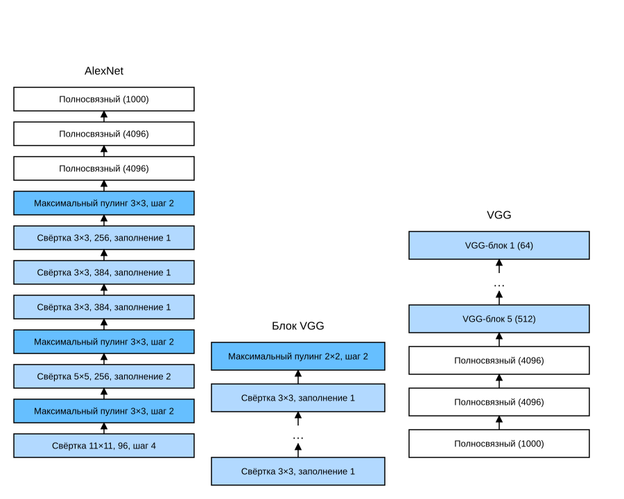

# 7.2 Сети с использованием блоков (VGG)

AlexNet показала, что глубокие нейронные сети работают, однако она не дала общего шаблона, по которому последующие исследователи могли бы проектировать новые сети. В следующих разделах мы рассмотрим несколько эвристических идей, которые часто используются при проектировании глубоких сетей.

Подобно тому как инженеры при проектировании микросхем переходят от размещения транзисторов к логическим элементам и затем к логическим блокам, архитектура нейронных сетей становится всё более абстрактной. Исследователи сначала рассматривали задачу с точки зрения отдельных нейронов, затем перешли к целым слоям, а теперь — к блокам, которые повторяют узоры из слоёв.

Идея использования блоков впервые появилась в *сетях VGG* из [Visual Geometry Group](http://www.robots.ox.ac.uk/~vgg/) Оксфордского университета. Используя циклы и подпрограммы, такие повторяющиеся архитектуры легко реализовать в коде любого современного фреймворка глубокого обучения.

## 7.2.1 VGG-блок

Базовые элементы классической свёрточной сети образуют такую последовательность:

1. свёрточный слой с заполнением, которое сохраняет разрешение;
1. нелинейная функция активации, например ReLU;
1. слой пулинга, например слой максимального пулинга.

VGG-блок устроен похоже: он состоит из последовательности свёрточных слоёв, за которой следует слой максимального пулинга для пространственного уменьшения размерности. В исходной статье о VGG (Simonyan, Zisserman, 2014) использовались свёрточные ядра $3\times3$ с заполнением 1 (сохраняющим высоту и ширину), а также слои максимального пулинга с окном $2 \times 2$ и шагом 2 (после каждого блока разрешение уменьшается вдвое). В приведённом ниже коде мы определяем функцию `vgg_block`, которая реализует VGG-блок.

**MXNet, TensorFlow:** функция принимает два параметра: число свёрточных слоёв `num_convs` и число выходных каналов `num_channels`.

**PyTorch:** функция принимает три параметра: число свёрточных слоёв `num_convs`, число входных каналов `in_channels` и число выходных каналов `out_channels`.

**MXNet:**
```python
from d2l import mxnet as d2l
from mxnet import np, npx
from mxnet.gluon import nn
npx.set_np()

def vgg_block(num_convs, num_channels):
    blk = nn.Sequential()
    for _ in range(num_convs):
        blk.add(nn.Conv2D(num_channels, kernel_size=3,
                          padding=1, activation='relu'))
    blk.add(nn.MaxPool2D(pool_size=2, strides=2))
    return blk
```

**PyTorch:**
```python
from d2l import torch as d2l
import torch
from torch import nn

def vgg_block(num_convs, in_channels, out_channels):
    layers = []
    for _ in range(num_convs):
        layers.append(nn.Conv2d(in_channels, out_channels,
                                kernel_size=3, padding=1))
        layers.append(nn.ReLU())
        in_channels = out_channels
    layers.append(nn.MaxPool2d(kernel_size=2,stride=2))
    return nn.Sequential(*layers)
```

**TensorFlow:**
```python
from d2l import tensorflow as d2l
import tensorflow as tf

def vgg_block(num_convs, num_channels):
    blk = tf.keras.models.Sequential()
    for _ in range(num_convs):
        blk.add(tf.keras.layers.Conv2D(num_channels,kernel_size=3,
                                    padding='same',activation='relu'))
    blk.add(tf.keras.layers.MaxPool2D(pool_size=2, strides=2))
    return blk
```

**PaddlePaddle:**
```python
from d2l import paddle as d2l
import warnings
warnings.filterwarnings("ignore")
import paddle
import paddle.nn as nn

def vgg_block(num_convs, in_channels, out_channels):
    layers = []
    for _ in range(num_convs):
        layers.append(
            nn.Conv2D(in_channels, out_channels, kernel_size=3, padding=1))
        layers.append(nn.ReLU())
        in_channels = out_channels
    layers.append(nn.MaxPool2D(kernel_size=2, stride=2))
    return nn.Sequential(*layers)
```

## 7.2.2 Сеть VGG

Как и AlexNet и LeNet, сеть VGG делится на две части: первая состоит в основном из свёрточных слоёв и слоёв пулинга, вторая — из полносвязных слоёв. См. рис. 7.2.1.



Сеть VGG соединяет несколько VGG-блоков (определённых в функции `vgg_block`), как показано на рис. 7.2.1. Её гиперпараметр `conv_arch` задаёт число свёрточных слоёв и число выходных каналов в каждом VGG-блоке. Полносвязная часть такая же, как у AlexNet.

Исходная сеть VGG имеет пять свёрточных блоков: в первых двух по одному свёрточному слою, в последних трёх — по два. Первый блок имеет 64 выходных канала, и каждый следующий блок удваивает их число, пока оно не достигнет 512. Поскольку сеть использует 8 свёрточных слоёв и 3 полносвязных слоя, её обычно называют VGG-11.

```python
conv_arch = ((1, 64), (1, 128), (2, 256), (2, 512), (2, 512))
```

Ниже реализована VGG-11. Это несложно сделать циклом по `conv_arch`.

**MXNet:**
```python
def vgg(conv_arch):
    net = nn.Sequential()
    # Свёрточная часть
    for (num_convs, num_channels) in conv_arch:
        net.add(vgg_block(num_convs, num_channels))
    # Полносвязная часть
    net.add(nn.Dense(4096, activation='relu'), nn.Dropout(0.5),
            nn.Dense(4096, activation='relu'), nn.Dropout(0.5),
            nn.Dense(10))
    return net

net = vgg(conv_arch)
```

**PyTorch:**
```python
def vgg(conv_arch):
    conv_blks = []
    in_channels = 1
    # Свёрточная часть
    for (num_convs, out_channels) in conv_arch:
        conv_blks.append(vgg_block(num_convs, in_channels, out_channels))
        in_channels = out_channels

    return nn.Sequential(
        *conv_blks, nn.Flatten(),
        # Полносвязная часть
        nn.Linear(out_channels * 7 * 7, 4096), nn.ReLU(), nn.Dropout(0.5),
        nn.Linear(4096, 4096), nn.ReLU(), nn.Dropout(0.5),
        nn.Linear(4096, 10))

net = vgg(conv_arch)
```

**TensorFlow:**
```python
def vgg(conv_arch):
    net = tf.keras.models.Sequential()
    # Свёрточная часть
    for (num_convs, num_channels) in conv_arch:
        net.add(vgg_block(num_convs, num_channels))
    # Полносвязная часть
    net.add(tf.keras.models.Sequential([
        tf.keras.layers.Flatten(),
        tf.keras.layers.Dense(4096, activation='relu'),
        tf.keras.layers.Dropout(0.5),
        tf.keras.layers.Dense(4096, activation='relu'),
        tf.keras.layers.Dropout(0.5),
        tf.keras.layers.Dense(10)]))
    return net

net = vgg(conv_arch)
```

**PaddlePaddle:**
```python
def vgg(conv_arch):
    conv_blks = []
    in_channels = 1
    # Свёрточная часть
    for (num_convs, out_channels) in conv_arch:
        conv_blks.append(vgg_block(num_convs, in_channels, out_channels))
        in_channels = out_channels

    return nn.Sequential(*conv_blks, nn.Flatten(),
                         # Полносвязная часть
                         nn.Linear(out_channels * 7 * 7, 4096), nn.ReLU(),
                         nn.Dropout(0.5), nn.Linear(4096, 4096), nn.ReLU(),
                         nn.Dropout(0.5), nn.Linear(4096, 10))

net = vgg(conv_arch)
```

Далее построим выборку из одноканальных данных высотой и шириной 224 и **посмотрим, какую форму имеет выход каждого слоя**.

**MXNet:**
```python
net.initialize()
X = np.random.uniform(size=(1, 1, 224, 224))
for blk in net:
    X = blk(X)
    print(blk.name, 'форма выхода:\t', X.shape)
```

**PyTorch:**
```python
X = torch.randn(size=(1, 1, 224, 224))
for blk in net:
    X = blk(X)
    print(blk.__class__.__name__,'форма выхода:\t',X.shape)
```

**TensorFlow:**
```python
X = tf.random.uniform((1, 224, 224, 1))
for blk in net.layers:
    X = blk(X)
    print(blk.__class__.__name__,'форма выхода:\t', X.shape)
```

**PaddlePaddle:**
```python
X = paddle.randn(shape=(1, 1, 224, 224))
for blk in net:
    X = blk(X)
    print(blk.__class__.__name__,'форма выхода:\t',X.shape)
```

Как видно из кода, высота и ширина уменьшаются вдвое в каждом блоке и в итоге становятся равными 7. Затем представление выравнивается и подаётся в полносвязные слои.

## 7.2.3 Обучение модели

**Поскольку VGG-11 требует больше вычислений, чем AlexNet, мы построим сеть с меньшим числом каналов**, которой будет достаточно для обучения на наборе Fashion-MNIST.

**MXNet, PyTorch, PaddlePaddle:**
```python
ratio = 4
small_conv_arch = [(pair[0], pair[1] // ratio) for pair in conv_arch]
net = vgg(small_conv_arch)
```

**TensorFlow:**
```python
ratio = 4
small_conv_arch = [(pair[0], pair[1] // ratio) for pair in conv_arch]
# Напомним: это должна быть функция, которую передают в «d2l.train_ch6()». Чтобы использовать имеющиеся CPU/GPU, построение и компиляцию модели нужно выполнять внутри strategy.scope()
net = lambda: vgg(small_conv_arch)
```

За исключением немного более высокой скорости обучения, **обучение модели** проходит так же, как обучение AlexNet (см. раздел 7.1).

```python
lr, num_epochs, batch_size = 0.05, 10, 128
train_iter, test_iter = d2l.load_data_fashion_mnist(batch_size, resize=224)
d2l.train_ch6(net, train_iter, test_iter, num_epochs, lr, d2l.try_gpu())
```

## Резюме

* VGG-11 строит сеть из повторно используемых свёрточных блоков. Различные модели VGG отличаются друг от друга числом свёрточных слоёв и числом выходных каналов в каждом блоке.
* Использование блоков делает описание сети очень компактным. Блоки позволяют эффективно проектировать сложные сети.
* В статье о VGG Симонян и Зиссерман экспериментировали с различными архитектурами. В частности, они обнаружили, что глубокие и узкие свёртки (то есть $3 \times 3$) эффективнее мелких и широких.

## Упражнения

1. При печати размеров слоёв мы видим только 8 результатов, а не 11. Куда делись оставшиеся 3 слоя?
1. По сравнению с AlexNet вычисления VGG выполняются гораздо медленнее, и ей требуется больше памяти GPU. Проанализируйте причины этого.
1. Попробуйте изменить высоту и ширину изображений Fashion-MNIST с 224 на 96. Как это повлияет на эксперименты?
1. Пользуясь таблицей 1 из статьи о VGG (Simonyan, Zisserman, 2014), постройте другие распространённые модели, например VGG-16 или VGG-19.

**MXNet:**
[Обсуждение](https://discuss.d2l.ai/t/1867)

**PyTorch:**
[Обсуждение](https://discuss.d2l.ai/t/1866)

**TensorFlow:**
[Обсуждение](https://discuss.d2l.ai/t/1865)

**PaddlePaddle:**
[Обсуждение](https://discuss.d2l.ai/t/11789)

## Литература

* Simonyan, K., & Zisserman, A. (2014). Very deep convolutional networks for large-scale image recognition. *arXiv preprint arXiv:1409.1556*.
