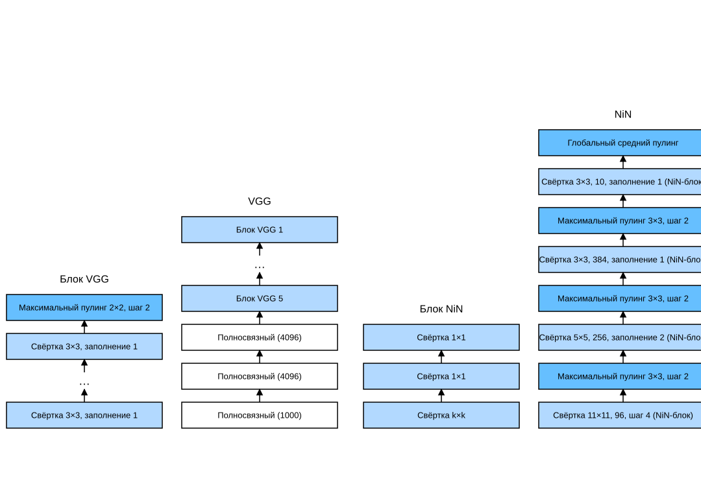

# 7.3 Сеть в сети (NiN)

LeNet, AlexNet и VGG имеют общий шаблон проектирования: сначала серия свёрточных и пулинговых слоёв извлекает пространственно-структурные признаки, затем полносвязные слои обрабатывают представление признаков.
AlexNet и VGG улучшили LeNet главным образом тем, что расширили и углубили эти два модуля.
Можно также представить себе использование полносвязных слоёв на раннем этапе этого процесса. Однако если использовать полносвязные слои, можно полностью утратить пространственную структуру представления.
*Сеть в сети* (*NiN*) предлагает очень простое решение: применять многослойный перцептрон к каналам в каждом пикселе отдельно (Lin et al., 2013).

## 7.3.1 NiN-блок

Напомним, что входом и выходом свёрточного слоя служат четырёхмерные тензоры, оси которых соответствуют примерам, каналам, высоте и ширине. Кроме того, входом и выходом полносвязного слоя обычно служат двумерные тензоры, соответствующие примерам и признакам.
Идея NiN состоит в том, чтобы в каждой позиции пикселя (для каждой высоты и ширины) применять полносвязный слой.
Если связать веса со всеми пространственными позициями, это можно рассматривать как свёрточный слой $1\times 1$ (см. раздел 6.4) или как полносвязный слой, который независимо действует в каждой позиции пикселя.
С другой точки зрения, каждый пиксель в пространственных измерениях можно считать отдельным примером, а измерение каналов — различными признаками.

На рис. 7.3.1 показаны основные архитектурные различия между VGG и NiN и их блоками.
NiN-блок начинается с обычного свёрточного слоя, за которым следуют два свёрточных слоя $1 \times 1$. Эти два слоя $1 \times 1$ играют роль поэлементных полносвязных слоёв с функцией активации ReLU.
Форма окна свёртки первого слоя обычно задаётся пользователем.
Окна последующих слоёв фиксированы и имеют размер $1 \times 1$.



**Рис. 7.3.1.** Сравнение архитектур VGG и NiN и их блоков

**MXNet:**
```python
from d2l import mxnet as d2l
from mxnet import np, npx
from mxnet.gluon import nn
npx.set_np()

def nin_block(num_channels, kernel_size, strides, padding):
    blk = nn.Sequential()
    blk.add(nn.Conv2D(num_channels, kernel_size, strides, padding,
                      activation='relu'),
            nn.Conv2D(num_channels, kernel_size=1, activation='relu'),
            nn.Conv2D(num_channels, kernel_size=1, activation='relu'))
    return blk
```

**PyTorch:**
```python
from d2l import torch as d2l
import torch
from torch import nn

def nin_block(in_channels, out_channels, kernel_size, strides, padding):
    return nn.Sequential(
        nn.Conv2d(in_channels, out_channels, kernel_size, strides, padding),
        nn.ReLU(),
        nn.Conv2d(out_channels, out_channels, kernel_size=1), nn.ReLU(),
        nn.Conv2d(out_channels, out_channels, kernel_size=1), nn.ReLU())
```

**TensorFlow:**
```python
from d2l import tensorflow as d2l
import tensorflow as tf

def nin_block(num_channels, kernel_size, strides, padding):
    return tf.keras.models.Sequential([
        tf.keras.layers.Conv2D(num_channels, kernel_size, strides=strides,
                               padding=padding, activation='relu'),
        tf.keras.layers.Conv2D(num_channels, kernel_size=1,
                               activation='relu'),
        tf.keras.layers.Conv2D(num_channels, kernel_size=1,
                               activation='relu')])
```

**PaddlePaddle:**
```python
from d2l import paddle as d2l
import warnings
warnings.filterwarnings("ignore")
import paddle
import paddle.nn as nn

def nin_block(in_channels, out_channels, kernel_size, strides, padding):
    return nn.Sequential(
        nn.Conv2D(in_channels, out_channels, kernel_size, strides, padding),
        nn.ReLU(), 
        nn.Conv2D(out_channels, out_channels, kernel_size=1),
        nn.ReLU(), 
        nn.Conv2D(out_channels, out_channels, kernel_size=1),
        nn.ReLU())
```

## 7.3.2 Модель NiN

Первоначальная сеть NiN появилась вскоре после AlexNet и явно была вдохновлена ею.
NiN использует свёрточные слои с окнами $11\times 11$, $5\times 5$ и $3\times 3$, а число выходных каналов такое же, как в AlexNet.
После каждого NiN-блока стоит слой максимального пулинга с окном $3\times 3$ и шагом 2.

Заметное отличие NiN от AlexNet в том, что NiN полностью отказывается от полносвязных слоёв.
Вместо них NiN использует NiN-блок, число выходных каналов которого равно числу классов. В конце ставится *глобальный средний пулинг* (global average pooling), который выдаёт логиты. Преимущество такой конструкции в том, что она заметно сокращает число параметров модели. Однако на практике такой подход иногда увеличивает время обучения.

**MXNet:**
```python
net = nn.Sequential()
net.add(nin_block(96, kernel_size=11, strides=4, padding=0),
        nn.MaxPool2D(pool_size=3, strides=2),
        nin_block(256, kernel_size=5, strides=1, padding=2),
        nn.MaxPool2D(pool_size=3, strides=2),
        nin_block(384, kernel_size=3, strides=1, padding=1),
        nn.MaxPool2D(pool_size=3, strides=2),
        nn.Dropout(0.5),
        # Число классов меток равно 10
        nin_block(10, kernel_size=3, strides=1, padding=1),
        # Глобальный средний пулинг автоматически задаёт форму окна равной высоте и ширине входа
        nn.GlobalAvgPool2D(),
        # Преобразуем четырёхмерный выход в двумерный; его форма равна (размер батча, 10)
        nn.Flatten())
```

**PyTorch:**
```python
net = nn.Sequential(
    nin_block(1, 96, kernel_size=11, strides=4, padding=0),
    nn.MaxPool2d(3, stride=2),
    nin_block(96, 256, kernel_size=5, strides=1, padding=2),
    nn.MaxPool2d(3, stride=2),
    nin_block(256, 384, kernel_size=3, strides=1, padding=1),
    nn.MaxPool2d(3, stride=2),
    nn.Dropout(0.5),
    # Число классов меток равно 10
    nin_block(384, 10, kernel_size=3, strides=1, padding=1),
    nn.AdaptiveAvgPool2d((1, 1)),
    # Преобразуем четырёхмерный выход в двумерный; его форма равна (размер батча, 10)
    nn.Flatten())
```

**TensorFlow:**
```python
def net():
    return tf.keras.models.Sequential([
        nin_block(96, kernel_size=11, strides=4, padding='valid'),
        tf.keras.layers.MaxPool2D(pool_size=3, strides=2),
        nin_block(256, kernel_size=5, strides=1, padding='same'),
        tf.keras.layers.MaxPool2D(pool_size=3, strides=2),
        nin_block(384, kernel_size=3, strides=1, padding='same'),
        tf.keras.layers.MaxPool2D(pool_size=3, strides=2),
        tf.keras.layers.Dropout(0.5),
        # Число классов меток равно 10
        nin_block(10, kernel_size=3, strides=1, padding='same'),
        tf.keras.layers.GlobalAveragePooling2D(),
        tf.keras.layers.Reshape((1, 1, 10)),
        # Преобразуем четырёхмерный выход в двумерный; его форма равна (размер батча, 10)
        tf.keras.layers.Flatten(),
        ])
```

**PaddlePaddle:**
```python
net = nn.Sequential(
    nin_block(1, 96, kernel_size=11, strides=4, padding=0),
    nn.MaxPool2D(3, stride=2),
    nin_block(96, 256, kernel_size=5, strides=1, padding=2),
    nn.MaxPool2D(3, stride=2),
    nin_block(256, 384, kernel_size=3, strides=1, padding=1),
    nn.MaxPool2D(3, stride=2), nn.Dropout(0.5),
    # Число классов меток равно 10
    nin_block(384, 10, kernel_size=3, strides=1, padding=1),
    nn.AdaptiveAvgPool2D((1, 1)),
    # Преобразуем четырёхмерный выход в двумерный; его форма равна (размер батча, 10)
    nn.Flatten())
```

Создадим пример данных, чтобы **посмотреть форму выхода каждого блока**.

**MXNet:**
```python
X = np.random.uniform(size=(1, 1, 224, 224))
net.initialize()
for layer in net:
    X = layer(X)
    print(layer.name, 'форма выхода:\t', X.shape)
```

**PyTorch:**
```python
X = torch.rand(size=(1, 1, 224, 224))
for layer in net:
    X = layer(X)
    print(layer.__class__.__name__,'форма выхода:\t', X.shape)
```

**TensorFlow:**
```python
X = tf.random.uniform((1, 224, 224, 1))
for layer in net().layers:
    X = layer(X)
    print(layer.__class__.__name__,'форма выхода:\t', X.shape)
```

**PaddlePaddle:**
```python
X = paddle.rand(shape=(1, 1, 224, 224))
for layer in net:
    X = layer(X)
    print(layer.__class__.__name__,'форма выхода:\t', X.shape)
```

## 7.3.3 Обучение модели

Как и прежде, мы обучаем модель на Fashion-MNIST. Обучение NiN похоже на обучение AlexNet и VGG.

```python
lr, num_epochs, batch_size = 0.1, 10, 128
train_iter, test_iter = d2l.load_data_fashion_mnist(batch_size, resize=224)
d2l.train_ch6(net, train_iter, test_iter, num_epochs, lr, d2l.try_gpu())
```

## Резюме

* NiN использует блок, состоящий из одного свёрточного слоя и нескольких свёрточных слоёв $1\times 1$. Такой блок можно использовать в свёрточной сети, чтобы добавить больше нелинейности для каждого пикселя.
* NiN удаляет полносвязные слои, склонные к переобучению, и заменяет их глобальным средним пулингом (то есть усреднением по всем позициям). Число каналов в этом слое равно требуемому числу выходов (например, для Fashion-MNIST — 10).
* Удаление полносвязных слоёв снижает переобучение и заметно сокращает число параметров NiN.
* Конструкция NiN повлияла на проектирование многих последующих свёрточных сетей.

## Упражнения

1. Подберите гиперпараметры NiN, чтобы повысить точность классификации.
1. Зачем в NiN-блоке два свёрточных слоя $1\times 1$? Удалите один из них, затем наблюдайте и проанализируйте результаты.
1. Подсчитайте ресурсы, которые использует NiN.
    1. Каково число параметров?
    1. Каков объём вычислений?
    1. Сколько памяти GPU нужно во время обучения?
    1. Сколько памяти GPU нужно во время предсказания?
1. Что будет, если сразу сжать представление размера $384 \times 5 \times 5$ до $10 \times 5 \times 5$? Какие проблемы при этом возникнут?

**MXNet:**
[Обсуждение](https://discuss.d2l.ai/t/1870)

**PyTorch:**
[Обсуждение](https://discuss.d2l.ai/t/1869)

**TensorFlow:**
[Обсуждение](https://discuss.d2l.ai/t/1868)

**PaddlePaddle:**
[Обсуждение](https://discuss.d2l.ai/t/11790)

## Литература

* Lin, M., Chen, Q., & Yan, S. (2013). Network in network. *arXiv preprint arXiv:1312.4400*.
