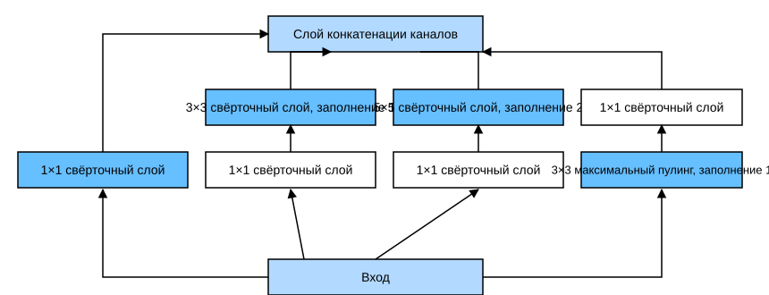
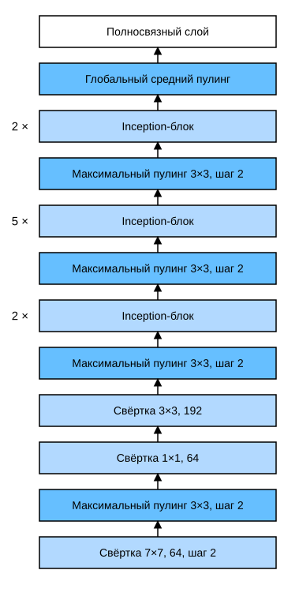

# 7.4 Сеть с параллельными конкатенациями (GoogLeNet)

На соревновании ImageNet по распознаванию изображений в 2014 году выделилась архитектура под названием *GoogLeNet* (Szegedy et al., 2015).
GoogLeNet заимствует идею последовательно соединённых сетей из NiN и развивает её.
Главный вопрос статьи — какой размер свёрточного ядра наиболее подходит.
В самом деле, популярные прежде сети использовали ядра от совсем маленьких $1 \times 1$ до больших $11 \times 11$.
Одна из мыслей статьи в том, что иногда полезно комбинировать свёрточные ядра разных размеров.
В этом разделе мы представим немного упрощённую версию GoogLeNet: опустим некоторые особенности, которые добавлялись для стабилизации обучения, но при современных методах обучения уже не нужны.

## 7.4.1 Inception-блок

В GoogLeNet базовый свёрточный блок называется *Inception-блоком* (Inception block). Название, вероятно, происходит от фильма «Начало» (Inception), в котором звучит фраза «We need to go deeper» («Нам нужно идти глубже»).



**Рис. 7.4.1.** Архитектура Inception-блока

Как показано на рис. 7.4.1, Inception-блок состоит из четырёх параллельных путей.
Первые три пути используют свёрточные слои с окнами $1\times 1$, $3\times 3$ и $5\times 5$ и извлекают информацию из разных пространственных масштабов.
Два средних пути сначала выполняют свёртку $1\times 1$ на входе, чтобы уменьшить число каналов и тем самым снизить сложность модели.
Четвёртый путь использует слой максимального пулинга $3\times 3$, за которым следует свёрточный слой $1\times 1$, меняющий число каналов.
Все четыре пути используют подходящее заполнение, чтобы высота и ширина входа и выхода совпадали. Наконец, выходы путей конкатенируются по измерению каналов, и результат становится выходом Inception-блока. В Inception-блоке обычно настраивают число выходных каналов каждого слоя.

**MXNet:**
```python
from d2l import mxnet as d2l
from mxnet import np, npx
from mxnet.gluon import nn
npx.set_np()

class Inception(nn.Block):
    # c1--c4 — число выходных каналов каждого пути
    def __init__(self, c1, c2, c3, c4, **kwargs):
        super(Inception, self).__init__(**kwargs)
        # Путь 1: один свёрточный слой 1x1
        self.p1_1 = nn.Conv2D(c1, kernel_size=1, activation='relu')
        # Путь 2: свёрточный слой 1x1, затем свёрточный слой 3x3
        self.p2_1 = nn.Conv2D(c2[0], kernel_size=1, activation='relu')
        self.p2_2 = nn.Conv2D(c2[1], kernel_size=3, padding=1,
                              activation='relu')
        # Путь 3: свёрточный слой 1x1, затем свёрточный слой 5x5
        self.p3_1 = nn.Conv2D(c3[0], kernel_size=1, activation='relu')
        self.p3_2 = nn.Conv2D(c3[1], kernel_size=5, padding=2,
                              activation='relu')
        # Путь 4: слой максимального пулинга 3x3, затем свёрточный слой 1x1
        self.p4_1 = nn.MaxPool2D(pool_size=3, strides=1, padding=1)
        self.p4_2 = nn.Conv2D(c4, kernel_size=1, activation='relu')

    def forward(self, x):
        p1 = self.p1_1(x)
        p2 = self.p2_2(self.p2_1(x))
        p3 = self.p3_2(self.p3_1(x))
        p4 = self.p4_2(self.p4_1(x))
        # Конкатенируем выходы по измерению каналов
        return np.concatenate((p1, p2, p3, p4), axis=1)
```

**PyTorch:**
```python
from d2l import torch as d2l
import torch
from torch import nn
from torch.nn import functional as F

class Inception(nn.Module):
    # c1--c4 — число выходных каналов каждого пути
    def __init__(self, in_channels, c1, c2, c3, c4, **kwargs):
        super(Inception, self).__init__(**kwargs)
        # Путь 1: один свёрточный слой 1x1
        self.p1_1 = nn.Conv2d(in_channels, c1, kernel_size=1)
        # Путь 2: свёрточный слой 1x1, затем свёрточный слой 3x3
        self.p2_1 = nn.Conv2d(in_channels, c2[0], kernel_size=1)
        self.p2_2 = nn.Conv2d(c2[0], c2[1], kernel_size=3, padding=1)
        # Путь 3: свёрточный слой 1x1, затем свёрточный слой 5x5
        self.p3_1 = nn.Conv2d(in_channels, c3[0], kernel_size=1)
        self.p3_2 = nn.Conv2d(c3[0], c3[1], kernel_size=5, padding=2)
        # Путь 4: слой максимального пулинга 3x3, затем свёрточный слой 1x1
        self.p4_1 = nn.MaxPool2d(kernel_size=3, stride=1, padding=1)
        self.p4_2 = nn.Conv2d(in_channels, c4, kernel_size=1)

    def forward(self, x):
        p1 = F.relu(self.p1_1(x))
        p2 = F.relu(self.p2_2(F.relu(self.p2_1(x))))
        p3 = F.relu(self.p3_2(F.relu(self.p3_1(x))))
        p4 = F.relu(self.p4_2(self.p4_1(x)))
        # Конкатенируем выходы по измерению каналов
        return torch.cat((p1, p2, p3, p4), dim=1)
```

**TensorFlow:**
```python
from d2l import tensorflow as d2l
import tensorflow as tf

class Inception(tf.keras.Model):
    # c1--c4 — число выходных каналов каждого пути
    def __init__(self, c1, c2, c3, c4):
        super().__init__()
        # Путь 1: один свёрточный слой 1x1
        self.p1_1 = tf.keras.layers.Conv2D(c1, 1, activation='relu')
        # Путь 2: свёрточный слой 1x1, затем свёрточный слой 3x3
        self.p2_1 = tf.keras.layers.Conv2D(c2[0], 1, activation='relu')
        self.p2_2 = tf.keras.layers.Conv2D(c2[1], 3, padding='same',
                                           activation='relu')
        # Путь 3: свёрточный слой 1x1, затем свёрточный слой 5x5
        self.p3_1 = tf.keras.layers.Conv2D(c3[0], 1, activation='relu')
        self.p3_2 = tf.keras.layers.Conv2D(c3[1], 5, padding='same',
                                           activation='relu')
        # Путь 4: слой максимального пулинга 3x3, затем свёрточный слой 1x1
        self.p4_1 = tf.keras.layers.MaxPool2D(3, 1, padding='same')
        self.p4_2 = tf.keras.layers.Conv2D(c4, 1, activation='relu')


    def call(self, x):
        p1 = self.p1_1(x)
        p2 = self.p2_2(self.p2_1(x))
        p3 = self.p3_2(self.p3_1(x))
        p4 = self.p4_2(self.p4_1(x))
        # Конкатенируем выходы по измерению каналов
        return tf.keras.layers.Concatenate()([p1, p2, p3, p4])
```

**PaddlePaddle:**
```python
from d2l import paddle as d2l
import warnings
warnings.filterwarnings("ignore")
import paddle
import paddle.nn as nn
import paddle.nn.functional as F

class Inception(nn.Layer):
    # c1--c4 — число выходных каналов каждого пути
    def __init__(self, in_channels, c1, c2, c3, c4, **kwargs):
        super(Inception, self).__init__(**kwargs)
        # Путь 1: один свёрточный слой 1x1
        self.p1_1 = nn.Conv2D(in_channels, c1, kernel_size=1)
        # Путь 2: свёрточный слой 1x1, затем свёрточный слой 3x3
        self.p2_1 = nn.Conv2D(in_channels, c2[0], kernel_size=1)
        self.p2_2 = nn.Conv2D(c2[0], c2[1], kernel_size=3, padding=1)
        # Путь 3: свёрточный слой 1x1, затем свёрточный слой 5x5
        self.p3_1 = nn.Conv2D(in_channels, c3[0], kernel_size=1)
        self.p3_2 = nn.Conv2D(c3[0], c3[1], kernel_size=5, padding=2)
        # Путь 4: слой максимального пулинга 3x3, затем свёрточный слой 1x1
        self.p4_1 = nn.MaxPool2D(kernel_size=3, stride=1, padding=1)
        self.p4_2 = nn.Conv2D(in_channels, c4, kernel_size=1)

    def forward(self, x):
        p1 = F.relu(self.p1_1(x))
        p2 = F.relu(self.p2_2(F.relu(self.p2_1(x))))
        p3 = F.relu(self.p3_2(F.relu(self.p3_1(x))))
        p4 = F.relu(self.p4_2(self.p4_1(x)))
        # Конкатенируем выходы по измерению каналов
        return paddle.concat(x=[p1, p2, p3, p4], axis=1)
```

Почему же GoogLeNet так эффективна? Прежде всего заметим, что комбинация фильтров разных размеров позволяет исследовать изображение на разных масштабах: фильтры разного размера эффективно распознают детали изображения разного масштаба.
Кроме того, разным фильтрам можно задавать разное число параметров.

## 7.4.2 Модель GoogLeNet

Как показано на рис. 7.4.2, GoogLeNet в общей сложности использует девять Inception-блоков и слои глобального среднего пулинга, чтобы получить свою оценку. Слои максимального пулинга между Inception-блоками понижают размерность. Первый модуль похож на AlexNet и LeNet, сочетание Inception-блоков унаследовано от VGG, а глобальный средний пулинг позволяет не использовать полносвязные слои в конце.



**Рис. 7.4.2.** Архитектура GoogLeNet

Теперь реализуем каждый модуль GoogLeNet по порядку. Первый модуль использует 64 канала и свёрточный слой $7\times 7$.

**MXNet:**
```python
b1 = nn.Sequential()
b1.add(nn.Conv2D(64, kernel_size=7, strides=2, padding=3, activation='relu'),
       nn.MaxPool2D(pool_size=3, strides=2, padding=1))
```

**PyTorch:**
```python
b1 = nn.Sequential(nn.Conv2d(1, 64, kernel_size=7, stride=2, padding=3),
                   nn.ReLU(),
                   nn.MaxPool2d(kernel_size=3, stride=2, padding=1))
```

**TensorFlow:**
```python
def b1():
    return tf.keras.models.Sequential([
        tf.keras.layers.Conv2D(64, 7, strides=2, padding='same',
                               activation='relu'),
        tf.keras.layers.MaxPool2D(pool_size=3, strides=2, padding='same')])
```

**PaddlePaddle:**
```python
b1 = nn.Sequential(nn.Conv2D(1, 64, kernel_size=7, stride=2, padding=3),
                   nn.ReLU(), 
                   nn.MaxPool2D(kernel_size=3, stride=2,padding=1))
```

Второй модуль использует два свёрточных слоя: первый — свёрточный слой $1\times 1$ с 64 каналами; второй — свёрточный слой $3\times 3$, который увеличивает число каналов втрое. Это соответствует второму пути Inception-блока.

**MXNet:**
```python
b2 = nn.Sequential()
b2.add(nn.Conv2D(64, kernel_size=1, activation='relu'),
       nn.Conv2D(192, kernel_size=3, padding=1, activation='relu'),
       nn.MaxPool2D(pool_size=3, strides=2, padding=1))
```

**PyTorch:**
```python
b2 = nn.Sequential(nn.Conv2d(64, 64, kernel_size=1),
                   nn.ReLU(),
                   nn.Conv2d(64, 192, kernel_size=3, padding=1),
                   nn.ReLU(),
                   nn.MaxPool2d(kernel_size=3, stride=2, padding=1))
```

**TensorFlow:**
```python
def b2():
    return tf.keras.Sequential([
        tf.keras.layers.Conv2D(64, 1, activation='relu'),
        tf.keras.layers.Conv2D(192, 3, padding='same', activation='relu'),
        tf.keras.layers.MaxPool2D(pool_size=3, strides=2, padding='same')])
```

**PaddlePaddle:**
```python
b2 = nn.Sequential(nn.Conv2D(64, 64, kernel_size=1), 
                   nn.ReLU(),
                   nn.Conv2D(64, 192, kernel_size=3, padding=1),
                   nn.ReLU(),
                   nn.MaxPool2D(kernel_size=3, stride=2, padding=1))
```

Третий модуль последовательно соединяет два полноценных Inception-блока.
Выходное число каналов первого Inception-блока равно $64+128+32+32=256$, а соотношение выходных каналов между путями составляет $64:128:32:32=2:4:1:1$.
Второй и третий пути сначала уменьшают число входных каналов до $96/192=1/2$ и $16/192=1/12$ соответственно, а затем применяют свёрточный слой. Выходное число каналов второго Inception-блока увеличивается до $128+192+96+64=480$, а соотношение выходных каналов между путями составляет $128:192:96:64 = 4:6:3:2$.
Второй и третий пути сначала уменьшают число входных каналов до $128/256=1/2$ и $32/256=1/8$ соответственно.

**MXNet:**
```python
b3 = nn.Sequential()
b3.add(Inception(64, (96, 128), (16, 32), 32),
       Inception(128, (128, 192), (32, 96), 64),
       nn.MaxPool2D(pool_size=3, strides=2, padding=1))
```

**PyTorch:**
```python
b3 = nn.Sequential(Inception(192, 64, (96, 128), (16, 32), 32),
                   Inception(256, 128, (128, 192), (32, 96), 64),
                   nn.MaxPool2d(kernel_size=3, stride=2, padding=1))
```

**TensorFlow:**
```python
def b3():
    return tf.keras.models.Sequential([
        Inception(64, (96, 128), (16, 32), 32),
        Inception(128, (128, 192), (32, 96), 64),
        tf.keras.layers.MaxPool2D(pool_size=3, strides=2, padding='same')])
```

**PaddlePaddle:**
```python
b3 = nn.Sequential(Inception(192, 64, (96, 128), (16, 32), 32),
                   Inception(256, 128, (128, 192), (32, 96), 64),
                   nn.MaxPool2D(kernel_size=3, stride=2, padding=1))
```

Четвёртый модуль сложнее: он последовательно соединяет пять Inception-блоков, выходное число каналов которых равно $192+208+48+64=512$, $160+224+64+64=512$, $128+256+64+64=512$, $112+288+64+64=528$ и $256+320+128+128=832$.
Распределение каналов по путям здесь похоже на третий модуль: больше всего каналов даёт второй путь со свёрткой $3\times 3$, затем первый путь с одной свёрткой $1\times 1$, далее третий путь со свёрткой $5\times 5$ и четвёртый путь с максимальным пулингом $3\times 3$.
Второй и третий пути сначала пропорционально уменьшают число каналов. Эти пропорции немного различаются в разных Inception-блоках.

**MXNet:**
```python
b4 = nn.Sequential()
b4.add(Inception(192, (96, 208), (16, 48), 64),
       Inception(160, (112, 224), (24, 64), 64),
       Inception(128, (128, 256), (24, 64), 64),
       Inception(112, (144, 288), (32, 64), 64),
       Inception(256, (160, 320), (32, 128), 128),
       nn.MaxPool2D(pool_size=3, strides=2, padding=1))
```

**PyTorch:**
```python
b4 = nn.Sequential(Inception(480, 192, (96, 208), (16, 48), 64),
                   Inception(512, 160, (112, 224), (24, 64), 64),
                   Inception(512, 128, (128, 256), (24, 64), 64),
                   Inception(512, 112, (144, 288), (32, 64), 64),
                   Inception(528, 256, (160, 320), (32, 128), 128),
                   nn.MaxPool2d(kernel_size=3, stride=2, padding=1))
```

**TensorFlow:**
```python
def b4():
    return tf.keras.Sequential([
        Inception(192, (96, 208), (16, 48), 64),
        Inception(160, (112, 224), (24, 64), 64),
        Inception(128, (128, 256), (24, 64), 64),
        Inception(112, (144, 288), (32, 64), 64),
        Inception(256, (160, 320), (32, 128), 128),
        tf.keras.layers.MaxPool2D(pool_size=3, strides=2, padding='same')])
```

**PaddlePaddle:**
```python
b4 = nn.Sequential(Inception(480, 192, (96, 208), (16, 48), 64),
                   Inception(512, 160, (112, 224), (24, 64), 64),
                   Inception(512, 128, (128, 256), (24, 64), 64),
                   Inception(512, 112, (144, 288), (32, 64), 64),
                   Inception(528, 256, (160, 320), (32, 128), 128),
                   nn.MaxPool2D(kernel_size=3, stride=2, padding=1))
```

Пятый модуль содержит два Inception-блока с выходным числом каналов $256+320+128+128=832$ и $384+384+128+128=1024$.
Распределение каналов по путям здесь то же, что в третьем и четвёртом модулях, только числа другие.
Важно, что за пятым модулем сразу следует выходной слой: как и в NiN, здесь используется глобальный средний пулинг, который приводит высоту и ширину каждого канала к 1.
Наконец, выход превращается в двумерный массив, и к нему добавляется полносвязный слой с числом выходов, равным числу классов меток.

**MXNet:**
```python
b5 = nn.Sequential()
b5.add(Inception(256, (160, 320), (32, 128), 128),
       Inception(384, (192, 384), (48, 128), 128),
       nn.GlobalAvgPool2D())

net = nn.Sequential()
net.add(b1, b2, b3, b4, b5, nn.Dense(10))
```

**PyTorch:**
```python
b5 = nn.Sequential(Inception(832, 256, (160, 320), (32, 128), 128),
                   Inception(832, 384, (192, 384), (48, 128), 128),
                   nn.AdaptiveAvgPool2d((1,1)),
                   nn.Flatten())

net = nn.Sequential(b1, b2, b3, b4, b5, nn.Linear(1024, 10))
```

**TensorFlow:**
```python
def b5():
    return tf.keras.Sequential([
        Inception(256, (160, 320), (32, 128), 128),
        Inception(384, (192, 384), (48, 128), 128),
        tf.keras.layers.GlobalAvgPool2D(),
        tf.keras.layers.Flatten()
    ])

# «net» должна быть функцией, которую передают в «d2l.train_ch6()».
# Чтобы использовать имеющиеся CPU/GPU, построение и компиляцию модели нужно выполнять внутри «strategy.scope()»
def net():
    return tf.keras.Sequential([b1(), b2(), b3(), b4(), b5(),
                                tf.keras.layers.Dense(10)])
```

**PaddlePaddle:**
```python
b5 = nn.Sequential(Inception(832, 256, (160, 320), (32, 128), 128),
                   Inception(832, 384, (192, 384), (48, 128), 128),
                   nn.AdaptiveAvgPool2D((1, 1)), 
                   nn.Flatten())

net = nn.Sequential(b1, b2, b3, b4, b5, nn.Linear(1024, 10))
```

Модель GoogLeNet вычислительно сложна, и её трудно модифицировать (например, менять число каналов, как это делается в VGG). **Чтобы обучение на Fashion-MNIST было коротким, мы уменьшим высоту и ширину входа с 224 до 96**, что упростит вычисления. Ниже показано, как меняется форма выхода каждого модуля.

**MXNet:**
```python
X = np.random.uniform(size=(1, 1, 96, 96))
net.initialize()
for layer in net:
    X = layer(X)
    print(layer.name, 'форма выхода:\t', X.shape)
```

**PyTorch:**
```python
X = torch.rand(size=(1, 1, 96, 96))
for layer in net:
    X = layer(X)
    print(layer.__class__.__name__,'форма выхода:\t', X.shape)
```

**TensorFlow:**
```python
X = tf.random.uniform(shape=(1, 96, 96, 1))
for layer in net().layers:
    X = layer(X)
    print(layer.__class__.__name__, 'форма выхода:\t', X.shape)
```

**PaddlePaddle:**
```python
X = paddle.rand(shape=(1, 1, 96, 96))
for layer in net:
    X = layer(X)
    print(layer.__class__.__name__,'форма выхода:\t', X.shape)
```

## 7.4.3 Обучение модели

Как и прежде, обучим модель на наборе Fashion-MNIST. Перед обучением приведём изображения к разрешению $96 \times 96$.

```python
lr, num_epochs, batch_size = 0.1, 10, 128
train_iter, test_iter = d2l.load_data_fashion_mnist(batch_size, resize=96)
d2l.train_ch6(net, train_iter, test_iter, num_epochs, lr, d2l.try_gpu())
```

## Резюме

* Inception-блок — это подсеть с четырьмя путями. Он параллельно извлекает информацию с помощью свёрточных слоёв разной формы окна и слоёв максимального пулинга, а свёрточные слои $1\times 1$ уменьшают число каналов в каждом пикселе, что снижает сложность модели.
* GoogLeNet соединяет несколько тщательно спроектированных Inception-блоков с другими слоями (свёрточными и полносвязными). Соотношение числа каналов в Inception-блоках получено в результате большого числа экспериментов на наборе данных ImageNet.
* GoogLeNet и её преемники одно время были одними из самых эффективных моделей на ImageNet: при меньшей вычислительной сложности они дают сопоставимую точность.

## Упражнения

1. У GoogLeNet есть несколько последующих версий. Попробуйте реализовать и запустить их, затем проанализируйте результаты. Эти версии включают:
    * добавление слоёв пакетной нормализации (batch normalization) (Ioffe and Szegedy, 2015), о которой пойдёт речь в разделе 7.5;
    * корректировку модуля Inception (Szegedy et al., 2016);
    * регуляризацию модели с помощью сглаживания меток (label smoothing) (Szegedy et al., 2016);
    * добавление остаточных связей (Szegedy et al., 2017) (см. раздел 7.6).
1. Каков минимальный размер изображения, с которым можно использовать GoogLeNet?
1. Сравните размер параметров моделей AlexNet, VGG и NiN с GoogLeNet. Как две последние архитектуры существенно уменьшили размер параметров модели?

**MXNet:**
[Обсуждение](https://discuss.d2l.ai/t/1873)

**PyTorch:**
[Обсуждение](https://discuss.d2l.ai/t/1871)

**TensorFlow:**
[Обсуждение](https://discuss.d2l.ai/t/1872)

**PaddlePaddle:**
[Обсуждение](https://discuss.d2l.ai/t/11791)

## Литература

* Ioffe, S., & Szegedy, C. (2015). Batch normalization: Accelerating deep network training by reducing internal covariate shift. *arXiv preprint arXiv:1502.03167*.
* Szegedy, C., Ioffe, S., Vanhoucke, V., & Alemi, A. A. (2017). Inception-v4, Inception-ResNet and the impact of residual connections on learning. *Thirty-First AAAI Conference on Artificial Intelligence*.
* Szegedy, C., Liu, W., Jia, Y., Sermanet, P., Reed, S., Anguelov, D., Erhan, D., Vanhoucke, V., & Rabinovich, A. (2015). Going deeper with convolutions. *Proceedings of the IEEE Conference on Computer Vision and Pattern Recognition*, 1–9.
* Szegedy, C., Vanhoucke, V., Ioffe, S., Shlens, J., & Wojna, Z. (2016). Rethinking the Inception architecture for computer vision. *Proceedings of the IEEE Conference on Computer Vision and Pattern Recognition*, 2818–2826.
