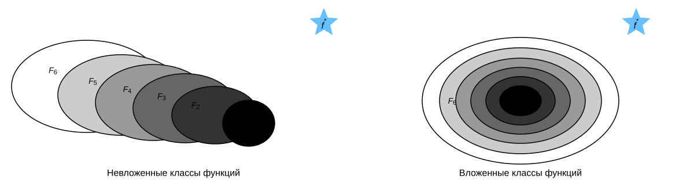
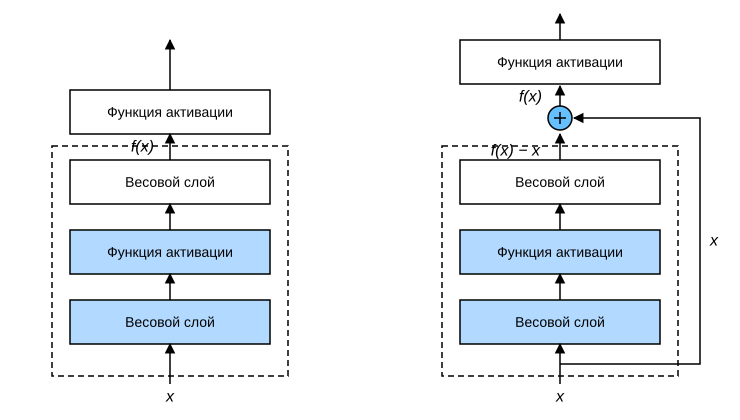
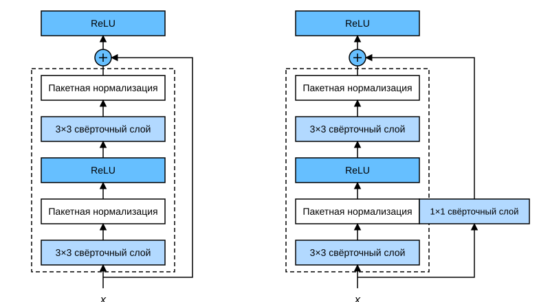
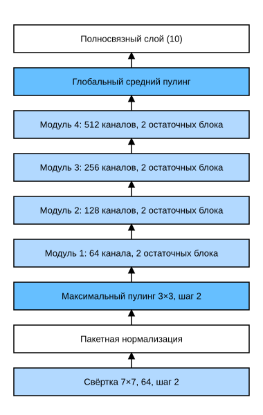

# 7.6 Остаточные сети (ResNet)

По мере того как мы проектируем всё более глубокие сети, становится крайне важным понимать, как добавленные слои улучшают производительность нейронной сети. Ещё важнее уметь проектировать такие сети, в которых добавление слоёв делает сеть более выразительной.
Чтобы добиться качественного прорыва, нам понадобятся некоторые математические основы.

## 7.6.1 Классы функций

Сначала предположим, что существует определённый класс архитектур нейронных сетей $\mathcal{F}$, включающий настройки скорости обучения и других гиперпараметров. Для всех $f \in \mathcal{F}$ существуют некоторые наборы параметров (например, весов и смещений), которые можно получить, обучая сеть на подходящем наборе данных.
Теперь предположим, что $f^*$ — функция, которую мы действительно хотим найти. Если $f^* \in \mathcal{F}$, мы легко получим её обучением, но обычно нам так не повезёт. Вместо этого мы попытаемся найти функцию $f^*_\mathcal{F}$, которая окажется лучшим выбором внутри $\mathcal{F}$.
Например, для набора данных с признаками $\mathbf{X}$ и метками $\mathbf{y}$ мы можем попытаться найти её, решив следующую задачу оптимизации:

$$f^*_\mathcal{F} := \mathop{\mathrm{argmin}}_f L(\mathbf{X}, \mathbf{y}, f) \text{ subject to } f \in \mathcal{F}.$$

Как же получить функцию, которая ближе к истинной $f^*$? Единственная разумная возможность — спроектировать более мощную архитектуру $\mathcal{F}'$. Иначе говоря, мы ожидаем, что $f^*_{\mathcal{F}'}$ будет «ближе» к $f^*$, чем $f^*_{\mathcal{F}}$.
Однако если $\mathcal{F} \not\subseteq \mathcal{F}'$, то нет гарантии, что новая архитектура окажется «ближе». Более того, $f^*_{\mathcal{F}'}$ может оказаться даже хуже.
Как показано на рис. 7.6.1, для классов функций, не вложенных друг в друга, более сложный класс функций не всегда приближается к «истинной» функции $f^*$ (сложность растёт от $\mathcal{F}_1$ к $\mathcal{F}_6$).
На левой части рис. 7.6.1 $\mathcal{F}_3$ ближе к $f^*$, чем $\mathcal{F}_1$, но $\mathcal{F}_6$ оказывается дальше.
Напротив, для вложенных классов функций $\mathcal{F}_1 \subseteq \ldots \subseteq \mathcal{F}_6$, показанных справа на рис. 7.6.1, этой проблемы можно избежать.



Поэтому мы можем гарантировать улучшение производительности, только если более сложный класс функций содержит меньший. Для глубоких нейронных сетей, если мы сможем обучить новый добавленный слой так, чтобы он стал *тождественным отображением* (identity function) $f(\mathbf{x}) = \mathbf{x}$, новая модель будет так же эффективна, как исходная. Кроме того, поскольку новая модель может найти лучшее решение для аппроксимации обучающего набора, добавление слоя, по-видимому, облегчает уменьшение ошибки обучения.

Для решения этой задачи Кайминг Хе (Kaiming He) и соавторы предложили *остаточные сети* (ResNet) (He et al., 2016). Эта сеть победила на соревновании ImageNet Large Scale Visual Recognition Challenge в 2015 году и глубоко повлияла на проектирование последующих глубоких нейронных сетей. Главная идея остаточных сетей состоит в том, что каждый добавленный слой должен легче включать исходную функцию как один из своих элементов. Так появились *остаточные блоки* (residual blocks), и это проектное решение оказало большое влияние на построение глубоких нейронных сетей.

## 7.6.2 Остаточный блок

Сосредоточимся на локальном фрагменте сети. Как показано на рис. 7.6.2, пусть исходный вход — $x$, а желаемое идеальное отображение — $f(\mathbf{x})$ (это вход функции активации над рис. 7.6.2).
Часть в пунктирной рамке слева на рис. 7.6.2 должна непосредственно аппроксимировать это отображение $f(\mathbf{x})$, а часть в пунктирной рамке справа — остаточное отображение $f(\mathbf{x}) - \mathbf{x}$.
Остаточное отображение на практике обычно проще оптимизировать.
Если в качестве желаемого отображения $f(\mathbf{x})$ взять упомянутое выше тождественное отображение, достаточно обнулить веса и параметры смещения взвешенных операций (например, аффинных) в верхней части пунктирной рамки справа на рис. 7.6.2, и тогда $f(\mathbf{x})$ станет тождественным отображением.
На практике, когда идеальное отображение $f(\mathbf{x})$ очень близко к тождественному, остаточное отображение способно уловить небольшие отклонения от него.
Правая часть рис. 7.6.2 — основная архитектура ResNet: *остаточный блок* (residual block). В остаточном блоке вход может быстрее распространяться вперёд по межслойным связям данных.



ResNet сохраняет полную конструкцию из свёрточных слоёв $3\times 3$ из VGG.
Остаточный блок содержит сначала два свёрточных слоя $3\times 3$ с одинаковым числом выходных каналов. За каждым свёрточным слоем следуют слой пакетной нормализации и функция активации ReLU. Затем по межслойному пути данных мы пропускаем эти две свёрточные операции и складываем вход с выходом непосредственно перед последней функцией активации ReLU.
Такая конструкция требует, чтобы выходы двух свёрточных слоёв имели ту же форму, что и вход, иначе их нельзя будет сложить.
Если нужно изменить число каналов, необходимо добавить дополнительный свёрточный слой $1\times 1$, который приведёт вход к нужной форме перед сложением.
Реализация остаточного блока приведена ниже:

**MXNet:**
```python
from d2l import mxnet as d2l
from mxnet import np, npx
from mxnet.gluon import nn
npx.set_np()

class Residual(nn.Block):  #@save
    def __init__(self, num_channels, use_1x1conv=False, strides=1, **kwargs):
        super().__init__(**kwargs)
        self.conv1 = nn.Conv2D(num_channels, kernel_size=3, padding=1,
                               strides=strides)
        self.conv2 = nn.Conv2D(num_channels, kernel_size=3, padding=1)
        if use_1x1conv:
            self.conv3 = nn.Conv2D(num_channels, kernel_size=1,
                                   strides=strides)
        else:
            self.conv3 = None
        self.bn1 = nn.BatchNorm()
        self.bn2 = nn.BatchNorm()

    def forward(self, X):
        Y = npx.relu(self.bn1(self.conv1(X)))
        Y = self.bn2(self.conv2(Y))
        if self.conv3:
            X = self.conv3(X)
        return npx.relu(Y + X)
```

**PyTorch:**
```python
from d2l import torch as d2l
import torch
from torch import nn
from torch.nn import functional as F

class Residual(nn.Module):  #@save
    def __init__(self, input_channels, num_channels,
                 use_1x1conv=False, strides=1):
        super().__init__()
        self.conv1 = nn.Conv2d(input_channels, num_channels,
                               kernel_size=3, padding=1, stride=strides)
        self.conv2 = nn.Conv2d(num_channels, num_channels,
                               kernel_size=3, padding=1)
        if use_1x1conv:
            self.conv3 = nn.Conv2d(input_channels, num_channels,
                                   kernel_size=1, stride=strides)
        else:
            self.conv3 = None
        self.bn1 = nn.BatchNorm2d(num_channels)
        self.bn2 = nn.BatchNorm2d(num_channels)

    def forward(self, X):
        Y = F.relu(self.bn1(self.conv1(X)))
        Y = self.bn2(self.conv2(Y))
        if self.conv3:
            X = self.conv3(X)
        Y += X
        return F.relu(Y)
```

**TensorFlow:**
```python
from d2l import tensorflow as d2l
import tensorflow as tf

class Residual(tf.keras.Model):  #@save
    def __init__(self, num_channels, use_1x1conv=False, strides=1):
        super().__init__()
        self.conv1 = tf.keras.layers.Conv2D(
            num_channels, padding='same', kernel_size=3, strides=strides)
        self.conv2 = tf.keras.layers.Conv2D(
            num_channels, kernel_size=3, padding='same')
        self.conv3 = None
        if use_1x1conv:
            self.conv3 = tf.keras.layers.Conv2D(
                num_channels, kernel_size=1, strides=strides)
        self.bn1 = tf.keras.layers.BatchNormalization()
        self.bn2 = tf.keras.layers.BatchNormalization()

    def call(self, X):
        Y = tf.keras.activations.relu(self.bn1(self.conv1(X)))
        Y = self.bn2(self.conv2(Y))
        if self.conv3 is not None:
            X = self.conv3(X)
        Y += X
        return tf.keras.activations.relu(Y)
```

**PaddlePaddle:**
```python
from d2l import paddle as d2l
import warnings
warnings.filterwarnings("ignore")
import paddle
import paddle.nn as nn
from paddle.nn import functional as F

class Residual(nn.Layer):  #@save
    def __init__(self, input_channels, num_channels, use_1x1conv=False,
                 strides=1):
        super(Residual, self).__init__()
        self.conv1 = nn.Conv2D(input_channels, num_channels, kernel_size=3,
                               padding=1, stride=strides)
        self.conv2 = nn.Conv2D(num_channels, num_channels, kernel_size=3,
                               padding=1)
        if use_1x1conv:
            self.conv3 = nn.Conv2D(input_channels, num_channels,
                                   kernel_size=1, stride=strides)
        else:
            self.conv3 = None
        self.bn1 = nn.BatchNorm2D(num_channels)
        self.bn2 = nn.BatchNorm2D(num_channels)
        self.relu = nn.ReLU()

    def forward(self, X):
        Y = F.relu(self.bn1(self.conv1(X)))
        Y = self.bn2(self.conv2(Y))
        if self.conv3:
            X = self.conv3(X)
        Y += X
        return F.relu(Y)
```

Как показано на рис. 7.6.3, этот код порождает два типа сетей: при `use_1x1conv=False` вход добавляется к выходу до применения нелинейной функции ReLU; при `use_1x1conv=True` вход дополнительно проходит через свёртку $1 \times 1$, которая меняет число каналов и разрешение.



Рассмотрим случай, когда **форма входа и выхода совпадает**.

**MXNet:**
```python
blk = Residual(3)
blk.initialize()
X = np.random.uniform(size=(4, 3, 6, 6))
blk(X).shape
```

**PyTorch:**
```python
blk = Residual(3,3)
X = torch.rand(4, 3, 6, 6)
Y = blk(X)
Y.shape
```

**TensorFlow:**
```python
blk = Residual(3)
X = tf.random.uniform((4, 6, 6, 3))
Y = blk(X)
Y.shape
```

**PaddlePaddle:**
```python
blk = Residual(3, 3)
X = paddle.rand([4, 3, 6, 6])
Y = blk(X)
Y.shape
```

Можно также **одновременно увеличить число выходных каналов и уменьшить вдвое высоту и ширину выхода**.

**MXNet:**
```python
blk = Residual(6, use_1x1conv=True, strides=2)
blk.initialize()
blk(X).shape
```

**PyTorch:**
```python
blk = Residual(3,6, use_1x1conv=True, strides=2)
blk(X).shape
```

**TensorFlow:**
```python
blk = Residual(6, use_1x1conv=True, strides=2)
blk(X).shape
```

**PaddlePaddle:**
```python
blk = Residual(3, 6, use_1x1conv=True, strides=2)
blk(X).shape
```

## 7.6.3 Модель ResNet

Первые два слоя ResNet такие же, как в GoogLeNet: после свёрточного слоя $7 \times 7$ с 64 выходными каналами и шагом 2 идёт слой максимального пулинга $3 \times 3$ с шагом 2. Отличие в том, что в ResNet после каждого свёрточного слоя добавлен слой пакетной нормализации.

**MXNet:**
```python
net = nn.Sequential()
net.add(nn.Conv2D(64, kernel_size=7, strides=2, padding=3),
        nn.BatchNorm(), nn.Activation('relu'),
        nn.MaxPool2D(pool_size=3, strides=2, padding=1))
```

**PyTorch:**
```python
b1 = nn.Sequential(nn.Conv2d(1, 64, kernel_size=7, stride=2, padding=3),
                   nn.BatchNorm2d(64), nn.ReLU(),
                   nn.MaxPool2d(kernel_size=3, stride=2, padding=1))
```

**TensorFlow:**
```python
b1 = tf.keras.models.Sequential([
    tf.keras.layers.Conv2D(64, kernel_size=7, strides=2, padding='same'),
    tf.keras.layers.BatchNormalization(),
    tf.keras.layers.Activation('relu'),
    tf.keras.layers.MaxPool2D(pool_size=3, strides=2, padding='same')])
```

**PaddlePaddle:**
```python
b1 = nn.Sequential(nn.Conv2D(1, 64, kernel_size=7, stride=2, padding=3),
                   nn.BatchNorm2D(64), nn.ReLU(),
                   nn.MaxPool2D(kernel_size=3, stride=2, padding=1))
```

После этого GoogLeNet использует четыре модуля из Inception-блоков. ResNet использует четыре модуля из остаточных блоков, каждый из которых содержит несколько остаточных блоков с одинаковым числом выходных каналов. Число каналов первого модуля совпадает с числом входных каналов. Поскольку перед этим уже использован слой максимального пулинга с шагом 2, высоту и ширину уменьшать не нужно. Каждый последующий модуль в первом остаточном блоке удваивает число каналов предыдущего модуля и уменьшает вдвое высоту и ширину.

Реализуем этот модуль. Обратите внимание, что первый модуль обрабатывается особым образом.

**MXNet:**
```python
def resnet_block(num_channels, num_residuals, first_block=False):
    blk = nn.Sequential()
    for i in range(num_residuals):
        if i == 0 and not first_block:
            blk.add(Residual(num_channels, use_1x1conv=True, strides=2))
        else:
            blk.add(Residual(num_channels))
    return blk
```

**PyTorch:**
```python
def resnet_block(input_channels, num_channels, num_residuals,
                 first_block=False):
    blk = []
    for i in range(num_residuals):
        if i == 0 and not first_block:
            blk.append(Residual(input_channels, num_channels,
                                use_1x1conv=True, strides=2))
        else:
            blk.append(Residual(num_channels, num_channels))
    return blk
```

**TensorFlow:**
```python
class ResnetBlock(tf.keras.layers.Layer):
    def __init__(self, num_channels, num_residuals, first_block=False,
                 **kwargs):
        super(ResnetBlock, self).__init__(**kwargs)
        self.residual_layers = []
        for i in range(num_residuals):
            if i == 0 and not first_block:
                self.residual_layers.append(
                    Residual(num_channels, use_1x1conv=True, strides=2))
            else:
                self.residual_layers.append(Residual(num_channels))

    def call(self, X):
        for layer in self.residual_layers.layers:
            X = layer(X)
        return X
```

**PaddlePaddle:**
```python
def resnet_block(input_channels, num_channels, num_residuals,
                 first_block=False):
    blk = []
    for i in range(num_residuals):
        if i == 0 and not first_block:
            blk.append(
                Residual(input_channels, num_channels, use_1x1conv=True,
                         strides=2))
        else:
            blk.append(Residual(num_channels, num_channels))
    return blk
```

Далее добавим в ResNet все остаточные блоки; здесь в каждом модуле по два остаточных блока.

**MXNet:**
```python
net.add(resnet_block(64, 2, first_block=True),
        resnet_block(128, 2),
        resnet_block(256, 2),
        resnet_block(512, 2))
```

**PyTorch, PaddlePaddle:**
```python
b2 = nn.Sequential(*resnet_block(64, 64, 2, first_block=True))
b3 = nn.Sequential(*resnet_block(64, 128, 2))
b4 = nn.Sequential(*resnet_block(128, 256, 2))
b5 = nn.Sequential(*resnet_block(256, 512, 2))
```

**TensorFlow:**
```python
b2 = ResnetBlock(64, 2, first_block=True)
b3 = ResnetBlock(128, 2)
b4 = ResnetBlock(256, 2)
b5 = ResnetBlock(512, 2)
```

Наконец, как и в GoogLeNet, в ResNet добавляем слой глобального среднего пулинга и полносвязный выходной слой.

**MXNet:**
```python
net.add(nn.GlobalAvgPool2D(), nn.Dense(10))
```

**PyTorch:**
```python
net = nn.Sequential(b1, b2, b3, b4, b5,
                    nn.AdaptiveAvgPool2d((1,1)),
                    nn.Flatten(), nn.Linear(512, 10))
```

**TensorFlow:**
```python
# Напомним, что ранее мы определили функцию, чтобы использовать различные вычислительные ресурсы,
# например GPU, в области tf.distribute.MirroredStrategy. Кроме того, хотя мы уже создали b1, b2, b3, b4 и b5,
# мы пересоздаём их внутри этой функции
def net():
    return tf.keras.Sequential([
        # Следующие слои такие же, как b1, созданный ранее
        tf.keras.layers.Conv2D(64, kernel_size=7, strides=2, padding='same'),
        tf.keras.layers.BatchNormalization(),
        tf.keras.layers.Activation('relu'),
        tf.keras.layers.MaxPool2D(pool_size=3, strides=2, padding='same'),
        # Следующие слои такие же, как b2, b3, b4 и b5, созданные ранее
        ResnetBlock(64, 2, first_block=True),
        ResnetBlock(128, 2),
        ResnetBlock(256, 2),
        ResnetBlock(512, 2),
        tf.keras.layers.GlobalAvgPool2D(),
        tf.keras.layers.Dense(units=10)])
```

**PaddlePaddle:**
```python
net = nn.Sequential(b1, b2, b3, b4, b5, 
                    nn.AdaptiveAvgPool2D((1, 1)),
                    nn.Flatten(), nn.Linear(512, 10))
```

Каждый модуль содержит 4 свёрточных слоя (не считая свёрточного слоя $1\times 1$ для тождественного отображения). Вместе с первым свёрточным слоем $7\times 7$ и последним полносвязным слоем получаем 18 слоёв. Поэтому такую модель обычно называют ResNet-18. Изменяя число каналов и число остаточных блоков в модулях, можно получить разные модели ResNet, например более глубокую ResNet-152 с 152 слоями.
Хотя основная архитектура ResNet похожа на GoogLeNet, ResNet проще и её легче модифицировать. Эти факторы привели к быстрому и широкому распространению ResNet.
На рис. 7.6.4 показана полная архитектура ResNet-18.



Прежде чем обучать ResNet, **посмотрим, как меняется форма входа для разных модулей ResNet**. Во всех предыдущих архитектурах разрешение уменьшалось, а число каналов росло, пока глобальный средний пулинг не соберёт все признаки.

**MXNet:**
```python
X = np.random.uniform(size=(1, 1, 224, 224))
net.initialize()
for layer in net:
    X = layer(X)
    print(layer.name, 'форма выхода:\t', X.shape)
```

**PyTorch:**
```python
X = torch.rand(size=(1, 1, 224, 224))
for layer in net:
    X = layer(X)
    print(layer.__class__.__name__,'форма выхода:\t', X.shape)
```

**TensorFlow:**
```python
X = tf.random.uniform(shape=(1, 224, 224, 1))
for layer in net().layers:
    X = layer(X)
    print(layer.__class__.__name__,'форма выхода:\t', X.shape)
```

**PaddlePaddle:**
```python
X = paddle.rand(shape=(1, 1, 224, 224))
for layer in net:
    X = layer(X)
    print(layer.__class__.__name__,'форма выхода:\t', X.shape)
```

## 7.6.4 Обучение модели

Как и раньше, обучаем ResNet на наборе Fashion-MNIST.

```python
lr, num_epochs, batch_size = 0.05, 10, 256
train_iter, test_iter = d2l.load_data_fashion_mnist(batch_size, resize=96)
d2l.train_ch6(net, train_iter, test_iter, num_epochs, lr, d2l.try_gpu())
```

## Резюме

* Изучение вложенных функций (nested function) — идеальный сценарий для обучения нейронных сетей. В глубоких нейронных сетях обучить дополнительный слой тождественному отображению (identity function) проще, хотя это и крайний случай.
* Остаточное отображение может более легко обучаться одной и той же функции, например приближать параметры весового слоя к нулю.
* Остаточные блоки (residual blocks) позволяют обучать эффективную глубокую нейронную сеть: вход может быстрее распространяться вперёд по остаточным связям между слоями.
* Остаточные сети (ResNet) оказали глубокое влияние на проектирование последующих глубоких нейронных сетей.

## Упражнения

1. Каково главное различие между Inception-блоком (рис. 7.4.1) и остаточным блоком? Как они связаны друг с другом после удаления некоторых путей в Inception-блоке?
1. Используя таблицу 1 из статьи о ResNet (He et al., 2016), реализуйте различные варианты модели.
1. Для более глубоких сетей ResNet вводит архитектуру «bottleneck» (узкое место), которая снижает сложность модели. Попробуйте её реализовать.
1. В последующих версиях ResNet авторы изменили порядок слоёв с «свёрточный слой, слой пакетной нормализации, слой активации» на «слой пакетной нормализации, слой активации, свёрточный слой». Попробуйте внести это изменение. Подробнее см. рис. 1 в статье (He et al., 2016*).
1. Почему, даже если классы функций вложены, мы всё равно ограничиваем рост сложности функций?

**MXNet:**
[Обсуждение](https://discuss.d2l.ai/t/1879)

**PyTorch:**
[Обсуждение](https://discuss.d2l.ai/t/1877)

**TensorFlow:**
[Обсуждение](https://discuss.d2l.ai/t/1878)

**PaddlePaddle:**
[Обсуждение](https://discuss.d2l.ai/t/11793)

## Литература

* He, K., Zhang, X., Ren, S., & Sun, J. (2016). Deep residual learning for image recognition. *Proceedings of the IEEE Conference on Computer Vision and Pattern Recognition*, 770–778.
* He, K., Zhang, X., Ren, S., & Sun, J. (2016). Identity mappings in deep residual networks. *European Conference on Computer Vision*, 630–645.
