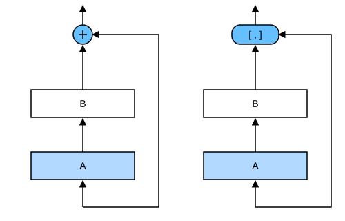
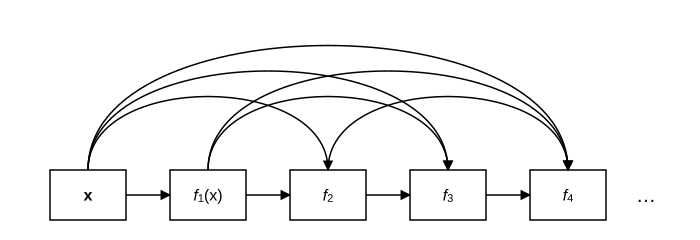

# 7.7 Плотно связанные сети (DenseNet)

ResNet существенно изменила представление о том, как параметризовать функции в глубоких сетях.
*Плотно связанная сеть* (DenseNet) (Huang et al., 2017) в некотором смысле является логическим развитием ResNet. Сначала разберёмся с этим математически.

## 7.7.1 От ResNet к DenseNet

Вспомним разложение в ряд Тейлора (Taylor expansion) произвольной функции: оно раскладывает функцию на члены всё более высокого порядка. При $x$, близком к 0,

$$f(x) = f(0) + f'(0) x + \frac{f''(0)}{2!}  x^2 + \frac{f'''(0)}{3!}  x^3 + \ldots.$$

Аналогично ResNet представляет функцию в виде

$$f(\mathbf{x}) = \mathbf{x} + g(\mathbf{x}).$$

То есть ResNet разбивает $f$ на две части: простое линейное слагаемое и сложное нелинейное слагаемое. Что если пойти дальше и разложить $f$ более чем на две части? Один из вариантов — DenseNet.



Как показано на рис. 7.7.1, ключевое различие ResNet и DenseNet в том, что выход DenseNet — это *конкатенация* (на рисунке она обозначена $[,]$), а не простая сумма, как в ResNet. Поэтому после применения всё более сложной последовательности функций мы выполняем отображение от $\mathbf{x}$ к её разложению:

$$\mathbf{x} \to \left[
\mathbf{x},
f_1(\mathbf{x}),
f_2([\mathbf{x}, f_1(\mathbf{x})]), f_3([\mathbf{x}, f_1(\mathbf{x}), f_2([\mathbf{x}, f_1(\mathbf{x})])]), \ldots\right].$$

Наконец, эти разложения объединяются в многослойный перцептрон, который снова уменьшает число признаков.
Реализовать это очень просто: мы не добавляем слагаемые, а конкатенируем их.
Название DenseNet происходит от «плотных связей» между переменными: последний слой связан со всеми предыдущими слоями.
Плотные связи показаны на рис. 7.7.2.



Плотная сеть состоит в основном из двух частей: *плотных блоков* (dense block) и *переходных слоёв* (transition layer). Первые определяют, как соединять входы и выходы, а вторые управляют числом каналов, чтобы сеть не становилась слишком сложной.

## 7.7.2 Плотный блок

DenseNet использует усовершенствованную версию ResNet с архитектурой «пакетная нормализация, активация и свёртка» (см. упражнения в разделе 7.6). Сначала реализуем эту архитектуру.

**MXNet:**
```python
from d2l import mxnet as d2l
from mxnet import np, npx
from mxnet.gluon import nn
npx.set_np()

def conv_block(num_channels):
    blk = nn.Sequential()
    blk.add(nn.BatchNorm(),
            nn.Activation('relu'),
            nn.Conv2D(num_channels, kernel_size=3, padding=1))
    return blk
```

**PyTorch:**
```python
from d2l import torch as d2l
import torch
from torch import nn

def conv_block(input_channels, num_channels):
    return nn.Sequential(
        nn.BatchNorm2d(input_channels), nn.ReLU(),
        nn.Conv2d(input_channels, num_channels, kernel_size=3, padding=1))
```

**TensorFlow:**
```python
from d2l import tensorflow as d2l
import tensorflow as tf

class ConvBlock(tf.keras.layers.Layer):
    def __init__(self, num_channels):
        super(ConvBlock, self).__init__()
        self.bn = tf.keras.layers.BatchNormalization()
        self.relu = tf.keras.layers.ReLU()
        self.conv = tf.keras.layers.Conv2D(
            filters=num_channels, kernel_size=(3, 3), padding='same')

        self.listLayers = [self.bn, self.relu, self.conv]

    def call(self, x):
        y = x
        for layer in self.listLayers.layers:
            y = layer(y)
        y = tf.keras.layers.concatenate([x,y], axis=-1)
        return y
```

**PaddlePaddle:**
```python
from d2l import paddle as d2l
import warnings
warnings.filterwarnings("ignore")
import paddle
import paddle.nn as nn

def conv_block(input_channels, num_channels):
    return nn.Sequential(
        nn.BatchNorm2D(input_channels), nn.ReLU(),
        nn.Conv2D(input_channels, num_channels, kernel_size=3, padding=1))
```

*Плотный блок* состоит из нескольких свёрточных блоков, каждый из которых использует одинаковое число выходных каналов. Однако в прямом проходе мы конкатенируем по каналам вход и выход каждого свёрточного блока.

**MXNet:**
```python
class DenseBlock(nn.Block):
    def __init__(self, num_convs, num_channels, **kwargs):
        super().__init__(**kwargs)
        self.net = nn.Sequential()
        for _ in range(num_convs):
            self.net.add(conv_block(num_channels))

    def forward(self, X):
        for blk in self.net:
            Y = blk(X)
            # Конкатенируем входы и выходы каждого блока по измерению каналов
            X = np.concatenate((X, Y), axis=1)
        return X
```

**PyTorch:**
```python
class DenseBlock(nn.Module):
    def __init__(self, num_convs, input_channels, num_channels):
        super(DenseBlock, self).__init__()
        layer = []
        for i in range(num_convs):
            layer.append(conv_block(
                num_channels * i + input_channels, num_channels))
        self.net = nn.Sequential(*layer)

    def forward(self, X):
        for blk in self.net:
            Y = blk(X)
            # Конкатенируем входы и выходы каждого блока по измерению каналов
            X = torch.cat((X, Y), dim=1)
        return X
```

**TensorFlow:**
```python
class DenseBlock(tf.keras.layers.Layer):
    def __init__(self, num_convs, num_channels):
        super(DenseBlock, self).__init__()
        self.listLayers = []
        for _ in range(num_convs):
            self.listLayers.append(ConvBlock(num_channels))

    def call(self, x):
        for layer in self.listLayers.layers:
            x = layer(x)
        return x
```

**PaddlePaddle:**
```python
class DenseBlock(nn.Layer):
    def __init__(self, num_convs, input_channels, num_channels):
        super(DenseBlock, self).__init__()
        layer = []
        for i in range(num_convs):
            layer.append(
                conv_block(num_channels * i + input_channels, num_channels))
        self.net = nn.Sequential(*layer)

    def forward(self, X):
        for blk in self.net:
            Y = blk(X)
            # Конкатенируем входы и выходы каждого блока по измерению каналов
            X = paddle.concat(x=[X, Y], axis=1)
        return X
```

В следующем примере мы **определяем** `DenseBlock` с 2 свёрточными блоками по 10 выходных каналов.
При входе с 3 каналами получаем выход с $3+2\times 10=23$ каналами. Число выходных каналов свёрточного блока определяет, насколько вырастает число каналов по сравнению с входом, поэтому его называют *темпом роста* (growth rate).

**MXNet:**
```python
blk = DenseBlock(2, 10)
blk.initialize()
X = np.random.uniform(size=(4, 3, 8, 8))
Y = blk(X)
Y.shape
```

**PyTorch:**
```python
blk = DenseBlock(2, 3, 10)
X = torch.randn(4, 3, 8, 8)
Y = blk(X)
Y.shape
```

**TensorFlow:**
```python
blk = DenseBlock(2, 10)
X = tf.random.uniform((4, 8, 8, 3))
Y = blk(X)
Y.shape
```

**PaddlePaddle:**
```python
blk = DenseBlock(2, 3, 10)
X = paddle.randn([4, 3, 8, 8])
Y = blk(X)
Y.shape
```

## 7.7.3 Переходный слой

Поскольку каждый плотный блок увеличивает число каналов, при большом их количестве модель становится слишком сложной. Переходный слой как раз и позволяет управлять сложностью модели. Он уменьшает число каналов свёрточным слоем $1\times 1$ и вдвое уменьшает высоту и ширину с помощью слоя среднего пулинга с шагом 2, что дополнительно снижает сложность модели.

**MXNet:**
```python
def transition_block(num_channels):
    blk = nn.Sequential()
    blk.add(nn.BatchNorm(), nn.Activation('relu'),
            nn.Conv2D(num_channels, kernel_size=1),
            nn.AvgPool2D(pool_size=2, strides=2))
    return blk
```

**PyTorch:**
```python
def transition_block(input_channels, num_channels):
    return nn.Sequential(
        nn.BatchNorm2d(input_channels), nn.ReLU(),
        nn.Conv2d(input_channels, num_channels, kernel_size=1),
        nn.AvgPool2d(kernel_size=2, stride=2))
```

**TensorFlow:**
```python
class TransitionBlock(tf.keras.layers.Layer):
    def __init__(self, num_channels, **kwargs):
        super(TransitionBlock, self).__init__(**kwargs)
        self.batch_norm = tf.keras.layers.BatchNormalization()
        self.relu = tf.keras.layers.ReLU()
        self.conv = tf.keras.layers.Conv2D(num_channels, kernel_size=1)
        self.avg_pool = tf.keras.layers.AvgPool2D(pool_size=2, strides=2)

    def call(self, x):
        x = self.batch_norm(x)
        x = self.relu(x)
        x = self.conv(x)
        return self.avg_pool(x)
```

**PaddlePaddle:**
```python
def transition_block(input_channels, num_channels):
    return nn.Sequential(
        nn.BatchNorm2D(input_channels), nn.ReLU(),
        nn.Conv2D(input_channels, num_channels, kernel_size=1),
        nn.AvgPool2D(kernel_size=2, stride=2))
```

Применим **переходный слой** с 10 выходными каналами к выходу плотного блока из предыдущего примера. Число выходных каналов уменьшится до 10, а высота и ширина уменьшатся вдвое.

**MXNet:**
```python
blk = transition_block(10)
blk.initialize()
blk(Y).shape
```

**PyTorch, PaddlePaddle:**
```python
blk = transition_block(23, 10)
blk(Y).shape
```

**TensorFlow:**
```python
blk = TransitionBlock(10)
blk(Y).shape
```

## 7.7.4 Модель DenseNet

Построим модель DenseNet. Сначала DenseNet использует такой же одиночный свёрточный слой и слой максимального пулинга, как и ResNet.

**MXNet:**
```python
net = nn.Sequential()
net.add(nn.Conv2D(64, kernel_size=7, strides=2, padding=3),
        nn.BatchNorm(), nn.Activation('relu'),
        nn.MaxPool2D(pool_size=3, strides=2, padding=1))
```

**PyTorch:**
```python
b1 = nn.Sequential(
    nn.Conv2d(1, 64, kernel_size=7, stride=2, padding=3),
    nn.BatchNorm2d(64), nn.ReLU(),
    nn.MaxPool2d(kernel_size=3, stride=2, padding=1))
```

**TensorFlow:**
```python
def block_1():
    return tf.keras.Sequential([
       tf.keras.layers.Conv2D(64, kernel_size=7, strides=2, padding='same'),
       tf.keras.layers.BatchNormalization(),
       tf.keras.layers.ReLU(),
       tf.keras.layers.MaxPool2D(pool_size=3, strides=2, padding='same')])
```

**PaddlePaddle:**
```python
b1 = nn.Sequential(
    nn.Conv2D(1, 64, kernel_size=7, stride=2, padding=3),
    nn.BatchNorm2D(64), nn.ReLU(),
    nn.MaxPool2D(kernel_size=3, stride=2, padding=1))
```

Далее, аналогично четырём остаточным блокам ResNet, DenseNet использует четыре плотных блока.
Как и в ResNet, можно задать число свёрточных слоёв в каждом плотном блоке. Здесь зададим 4, чтобы соответствовать ResNet-18 из раздела 7.6.
Число выходных каналов свёрточных слоёв в плотном блоке (то есть темп роста) зададим равным 32, поэтому каждый плотный блок будет добавлять 128 каналов.

Между модулями ResNet уменьшает высоту и ширину остаточными блоками с шагом 2, тогда как DenseNet использует переходные слои, которые вдвое уменьшают и высоту, и ширину, и число каналов.

**MXNet:**
```python
# num_channels — текущее число каналов
num_channels, growth_rate = 64, 32
num_convs_in_dense_blocks = [4, 4, 4, 4]

for i, num_convs in enumerate(num_convs_in_dense_blocks):
    net.add(DenseBlock(num_convs, growth_rate))
    # Число выходных каналов предыдущего плотного блока
    num_channels += num_convs * growth_rate
    # Между плотными блоками добавляем переходный слой, который уменьшает число каналов вдвое
    if i != len(num_convs_in_dense_blocks) - 1:
        num_channels //= 2
        net.add(transition_block(num_channels))
```

**PyTorch:**
```python
# num_channels — текущее число каналов
num_channels, growth_rate = 64, 32
num_convs_in_dense_blocks = [4, 4, 4, 4]
blks = []
for i, num_convs in enumerate(num_convs_in_dense_blocks):
    blks.append(DenseBlock(num_convs, num_channels, growth_rate))
    # Число выходных каналов предыдущего плотного блока
    num_channels += num_convs * growth_rate
    # Между плотными блоками добавляем переходный слой, который уменьшает число каналов вдвое
    if i != len(num_convs_in_dense_blocks) - 1:
        blks.append(transition_block(num_channels, num_channels // 2))
        num_channels = num_channels // 2
```

**TensorFlow:**
```python
def block_2():
    net = block_1()
    # num_channels — текущее число каналов
    num_channels, growth_rate = 64, 32
    num_convs_in_dense_blocks = [4, 4, 4, 4]

    for i, num_convs in enumerate(num_convs_in_dense_blocks):
        net.add(DenseBlock(num_convs, growth_rate))
        # Число выходных каналов предыдущего плотного блока
        num_channels += num_convs * growth_rate
        # Между плотными блоками добавляем переходный слой, который уменьшает число каналов вдвое
        if i != len(num_convs_in_dense_blocks) - 1:
            num_channels //= 2
            net.add(TransitionBlock(num_channels))
    return net
```

**PaddlePaddle:**
```python
# num_channels — текущее число каналов
num_channels, growth_rate = 64, 32
num_convs_in_dense_blocks = [4, 4, 4, 4]
blks = []
for i, num_convs in enumerate(num_convs_in_dense_blocks):
    blks.append(DenseBlock(num_convs, num_channels, growth_rate))
    # Число выходных каналов предыдущего плотного блока
    num_channels += num_convs * growth_rate
    # Между плотными блоками добавляем переходный слой, который уменьшает число каналов вдвое
    if i != len(num_convs_in_dense_blocks) - 1:
        blks.append(transition_block(num_channels, num_channels // 2))
        num_channels = num_channels // 2
```

Как и в ResNet, в конце добавляем слой глобального среднего пулинга и полносвязный слой для вывода результата.

**MXNet:**
```python
net.add(nn.BatchNorm(),
        nn.Activation('relu'),
        nn.GlobalAvgPool2D(),
        nn.Dense(10))
```

**PyTorch:**
```python
net = nn.Sequential(
    b1, *blks,
    nn.BatchNorm2d(num_channels), nn.ReLU(),
    nn.AdaptiveAvgPool2d((1, 1)),
    nn.Flatten(),
    nn.Linear(num_channels, 10))
```

**TensorFlow:**
```python
def net():
    net = block_2()
    net.add(tf.keras.layers.BatchNormalization())
    net.add(tf.keras.layers.ReLU())
    net.add(tf.keras.layers.GlobalAvgPool2D())
    net.add(tf.keras.layers.Flatten())
    net.add(tf.keras.layers.Dense(10))
    return net
```

**PaddlePaddle:**
```python
net = nn.Sequential(
    b1, *blks, 
    nn.BatchNorm2D(num_channels), nn.ReLU(),
    nn.AdaptiveMaxPool2D((1, 1)), 
    nn.Flatten(),
    nn.Linear(num_channels, 10))
```

## 7.7.5 Обучение модели

Поскольку здесь используется достаточно глубокая сеть, в этом разделе мы уменьшаем высоту и ширину входа с 224 до 96, чтобы упростить вычисления.

```python
lr, num_epochs, batch_size = 0.1, 10, 256
train_iter, test_iter = d2l.load_data_fashion_mnist(batch_size, resize=96)
d2l.train_ch6(net, train_iter, test_iter, num_epochs, lr, d2l.try_gpu())
```

## Резюме

* В отличие от ResNet, где вход и выход складываются, плотно связанная сеть (DenseNet) конкатенирует вход и выход по измерению каналов.
* Основные строительные блоки DenseNet — плотные блоки и переходные слои.
* При построении DenseNet нужно добавлять переходные слои, которые управляют размерностью сети и снова уменьшают число каналов.

## Упражнения

1. Почему в переходном слое мы используем средний пулинг, а не максимальный?
1. Одно из достоинств DenseNet в том, что её параметров меньше, чем у ResNet. Почему так?
1. Один из недостатков DenseNet — чрезмерное потребление памяти (оперативной или видеопамяти GPU).
    1. Так ли это на самом деле? Попробуйте заменить форму входа на $224 \times 224$ и посмотрите на фактическое потребление памяти GPU.
    1. Есть ли другой способ уменьшить потребление памяти GPU? Нужно ли для этого менять фреймворк?
1. Реализуйте различные версии DenseNet, показанные в таблице 1 статьи о DenseNet (Huang et al., 2017).
1. Примените идеи DenseNet для проектирования модели на основе многослойного перцептрона. Примените её к задаче прогнозирования цен на жильё из раздела 4.10.

**MXNet:**
[Обсуждение](https://discuss.d2l.ai/t/1882)

**PyTorch:**
[Обсуждение](https://discuss.d2l.ai/t/1880)

**TensorFlow:**
[Обсуждение](https://discuss.d2l.ai/t/1881)

**PaddlePaddle:**
[Обсуждение](https://discuss.d2l.ai/t/11794)

## Литература

* Huang, G., Liu, Z., Van Der Maaten, L., & Weinberger, K. Q. (2017). Densely connected convolutional networks. *Proceedings of the IEEE Conference on Computer Vision and Pattern Recognition*, 4700–4708.
