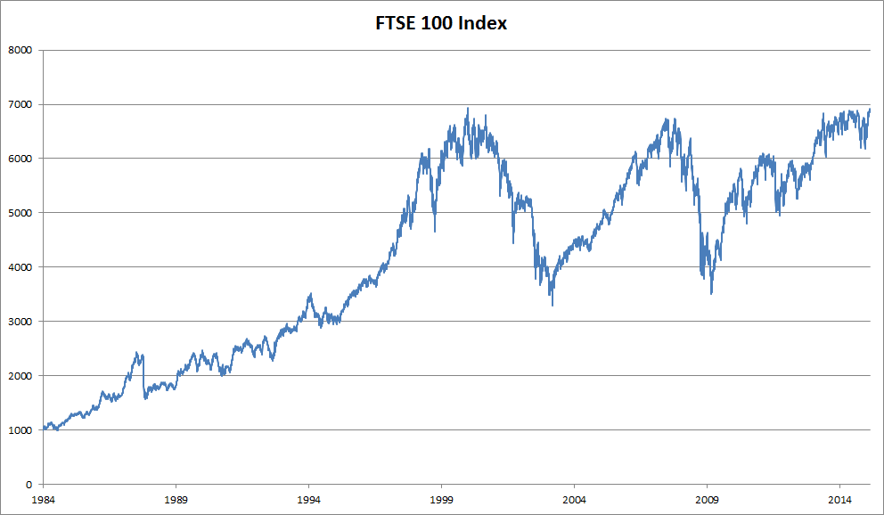
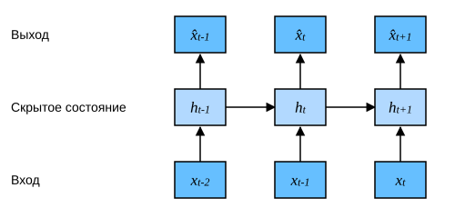

# 8.1 Модели последовательностей

Представьте, что кто-то смотрит фильмы на Netflix (международном видеосервисе). Преданный пользователь оценивает каждый фильм, ведь хороший фильм заслуживает поддержки и признания. Однако на деле всё не так просто. Со временем мнение людей о фильмах сильно меняется. Психологи даже дали названия этим явлениям:

* *эффект привязки* (anchoring): оценка формируется на основе мнений других людей.
  Например, после церемонии «Оскар» оценки фильма, оказавшегося в центре внимания, растут, хотя сам фильм остаётся прежним.
  Этот эффект сохраняется несколько месяцев, пока люди не забудут о наградах, которые получил фильм.
  Результаты показывают (Wu et al., 2017), что такой эффект повышает оценки больше чем на полпроцента.
* *гедонистическая адаптация* (hedonic adaptation): люди быстро принимают более хорошую или более плохую ситуацию и привыкают к ней как к новой норме.
  Например, посмотрев много хороших фильмов, люди начинают сильно ожидать, что следующий будет ещё лучше.
  Поэтому после множества выдающихся фильмов даже обычный может показаться плохим.
* *сезонность* (seasonality): мало кто любит смотреть фильмы про Санта-Клауса в августе.
* Иногда фильм становится непопулярным из-за недостойного поведения режиссёра или актёров во время съёмок.
* Некоторые фильмы становятся культовыми лишь потому, что они крайне плохи. Именно поэтому печально известны *Plan 9 from Outer Space* и *Troll 2*.

Короче говоря, оценки фильмов никогда не бывают постоянными.
Поэтому учёт временной динамики может дать более точные рекомендации фильмов (Koren, 2009).
Разумеется, последовательные данные — это не только оценки фильмов.
Ниже приведено ещё несколько ситуаций.

* При работе с программами у многих пользователей складываются устойчивые привычки.
  Например, после школы социальные сети пользуются большей популярностью, а торговые приложения для акций чаще открывают в часы работы биржи.
* Предсказать завтрашнюю цену акции труднее, чем угадать цену по уже известным данным, хотя в обоих случаях мы оцениваем всего одно число.
  В конце концов, задним умом все крепки.
  В статистике предсказание за пределами известного диапазона наблюдений называют *экстраполяцией* (extrapolation), а оценку между уже имеющимися наблюдениями — *интерполяцией* (interpolation).
* По своей природе музыка, речь, текст и видео непрерывны.
  Если переставить их последовательность, исходный смысл будет утрачен.
  Например, заголовок «Собака укусила человека» звучит гораздо менее удивительно, чем «Человек укусил собаку», хотя состав слов в обоих предложениях одинаков.
* Землетрясения обладают сильной взаимосвязью: после сильного землетрясения часто следуют несколько слабых афтершоков, и их сила значительно выше, чем у афтершоков после слабых толчков.
  Более того, землетрясения связаны в пространстве и времени: афтершоки обычно происходят в пределах короткого промежутка времени и на небольшом расстоянии.
* Взаимодействие между людьми тоже непрерывно, что видно по спорам и дискуссиям в микроблогах.

## 8.1.1 Статистические инструменты

Для работы с последовательными данными нужны статистические инструменты и новые архитектуры глубоких нейронных сетей.
Для простоты возьмём в качестве примера цены акций (индекс FTSE 100), показанные на рис. 8.1.1.



**Рис. 8.1.1.** Индекс FTSE 100 за последние 30 лет

Обозначим цену через $x_t$: это цена, наблюдаемая на *временном шаге* (time step) $t \in \mathbb{Z}^+$.
Заметьте, что в этой книге $t$ для последовательностей обычно дискретно и принимает целые значения или их подмножество.
Предположим, что трейдер хочет успешно торговать на фондовом рынке в день $t$, и поэтому прогнозирует $x_t$ по следующему соотношению:

$$x_t \sim P(x_t \mid x_{t-1}, \ldots, x_1).$$

### 8.1.1.1 Авторегрессионные модели

Для такого прогноза трейдер может использовать регрессионную модель, например ту, которую мы обучали в разделе 3.3.
Есть лишь одна основная проблема: количество входных данных, то есть $x_{t-1}, \ldots, x_1$, зависит от $t$.
Иначе говоря, количество входов растёт вместе с объёмом накопленных данных, поэтому нужна приближённая схема, которая делает вычисления выполнимыми.
Большая часть этой главы посвящена тому, как эффективно оценивать $P(x_t \mid x_{t-1}, \ldots, x_1)$.
В простейшем виде это сводится к двум стратегиям.

Первая стратегия состоит в том, что в реальных условиях очень длинная последовательность $x_{t-1}, \ldots, x_1$, вероятно, не нужна.
Поэтому достаточно ограничиться временным окном длины $\tau$, то есть использовать наблюдения $x_{t-1}, \ldots, x_{t-\tau}$.
Самое очевидное преимущество такого подхода в том, что число параметров остаётся постоянным, по крайней мере при $t > \tau$, и это позволяет обучать глубокую сеть, о которой мы говорили выше.
Такие модели называют *авторегрессионными*, потому что они выполняют регрессию на самих себя.

Вторая стратегия, показанная на рис. 8.1.2, состоит в том, чтобы сохранять некоторую сводку прошлых наблюдений $h_t$ и одновременно обновлять и предсказание $\hat{x}_t$, и сводку $h_t$.
Так получается модель, которая оценивает $x_t$ по соотношению $\hat{x}_t = P(x_t \mid h_{t})$ и обновляет $h_t$ по формуле $h_t = g(h_{t-1}, x_{t-1})$.
Поскольку $h_t$ никогда не наблюдается, такие модели называют *скрытыми авторегрессионными моделями* (latent autoregressive models).



**Рис. 8.1.2.** Скрытая авторегрессионная модель

В обоих случаях возникает очевидный вопрос: как получить обучающие данные?
Классический подход — использовать исторические наблюдения, чтобы предсказывать следующее будущее наблюдение.
Очевидно, что время не стоит на месте.
Однако обычно предполагают, что хотя конкретные значения $x_t$ могут меняться, сама динамика последовательности не меняется.
Такое допущение разумно, потому что новая динамика определяется новыми данными, а по имеющимся данным предсказать новую динамику нельзя.
Статистики называют неизменную динамику *стационарной* (stationary).
Поэтому оценку всей последовательности получают следующим образом:

$$P(x_1, \ldots, x_T) = \prod_{t=1}^T P(x_t \mid x_{t-1}, \ldots, x_1).$$

Заметим, что приведённые рассуждения остаются верными, если мы имеем дело с дискретными объектами (например, словами), а не с непрерывными числами.
Единственное отличие в том, что для дискретных объектов для оценки $P(x_t \mid  x_{t-1}, \ldots, x_1)$ нужно использовать классификатор, а не регрессионную модель.

### 8.1.1.2 Марковские модели

Вспомним, что в авторегрессионном приближении для оценки $x_t$ мы используем $x_{t-1}, \ldots, x_{t-\tau}$ вместо $x_{t-1}, \ldots, x_1$.
Если такое приближение достаточно точно, говорят, что последовательность удовлетворяет *марковскому условию* (Markov condition).
В частности, при $\tau = 1$ получаем *марковскую модель первого порядка* (first-order Markov model), в которой $P(x)$ задаётся формулой

$$P(x_1, \ldots, x_T) = \prod_{t=1}^T P(x_t \mid x_{t-1}) \text{ при } P(x_1 \mid x_0) = P(x_1).$$

Такая модель особенно удобна, когда $x_t$ принимает только дискретные значения: тогда с помощью динамического программирования результат можно точно вычислить вдоль марковской цепи.
Например, мы можем эффективно вычислить $P(x_{t+1} \mid x_{t-1})$:

$$
\begin{aligned}
P(x_{t+1} \mid x_{t-1})
&= \frac{\sum_{x_t} P(x_{t+1}, x_t, x_{t-1})}{P(x_{t-1})}\\
&= \frac{\sum_{x_t} P(x_{t+1} \mid x_t, x_{t-1}) P(x_t, x_{t-1})}{P(x_{t-1})}\\
&= \sum_{x_t} P(x_{t+1} \mid x_t) P(x_t \mid x_{t-1})
\end{aligned}
$$

Благодаря этому факту достаточно учитывать очень короткую предысторию в прошлых наблюдениях: $P(x_{t+1} \mid x_t, x_{t-1}) = P(x_{t+1} \mid x_t)$.
Динамическое программирование для скрытых марковских моделей выходит за рамки этого раздела (мы встретимся с ним в разделе 9.4), а инструменты динамического программирования широко используются в алгоритмах управления и обучения с подкреплением.

### 8.1.1.3 Причинность

В принципе, разложение $P(x_1, \ldots, x_T)$ в обратном порядке тоже допустимо.
В самом деле, из формулы условной вероятности всегда следует:

$$P(x_1, \ldots, x_T) = \prod_{t=T}^1 P(x_t \mid x_{t+1}, \ldots, x_T).$$

Более того, если исходить из марковской модели, можно получить и обратное условное распределение.
Однако во многих случаях у данных есть естественное направление: время идёт вперёд.
Очевидно, что будущие события не могут влиять на прошлое.
Поэтому, если мы изменим $x_t$, это может повлиять на то, что случится в будущем, $x_{t+1}$, но не наоборот.
Иначе говоря, если мы изменим $x_t$, распределение, основанное на прошлых событиях, не изменится.
Поэтому объяснить $P(x_{t+1} \mid x_t)$ обычно проще, чем $P(x_t \mid x_{t+1})$.
Например, в некоторых случаях для некоторого аддитивного шума $\epsilon$ можно найти $x_{t+1} = f(x_t) + \epsilon$, тогда как обратное представление невозможно (Hoyer et al., 2009).
И именно это направление вперёд обычно и представляет для нас интерес.
Питерс и соавторы (Peters et al., 2017) подробно излагают эту тему; наше обсуждение лишь слегка затрагивает эту тему.

## 8.1.2 Обучение

Теперь, когда мы познакомились со статистическими инструментами, попробуем применить их на практике!
Сначала сгенерируем данные: **используем синусоиду с аддитивным шумом, чтобы получить последовательность с временными шагами $1, 2, \ldots, 1000$.**

**MXNet:**
```python
%matplotlib inline
from d2l import mxnet as d2l
from mxnet import autograd, np, npx, gluon, init
from mxnet.gluon import nn
npx.set_np()
```

**PyTorch:**
```python
%matplotlib inline
from d2l import torch as d2l
import torch
from torch import nn
```

**TensorFlow:**
```python
%matplotlib inline
from d2l import tensorflow as d2l
import tensorflow as tf
```

**PaddlePaddle:**
```python
%matplotlib inline
from d2l import paddle as d2l
import warnings
warnings.filterwarnings("ignore")
import paddle
from paddle import nn
```

**MXNet, PyTorch, PaddlePaddle:**
```python
T = 1000  # Всего генерируем 1000 точек
time = d2l.arange(1, T + 1, dtype=d2l.float32)
x = d2l.sin(0.01 * time) + d2l.normal(0, 0.2, (T,))
d2l.plot(time, [x], 'время', 'x', xlim=[1, 1000], figsize=(6, 3))
```

**TensorFlow:**
```python
T = 1000  # Всего генерируем 1000 точек
time = d2l.arange(1, T + 1, dtype=d2l.float32)
x = d2l.sin(0.01 * time) + d2l.normal([T], 0, 0.2)
d2l.plot(time, [x], 'время', 'x', xlim=[1, 1000], figsize=(6, 3))
```

Далее преобразуем последовательность в пары «признаки — метка» для модели.
С помощью размера вложения $\tau$ **построим пары данных $y_t = x_t$ и $\mathbf{x}_t = [x_{t-\tau}, \ldots, x_{t-1}]$.**
Получится на $\tau$ примеров меньше, поскольку для первых $\tau$ значений у нас нет достаточной истории.
Простое решение — отбросить эти первые примеры, если последовательность достаточно длинна; другой вариант — дополнить последовательность нулями.
Здесь для обучения мы используем только первые 600 пар «признаки — метка».

**MXNet, PyTorch, PaddlePaddle:**
```python
tau = 4
features = d2l.zeros((T - tau, tau))
for i in range(tau):
    features[:, i] = x[i: T - tau + i]
labels = d2l.reshape(x[tau:], (-1, 1))
```

**TensorFlow:**
```python
tau = 4
features = tf.Variable(d2l.zeros((T - tau, tau)))
for i in range(tau):
    features[:, i].assign(x[i: T - tau + i])
labels = d2l.reshape(x[tau:], (-1, 1))
```

```python
batch_size, n_train = 16, 600
# Для обучения используются только первые n_train примеров
train_iter = d2l.load_array((features[:n_train], labels[:n_train]),
                            batch_size, is_train=True)
```

Здесь мы **обучаем модель с довольно простой архитектурой: многослойный перцептрон с двумя полносвязными слоями**, функцией активации ReLU и квадратичной функцией потерь.

**MXNet:**
```python
# Простой многослойный перцептрон
def get_net():
    net = nn.Sequential()
    net.add(nn.Dense(10, activation='relu'),
            nn.Dense(1))
    net.initialize(init.Xavier())
    return net

# Квадратичная функция потерь
loss = gluon.loss.L2Loss()
```

**PyTorch:**
```python
# Функция инициализации весов сети
def init_weights(m):
    if type(m) == nn.Linear:
        nn.init.xavier_uniform_(m.weight)

# Простой многослойный перцептрон
def get_net():
    net = nn.Sequential(nn.Linear(4, 10),
                        nn.ReLU(),
                        nn.Linear(10, 1))
    net.apply(init_weights)
    return net

# Квадратичная функция потерь. Замечание: MSELoss вычисляет квадрат ошибки без множителя 1/2
loss = nn.MSELoss(reduction='none')
```

**TensorFlow:**
```python
# Простой многослойный перцептрон
def get_net():
    net = tf.keras.Sequential([tf.keras.layers.Dense(10, activation='relu'),
                              tf.keras.layers.Dense(1)])
    return net

# Среднеквадратичная функция потерь. Замечание: MeanSquaredError вычисляет квадрат ошибки без множителя 1/2
loss = tf.keras.losses.MeanSquaredError()
```

**PaddlePaddle:**
```python
def init_weights(m):
    if type(m) == nn.Linear:
        nn.initializer.XavierUniform(m.weight)

# Простой многослойный перцептрон
def get_net():
    net = nn.Sequential(nn.Linear(4, 10),
                        nn.ReLU(),
                        nn.Linear(10, 1))
    net.apply(init_weights)
    return net

# Квадратичная функция потерь. Замечание: MSELoss вычисляет квадрат ошибки без множителя 1/2
loss = nn.MSELoss(reduction='none')
```

Теперь **обучим модель**. Код обучения строится так же, как в предыдущих разделах (например, в разделе 3.3), поэтому мы не будем вдаваться в подробности.

**MXNet:**
```python
def train(net, train_iter, loss, epochs, lr):
    trainer = gluon.Trainer(net.collect_params(), 'adam',
                            {'learning_rate': lr})
    for epoch in range(epochs):
        for X, y in train_iter:
            with autograd.record():
                l = loss(net(X), y)
            l.backward()
            trainer.step(batch_size)
        print(f'эпоха {epoch + 1}, '
              f'потери {d2l.evaluate_loss(net, train_iter, loss):f}')

net = get_net()
train(net, train_iter, loss, 5, 0.01)
```

**PyTorch:**
```python
def train(net, train_iter, loss, epochs, lr):
    trainer = torch.optim.Adam(net.parameters(), lr)
    for epoch in range(epochs):
        for X, y in train_iter:
            trainer.zero_grad()
            l = loss(net(X), y)
            l.sum().backward()
            trainer.step()
        print(f'эпоха {epoch + 1}, '
              f'потери {d2l.evaluate_loss(net, train_iter, loss):f}')

net = get_net()
train(net, train_iter, loss, 5, 0.01)
```

**TensorFlow:**
```python
def train(net, train_iter, loss, epochs, lr):
    trainer = tf.keras.optimizers.Adam()
    for epoch in range(epochs):
        for X, y in train_iter:
            with tf.GradientTape() as g:
                out = net(X)
                l = loss(y, out)
                params = net.trainable_variables
                grads = g.gradient(l, params)
            trainer.apply_gradients(zip(grads, params))
        print(f'эпоха {epoch + 1}, '
              f'потери {d2l.evaluate_loss(net, train_iter, loss):f}')

net = get_net()
train(net, train_iter, loss, 5, 0.01)
```

**PaddlePaddle:**
```python
def train(net, train_iter, loss, epochs, lr):
    trainer = paddle.optimizer.Adam(learning_rate=lr, parameters=net.parameters())
    for epoch in range(epochs):
        for i,(X, y) in enumerate (train_iter()):
            trainer.clear_grad()
            l = loss(net(X), y)
            l.sum().backward()
            trainer.step()
        print(f'эпоха {epoch + 1}, '
              f'потери {d2l.evaluate_loss(net, train_iter, loss):f}')

net = get_net()
train(net, train_iter, loss, 5, 0.01)
```

## 8.1.3 Предсказание

Поскольку ошибка обучения очень мала, мы ожидаем, что модель будет хорошо работать.
Посмотрим, что это означает на практике.
Прежде всего проверим способность модели **предсказывать следующий временной шаг**, то есть *одношаговое предсказание* (one-step-ahead prediction).

```python
onestep_preds = net(features)
d2l.plot([time, time[tau:]],
         [d2l.numpy(x), d2l.numpy(onestep_preds)], 'время',
         'x', legend=['данные', 'одношаговые предсказания'], xlim=[1, 1000],
         figsize=(6, 3))
```

Как и ожидалось, одношаговое предсказание работает неплохо.
Даже когда предсказания выходят за пределы $600+4$ (`n_train + tau`), их результат выглядит правдоподобно.
Однако есть небольшая проблема: если наблюдения заканчиваются на шаге $604$, нам приходится двигаться вперёд шаг за шагом:

$$
\hat{x}_{605} = f(x_{601}, x_{602}, x_{603}, x_{604}), \\
\hat{x}_{606} = f(x_{602}, x_{603}, x_{604}, \hat{x}_{605}), \\
\hat{x}_{607} = f(x_{603}, x_{604}, \hat{x}_{605}, \hat{x}_{606}),\\
\hat{x}_{608} = f(x_{604}, \hat{x}_{605}, \hat{x}_{606}, \hat{x}_{607}),\\
\hat{x}_{609} = f(\hat{x}_{605}, \hat{x}_{606}, \hat{x}_{607}, \hat{x}_{608}),\\
\ldots
$$

Обычно для наблюдений до $x_t$ предсказание на временном шаге $t+k$, обозначаемое $\hat{x}_{t+k}$, называют *$k$-шаговым предсказанием* ($k$-step-ahead prediction).
Поскольку наши наблюдения дошли до $x_{604}$, его $k$-шаговое предсказание равно $\hat{x}_{604+k}$.
Иначе говоря, для **многошагового предсказания** нам приходится использовать собственные предсказания, а не исходные данные.
Посмотрим, что получится.

**MXNet, PyTorch:**
```python
multistep_preds = d2l.zeros(T)
multistep_preds[: n_train + tau] = x[: n_train + tau]
for i in range(n_train + tau, T):
    multistep_preds[i] = net(
        d2l.reshape(multistep_preds[i - tau: i], (1, -1)))
```

**TensorFlow:**
```python
multistep_preds = tf.Variable(d2l.zeros(T))
multistep_preds[:n_train + tau].assign(x[:n_train + tau])
for i in range(n_train + tau, T):
    multistep_preds[i].assign(d2l.reshape(net(
        d2l.reshape(multistep_preds[i - tau: i], (1, -1))), ()))
```

**PaddlePaddle:**
```python
multistep_preds = d2l.zeros([T])
multistep_preds[: n_train + tau] = x[: n_train + tau]
for i in range(n_train + tau, T):
    multistep_preds[i] = net(
        d2l.reshape(multistep_preds[i - tau: i], (1, -1)))
```

```python
d2l.plot([time, time[tau:], time[n_train + tau:]],
         [d2l.numpy(x), d2l.numpy(onestep_preds),
          d2l.numpy(multistep_preds[n_train + tau:])], 'время',
         'x', legend=['данные', 'одношаговые предсказания', 'многошаговые предсказания'],
         xlim=[1, 1000], figsize=(6, 3))
```

Как видно из примера выше, зелёная линия предсказаний явно не идеальна.
После нескольких шагов предсказания очень быстро затухают до константы.
Почему этот алгоритм работает так плохо? Причина в накоплении ошибок.
Предположим, что после шага $1$ мы накопили ошибку $\epsilon_1 = \bar\epsilon$.
Тогда вход на шаге $2$ оказывается возмущён на $\epsilon_1$, и накопленная ошибка становится $\epsilon_2 = \bar\epsilon + c \epsilon_1$, где $c$ — некоторая константа; аналогично ведут себя и последующие ошибки предсказания.
Поэтому ошибка может довольно быстро уводить предсказание от истинных наблюдений.
Например, прогноз погоды на следующие 24 часа обычно довольно точен, но дальше точность быстро падает.
Мы обсудим, как это улучшить, в этой и следующих главах.

Теперь, основываясь на $k = 1, 4, 16, 64$ и вычислив предсказания для всей последовательности, **внимательнее рассмотрим трудности $k$-шагового предсказания**.

```python
max_steps = 64
```

**MXNet, PyTorch:**
```python
features = d2l.zeros((T - tau - max_steps + 1, tau + max_steps))
# Столбец i (i < tau) — наблюдения из x, временные шаги от (i) до (i+T-tau-max_steps+1)
for i in range(tau):
    features[:, i] = x[i: i + T - tau - max_steps + 1]

# Столбец i (i >= tau) — предсказания с шага (i-tau+1), временные шаги от (i) до (i+T-tau-max_steps+1)
for i in range(tau, tau + max_steps):
    features[:, i] = d2l.reshape(net(features[:, i - tau: i]), -1)
```

**TensorFlow:**
```python
features = tf.Variable(d2l.zeros((T - tau - max_steps + 1, tau + max_steps)))
# Столбец i (i < tau) — наблюдения из x, временные шаги от (i) до (i+T-tau-max_steps+1)
for i in range(tau):
    features[:, i].assign(x[i: i + T - tau - max_steps + 1].numpy())

# Столбец i (i >= tau) — предсказания с шага (i-tau+1), временные шаги от (i) до (i+T-tau-max_steps+1)
for i in range(tau, tau + max_steps):
    features[:, i].assign(d2l.reshape(net((features[:, i - tau: i])), -1))
```

**PaddlePaddle:**
```python
features = d2l.zeros((T - tau - max_steps + 1, tau + max_steps))
# Столбец i (i < tau) — наблюдения из x, временные шаги от (i+1) до (i+T-tau-max_steps+1)
for i in range(tau):
    features[:, i] = x[i: i + T - tau - max_steps + 1]

# Столбец i (i >= tau) — предсказания с шага (i-tau+1), временные шаги от (i+1) до (i+T-tau-max_steps+1)
for i in range(tau, tau + max_steps):
    features[:, i] = d2l.reshape(net(features[:, i - tau: i]), [-1])
```

```python
steps = (1, 4, 16, 64)
d2l.plot([time[tau + i - 1: T - max_steps + i] for i in steps],
         [d2l.numpy(features[:, tau + i - 1]) for i in steps], 'время', 'x',
         legend=[f'{i}-шаговые предсказания' for i in steps], xlim=[5, 1000],
         figsize=(6, 3))
```

Приведённый пример ясно показывает, как меняется качество предсказаний по мере того, как мы пытаемся заглянуть дальше в будущее.
Хотя «$4$-шаговое предсказание» всё ещё выглядит неплохо, любое предсказание дальше этого горизонта почти бесполезно.

## Резюме

* Интерполяция (оценка между уже имеющимися наблюдениями) и экстраполяция (предсказание за пределами известных наблюдений) на практике значительно различаются по сложности. Поэтому при работе с последовательными данными во время обучения всегда нужно соблюдать их временной порядок, то есть лучше не обучать модель на будущих данных.
* Для оценки моделей последовательностей нужны специальные статистические инструменты; два распространённых выбора — авторегрессионные модели и скрытые авторегрессионные модели.
* Для причинных моделей, в которых время движется вперёд, прямая оценка обычно проще обратной.
* Для последовательности наблюдений до временного шага $t$ предсказание на шаге $t+k$ называют «$k$-шаговым предсказанием». По мере увеличения $k$ ошибки быстро накапливаются, и качество предсказаний стремительно падает.

## Упражнения

1. Улучшите модель из этого раздела.
    1. Попробуйте использовать больше четырёх прошлых наблюдений. Сколько их нужно для получения точного результата?
    1. Сколько прошлых наблюдений понадобилось бы без шума? Подсказка: запишите $\sin$ и $\cos$ как решения дифференциального уравнения.
    1. Можно ли объединить старые наблюдения, сохранив общее число признаков? Может ли это повысить точность? Почему?
    1. Измените архитектуру нейронной сети и оцените её качество.
1. Инвестор хочет найти хорошую ценную бумагу для покупки. Он смотрит на прошлую доходность, чтобы решить, какая из них, вероятно, покажет хорошие результаты. Что может пойти не так в этой стратегии?
1. В какой мере модель причинного характера, в которой время движется вперёд, подходит для текста?
1. Приведите пример, когда для описания динамики данных может понадобиться скрытая авторегрессионная модель.

**MXNet:**
[Обсуждение](https://discuss.d2l.ai/t/2090)

**PyTorch:**
[Обсуждение](https://discuss.d2l.ai/t/2091)

**TensorFlow:**
[Обсуждение](https://discuss.d2l.ai/t/2092)

**PaddlePaddle:**
[Обсуждение](https://discuss.d2l.ai/t/11795)

## Литература

* Koren, Y. (2009). Collaborative filtering with temporal dynamics. *Proceedings of the 15th ACM SIGKDD International Conference on Knowledge Discovery and Data Mining*, 447–456.
* Hoyer, P. O., Janzing, D., Mooij, J. M., Peters, J., & Schölkopf, B. (2009). Nonlinear causal discovery with additive noise models. *Advances in Neural Information Processing Systems*, 689–696.
* Peters, J., Janzing, D., & Schölkopf, B. (2017). *Elements of causal inference: Foundations and learning algorithms*. MIT Press.
* Wu, C.-Y., Ahmed, A., Beutel, A., Smola, A. J., & Jing, H. (2017). Recurrent recommender networks. *Proceedings of the Tenth ACM International Conference on Web Search and Data Mining*, 495–503.
