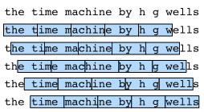

# 8.3 Языковые модели и набор данных

В разделе 8.2 мы узнали, как преобразовать текстовые данные в токены, которые можно рассматривать как последовательность дискретных наблюдений, например слов или символов.
Пусть токены текста длины $T$ идут в порядке $x_1, x_2, \ldots, x_T$.
Тогда $x_t$ ($1 \leq t \leq T$) можно считать наблюдением или меткой текстовой последовательности на временном шаге $t$.
Для такой текстовой последовательности цель *языковой модели* (language model) — оценить совместную вероятность последовательности

$$P(x_1, x_2, \ldots, x_T).$$

Например, идеальная языковая модель, которая выбирает один токен за раз, $x_t \sim P(x_t \mid x_{t-1}, \ldots, x_1)$, могла бы сама генерировать естественный текст.
В отличие от обезьяны, которая печатает на пишущей машинке наугад, текст, полученный из такой модели, воспринимается как естественный язык (например, английский).
Достаточно опираться на текст предыдущей части диалога, чтобы сгенерировать осмысленную реплику.
Однако мы ещё очень далеки от систем, которые так работают, ведь для этого нужно «понимать» текст, а не просто порождать грамматически правильные фразы.

Тем не менее языковые модели очень полезны.
Например, фразы «to recognize speech» и «to wreck a nice beach» звучат почти одинаково.
Эта похожесть вызывает неоднозначность при распознавании речи, но её легко разрешить с помощью языковой модели, ведь смысл второй фразы странен.
Аналогично в алгоритмах автоматического реферирования фраза «собака укусила человека» встречается гораздо чаще, чем «человек укусил собаку»; а фраза «я хочу съесть бабушку» звучит весьма странно, тогда как «я хочу есть, бабушка» — вполне нормально.

## 8.3.1 Обучение языковых моделей

Очевидно, что перед нами стоит задача моделирования документа или даже последовательности токенов.
Предположим, что текст разбит на токены на уровне слов; тогда мы можем опереться на анализ последовательных моделей из раздела 8.1.
Начнём с основных правил теории вероятностей:

$$P(x_1, x_2, \ldots, x_T) = \prod_{t=1}^T P(x_t  \mid  x_1, \ldots, x_{t-1}).$$

Например, вероятность текстовой последовательности из четырёх слов равна:

$$P(\text{deep}, \text{learning}, \text{is}, \text{fun}) =  P(\text{deep}) P(\text{learning}  \mid  \text{deep}) P(\text{is}  \mid  \text{deep}, \text{learning}) P(\text{fun}  \mid  \text{deep}, \text{learning}, \text{is}).$$

Чтобы обучить языковую модель, нужно вычислить вероятности отдельных слов и условные вероятности появления слова при заданных предыдущих словах.
Эти вероятности по сути и являются параметрами языковой модели.

Будем считать, что обучающий набор данных — это большой текстовый корпус.
Например, это все статьи Википедии, [проект Гутенберг](https://en.wikipedia.org/wiki/Project_Gutenberg) или весь текст, опубликованный в сети.
Вероятности слов в обучающем наборе можно вычислить по их относительной частоте.
Например, оценку $\hat{P}(\text{deep})$ можно вычислить как долю предложений, начинающихся со слова «deep».
Немного менее точный способ — подсчитать, сколько раз слово «deep» встречается в наборе данных, и разделить это число на общее количество слов в корпусе.
Этот метод хорошо работает, особенно для часто встречающихся слов.
Далее мы можем попытаться оценить

$$\hat{P}(\text{learning} \mid \text{deep}) = \frac{n(\text{deep, learning})}{n(\text{deep})},$$

где $n(x)$ и $n(x, x')$ — количество появлений отдельного слова и пары соседних слов соответственно.
К сожалению, пара «deep learning» встречается гораздо реже, поэтому оценить правильную вероятность для таких пар намного труднее.
Особенно сложно для необычных сочетаний слов найти достаточное число вхождений, чтобы получить точную оценку.
Для троек и более слов ситуация становится ещё хуже.
Многие правдоподобные сочетания из трёх слов могут присутствовать в языке, но не встречаться в наборе данных.
Если не предложить какое-либо решение, которое присвоит таким сочетаниям ненулевые счётчики, их нельзя будет использовать в языковой модели.
Если набор данных мал или слова очень редки, то вероятность встретить такое слово даже один раз может оказаться слишком низкой.

Распространённая стратегия — выполнить некоторую форму *сглаживания Лапласа* (Laplace smoothing), добавив небольшую константу ко всем счётчикам.
Пусть $n$ обозначает общее число слов в обучающем наборе, а $m$ — число уникальных слов.
Это решение помогает в задачах с отдельными словами, например:

$$
\begin{aligned}
    \hat{P}(x) & = \frac{n(x) + \epsilon_1/m}{n + \epsilon_1}, \\
    \hat{P}(x' \mid x) & = \frac{n(x, x') + \epsilon_2 \hat{P}(x')}{n(x) + \epsilon_2}, \\
    \hat{P}(x'' \mid x,x') & = \frac{n(x, x',x'') + \epsilon_3 \hat{P}(x'')}{n(x, x') + \epsilon_3}.
\end{aligned}
$$

Здесь $\epsilon_1, \epsilon_2$ и $\epsilon_3$ — гиперпараметры.
Возьмём $\epsilon_1$ в качестве примера: при $\epsilon_1 = 0$ сглаживание не применяется; при $\epsilon_1$, стремящемся к бесконечности, $\hat{P}(x)$ приближается к равномерному распределению $1/m$.
Приведённые формулы — довольно простой вариант модели, описанной в (Wood et al., 2011).

Однако такие модели легко становятся неэффективными, по следующим причинам.
Во-первых, нам приходится хранить все счётчики.
Во-вторых, такой подход полностью игнорирует смысл слов.
Например, слова «кот» (cat) и «кошачьи» (feline) могут встречаться в похожих контекстах, но учитывать такие связи в модели, опирающейся на контекст, довольно трудно.
Наконец, длинные последовательности слов в основном не встречаются в обучающих данных, поэтому модель, которая просто подсчитывает частоты ранее «увиденных» последовательностей слов, заведомо будет плохо работать на таких примерах.

## 8.3.2 Марковские модели и $n$-граммы

Прежде чем рассматривать решения с глубоким обучением, нужно ввести ещё несколько понятий и терминов.
Вспомним марковские модели, которые мы обсуждали в разделе 8.1, и применим их к языковому моделированию.
Если $P(x_{t+1} \mid x_t, \ldots, x_1) = P(x_{t+1} \mid x_t)$, то распределение на последовательности обладает марковским свойством первого порядка.
Чем выше порядок, тем длиннее зависимости.
Это свойство приводит ко многим приближённым формулам, которые можно использовать для моделирования последовательностей:

$$
\begin{aligned}
P(x_1, x_2, x_3, x_4) &=  P(x_1) P(x_2) P(x_3) P(x_4),\\
P(x_1, x_2, x_3, x_4) &=  P(x_1) P(x_2  \mid  x_1) P(x_3  \mid  x_2) P(x_4  \mid  x_3),\\
P(x_1, x_2, x_3, x_4) &=  P(x_1) P(x_2  \mid  x_1) P(x_3  \mid  x_1, x_2) P(x_4  \mid  x_2, x_3).
\end{aligned}
$$

Обычно формулы с одной, двумя и тремя переменными называют соответственно *униграммными* (unigram), *биграммными* (bigram) и *триграммными* (trigram) моделями.
Ниже мы узнаем, как строить более удачные модели.

## 8.3.3 Статистика естественного языка

Посмотрим, как выглядит статистика естественного языка на реальных данных.
Построим словарь на основе набора данных «Машина времени», описанного в разделе 8.2, и выведем десять самых употребительных (самых частотных) слов.

**MXNet:**
```python
from d2l import mxnet as d2l
from mxnet import np, npx
import random
npx.set_np()
```

**PyTorch:**
```python
from d2l import torch as d2l
import torch
import random
```

**TensorFlow:**
```python
from d2l import tensorflow as d2l
import tensorflow as tf
import random
```

**PaddlePaddle:**
```python
from d2l import paddle as d2l
import warnings
warnings.filterwarnings("ignore")
import paddle
import random
```

```python
tokens = d2l.tokenize(d2l.read_time_machine())
# Строки текста не обязательно являются предложениями или абзацами, поэтому объединяем все строки в один список
corpus = [token for line in tokens for token in line]
vocab = d2l.Vocab(corpus)
vocab.token_freqs[:10]
```

Как видно, **самые популярные слова** выглядят довольно скучно.
Такие слова обычно называют **стоп-словами** (stop words), поэтому их можно отфильтровать.
Тем не менее они всё же несут смысл, и мы продолжим использовать их в модели.
Кроме того, очевидная проблема в том, что частоты слов убывают очень быстро.
Например, частота самого частого слова значительно выше, чем у десятого: частота десятого меньше одной пятой частоты первого.
Чтобы лучше разобраться, **построим график частот слов**:

```python
freqs = [freq for token, freq in vocab.token_freqs]
d2l.plot(freqs, xlabel='токен: x', ylabel='частота: n(x)',
         xscale='log', yscale='log')
```

По этому графику видно: частоты слов убывают быстро и предсказуемо.
Если не учитывать первые несколько слов-исключений, остальные слова примерно ложатся на прямую в двойном логарифмическом масштабе.
Это означает, что частоты слов подчиняются *закону Ципфа* (Zipf's law): частота $n_i$ $i$-го по популярности слова выражается формулой

$$n_i \propto \frac{1}{i^\alpha},\tag{8.3.1}$$

или, что то же самое,

$$\log n_i = -\alpha \log i + c,$$

где $\alpha$ — показатель, характеризующий распределение, а $c$ — константа.
Из этого следует, что моделировать слова только подсчётом и сглаживанием нецелесообразно, поскольку такая модель сильно завышает частоты хвоста распределения, то есть редко употребляемых слов.
А как обстоит дело с **другими комбинациями токенов, например с биграммами, триграммами и так далее?**
Проверим, ведут ли себя частоты биграмм так же, как частоты униграмм.

```python
bigram_tokens = [pair for pair in zip(corpus[:-1], corpus[1:])]
bigram_vocab = d2l.Vocab(bigram_tokens)
bigram_vocab.token_freqs[:10]
```

Здесь стоит обратить внимание: из десяти самых частых пар девять состоят из двух стоп-слов, и только одна связана с «the time».
Теперь проверим, ведут ли себя так же частоты триграмм.

```python
trigram_tokens = [triple for triple in zip(
    corpus[:-2], corpus[1:-1], corpus[2:])]
trigram_vocab = d2l.Vocab(trigram_tokens)
trigram_vocab.token_freqs[:10]
```

Наконец, **наглядно сравним частоты токенов в трёх моделях**: униграммной, биграммной и триграммной.

```python
bigram_freqs = [freq for token, freq in bigram_vocab.token_freqs]
trigram_freqs = [freq for token, freq in trigram_vocab.token_freqs]
d2l.plot([freqs, bigram_freqs, trigram_freqs], xlabel='токен: x',
         ylabel='частота: n(x)', xscale='log', yscale='log',
         legend=['униграммы', 'биграммы', 'триграммы'])
```

Этот график очень интересен, и на то есть несколько причин:

1. Помимо униграмм, последовательности слов тоже подчиняются закону Ципфа, хотя показатель $\alpha$ в формуле (8.3.1) меньше (величина показателя зависит от длины последовательности);
1. Число $n$-грамм в словаре не столь велико, что говорит о существовании в языке довольно значительной структуры, а это даёт надежду на применимость моделей;
1. Многие $n$-граммы встречаются очень редко, что делает сглаживание Лапласа совершенно непригодным для языкового моделирования.
Вместо него мы будем использовать модели на основе глубокого обучения.

## 8.3.4 Чтение длинных последовательных данных

Поскольку последовательные данные по природе непрерывны, при их обработке нужно решить эту проблему.
В разделе 8.1 мы сделали это довольно необычным способом: когда последовательность становится слишком длинной, чтобы модель могла обработать её целиком, мы можем разбить её на части, удобные для чтения моделью.

Прежде чем описывать модель, рассмотрим общую стратегию.
Пусть языковая модель обучается нейронной сетью, которая за один раз обрабатывает мини-батч последовательностей фиксированной длины (например, $n$ временных шагов).
Вопрос в том, как **случайно сгенерировать признаки и метки для мини-батча данных**.

Во-первых, поскольку текстовая последовательность может быть произвольной длины (например, весь роман «Машина времени»), её можно разбить на подпоследовательности с одинаковым числом временных шагов.
При обучении нейронной сети такие мини-батчи подпоследовательностей подаются в модель.
Пусть сеть за один раз обрабатывает подпоследовательность из $n$ временных шагов.
На рис. 8.3.1 показаны все способы получить подпоследовательности из исходной текстовой последовательности при $n=5$, причём токен каждого временного шага соответствует одному символу.
Обратите внимание, что, поскольку начальное положение можно задать любым смещением, у нас довольно много свободы.



Какую из подпоследовательностей на рис. 8.3.1 выбрать? На самом деле все они одинаково хороши.
Однако если выбрать только одно смещение, то покрытие всех возможных подпоследовательностей для обучения сети будет ограниченным.
Поэтому можно разбивать последовательность, начиная со случайного смещения, чтобы получить одновременно *покрытие* (coverage) и *случайность* (randomness).
Ниже мы опишем, как реализовать две стратегии: *случайную выборку* (random sampling) и *последовательное разбиение* (sequential partitioning).

### 8.3.4.1 Случайная выборка

(**При случайной выборке каждый образец — это подпоследовательность, произвольно взятая из исходной длинной последовательности.**)
В ходе итераций подпоследовательности из двух соседних случайных мини-батчей не обязательно являются соседними в исходной последовательности.
Для языкового моделирования цель состоит в том, чтобы по уже увиденным токенам предсказать следующий токен, поэтому метками служат исходная последовательность, сдвинутая на один токен.

Приведённый ниже код на каждом шаге случайным образом генерирует мини-батч.
Здесь параметр `batch_size` задаёт число подпоследовательностей в мини-батче, а параметр `num_steps` — число временных шагов в каждой подпоследовательности.

```python
def seq_data_iter_random(corpus, batch_size, num_steps):  #@save
    """Генерирует мини-батч подпоследовательностей с помощью случайной выборки"""
    # Разбиваем последовательность, начиная со случайного смещения (диапазон включает num_steps-1)
    corpus = corpus[random.randint(0, num_steps - 1):]
    # Вычитаем 1, поскольку нужно учесть метки
    num_subseqs = (len(corpus) - 1) // num_steps
    # Начальные индексы подпоследовательностей длины num_steps
    initial_indices = list(range(0, num_subseqs * num_steps, num_steps))
    # При случайной выборке подпоследовательности из двух соседних
    # случайных мини-батчей не обязательно соседствуют в исходной последовательности
    random.shuffle(initial_indices)

    def data(pos):
        # Возвращает последовательность длины num_steps, начиная с позиции pos
        return corpus[pos: pos + num_steps]

    num_batches = num_subseqs // batch_size
    for i in range(0, batch_size * num_batches, batch_size):
        # Здесь initial_indices содержит случайные начальные индексы подпоследовательностей
        initial_indices_per_batch = initial_indices[i: i + batch_size]
        X = [data(j) for j in initial_indices_per_batch]
        Y = [data(j + 1) for j in initial_indices_per_batch]
        yield d2l.tensor(X), d2l.tensor(Y)
```

Сгенерируем последовательность от $0$ до $34$.
Пусть размер батча равен $2$, а число временных шагов — $5$; тогда можно получить
$\lfloor (35 - 1) / 5 \rfloor= 6$ пар «признаки — метка».
Если установить размер мини-батча равным $2$, то получится $3$ мини-батча.

```python
my_seq = list(range(35))
for X, Y in seq_data_iter_random(my_seq, batch_size=2, num_steps=5):
    print('X: ', X, '\nY:', Y)
```

### 8.3.4.2 Последовательное разбиение

В ходе итераций, помимо случайной выборки из исходной последовательности, мы можем **гарантировать, что подпоследовательности из двух соседних мини-батчей также соседствуют в исходной последовательности**.
Эта стратегия сохраняет порядок разбитых подпоследовательностей при переходе от мини-батча к мини-батчу, поэтому её называют последовательным разбиением.

**MXNet, PyTorch:**
```python
def seq_data_iter_sequential(corpus, batch_size, num_steps):  #@save
    """Генерирует мини-батч подпоследовательностей с помощью последовательного разбиения"""
    # Разбиваем последовательность, начиная со случайного смещения
    offset = random.randint(0, num_steps)
    num_tokens = ((len(corpus) - offset - 1) // batch_size) * batch_size
    Xs = d2l.tensor(corpus[offset: offset + num_tokens])
    Ys = d2l.tensor(corpus[offset + 1: offset + 1 + num_tokens])
    Xs, Ys = Xs.reshape(batch_size, -1), Ys.reshape(batch_size, -1)
    num_batches = Xs.shape[1] // num_steps
    for i in range(0, num_steps * num_batches, num_steps):
        X = Xs[:, i: i + num_steps]
        Y = Ys[:, i: i + num_steps]
        yield X, Y
```

**TensorFlow:**
```python
def seq_data_iter_sequential(corpus, batch_size, num_steps):  #@save
    """Генерирует мини-батч подпоследовательностей с помощью последовательного разбиения"""
    # Разбиваем последовательность, начиная со случайного смещения
    offset = random.randint(0, num_steps)
    num_tokens = ((len(corpus) - offset - 1) // batch_size) * batch_size
    Xs = d2l.tensor(corpus[offset: offset + num_tokens])
    Ys = d2l.tensor(corpus[offset + 1: offset + 1 + num_tokens])
    Xs = d2l.reshape(Xs, (batch_size, -1))
    Ys = d2l.reshape(Ys, (batch_size, -1))
    num_batches = Xs.shape[1] // num_steps
    for i in range(0, num_batches * num_steps, num_steps):
        X = Xs[:, i: i + num_steps]
        Y = Ys[:, i: i + num_steps]
        yield X, Y
```

**PaddlePaddle:**
```python
def seq_data_iter_sequential(corpus, batch_size, num_steps):  #@save
    """Генерирует мини-батч подпоследовательностей с помощью последовательного разбиения"""
    # Разбиваем последовательность, начиная со случайного смещения
    offset = random.randint(0, num_steps)
    num_tokens = ((len(corpus) - offset - 1) // batch_size) * batch_size
    Xs = d2l.tensor(corpus[offset: offset + num_tokens])
    Ys = d2l.tensor(corpus[offset + 1: offset + 1 + num_tokens])
    Xs, Ys = Xs.reshape((batch_size, -1)), Ys.reshape((batch_size, -1))
    num_batches = Xs.shape[1] // num_steps
    for i in range(0, num_steps * num_batches, num_steps):
        X = Xs[:, i: i + num_steps]
        Y = Ys[:, i: i + num_steps]
        yield X, Y
```

Используя те же параметры, **считаем признаки `X` и метки `Y` мини-батча подпоследовательностей при последовательном разбиении**.
Если вывести их, можно заметить: в ходе итераций подпоследовательности из двух соседних мини-батчей действительно соседствуют в исходной последовательности.

```python
for X, Y in seq_data_iter_sequential(my_seq, batch_size=2, num_steps=5):
    print('X: ', X, '\nY:', Y)
```

Теперь **объединим обе функции выборки в один класс**, чтобы позже использовать его как итератор данных.

```python
class SeqDataLoader:  #@save
    """Итератор для загрузки последовательных данных"""
    def __init__(self, batch_size, num_steps, use_random_iter, max_tokens):
        if use_random_iter:
            self.data_iter_fn = d2l.seq_data_iter_random
        else:
            self.data_iter_fn = d2l.seq_data_iter_sequential
        self.corpus, self.vocab = d2l.load_corpus_time_machine(max_tokens)
        self.batch_size, self.num_steps = batch_size, num_steps

    def __iter__(self):
        return self.data_iter_fn(self.corpus, self.batch_size, self.num_steps)
```

**Наконец, определим функцию `load_data_time_machine`, которая возвращает одновременно итератор данных и словарь**,
поэтому её можно использовать так же, как другие функции с префиксом `load_data`
(например, `d2l.load_data_fashion_mnist`, определённую в разделе 3.5).

```python
def load_data_time_machine(batch_size, num_steps,  #@save
                           use_random_iter=False, max_tokens=10000):
    """Возвращает итератор и словарь набора данных «Машина времени»"""
    data_iter = SeqDataLoader(
        batch_size, num_steps, use_random_iter, max_tokens)
    return data_iter, data_iter.vocab
```

## Резюме

* Языковые модели — ключевой инструмент обработки естественного языка.
* $n$-граммы обеспечивают практичный способ работы с длинными последовательностями за счёт ограничения учитываемых зависимостей.
* У длинных последовательностей есть проблема: они очень редко встречаются, а иногда и вовсе не встречаются.
* Закон Ципфа описывает распределение слов не только для униграмм, но и для других $n$-грамм.
* Сглаживание Лапласа позволяет эффективно работать с редкими сочетаниями слов, которые, тем не менее, имеют богатую структуру.
* Основные способы чтения длинных последовательностей — случайная выборка и последовательное разбиение. Последнее гарантирует, что подпоследовательности из двух соседних мини-батчей также соседствуют в исходной последовательности.

## Упражнения

1. Предположим, что в обучающем наборе данных есть $100\,000$ слов. Сколько частот слов и смежных частот нужно хранить для четырёхграммной модели?
1. Как моделировать последовательность диалогов?
1. Показатели закона Ципфа для униграмм, биграмм и триграмм различны. Можете ли вы оценить их?
1. Какие ещё способы чтения длинных последовательных данных вы можете предложить?
1. Рассмотрим случайное смещение, которое мы используем для чтения длинных последовательностей.
    1. Почему случайное смещение — хорошая идея?
    1. Действительно ли оно даёт идеально равномерное распределение на последовательностях документа?
    1. Что нужно сделать, чтобы распределение стало более равномерным?
1. Если мы хотим, чтобы образец последовательности был целым предложением, какие проблемы возникнут при выборке мини-батчей? Как их решить?

**MXNet:**
[Обсуждение](https://discuss.d2l.ai/t/2096)

**PyTorch:**
[Обсуждение](https://discuss.d2l.ai/t/2097)

**TensorFlow:**
[Обсуждение](https://discuss.d2l.ai/t/2098)

**PaddlePaddle:**
[Обсуждение](https://discuss.d2l.ai/t/11797)

## Литература

* Wood, F., Gasthaus, J., Archambeau, C., James, L., & Teh, Y. W. (2011). The sequence memoizer. *Communications of the ACM*, 54(2), 91–98.
