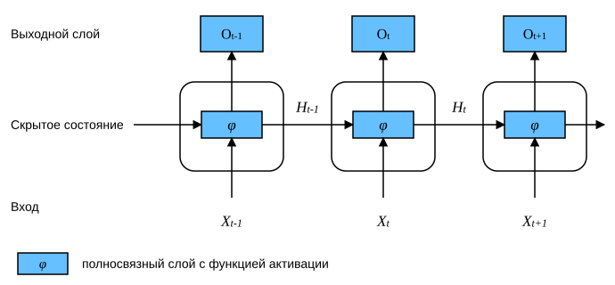
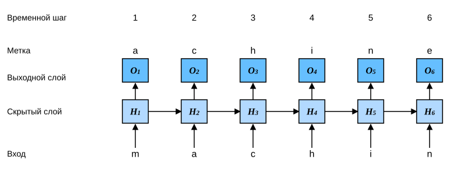

# 8.4 Рекуррентные нейронные сети

В разделе 8.3 мы ввели модель $n$-грамм, в которой условная вероятность появления слова $x_t$ на временном шаге $t$ зависит только от предыдущих $n-1$ слов.
Если мы хотим учитывать влияние слов, которые стоят дальше, чем на $t-(n-1)$ шагов назад, нужно увеличивать $n$.
Однако число параметров модели при этом растёт экспоненциально, поскольку словарь $\mathcal{V}$ должен хранить $|\mathcal{V}|^n$ чисел.
Поэтому вместо моделирования $P(x_t \mid x_{t-1}, \ldots, x_{t-n+1})$ лучше использовать модель со скрытой переменной:

$$P(x_t \mid x_{t-1}, \ldots, x_1) \approx P(x_t \mid h_{t-1}),$$

где $h_{t-1}$ — *скрытое состояние* (hidden state), также называемое *скрытой переменной* (hidden variable), которое хранит информацию о последовательности до временного шага $t-1$.
Обычно скрытое состояние на временном шаге $t$ можно вычислить по текущему входу $x_{t}$ и предыдущему скрытому состоянию $h_{t-1}$:

$$h_t = f(x_{t}, h_{t-1}).\tag{8.4.1}$$

Для функции $f$ из (8.4.1) модель со скрытой переменной не является приближением.
В самом деле, $h_t$ может хранить все данные, наблюдённые до этого момента, однако такая операция может быть дорогой как по вычислениям, так и по памяти.

Вспомним скрытые слои с их скрытыми элементами, о которых шла речь в главе 4.
Важно отличать скрытые слои от скрытых состояний.
Как уже было сказано, скрытые слои находятся на пути от входа к выходу, если смотреть на них с точки зрения наблюдаемых величин, тогда как скрытое состояние — это то, что поступает на *вход* на каждом шаге, и вычисляется оно только по данным предыдущих временных шагов.

*Рекуррентные нейронные сети* (recurrent neural networks, RNNs) — это нейронные сети со скрытым состоянием.
Прежде чем вводить модель рекуррентной сети, вспомним многослойный перцептрон из раздела 4.1.

## 8.4.1 Нейронные сети без скрытых состояний

Посмотрим на многослойный перцептрон с одним скрытым слоем.
Пусть функция активации скрытого слоя равна $\phi$.
Дан мини-батч $\mathbf{X} \in \mathbb{R}^{n \times d}$ размера $n$ с входной размерностью $d$.
Тогда выход скрытого слоя $\mathbf{H} \in \mathbb{R}^{n \times h}$ вычисляется по формуле

$$\mathbf{H} = \phi(\mathbf{X} \mathbf{W}_{xh} + \mathbf{b}_h).\tag{8.4.2}$$

В (8.4.2) параметры скрытого слоя — весовая матрица $\mathbf{W}_{xh} \in \mathbb{R}^{d \times h}$ и вектор смещения $\mathbf{b}_h \in \mathbb{R}^{1 \times h}$, а число скрытых элементов равно $h$.
Поэтому при сложении можно применить механизм broadcasting (см. раздел 2.1.3).
Далее скрытую переменную $\mathbf{H}$ используем как вход выходного слоя.
Выходной слой задаётся формулой

$$\mathbf{O} = \mathbf{H} \mathbf{W}_{hq} + \mathbf{b}_q,$$

где $\mathbf{O} \in \mathbb{R}^{n \times q}$ — выходные данные, $\mathbf{W}_{hq} \in \mathbb{R}^{h \times q}$ — весовая матрица, а $\mathbf{b}_q \in \mathbb{R}^{1 \times q}$ — вектор смещения выходного слоя.
Если решается задача классификации, то для вычисления вероятностного распределения по классам можно использовать $\text{softmax}(\mathbf{O})$.

Это полностью аналогично задаче регрессии, которую мы решали в разделе 8.1, поэтому подробности опускаем.
Достаточно того, что можно случайным образом выбирать пары «признаки — метка» и обучать параметры сети с помощью автоматического дифференцирования и стохастического градиентного спуска.

## 8.4.2 Рекуррентные нейронные сети со скрытыми состояниями

Когда появляется скрытое состояние, ситуация становится совсем другой.
Пусть на временном шаге $t$ поступает мини-батч входных данных $\mathbf{X}_t \in \mathbb{R}^{n \times d}$.
Иными словами, для мини-батча из $n$ последовательностей каждая строка $\mathbf{X}_t$ соответствует одному примеру из этой последовательности на временном шаге $t$.
Обозначим через $\mathbf{H}_t  \in \mathbb{R}^{n \times h}$ скрытую переменную на временном шаге $t$.
В отличие от многослойного перцептрона, здесь мы сохраняем скрытую переменную предыдущего шага $\mathbf{H}_{t-1}$ и вводим новый весовой параметр $\mathbf{W}_{hh} \in \mathbb{R}^{h \times h}$, который описывает, как использовать скрытую переменную предыдущего шага на текущем шаге.
Конкретно, скрытая переменная текущего шага вычисляется по текущему входу и скрытой переменной предыдущего шага:

$$\mathbf{H}_t = \phi(\mathbf{X}_t \mathbf{W}_{xh} + \mathbf{H}_{t-1} \mathbf{W}_{hh}  + \mathbf{b}_h).\tag{8.4.3}$$

По сравнению с (8.4.2) в (8.4.3) добавлено слагаемое $\mathbf{H}_{t-1} \mathbf{W}_{hh}$, которое реализует (8.4.1).
Из связи между скрытыми переменными $\mathbf{H}_t$ и $\mathbf{H}_{t-1}$ видно, что эти переменные хранят и сохраняют историю последовательности до текущего временного шага, подобно состоянию или памяти нейронной сети на текущем шаге.
Поэтому такие скрытые переменные называют *скрытыми состояниями* (hidden state).
Поскольку на текущем шаге скрытое состояние определяется так же, как и на предыдущем, вычисление (8.4.3) является *рекуррентным* (recurrent).
Отсюда и название: нейронные сети, в которых скрытое состояние вычисляется рекуррентно, называют *рекуррентными нейронными сетями* (recurrent neural network).
Слой, который выполняет вычисления (8.4.3), называют *рекуррентным слоем* (recurrent layer).

Существует много способов построить рекуррентную нейронную сеть.
Сеть со скрытым состоянием, заданным формулой (8.4.3), — одна из самых распространённых.
Для шага $t$ выход выходного слоя вычисляется так же, как в многослойном перцептроне:

$$\mathbf{O}_t = \mathbf{H}_t \mathbf{W}_{hq} + \mathbf{b}_q.$$

Параметры рекуррентной нейронной сети включают веса скрытого слоя $\mathbf{W}_{xh} \in \mathbb{R}^{d \times h}$, $\mathbf{W}_{hh} \in \mathbb{R}^{h \times h}$ и смещение $\mathbf{b}_h \in \mathbb{R}^{1 \times h}$, а также веса выходного слоя $\mathbf{W}_{hq} \in \mathbb{R}^{h \times q}$ и смещение $\mathbf{b}_q \in \mathbb{R}^{1 \times q}$.
Стоит отметить, что на разных временных шагах рекуррентная нейронная сеть всегда использует одни и те же параметры модели.
Поэтому число параметров сети не растёт с увеличением числа временных шагов.

На рис. 8.4.1 показана логика вычислений рекуррентной нейронной сети на трёх соседних временных шагах.
На произвольном шаге $t$ вычисление скрытого состояния можно представить так:

1. объединить входной вектор текущего шага $\mathbf{X}_t$ и скрытое состояние предыдущего шага $\mathbf{H}_{t-1}$;
1. подать результат объединения в полносвязный слой с функцией активации $\phi$.
   Выход этого полносвязного слоя — скрытое состояние текущего шага $\mathbf{H}_t$.

В данном случае параметры модели — это конкатенация $\mathbf{W}_{xh}$ и $\mathbf{W}_{hh}$ и смещение $\mathbf{b}_h$, все они берутся из (8.4.3).
Скрытое состояние $\mathbf{H}_t$ текущего шага участвует в вычислении скрытого состояния следующего шага $\mathbf{H}_{t+1}$.
Кроме того, $\mathbf{H}_t$ подаётся в полносвязный выходной слой, с помощью которого вычисляется выход $\mathbf{O}_t$ текущего шага.



Выше мы упомянули, что вычисление $\mathbf{X}_t \mathbf{W}_{xh} + \mathbf{H}_{t-1} \mathbf{W}_{hh}$ в скрытом состоянии эквивалентно умножению матрицы, полученной конкатенацией $\mathbf{X}_t$ и $\mathbf{H}_{t-1}$, на матрицу, полученную конкатенацией $\mathbf{W}_{xh}$ и $\mathbf{W}_{hh}$.
Это свойство можно доказать математически, но ниже мы проверим его простым кодом.
Сначала определим матрицы `X`, `W_xh`, `H` и `W_hh`, их формы — $(3，1)$, $(1，4)$, $(3，4)$ и $(4，4)$.
Перемножим `X` с `W_xh`, `H` с `W_hh`, а затем сложим оба произведения: получим матрицу формы $(3，4)$.

**MXNet:**
```python
from d2l import mxnet as d2l
from mxnet import np, npx
npx.set_np()
```

**PyTorch:**
```python
from d2l import torch as d2l
import torch
```

**TensorFlow:**
```python
from d2l import tensorflow as d2l
import tensorflow as tf
```

**PaddlePaddle:**
```python
from d2l import paddle as d2l
import warnings
warnings.filterwarnings("ignore")
import paddle
```

**MXNet, PyTorch, PaddlePaddle:**
```python
X, W_xh = d2l.normal(0, 1, (3, 1)), d2l.normal(0, 1, (1, 4))
H, W_hh = d2l.normal(0, 1, (3, 4)), d2l.normal(0, 1, (4, 4))
d2l.matmul(X, W_xh) + d2l.matmul(H, W_hh)
```

**TensorFlow:**
```python
X, W_xh = d2l.normal((3, 1), 0, 1), d2l.normal((1, 4), 0, 1)
H, W_hh = d2l.normal((3, 4), 0, 1), d2l.normal((4, 4), 0, 1)
d2l.matmul(X, W_xh) + d2l.matmul(H, W_hh)
```

Теперь объединим матрицы `X` и `H` по столбцам (ось 1), а матрицы `W_xh` и `W_hh` — по строкам (ось 0).
Эти конкатенации дают матрицы формы $(3, 5)$ и $(5, 4)$.
Перемножив эти две объединённые матрицы, получим выходную матрицу той же формы $(3, 4)$, что и выше.

```python
d2l.matmul(d2l.concat((X, H), 1), d2l.concat((W_xh, W_hh), 0))
```

## 8.4.3 Символьная языковая модель на основе рекуррентной нейронной сети

Вспомним языковую модель из раздела 8.3: наша цель — по прошлым и текущим токенам предсказать следующий токен, поэтому в качестве меток мы берём исходную последовательность, сдвинутую на один токен.
Бенджио и соавторы впервые предложили использовать нейронные сети для языкового моделирования (Bengio et al., 2003).
Далее рассмотрим, как построить языковую модель с помощью рекуррентной нейронной сети.
Пусть размер мини-батча равен $1$, а текстовая последовательность в батче — «machine».
Чтобы упростить обучение в дальнейшем, рассмотрим *символьную языковую модель* (character-level language model): текст разбивается на токены-символы, а не на слова.
На рис. 8.4.2 показано, как с помощью символьной языковой модели на основе рекуррентной нейронной сети предсказать следующий символ по текущему и предыдущим символам.



В ходе обучения мы применяем softmax к выходу выходного слоя на каждом временном шаге, а затем с помощью кросс-энтропийной функции потерь вычисляем ошибку между выходом модели и метками.
Из-за рекуррентного вычисления скрытого состояния выход $\mathbf{O}_3$ на третьем временном шаге на рис. 8.4.2 определяется последовательностью символов «m», «a» и «c».
Поскольку в обучающих данных следующий символ этой последовательности — «h», потеря на третьем шаге зависит от вероятностного распределения следующего символа, которое строится по признакам «m», «a», «c» и метке «h» этого шага.

На практике мы используем мини-батч размера $n>1$, а каждый токен представляется $d$-мерным вектором.
Поэтому входной элемент $\mathbf X_t$ на временном шаге $t$ будет матрицей размера $n\times d$, как и в обсуждении в разделе 8.4.2.

## 8.4.4 Перплексия (perplexity)

Наконец, обсудим, как измерять качество языковой модели; эта мера будет использоваться для оценки моделей на основе рекуррентных нейронных сетей в следующих разделах.
Хорошая языковая модель способна очень точно предсказать, что мы увидим дальше.
Рассмотрим продолжения фразы «It is raining ...» («...дождь») от разных языковых моделей:

1. «It is raining outside» («На улице дождь»);
1. «It is raining banana tree» («На банановое дерево идёт дождь»);
1. «It is raining piouw;kcj pwepoiut» («piouw;kcj pwepoiut — дождь»).

С точки зрения качества пример $1$ очевидно самый разумный и логически связный.
Хотя модель, возможно, не очень точно отражает семантику последующих слов, ведь более совершенными продолжениями могли бы быть «It is raining in San Francisco» («В Сан-Франциско идёт дождь») и «It is raining in winter» («Зимой идёт дождь»), модель уже научилась определять, какие классы слов идут дальше.
Пример $2$ гораздо хуже, поскольку он даёт бессмысленное продолжение.
Тем не менее модель хотя бы научилась писать слова и улавливать некоторую связь между словами.
Наконец, пример $3$ показывает, что недостаточно обученная модель не может правильно описать данные.

Качество модели можно измерить, вычислив правдоподобие последовательности.
Однако это число трудно понимать и сравнивать.
Ведь короткие последовательности гораздо более вероятны, чем длинные, поэтому вероятность того, что модель породит роман Толстого «Война и мир», неизбежно будет гораздо меньше, чем вероятность того, что она породит небольшую повесть Сент-Экзюпери «Маленький принц».
При этом недостающее правдоподобие фактически соответствует среднему значению.

Здесь может помочь теория информации.
Мы определяли энтропию, информационное содержание и перекрёстную энтропию, когда вводили softmax-регрессию (раздел 3.4.7), а дополнительные сведения по теории информации приведены в онлайн-приложении [по теории информации](https://d2l.ai/chapter_appendix-mathematics-for-deep-learning/information-theory.html).
Если мы хотим сжать текст, можно предсказывать следующий токен по набору текущих токенов.
Лучшая языковая модель позволяет точнее предсказывать следующий токен, а значит, при сжатии последовательности потребуется меньше битов.
Поэтому качество можно измерить через среднее значение кросс-энтропийной потери по всем $n$ токенам последовательности:

$$\frac{1}{n} \sum_{t=1}^n -\log P(x_t \mid x_{t-1}, \ldots, x_1),\tag{8.4.4}$$

где $P$ задаётся языковой моделью, а $x_t$ — фактический токен, наблюдаемый в последовательности на временном шаге $t$.
Это позволяет сравнивать качество документов разной длины.
По историческим причинам специалисты по обработке естественного языка предпочитают использовать величину, которая называется *перплексия* (perplexity).
Это просто экспонента от (8.4.4):

$$\exp\left(-\frac{1}{n} \sum_{t=1}^n \log P(x_t \mid x_{t-1}, \ldots, x_1)\right).$$

Перплексию лучше всего понимать как «среднее гармоническое число фактических вариантов выбора следующего токена».
Рассмотрим несколько случаев.

* В лучшем случае модель всегда идеально оценивает вероятность метки-токена как $1$.
  В этом случае перплексия модели равна $1$.
* В худшем случае модель всегда предсказывает вероятность метки-токена, равную $0$.
  В этом случае перплексия равна плюс бесконечности.
* В качестве базовой линии модель предсказывает равномерное распределение по всем доступным токенам словаря.
  В этом случае перплексия равна числу уникальных токенов в словаре.
  Более того, если хранить последовательность без какого-либо сжатия, это и будет наилучший способ кодирования.
  Поэтому такая оценка даёт важную верхнюю границу, которую должна превзойти любая практическая модель.

В следующих подразделах мы реализуем символьную языковую модель на основе рекуррентной нейронной сети и будем оценивать её с помощью перплексии.

## Резюме

* Нейронная сеть, которая вычисляет скрытое состояние рекуррентно, называется рекуррентной нейронной сетью (RNN).
* Скрытое состояние рекуррентной нейронной сети может хранить историю последовательности до текущего временного шага.
* Число параметров рекуррентной нейронной сети не растёт с увеличением числа временных шагов.
* С помощью рекуррентной нейронной сети можно построить символьную языковую модель.
* Для оценки качества языковой модели можно использовать перплексию.

## Упражнения

1. Если мы используем рекуррентную нейронную сеть для предсказания следующего символа в текстовой последовательности, какова размерность выхода для каждого варианта?
1. Почему рекуррентная нейронная сеть может на каком-либо временном шаге представлять условную вероятность текущего токена, опираясь на все предыдущие токены текстовой последовательности?
1. Что происходит с градиентами, если выполнять обратное распространение по длинной последовательности?
1. Какие проблемы связаны с языковой моделью, которую мы описали в этом разделе?

**MXNet:**
[Обсуждение](https://discuss.d2l.ai/t/2099)

**PyTorch:**
[Обсуждение](https://discuss.d2l.ai/t/2100)

**TensorFlow:**
[Обсуждение](https://discuss.d2l.ai/t/2101)

**PaddlePaddle:**
[Обсуждение](https://discuss.d2l.ai/t/11798)

## Литература

* Bengio, Y., Ducharme, R., Vincent, P., & Jauvin, C. (2003). A neural probabilistic language model. *Journal of Machine Learning Research*, 3, 1137–1155.
