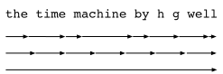
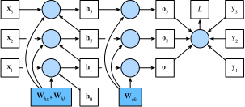

# 8.7 Обратное распространение через время (BPTT)

До сих пор мы многократно упоминали такие понятия, как *взрыв градиентов* и *затухание градиентов*, а также необходимость *отсоединять градиенты* в рекуррентных сетях.
Например, в разделе 8.5 мы вызывали функцию `detach` для последовательности.
Чтобы быстро построить модель и понять, как она работает, мы не давали этим понятиям достаточного объяснения.
В этом разделе подробнее рассмотрим детали обратного распространения для моделей последовательностей и связанную с ним математику.

Когда мы впервые реализовывали рекуррентную нейронную сеть (раздел 8.5), мы столкнулись с проблемой взрыва градиентов.
Если вы решали упражнения, то заметили, что отсечение градиентов крайне важно для сходимости модели.
Чтобы лучше понять эту проблему, в этом разделе мы вспомним, как вычисляются градиенты для моделей последовательностей.
Здесь нет ничего принципиально нового: мы по-прежнему используем цепное правило (правило дифференцирования сложной функции).

В разделе 4.7 мы описали прямое и обратное распространение для многослойного перцептрона и соответствующие вычислительные графы.
В рекуррентной сети прямое распространение устроено относительно просто.
*Обратное распространение через время* (backpropagation through time, BPTT) (Werbos, 1990) — это частный случай обратного распространения для рекуррентных нейронных сетей.
Оно требует разворачивать вычислительный граф рекуррентной сети по одному временному шагу, чтобы получить зависимости между переменными модели и параметрами.
Затем, используя цепное правило, применяем обратное распространение для вычисления и сохранения градиентов.
Поскольку последовательность может быть довольно длинной, длинными могут быть и зависимости.
Например, в последовательности из 1000 символов первый токен может сильно влиять на токен в конце.
Такой расчёт невыполним на практике: он требует слишком много времени и памяти, а градиент получается через произведение более чем тысячи матриц и оказывается крайне неустойчивым.
Процесс сопровождается и вычислительными, и статистическими неопределённостями.
Ниже мы выясним, что происходит, и разберём, как решать эти проблемы на практике.

## 8.7.1 Анализ градиентов в рекуррентных нейронных сетях

Начнём с упрощённой модели, описывающей работу рекуррентной нейронной сети.
Эта модель не учитывает всех особенностей скрытого состояния и деталей его обновления.
Математическая запись здесь не различает явно скаляры, векторы и матрицы, поскольку для анализа эти детали не важны, а только усложнили бы обозначения.

В упрощённой модели скрытое состояние на временном шаге $t$ обозначим $h_t$, вход — $x_t$, выход — $o_t$.
Вспомним обсуждение в разделе 8.4.2: вход и скрытое состояние можно объединить и умножить на один весовой параметр скрытого слоя.
Поэтому веса скрытого и выходного слоёв обозначим $w_h$ и $w_o$ соответственно.
Скрытое состояние и выход на каждом временном шаге записываются так:

$$\begin{aligned}h_t &= f(x_t, h_{t-1}, w_h),\\o_t &= g(h_t, w_o),\end{aligned}\tag{8.7.1}$$

где $f$ и $g$ — преобразования скрытого и выходного слоёв соответственно.
Таким образом, у нас есть цепочка $\{\ldots, (x_{t-1}, h_{t-1}, o_{t-1}), (x_{t}, h_{t}, o_t), \ldots\}$, в которой элементы зависят друг от друга через рекуррентные вычисления.
Прямое распространение устроено просто: мы поочерёдно проходим тройки $(x_t, h_t, o_t)$ по временным шагам, а затем с помощью целевой функции оцениваем разницу между выходами $o_t$ и соответствующими метками $y_t$ на всех $T$ временных шагах:

$$L(x_1, \ldots, x_T, y_1, \ldots, y_T, w_h, w_o) = \frac{1}{T}\sum_{t=1}^T l(y_t, o_t).$$

Для обратного распространения возникают более сложные вопросы, особенно при вычислении градиента целевой функции $L$ по параметру $w_h$.
Согласно цепному правилу:

$$\begin{aligned}\frac{\partial L}{\partial w_h}  & = \frac{1}{T}\sum_{t=1}^T \frac{\partial l(y_t, o_t)}{\partial w_h}  \\& = \frac{1}{T}\sum_{t=1}^T \frac{\partial l(y_t, o_t)}{\partial o_t} \frac{\partial g(h_t, w_o)}{\partial h_t}  \frac{\partial h_t}{\partial w_h}.\end{aligned}\tag{8.7.2}$$

В (8.7.2) первый и второй множители вычисляются легко, а вот третий, $\partial h_t/\partial w_h$, создаёт трудности: нужно рекуррентно учесть влияние параметра $w_h$ на $h_t$.
Согласно рекуррентной формуле (8.7.1), $h_t$ зависит и от $h_{t-1}$, и от $w_h$, причём само $h_{t-1}$ тоже зависит от $w_h$.
Поэтому по цепному правилу получаем:

$$\frac{\partial h_t}{\partial w_h}= \frac{\partial f(x_{t},h_{t-1},w_h)}{\partial w_h} +\frac{\partial f(x_{t},h_{t-1},w_h)}{\partial h_{t-1}} \frac{\partial h_{t-1}}{\partial w_h}.\tag{8.7.3}$$

Чтобы вывести эти градиенты, рассмотрим три последовательности $\{a_{t}\},\{b_{t}\},\{c_{t}\}$, для которых при $t=1,2,\ldots$ выполнено $a_{0}=0$ и $a_{t}=b_{t}+c_{t}a_{t-1}$.
Для $t\geq 1$ легко получить:

$$a_{t}=b_{t}+\sum_{i=1}^{t-1}\left(\prod_{j=i+1}^{t}c_{j}\right)b_{i}.\tag{8.7.4}$$

Подставим вместо $a_t$, $b_t$ и $c_t$ следующие выражения:

$$\begin{aligned}a_t &= \frac{\partial h_t}{\partial w_h},\\
b_t &= \frac{\partial f(x_{t},h_{t-1},w_h)}{\partial w_h}, \\
c_t &= \frac{\partial f(x_{t},h_{t-1},w_h)}{\partial h_{t-1}},\end{aligned}$$

Тогда градиент в (8.7.3) удовлетворяет соотношению $a_{t}=b_{t}+c_{t}a_{t-1}$.
Поэтому для каждого $t$ из (8.7.4) мы можем избавиться от рекуррентного вычисления в (8.7.3) и записать:

$$\frac{\partial h_t}{\partial w_h}=\frac{\partial f(x_{t},h_{t-1},w_h)}{\partial w_h}+\sum_{i=1}^{t-1}\left(\prod_{j=i+1}^{t} \frac{\partial f(x_{j},h_{j-1},w_h)}{\partial h_{j-1}} \right) \frac{\partial f(x_{i},h_{i-1},w_h)}{\partial w_h}.\tag{8.7.5}$$

Хотя мы можем рекурсивно вычислять $\partial h_t/\partial w_h$ с помощью цепного правила, при большом $t$ цепочка становится очень длинной.
Нужно найти способ справиться с этой проблемой.

### 8.7.1.1 Полное вычисление

Очевидно, можно просто вычислить всю сумму в (8.7.5).
Однако такое вычисление очень медленное, и градиент может взрываться, поскольку малые изменения начальных условий могут сильно повлиять на результат.
То есть возможен эффект, похожий на эффект бабочки: небольшое изменение начальных условий приводит к непропорционально большому изменению результата.
Для оцениваемой модели это крайне нежелательно: мы ищем оценку, которая хорошо обобщается и устойчива.
Поэтому на практике такой метод почти никогда не используют.

### 8.7.1.2 Усечение по времени

В качестве альтернативы можно усечь сумму в (8.7.5) после $\tau$ шагов.
Именно это мы и делали до сих пор, например при отсоединении градиентов в разделе 8.5.
Это даёт *приближение* истинного градиента: сумма обрывается на $\partial h_{t-\tau}/\partial w_h$.
На практике такой подход работает очень хорошо.
Его обычно называют усечённым обратным распространением через время (Jaeger, 2002).
Благодаря ему модель в основном учитывает краткосрочные влияния, а не долгосрочные.
Это полезно, поскольку смещает оценку в сторону более простых и устойчивых моделей.

### 8.7.1.3 Случайное усечение

Наконец, можно заменить $\partial h_t/\partial w_h$ случайной величиной, которая в среднем даёт правильный результат, но при этом усекает последовательность.
Для этого используется последовательность $\xi_t$, заданная вероятностями $0 \leq \pi_t \leq 1$: $P(\xi_t = 0) = 1-\pi_t$ и $P(\xi_t = \pi_t^{-1}) = \pi_t$, поэтому $E[\xi_t] = 1$.
Подставим её вместо градиента $\partial h_t/\partial w_h$ в (8.7.3):

$$z_t= \frac{\partial f(x_{t},h_{t-1},w_h)}{\partial w_h} +\xi_t \frac{\partial f(x_{t},h_{t-1},w_h)}{\partial h_{t-1}} \frac{\partial h_{t-1}}{\partial w_h}.$$

Из определения $\xi_t$ следует, что $E[z_t] = \partial h_t/\partial w_h$.
Каждый раз, когда $\xi_t = 0$, рекурсивное вычисление обрывается на временном шаге $t$.
В результате получается взвешенная сумма последовательностей разной длины, где длинные последовательности встречаются редко, поэтому им придаётся больший вес.
Эту идею предложили Таллек и Оливье (Tallec and Ollivier, 2017).

### 8.7.1.4 Сравнение стратегий

**Рис. 8.7.1.** Сравнение стратегий вычисления градиентов в RNN: сверху вниз — случайное усечение, обычное усечение, полное вычисление

Рис. 8.7.1 иллюстрирует три стратегии обратного распространения через время при анализе первых символов книги «Машина времени» с помощью рекуррентной нейронной сети:

* первая строка — случайное усечение: текст разбивается на фрагменты разной длины;
* вторая строка — обычное усечение: текст разбивается на подпоследовательности одинаковой длины. Именно это мы делали в экспериментах с рекуррентными сетями;
* третья строка — полное обратное распространение через время: оно приводит к вычислительно неосуществимому выражению.

К сожалению, хотя случайное усечение теоретически привлекательно, на практике оно, вероятно, не лучше обычного усечения по нескольким причинам.
Во-первых, после обратного распространения по нескольким последним временным шагам наблюдений уже достаточно, чтобы уловить реальные зависимости.
Во-вторых, рост дисперсии нивелирует то преимущество, что более длинные временные шаги дают более точный градиент.
В-третьих, нам на самом деле нужны модели, которые учитывают только короткодистанционные взаимодействия.
Поэтому модели нужен именно тот лёгкий эффект регуляризации, который обеспечивает усечённое обратное распространение через время.

## 8.7.2 Детали обратного распространения через время

После общих принципов рассмотрим подробнее обратное распространение через время.
В отличие от анализа из раздела 8.7.1, здесь мы покажем, как вычислить градиенты целевой функции по всем разложенным параметрам модели.
Чтобы упростить изложение, рассмотрим рекуррентную нейронную сеть без параметров смещения, у которой в скрытом слое используется тождественное отображение в качестве функции активации ($\phi(x)=x$).
Для временного шага $t$ пусть вход отдельного примера и соответствующая метка будут $\mathbf{x}_t \in \mathbb{R}^d$ и $y_t$.
Скрытое состояние $\mathbf{h}_t \in \mathbb{R}^h$ и выход $\mathbf{o}_t \in \mathbb{R}^q$ вычисляются так:

$$\begin{aligned}\mathbf{h}_t &= \mathbf{W}_{hx} \mathbf{x}_t + \mathbf{W}_{hh} \mathbf{h}_{t-1},\\
\mathbf{o}_t &= \mathbf{W}_{qh} \mathbf{h}_{t},\end{aligned}$$

где веса имеют размеры $\mathbf{W}_{hx} \in \mathbb{R}^{h \times d}$, $\mathbf{W}_{hh} \in \mathbb{R}^{h \times h}$ и $\mathbf{W}_{qh} \in \mathbb{R}^{q \times h}$.
Пусть $l(\mathbf{o}_t, y_t)$ — функция потерь на временном шаге $t$. Тогда целевая функция — суммарные потери за $T$ временных шагов от начала последовательности — равна:

$$L = \frac{1}{T} \sum_{t=1}^T l(\mathbf{o}_t, y_t).$$

Чтобы визуализировать зависимости между переменными модели и её параметрами во время вычислений рекуррентной сети, можно построить вычислительный граф, показанный на рис. 8.7.2.
Например, вычисление скрытого состояния $\mathbf{h}_3$ на третьем шаге зависит от параметров модели $\mathbf{W}_{hx}$ и $\mathbf{W}_{hh}$, от скрытого состояния предыдущего шага $\mathbf{h}_2$ и от входа текущего шага $\mathbf{x}_3$.

**Рис. 8.7.2.** Граф вычислений, показывающий зависимости в рекуррентной нейронной сети с тремя временными шагами. Незакрашенные прямоугольники — переменные, закрашенные — параметры, кружки — операторы

Как уже было сказано, параметрами модели на рис. 8.7.2 являются $\mathbf{W}_{hx}$, $\mathbf{W}_{hh}$ и $\mathbf{W}_{qh}$.
Обычно обучение требует вычисления градиентов по этим параметрам: $\partial L/\partial \mathbf{W}_{hx}$, $\partial L/\partial \mathbf{W}_{hh}$ и $\partial L/\partial \mathbf{W}_{qh}$.
По зависимостям на рис. 8.7.2 можно обходить вычислительный граф против направления стрелок и последовательно вычислять и сохранять градиенты.
Чтобы гибко представлять умножение матриц, векторов и скаляров различных форм в цепном правиле, мы используем оператор $\text{prod}$, описанный в разделе 4.7.

Сначала отметим, что в любой момент времени $t$ дифференцирование целевой функции по выходу модели вычисляется довольно просто:

$$\frac{\partial L}{\partial \mathbf{o}_t} =  \frac{\partial l (\mathbf{o}_t, y_t)}{T \cdot \partial \mathbf{o}_t} \in \mathbb{R}^q.\tag{8.7.6}$$

Теперь можно вычислить градиент целевой функции по параметру выходного слоя $\mathbf{W}_{qh}$: $\partial L/\partial \mathbf{W}_{qh} \in \mathbb{R}^{q \times h}$.
По рис. 8.7.2 целевая функция $L$ зависит от $\mathbf{W}_{qh}$ через $\mathbf{o}_1, \ldots, \mathbf{o}_T$.
По цепному правилу получаем:

$$
\frac{\partial L}{\partial \mathbf{W}_{qh}}
= \sum_{t=1}^T \text{prod}\left(\frac{\partial L}{\partial \mathbf{o}_t}, \frac{\partial \mathbf{o}_t}{\partial \mathbf{W}_{qh}}\right)
= \sum_{t=1}^T \frac{\partial L}{\partial \mathbf{o}_t} \mathbf{h}_t^\top,
$$

где $\partial L/\partial \mathbf{o}_t$ задаётся формулой (8.7.6).

Далее, как видно на рис. 8.7.2, на последнем временном шаге $T$ целевая функция $L$ зависит от скрытого состояния $\mathbf{h}_T$ только через $\mathbf{o}_T$.
Поэтому по цепному правилу градиент $\partial L/\partial \mathbf{h}_T \in \mathbb{R}^h$ вычисляется легко:

$$\frac{\partial L}{\partial \mathbf{h}_T} = \text{prod}\left(\frac{\partial L}{\partial \mathbf{o}_T}, \frac{\partial \mathbf{o}_T}{\partial \mathbf{h}_T} \right) = \mathbf{W}_{qh}^\top \frac{\partial L}{\partial \mathbf{o}_T}.\tag{8.7.7}$$

Когда целевая функция $L$ зависит от $\mathbf{h}_t$ через $\mathbf{h}_{t+1}$ и $\mathbf{o}_t$, для любого временного шага $t < T$ всё становится сложнее.
По цепному правилу градиент скрытого состояния $\partial L/\partial \mathbf{h}_t \in \mathbb{R}^h$ при любом $t < T$ можно вычислить рекурсивно:

$$\frac{\partial L}{\partial \mathbf{h}_t} = \text{prod}\left(\frac{\partial L}{\partial \mathbf{h}_{t+1}}, \frac{\partial \mathbf{h}_{t+1}}{\partial \mathbf{h}_t} \right) + \text{prod}\left(\frac{\partial L}{\partial \mathbf{o}_t}, \frac{\partial \mathbf{o}_t}{\partial \mathbf{h}_t} \right) = \mathbf{W}_{hh}^\top \frac{\partial L}{\partial \mathbf{h}_{t+1}} + \mathbf{W}_{qh}^\top \frac{\partial L}{\partial \mathbf{o}_t}.\tag{8.7.8}$$

Для анализа раскроем рекурсию (8.7.8) для любого временного шага $1 \leq t \leq T$:

$$\frac{\partial L}{\partial \mathbf{h}_t}= \sum_{i=t}^T {\left(\mathbf{W}_{hh}^\top\right)}^{T-i} \mathbf{W}_{qh}^\top \frac{\partial L}{\partial \mathbf{o}_{T+t-i}}.\tag{8.7.9}$$

Из (8.7.9) видно, что даже в этом простом линейном примере проявляются ключевые проблемы моделей длинных последовательностей: в выражении возникает потенциально очень большая степень $\mathbf{W}_{hh}^\top$.
В этой степени собственные значения, меньшие 1, исчезают, а большие 1 — расходятся.
Это численно неустойчиво и проявляется в виде затухания или взрыва градиентов.
Одно из решений — ограничить длину временных шагов по соображениям вычислительного удобства, как описано в разделе 8.7.1.
На практике такое усечение реализуется отсоединением градиентов после заданного числа временных шагов.
Позже мы узнаем, как более сложные модели последовательностей (например, LSTM) помогают смягчить эту проблему.

Наконец, из рис. 8.7.2 видно, что целевая функция $L$ зависит от параметров скрытого слоя $\mathbf{W}_{hx}$ и $\mathbf{W}_{hh}$ через скрытые состояния $\mathbf{h}_1, \ldots, \mathbf{h}_T$.
Чтобы вычислить градиенты $\partial L / \partial \mathbf{W}_{hx} \in \mathbb{R}^{h \times d}$ и $\partial L / \partial \mathbf{W}_{hh} \in \mathbb{R}^{h \times h}$, применим цепное правило:

$$
\begin{aligned}
\frac{\partial L}{\partial \mathbf{W}_{hx}}
&= \sum_{t=1}^T \text{prod}\left(\frac{\partial L}{\partial \mathbf{h}_t}, \frac{\partial \mathbf{h}_t}{\partial \mathbf{W}_{hx}}\right)
= \sum_{t=1}^T \frac{\partial L}{\partial \mathbf{h}_t} \mathbf{x}_t^\top,\\
\frac{\partial L}{\partial \mathbf{W}_{hh}}
&= \sum_{t=1}^T \text{prod}\left(\frac{\partial L}{\partial \mathbf{h}_t}, \frac{\partial \mathbf{h}_t}{\partial \mathbf{W}_{hh}}\right)
= \sum_{t=1}^T \frac{\partial L}{\partial \mathbf{h}_t} \mathbf{h}_{t-1}^\top,
\end{aligned}
$$

где $\partial L/\partial \mathbf{h}_t$ вычисляется рекурсивно по формулам (8.7.7) и (8.7.8) и является ключевой величиной, определяющей численную устойчивость.

Как мы объясняли в разделе 4.7, обратное распространение через время — это способ применения обратного распространения к рекуррентным нейронным сетям, поэтому обучение такой сети чередует прямое распространение и обратное распространение через время.
Обратное распространение через время последовательно вычисляет и сохраняет указанные градиенты.
В частности, сохранённые промежуточные значения повторно используются, чтобы не вычислять их заново; например, сохраняется $\partial L/\partial \mathbf{h}_t$, которое затем используется при вычислении $\partial L / \partial \mathbf{W}_{hx}$ и $\partial L / \partial \mathbf{W}_{hh}$.

## Резюме

* «Обратное распространение через время» применяется только к обратному распространению в моделях последовательностей со скрытыми состояниями.
* Усечение нужно для вычислительного удобства и численной устойчивости. Существует два вида усечения: обычное и случайное.
* Высокие степени матриц могут приводить к расхождению или затуханию собственных значений, что проявляется как взрыв или затухание градиентов.
* Для эффективности вычислений обратное распространение через время кэширует промежуточные значения во время вычислений.

## Упражнения

1. Пусть у нас есть симметричная матрица $\mathbf{M} \in \mathbb{R}^{n \times n}$ с собственными значениями $\lambda_i$ и соответствующими собственными векторами $\mathbf{v}_i$ ($i = 1, \ldots, n$). Обычно считается, что собственные значения упорядочены так, что $|\lambda_i| \geq |\lambda_{i+1}|$.
    1. Докажите, что $\mathbf{M}^k$ имеет собственные значения $\lambda_i^k$.
    1. Докажите, что для случайного вектора $\mathbf{x} \in \mathbb{R}^n$ вектор $\mathbf{M}^k \mathbf{x}$ с высокой вероятностью будет лежать на одной прямой с собственным вектором $\mathbf{v}_1$ матрицы $\mathbf{M}$. Формализуйте это доказательство.
    1. Что означают полученные результаты для градиентов в рекуррентных нейронных сетях?
1. Существуют ли, кроме отсечения градиентов, другие способы борьбы со взрывом градиентов в рекуррентных нейронных сетях?

[Обсуждение](https://discuss.d2l.ai/t/2107)

## Литература

* Werbos, P. J. (1990). Backpropagation through time: What it does and how to do it. *Proceedings of the IEEE*, 78(10), 1550–1560.
* Jaeger, H. (2002). *Tutorial on training recurrent neural networks, covering BPPT, RTRL, EKF and the "echo state network" approach* (Vol. 5). GMD-Forschungszentrum Informationstechnik Bonn.
* Tallec, C., & Ollivier, Y. (2017). Unbiasing truncated backpropagation through time. *arXiv preprint arXiv:1705.08209*.
