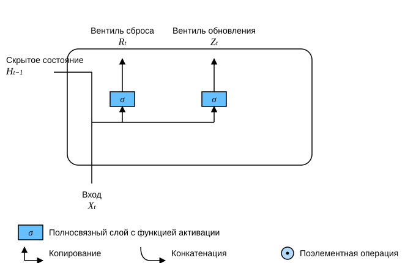
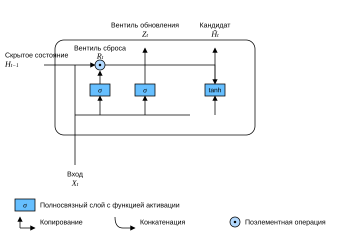
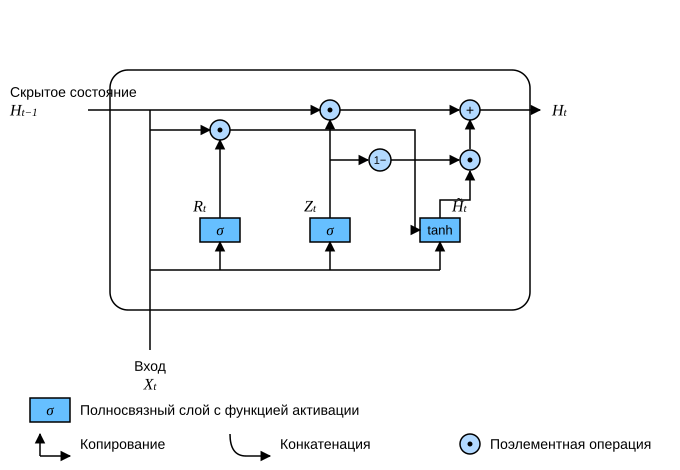

# 9.1 Управляемый рекуррентный блок (GRU)

В разделе 8.7 мы рассмотрели, как вычисляются градиенты в рекуррентных нейронных сетях, и выяснили, что многократное умножение матриц может приводить к затуханию или взрыву градиентов. Посмотрим, что это значит на практике:

* Может сложиться ситуация, когда ранние наблюдения очень важны для прогнозирования всех последующих. Рассмотрим крайний случай: первое наблюдение содержит контрольную сумму, а цель — в конце последовательности определить, верна ли она. В этом случае влияние первого токена критически важно. Хотелось бы иметь механизм, который сохраняет важную раннюю информацию в *ячейке памяти*. Без такого механизма пришлось бы приписывать этому наблюдению очень большой градиент, поскольку оно влияет на все последующие наблюдения.
* Может сложиться ситуация, когда некоторые токены не несут полезной информации. Например, при анализе тональности веб-страницы вспомогательный HTML-код может не иметь отношения к эмоциям, которые передаёт страница. Хотелось бы иметь механизм, который *пропускает* такие токены при вычислении скрытого состояния.
* Может сложиться ситуация, когда между частями последовательности есть логический разрыв. Например, между главами книги или между периодами «медвежьего» и «бычьего» рынка ценных бумаг. В таком случае полезно иметь способ *сбросить* внутреннее представление состояния.

Для решения таких проблем в научной литературе предложено много методов. Одним из самых ранних была долгая краткосрочная память (long short-term memory, LSTM) (Hochreiter и Schmidhuber, 1997), которую мы рассмотрим в разделе 9.2. *Управляемый рекуррентный блок* (gated recurrent unit, GRU) (Cho et al., 2014) — это немного упрощённый вариант LSTM, который обычно даёт сопоставимое качество, но вычисляется заметно быстрее (Chung et al., 2014). Поскольку управляемый блок проще, начнём с него.

## Управление скрытым состоянием

Ключевое отличие управляемого рекуррентного блока от обычной рекуррентной нейронной сети в том, что первый поддерживает управление скрытым состоянием. Это значит, что у модели есть специальные механизмы, которые определяют, когда скрытое состояние нужно обновлять, а когда — сбрасывать. Эти механизмы обучаемые, и с их помощью можно решить перечисленные выше проблемы. Например, если первый токен очень важен, модель научится не обновлять скрытое состояние после первого наблюдения. Так же она научится пропускать нерелевантные наблюдения. Наконец, модель научится сбрасывать скрытое состояние, когда это потребуется. Подробнее о каждом из управляющих механизмов — ниже.

### Вентиль сброса и вентиль обновления

Начнём с *вентиля сброса* (reset gate) и *вентиля обновления* (update gate). Спроектируем их как векторы со значениями из интервала $(0, 1)$, чтобы можно было строить выпуклые комбинации. Вентиль сброса позволяет контролировать, сколько из прошлого состояния, которое, возможно, ещё понадобится, нужно учесть. Вентиль обновления позволяет определить, какая часть нового состояния является копией старого.

На рис. 9.1.1 показано, как вентиль сброса и вентиль обновления получают входные данные: и тот и другой вычисляются по входу текущего временного шага и скрытому состоянию предыдущего шага. Выходы обоих вентилей формируются двумя полносвязными слоями с сигмоидной функцией активации.



Рассмотрим математическую запись управляемого рекуррентного блока. Для временного шага $t$ пусть вход — это мини-батч $\mathbf{X}_t \in \mathbb{R}^{n \times d}$ (число примеров $n$, число входов $d$), а скрытое состояние предыдущего шага — $\mathbf{H}_{t-1} \in \mathbb{R}^{n \times h}$ (число скрытых элементов $h$). Тогда вентиль сброса $\mathbf{R}_t \in \mathbb{R}^{n \times h}$ и вентиль обновления $\mathbf{Z}_t \in \mathbb{R}^{n \times h}$ вычисляются так:

$$
\begin{aligned}
\mathbf{R}_t = \sigma(\mathbf{X}_t \mathbf{W}_{xr} + \mathbf{H}_{t-1} \mathbf{W}_{hr} + \mathbf{b}_r),\\
\mathbf{Z}_t = \sigma(\mathbf{X}_t \mathbf{W}_{xz} + \mathbf{H}_{t-1} \mathbf{W}_{hz} + \mathbf{b}_z),
\end{aligned}
$$

где $\mathbf{W}_{xr}, \mathbf{W}_{xz} \in \mathbb{R}^{d \times h}$ и $\mathbf{W}_{hr}, \mathbf{W}_{hz} \in \mathbb{R}^{h \times h}$ — весовые параметры, а $\mathbf{b}_r, \mathbf{b}_z \in \mathbb{R}^{1 \times h}$ — параметры смещения. Обратите внимание, что при суммировании срабатывает механизм broadcasting (см. раздел 2.1.3). Чтобы перевести значения в интервал $(0, 1)$, мы используем сигмоидную функцию (см. раздел 4.1).

### Кандидат скрытого состояния

Далее объединим вентиль сброса $\mathbf{R}_t$ с обычным механизмом обновления скрытого состояния из (8.4.3) и получим *кандидат скрытого состояния* (candidate hidden state) $\tilde{\mathbf{H}}_t \in \mathbb{R}^{n \times h}$ на временном шаге $t$:

$$\tilde{\mathbf{H}}_t = \tanh(\mathbf{X}_t \mathbf{W}_{xh} + \left(\mathbf{R}_t \odot \mathbf{H}_{t-1}\right) \mathbf{W}_{hh} + \mathbf{b}_h),\tag{9.1.1}$$

где $\mathbf{W}_{xh} \in \mathbb{R}^{d \times h}$ и $\mathbf{W}_{hh} \in \mathbb{R}^{h \times h}$ — весовые параметры, $\mathbf{b}_h \in \mathbb{R}^{1 \times h}$ — параметр смещения, а символ $\odot$ обозначает поэлементное произведение (произведение Адамара). Здесь мы используем нелинейность tanh, чтобы значения кандидата оставались в интервале $(-1, 1)$.

По сравнению с (8.4.3) в (9.1.1) элементы $\mathbf{R}_t$ и $\mathbf{H}_{t-1}$ перемножаются поэлементно, и это уменьшает влияние прошлых состояний. Когда элементы вентиля сброса $\mathbf{R}_t$ близки к $1$, мы возвращаемся к обычной рекуррентной нейронной сети из (8.4.3). Для элементов $\mathbf{R}_t$, близких к $0$, кандидат скрытого состояния — это результат многослойного перцептрона, которому подан только вход $\mathbf{X}_t$. Значит, любое предыдущее скрытое состояние сбрасывается до значения по умолчанию.

На рис. 9.1.2 показан порядок вычислений после применения вентиля сброса.



### Скрытое состояние

Результат выше — это только кандидат скрытого состояния, и теперь нужно учесть действие вентиля обновления $\mathbf{Z}_t$. Этот шаг определяет, в какой мере новое скрытое состояние $\mathbf{H}_t \in \mathbb{R}^{n \times h}$ берётся из старого $\mathbf{H}_{t-1}$, а в какой — из нового кандидата $\tilde{\mathbf{H}}_t$. Для этого достаточно поэлементно построить выпуклую комбинацию $\mathbf{H}_{t-1}$ и $\tilde{\mathbf{H}}_t$, которую задаёт вентиль обновления $\mathbf{Z}_t$. Так получается итоговая формула управляемого рекуррентного блока:

$$\mathbf{H}_t = \mathbf{Z}_t \odot \mathbf{H}_{t-1}  + (1 - \mathbf{Z}_t) \odot \tilde{\mathbf{H}}_t.$$

Когда вентиль обновления $\mathbf{Z}_t$ близок к $1$, модель склонна сохранять старое состояние. В этом случае информация из $\mathbf{X}_t$ по существу игнорируется, и шаг $t$ эффективно пропускается в цепочке зависимостей. Наоборот, когда $\mathbf{Z}_t$ близок к $0$, новое скрытое состояние $\mathbf{H}_t$ приближается к кандидату $\tilde{\mathbf{H}}_t$. Эти свойства помогают справиться с проблемой затухания градиентов в рекуррентных нейронных сетях и лучше улавливать зависимости между далеко расположенными временными шагами. Например, если вентиль обновления близок к $1$ на всех шагах некоторого подотрезка, то старое скрытое состояние из начала последовательности легко сохраняется и передаётся до её конца, независимо от длины последовательности.

На рис. 9.1.3 показано, как действие вентиля обновления влияет на поток вычислений.



Итак, у управляемого рекуррентного блока две заметные особенности:

* вентиль сброса помогает улавливать краткосрочные зависимости в последовательности;
* вентиль обновления помогает улавливать долгосрочные зависимости в последовательности.

## Реализация с нуля

Чтобы лучше понять модель управляемого рекуррентного блока, реализуем её с нуля. Сначала загрузим набор данных «Машина времени», который использовали в разделе 8.5:

**MXNet:**

```python
from d2l import mxnet as d2l
from mxnet import np, npx
from mxnet.gluon import rnn
npx.set_np()

batch_size, num_steps = 32, 35
train_iter, vocab = d2l.load_data_time_machine(batch_size, num_steps)
```

**PyTorch:**

```python
from d2l import torch as d2l
import torch
from torch import nn

batch_size, num_steps = 32, 35
train_iter, vocab = d2l.load_data_time_machine(batch_size, num_steps)
```

**TensorFlow:**

```python
from d2l import tensorflow as d2l
import tensorflow as tf

batch_size, num_steps = 32, 35
train_iter, vocab = d2l.load_data_time_machine(batch_size, num_steps)
```

**PaddlePaddle:**

```python
from d2l import paddle as d2l
import warnings
warnings.filterwarnings("ignore")
import paddle
import paddle.nn.functional as F
from paddle import nn

batch_size, num_steps = 32, 35
train_iter, vocab = d2l.load_data_time_machine(batch_size, num_steps)
```

### Инициализация параметров модели

Следующий шаг — инициализация параметров модели. Веса мы извлекаем из нормального распределения со стандартным отклонением $0.01$, а параметры смещения полагаем равными $0$. Гиперпараметр `num_hiddens` задаёт число скрытых элементов. Создадим все веса и смещения, связанные с вентилем обновления, вентилем сброса, кандидатом скрытого состояния и выходным слоем.

**MXNet:**

```python
def get_params(vocab_size, num_hiddens, device):
    num_inputs = num_outputs = vocab_size

    def normal(shape):
        return np.random.normal(scale=0.01, size=shape, ctx=device)

    def three():
        return (normal((num_inputs, num_hiddens)),
                normal((num_hiddens, num_hiddens)),
                np.zeros(num_hiddens, ctx=device))

    W_xz, W_hz, b_z = three()  # Параметры вентиля обновления
    W_xr, W_hr, b_r = three()  # Параметры вентиля сброса
    W_xh, W_hh, b_h = three()  # Параметры кандидата скрытого состояния
    # Параметры выходного слоя
    W_hq = normal((num_hiddens, num_outputs))
    b_q = np.zeros(num_outputs, ctx=device)
    # Прикрепляем градиенты
    params = [W_xz, W_hz, b_z, W_xr, W_hr, b_r, W_xh, W_hh, b_h, W_hq, b_q]
    for param in params:
        param.attach_grad()
    return params
```

**PyTorch:**

```python
def get_params(vocab_size, num_hiddens, device):
    num_inputs = num_outputs = vocab_size

    def normal(shape):
        return torch.randn(size=shape, device=device)*0.01

    def three():
        return (normal((num_inputs, num_hiddens)),
                normal((num_hiddens, num_hiddens)),
                d2l.zeros(num_hiddens, device=device))

    W_xz, W_hz, b_z = three()  # Параметры вентиля обновления
    W_xr, W_hr, b_r = three()  # Параметры вентиля сброса
    W_xh, W_hh, b_h = three()  # Параметры кандидата скрытого состояния
    # Параметры выходного слоя
    W_hq = normal((num_hiddens, num_outputs))
    b_q = d2l.zeros(num_outputs, device=device)
    # Прикрепляем градиенты
    params = [W_xz, W_hz, b_z, W_xr, W_hr, b_r, W_xh, W_hh, b_h, W_hq, b_q]
    for param in params:
        param.requires_grad_(True)
    return params
```

**TensorFlow:**

```python
def get_params(vocab_size, num_hiddens):
    num_inputs = num_outputs = vocab_size

    def normal(shape):
        return d2l.normal(shape=shape,stddev=0.01,mean=0,dtype=tf.float32)

    def three():
        return (tf.Variable(normal((num_inputs, num_hiddens)), dtype=tf.float32),
                tf.Variable(normal((num_hiddens, num_hiddens)), dtype=tf.float32),
                tf.Variable(d2l.zeros(num_hiddens), dtype=tf.float32))

    W_xz, W_hz, b_z = three()  # Параметры вентиля обновления
    W_xr, W_hr, b_r = three()  # Параметры вентиля сброса
    W_xh, W_hh, b_h = three()  # Параметры кандидата скрытого состояния
    # Параметры выходного слоя
    W_hq = tf.Variable(normal((num_hiddens, num_outputs)), dtype=tf.float32)
    b_q = tf.Variable(d2l.zeros(num_outputs), dtype=tf.float32)
    params = [W_xz, W_hz, b_z, W_xr, W_hr, b_r, W_xh, W_hh, b_h, W_hq, b_q]
    return params
```

**PaddlePaddle:**

```python
def get_params(vocab_size, num_hiddens):
    num_inputs = num_outputs = vocab_size

    def normal(shape):
        return paddle.randn(shape=shape)*0.01

    def three():
        return (normal((num_inputs, num_hiddens)),
                normal((num_hiddens, num_hiddens)),
                paddle.zeros([num_hiddens]))

    W_xz, W_hz, b_z = three()  # Параметры вентиля обновления
    W_xr, W_hr, b_r = three()  # Параметры вентиля сброса
    W_xh, W_hh, b_h = three()  # Параметры кандидата скрытого состояния
    # Параметры выходного слоя
    W_hq = normal((num_hiddens, num_outputs))
    b_q = paddle.zeros([num_outputs])
    # Прикрепляем градиенты
    params = [W_xz, W_hz, b_z, W_xr, W_hr, b_r, W_xh, W_hh, b_h, W_hq, b_q]
    for param in params:
        param.stop_gradient = False
    return params
```

### Определение модели

Теперь определим функцию инициализации скрытого состояния `init_gru_state`. Как и функция `init_rnn_state` из раздела 8.5, она возвращает тензор формы (размер пакета, число скрытых элементов), заполненный нулями.

**MXNet:**

```python
def init_gru_state(batch_size, num_hiddens, device):
    return (np.zeros(shape=(batch_size, num_hiddens), ctx=device), )
```

**PyTorch:**

```python
def init_gru_state(batch_size, num_hiddens, device):
    return (torch.zeros((batch_size, num_hiddens), device=device), )
```

**TensorFlow:**

```python
def init_gru_state(batch_size, num_hiddens):
    return (d2l.zeros((batch_size, num_hiddens)), )
```

**PaddlePaddle:**

```python
def init_gru_state(batch_size, num_hiddens):
    return (paddle.zeros([batch_size, num_hiddens]), )
```

Теперь мы готовы определить модель управляемого рекуррентного блока. Её архитектура совпадает с архитектурой базовой рекуррентной ячейки, отличаются только более сложные формулы обновления.

**MXNet:**

```python
def gru(inputs, state, params):
    W_xz, W_hz, b_z, W_xr, W_hr, b_r, W_xh, W_hh, b_h, W_hq, b_q = params
    H, = state
    outputs = []
    for X in inputs:
        Z = npx.sigmoid(np.dot(X, W_xz) + np.dot(H, W_hz) + b_z)
        R = npx.sigmoid(np.dot(X, W_xr) + np.dot(H, W_hr) + b_r)
        H_tilda = np.tanh(np.dot(X, W_xh) + np.dot(R * H, W_hh) + b_h)
        H = Z * H + (1 - Z) * H_tilda
        Y = np.dot(H, W_hq) + b_q
        outputs.append(Y)
    return np.concatenate(outputs, axis=0), (H,)
```

**PyTorch:**

```python
def gru(inputs, state, params):
    W_xz, W_hz, b_z, W_xr, W_hr, b_r, W_xh, W_hh, b_h, W_hq, b_q = params
    H, = state
    outputs = []
    for X in inputs:
        Z = torch.sigmoid((X @ W_xz) + (H @ W_hz) + b_z)
        R = torch.sigmoid((X @ W_xr) + (H @ W_hr) + b_r)
        H_tilda = torch.tanh((X @ W_xh) + ((R * H) @ W_hh) + b_h)
        H = Z * H + (1 - Z) * H_tilda
        Y = H @ W_hq + b_q
        outputs.append(Y)
    return torch.cat(outputs, dim=0), (H,)
```

**TensorFlow:**

```python
def gru(inputs, state, params):
    W_xz, W_hz, b_z, W_xr, W_hr, b_r, W_xh, W_hh, b_h, W_hq, b_q = params
    H, = state
    outputs = []
    for X in inputs:
        X = tf.reshape(X,[-1,W_xh.shape[0]])
        Z = tf.sigmoid(tf.matmul(X, W_xz) + tf.matmul(H, W_hz) + b_z)
        R = tf.sigmoid(tf.matmul(X, W_xr) + tf.matmul(H, W_hr) + b_r)
        H_tilda = tf.tanh(tf.matmul(X, W_xh) + tf.matmul(R * H, W_hh) + b_h)
        H = Z * H + (1 - Z) * H_tilda
        Y = tf.matmul(H, W_hq) + b_q
        outputs.append(Y)
    return tf.concat(outputs, axis=0), (H,)
```

**PaddlePaddle:**

```python
def gru(inputs, state, params):
    W_xz, W_hz, b_z, W_xr, W_hr, b_r, W_xh, W_hh, b_h, W_hq, b_q = params
    H,*_ = state
    outputs = []
    for X in inputs:
        Z = F.sigmoid((X @ W_xz) + (H @ W_hz) + b_z)
        R = F.sigmoid((X @ W_xr) + (H @ W_hr) + b_r)
        H_tilda = paddle.tanh((X @ W_xh) + ((R * H) @ W_hh) + b_h)
        H = Z * H + (1 - Z) * H_tilda
        Y = H @ W_hq + b_q
        outputs.append(Y)
    return paddle.concat(outputs, axis=0), (H,*_)
```

### Обучение и предсказание

Обучение и предсказание выполняются точно так же, как в разделе 8.5. По окончании обучения выведем перплексию на обучающем наборе, а также перплексию предсказанных последовательностей с префиксами «time traveler» и «traveler».

**MXNet, PyTorch:**

```python
vocab_size, num_hiddens, device = len(vocab), 256, d2l.try_gpu()
num_epochs, lr = 500, 1
model = d2l.RNNModelScratch(len(vocab), num_hiddens, device, get_params,
                            init_gru_state, gru)
d2l.train_ch8(model, train_iter, vocab, lr, num_epochs, device)
```

**TensorFlow:**

```python
vocab_size, num_hiddens, device_name = len(vocab), 256, d2l.try_gpu()._device_name
# Определяем стратегию обучения
strategy = tf.distribute.OneDeviceStrategy(device_name)
num_epochs, lr = 500, 1
with strategy.scope():
    model = d2l.RNNModelScratch(len(vocab), num_hiddens, init_gru_state, gru, get_params)

d2l.train_ch8(model, train_iter, vocab, lr, num_epochs, strategy)
```

**PaddlePaddle:**

```python
vocab_size, num_hiddens, device = len(vocab), 256, d2l.try_gpu()
num_epochs, lr = 500, 1.0
model = d2l.RNNModelScratch(len(vocab), num_hiddens, get_params,
                            init_gru_state, gru)
d2l.train_ch8(model, train_iter, vocab, lr, num_epochs, device)
```

## Краткая реализация

Высокоуровневый API содержит все детали, которые мы разбирали выше, поэтому модель управляемого рекуррентного блока можно создать напрямую. Этот код работает значительно быстрее, потому что многие детали обрабатываются скомпилированными операторами, а не кодом на Python.

**MXNet:**

```python
gru_layer = rnn.GRU(num_hiddens)
model = d2l.RNNModel(gru_layer, len(vocab))
d2l.train_ch8(model, train_iter, vocab, lr, num_epochs, device)
```

**PyTorch:**

```python
num_inputs = vocab_size
gru_layer = nn.GRU(num_inputs, num_hiddens)
model = d2l.RNNModel(gru_layer, len(vocab))
model = model.to(device)
d2l.train_ch8(model, train_iter, vocab, lr, num_epochs, device)
```

**TensorFlow:**

```python
gru_cell = tf.keras.layers.GRUCell(num_hiddens,
    kernel_initializer='glorot_uniform')
gru_layer = tf.keras.layers.RNN(gru_cell, time_major=True,
    return_sequences=True, return_state=True)

device_name = d2l.try_gpu()._device_name
strategy = tf.distribute.OneDeviceStrategy(device_name)
with strategy.scope():
    model = d2l.RNNModel(gru_layer, vocab_size=len(vocab))

d2l.train_ch8(model, train_iter, vocab, lr, num_epochs, strategy)
```

**PaddlePaddle:**

```python
num_inputs = vocab_size
gru_layer = nn.GRU(num_inputs, num_hiddens, time_major=True)
model = d2l.RNNModel(gru_layer, len(vocab))
d2l.train_ch8(model, train_iter, vocab, lr, num_epochs, device)
```

## Резюме

* Управляемые рекуррентные нейронные сети могут лучше улавливать зависимости между элементами последовательности, далеко расположенными друг от друга.
* Вентиль сброса помогает улавливать краткосрочные зависимости в последовательности.
* Вентиль обновления помогает улавливать долгосрочные зависимости в последовательности.
* Когда вентиль сброса открыт, управляемый рекуррентный блок ведёт себя как базовая рекуррентная сеть; когда открыт вентиль обновления, блок может пропускать подпоследовательности.

## Упражнения

1. Предположим, мы хотим использовать вход временного шага $t'$ только для предсказания выхода на временном шаге $t > t'$. Каковы оптимальные значения вентилей сброса и обновления на каждом шаге?
1. Настройте гиперпараметры и проанализируйте их влияние на время работы, перплексию и порядок выходных символов.
1. Сравните, как разные реализации `rnn.RNN` и `rnn.GRU` влияют на время работы, перплексию и выходные строки.
1. Что будет, если реализовать только часть управляемого рекуррентного блока, например только вентиль сброса или только вентиль обновления?

**MXNet:**
[Обсуждение](https://discuss.d2l.ai/t/2764)

**PyTorch:**
[Обсуждение](https://discuss.d2l.ai/t/2763)

**PaddlePaddle:**
[Обсуждение](https://discuss.d2l.ai/t/11812)

## Литература

* Hochreiter, S., & Schmidhuber, J. (1997). Long short-term memory. *Neural Computation*, 9(8), 1735–1780.
* Cho, K., Van Merrienboer, B., Bahdanau, D., & Bengio, Y. (2014). On the properties of neural machine translation: Encoder-decoder approaches. *arXiv preprint arXiv:1409.1259*.
* Chung, J., Gulcehre, C., Cho, K., & Bengio, Y. (2014). Empirical evaluation of gated recurrent neural networks on sequence modeling. *arXiv preprint arXiv:1412.3555*.
