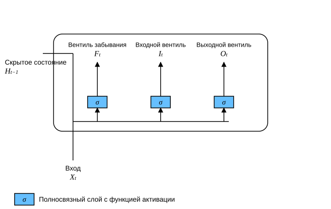
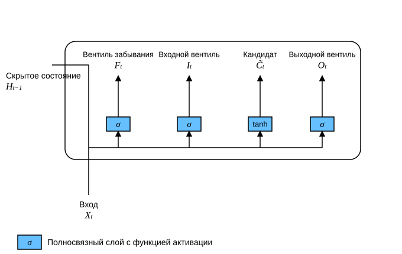
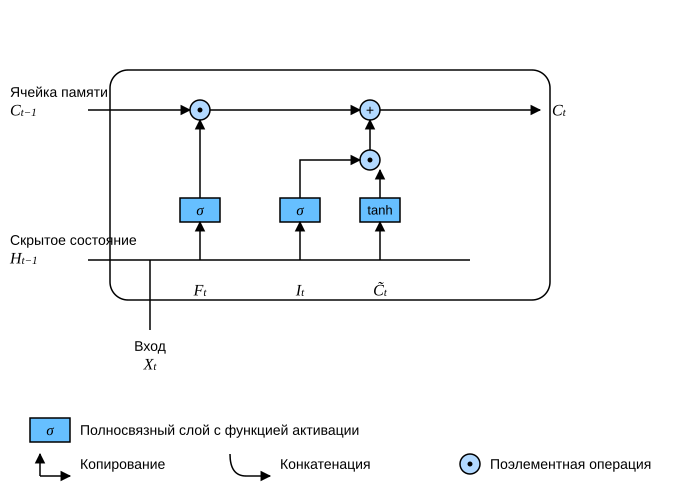
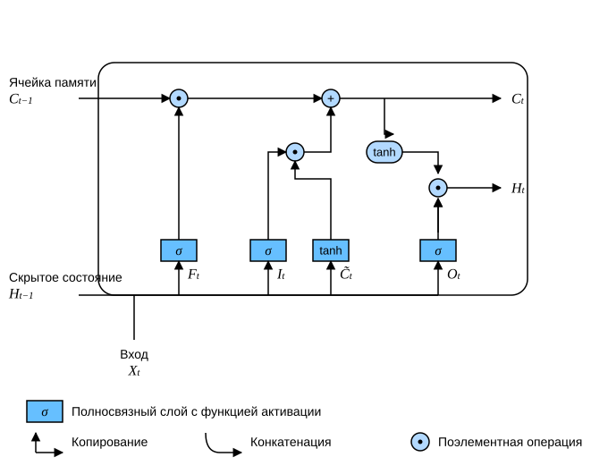

# 9.2 Долгая краткосрочная память (LSTM)

Долгое время у моделей со скрытыми переменными существовала проблема: сложно одновременно сохранять долгосрочную информацию и реагировать на короткие входные данные. Одним из самых ранних решений стала долгая краткосрочная память (long short-term memory, LSTM) (Hochreiter и Schmidhuber, 1997). У неё много общих свойств с управляемым рекуррентным блоком (раздел 9.1). Любопытно, что архитектура LSTM немного сложнее, чем у GRU, однако появилась она почти на двадцать лет раньше.

## Ячейка памяти с вентилями

Архитектура LSTM, по-видимому, вдохновлена логическими вентилями компьютеров. LSTM вводит *ячейку памяти* (memory cell), или просто *ячейку* (cell). Некоторые авторы считают ячейку памяти особым видом скрытого состояния: у неё та же форма, что и у скрытого состояния, но предназначена она для хранения дополнительной информации. Чтобы управлять ячейкой памяти, нужно несколько вентилей. Один из них выводит содержимое ячейки наружу — это *выходной вентиль* (output gate). Другой решает, когда данные записываются в ячейку, — это *входной вентиль* (input gate). Нам также нужен механизм, который сбрасывает содержимое ячейки; им управляет *вентиль забывания* (forget gate). Мотивация та же, что и у управляемого рекуррентного блока: специальный механизм решает, когда запоминать входные данные или игнорировать их. Посмотрим, как это работает на практике.

### Входной вентиль, вентиль забывания и выходной вентиль

Как и в управляемом рекуррентном блоке, входом для вентилей служат входные данные текущего временного шага и скрытое состояние предыдущего шага (рис. 9.2.1). Эти данные обрабатываются тремя полносвязными слоями с сигмоидной функцией активации, которые вычисляют значения входного вентиля, вентиля забывания и выходного вентиля. Поэтому значения всех трёх вентилей лежат в интервале $(0, 1)$.



Уточним математическую запись LSTM. Пусть есть $h$ скрытых элементов, размер пакета равен $n$, а число входов — $d$. Тогда вход — это $\mathbf{X}_t \in \mathbb{R}^{n \times d}$, а скрытое состояние предыдущего шага — $\mathbf{H}_{t-1} \in \mathbb{R}^{n \times h}$. Соответственно, вентили на временном шаге $t$ определяются так: входной вентиль — $\mathbf{I}_t \in \mathbb{R}^{n \times h}$, вентиль забывания — $\mathbf{F}_t \in \mathbb{R}^{n \times h}$, выходной вентиль — $\mathbf{O}_t \in \mathbb{R}^{n \times h}$. Их значения вычисляются по формулам:

$$
\begin{aligned}
\mathbf{I}_t &= \sigma(\mathbf{X}_t \mathbf{W}_{xi} + \mathbf{H}_{t-1} \mathbf{W}_{hi} + \mathbf{b}_i),\\
\mathbf{F}_t &= \sigma(\mathbf{X}_t \mathbf{W}_{xf} + \mathbf{H}_{t-1} \mathbf{W}_{hf} + \mathbf{b}_f),\\
\mathbf{O}_t &= \sigma(\mathbf{X}_t \mathbf{W}_{xo} + \mathbf{H}_{t-1} \mathbf{W}_{ho} + \mathbf{b}_o),
\end{aligned}
$$

где $\mathbf{W}_{xi}, \mathbf{W}_{xf}, \mathbf{W}_{xo} \in \mathbb{R}^{d \times h}$ и $\mathbf{W}_{hi}, \mathbf{W}_{hf}, \mathbf{W}_{ho} \in \mathbb{R}^{h \times h}$ — весовые параметры, а $\mathbf{b}_i, \mathbf{b}_f, \mathbf{b}_o \in \mathbb{R}^{1 \times h}$ — параметры смещения.

### Кандидат ячейки памяти

Поскольку работа вентилей пока не определена, сначала введём *кандидат ячейки памяти* (candidate memory cell) $\tilde{\mathbf{C}}_t \in \mathbb{R}^{n \times h}$. Его вычисление похоже на вычисление трёх вентилей, но в качестве функции активации используется $\tanh$, и значения лежат в интервале $(-1, 1)$. Уравнение на временном шаге $t$ имеет вид:

$$\tilde{\mathbf{C}}_t = \text{tanh}(\mathbf{X}_t \mathbf{W}_{xc} + \mathbf{H}_{t-1} \mathbf{W}_{hc} + \mathbf{b}_c),$$

где $\mathbf{W}_{xc} \in \mathbb{R}^{d \times h}$ и $\mathbf{W}_{hc} \in \mathbb{R}^{h \times h}$ — весовые параметры, а $\mathbf{b}_c \in \mathbb{R}^{1 \times h}$ — параметр смещения.

Кандидат ячейки памяти показан на рис. 9.2.2.



### Ячейка памяти

В управляемом рекуррентном блоке есть механизм, который контролирует запись новых данных и забывание старых. В LSTM есть похожая пара вентилей: входной вентиль $\mathbf{I}_t$ определяет, сколько новых данных из $\tilde{\mathbf{C}}_t$ нужно учесть, а вентиль забывания $\mathbf{F}_t$ — сколько содержимого прошлой ячейки памяти $\mathbf{C}_{t-1} \in \mathbb{R}^{n \times h}$ сохранить. С помощью поэлементного умножения получаем:

$$\mathbf{C}_t = \mathbf{F}_t \odot \mathbf{C}_{t-1} + \mathbf{I}_t \odot \tilde{\mathbf{C}}_t.$$

Если вентиль забывания всегда равен $1$, а входной вентиль — $0$, то прошлая ячейка памяти $\mathbf{C}_{t-1}$ сохраняется во времени и передаётся на текущий временной шаг. Такая конструкция введена, чтобы смягчить проблему затухания градиентов и лучше улавливать зависимости на больших расстояниях в последовательности.

Схема вычисления ячейки памяти показана на рис. 9.2.3.



### Скрытое состояние

Наконец, нужно определить, как вычисляется скрытое состояние $\mathbf{H}_t \in \mathbb{R}^{n \times h}$. Здесь вступает в действие выходной вентиль. В LSTM скрытое состояние — это управляемая версия $\tanh$ от ячейки памяти. Это гарантирует, что значения $\mathbf{H}_t$ всегда лежат в интервале $(-1, 1)$:

$$\mathbf{H}_t = \mathbf{O}_t \odot \tanh(\mathbf{C}_t).$$

Когда выходной вентиль близок к $1$, вся информация из памяти передаётся в блок предсказаний. Когда же выходной вентиль близок к $0$, вся информация остаётся внутри ячейки памяти, а скрытое состояние не обновляется.

На рис. 9.2.4 показана схема движения данных.



## Реализация с нуля

Теперь реализуем LSTM с нуля. Как и в эксперименте из раздела 8.5, сначала загрузим набор данных «Машина времени»:

**MXNet:**

```python
from d2l import mxnet as d2l
from mxnet import np, npx
from mxnet.gluon import rnn
npx.set_np()

batch_size, num_steps = 32, 35
train_iter, vocab = d2l.load_data_time_machine(batch_size, num_steps)
```

**PyTorch:**

```python
from d2l import torch as d2l
import torch
from torch import nn

batch_size, num_steps = 32, 35
train_iter, vocab = d2l.load_data_time_machine(batch_size, num_steps)
```

**TensorFlow:**

```python
from d2l import tensorflow as d2l
import tensorflow as tf
batch_size, num_steps = 32, 35
train_iter, vocab = d2l.load_data_time_machine(batch_size, num_steps)
```

**PaddlePaddle:**

```python
from d2l import paddle as d2l
import warnings
warnings.filterwarnings("ignore")
import paddle
from paddle import nn
import paddle.nn.functional as Function

batch_size, num_steps = 32, 35
train_iter, vocab = d2l.load_data_time_machine(batch_size, num_steps)
```

### Инициализация параметров модели

Далее определим и инициализируем параметры модели. Как и раньше, гиперпараметр `num_hiddens` задаёт число скрытых элементов. Веса инициализируем из нормального распределения со стандартным отклонением $0.01$, а параметры смещения полагаем равными $0$.

**MXNet:**

```python
def get_lstm_params(vocab_size, num_hiddens, device):
    num_inputs = num_outputs = vocab_size

    def normal(shape):
        return np.random.normal(scale=0.01, size=shape, ctx=device)

    def three():
        return (normal((num_inputs, num_hiddens)),
                normal((num_hiddens, num_hiddens)),
                np.zeros(num_hiddens, ctx=device))

    W_xi, W_hi, b_i = three()  # Параметры входного вентиля
    W_xf, W_hf, b_f = three()  # Параметры вентиля забывания
    W_xo, W_ho, b_o = three()  # Параметры выходного вентиля
    W_xc, W_hc, b_c = three()  # Параметры кандидата ячейки памяти
    # Параметры выходного слоя
    W_hq = normal((num_hiddens, num_outputs))
    b_q = np.zeros(num_outputs, ctx=device)
    # Прикрепляем градиенты
    params = [W_xi, W_hi, b_i, W_xf, W_hf, b_f, W_xo, W_ho, b_o, W_xc, W_hc,
              b_c, W_hq, b_q]
    for param in params:
        param.attach_grad()
    return params
```

**PyTorch:**

```python
def get_lstm_params(vocab_size, num_hiddens, device):
    num_inputs = num_outputs = vocab_size

    def normal(shape):
        return torch.randn(size=shape, device=device)*0.01

    def three():
        return (normal((num_inputs, num_hiddens)),
                normal((num_hiddens, num_hiddens)),
                d2l.zeros(num_hiddens, device=device))

    W_xi, W_hi, b_i = three()  # Параметры входного вентиля
    W_xf, W_hf, b_f = three()  # Параметры вентиля забывания
    W_xo, W_ho, b_o = three()  # Параметры выходного вентиля
    W_xc, W_hc, b_c = three()  # Параметры кандидата ячейки памяти
    # Параметры выходного слоя
    W_hq = normal((num_hiddens, num_outputs))
    b_q = d2l.zeros(num_outputs, device=device)
    # Прикрепляем градиенты
    params = [W_xi, W_hi, b_i, W_xf, W_hf, b_f, W_xo, W_ho, b_o, W_xc, W_hc,
              b_c, W_hq, b_q]
    for param in params:
        param.requires_grad_(True)
    return params
```

**TensorFlow:**

```python
def get_lstm_params(vocab_size, num_hiddens):
    num_inputs = num_outputs = vocab_size

    def normal(shape):
        return tf.Variable(tf.random.normal(shape=shape, stddev=0.01,
                                            mean=0, dtype=tf.float32))
    def three():
        return (normal((num_inputs, num_hiddens)),
                normal((num_hiddens, num_hiddens)),
                tf.Variable(tf.zeros(num_hiddens), dtype=tf.float32))

    W_xi, W_hi, b_i = three()  # Параметры входного вентиля
    W_xf, W_hf, b_f = three()  # Параметры вентиля забывания
    W_xo, W_ho, b_o = three()  # Параметры выходного вентиля
    W_xc, W_hc, b_c = three()  # Параметры кандидата ячейки памяти
    # Параметры выходного слоя
    W_hq = normal((num_hiddens, num_outputs))
    b_q = tf.Variable(tf.zeros(num_outputs), dtype=tf.float32)
    # Прикрепляем градиенты
    params = [W_xi, W_hi, b_i, W_xf, W_hf, b_f, W_xo, W_ho, b_o, W_xc, W_hc,
              b_c, W_hq, b_q]
    return params
```

**PaddlePaddle:**

```python
def get_lstm_params(vocab_size, num_hiddens):
    num_inputs = num_outputs = vocab_size

    def normal(shape):
        return paddle.randn(shape=shape)*0.01

    def three():
        return (normal((num_inputs, num_hiddens)),
                normal((num_hiddens, num_hiddens)),
                d2l.zeros([num_hiddens]))

    W_xi, W_hi, b_i = three()  # Параметры входного вентиля
    W_xf, W_hf, b_f = three()  # Параметры вентиля забывания
    W_xo, W_ho, b_o = three()  # Параметры выходного вентиля
    W_xc, W_hc, b_c = three()  # Параметры кандидата ячейки памяти
    # Параметры выходного слоя
    W_hq = normal((num_hiddens, num_outputs))
    b_q = d2l.zeros([num_outputs])
    # Прикрепляем градиенты
    params = [W_xi, W_hi, b_i, W_xf, W_hf, b_f, W_xo, W_ho, b_o, W_xc, W_hc,
              b_c, W_hq, b_q]
    for param in params:
        param.stop_gradient = False
    return params
```

### Определение модели

В функции инициализации состояние LSTM должно возвращать *дополнительную* ячейку памяти: её значения равны 0, а форма — (размер пакета, число скрытых элементов). Поэтому инициализация состояния выглядит так.

**MXNet:**

```python
def init_lstm_state(batch_size, num_hiddens, device):
    return (np.zeros((batch_size, num_hiddens), ctx=device),
            np.zeros((batch_size, num_hiddens), ctx=device))
```

**PyTorch:**

```python
def init_lstm_state(batch_size, num_hiddens, device):
    return (torch.zeros((batch_size, num_hiddens), device=device),
            torch.zeros((batch_size, num_hiddens), device=device))
```

**TensorFlow:**

```python
def init_lstm_state(batch_size, num_hiddens):
    return (tf.zeros(shape=(batch_size, num_hiddens)),
            tf.zeros(shape=(batch_size, num_hiddens)))
```

**PaddlePaddle:**

```python
def init_lstm_state(batch_size, num_hiddens):
    return (paddle.zeros([batch_size, num_hiddens]),
            paddle.zeros([batch_size, num_hiddens]))
```

Сама модель определена так, как мы обсуждали выше: три вентиля и дополнительная ячейка памяти. Обратите внимание, что в выходной слой передаётся только скрытое состояние, а ячейка памяти $\mathbf{C}_t$ напрямую в вычислении выхода не участвует.

**MXNet:**

```python
def lstm(inputs, state, params):
    [W_xi, W_hi, b_i, W_xf, W_hf, b_f, W_xo, W_ho, b_o, W_xc, W_hc, b_c,
     W_hq, b_q] = params
    (H, C) = state
    outputs = []
    for X in inputs:
        I = npx.sigmoid(np.dot(X, W_xi) + np.dot(H, W_hi) + b_i)
        F = npx.sigmoid(np.dot(X, W_xf) + np.dot(H, W_hf) + b_f)
        O = npx.sigmoid(np.dot(X, W_xo) + np.dot(H, W_ho) + b_o)
        C_tilda = np.tanh(np.dot(X, W_xc) + np.dot(H, W_hc) + b_c)
        C = F * C + I * C_tilda
        H = O * np.tanh(C)
        Y = np.dot(H, W_hq) + b_q
        outputs.append(Y)
    return np.concatenate(outputs, axis=0), (H, C)
```

**PyTorch:**

```python
def lstm(inputs, state, params):
    [W_xi, W_hi, b_i, W_xf, W_hf, b_f, W_xo, W_ho, b_o, W_xc, W_hc, b_c,
     W_hq, b_q] = params
    (H, C) = state
    outputs = []
    for X in inputs:
        I = torch.sigmoid((X @ W_xi) + (H @ W_hi) + b_i)
        F = torch.sigmoid((X @ W_xf) + (H @ W_hf) + b_f)
        O = torch.sigmoid((X @ W_xo) + (H @ W_ho) + b_o)
        C_tilda = torch.tanh((X @ W_xc) + (H @ W_hc) + b_c)
        C = F * C + I * C_tilda
        H = O * torch.tanh(C)
        Y = (H @ W_hq) + b_q
        outputs.append(Y)
    return torch.cat(outputs, dim=0), (H, C)
```

**TensorFlow:**

```python
def lstm(inputs, state, params):
    W_xi, W_hi, b_i, W_xf, W_hf, b_f, W_xo, W_ho, b_o, W_xc, W_hc, b_c, W_hq, b_q = params
    (H, C) = state
    outputs = []
    for X in inputs:
        X=tf.reshape(X,[-1,W_xi.shape[0]])
        I = tf.sigmoid(tf.matmul(X, W_xi) + tf.matmul(H, W_hi) + b_i)
        F = tf.sigmoid(tf.matmul(X, W_xf) + tf.matmul(H, W_hf) + b_f)
        O = tf.sigmoid(tf.matmul(X, W_xo) + tf.matmul(H, W_ho) + b_o)
        C_tilda = tf.tanh(tf.matmul(X, W_xc) + tf.matmul(H, W_hc) + b_c)
        C = F * C + I * C_tilda
        H = O * tf.tanh(C)
        Y = tf.matmul(H, W_hq) + b_q
        outputs.append(Y)
    return tf.concat(outputs, axis=0), (H,C)
```

**PaddlePaddle:**

```python
def lstm(inputs, state, params):
    [W_xi, W_hi, b_i, W_xf, W_hf, b_f, W_xo, W_ho, b_o, W_xc, W_hc, b_c,
     W_hq, b_q] = params
    (H, C) = state
    outputs = []
    for X in inputs:
        I = Function.sigmoid((X @ W_xi) + (H @ W_hi) + b_i)
        F = Function.sigmoid((X @ W_xf) + (H @ W_hf) + b_f)
        O = Function.sigmoid((X @ W_xo) + (H @ W_ho) + b_o)
        C_tilda = paddle.tanh((X @ W_xc) + (H @ W_hc) + b_c)
        C = F * C + I * C_tilda
        H = O * paddle.tanh(C)
        Y = (H @ W_hq) + b_q
        outputs.append(Y)
    return paddle.concat(outputs, axis=0), (H, C)
```

### Обучение и предсказание

Обучим LSTM, создав экземпляр класса `RNNModelScratch`, который мы ввели в разделе 8.5, так же как делали это для управляемого рекуррентного блока в разделе 9.1.

**MXNet, PyTorch:**

```python
vocab_size, num_hiddens, device = len(vocab), 256, d2l.try_gpu()
num_epochs, lr = 500, 1
model = d2l.RNNModelScratch(len(vocab), num_hiddens, device, get_lstm_params,
                            init_lstm_state, lstm)
d2l.train_ch8(model, train_iter, vocab, lr, num_epochs, device)
```

**TensorFlow:**

```python
vocab_size, num_hiddens, device_name = len(vocab), 256, d2l.try_gpu()._device_name
num_epochs, lr = 500, 1
strategy = tf.distribute.OneDeviceStrategy(device_name)
with strategy.scope():
    model = d2l.RNNModelScratch(len(vocab), num_hiddens, init_lstm_state, lstm, get_lstm_params)
d2l.train_ch8(model, train_iter, vocab, lr, num_epochs, strategy)
```

**PaddlePaddle:**

```python
vocab_size, num_hiddens, device = len(vocab), 256, d2l.try_gpu()
num_epochs, lr = 500, 1.0
model = d2l.RNNModelScratch(len(vocab), num_hiddens, get_lstm_params,
                            init_lstm_state, lstm)
d2l.train_ch8(model, train_iter, vocab, lr, num_epochs, device)
```

## Краткая реализация

С помощью высокоуровневого API можно напрямую создать модель `LSTM`. Высокоуровневый API инкапсулирует все детали конфигурации, описанные выше. Этот код работает значительно быстрее, потому что многие детали обрабатываются скомпилированными операторами, а не кодом на Python.

**MXNet:**

```python
lstm_layer = rnn.LSTM(num_hiddens)
model = d2l.RNNModel(lstm_layer, len(vocab))
d2l.train_ch8(model, train_iter, vocab, lr, num_epochs, device)
```

**PyTorch:**

```python
num_inputs = vocab_size
lstm_layer = nn.LSTM(num_inputs, num_hiddens)
model = d2l.RNNModel(lstm_layer, len(vocab))
model = model.to(device)
d2l.train_ch8(model, train_iter, vocab, lr, num_epochs, device)
```

**TensorFlow:**

```python
lstm_cell = tf.keras.layers.LSTMCell(num_hiddens,
    kernel_initializer='glorot_uniform')
lstm_layer = tf.keras.layers.RNN(lstm_cell, time_major=True,
    return_sequences=True, return_state=True)
device_name = d2l.try_gpu()._device_name
strategy = tf.distribute.OneDeviceStrategy(device_name)
with strategy.scope():
    model = d2l.RNNModel(lstm_layer, vocab_size=len(vocab))
d2l.train_ch8(model, train_iter, vocab, lr, num_epochs, strategy)
```

**PaddlePaddle:**

```python
num_inputs = vocab_size
lstm_layer = nn.LSTM(num_inputs, num_hiddens, time_major=True)
model = d2l.RNNModel(lstm_layer, len(vocab))
d2l.train_ch8(model, train_iter, vocab, lr, num_epochs, device)
```

Долгая краткосрочная память — типичный пример авторегрессионной модели со скрытыми переменными и важным управлением состоянием. За годы было предложено много её вариантов, например многослойные модели, остаточные связи и различные виды регуляризации. Однако из-за длинных зависимостей в последовательностях обучение LSTM и других последовательных моделей, например управляемых рекуррентных блоков, остаётся достаточно затратным. В дальнейших главах мы рассмотрим более совершенные альтернативы, например Transformer.

## Резюме

* В долгой краткосрочной памяти три типа вентилей: входной, забывания и выходной.
* Скрытый слой LSTM выдаёт «скрытое состояние» и «ячейку памяти». Только скрытое состояние передаётся в выходной слой, а ячейка памяти остаётся внутренней информацией.
* LSTM помогает смягчить проблемы затухающих и взрывных градиентов.

## Упражнения

1. Настройте гиперпараметры и проанализируйте их влияние на время работы, перплексию и порядок выходных символов.
1. Как изменить модель, чтобы она генерировала слова, а не последовательности символов?
1. При заданном размере скрытого слоя сравните вычислительные затраты управляемого рекуррентного блока, LSTM и обычной рекуррентной нейронной сети. Особое внимание уделите затратам на обучение и на вывод.
1. Кандидат ячейки памяти уже ограничен интервалом $(-1, 1)$ благодаря функции $\tanh$. Зачем скрытому состоянию снова использовать $\tanh$, чтобы выход также оставался в интервале $(-1, 1)$?
1. Реализуйте модель LSTM, которая делает прогнозы по временному ряду, а не по последовательности символов.

**MXNet:**
[Обсуждение](https://discuss.d2l.ai/t/2766)

**PyTorch:**
[Обсуждение](https://discuss.d2l.ai/t/2768)

**PaddlePaddle:**
[Обсуждение](https://discuss.d2l.ai/t/11833)

## Литература

* Hochreiter, S., & Schmidhuber, J. (1997). Long short-term memory. *Neural Computation*, 9(8), 1735–1780.
