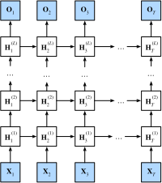

# 9.3 Глубокие рекуррентные нейронные сети

До сих пор мы рассматривали только рекуррентные нейронные сети с одним однонаправленным скрытым слоем. В них способ взаимодействия скрытых переменных и наблюдений с конкретными функциями выбирается довольно произвольно. Пока тип этого взаимодействия достаточно гибок, это не проблема. Однако для одного слоя задача может оказаться очень трудной. В линейных моделях мы решали такую задачу, добавляя больше слоёв. В рекуррентных нейронных сетях сначала нужно понять, как добавить слои и где вставить дополнительную нелинейность, поэтому вопрос непростой.

На самом деле можно сложить несколько рекуррентных слоёв друг на друга: комбинация простых слоёв даёт гибкий механизм. В частности, данные могут быть связаны с разными уровнями такой «стопки» слоёв. Например, мы хотим иметь доступ к макроданным о состоянии финансового рынка (медвежьем или бычьем), а микроданные фиксируют лишь краткосрочную динамику.

На рис. 9.3.1 показана глубокая рекуррентная нейронная сеть с $L$ скрытыми слоями: каждое скрытое состояние непрерывно передаётся на следующий временной шаг текущего слоя и на текущий временной шаг следующего слоя.



## Функциональные зависимости

Зависимости в глубокой архитектуре с $L$ скрытыми слоями (рис. 9.3.1) можно записать формально. Дальнейшее обсуждение в основном относится к классической рекуррентной нейронной сети, но сделанные выводы применимы и к другим последовательным моделям.

Пусть на временном шаге $t$ задан мини-батч входных данных $\mathbf{X}_t \in \mathbb{R}^{n \times d}$ (число примеров $n$, число входов в каждом примере $d$). Скрытое состояние $l$-го скрытого слоя ($l=1,\ldots,L$) обозначим через $\mathbf{H}_t^{(l)} \in \mathbb{R}^{n \times h}$ (число скрытых элементов $h$), а выход выходного слоя — через $\mathbf{O}_t \in \mathbb{R}^{n \times q}$ (число выходов $q$). Положим $\mathbf{H}_t^{(0)} = \mathbf{X}_t$, а для $l$-го скрытого слоя используем функцию активации $\phi_l$. Тогда

$$\mathbf{H}_t^{(l)} = \phi_l(\mathbf{H}_t^{(l-1)} \mathbf{W}_{xh}^{(l)} + \mathbf{H}_{t-1}^{(l)} \mathbf{W}_{hh}^{(l)}  + \mathbf{b}_h^{(l)}),\tag{9.3.1}$$

где весовые параметры $\mathbf{W}_{xh}^{(l)} \in \mathbb{R}^{h \times h}$, $\mathbf{W}_{hh}^{(l)} \in \mathbb{R}^{h \times h}$ и параметр смещения $\mathbf{b}_h^{(l)} \in \mathbb{R}^{1 \times h}$ относятся к $l$-му скрытому слою.

Наконец, выходной слой вычисляется только на основе скрытого состояния последнего, $L$-го, скрытого слоя:

$$\mathbf{O}_t = \mathbf{H}_t^{(L)} \mathbf{W}_{hq} + \mathbf{b}_q,$$

где весовой параметр $\mathbf{W}_{hq} \in \mathbb{R}^{h \times q}$ и параметр смещения $\mathbf{b}_q \in \mathbb{R}^{1 \times q}$ относятся к выходному слою.

Как и в многослойном перцептроне, число скрытых слоёв $L$ и число скрытых элементов $h$ — гиперпараметры. Иными словами, их можно настраивать. Кроме того, если в (9.3.1) заменить скрытое состояние на состояние управляемого рекуррентного блока или LSTM, легко получить глубокую управляемую рекуррентную сеть или глубокую LSTM.

## Краткая реализация

Многие детали реализации многослойной рекуррентной сети уже есть в высокоуровневом API. Для простоты покажем только использование таких встроенных средств. Возьмём модель LSTM: код очень похож на код из раздела 9.2, и отличие лишь в том, что мы задаём число слоёв, а не используем значение по умолчанию (один слой). Как обычно, начнём с загрузки набора данных.

**MXNet:**

```python
from d2l import mxnet as d2l
from mxnet import npx
from mxnet.gluon import rnn
npx.set_np()

batch_size, num_steps = 32, 35
train_iter, vocab = d2l.load_data_time_machine(batch_size, num_steps)
```

**PyTorch:**

```python
from d2l import torch as d2l
import torch
from torch import nn

batch_size, num_steps = 32, 35
train_iter, vocab = d2l.load_data_time_machine(batch_size, num_steps)
```

**PaddlePaddle:**

```python
from d2l import paddle as d2l
import warnings
warnings.filterwarnings("ignore")
import paddle
from paddle import nn

batch_size, num_steps = 32, 35
train_iter, vocab = d2l.load_data_time_machine(batch_size, num_steps)
```

Выбор архитектурных параметров тоже очень похож на тот, что мы делали в разделе 9.2. Поскольку словарь тот же, входы и выходы выбираем одного размера, то есть `vocab_size`. Число скрытых элементов по-прежнему равно $256$. Единственное отличие: теперь число скрытых слоёв задаётся значением `num_layers`.

**MXNet:**

```python
vocab_size, num_hiddens, num_layers = len(vocab), 256, 2
device = d2l.try_gpu()
lstm_layer = rnn.LSTM(num_hiddens, num_layers)
model = d2l.RNNModel(lstm_layer, len(vocab))
```

**PyTorch:**

```python
vocab_size, num_hiddens, num_layers = len(vocab), 256, 2
num_inputs = vocab_size
device = d2l.try_gpu()
lstm_layer = nn.LSTM(num_inputs, num_hiddens, num_layers)
model = d2l.RNNModel(lstm_layer, len(vocab))
model = model.to(device)
```

**PaddlePaddle:**

```python
vocab_size, num_hiddens, num_layers = len(vocab), 256, 2
num_inputs = vocab_size
device = d2l.try_gpu()
lstm_layer = nn.LSTM(num_inputs, num_hiddens, num_layers, time_major=True)
model = d2l.RNNModel(lstm_layer, len(vocab))
```

## Обучение и предсказание

Поскольку мы использовали модель LSTM с двумя слоями, обучение заметно замедлилось.

```python
num_epochs, lr = 500, 2
d2l.train_ch8(model, train_iter, vocab, lr*1.0, num_epochs, device)
```

## Резюме

* В глубокой рекуррентной нейронной сети скрытое состояние передаётся на следующий временной шаг текущего слоя и на текущий временной шаг следующего слоя.
* Существует много вариантов глубоких рекуррентных нейронных сетей, например на основе LSTM, управляемых рекуррентных блоков или классических рекуррентных ячеек. Все они есть в высокоуровневых API фреймворков глубокого обучения.
* В целом глубокие рекуррентные сети требуют много настройки (например, скорости обучения и отсечения градиентов), чтобы обеспечить хорошую сходимость, а инициализацию модели нужно выполнять внимательно.

## Упражнения

1. Опираясь на реализацию одного слоя, которую мы рассмотрели в разделе 8.5, попробуйте реализовать с нуля двухслойную рекуррентную нейронную сеть.
1. В модели, обученной в этом разделе, сравните точность и скорость обучения при замене LSTM на управляемый рекуррентный блок.
1. Насколько низко можно снизить перплексию, если увеличить объём обучающих данных?
1. При моделировании текста можно ли объединять исходные данные разных авторов? Каковы плюсы и минусы такого подхода?

**MXNet:**
[Обсуждение](https://discuss.d2l.ai/t/2771)

**PyTorch:**
[Обсуждение](https://discuss.d2l.ai/t/2770)

**PaddlePaddle:**
[Обсуждение](https://discuss.d2l.ai/t/11834)
