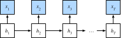
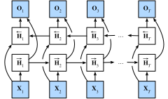

# 9.4 Двунаправленные рекуррентные нейронные сети

В задачах последовательного обучения мы обычно предполагали, что цель — при заданных наблюдениях смоделировать следующий выход (например, в контексте временного ряда или языковой модели). Это типичный сценарий, но не единственный. Какие ещё ситуации возможны? Рассмотрим три задачи на заполнение пропусков в текстовой последовательности:

* Я `___`.
* Я `___` голоден.
* Я `___` голоден, и я могу съесть полсвиньи.

В зависимости от объёма доступной информации пропуск можно заполнить разными словами, например «рад» (happy), «не» (not) или «очень» (very). Очевидно, что контекст справа от пропуска (если он есть) несёт важную информацию, которая влияет на выбор слова. Поэтому последовательная модель, которая не может использовать этот контекст, будет плохо справляться с такими задачами. Например, для хорошего распознавания именованных сущностей (чтобы понять, означает ли «Green» «мистера Грина» или зелёный цвет) важен контекст разной длины по обе стороны от слова. Чтобы найти идею решения, сначала обратимся к вероятностным графическим моделям.

## 9.4.1 Динамическое программирование в скрытых марковских моделях

Этот подраздел нужен для иллюстрации задачи динамического программирования. Технические детали здесь не важны для понимания моделей глубокого обучения, но они помогают понять, зачем используется глубокое обучение и почему выбирается та или иная архитектура.

Если мы хотим решить задачу с помощью вероятностной графической модели, можно построить модель со скрытыми переменными. На каждом временном шаге $t$ предполагаем существование скрытой переменной $h_t$, которая с вероятностью $P(x_t \mid h_t)$ определяет наблюдаемое $x_t$. Кроме того, любой переход $h_t \to h_{t+1}$ задаётся вероятностью перехода $P(h_{t+1} \mid h_{t})$. Такая графическая модель называется *скрытой марковской моделью* (hidden Markov model, HMM), см. рис. 9.4.1.



**Рис. 9.4.1.** Скрытая марковская модель

Итак, для последовательности из $T$ наблюдений совместное распределение наблюдаемых и скрытых состояний имеет вид:

$$P(x_1, \ldots, x_T, h_1, \ldots, h_T) = \prod_{t=1}^T P(h_t \mid h_{t-1}) P(x_t \mid h_t), \text{ where } P(h_1 \mid h_0) = P(h_1).\tag{9.4.1}$$

Пусть мы наблюдаем все $x_i$, кроме $x_j$, и наша цель — вычислить $P(x_j \mid x_{-j})$, где $x_{-j} = (x_1, \ldots, x_{j-1}, x_{j+1}, \ldots, x_{T})$. Поскольку в $P(x_j \mid x_{-j})$ нет скрытых переменных, мы должны просуммировать по всем возможным комбинациям значений $h_1, \ldots, h_T$. Если каждая $h_i$ может принимать $k$ различных значений (конечное число состояний), нам придётся суммировать $k^T$ слагаемых, и эта задача очевидно невыполнима. К счастью, есть изящное решение — *динамическое программирование* (dynamic programming).

Чтобы понять, как работает динамическое программирование, рассмотрим последовательное суммирование по скрытым переменным $h_1, \ldots, h_T$. Из (9.4.1) получаем:

$$\begin{aligned}
    &P(x_1, \ldots, x_T) \\
    =& \sum_{h_1, \ldots, h_T} P(x_1, \ldots, x_T, h_1, \ldots, h_T) \\
    =& \sum_{h_1, \ldots, h_T} \prod_{t=1}^T P(h_t \mid h_{t-1}) P(x_t \mid h_t) \\
    =& \sum_{h_2, \ldots, h_T} \underbrace{\left[\sum_{h_1} P(h_1) P(x_1 \mid h_1) P(h_2 \mid h_1)\right]}_{\pi_2(h_2) \stackrel{\mathrm{def}}{=}}
    P(x_2 \mid h_2) \prod_{t=3}^T P(h_t \mid h_{t-1}) P(x_t \mid h_t) \\
    =& \sum_{h_3, \ldots, h_T} \underbrace{\left[\sum_{h_2} \pi_2(h_2) P(x_2 \mid h_2) P(h_3 \mid h_2)\right]}_{\pi_3(h_3)\stackrel{\mathrm{def}}{=}}
    P(x_3 \mid h_3) \prod_{t=4}^T P(h_t \mid h_{t-1}) P(x_t \mid h_t)\\
    =& \dots \\
    =& \sum_{h_T} \pi_T(h_T) P(x_T \mid h_T).
\end{aligned}$$

Обычно *прямую рекурсию* (forward recursion) записывают так:

$$\pi_{t+1}(h_{t+1}) = \sum_{h_t} \pi_t(h_t) P(x_t \mid h_t) P(h_{t+1} \mid h_t).$$

Рекурсия инициализируется значением $\pi_1(h_1) = P(h_1)$. Для краткости её можно записать как $\pi_{t+1} = f(\pi_t, x_t)$, где $f$ — некоторая обучаемая функция. Это похоже на уравнения обновления для скрытых переменных в рекуррентных нейронных сетях.

Как и с прямой рекурсией, мы можем использовать обратную рекурсию для суммирования по тем же скрытым переменным. В результате получаем:

$$\begin{aligned}
    & P(x_1, \ldots, x_T) \\
     =& \sum_{h_1, \ldots, h_T} P(x_1, \ldots, x_T, h_1, \ldots, h_T) \\
    =& \sum_{h_1, \ldots, h_T} \prod_{t=1}^{T-1} P(h_t \mid h_{t-1}) P(x_t \mid h_t) \cdot P(h_T \mid h_{T-1}) P(x_T \mid h_T) \\
    =& \sum_{h_1, \ldots, h_{T-1}} \prod_{t=1}^{T-1} P(h_t \mid h_{t-1}) P(x_t \mid h_t) \cdot
    \underbrace{\left[\sum_{h_T} P(h_T \mid h_{T-1}) P(x_T \mid h_T)\right]}_{\rho_{T-1}(h_{T-1})\stackrel{\mathrm{def}}{=}} \\
    =& \sum_{h_1, \ldots, h_{T-2}} \prod_{t=1}^{T-2} P(h_t \mid h_{t-1}) P(x_t \mid h_t) \cdot
    \underbrace{\left[\sum_{h_{T-1}} P(h_{T-1} \mid h_{T-2}) P(x_{T-1} \mid h_{T-1}) \rho_{T-1}(h_{T-1}) \right]}_{\rho_{T-2}(h_{T-2})\stackrel{\mathrm{def}}{=}} \\
    =& \ldots \\
    =& \sum_{h_1} P(h_1) P(x_1 \mid h_1)\rho_{1}(h_{1}).
\end{aligned}$$

Поэтому *обратную рекурсию* (backward recursion) можно записать так:

$$\rho_{t-1}(h_{t-1})= \sum_{h_{t}} P(h_{t} \mid h_{t-1}) P(x_{t} \mid h_{t}) \rho_{t}(h_{t}),$$

с инициализацией $\rho_T(h_T) = 1$. И прямая, и обратная рекурсии позволяют просуммировать по всем значениям $(h_1, \ldots, h_T)$ за время $\mathcal{O}(kT)$, то есть линейно, а не экспоненциально. Это одно из больших преимуществ вероятностного вывода с помощью графических моделей. Кроме того, это очень частный случай общего алгоритма передачи сообщений (Aji and McEliece, 2000). Комбинируя прямую и обратную рекурсии, мы получаем

$$P(x_j \mid x_{-j}) \propto \sum_{h_j} \pi_j(h_j) \rho_j(h_j) P(x_j \mid h_j).$$

Обратную рекурсию для краткости можно записать как $\rho_{t-1} = g(\rho_t, x_t)$, где $g$ — обучаемая функция. Снова это похоже на уравнение обновления, но только вычисляется оно не в прямом, а в обратном направлении, в отличие от того, что мы видели в рекуррентных нейронных сетях. Действительно, знание будущих данных полезно для скрытой марковской модели. Специалисты по обработке сигналов различают два случая — когда будущие наблюдения известны и когда их нет; это интерполяция и экстраполяция соответственно. Подробнее см. (Doucet et al., 2001).

## 9.4.2 Двунаправленные модели

Если мы хотим, чтобы в рекуррентной нейронной сети был механизм, который даёт возможность заглядывать вперёд, похожий на тот, что есть в скрытой марковской модели, нужно изменить архитектуру. Это несложно концептуально: достаточно добавить рекуррентную сеть, которая работает «от последнего токена к первому», то есть в обратном направлении, помимо сети, которая работает в прямом направлении, от первого токена. *Двунаправленные рекуррентные нейронные сети* (bidirectional RNNs) добавляют скрытый слой, передающий информацию в обратном направлении, и позволяют гибко обрабатывать такую информацию. На рис. 9.4.2 показана архитектура двунаправленной рекуррентной нейронной сети с одним скрытым слоем.



**Рис. 9.4.2.** Архитектура двунаправленной рекуррентной нейронной сети

По сути, это мало отличается от прямой и обратной рекурсий динамического программирования в скрытой марковской модели. Основное различие в том, что уравнения скрытой марковской модели имеют строгий статистический смысл, тогда как у двунаправленных рекуррентных сетей такой наглядной интерпретации нет: их можно рассматривать только как универсальные обучаемые функции. Этот переход хорошо иллюстрирует принцип современных глубоких сетей: сначала берут тип функциональной зависимости из классической статистической модели, а затем параметризуют её в общем виде.

### 9.4.2.1 Определение

Двунаправленные рекуррентные нейронные сети были предложены в работе (Schuster and Paliwal, 1997), подробное обсуждение различных архитектур есть в (Graves and Schmidhuber, 2005). Рассмотрим подробнее устройство такой сети.

Для произвольного временного шага $t$ пусть задан минибатч входных данных $\mathbf{X}_t \in \mathbb{R}^{n \times d}$ (число примеров $n$, число входов в каждом примере $d$), а функция активации скрытого слоя — $\phi$. В двунаправленной архитектуре пусть прямое и обратное скрытые состояния на временном шаге равны соответственно $\overrightarrow{\mathbf{H}}_t  \in \mathbb{R}^{n \times h}$ и $\overleftarrow{\mathbf{H}}_t  \in \mathbb{R}^{n \times h}$, где $h$ — число скрытых элементов. Прямое и обратное скрытые состояния обновляются так:

$$
\begin{aligned}
\overrightarrow{\mathbf{H}}_t &= \phi(\mathbf{X}_t \mathbf{W}_{xh}^{(f)} + \overrightarrow{\mathbf{H}}_{t-1} \mathbf{W}_{hh}^{(f)}  + \mathbf{b}_h^{(f)}),\\
\overleftarrow{\mathbf{H}}_t &= \phi(\mathbf{X}_t \mathbf{W}_{xh}^{(b)} + \overleftarrow{\mathbf{H}}_{t+1} \mathbf{W}_{hh}^{(b)}  + \mathbf{b}_h^{(b)}),
\end{aligned}
$$

где весовые параметры $\mathbf{W}_{xh}^{(f)} \in \mathbb{R}^{d \times h}$, $\mathbf{W}_{hh}^{(f)} \in \mathbb{R}^{h \times h}$, $\mathbf{W}_{xh}^{(b)} \in \mathbb{R}^{d \times h}$, $\mathbf{W}_{hh}^{(b)} \in \mathbb{R}^{h \times h}$ и параметры смещения $\mathbf{b}_h^{(f)} \in \mathbb{R}^{1 \times h}$, $\mathbf{b}_h^{(b)} \in \mathbb{R}^{1 \times h}$ — это параметры модели.

Затем прямое скрытое состояние $\overrightarrow{\mathbf{H}}_t$ и обратное скрытое состояние $\overleftarrow{\mathbf{H}}_t$ объединяются (конкатенируются), и получается скрытое состояние $\mathbf{H}_t \in \mathbb{R}^{n \times 2h}$, которое передаётся в выходной слой. В глубокой двунаправленной рекуррентной нейронной сети с несколькими скрытыми слоями эта информация передаётся на вход следующего двунаправленного слоя. Наконец, выходной слой вычисляет выход $\mathbf{O}_t \in \mathbb{R}^{n \times q}$ (где $q$ — число выходных элементов):

$$\mathbf{O}_t = \mathbf{H}_t \mathbf{W}_{hq} + \mathbf{b}_q.$$

Здесь весовая матрица $\mathbf{W}_{hq} \in \mathbb{R}^{2h \times q}$ и смещение $\mathbf{b}_q \in \mathbb{R}^{1 \times q}$ — параметры выходного слоя. По сути, два направления могут иметь разное число скрытых элементов.

### 9.4.2.2 Вычислительные затраты модели и её применение

Ключевое свойство двунаправленной рекуррентной нейронной сети в том, что для вычисления выхода используется информация с обоих концов последовательности. То есть для предсказания текущего наблюдения мы используем наблюдения из прошлого и будущего. Но для предсказания следующего токена такая модель не подходит. Ведь при предсказании следующего токена мы не знаем, каким будет его правый контекст, поэтому точность окажется невысокой. В частности, во время обучения мы можем использовать прошлые и будущие данные, чтобы оценить пропущенное слово, а во время тестирования у нас есть только прошлые данные, и точность будет плохой. Следующий эксперимент это иллюстрирует.

Ещё одна серьёзная проблема: двунаправленные рекуррентные нейронные сети вычисляются очень медленно. Основная причина в том, что прямое распространение в такой сети требует прямой и обратной рекурсий в двунаправленных слоях, а обратное распространение зависит от результатов прямого распространения. Поэтому цепочка для вычисления градиентов получается очень длинной.

Двунаправленные слои на практике используются очень редко и только в отдельных случаях, например для заполнения пропущенных слов, аннотирования токенов (например, для распознавания именованных сущностей) и для кодирования последовательности как одного из этапов конвейера обработки (например, в машинном переводе). В разделах 14.8 и 15.2 мы покажем, как двунаправленные рекуррентные нейронные сети используются для кодирования текстовых последовательностей.

## 9.4.3 Ошибочное применение двунаправленных рекуррентных нейронных сетей

Поскольку двунаправленная рекуррентная нейронная сеть использует и прошлые, и будущие данные, мы не можем слепо применять эту языковую модель к любой задаче предсказания. Хотя перплексия, которую выдаёт модель, выглядит разумно, её способность предсказывать будущие токены может оказаться серьёзно ошибочной. Приведённый ниже пример кода служит предостережением: не используйте такие модели в неподходящих условиях.

**MXNet:**

```python
from d2l import mxnet as d2l
from mxnet import npx
from mxnet.gluon import rnn
npx.set_np()

# Загружаем данные
batch_size, num_steps, device = 32, 35, d2l.try_gpu()
train_iter, vocab = d2l.load_data_time_machine(batch_size, num_steps)
# Определяем двунаправленную LSTM-модель, задав bidirectional=True
vocab_size, num_hiddens, num_layers = len(vocab), 256, 2
lstm_layer = rnn.LSTM(num_hiddens, num_layers, bidirectional=True)
model = d2l.RNNModel(lstm_layer, len(vocab))
# Обучаем модель
num_epochs, lr = 500, 1
d2l.train_ch8(model, train_iter, vocab, lr, num_epochs, device)
```

**PyTorch:**

```python
from d2l import torch as d2l
import torch
from torch import nn

# Загружаем данные
batch_size, num_steps, device = 32, 35, d2l.try_gpu()
train_iter, vocab = d2l.load_data_time_machine(batch_size, num_steps)
# Определяем двунаправленную LSTM-модель, задав bidirectional=True
vocab_size, num_hiddens, num_layers = len(vocab), 256, 2
num_inputs = vocab_size
lstm_layer = nn.LSTM(num_inputs, num_hiddens, num_layers, bidirectional=True)
model = d2l.RNNModel(lstm_layer, len(vocab))
model = model.to(device)
# Обучаем модель
num_epochs, lr = 500, 1
d2l.train_ch8(model, train_iter, vocab, lr, num_epochs, device)
```

**PaddlePaddle:**

```python
from d2l import paddle as d2l
import warnings
warnings.filterwarnings("ignore")
import paddle
from paddle import nn

# Загружаем данные
batch_size, num_steps, device  = 32, 35, d2l.try_gpu()
train_iter, vocab = d2l.load_data_time_machine(batch_size, num_steps)
# Определяем двунаправленную LSTM-модель, задав direction='bidirect'
vocab_size, num_hiddens, num_layers = len(vocab), 256, 2
num_inputs = vocab_size
lstm_layer = nn.LSTM(num_inputs, num_hiddens, num_layers, direction='bidirect', time_major=True)
model = d2l.RNNModel(lstm_layer, len(vocab))
# Обучаем модель
num_epochs, lr = 500, 1.0
d2l.train_ch8(model, train_iter, vocab, lr, num_epochs, device)
```

Полученный результат, очевидно, ошеломляет. О том, как эффективнее использовать двунаправленные рекуррентные нейронные сети, см. применение к классификации тональности в разделе 15.2.

## Резюме

* В двунаправленной рекуррентной нейронной сети скрытое состояние на каждом временном шаге определяется одновременно данными, которые идут до и после этого шага.
* Двунаправленная рекуррентная нейронная сеть похожа на алгоритм «прямой — обратный» (forward-backward) в вероятностных графических моделях.
* Двунаправленные рекуррентные нейронные сети в основном используются для кодирования последовательностей и для оценки наблюдений при заданном двунаправленном контексте.
* Из-за более длинной цепочки градиентов обучение двунаправленных рекуррентных нейронных сетей очень дорого.

## Упражнения

1. Как изменится форма $\mathbf{H}_t$, если в разных направлениях использовать разное число скрытых элементов?
1. Спроектируйте двунаправленную рекуррентную нейронную сеть с несколькими скрытыми слоями.
1. В естественном языке многозначность слов очень распространена. Например, слово «bank» имеет разные значения в контекстах «i went to the bank to deposit cash» и «i went to the bank to sit down». Как спроектировать нейронную модель, которая по заданной последовательности контекста и слову возвращает векторное представление этого слова в данном контексте? Какой тип архитектуры нейронной сети лучше всего подходит для работы с многозначностью?

**MXNet:**
[Обсуждение](https://discuss.d2l.ai/t/2774)

**PyTorch:**
[Обсуждение](https://discuss.d2l.ai/t/2773)

**PaddlePaddle:**
[Обсуждение](https://discuss.d2l.ai/t/11835)

## Литература

* Aji, S. M., & McEliece, R. J. (2000). The generalized distributive law. *IEEE Transactions on Information Theory*, 46(2), 325–343.
* Doucet, A., De Freitas, N., & Gordon, N. (2001). An introduction to sequential Monte Carlo methods. In *Sequential Monte Carlo methods in practice*, 3–14.
* Schuster, M., & Paliwal, K. K. (1997). Bidirectional recurrent neural networks. *IEEE Transactions on Signal Processing*, 45(11), 2673–2681.
* Graves, A., & Schmidhuber, J. (2005). Framewise phoneme classification with bidirectional LSTM and other neural network architectures. *Neural Networks*, 18(5–6), 602–610.
