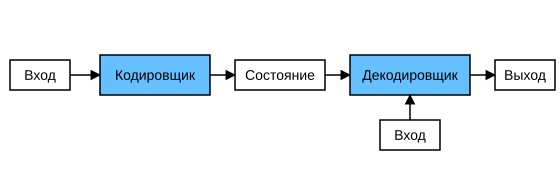

# 9.6 Архитектура «кодировщик — декодировщик»

Как мы обсуждали в разделе 9.5, машинный перевод — центральная задача моделей преобразования последовательностей, у которых и вход, и выход имеют переменную длину. Чтобы работать с такими входами и выходами, можно спроектировать архитектуру из двух основных компонентов. Первый компонент — *кодировщик* (encoder): он принимает последовательность переменной длины на входе и преобразует её в закодированное состояние фиксированной формы. Второй компонент — *декодировщик* (decoder): он отображает закодированное состояние фиксированной формы в последовательность переменной длины. Эта конструкция называется архитектурой *«кодировщик — декодировщик»* (encoder-decoder) и показана на рис. 9.6.1.



Рассмотрим перевод с английского на французский. Пусть на вход подана английская последовательность «They», «are», «watching», «.». Сначала архитектура «кодировщик — декодировщик» кодирует входную последовательность переменной длины в некоторое «состояние», а затем декодирует его: на выход по одному токену выдаётся переведённая последовательность «Ils», «regardent», «.». Поскольку архитектура «кодировщик — декодировщик» служит основой для разных моделей преобразования последовательностей в следующих главах, в этом разделе мы превратим её в набор интерфейсов, удобных для последующей реализации.

## Кодировщик

В интерфейсе кодировщика мы задаём только входную последовательность переменной длины `X`. Любая модель, которая наследует базовый класс `Encoder`, должна реализовать его метод.

**MXNet:**

```python
from mxnet.gluon import nn

#@save
class Encoder(nn.Block):
    """Базовый интерфейс кодировщика в архитектуре «кодировщик — декодировщик»"""
    def __init__(self, **kwargs):
        super(Encoder, self).__init__(**kwargs)

    def forward(self, X, *args):
        raise NotImplementedError
```

**PyTorch:**

```python
from torch import nn

#@save
class Encoder(nn.Module):
    """Базовый интерфейс кодировщика в архитектуре «кодировщик — декодировщик»"""
    def __init__(self, **kwargs):
        super(Encoder, self).__init__(**kwargs)

    def forward(self, X, *args):
        raise NotImplementedError
```

**TensorFlow:**

```python
import tensorflow as tf

#@save
class Encoder(tf.keras.layers.Layer):
    """Базовый интерфейс кодировщика в архитектуре «кодировщик — декодировщик»"""
    def __init__(self, **kwargs):
        super(Encoder, self).__init__(**kwargs)

    def call(self, X, *args, **kwargs):
        raise NotImplementedError
```

**PaddlePaddle:**

```python
import warnings
warnings.filterwarnings("ignore")
from paddle import nn

#@save
class Encoder(nn.Layer):
    """Базовый интерфейс кодировщика в архитектуре «кодировщик — декодировщик»"""
    def __init__(self, **kwargs):
        super(Encoder, self).__init__(**kwargs)

    def forward(self, X, *args):
        raise NotImplementedError
```

## Декодировщик

В интерфейсе декодировщика мы добавляем функцию `init_state`, которая преобразует выход кодировщика (`enc_outputs`) в закодированное состояние. Обратите внимание, что для этого шага может понадобиться дополнительный вход, например эффективная длина входной последовательности; это объясняется в разделе 9.5.4. Чтобы генерировать последовательность токенов переменной длины по одному токену, декодировщик на каждом временном шаге отображает входные данные (например, токен, сгенерированный на предыдущем шаге) и закодированное состояние в выходной токен текущего шага.

**MXNet:**

```python
#@save
class Decoder(nn.Block):
    """Базовый интерфейс декодировщика в архитектуре «кодировщик — декодировщик»"""
    def __init__(self, **kwargs):
        super(Decoder, self).__init__(**kwargs)

    def init_state(self, enc_outputs, *args):
        raise NotImplementedError

    def forward(self, X, state):
        raise NotImplementedError
```

**PyTorch:**

```python
#@save
class Decoder(nn.Module):
    """Базовый интерфейс декодировщика в архитектуре «кодировщик — декодировщик»"""
    def __init__(self, **kwargs):
        super(Decoder, self).__init__(**kwargs)

    def init_state(self, enc_outputs, *args):
        raise NotImplementedError

    def forward(self, X, state):
        raise NotImplementedError
```

**TensorFlow:**

```python
#@save
class Decoder(tf.keras.layers.Layer):
    """Базовый интерфейс декодировщика в архитектуре «кодировщик — декодировщик»"""
    def __init__(self, **kwargs):
        super(Decoder, self).__init__(**kwargs)

    def init_state(self, enc_outputs, *args):
        raise NotImplementedError

    def call(self, X, state, **kwargs):
        raise NotImplementedError
```

**PaddlePaddle:**

```python
#@save
class Decoder(nn.Layer):
    """Базовый интерфейс декодировщика в архитектуре «кодировщик — декодировщик»"""
    def __init__(self, **kwargs):
        super(Decoder, self).__init__(**kwargs)

    def init_state(self, enc_outputs, *args):
        raise NotImplementedError

    def forward(self, X, state):
        raise NotImplementedError
```

## Объединение кодировщика и декодировщика

Итак, архитектура «кодировщик — декодировщик» содержит кодировщик и декодировщик и может иметь дополнительные параметры. В прямом проходе выход кодировщика используется для получения закодированного состояния, которое затем подаётся декодировщику как часть его входа.

**MXNet:**

```python
#@save
class EncoderDecoder(nn.Block):
    """Базовый класс архитектуры «кодировщик — декодировщик»"""
    def __init__(self, encoder, decoder, **kwargs):
        super(EncoderDecoder, self).__init__(**kwargs)
        self.encoder = encoder
        self.decoder = decoder

    def forward(self, enc_X, dec_X, *args):
        enc_outputs = self.encoder(enc_X, *args)
        dec_state = self.decoder.init_state(enc_outputs, *args)
        return self.decoder(dec_X, dec_state)
```

**PyTorch:**

```python
#@save
class EncoderDecoder(nn.Module):
    """Базовый класс архитектуры «кодировщик — декодировщик»"""
    def __init__(self, encoder, decoder, **kwargs):
        super(EncoderDecoder, self).__init__(**kwargs)
        self.encoder = encoder
        self.decoder = decoder

    def forward(self, enc_X, dec_X, *args):
        enc_outputs = self.encoder(enc_X, *args)
        dec_state = self.decoder.init_state(enc_outputs, *args)
        return self.decoder(dec_X, dec_state)
```

**TensorFlow:**

```python
#@save
class EncoderDecoder(tf.keras.Model):
    """Базовый класс архитектуры «кодировщик — декодировщик»"""
    def __init__(self, encoder, decoder, **kwargs):
        super(EncoderDecoder, self).__init__(**kwargs)
        self.encoder = encoder
        self.decoder = decoder

    def call(self, enc_X, dec_X, *args, **kwargs):
        enc_outputs = self.encoder(enc_X, *args, **kwargs)
        dec_state = self.decoder.init_state(enc_outputs, *args)
        return self.decoder(dec_X, dec_state, **kwargs)
```

**PaddlePaddle:**

```python
#@save
class EncoderDecoder(nn.Layer):
    """Базовый класс архитектуры «кодировщик — декодировщик»"""
    def __init__(self, encoder, decoder, **kwargs):
        super(EncoderDecoder, self).__init__(**kwargs)
        self.encoder = encoder
        self.decoder = decoder

    def forward(self, enc_X, dec_X, *args):
        enc_outputs = self.encoder(enc_X, *args)
        dec_state = self.decoder.init_state(enc_outputs, *args)
        return self.decoder(dec_X, dec_state)
```

Термин *состояние* в архитектуре «кодировщик — декодировщик» наводит на мысль, что для её реализации стоит использовать нейронные сети с состоянием. В следующем разделе мы разберём, как применять рекуррентные нейронные сети для построения моделей преобразования последовательностей на основе архитектуры «кодировщик — декодировщик».

## Резюме

* Архитектура «кодировщик — декодировщик» принимает и выдаёт последовательности переменной длины, поэтому подходит для задач преобразования последовательностей, таких как машинный перевод.
* Кодировщик принимает последовательность переменной длины и преобразует её в закодированное состояние фиксированной формы.
* Декодировщик отображает закодированное состояние фиксированной формы в последовательность переменной длины.

## Упражнения

1. Предположим, что мы реализуем архитектуру «кодировщик — декодировщик» с помощью нейронных сетей. Обязаны ли кодировщик и декодировщик быть нейронными сетями одного и того же типа?
1. Помимо машинного перевода, есть ли другие приложения, подходящие для архитектуры «кодировщик — декодировщик»?

**MXNet:**
[Обсуждение](https://discuss.d2l.ai/t/2780)

**PyTorch:**
[Обсуждение](https://discuss.d2l.ai/t/2779)

**PaddlePaddle:**
[Обсуждение](https://discuss.d2l.ai/t/11837)
