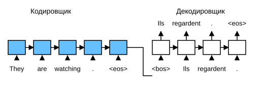
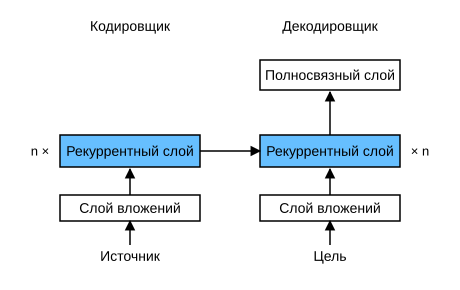
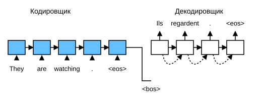

# 9.7 Обучение «последовательность в последовательность» (seq2seq)

Как мы видели в разделе 9.5, и входная, и выходная последовательности в машинном переводе имеют переменную длину. Чтобы решать такие задачи, в разделе 9.6 мы спроектировали общую архитектуру «кодировщик — декодировщик». В этом разделе мы используем две рекуррентные нейронные сети: кодировщик и декодировщик, и применим их к задачам обучения *«последовательность в последовательность»* (sequence to sequence, seq2seq) (Sutskever et al., 2014; Cho et al., 2014).

Следуя принципам архитектуры «кодировщик — декодировщик», рекуррентный кодировщик принимает на вход последовательность переменной длины и преобразует её в скрытое состояние фиксированной формы. Иными словами, информация входной последовательности *кодируется* в скрытом состоянии рекуррентного кодировщика. Чтобы последовательно генерировать токены выходной последовательности, отдельный рекуррентный декодировщик предсказывает следующий токен, опираясь на закодированную информацию входной последовательности и на уже увиденные или сгенерированные токены выходной последовательности. На рис. 9.7.1 показано, как две рекуррентные нейронные сети используются для обучения «последовательность в последовательность» в задаче машинного перевода.



На рис. 9.7.1 специальный токен `<eos>` обозначает конец последовательности. Как только выходная последовательность его генерирует, модель прекращает предсказание. В начальный временной шаг рекуррентного декодировщика принимаются два конструктивных решения. Во-первых, специальный токен `<bos>` обозначает начало последовательности и является первым токеном входа декодировщика. Во-вторых, скрытое состояние декодировщика инициализируется конечным скрытым состоянием рекуррентного кодировщика. Например, в работе (Sutskever et al., 2014) именно так закодированная информация входной последовательности передаётся декодировщику для генерации выходной последовательности. В других архитектурах (Cho et al., 2014), как показано на рис. 9.7.1, конечное скрытое состояние кодировщика на каждом временном шаге также подаётся на вход декодировщика как часть входной последовательности. По аналогии с обучением языковой модели из раздела 8.3 можно сдвинуть метки: исходная выходная последовательность с токенами «Ils», «regardent», «.» и `<eos>` служит целевой для входа, который начинается с `<bos>`, «Ils», «regardent», «.». Так предсказание смещается на одну позицию.

Ниже мы реализуем архитектуру, показанную на рис. 9.7.1, и обучим модель машинного перевода на наборе данных «английский — французский», описанном в разделе 9.5.

**MXNet:**

```python
import collections
from d2l import mxnet as d2l
import math
from mxnet import np, npx, init, gluon, autograd
from mxnet.gluon import nn, rnn
npx.set_np()
```

**PyTorch:**

```python
import collections
from d2l import torch as d2l
import math
import torch
from torch import nn
```

**TensorFlow:**

```python
import collections
from d2l import tensorflow as d2l
import math
import tensorflow as tf
```

**PaddlePaddle:**

```python
import collections
from d2l import paddle as d2l
import warnings
warnings.filterwarnings("ignore")
import math
import paddle
from paddle import nn
```

## Кодировщик

Технически кодировщик преобразует входную последовательность переменной длины в контекстную переменную $\mathbf{c}$ фиксированной формы и кодирует в ней информацию входной последовательности. Как показано на рис. 9.7.1, для кодировщика можно использовать рекуррентную нейронную сеть.

Рассмотрим одну последовательность в качестве примера (размер пакета равен $1$). Пусть входная последовательность — $x_1, \ldots, x_T$, где $x_t$ — $t$-й токен входного текста. На временном шаге $t$ рекуррентная нейронная сеть преобразует входной вектор признаков $\mathbf{x}_t$ токена $x_t$ и $\mathbf{h}_{t-1}$ (скрытое состояние предыдущего шага) в $\mathbf{h}_t$ (скрытое состояние текущего шага). Преобразование, которое выполняет рекуррентный слой, опишем функцией $f$:

$$\mathbf{h}_t = f(\mathbf{x}_t, \mathbf{h}_{t-1}). $$

В целом кодировщик с помощью выбранной функции $q$ преобразует скрытые состояния всех временных шагов в контекстную переменную:

$$\mathbf{c} =  q(\mathbf{h}_1, \ldots, \mathbf{h}_T).$$

Например, если выбрать $q(\mathbf{h}_1, \ldots, \mathbf{h}_T) = \mathbf{h}_T$ (как на рис. 9.7.1), контекстная переменная — это просто скрытое состояние входной последовательности на последнем временном шаге $\mathbf{h}_T$.

До сих пор мы использовали однонаправленную рекуррентную нейронную сеть для построения кодировщика, в которой скрытое состояние зависит только от подпоследовательности входа, начиная с первой позиции и до текущего временного шага (включительно). Можно построить кодировщик и на основе двунаправленной рекуррентной нейронной сети, в которой скрытое состояние зависит от двух подпоследовательностей: одной, которая идёт до текущего шага, и другой, которая идёт после него (включительно). Тогда скрытое состояние кодирует информацию обо всей последовательности.

Теперь **реализуем рекуррентный кодировщик**. Обратите внимание, что мы используем *слой вложений* (embedding layer), чтобы получить вектор признаков для каждого токена входной последовательности. Веса слоя вложений — это матрица, число строк которой равно размеру входного словаря (`vocab_size`), а число столбцов — размерности вектора признаков (`embed_size`). Для любого индекса входного токена $i$ слой вложений берёт $i$-ю строку матрицы весов (нумерация с нуля) и возвращает его вектор признаков. Кроме того, для реализации кодировщика здесь выбран многослойный управляемый рекуррентный блок.

**MXNet:**

```python
#@save
class Seq2SeqEncoder(d2l.Encoder):
    """Рекуррентный кодировщик для обучения «последовательность в последовательность»"""
    def __init__(self, vocab_size, embed_size, num_hiddens, num_layers,
                 dropout=0, **kwargs):
        super(Seq2SeqEncoder, self).__init__(**kwargs)
        # Слой вложений
        self.embedding = nn.Embedding(vocab_size, embed_size)
        self.rnn = rnn.GRU(num_hiddens, num_layers, dropout=dropout)

    def forward(self, X, *args):
        # Форма 'X': (batch_size, num_steps, embed_size)
        X = self.embedding(X)
        # В рекуррентных нейронных сетях первая ось соответствует временным шагам
        X = X.swapaxes(0, 1)
        state = self.rnn.begin_state(batch_size=X.shape[1], ctx=X.ctx)
        output, state = self.rnn(X, state)
        # Форма output: (num_steps, batch_size, num_hiddens)
        # Форма state: (num_layers, batch_size, num_hiddens)
        return output, state
```

**PyTorch:**

```python
#@save
class Seq2SeqEncoder(d2l.Encoder):
    """Рекуррентный кодировщик для обучения «последовательность в последовательность»"""
    def __init__(self, vocab_size, embed_size, num_hiddens, num_layers,
                 dropout=0, **kwargs):
        super(Seq2SeqEncoder, self).__init__(**kwargs)
        # Слой вложений
        self.embedding = nn.Embedding(vocab_size, embed_size)
        self.rnn = nn.GRU(embed_size, num_hiddens, num_layers,
                          dropout=dropout)

    def forward(self, X, *args):
        # Форма 'X': (batch_size, num_steps, embed_size)
        X = self.embedding(X)
        # В рекуррентных нейронных сетях первая ось соответствует временным шагам
        X = X.permute(1, 0, 2)
        # Если состояние не задано, оно по умолчанию равно 0
        output, state = self.rnn(X)
        # Форма output: (num_steps, batch_size, num_hiddens)
        # Форма state: (num_layers, batch_size, num_hiddens)
        return output, state
```

**TensorFlow:**

```python
#@save
class Seq2SeqEncoder(d2l.Encoder):
    """Рекуррентный кодировщик для обучения «последовательность в последовательность»"""
    def __init__(self, vocab_size, embed_size, num_hiddens, num_layers, dropout=0, **kwargs): 
        super().__init__(*kwargs)
        # Слой вложений
        self.embedding = tf.keras.layers.Embedding(vocab_size, embed_size)
        self.rnn = tf.keras.layers.RNN(tf.keras.layers.StackedRNNCells(
            [tf.keras.layers.GRUCell(num_hiddens, dropout=dropout)
             for _ in range(num_layers)]), return_sequences=True,
                                       return_state=True)
    
    def call(self, X, *args, **kwargs):
        # Форма входа 'X': (batch_size, num_steps)
        # Форма выхода 'X': (batch_size, num_steps, embed_size)
        X = self.embedding(X)
        output = self.rnn(X, **kwargs)
        state = output[1:]
        return output[0], state
```

**PaddlePaddle:**

```python
#@save
class Seq2SeqEncoder(d2l.Encoder):
    """Рекуррентный кодировщик для обучения «последовательность в последовательность»"""
    def __init__(self, vocab_size, embed_size, num_hiddens, num_layers,
                 dropout=0, **kwargs):
        super(Seq2SeqEncoder, self).__init__(**kwargs)
        weight_ih_attr = paddle.ParamAttr(initializer=nn.initializer.XavierUniform())
        weight_hh_attr = paddle.ParamAttr(initializer=nn.initializer.XavierUniform())
        # Слой вложений
        self.embedding = nn.Embedding(vocab_size, embed_size)
        self.rnn = nn.GRU(embed_size, num_hiddens, num_layers, dropout=dropout,
                          time_major=True, weight_ih_attr=weight_ih_attr, weight_hh_attr=weight_hh_attr)

    def forward(self, X, *args):
        # Форма 'X': (batch_size, num_steps, embed_size)
        X = self.embedding(X)
        # В рекуррентных нейронных сетях первая ось соответствует временным шагам
        X = X.transpose([1, 0, 2])
        # Если состояние не задано, оно по умолчанию равно 0
        output, state = self.rnn(X)
        # Форма output у слоя GRU в PaddlePaddle: (batch_size, time_steps, num_directions * num_hiddens),
        # нужно задать time_major=True, чтобы первая размерность input была time_steps
        # Форма state[0]: (num_layers, batch_size, num_hiddens)
        return output, state
```

О возвращаемых значениях рекуррентного слоя см. раздел 8.6.

Теперь создадим **экземпляр описанного выше кодировщика**. Мы используем двухслойный управляемый рекуррентный блок с $16$ скрытыми элементами. Пусть задан мини-батч входных последовательностей `X` (размер пакета $4$, временных шагов $7$). После обработки всех временных шагов выход последнего слоя — это тензор `output`, который возвращает рекуррентный слой кодировщика, формы (число временных шагов, размер пакета, число скрытых элементов).

**MXNet:**

```python
encoder = Seq2SeqEncoder(vocab_size=10, embed_size=8, num_hiddens=16,
                         num_layers=2)
encoder.initialize()
X = d2l.zeros((4, 7))
output, state = encoder(X)
output.shape
```

**PyTorch:**

```python
encoder = Seq2SeqEncoder(vocab_size=10, embed_size=8, num_hiddens=16,
                         num_layers=2)
encoder.eval()
X = d2l.zeros((4, 7), dtype=torch.long)
output, state = encoder(X)
output.shape
```

**TensorFlow:**

```python
encoder = Seq2SeqEncoder(vocab_size=10, embed_size=8, num_hiddens=16, num_layers=2)
X = tf.zeros((4, 7))
output, state = encoder(X, training=False)
output.shape
```

**PaddlePaddle:**

```python
encoder = Seq2SeqEncoder(vocab_size=10, embed_size=8, num_hiddens=16,
                         num_layers=2)
encoder.eval()
X = d2l.zeros((4, 7), dtype=paddle.int64)
output, state = encoder(X)
output.shape
```

Поскольку мы используем управляемый рекуррентный блок, форма скрытого состояния на последнем временном шаге для нескольких слоёв равна (число скрытых слоёв, размер пакета, число скрытых элементов). Если бы использовалась LSTM, в `state` также содержалась бы информация о ячейке памяти.

**MXNet:**

```python
len(state), state[0].shape
```

**PyTorch, PaddlePaddle:**

```python
state.shape
```

**TensorFlow:**

```python
len(state), [element.shape for element in state]
```

## Декодировщик

Как говорилось выше, контекстная переменная $\mathbf{c}$, которую выдаёт кодировщик, кодирует всю входную последовательность $x_1, \ldots, x_T$. Пусть выходная последовательность из обучающего набора данных — $y_1, y_2, \ldots, y_{T'}$. Для каждого временного шага $t'$ (он не совпадает с шагом $t$ входной последовательности или кодировщика) вероятность выхода $y_{t'}$ декодировщика зависит от предыдущей выходной подпоследовательности $y_1, \ldots, y_{t'-1}$ и контекстной переменной $\mathbf{c}$, то есть $P(y_{t'} \mid y_1, \ldots, y_{t'-1}, \mathbf{c})$.

Чтобы смоделировать такую условную вероятность для последовательностей, можно использовать ещё одну рекуррентную нейронную сеть в качестве декодировщика. На любом временном шаге $t^\prime$ выходной последовательности рекуррентная сеть принимает в качестве входа выход предыдущего шага $y_{t^\prime-1}$ и контекстную переменную $\mathbf{c}$. Затем она преобразует их вместе с предыдущим скрытым состоянием $\mathbf{s}_{t^\prime-1}$ в скрытое состояние $\mathbf{s}_{t^\prime}$ текущего шага. Поэтому преобразование скрытого слоя декодировщика можно записать функцией $g$:

$$\mathbf{s}_{t^\prime} = g(y_{t^\prime-1}, \mathbf{c}, \mathbf{s}_{t^\prime-1}).\tag{9.7.1}$$

Получив скрытое состояние декодировщика, мы можем с помощью выходного слоя и операции softmax вычислить распределение условных вероятностей выхода $y_{t^\prime}$ на временном шаге $t^\prime$: $P(y_{t^\prime} \mid y_1, \ldots, y_{t^\prime-1}, \mathbf{c})$.

Как показано на рис. 9.7.1, при реализации декодировщика мы напрямую используем скрытое состояние кодировщика на последнем временном шаге, чтобы инициализировать скрытое состояние декодировщика. Поэтому рекуррентные кодировщик и декодировщик должны иметь одинаковое число слоёв и скрытых элементов. Чтобы дополнительно передать закодированную информацию входной последовательности, контекстная переменная соединяется (конкатенируется) с входом декодировщика на всех временных шагах. Для предсказания распределения вероятностей выходных токенов на последнем слое рекуррентного декодировщика используется полносвязный слой, который преобразует скрытое состояние.

**MXNet:**

```python
class Seq2SeqDecoder(d2l.Decoder):
    """Рекуррентный декодировщик для обучения «последовательность в последовательность»"""
    def __init__(self, vocab_size, embed_size, num_hiddens, num_layers,
                 dropout=0, **kwargs):
        super(Seq2SeqDecoder, self).__init__(**kwargs)
        self.embedding = nn.Embedding(vocab_size, embed_size)
        self.rnn = rnn.GRU(num_hiddens, num_layers, dropout=dropout)
        self.dense = nn.Dense(vocab_size, flatten=False)

    def init_state(self, enc_outputs, *args):
        return enc_outputs[1]

    def forward(self, X, state):
        # Форма 'X': (batch_size, num_steps, embed_size)
        X = self.embedding(X).swapaxes(0, 1)
        # Форма context: (batch_size, num_hiddens)
        context = state[0][-1]
        # Расширяем context (broadcast), чтобы у него было то же num_steps, что и у X
        context = np.broadcast_to(context, (
            X.shape[0], context.shape[0], context.shape[1]))
        X_and_context = d2l.concat((X, context), 2)
        output, state = self.rnn(X_and_context, state)
        output = self.dense(output).swapaxes(0, 1)
        # Форма output: (batch_size, num_steps, vocab_size)
        # Форма state: (num_layers, batch_size, num_hiddens)
        return output, state
```

**PyTorch:**

```python
class Seq2SeqDecoder(d2l.Decoder):
    """Рекуррентный декодировщик для обучения «последовательность в последовательность»"""
    def __init__(self, vocab_size, embed_size, num_hiddens, num_layers,
                 dropout=0, **kwargs):
        super(Seq2SeqDecoder, self).__init__(**kwargs)
        self.embedding = nn.Embedding(vocab_size, embed_size)
        self.rnn = nn.GRU(embed_size + num_hiddens, num_hiddens, num_layers,
                          dropout=dropout)
        self.dense = nn.Linear(num_hiddens, vocab_size)

    def init_state(self, enc_outputs, *args):
        return enc_outputs[1]

    def forward(self, X, state):
        # Форма 'X': (batch_size, num_steps, embed_size)
        X = self.embedding(X).permute(1, 0, 2)
        # Расширяем context (broadcast), чтобы у него было то же num_steps, что и у X
        context = state[-1].repeat(X.shape[0], 1, 1)
        X_and_context = d2l.concat((X, context), 2)
        output, state = self.rnn(X_and_context, state)
        output = self.dense(output).permute(1, 0, 2)
        # Форма output: (batch_size, num_steps, vocab_size)
        # Форма state: (num_layers, batch_size, num_hiddens)
        return output, state
```

**TensorFlow:**

```python
class Seq2SeqDecoder(d2l.Decoder):
    """Рекуррентный декодировщик для обучения «последовательность в последовательность»"""
    def __init__(self, vocab_size, embed_size, num_hiddens, num_layers,
                 dropout=0, **kwargs):
        super().__init__(**kwargs)
        self.embedding = tf.keras.layers.Embedding(vocab_size, embed_size)
        self.rnn = tf.keras.layers.RNN(tf.keras.layers.StackedRNNCells(
            [tf.keras.layers.GRUCell(num_hiddens, dropout=dropout)
             for _ in range(num_layers)]), return_sequences=True,
                                       return_state=True)
        self.dense = tf.keras.layers.Dense(vocab_size)
        
    def init_state(self, enc_outputs, *args):
        return enc_outputs[1]
    
    def call(self, X, state, **kwargs):
        # Форма 'X': (batch_size, num_steps, embed_size)
        X = self.embedding(X)
        # Расширяем context (broadcast), чтобы у него было то же num_steps, что и у X
        context = tf.repeat(tf.expand_dims(state[-1], axis=1), repeats=X.shape[1], axis=1)
        X_and_context = tf.concat((X, context), axis=2)
        rnn_output = self.rnn(X_and_context, state, **kwargs)
        output = self.dense(rnn_output[0])
        # Форма output: (batch_size, num_steps, vocab_size)
        # state — список из num_layers элементов, каждый формы (batch_size, num_hiddens)
        return output, rnn_output[1:]
```

**PaddlePaddle:**

```python
class Seq2SeqDecoder(d2l.Decoder):
    """Рекуррентный декодировщик для обучения «последовательность в последовательность»"""
    def __init__(self, vocab_size, embed_size, num_hiddens, num_layers,
                 dropout=0, **kwargs):
        super(Seq2SeqDecoder, self).__init__(**kwargs)
        self.embedding = nn.Embedding(vocab_size, embed_size)
        weight_attr = paddle.ParamAttr(initializer=nn.initializer.XavierUniform())
        weight_ih_attr = paddle.ParamAttr(initializer=nn.initializer.XavierUniform())
        weight_hh_attr = paddle.ParamAttr(initializer=nn.initializer.XavierUniform())
        self.rnn = nn.GRU(embed_size + num_hiddens, num_hiddens, num_layers, dropout=dropout,
                          time_major=True, weight_ih_attr=weight_ih_attr,weight_hh_attr=weight_hh_attr)
        self.dense = nn.Linear(num_hiddens, vocab_size,weight_attr=weight_attr)

    def init_state(self, enc_outputs, *args):
        return enc_outputs[1]

    def forward(self, X, state):
        # Форма 'X': (batch_size, num_steps, embed_size)
        X = self.embedding(X).transpose([1, 0, 2])
        # Расширяем context (broadcast), чтобы у него было то же num_steps, что и у X
        context = state[-1].tile([X.shape[0], 1, 1])
        X_and_context = d2l.concat((X, context), 2)
        output, state = self.rnn(X_and_context, state)
        output = self.dense(output).transpose([1, 0, 2])
        # Форма output: (batch_size, num_steps, vocab_size)
        # Форма state[0]: (num_layers, batch_size, num_hiddens)
        return output, state
```

Теперь **создадим экземпляр декодировщика** с теми же гиперпараметрами, что и у кодировщика. Как видно, форма выхода декодировщика становится (размер пакета, число временных шагов, размер словаря), где последняя размерность тензора хранит распределение предсказанных токенов.

**MXNet:**

```python
decoder = Seq2SeqDecoder(vocab_size=10, embed_size=8, num_hiddens=16,
                         num_layers=2)
decoder.initialize()
state = decoder.init_state(encoder(X))
output, state = decoder(X, state)
output.shape, len(state), state[0].shape
```

**PyTorch:**

```python
decoder = Seq2SeqDecoder(vocab_size=10, embed_size=8, num_hiddens=16,
                         num_layers=2)
decoder.eval()
state = decoder.init_state(encoder(X))
output, state = decoder(X, state)
output.shape, state.shape
```

**TensorFlow:**

```python
decoder = Seq2SeqDecoder(vocab_size=10, embed_size=8, num_hiddens=16, num_layers=2)
state = decoder.init_state(encoder(X))
output, state = decoder(X, state, training=False)
output.shape, len(state), state[0].shape
```

**PaddlePaddle:**

```python
decoder = Seq2SeqDecoder(vocab_size=10, embed_size=8, num_hiddens=16,
                         num_layers=2)
decoder.eval()
state = decoder.init_state(encoder(X))
output, state = decoder(X, state)
output.shape, state.shape
```

Итак, слои описанной выше модели «кодировщик — декодировщик» на основе рекуррентных нейронных сетей показаны на рис. 9.7.2.



## Функция потерь

На каждом временном шаге декодировщик предсказывает распределение вероятностей выходных токенов. Как и в языковой модели, можно использовать softmax, чтобы получить распределение, и оптимизировать модель, вычисляя кросс-энтропийную функцию потерь. Напомним, что в разделе 9.5 в конец последовательностей были добавлены служебные токены заполнения, чтобы последовательности разной длины можно было загружать мини-батчами одинаковой формы. Однако предсказания для токенов заполнения следует исключить из вычисления функции потерь.

Для этого можно использовать функцию `sequence_mask` ниже, которая **обнуляет нерелевантные элементы**, так что последующие вычисления с нерелевантными предсказаниями дают ноль при умножении. Например, если у двух последовательностей допустимые (без токенов заполнения) длины равны $1$ и $2$, то первый элемент первой последовательности и первые два элемента второй остаются, а все остальные элементы обнуляются.

**MXNet:**

```python
X = np.array([[1, 2, 3], [4, 5, 6]])
npx.sequence_mask(X, np.array([1, 2]), True, axis=1)
```

**PyTorch:**

```python
#@save
def sequence_mask(X, valid_len, value=0):
    """Маскирует нерелевантные элементы в последовательности"""
    maxlen = X.size(1)
    mask = torch.arange((maxlen), dtype=torch.float32,
                        device=X.device)[None, :] < valid_len[:, None]
    X[~mask] = value
    return X

X = torch.tensor([[1, 2, 3], [4, 5, 6]])
sequence_mask(X, torch.tensor([1, 2]))
```

**TensorFlow:**

```python
#@save
def sequence_mask(X, valid_len, value=0):
    """Маскирует нерелевантные элементы в последовательности"""
    maxlen = X.shape[1]
    mask = tf.range(start=0, limit=maxlen, dtype=tf.float32)[
        None, :] < tf.cast(valid_len[:, None], dtype=tf.float32)
    
    if len(X.shape) == 3:
        return tf.where(tf.expand_dims(mask, axis=-1), X, value)
    else:
        return tf.where(mask, X, value)
    
X = tf.constant([[1, 2, 3], [4, 5, 6]])
sequence_mask(X, tf.constant([1, 2]))
```

**PaddlePaddle:**

```python
#@save
def sequence_mask(X, valid_len, value=0):
    """Маскирует нерелевантные элементы в последовательности"""
    maxlen = X.shape[1]
    mask = paddle.arange((maxlen), dtype=paddle.float32)[None, :] < valid_len[:, None]
    Xtype = X.dtype
    X = X.astype(paddle.float32)
    X[~mask] = float(value)
    return X.astype(Xtype)

X = paddle.to_tensor([[1, 2, 3], [4, 5, 6]])
sequence_mask(X, paddle.to_tensor([1, 2]))
```

Мы также можем **обнулять все элементы по последним осям**. Если нужно, эти элементы можно заменить ненулевым значением.

**MXNet:**

```python
X = d2l.ones((2, 3, 4))
npx.sequence_mask(X, np.array([1, 2]), True, value=-1, axis=1)
```

**PyTorch:**

```python
X = d2l.ones(2, 3, 4)
sequence_mask(X, torch.tensor([1, 2]), value=-1)
```

**TensorFlow:**

```python
X = tf.ones((2,3,4))
sequence_mask(X, tf.constant([1, 2]), value=-1)
```

**PaddlePaddle:**

```python
X = d2l.ones([2, 3, 4])
sequence_mask(X, paddle.to_tensor([1, 2]), value=-1)
```

Теперь мы можем **исключить нерелевантные предсказания, расширив функцию кросс-энтропийных потерь softmax**. Сначала маски всех предсказанных токенов равны 1. Как только задана допустимая длина, маски токенов заполнения становятся равными 0. Наконец, потери всех токенов умножаются на маску, чтобы отфильтровать нерелевантные предсказания, возникающие из-за токенов заполнения.

**MXNet:**

```python
class MaskedSoftmaxCELoss(gluon.loss.SoftmaxCELoss):
    """Softmax-функция кросс-энтропийных потерь с маскированием"""
    # Форма pred: (batch_size, num_steps, vocab_size)
    # Форма label: (batch_size, num_steps)
    # Форма valid_len: (batch_size,)
    def forward(self, pred, label, valid_len):
        # Форма weights: (batch_size, num_steps, 1)
        weights = np.expand_dims(np.ones_like(label), axis=-1)
        weights = npx.sequence_mask(weights, valid_len, True, axis=1)
        return super(MaskedSoftmaxCELoss, self).forward(pred, label, weights)
```

**PyTorch:**

```python
#@save
class MaskedSoftmaxCELoss(nn.CrossEntropyLoss):
    """Softmax-функция кросс-энтропийных потерь с маскированием"""
    # Форма pred: (batch_size, num_steps, vocab_size)
    # Форма label: (batch_size, num_steps)
    # Форма valid_len: (batch_size,)
    def forward(self, pred, label, valid_len):
        weights = torch.ones_like(label)
        weights = sequence_mask(weights, valid_len)
        self.reduction='none'
        unweighted_loss = super(MaskedSoftmaxCELoss, self).forward(
            pred.permute(0, 2, 1), label)
        weighted_loss = (unweighted_loss * weights).mean(dim=1)
        return weighted_loss
```

**TensorFlow:**

```python
#@save
class MaskedSoftmaxCELoss(tf.keras.losses.Loss):
    """Softmax-функция кросс-энтропийных потерь с маскированием"""
    def __init__(self, valid_len):
        super().__init__(reduction='none')
        self.valid_len = valid_len
    
    # Форма pred: (batch_size, num_steps, vocab_size)
    # Форма label: (batch_size, num_steps)
    # Форма valid_len: (batch_size,)
    def call(self, label, pred):
        weights = tf.ones_like(label, dtype=tf.float32)
        weights = sequence_mask(weights, self.valid_len)
        label_one_hot = tf.one_hot(label, depth=pred.shape[-1])
        unweighted_loss = tf.keras.losses.CategoricalCrossentropy(
            from_logits=True, reduction='none')(label_one_hot, pred)
        weighted_loss = tf.reduce_mean((unweighted_loss*weights), axis=1)
        return weighted_loss
```

**PaddlePaddle:**

```python
#@save
class MaskedSoftmaxCELoss(nn.CrossEntropyLoss):
    """Softmax-функция кросс-энтропийных потерь с маскированием"""
    # Форма pred: (batch_size, num_steps, vocab_size)
    # Форма label: (batch_size, num_steps)
    # Форма valid_len: (batch_size,)
    def forward(self, pred, label, valid_len):
        weights = paddle.ones_like(label)
        weights = sequence_mask(weights, valid_len)
        self.reduction='none'
        unweighted_loss = super(MaskedSoftmaxCELoss, self).forward(
            pred, label)
        weighted_loss = (unweighted_loss * weights).mean(axis=1)
        return weighted_loss
```

Мы можем создать три одинаковые последовательности для **проверки корректности кода**, а затем задать для них допустимые длины $4$, $2$ и $0$. В результате потери первой последовательности должны быть вдвое больше, чем у второй, а потери третьей — равны нулю.

**MXNet:**

```python
loss = MaskedSoftmaxCELoss()
loss(d2l.ones((3, 4, 10)), d2l.ones((3, 4)), np.array([4, 2, 0]))
```

**PyTorch:**

```python
loss = MaskedSoftmaxCELoss()
loss(d2l.ones(3, 4, 10), d2l.ones((3, 4), dtype=torch.long),
     torch.tensor([4, 2, 0]))
```

**TensorFlow:**

```python
loss = MaskedSoftmaxCELoss(tf.constant([4, 2, 0]))
loss(tf.ones((3,4), dtype = tf.int32), tf.ones((3, 4, 10))).numpy()
```

**PaddlePaddle:**

```python
loss = MaskedSoftmaxCELoss()
loss(d2l.ones([3, 4, 10]), d2l.ones((3, 4), dtype=paddle.int64),
     paddle.to_tensor([4, 2, 0]))
```

## Обучение

В приведённом ниже цикле обучения, как показано на рис. 9.7.1, специальный токен начала последовательности (`<bos>`) и исходная выходная последовательность (без токена конца `<eos>`) объединяются и подаются на вход декодировщика. Этот приём называется *принудительным обучением* (teacher forcing), потому что исходная выходная последовательность (метки токенов) подаётся в декодировщик. В качестве альтернативы текущим входом декодировщика может быть токен, полученный как *предсказание* на предыдущем временном шаге.

**MXNet:**

```python
#@save
def train_seq2seq(net, data_iter, lr, num_epochs, tgt_vocab, device):
    """Обучает модель «последовательность в последовательность»"""
    net.initialize(init.Xavier(), force_reinit=True, ctx=device)
    trainer = gluon.Trainer(net.collect_params(), 'adam',
                            {'learning_rate': lr})
    loss = MaskedSoftmaxCELoss()
    animator = d2l.Animator(xlabel='epoch', ylabel='loss',
                            xlim=[10, num_epochs])
    for epoch in range(num_epochs):
        timer = d2l.Timer()
        metric = d2l.Accumulator(2)  # Сумма потерь на обучении и число токенов
        for batch in data_iter:
            X, X_valid_len, Y, Y_valid_len = [
                x.as_in_ctx(device) for x in batch]
            bos = np.array([tgt_vocab['<bos>']] * Y.shape[0], 
                       ctx=device).reshape(-1, 1)
            dec_input = np.concatenate([bos, Y[:, :-1]], 1)  # Принудительное обучение
            with autograd.record():
                Y_hat, _ = net(X, dec_input, X_valid_len)
                l = loss(Y_hat, Y, Y_valid_len)
            l.backward()
            d2l.grad_clipping(net, 1)
            num_tokens = Y_valid_len.sum()
            trainer.step(num_tokens)
            metric.add(l.sum(), num_tokens)
        if (epoch + 1) % 10 == 0:
            animator.add(epoch + 1, (metric[0] / metric[1],))
    print(f'loss {metric[0] / metric[1]:.3f}, {metric[1] / timer.stop():.1f} '
        f'tokens/sec on {str(device)}')
```

**PyTorch:**

```python
#@save
def train_seq2seq(net, data_iter, lr, num_epochs, tgt_vocab, device):
    """Обучает модель «последовательность в последовательность»"""
    def xavier_init_weights(m):
        if type(m) == nn.Linear:
            nn.init.xavier_uniform_(m.weight)
        if type(m) == nn.GRU:
            for param in m._flat_weights_names:
                if "weight" in param:
                    nn.init.xavier_uniform_(m._parameters[param])

    net.apply(xavier_init_weights)
    net.to(device)
    optimizer = torch.optim.Adam(net.parameters(), lr=lr)
    loss = MaskedSoftmaxCELoss()
    net.train()
    animator = d2l.Animator(xlabel='epoch', ylabel='loss',
                     xlim=[10, num_epochs])
    for epoch in range(num_epochs):
        timer = d2l.Timer()
        metric = d2l.Accumulator(2)  # Сумма потерь на обучении и число токенов
        for batch in data_iter:
            optimizer.zero_grad()
            X, X_valid_len, Y, Y_valid_len = [x.to(device) for x in batch]
            bos = torch.tensor([tgt_vocab['<bos>']] * Y.shape[0],
                          device=device).reshape(-1, 1)
            dec_input = torch.cat([bos, Y[:, :-1]], 1)  # Принудительное обучение
            Y_hat, _ = net(X, dec_input, X_valid_len)
            l = loss(Y_hat, Y, Y_valid_len)
            l.sum().backward()  # Обратное распространение от скаляра функции потерь
            d2l.grad_clipping(net, 1)
            num_tokens = Y_valid_len.sum()
            optimizer.step()
            with torch.no_grad():
                metric.add(l.sum(), num_tokens)
        if (epoch + 1) % 10 == 0:
            animator.add(epoch + 1, (metric[0] / metric[1],))
    print(f'loss {metric[0] / metric[1]:.3f}, {metric[1] / timer.stop():.1f} '
        f'tokens/sec on {str(device)}')
```

**TensorFlow:**

```python
#@save
def train_seq2seq(net, data_iter, lr, num_epochs, tgt_vocab, device):
    """Обучает модель «последовательность в последовательность»"""
    optimizer = tf.keras.optimizers.Adam(learning_rate=lr)
    animator = d2l.Animator(xlabel="epoch", ylabel="loss",
                            xlim=[10, num_epochs])
    for epoch in range(num_epochs):
        timer = d2l.Timer()
        metric = d2l.Accumulator(2)  # Сумма потерь на обучении и число токенов
        for batch in data_iter:
            X, X_valid_len, Y, Y_valid_len = [x for x in batch]
            bos = tf.reshape(tf.constant([tgt_vocab['<bos>']] * Y.shape[0]),
                             shape=(-1, 1))
            dec_input = tf.concat([bos, Y[:, :-1]], 1)  # Принудительное обучение
            with tf.GradientTape() as tape:
                Y_hat, _ = net(X, dec_input, X_valid_len, training=True)
                l = MaskedSoftmaxCELoss(Y_valid_len)(Y, Y_hat)
            gradients = tape.gradient(l, net.trainable_variables)
            gradients = d2l.grad_clipping(gradients, 1)
            optimizer.apply_gradients(zip(gradients, net.trainable_variables))
            num_tokens = tf.reduce_sum(Y_valid_len).numpy()
            metric.add(tf.reduce_sum(l), num_tokens)
        if (epoch + 1) % 10 == 0:
            animator.add(epoch + 1, (metric[0] / metric[1],))
    print(f'loss {metric[0] / metric[1]:.3f}, {metric[1] / timer.stop():.1f} '
          f'tokens/sec on {str(device)}')
```

**PaddlePaddle:**

```python
#@save
def train_seq2seq(net, data_iter, lr, num_epochs, tgt_vocab, device):
    """Обучает модель «последовательность в последовательность»"""
    optimizer = paddle.optimizer.Adam(learning_rate=lr, parameters=net.parameters())
    loss = MaskedSoftmaxCELoss()
    net.train()
    animator = d2l.Animator(xlabel='epoch', ylabel='loss',
                     xlim=[10, num_epochs])
    for epoch in range(num_epochs):
        timer = d2l.Timer()
        metric = d2l.Accumulator(2)  # Сумма потерь на обучении и число токенов
        for batch in data_iter:
            optimizer.clear_grad()
            X, X_valid_len, Y, Y_valid_len = [paddle.to_tensor(x, place=device) for x in batch]
            bos = paddle.to_tensor([tgt_vocab['<bos>']] * Y.shape[0]).reshape([-1, 1])
            dec_input = paddle.concat([bos, Y[:, :-1]], 1)  # Принудительное обучение
            Y_hat, _ = net(X, dec_input, X_valid_len.squeeze())
            l = loss(Y_hat, Y, Y_valid_len.squeeze())
            l.backward()  # Обратное распространение от скаляра функции потерь
            d2l.grad_clipping(net, 1)
            num_tokens = Y_valid_len.sum()
            optimizer.step()
            with paddle.no_grad():
                metric.add(l.sum(), num_tokens)
        if (epoch + 1) % 10 == 0:
            animator.add(epoch + 1, (metric[0] / metric[1],))
    print(f'loss {metric[0] / metric[1]:.3f}, {metric[1] / timer.stop():.1f} '
        f'tokens/sec on {str(device)}')
```

Теперь на наборе данных для машинного перевода мы можем **создать и обучить рекуррентную модель «кодировщик — декодировщик»** для обучения «последовательность в последовательность».

```python
embed_size, num_hiddens, num_layers, dropout = 32, 32, 2, 0.1
batch_size, num_steps = 64, 10
lr, num_epochs, device = 0.005, 300, d2l.try_gpu()

train_iter, src_vocab, tgt_vocab = d2l.load_data_nmt(batch_size, num_steps)
encoder = Seq2SeqEncoder(len(src_vocab), embed_size, num_hiddens, num_layers,
                        dropout)
decoder = Seq2SeqDecoder(len(tgt_vocab), embed_size, num_hiddens, num_layers,
                        dropout)
net = d2l.EncoderDecoder(encoder, decoder)
train_seq2seq(net, train_iter, lr, num_epochs, tgt_vocab, device)
```

## Предсказание

Чтобы предсказывать выходную последовательность токен за токеном, на каждом временном шаге декодировщика вход берётся из предсказанного токена предыдущего шага. Как и при обучении, в начальный временной шаг декодировщику подаётся токен начала последовательности (`<bos>`). Процесс предсказания показан на рис. 9.7.3. Он завершается, когда в выходной последовательности появляется токен конца последовательности (`<eos>`).



Различные стратегии генерации последовательностей мы рассмотрим в разделе 9.8.

**MXNet:**

```python
#@save
def predict_seq2seq(net, src_sentence, src_vocab, tgt_vocab, num_steps,
                    device, save_attention_weights=False):
    """Предсказание для модели «последовательность в последовательность»"""
    src_tokens = src_vocab[src_sentence.lower().split(' ')] + [
        src_vocab['<eos>']]
    enc_valid_len = np.array([len(src_tokens)], ctx=device)
    src_tokens = d2l.truncate_pad(src_tokens, num_steps, src_vocab['<pad>'])
    # Добавляем ось батча
    enc_X = np.expand_dims(np.array(src_tokens, ctx=device), axis=0)
    enc_outputs = net.encoder(enc_X, enc_valid_len)
    dec_state = net.decoder.init_state(enc_outputs, enc_valid_len)
    # Добавляем ось батча
    dec_X = np.expand_dims(np.array([tgt_vocab['<bos>']], ctx=device), 
                           axis=0)
    output_seq, attention_weight_seq = [], []
    for _ in range(num_steps):
        Y, dec_state = net.decoder(dec_X, dec_state)
        # Токен с наибольшей предсказанной вероятностью подаём на вход декодировщика на следующем шаге
        dec_X = Y.argmax(axis=2)
        pred = dec_X.squeeze(axis=0).astype('int32').item()
        # Сохраняем веса внимания (обсудим позже)
        if save_attention_weights:
            attention_weight_seq.append(net.decoder.attention_weights)
        # Как только предсказан токен конца последовательности, генерация выхода завершается
        if pred == tgt_vocab['<eos>']:
            break
        output_seq.append(pred)
    return ' '.join(tgt_vocab.to_tokens(output_seq)), attention_weight_seq
```

**PyTorch:**

```python
#@save
def predict_seq2seq(net, src_sentence, src_vocab, tgt_vocab, num_steps,
                    device, save_attention_weights=False):
    """Предсказание для модели «последовательность в последовательность»"""
    # При предсказании переводим net в режим оценки
    net.eval()
    src_tokens = src_vocab[src_sentence.lower().split(' ')] + [
        src_vocab['<eos>']]
    enc_valid_len = torch.tensor([len(src_tokens)], device=device)
    src_tokens = d2l.truncate_pad(src_tokens, num_steps, src_vocab['<pad>'])
    # Добавляем ось батча
    enc_X = torch.unsqueeze(
        torch.tensor(src_tokens, dtype=torch.long, device=device), dim=0)
    enc_outputs = net.encoder(enc_X, enc_valid_len)
    dec_state = net.decoder.init_state(enc_outputs, enc_valid_len)
    # Добавляем ось батча
    dec_X = torch.unsqueeze(torch.tensor(
        [tgt_vocab['<bos>']], dtype=torch.long, device=device), dim=0)
    output_seq, attention_weight_seq = [], []
    for _ in range(num_steps):
        Y, dec_state = net.decoder(dec_X, dec_state)
        # Токен с наибольшей предсказанной вероятностью подаём на вход декодировщика на следующем шаге
        dec_X = Y.argmax(dim=2)
        pred = dec_X.squeeze(dim=0).type(torch.int32).item()
        # Сохраняем веса внимания (обсудим позже)
        if save_attention_weights:
            attention_weight_seq.append(net.decoder.attention_weights)
        # Как только предсказан токен конца последовательности, генерация выхода завершается
        if pred == tgt_vocab['<eos>']:
            break
        output_seq.append(pred)
    return ' '.join(tgt_vocab.to_tokens(output_seq)), attention_weight_seq
```

**TensorFlow:**

```python
#@save
def predict_seq2seq(net, src_sentence, src_vocab, tgt_vocab, num_steps,
                    save_attention_weights=False):
    """Предсказание для модели «последовательность в последовательность»"""
    src_tokens = src_vocab[src_sentence.lower().split(' ')] + [
        src_vocab['<eos>']]
    enc_valid_len = tf.constant([len(src_tokens)])
    src_tokens = d2l.truncate_pad(src_tokens, num_steps, src_vocab['<pad>'])
    # Добавляем ось батча
    enc_X = tf.expand_dims(src_tokens, axis=0)
    enc_outputs = net.encoder(enc_X, enc_valid_len, training=False)
    dec_state = net.decoder.init_state(enc_outputs, enc_valid_len)
    # Добавляем ось батча
    dec_X = tf.expand_dims(tf.constant([tgt_vocab['<bos>']]), axis=0)
    output_seq, attention_weight_seq = [], []
    for _ in range(num_steps):
        Y, dec_state = net.decoder(dec_X, dec_state, training=False)
        # Токен с наибольшей предсказанной вероятностью подаём на вход декодировщика на следующем шаге
        dec_X = tf.argmax(Y, axis=2)
        pred = tf.squeeze(dec_X, axis=0)
        # Сохраняем веса внимания
        if save_attention_weights:
            attention_weight_seq.append(net.decoder.attention_weights)
        # Как только предсказан токен конца последовательности, генерация выхода завершается
        if pred == tgt_vocab['<eos>']:
            break
        output_seq.append(pred.numpy())
    return ' '.join(tgt_vocab.to_tokens(tf.reshape(output_seq, 
        shape = -1).numpy().tolist())), attention_weight_seq
```

**PaddlePaddle:**

```python
#@save
def predict_seq2seq(net, src_sentence, src_vocab, tgt_vocab, num_steps,
                    device, save_attention_weights=False):
    """Предсказание для модели «последовательность в последовательность»"""
    # При предсказании переводим net в режим оценки
    net.eval()
    src_tokens = src_vocab[src_sentence.lower().split(' ')] + [
        src_vocab['<eos>']]
    enc_valid_len = paddle.to_tensor([len(src_tokens)], place=device)
    src_tokens = d2l.truncate_pad(src_tokens, num_steps, src_vocab['<pad>'])
    # Добавляем ось батча
    enc_X = paddle.unsqueeze(
        paddle.to_tensor(src_tokens, dtype=paddle.int64, place=device), axis=0)
    enc_outputs = net.encoder(enc_X, enc_valid_len)
    dec_state = net.decoder.init_state(enc_outputs, enc_valid_len)
    # Добавляем ось батча
    dec_X = paddle.unsqueeze(paddle.to_tensor(
        [tgt_vocab['<bos>']], dtype=paddle.int64, place=device), axis=0)
    output_seq, attention_weight_seq = [], []
    for _ in range(num_steps):
        Y, dec_state = net.decoder(dec_X, dec_state)
        # Токен с наибольшей предсказанной вероятностью подаём на вход декодировщика на следующем шаге
        dec_X = Y.argmax(axis=2)
        pred = dec_X.squeeze(axis=0).astype(paddle.int32).item()
        # Сохраняем веса внимания (обсудим позже)
        if save_attention_weights:
            attention_weight_seq.append(net.decoder.attention_weights)
        # Как только предсказан токен конца последовательности, генерация выхода завершается
        if pred == tgt_vocab['<eos>']:
            break
        output_seq.append(pred)
    return ' '.join(tgt_vocab.to_tokens(output_seq)), attention_weight_seq
```

## Оценка предсказанных последовательностей

Предсказанные последовательности можно оценивать, сравнивая их с истинными метками. Хотя метрика BLEU (bilingual evaluation understudy) (Papineni et al., 2002) первоначально предложена для оценки результатов машинного перевода, сейчас её широко используют для измерения качества выходных последовательностей во многих приложениях. По сути, для каждой $n$-граммы предсказанной последовательности BLEU проверяет, встречается ли эта $n$-грамма в последовательности меток.

Определим BLEU так:

$$ \exp\left(\min\left(0, 1 - \frac{\mathrm{len}_{\text{label}}}{\mathrm{len}_{\text{pred}}}\right)\right) \prod_{n=1}^k p_n^{1/2^n},\tag{9.7.2}$$

где $\mathrm{len}_{\text{label}}$ — число токенов в последовательности меток, $\mathrm{len}_{\text{pred}}$ — число токенов в предсказанной последовательности, а $k$ — длина самой длинной $n$-граммы, используемой для сопоставления. Кроме того, $p_n$ — точность $n$-грамм, то есть отношение двух величин: первая — число $n$-грамм предсказанной последовательности, совпадающих с $n$-граммами последовательности меток, вторая — общее число $n$-грамм в предсказанной последовательности. Например, для меток $A$, $B$, $C$, $D$, $E$, $F$ и предсказания $A$, $B$, $B$, $C$, $D$ получаем $p_1 = 4/5$, $p_2 = 3/4$, $p_3 = 1/3$ и $p_4 = 0$.

Согласно определению BLEU (9.7.2), если предсказанная последовательность в точности совпадает с последовательностью меток, BLEU равен $1$. Кроме того, поскольку более длинные $n$-граммы сложнее совпасть, BLEU придаёт больший вес точности более длинных $n$-грамм. Конкретно, при фиксированном $p_n$ величина $p_n^{1/2^n}$ растёт с увеличением $n$ (в исходной статье используется $p_n^{1/n}$). Поскольку более короткие предсказанные последовательности дают более высокие $p_n$, множитель перед произведением в (9.7.2) штрафует короткие предсказания. Например, при $k=2$ для меток $A$, $B$, $C$, $D$, $E$, $F$ и предсказания $A$, $B$ хотя $p_1 = p_2 = 1$, штрафной множитель $\exp(1-6/2) \approx 0.14$ снижает BLEU.

Реализация BLEU приведена ниже.

```python
#@save
def bleu(pred_seq, label_seq, k):
    """Вычисляет BLEU"""
    pred_tokens, label_tokens = pred_seq.split(' '), label_seq.split(' ')
    len_pred, len_label = len(pred_tokens), len(label_tokens)
    score = math.exp(min(0, 1 - len_label / len_pred))
    for n in range(1, k + 1):
        num_matches, label_subs = 0, collections.defaultdict(int)
        for i in range(len_label - n + 1):
            label_subs[' '.join(label_tokens[i: i + n])] += 1
        for i in range(len_pred - n + 1):
            if label_subs[' '.join(pred_tokens[i: i + n])] > 0:
                num_matches += 1
                label_subs[' '.join(pred_tokens[i: i + n])] -= 1
        score *= math.pow(num_matches / (len_pred - n + 1), math.pow(0.5, n))
    return score
```

Наконец, с помощью обученной рекуррентной модели «кодировщик — декодировщик» **переведём несколько английских предложений на французский** и вычислим итоговое значение BLEU.

**MXNet, PyTorch, PaddlePaddle:**

```python
engs = ['go .', "i lost .", 'he\'s calm .', 'i\'m home .']
fras = ['va !', 'j\'ai perdu .', 'il est calme .', 'je suis chez moi .']
for eng, fra in zip(engs, fras):
    translation, attention_weight_seq = predict_seq2seq(
        net, eng, src_vocab, tgt_vocab, num_steps, device)
    print(f'{eng} => {translation}, bleu {bleu(translation, fra, k=2):.3f}')
```

**TensorFlow:**

```python
engs = ['go .', "i lost .", 'he\'s calm .', 'i\'m home .']
fras = ['va !', 'j\'ai perdu .', 'il est calme .', 'je suis chez moi .']
for eng, fra in zip(engs, fras):
    translation, attention_weight_seq = predict_seq2seq(
        net, eng, src_vocab, tgt_vocab, num_steps)
    print(f'{eng} => {translation}, bleu {bleu(translation, fra, k=2):.3f}')
```

## Резюме

* В соответствии с архитектурой «кодировщик — декодировщик» две рекуррентные нейронные сети можно использовать для построения модели обучения «последовательность в последовательность».
* При реализации кодировщика и декодировщика можно использовать многослойные рекуррентные нейронные сети.
* Маскирование позволяет отфильтровать нерелевантные вычисления, например при вычислении потерь.
* При обучении «кодировщик — декодировщик» метод принудительного обучения подаёт в декодировщик исходную выходную последовательность, а не предсказанные результаты.
* BLEU — распространённая метрика оценки, которая измеряет совпадение $n$-грамм предсказанной и эталонной последовательностей.

## Упражнения

1. Попробуйте улучшить качество перевода, подбирая гиперпараметры.
1. Повторите эксперимент без маскирования при вычислении потерь. Что вы наблюдаете? Почему результат именно такой?
1. Как инициализировать скрытое состояние декодировщика, если число слоёв или скрытых элементов у кодировщика и декодировщика различается?
1. Что будет, если во время обучения вместо принудительного обучения подавать в декодировщик предсказания предыдущего временного шага?
1. Повторите эксперименты, заменив управляемый рекуррентный блок на LSTM.
1. Какие ещё способы можно использовать для построения выходного слоя декодировщика?

**MXNet:**
[Обсуждение](https://discuss.d2l.ai/t/2783)

**PyTorch:**
[Обсуждение](https://discuss.d2l.ai/t/2782)

**PaddlePaddle:**
[Обсуждение](https://discuss.d2l.ai/t/11838)

## Литература

* Sutskever, I., Vinyals, O., & Le, Q. V. (2014). Sequence to sequence learning with neural networks. *Advances in Neural Information Processing Systems*, 3104–3112.
* Cho, K., Van Merrienboer, B., Gulcehre, C., Bahdanau, D., Bougares, F., Schwenk, H., & Bengio, Y. (2014). Learning phrase representations using RNN encoder-decoder for statistical machine translation. *arXiv preprint arXiv:1406.1078*.
* Papineni, K., Roukos, S., Ward, T., & Zhu, W. J. (2002). BLEU: a method for automatic evaluation of machine translation. In *Proceedings of the 40th Annual Meeting of the Association for Computational Linguistics*, 311–318.
