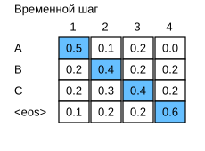
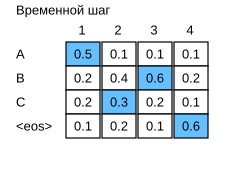
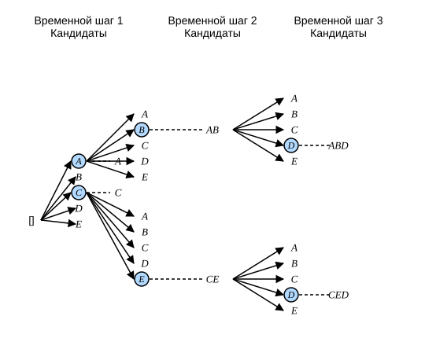

# 9.8 Лучевой поиск

В разделе 9.7 мы предсказывали выходную последовательность поэлементно, пока не появится специальный токен конца последовательности `<eos>`. В этом разделе сначала рассмотрим стратегию *жадного поиска* (greedy search) и обсудим её проблемы, а затем сравним её с альтернативами: *исчерпывающим поиском* (exhaustive search) и *лучевым поиском* (beam search).

Прежде чем вводить жадный поиск, определим задачу поиска с помощью тех же математических обозначений, что и в разделе 9.7. На любом временном шаге $t'$ вероятность выхода $y_{t'}$ декодировщика зависит от выходной подпоследовательности $y_1, \ldots, y_{t'-1}$ до этого шага и от контекстной переменной $\mathbf{c}$, которая кодирует информацию о входной последовательности. Чтобы оценить вычислительные затраты, обозначим выходной словарь через $\mathcal{Y}$, включив в него `<eos>`. Тогда мощность $\left|\mathcal{Y}\right|$ — это размер словаря. Максимальное число токенов в выходной последовательности обозначим через $T'$. Наша цель — найти наилучшую выходную последовательность среди всех $\mathcal{O}(\left|\mathcal{Y}\right|^{T'})$ возможных. Разумеется, всё, что идёт после `<eos>`, не относится к предложению и отбрасывается в итоговом выводе.

## Жадный поиск

Начнём с простой стратегии — *жадного поиска*, которую мы уже использовали для предсказания последовательностей в разделе 9.7. На каждом временном шаге $t'$ выходной последовательности жадный поиск выбирает из $\mathcal{Y}$ токен с наибольшей условной вероятностью:

$$y_{t'} = \operatorname*{argmax}_{y \in \mathcal{Y}} P(y \mid y_1, \ldots, y_{t'-1}, \mathbf{c})$$

Генерация завершается, когда в выходе появляется `<eos>` или когда достигнута максимальная длина $T'$.

Как показано на рис. 9.8.1, предположим, что в выходе есть четыре токена: «A», «B», «C» и `<eos>`. Четыре числа на каждом временном шаге — это условные вероятности генерации «A», «B», «C» и `<eos>` на этом шаге. На каждом шаге жадный поиск выбирает токен с наибольшей условной вероятностью. Поэтому на рис. 9.8.1 будет предсказана выходная последовательность «A», «B», «C» и `<eos>`. Условная вероятность этой последовательности равна $0.5\times0.4\times0.4\times0.6 = 0.048$.

В чём же проблема жадного поиска? На практике *оптимальная последовательность* (optimal sequence) — это та выходная последовательность, которая максимизирует произведение $\prod_{t'=1}^{T'} P(y_{t'} \mid y_1, \ldots, y_{t'-1}, \mathbf{c})$, то есть условную вероятность выхода при заданном входе. Однако жадный поиск не может гарантировать, что найдёт оптимальную последовательность.

Другой пример на рис. 9.8.2 иллюстрирует эту проблему. В отличие от рис. 9.8.1, на временном шаге $2$ мы выбираем токен «C» с *второй* по величине условной вероятностью. Поскольку выходная подпоследовательность на шагах 1 и 2 изменилась с «A» и «B» (рис. 9.8.1) на «A» и «C» (рис. 9.8.2), условные вероятности токенов на шаге 3 тоже меняются. Пусть на шаге 3 выбран токен «B». Тогда текущий шаг 4 зависит от выходной подпоследовательности «A», «C» и «B» из первых трёх шагов, а не от «A», «B» и «C», как на рис. 9.8.1. Поэтому условные вероятности генерации токенов на шаге 4 на рис. 9.8.2 тоже отличаются от рис. 9.8.1. В результате условная вероятность выходной последовательности «A», «C», «B» и `<eos>` на рис. 9.8.2 равна $0.5\times0.3 \times0.6\times0.6=0.054$, и это больше, чем у последовательности жадного поиска на рис. 9.8.1. Этот пример показывает, что последовательность «A», «B», «C» и `<eos>`, найденная жадным поиском, не обязательно является наилучшей.

## Исчерпывающий поиск

Если цель — получить оптимальную последовательность, можно использовать *исчерпывающий поиск* (exhaustive search): перебрать все возможные выходные последовательности и их условные вероятности, а затем выбрать ту, у которой условная вероятность наибольшая.

Хотя исчерпывающий поиск позволяет найти оптимальную последовательность, его вычислительная сложность $\mathcal{O}(\left|\mathcal{Y}\right|^{T'})$ может оказаться поразительно высокой. Например, при $|\mathcal{Y}|=10000$ и $T'=10$ нужно перебрать $10000^{10} = 10^{40}$ последовательностей — это огромное число, которое современные компьютеры практически не в состоянии обработать. Вычислительная сложность жадного поиска $\mathcal{O}(\left|\mathcal{Y}\right|T')$ значительно меньше, чем у исчерпывающего поиска. Например, при $|\mathcal{Y}|=10000$ и $T'=10$ нужно оценить лишь $10000\times10=10^5$ последовательностей.

## Лучевой поиск

Какую же стратегию поиска выбрать? Если важнее всего точность, очевидный выбор — исчерпывающий поиск. Если важнее всего вычислительные затраты, очевидный выбор — жадный поиск. Практическое применение лучевого поиска лежит между этими крайностями.

*Лучевой поиск* (beam search) — это улучшенная версия жадного поиска. У него есть гиперпараметр — *ширина луча* (beam size) $k$. На временном шаге $1$ мы выбираем $k$ токенов с наибольшей условной вероятностью. Эти $k$ токенов станут первыми токенами $k$ кандидатных выходных последовательностей. На каждом последующем временном шаге, опираясь на $k$ кандидатных выходных последовательностей предыдущего шага, мы продолжаем выбирать из $k\left|\mathcal{Y}\right|$ возможных продолжений $k$ кандидатных последовательностей с наибольшей условной вероятностью.

На рис. 9.8.3 показан процесс лучевого поиска. Пусть выходной словарь содержит только пять элементов $\mathcal{Y} = \{A, B, C, D, E\}$, один из которых — `<eos>`. Ширина луча равна $2$, а максимальная длина выходной последовательности — $3$. На временном шаге $1$ токены с наибольшей условной вероятностью $P(y_1 \mid \mathbf{c})$ — это $A$ и $C$. На временном шаге $2$ для всех $y_2 \in \mathcal{Y}$ вычисляем:

$$\begin{aligned}P(A, y_2 \mid \mathbf{c}) = P(A \mid \mathbf{c})P(y_2 \mid A, \mathbf{c}),\\ P(C, y_2 \mid \mathbf{c}) = P(C \mid \mathbf{c})P(y_2 \mid C, \mathbf{c}),\end{aligned}$$

Из этих десяти значений выбираем два наибольших, например $P(A, B \mid \mathbf{c})$ и $P(C, E \mid \mathbf{c})$. Затем на временном шаге $3$ для всех $y_3 \in \mathcal{Y}$ вычисляем:

$$\begin{aligned}P(A, B, y_3 \mid \mathbf{c}) = P(A, B \mid \mathbf{c})P(y_3 \mid A, B, \mathbf{c}),\\P(C, E, y_3 \mid \mathbf{c}) = P(C, E \mid \mathbf{c})P(y_3 \mid C, E, \mathbf{c}),\end{aligned}$$

Из этих десяти значений выбираем два наибольших, а именно $P(A, B, D \mid \mathbf{c})$ и $P(C, E, D \mid \mathbf{c})$, и получаем шесть кандидатных выходных последовательностей: (1) $A$; (2) $C$; (3) $A,B$; (4) $C,E$; (5) $A,B,D$; (6) $C,E,D$.

Наконец, на основе этих шести последовательностей (например, отбросив `<eos>` и всё, что идёт после него) получаем окончательное множество кандидатных выходных последовательностей. Затем выбираем ту из них, у которой нормированное по длине логарифмическое правдоподобие максимально:

$$ \frac{1}{L^\alpha} \log P(y_1, \ldots, y_{L}\mid \mathbf{c}) = \frac{1}{L^\alpha} \sum_{t'=1}^L \log P(y_{t'} \mid y_1, \ldots, y_{t'-1}, \mathbf{c}),\tag{9.8.1}$$

где $L$ — длина окончательной кандидатной последовательности, а $\alpha$ обычно равно $0.75$. Поскольку более длинная последовательность содержит больше логарифмических слагаемых в сумме, знаменатель $L^\alpha$ используется для штрафа за длину.

Вычислительная сложность лучевого поиска $\mathcal{O}(k\left|\mathcal{Y}\right|T')$ лежит между сложностями жадного и исчерпывающего поиска. Жадный поиск можно рассматривать как частный случай лучевого поиска с шириной луча $1$. Выбирая ширину луча, можно найти компромисс между точностью и вычислительными затратами.

## Резюме

* Стратегии поиска последовательностей включают жадный поиск, исчерпывающий поиск и лучевой поиск.
* Жадный поиск требует наименьших вычислений, но даёт относительно низкую точность.
* Исчерпывающий поиск даёт наивысшую точность, но требует наибольших вычислений.
* Лучевой поиск позволяет найти компромисс между точностью и вычислительными затратами, гибко выбирая ширину луча.

## Упражнения

1. Можно ли рассматривать исчерпывающий поиск как особый случай лучевого поиска? Почему?
1. Примените лучевой поиск в задаче машинного перевода из раздела 9.7. Как ширина луча влияет на скорость предсказания и на результат?
1. В разделе 8.5 мы генерировали текст с помощью языковой модели на основе заданного пользователем префикса. Какая стратегия поиска используется в этом примере? Можно ли её улучшить?

[Обсуждение](https://discuss.d2l.ai/t/5768)
