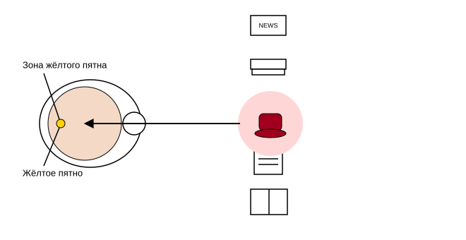
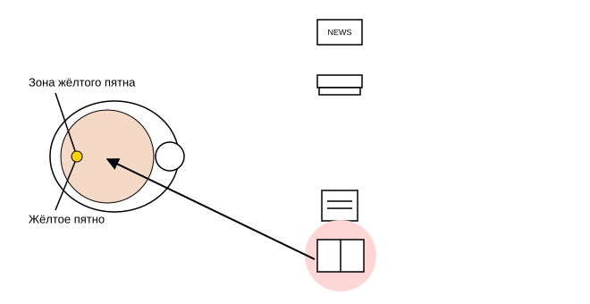
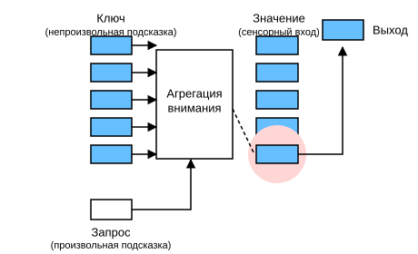

# 10.1 Подсказки внимания

Спасибо, что читаете эту книгу: внимание читателя — ограниченный ресурс. Сейчас вы читаете эту книгу и тем самым не читаете другие, поэтому ваше внимание оплачивается упущенной выгодой, подобно деньгам. Чтобы внимание, которое вы сейчас вкладываете, окупилось, авторы стараются (всем своим вниманием) написать хорошую книгу.

С тех пор как экономика изучает распределение редких ресурсов, мы живём в эпоху «экономики внимания», где человеческое внимание рассматривают как обмениваемый, ограниченный, ценный и дефицитный товар. Многие бизнес-модели строятся на этом: в музыкальных и видеосервисах люди либо тратят внимание на рекламу, либо платят, чтобы её скрыть; в сетевых играх, чтобы расти, люди либо тратят внимание на бои и помогают привлекать новых игроков, либо платят, чтобы сразу стать сильнее. Словом, внимание не бывает бесплатным.

Внимание ограничено, а вокруг много информации, которая его отвлекает. Например, зрительный нерв человека передаёт около $10^8$ бит информации в секунду, что намного превышает то, что мозг способен полностью обработать. К счастью, наши предки уже из опыта (то есть из данных) поняли, что не все сенсорные данные одинаково важны. На протяжении всей истории человечества способность направлять внимание только на небольшую часть интересующей информации позволяла мозгу разумнее распределять ресурсы для выживания, роста и общения: для поиска хищников, еды и партнёров.

## Подсказки внимания в биологии

Как внимание применяется к визуальному миру? Начнём с распространённой сегодня *двухкомпонентной* (two-component) схемы. Её истоки восходят к 1890-м годам, к Уильяму Джеймсу, которого считают «отцом американской психологии» (James, 2007). В этой схеме испытуемый целенаправленно выбирает фокус внимания, опираясь на *непроизвольные подсказки* и *произвольные подсказки*.

Непроизвольные подсказки основаны на заметности и бросаемости объектов в окружении. Представим, что перед нами пять предметов: газета, научная статья, чашка кофе, блокнот и книга (рис. 10.1.1). Все бумажные предметы напечатаны чёрно-белыми, а кофейная чашка красная. Иными словами, в этой визуальной обстановке чашка выделяется и невольно привлекает внимание. Поэтому мы направляем самый острый взгляд на кофе, как показано на рис. 10.1.1.



После кофе мы становимся бодрее и хотим почитать, поэтому поворачиваем голову, заново фокусируем взгляд и смотрим на книгу, как показано на рис. 10.1.2. В отличие от выбора на рис. 10.1.1, который определяется заметностью, выбор книги контролируется познанием и сознанием, поэтому внимание, опирающееся на произвольные подсказки, действует осторожнее. Сила такого выбора больше, поскольку его подталкивает субъективное намерение испытуемого.



## Запросы, ключи и значения

Произвольные и непроизвольные подсказки объясняют, как устроено человеческое внимание. Теперь посмотрим, как с помощью этих двух видов подсказок спроектировать нейросетевой механизм внимания.

Сначала рассмотрим относительно простой случай, когда используются только непроизвольные подсказки. Чтобы смещать выбор в сторону сенсорных входов, можно просто использовать параметризованный полносвязный слой или даже непараметризованные слои максимального или среднего пулинга.

Поэтому именно наличие произвольных подсказок отличает механизм внимания от полносвязных слоёв или слоёв пулинга. В контексте механизма внимания произвольные подсказки называют *запросом* (query). Для любого запроса механизм внимания через *агрегацию внимания* (attention pooling) направляет выбор на *сенсорные входы* (sensory inputs), например на промежуточные представления признаков. В механизме внимания такие сенсорные входы называют *значениями* (value). Более общо, каждое значение связано с *ключом* (key), который можно представить как непроизвольную подсказку для сенсорного входа. Как показано на рис. 10.1.3, агрегацию внимания можно спроектировать так, чтобы заданный запрос (произвольная подсказка) сопоставлялся с ключами (непроизвольными подсказками), и выбор падал на наиболее подходящее значение (сенсорный вход).



Поскольку описанная схема занимает центральное место на рис. 10.1.3, модели, построенные по ней, станут основным объектом изучения в этой главе. Однако у механизмов внимания есть и альтернативы. Например, можно спроектировать недифференцируемую модель внимания и обучать её методами обучения с подкреплением (Mnih et al., 2014).

## Визуализация внимания

Слой среднего пулинга можно рассматривать как взвешенное среднее входов, где веса всех входов одинаковы. На самом деле агрегация внимания даёт взвешенную сумму значений, а веса вычисляются между заданным запросом и разными ключами.

Чтобы визуализировать веса внимания, определим функцию `show_heatmaps`. Её вход `matrices` имеет форму (число строк для показа, число столбцов для показа, число запросов, число ключей).

**MXNet:**

```python
from d2l import mxnet as d2l
from mxnet import np, npx
npx.set_np()
```

**PyTorch:**

```python
from d2l import torch as d2l
import torch
```

**TensorFlow:**

```python
from d2l import tensorflow as d2l
import tensorflow as tf
```

**PaddlePaddle:**

```python
from d2l import paddle as d2l
import warnings
warnings.filterwarnings("ignore")
import paddle
```

```python
#@save
def show_heatmaps(matrices, xlabel, ylabel, titles=None, figsize=(2.5, 2.5),
                  cmap='Reds'):
    """Отображает тепловые карты матриц"""
    d2l.use_svg_display()
    num_rows, num_cols = matrices.shape[0], matrices.shape[1]
    fig, axes = d2l.plt.subplots(num_rows, num_cols, figsize=figsize,
                                 sharex=True, sharey=True, squeeze=False)
    for i, (row_axes, row_matrices) in enumerate(zip(axes, matrices)):
        for j, (ax, matrix) in enumerate(zip(row_axes, row_matrices)):
            pcm = ax.imshow(d2l.numpy(matrix), cmap=cmap)
            if i == num_rows - 1:
                ax.set_xlabel(xlabel)
            if j == 0:
                ax.set_ylabel(ylabel)
            if titles:
                ax.set_title(titles[j])
    fig.colorbar(pcm, ax=axes, shrink=0.6);
```

В примере ниже вес внимания равен 1, только если запрос и ключ совпадают, а в остальных случаях равен 0.

```python
attention_weights = d2l.reshape(d2l.eye(10), (1, 1, 10, 10))
show_heatmaps(attention_weights, xlabel='Keys', ylabel='Queries')
```

В следующих разделах функция `show_heatmaps` будет вызываться часто, чтобы показать веса внимания.

## Резюме

* Внимание человека ограничено, ценно и дефицитно.
* Испытуемые избирательно направляют внимание, используя непроизвольные и произвольные подсказки. Первые основаны на заметности, вторые — на сознательном выборе.
* Механизм внимания отличается от полносвязных слоёв или слоёв пулинга наличием произвольных подсказок.
* Механизм внимания через агрегацию внимания смещает выбор в сторону значений (сенсорных входов), где запросы (произвольные подсказки) и ключи (непроизвольные подсказки) определяют веса. Ключи и значения образуют пары.
* Веса внимания между запросами и ключами можно визуализировать.

## Упражнения

1. При декодировании последовательности в машинном переводе какой может быть произвольная подсказка? Что будет непроизвольной подсказкой и сенсорным входом?
1. Случайно сгенерируйте матрицу $10 \times 10$ и примените операцию `softmax`, чтобы каждая строка была корректным распределением вероятностей. Затем визуализируйте выходные веса внимания.

**MXNet:**
[Обсуждение](https://discuss.d2l.ai/t/5763)

**PyTorch:**
[Обсуждение](https://discuss.d2l.ai/t/5764)

**TensorFlow:**
[Обсуждение](https://discuss.d2l.ai/t/5765)

**PaddlePaddle:**
[Обсуждение](https://discuss.d2l.ai/t/11839)

## Литература

* James, W. (2007). *The Principles of Psychology*. Cosimo, Inc.
* Mnih, V., Heess, N., Graves, A., & others (2014). Recurrent models of visual attention. *Advances in Neural Information Processing Systems*, 2204–2212.
