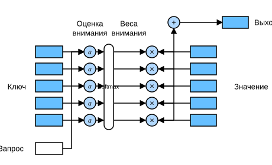

# 10.3 Функции оценки внимания

В разделе 10.2 для моделирования связи между запросом и ключами использовалось гауссово ядро. Показатель экспоненты в гауссовом ядре (10.2.4) можно рассматривать как *функцию оценки внимания* (attention scoring function), или просто *функцию оценки*. Её выход подаётся в функцию softmax. В результате получается распределение вероятностей по значениям, соответствующим ключам, то есть веса внимания. Наконец, выход агрегации внимания — это взвешенная сумма значений с этими весами внимания.

С высоты птичьего полёта этот алгоритм позволяет реализовать схему механизма внимания с рис. 10.1.3. На рис. 10.3.1 показано, как вычислить выход агрегации внимания как взвешенную сумму значений, где $a$ обозначает функцию оценки внимания. Поскольку веса внимания образуют распределение вероятностей, взвешенная сумма по сути является взвешенным средним.



**Рис. 10.3.1.** Вычисление выхода агрегации внимания как взвешенной суммы значений

Математически предположим, что есть запрос $\mathbf{q} \in \mathbb{R}^q$ и $m$ пар «ключ — значение» $(\mathbf{k}_1, \mathbf{v}_1), \ldots, (\mathbf{k}_m, \mathbf{v}_m)$, где $\mathbf{k}_i \in \mathbb{R}^k$, $\mathbf{v}_i \in \mathbb{R}^v$. Функция агрегации внимания $f$ представляется как взвешенная сумма значений:

$$f(\mathbf{q}, (\mathbf{k}_1, \mathbf{v}_1), \ldots, (\mathbf{k}_m, \mathbf{v}_m)) = \sum_{i=1}^m \alpha(\mathbf{q}, \mathbf{k}_i) \mathbf{v}_i \in \mathbb{R}^v,\tag{10.3.1}$$

где вес внимания (скаляр) для запроса $\mathbf{q}$ и ключа $\mathbf{k}_i$ получается так: функция оценки внимания $a$ переводит два вектора в скаляр, после чего применяется операция softmax:

$$\alpha(\mathbf{q}, \mathbf{k}_i) = \mathrm{softmax}(a(\mathbf{q}, \mathbf{k}_i)) = \frac{\exp(a(\mathbf{q}, \mathbf{k}_i))}{\sum_{j=1}^m \exp(a(\mathbf{q}, \mathbf{k}_j))} \in \mathbb{R}.\tag{10.3.2}$$

Как показано на рисунке выше, выбор разной функции оценки внимания $a$ приводит к разным операциям агрегации внимания. В этом разделе мы рассмотрим две популярные функции оценки; позже с их помощью построим более сложные механизмы внимания.

**MXNet:**

```python
import math
from d2l import mxnet as d2l
from mxnet import np, npx
from mxnet.gluon import nn
npx.set_np()
```

**PyTorch:**

```python
from d2l import torch as d2l
import math
import torch
from torch import nn
```

**TensorFlow:**

```python
from d2l import tensorflow as d2l
import tensorflow as tf
```

**PaddlePaddle:**

```python
from d2l import paddle as d2l
import math
import warnings
warnings.filterwarnings("ignore")
import paddle
from paddle import nn
```

## 10.3.1 Маскированная операция softmax

Как сказано выше, операция softmax выдаёт распределение вероятностей в качестве весов внимания. В некоторых случаях не все значения должны участвовать в агрегации внимания. Например, чтобы эффективно обрабатывать минибатчи в разделе 9.5, некоторые текстовые последовательности дополнены бессмысленными служебными токенами. Чтобы в агрегации внимания учитывались только осмысленные токены, можно задать действительную длину (то есть число токенов) и отфильтровать при вычислении softmax позиции, которые выходят за пределы этого диапазона. Ниже функция `masked_softmax` реализует такую *маскированную операцию softmax* (masked softmax operation), в которой любые позиции за пределами действительной длины маскируются и приравниваются к 0.

**MXNet:**

```python
#@save
def masked_softmax(X, valid_lens):
    """Выполняет softmax, маскируя элементы по последней оси"""
    # X: трёхмерный тензор, valid_lens: одномерный или двумерный тензор
    if valid_lens is None:
        return npx.softmax(X)
    else:
        shape = X.shape
        if valid_lens.ndim == 1:
            valid_lens = valid_lens.repeat(shape[1])
        else:
            valid_lens = valid_lens.reshape(-1)
        # Замаскированные элементы по последней оси заменяются очень большим отрицательным числом,
        # поэтому их выход softmax равен 0
        X = npx.sequence_mask(X.reshape(-1, shape[-1]), valid_lens, True,
                              value=-1e6, axis=1)
        return npx.softmax(X).reshape(shape)
```

**PyTorch:**

```python
#@save
def masked_softmax(X, valid_lens):
    """Выполняет softmax, маскируя элементы по последней оси"""
    # X: трёхмерный тензор, valid_lens: одномерный или двумерный тензор
    if valid_lens is None:
        return nn.functional.softmax(X, dim=-1)
    else:
        shape = X.shape
        if valid_lens.dim() == 1:
            valid_lens = torch.repeat_interleave(valid_lens, shape[1])
        else:
            valid_lens = valid_lens.reshape(-1)
        # Замаскированные элементы по последней оси заменяются очень большим отрицательным числом,
        # поэтому их выход softmax равен 0
        X = d2l.sequence_mask(X.reshape(-1, shape[-1]), valid_lens,
                              value=-1e6)
        return nn.functional.softmax(X.reshape(shape), dim=-1)
```

**TensorFlow:**

```python
#@save
def masked_softmax(X, valid_lens):
    """Выполняет softmax, маскируя элементы по последней оси"""
    # X: трёхмерный тензор, valid_lens: одномерный или двумерный тензор
    if valid_lens is None:
        return tf.nn.softmax(X, axis=-1)
    else:
        shape = X.shape
        if len(valid_lens.shape) == 1:
            valid_lens = tf.repeat(valid_lens, repeats=shape[1])
            
        else:
            valid_lens = tf.reshape(valid_lens, shape=-1)
        # Замаскированные элементы по последней оси заменяются очень большим отрицательным числом,
        # поэтому их выход softmax равен 0
        X = d2l.sequence_mask(tf.reshape(X, shape=(-1, shape[-1])), 
                              valid_lens, value=-1e6)    
        return tf.nn.softmax(tf.reshape(X, shape=shape), axis=-1)
```

**PaddlePaddle:**

```python
#@save
def masked_softmax(X, valid_lens):
    """Выполняет softmax, маскируя элементы по последней оси"""
    # X: трёхмерный тензор, valid_lens: одномерный или двумерный тензор
    if valid_lens is None:
        return nn.functional.softmax(X, axis=-1)
    else:
        shape = X.shape
        if valid_lens.dim() == 1:
            valid_lens = paddle.repeat_interleave(valid_lens, shape[1])
        else:
            valid_lens = valid_lens.reshape((-1,))
        # Замаскированные элементы по последней оси заменяются очень большим отрицательным числом,
        # поэтому их выход softmax равен 0
        X = d2l.sequence_mask(X.reshape((-1, shape[-1])), valid_lens,
                              value=-1e6)
        return nn.functional.softmax(X.reshape(shape), axis=-1)
```

Чтобы **продемонстрировать работу этой функции**, рассмотрим примеры, представленные двумя матрицами $2 \times 4$, с действительными длинами $2$ и $3$. После маскированной операции softmax значения за пределами действительной длины обнуляются.

**MXNet:**

```python
masked_softmax(np.random.uniform(size=(2, 2, 4)), d2l.tensor([2, 3]))
```

**PyTorch:**

```python
masked_softmax(torch.rand(2, 2, 4), torch.tensor([2, 3]))
```

**TensorFlow:**

```python
masked_softmax(tf.random.uniform(shape=(2, 2, 4)), tf.constant([2, 3]))
```

**PaddlePaddle:**

```python
masked_softmax(paddle.rand((2, 2, 4)), paddle.to_tensor([2, 3]))
```

Аналогично, можно использовать двумерный тензор и задать действительную длину для каждой строки матричного примера.

**MXNet:**

```python
masked_softmax(np.random.uniform(size=(2, 2, 4)),
               d2l.tensor([[1, 3], [2, 4]]))
```

**PyTorch:**

```python
masked_softmax(torch.rand(2, 2, 4), d2l.tensor([[1, 3], [2, 4]]))
```

**TensorFlow:**

```python
masked_softmax(tf.random.uniform(shape=(2, 2, 4)), tf.constant([[1, 3], [2, 4]]))
```

**PaddlePaddle:**

```python
masked_softmax(paddle.rand((2, 2, 4)), paddle.to_tensor([[1, 3], [2, 4]]))
```

## 10.3.2 Аддитивное внимание

В общем случае, когда запросы и ключи — векторы разной длины, в качестве функции оценки можно использовать аддитивное внимание. Для запроса $\mathbf{q} \in \mathbb{R}^q$ и ключа $\mathbf{k} \in \mathbb{R}^k$ функция оценки *аддитивного внимания* (additive attention) имеет вид

$$a(\mathbf q, \mathbf k) = \mathbf w_v^\top \text{tanh}(\mathbf W_q\mathbf q + \mathbf W_k \mathbf k) \in \mathbb{R},\tag{10.3.3}$$

где обучаемые параметры — $\mathbf W_q\in\mathbb R^{h\times q}$, $\mathbf W_k\in\mathbb R^{h\times k}$ и $\mathbf w_v\in\mathbb R^{h}$. Как видно из (10.3.3), запрос и ключ объединяются и подаются в многослойный перцептрон (MLP) с одним скрытым слоем, число скрытых элементов которого $h$ — гиперпараметр. В качестве функции активации используется $\tanh$, а смещение отключено.

Теперь реализуем аддитивное внимание.

**MXNet:**

```python
#@save
class AdditiveAttention(nn.Block):
    """Аддитивное внимание"""
    def __init__(self, num_hiddens, dropout, **kwargs):
        super(AdditiveAttention, self).__init__(**kwargs)
        # Используем flatten=False, чтобы преобразовывалась только последняя ось, а форма остальных осей сохранялась
        self.W_k = nn.Dense(num_hiddens, use_bias=False, flatten=False)
        self.W_q = nn.Dense(num_hiddens, use_bias=False, flatten=False)
        self.w_v = nn.Dense(1, use_bias=False, flatten=False)
        self.dropout = nn.Dropout(dropout)

    def forward(self, queries, keys, values, valid_lens):
        queries, keys = self.W_q(queries), self.W_k(keys)
        # После расширения размерностей
        # форма queries: (batch_size, число запросов, 1, num_hidden)
        # форма keys: (batch_size, 1, число пар «ключ — значение», num_hiddens)
        # Складываем с помощью broadcasting
        features = np.expand_dims(queries, axis=2) + np.expand_dims(
            keys, axis=1)
        features = np.tanh(features)
        # У self.w_v один выход, поэтому удаляем последнюю размерность формы.
        # Форма scores: (batch_size, число запросов, число пар «ключ — значение»)
        scores = np.squeeze(self.w_v(features), axis=-1)
        self.attention_weights = masked_softmax(scores, valid_lens)
        # Форма values: (batch_size, число пар «ключ — значение», размерность значений)
        return npx.batch_dot(self.dropout(self.attention_weights), values)
```

**PyTorch:**

```python
#@save
class AdditiveAttention(nn.Module):
    """Аддитивное внимание"""
    def __init__(self, key_size, query_size, num_hiddens, dropout, **kwargs):
        super(AdditiveAttention, self).__init__(**kwargs)
        self.W_k = nn.Linear(key_size, num_hiddens, bias=False)
        self.W_q = nn.Linear(query_size, num_hiddens, bias=False)
        self.w_v = nn.Linear(num_hiddens, 1, bias=False)
        self.dropout = nn.Dropout(dropout)

    def forward(self, queries, keys, values, valid_lens):
        queries, keys = self.W_q(queries), self.W_k(keys)
        # После расширения размерностей
        # форма queries: (batch_size, число запросов, 1, num_hidden)
        # форма keys: (batch_size, 1, число пар «ключ — значение», num_hiddens)
        # Складываем с помощью broadcasting
        features = queries.unsqueeze(2) + keys.unsqueeze(1)
        features = torch.tanh(features)
        # У self.w_v один выход, поэтому удаляем последнюю размерность формы.
        # Форма scores: (batch_size, число запросов, число пар «ключ — значение»)
        scores = self.w_v(features).squeeze(-1)
        self.attention_weights = masked_softmax(scores, valid_lens)
        # Форма values: (batch_size, число пар «ключ — значение», размерность значений)
        return torch.bmm(self.dropout(self.attention_weights), values)
```

**TensorFlow:**

```python
#@save
class AdditiveAttention(tf.keras.layers.Layer):
    """Аддитивное внимание"""
    def __init__(self, key_size, query_size, num_hiddens, dropout, **kwargs):
        super().__init__(**kwargs)
        self.W_k = tf.keras.layers.Dense(num_hiddens, use_bias=False)
        self.W_q = tf.keras.layers.Dense(num_hiddens, use_bias=False)
        self.w_v = tf.keras.layers.Dense(1, use_bias=False)
        self.dropout = tf.keras.layers.Dropout(dropout)
        
    def call(self, queries, keys, values, valid_lens, **kwargs):
        queries, keys = self.W_q(queries), self.W_k(keys)
        # После расширения размерностей
        # форма queries: (batch_size, число запросов, 1, num_hidden)
        # форма keys: (batch_size, 1, число пар «ключ — значение», num_hiddens)
        # Складываем с помощью broadcasting
        features = tf.expand_dims(queries, axis=2) + tf.expand_dims(
            keys, axis=1)
        features = tf.nn.tanh(features)
        # У self.w_v один выход, поэтому удаляем последнюю размерность формы.
        # Форма scores: (batch_size, число запросов, число пар «ключ — значение»)
        scores = tf.squeeze(self.w_v(features), axis=-1)
        self.attention_weights = masked_softmax(scores, valid_lens)
        # Форма values: (batch_size, число пар «ключ — значение», размерность значений)
        return tf.matmul(self.dropout(
            self.attention_weights, **kwargs), values)
```

**PaddlePaddle:**

```python
#@save
class AdditiveAttention(nn.Layer):
    """Аддитивное внимание"""
    def __init__(self, key_size, query_size, num_hiddens, dropout, **kwargs):
        super(AdditiveAttention, self).__init__(**kwargs)
        self.W_k = nn.Linear(key_size, num_hiddens, bias_attr=False)
        self.W_q = nn.Linear(query_size, num_hiddens, bias_attr=False)
        self.w_v = nn.Linear(num_hiddens, 1, bias_attr=False)
        self.dropout = nn.Dropout(dropout)

    def forward(self, queries, keys, values, valid_lens):
        queries, keys = self.W_q(queries), self.W_k(keys)
        # После расширения размерностей
        # форма queries: (batch_size, число запросов, 1, num_hidden)
        # форма keys: (batch_size, 1, число пар «ключ — значение», num_hiddens)
        # Складываем с помощью broadcasting
        features = queries.unsqueeze(2) + keys.unsqueeze(1)
        features = paddle.tanh(features)
        # У self.w_v один выход, поэтому удаляем последнюю размерность формы.
        # Форма scores: (batch_size, число запросов, число пар «ключ — значение»)
        scores = self.w_v(features).squeeze(-1)
        self.attention_weights = masked_softmax(scores, valid_lens)
        # Форма values: (batch_size, число пар «ключ — значение», размерность значений)
        return paddle.bmm(self.dropout(self.attention_weights), values)
```

Чтобы продемонстрировать **класс `AdditiveAttention`** на небольшом примере, возьмём запросы, ключи и значения формы (размер батча, число шагов или длина последовательности токенов, размерность признаков). Фактические формы: $(2,1,20)$, $(2,10,2)$ и $(2,10,4)$. Форма выхода агрегации внимания — (размер батча, число шагов запроса, размерность значений).

**MXNet:**

```python
queries, keys = d2l.normal(0, 1, (2, 1, 20)), d2l.ones((2, 10, 2))
# В минибатче values две одинаковые матрицы значений
values = np.arange(40).reshape(1, 10, 4).repeat(2, axis=0)
valid_lens = d2l.tensor([2, 6])

attention = AdditiveAttention(num_hiddens=8, dropout=0.1)
attention.initialize()
attention(queries, keys, values, valid_lens)
```

**PyTorch:**

```python
queries, keys = d2l.normal(0, 1, (2, 1, 20)), d2l.ones((2, 10, 2))
# В минибатче values две одинаковые матрицы значений
values = torch.arange(40, dtype=torch.float32).reshape(1, 10, 4).repeat(
    2, 1, 1)
valid_lens = d2l.tensor([2, 6])

attention = AdditiveAttention(key_size=2, query_size=20, num_hiddens=8,
                              dropout=0.1)
attention.eval()
attention(queries, keys, values, valid_lens)
```

**TensorFlow:**

```python
queries, keys = tf.random.normal(shape=(2, 1, 20)), tf.ones((2, 10, 2))
# В минибатче values две одинаковые матрицы значений
values = tf.repeat(tf.reshape(
    tf.range(40, dtype=tf.float32), shape=(1, 10, 4)), repeats=2, axis=0)
valid_lens = tf.constant([2, 6])

attention = AdditiveAttention(key_size=2, query_size=20, num_hiddens=8,
                              dropout=0.1)
attention(queries, keys, values, valid_lens, training=False)
```

**PaddlePaddle:**

```python
queries, keys = paddle.normal(0, 1, (2, 1, 20)), paddle.ones((2, 10, 2))
# В минибатче values две одинаковые матрицы значений
values = paddle.arange(40, dtype=paddle.float32).reshape((1, 10, 4)).tile(
    [2, 1, 1])
valid_lens = paddle.to_tensor([2, 6])

attention = AdditiveAttention(key_size=2, query_size=20, num_hiddens=8,
                              dropout=0.1)
attention.eval()
attention(queries, keys, values, valid_lens)
```

Хотя аддитивное внимание содержит обучаемые параметры, в этом примере все ключи одинаковы, поэтому **веса внимания** равномерны и определяются заданными действительными длинами.

```python
d2l.show_heatmaps(d2l.reshape(attention.attention_weights, (1, 1, 2, 10)),
                  xlabel='Keys', ylabel='Queries')
```

## 10.3.3 Масштабированное скалярное произведение внимания

Скалярное произведение даёт более эффективную с вычислительной точки зрения функцию оценки, но для него требуется, чтобы запрос и ключ имели одинаковую длину $d$. Предположим, что все элементы запроса и ключа — независимые случайные величины с нулевым средним и единичной дисперсией. Тогда скалярное произведение двух векторов имеет среднее $0$ и дисперсию $d$. Чтобы дисперсия скалярного произведения оставалась равной $1$ независимо от длины векторов, разделим скалярное произведение на $\sqrt{d}$. Тогда функция оценки *масштабированного скалярного произведения внимания* (scaled dot-product attention) имеет вид:

$$a(\mathbf q, \mathbf k) = \mathbf{q}^\top \mathbf{k}  /\sqrt{d}.$$

На практике для повышения эффективности удобнее рассматривать минибатчи. Например, внимание можно вычислить для $n$ запросов и $m$ пар «ключ — значение», где длина запросов и ключей равна $d$, а длина значений — $v$. Масштабированное скалярное произведение внимания для запросов $\mathbf Q\in\mathbb R^{n\times d}$, ключей $\mathbf K\in\mathbb R^{m\times d}$ и значений $\mathbf V\in\mathbb R^{m\times v}$ равно:

$$ \mathrm{softmax}\left(\frac{\mathbf Q \mathbf K^\top }{\sqrt{d}}\right) \mathbf V \in \mathbb{R}^{n\times v}.\tag{10.3.4}$$

Реализация масштабированного скалярного произведения внимания ниже использует *исключение* (dropout) для регуляризации модели.

**MXNet:**

```python
#@save
class DotProductAttention(nn.Block):
    """Масштабированное скалярное произведение внимания"""
    def __init__(self, dropout, **kwargs):
        super(DotProductAttention, self).__init__(**kwargs)
        self.dropout = nn.Dropout(dropout)

    # Форма queries: (batch_size, число запросов, d)
    # Форма keys: (batch_size, число пар «ключ — значение», d)
    # Форма values: (batch_size, число пар «ключ — значение», размерность значений)
    # Форма valid_lens: (batch_size,) или (batch_size, число запросов)
    def forward(self, queries, keys, values, valid_lens=None):
        d = queries.shape[-1]
        # Задаём transpose_b=True, чтобы поменять местами две последние размерности keys
        scores = npx.batch_dot(queries, keys, transpose_b=True) / math.sqrt(d)
        self.attention_weights = masked_softmax(scores, valid_lens)
        return npx.batch_dot(self.dropout(self.attention_weights), values)
```

**PyTorch:**

```python
#@save
class DotProductAttention(nn.Module):
    """Масштабированное скалярное произведение внимания"""
    def __init__(self, dropout, **kwargs):
        super(DotProductAttention, self).__init__(**kwargs)
        self.dropout = nn.Dropout(dropout)

    # Форма queries: (batch_size, число запросов, d)
    # Форма keys: (batch_size, число пар «ключ — значение», d)
    # Форма values: (batch_size, число пар «ключ — значение», размерность значений)
    # Форма valid_lens: (batch_size,) или (batch_size, число запросов)
    def forward(self, queries, keys, values, valid_lens=None):
        d = queries.shape[-1]
        # Задаём transpose_b=True, чтобы поменять местами две последние размерности keys
        scores = torch.bmm(queries, keys.transpose(1,2)) / math.sqrt(d)
        self.attention_weights = masked_softmax(scores, valid_lens)
        return torch.bmm(self.dropout(self.attention_weights), values)
```

**TensorFlow:**

```python
#@save
class DotProductAttention(tf.keras.layers.Layer):
    """Масштабированное скалярное произведение внимания"""
    def __init__(self, dropout, **kwargs):
        super().__init__(**kwargs)
        self.dropout = tf.keras.layers.Dropout(dropout)
        
    # Форма queries: (batch_size, число запросов, d)
    # Форма keys: (batch_size, число пар «ключ — значение», d)
    # Форма values: (batch_size, число пар «ключ — значение», размерность значений)
    # Форма valid_lens: (batch_size,) или (batch_size, число запросов)
    def call(self, queries, keys, values, valid_lens, **kwargs):
        d = queries.shape[-1]
        scores = tf.matmul(queries, keys, transpose_b=True)/tf.math.sqrt(
            tf.cast(d, dtype=tf.float32))
        self.attention_weights = masked_softmax(scores, valid_lens)
        return tf.matmul(self.dropout(self.attention_weights, **kwargs), values)
```

**PaddlePaddle:**

```python
#@save
class DotProductAttention(nn.Layer):
    """Масштабированное скалярное произведение внимания"""
    def __init__(self, dropout, **kwargs):
        super(DotProductAttention, self).__init__(**kwargs)
        self.dropout = nn.Dropout(dropout)

    # Форма queries: (batch_size, число запросов, d)
    # Форма keys: (batch_size, число пар «ключ — значение», d)
    # Форма values: (batch_size, число пар «ключ — значение», размерность значений)
    # Форма valid_lens: (batch_size,) или (batch_size, число запросов)
    def forward(self, queries, keys, values, valid_lens=None):
        d = queries.shape[-1]
        # Задаём transpose_b=True, чтобы поменять местами две последние размерности keys
        scores = paddle.bmm(queries, keys.transpose((0,2,1))) / math.sqrt(d)
        self.attention_weights = masked_softmax(scores, valid_lens)
        return paddle.bmm(self.dropout(self.attention_weights), values)
```

Чтобы **продемонстрировать `DotProductAttention`**, используем те же ключи, значения и действительные длины, что и в примере с аддитивным вниманием. Для скалярного произведения задаём размерность признаков запроса такой же, как у ключей.

**MXNet:**

```python
queries = d2l.normal(0, 1, (2, 1, 2))
attention = DotProductAttention(dropout=0.5)
attention.initialize()
attention(queries, keys, values, valid_lens)
```

**PyTorch:**

```python
queries = d2l.normal(0, 1, (2, 1, 2))
attention = DotProductAttention(dropout=0.5)
attention.eval()
attention(queries, keys, values, valid_lens)
```

**TensorFlow:**

```python
queries = tf.random.normal(shape=(2, 1, 2))
attention = DotProductAttention(dropout=0.5)
attention(queries, keys, values, valid_lens, training=False)
```

**PaddlePaddle:**

```python
queries = paddle.normal(0, 1, (2, 1, 2))
attention = DotProductAttention(dropout=0.5)
attention.eval()
attention(queries, keys, values, valid_lens)
```

Как и в примере с аддитивным вниманием, ключи содержат одинаковые элементы, которые нельзя различить никаким запросом, поэтому получаются **равномерные веса внимания**.

```python
d2l.show_heatmaps(d2l.reshape(attention.attention_weights, (1, 1, 2, 10)),
                  xlabel='Keys', ylabel='Queries')
```

## Резюме

* Выход агрегации внимания можно вычислять как взвешенное среднее значений; выбор разной функции оценки внимания приводит к разной агрегации внимания.
* Когда запросы и ключи — векторы разной длины, можно использовать аддитивную функцию оценки внимания. Когда их длины совпадают, масштабированное скалярное произведение эффективнее с вычислительной точки зрения.

## Упражнения

1. Измените ключи в маленьком примере и визуализируйте веса внимания. Дают ли аддитивное внимание и масштабированное скалярное произведение по-прежнему одинаковый результат? Почему?
1. Можно ли, используя только операции матричного умножения, спроектировать новую функцию оценки для запросов и ключей разной длины?
1. Когда запросы и ключи имеют одинаковую длину, является ли сложение векторов как функция оценки лучше скалярного произведения? Почему?

**MXNet:**
[Обсуждение](https://discuss.d2l.ai/t/5751)

**PyTorch:**
[Обсуждение](https://discuss.d2l.ai/t/5752)

**PaddlePaddle:**
[Обсуждение](https://discuss.d2l.ai/t/11841)
