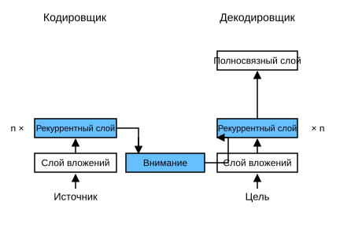

# 10.4 Внимание Баданау

В разделе 9.7 мы рассмотрели задачу машинного перевода: с помощью архитектуры «кодировщик — декодировщик» на основе двух рекуррентных нейронных сетей выполняется обучение «последовательность в последовательность». Конкретно, рекуррентный кодировщик преобразует последовательность переменной длины в контекстную переменную фиксированной формы, а рекуррентный декодировщик генерирует выходную последовательность токен за токеном, опираясь на сгенерированные токены и контекстную переменную. Однако даже если не все входные (исходные) токены полезны для декодирования некоторого токена, на каждом шаге декодирования используется одна и та же контекстная переменная, закодированная из *всех* входных токенов. Есть ли способ сделать контекстную переменную зависящей от шага декодирования?

Мы ищем вдохновение в работе (Graves, 2013): при генерации рукописного текста по заданной текстовой последовательности Грейвз спроектировал дифференцируемую модель внимания, которая выравнивает символы текста с более длинной записью, причём выравнивание сдвигается только в одном направлении. Вдохновлённые идеей обучаемого выравнивания, Баданау и соавторы предложили дифференцируемую модель внимания без строгого однонаправленного ограничения выравнивания (Bahdanau et al., 2014). При предсказании токена, если не все входные токены одинаково важны, модель выравнивает (или учитывает) только ту часть входной последовательности, которая связана с текущим предсказанием. Это достигается тем, что контекстная переменная рассматривается как выход, сфокусированный вниманием.

## Модель

Описанная ниже модель внимания Баданау использует те же обозначения, что и раздел 9.7. Эта новая модель на основе внимания ничем не отличается от модели из раздела 9.7, за исключением того, что контекстная переменная $\mathbf{c}$ в (9.7.1) на любом шаге декодирования $t'$ заменяется на $\mathbf{c}_{t'}$. Пусть во входной последовательности $T$ токенов. Тогда контекстная переменная на шаге декодирования $t'$ — это выход, сфокусированный вниманием:

$$\mathbf{c}_{t'} = \sum_{t=1}^T \alpha(\mathbf{s}_{t' - 1}, \mathbf{h}_t) \mathbf{h}_t,$$

где скрытое состояние декодировщика $\mathbf{s}_{t' - 1}$ на временном шаге $t' - 1$ служит запросом, а скрытые состояния кодировщика $\mathbf{h}_t$ одновременно являются и ключами, и значениями. Веса внимания $\alpha$ вычисляются с помощью аддитивной функции оценки внимания, определённой в (10.3.2).

Архитектура Баданау немного отличается от архитектуры рекуррентного кодировщика-декодировщика из раздела 9.7: на рис. 10.4.1 показана архитектура внимания Баданау.



**MXNet:**

```python
from d2l import mxnet as d2l
from mxnet import np, npx
from mxnet.gluon import rnn, nn
npx.set_np()
```

**PyTorch:**

```python
from d2l import torch as d2l
import torch
from torch import nn
```

**TensorFlow:**

```python
from d2l import tensorflow as d2l
import tensorflow as tf
```

**PaddlePaddle:**

```python
from d2l import paddle as d2l
import warnings
warnings.filterwarnings("ignore")
import paddle
from paddle import nn
```

## Определение декодировщика с вниманием

Теперь посмотрим, как определить внимание Баданау, чтобы реализовать рекуррентную модель «кодировщик — декодировщик». По сути, достаточно заново определить декодировщик. Чтобы веса обученного внимания было удобнее показывать, класс `AttentionDecoder` ниже задаёт **базовый интерфейс декодировщика с механизмом внимания**.

```python
#@save
class AttentionDecoder(d2l.Decoder):
    """Базовый интерфейс декодировщика с механизмом внимания"""
    def __init__(self, **kwargs):
        super(AttentionDecoder, self).__init__(**kwargs)

    @property
    def attention_weights(self):
        raise NotImplementedError
```

Далее **реализуем рекуррентный декодировщик с вниманием Баданау** в классе `Seq2SeqAttentionDecoder`. Сначала для инициализации состояния декодировщика нужны следующие входы:

1. финальный слой скрытых состояний кодировщика на всех временных шагах, который служит ключами и значениями для внимания;
1. скрытые состояния всех слоёв кодировщика на последнем временном шаге, которые служат для инициализации скрытого состояния декодировщика;
1. действительная длина кодировщика (без токенов заполнения, которые исключаются из пула внимания).

На каждом шаге декодирования финальный слой скрытого состояния декодировщика на предыдущем шаге используется как запрос. Поэтому выход внимания и встраивание входа объединяются и подаются на вход рекуррентного декодировщика.

**MXNet:**

```python
class Seq2SeqAttentionDecoder(AttentionDecoder):
    def __init__(self, vocab_size, embed_size, num_hiddens, num_layers,
                 dropout=0, **kwargs):
        super(Seq2SeqAttentionDecoder, self).__init__(**kwargs)
        self.attention = d2l.AdditiveAttention(num_hiddens, dropout)
        self.embedding = nn.Embedding(vocab_size, embed_size)
        self.rnn = rnn.GRU(num_hiddens, num_layers, dropout=dropout)
        self.dense = nn.Dense(vocab_size, flatten=False)

    def init_state(self, enc_outputs, enc_valid_lens, *args):
        # Форма outputs: (num_steps, batch_size, num_hiddens)
        # Форма hidden_state[0]: (num_layers, batch_size, num_hiddens)
        outputs, hidden_state = enc_outputs
        return (outputs.swapaxes(0, 1), hidden_state, enc_valid_lens)

    def forward(self, X, state):
        # Форма enc_outputs: (batch_size, num_steps, num_hiddens).
        # Форма hidden_state[0]: (num_layers, batch_size,
        # num_hiddens)
        enc_outputs, hidden_state, enc_valid_lens = state
        # Форма X на выходе: (num_steps, batch_size, embed_size)
        X = self.embedding(X).swapaxes(0, 1)
        outputs, self._attention_weights = [], []
        for x in X:
            # Форма query: (batch_size, 1, num_hiddens)
            query = np.expand_dims(hidden_state[0][-1], axis=1)
            # Форма context: (batch_size, 1, num_hiddens)
            context = self.attention(
                query, enc_outputs, enc_outputs, enc_valid_lens)
            # Конкатенируем по размерности признаков
            x = np.concatenate((context, np.expand_dims(x, axis=1)), axis=-1)
            # Преобразуем x к форме (1, batch_size, embed_size + num_hiddens)
            out, hidden_state = self.rnn(x.swapaxes(0, 1), hidden_state)
            outputs.append(out)
            self._attention_weights.append(self.attention.attention_weights)
        # После преобразования полносвязным слоем форма outputs:
        # (num_steps, batch_size, vocab_size)
        outputs = self.dense(np.concatenate(outputs, axis=0))
        return outputs.swapaxes(0, 1), [enc_outputs, hidden_state,
                                        enc_valid_lens]

    @property
    def attention_weights(self):
        return self._attention_weights
```

**PyTorch:**

```python
class Seq2SeqAttentionDecoder(AttentionDecoder):
    def __init__(self, vocab_size, embed_size, num_hiddens, num_layers,
                 dropout=0, **kwargs):
        super(Seq2SeqAttentionDecoder, self).__init__(**kwargs)
        self.attention = d2l.AdditiveAttention(
            num_hiddens, num_hiddens, num_hiddens, dropout)
        self.embedding = nn.Embedding(vocab_size, embed_size)
        self.rnn = nn.GRU(
            embed_size + num_hiddens, num_hiddens, num_layers,
            dropout=dropout)
        self.dense = nn.Linear(num_hiddens, vocab_size)

    def init_state(self, enc_outputs, enc_valid_lens, *args):
        # Форма outputs: (batch_size, num_steps, num_hiddens).
        # Форма hidden_state: (num_layers, batch_size, num_hiddens)
        outputs, hidden_state = enc_outputs
        return (outputs.permute(1, 0, 2), hidden_state, enc_valid_lens)

    def forward(self, X, state):
        # Форма enc_outputs: (batch_size, num_steps, num_hiddens).
        # Форма hidden_state: (num_layers, batch_size,
        # num_hiddens)
        enc_outputs, hidden_state, enc_valid_lens = state
        # Форма X на выходе: (num_steps, batch_size, embed_size)
        X = self.embedding(X).permute(1, 0, 2)
        outputs, self._attention_weights = [], []
        for x in X:
            # Форма query: (batch_size, 1, num_hiddens)
            query = torch.unsqueeze(hidden_state[-1], dim=1)
            # Форма context: (batch_size, 1, num_hiddens)
            context = self.attention(
                query, enc_outputs, enc_outputs, enc_valid_lens)
            # Конкатенируем по размерности признаков
            x = torch.cat((context, torch.unsqueeze(x, dim=1)), dim=-1)
            # Преобразуем x к форме (1, batch_size, embed_size + num_hiddens)
            out, hidden_state = self.rnn(x.permute(1, 0, 2), hidden_state)
            outputs.append(out)
            self._attention_weights.append(self.attention.attention_weights)
        # После преобразования полносвязным слоем форма outputs:
        # (num_steps, batch_size, vocab_size)
        outputs = self.dense(torch.cat(outputs, dim=0))
        return outputs.permute(1, 0, 2), [enc_outputs, hidden_state,
                                          enc_valid_lens]
    
    @property
    def attention_weights(self):
        return self._attention_weights
```

**TensorFlow:**

```python
class Seq2SeqAttentionDecoder(AttentionDecoder):
    def __init__(self, vocab_size, embed_size, num_hiddens, num_layers,
                 dropout=0, **kwargs):
        super().__init__(**kwargs)
        self.attention = d2l.AdditiveAttention(num_hiddens, num_hiddens,
                                               num_hiddens, dropout)
        self.embedding = tf.keras.layers.Embedding(vocab_size, embed_size)
        self.rnn = tf.keras.layers.RNN(tf.keras.layers.StackedRNNCells(
            [tf.keras.layers.GRUCell(num_hiddens, dropout=dropout)
             for _ in range(num_layers)]),
                                      return_sequences=True, 
                                      return_state=True)
        self.dense = tf.keras.layers.Dense(vocab_size)

    def init_state(self, enc_outputs, enc_valid_lens, *args):
        # Форма outputs: (num_steps, batch_size, num_hiddens)
        # Форма hidden_state[0]: (num_layers, batch_size, num_hiddens)

        outputs, hidden_state = enc_outputs
        return (outputs, hidden_state, enc_valid_lens)

    def call(self, X, state, **kwargs):
        # Форма enc_outputs: (batch_size, num_steps, num_hiddens)
        # Форма hidden_state[0]: (num_layers, batch_size, num_hiddens)
        enc_outputs, hidden_state, enc_valid_lens = state
        # Форма X на выходе: (num_steps, batch_size, embed_size)
        X = self.embedding(X) # Форма входа X: (batch_size, num_steps)
        X = tf.transpose(X, perm=(1, 0, 2))
        outputs, self._attention_weights = [], []
        for x in X:
            # Форма query: (batch_size, 1, num_hiddens)
            query = tf.expand_dims(hidden_state[-1], axis=1)
            # Форма context: (batch_size, 1, num_hiddens)
            context = self.attention(query, enc_outputs, enc_outputs,
                                     enc_valid_lens, **kwargs)
            # Конкатенируем по размерности признаков
            x = tf.concat((context, tf.expand_dims(x, axis=1)), axis=-1)
            out = self.rnn(x, hidden_state, **kwargs)
            hidden_state = out[1:]
            outputs.append(out[0])
            self._attention_weights.append(self.attention.attention_weights)
        # После преобразования полносвязным слоем форма outputs: (num_steps, batch_size, vocab_size)
        outputs = self.dense(tf.concat(outputs, axis=1))
        return outputs, [enc_outputs, hidden_state, enc_valid_lens]

    @property
    def attention_weights(self):
        return self._attention_weights
```

**PaddlePaddle:**

```python
class Seq2SeqAttentionDecoder(AttentionDecoder):
    def __init__(self, vocab_size, embed_size, num_hiddens, num_layers,
                 dropout=0, **kwargs):
        super(Seq2SeqAttentionDecoder, self).__init__(**kwargs)
        self.attention = d2l.AdditiveAttention(
            num_hiddens, num_hiddens, num_hiddens, dropout)
        self.embedding = nn.Embedding(vocab_size, embed_size)
        self.rnn = nn.GRU(embed_size + num_hiddens, num_hiddens, 
                          num_layers, bias_ih_attr=True,
                          time_major=True, dropout=dropout)
        self.dense = nn.Linear(num_hiddens, vocab_size)

    def init_state(self, enc_outputs, enc_valid_lens, *args):
        # Форма outputs: (batch_size, num_steps, num_hiddens).
        # Форма hidden_state: (num_layers, batch_size, num_hiddens)
        outputs, hidden_state = enc_outputs
        return (outputs.transpose((1, 0, 2)), hidden_state, enc_valid_lens)

    def forward(self, X, state):
        # Форма enc_outputs: (batch_size, num_steps, num_hiddens).
        # Форма hidden_state: (num_layers, batch_size, num_hiddens)
        enc_outputs, hidden_state, enc_valid_lens = state
        # Форма X на выходе: (num_steps, batch_size, embed_size)
        X = self.embedding(X).transpose((1, 0, 2))
        outputs, self._attention_weights = [], []
        for x in X:
            # Форма query: (batch_size, 1, num_hiddens)
            query = paddle.unsqueeze(hidden_state[-1], axis=1)
            # Форма context: (batch_size, 1, num_hiddens)
            context = self.attention(
                query, enc_outputs, enc_outputs, enc_valid_lens)
            # Конкатенируем по размерности признаков
            x = paddle.concat((context, paddle.unsqueeze(x, axis=1)), axis=-1)
            # Преобразуем x к форме (1, batch_size, embed_size + num_hiddens)
            out, hidden_state = self.rnn(x.transpose((1, 0, 2)), hidden_state)
            outputs.append(out)
            self._attention_weights.append(self.attention.attention_weights)
        # После преобразования полносвязным слоем форма outputs:
        # (num_steps, batch_size, vocab_size)
        outputs = self.dense(paddle.concat(outputs, axis=0))
        return outputs.transpose((1, 0, 2)), [enc_outputs, hidden_state, 
                                              enc_valid_lens]

    @property
    def attention_weights(self):
        return self._attention_weights
```

Далее проверим **декодировщик внимания Баданау** на мини-батче из четырёх последовательностей входа с семью временными шагами.

**MXNet:**

```python
encoder = d2l.Seq2SeqEncoder(vocab_size=10, embed_size=8, num_hiddens=16,
                             num_layers=2)
encoder.initialize()
decoder = Seq2SeqAttentionDecoder(vocab_size=10, embed_size=8, num_hiddens=16,
                                  num_layers=2)
decoder.initialize()
X = d2l.zeros((4, 7))  # (batch_size, num_steps)
state = decoder.init_state(encoder(X), None)
output, state = decoder(X, state)
output.shape, len(state), state[0].shape, len(state[1]), state[1][0].shape
```

**PyTorch:**

```python
encoder = d2l.Seq2SeqEncoder(vocab_size=10, embed_size=8, num_hiddens=16,
                             num_layers=2)
encoder.eval()
decoder = Seq2SeqAttentionDecoder(vocab_size=10, embed_size=8, num_hiddens=16,
                                  num_layers=2)
decoder.eval()
X = d2l.zeros((4, 7), dtype=torch.long)  # (batch_size, num_steps)
state = decoder.init_state(encoder(X), None)
output, state = decoder(X, state)
output.shape, len(state), state[0].shape, len(state[1]), state[1][0].shape
```

**TensorFlow:**

```python
encoder = d2l.Seq2SeqEncoder(vocab_size=10, embed_size=8, num_hiddens=16,
                             num_layers=2)
decoder = Seq2SeqAttentionDecoder(vocab_size=10, embed_size=8, num_hiddens=16,
                                  num_layers=2)
X = tf.zeros((4, 7))
state = decoder.init_state(encoder(X, training=False), None)
output, state = decoder(X, state, training=False)
output.shape, len(state), state[0].shape, len(state[1]), state[1][0].shape
```

**PaddlePaddle:**

```python
encoder = d2l.Seq2SeqEncoder(vocab_size=10, embed_size=8, num_hiddens=16,
                             num_layers=2)
encoder.eval()
decoder = Seq2SeqAttentionDecoder(vocab_size=10, embed_size=8, num_hiddens=16,
                                  num_layers=2)
decoder.eval()
X = paddle.zeros((4, 7), dtype='int64')  # (batch_size, num_steps)
state = decoder.init_state(encoder(X), None)
output, state = decoder(X, state)
output.shape, len(state), state[0].shape, len(state[1]), state[1][0].shape
```

## **Обучение**

Как и в разделе 9.7.4, здесь мы задаём гиперпараметры, создаём кодировщик и декодировщик с вниманием Баданау и обучаем модель машинному переводу. Из-за добавленного механизма внимания обучение заметно медленнее, чем в разделе 9.7 без внимания.

```python
embed_size, num_hiddens, num_layers, dropout = 32, 32, 2, 0.1
batch_size, num_steps = 64, 10
lr, num_epochs, device = 0.005, 250, d2l.try_gpu()

train_iter, src_vocab, tgt_vocab = d2l.load_data_nmt(batch_size, num_steps)
encoder = d2l.Seq2SeqEncoder(
    len(src_vocab), embed_size, num_hiddens, num_layers, dropout)
decoder = Seq2SeqAttentionDecoder(
    len(tgt_vocab), embed_size, num_hiddens, num_layers, dropout)
net = d2l.EncoderDecoder(encoder, decoder)
d2l.train_seq2seq(net, train_iter, lr, num_epochs, tgt_vocab, device)
```

После обучения модели мы **переводим несколько английских предложений на французский** и вычисляем их оценки BLEU.

**MXNet, PyTorch, PaddlePaddle:**

```python
engs = ['go .', "i lost .", 'he\'s calm .', 'i\'m home .']
fras = ['va !', 'j\'ai perdu .', 'il est calme .', 'je suis chez moi .']
for eng, fra in zip(engs, fras):
    translation, dec_attention_weight_seq = d2l.predict_seq2seq(
        net, eng, src_vocab, tgt_vocab, num_steps, device, True)
    print(f'{eng} => {translation}, ',
          f'bleu {d2l.bleu(translation, fra, k=2):.3f}')
```

**TensorFlow:**

```python
engs = ['go .', "i lost .", 'he\'s calm .', 'i\'m home .']
fras = ['va !', 'j\'ai perdu .', 'il est calme .', 'je suis chez moi .']
for eng, fra in zip(engs, fras):
    translation, dec_attention_weight_seq = d2l.predict_seq2seq(
        net, eng, src_vocab, tgt_vocab, num_steps, True)
    print(f'{eng} => {translation}, ',
          f'bleu {d2l.bleu(translation, fra, k=2):.3f}')
```

```python
attention_weights = d2l.reshape(
    d2l.concat([step[0][0][0] for step in dec_attention_weight_seq], 0),
    (1, 1, -1, num_steps))
```

После обучения **визуализация весов внимания** показывает, что каждый запрос распределяет разные веса по парам «ключ — значение». Это означает, что на каждом шаге декодирования разные части входной последовательности селективно выбираются в пул внимания.

**MXNet:**

```python
# Включаем токен конца последовательности
d2l.show_heatmaps(
    attention_weights[:, :, :, :len(engs[-1].split()) + 1],
    xlabel='Key positions', ylabel='Query positions')
```

**PyTorch, PaddlePaddle:**

```python
# Включаем токен конца последовательности
d2l.show_heatmaps(
    attention_weights[:, :, :, :len(engs[-1].split()) + 1].cpu(),
    xlabel='Key positions', ylabel='Query positions')
```

**TensorFlow:**

```python
# Включаем токен конца последовательности
d2l.show_heatmaps(attention_weights[:, :, :, :len(engs[-1].split()) + 1],
                  xlabel='Key positions', ylabel='Query positions')
```

## Резюме

* Предсказывая токен, если не все входные токены одинаково важны, рекуррентная модель «кодировщик — декодировщик» с вниманием Баданау селективно учитывает разные части входной последовательности. Это достигается за счёт того, что контекстная переменная рассматривается как выход аддитивной агрегации внимания.
* В рекуррентной модели «кодировщик — декодировщик» внимание Баданау рассматривает скрытое состояние декодировщика на предыдущем временном шаге как запрос, а скрытые состояния кодировщика на всех временных шагах — как ключи и значения одновременно.

## Упражнения

1. В экспериментах замените GRU на LSTM.
1. Измените эксперимент так, чтобы вместо аддитивной функции оценки внимания использовалось масштабированное скалярное произведение внимания. Как это повлияет на эффективность обучения?

**MXNet:**
[Обсуждение](https://discuss.d2l.ai/t/5753)

**PyTorch:**
[Обсуждение](https://discuss.d2l.ai/t/5754)

**PaddlePaddle:**
[Обсуждение](https://discuss.d2l.ai/t/11842)

## Литература

* Graves, A. (2013). Generating sequences with recurrent neural networks. *arXiv preprint arXiv:1308.0850*.
* Bahdanau, D., Cho, K., & Bengio, Y. (2014). Neural machine translation by jointly learning to align and translate. *arXiv preprint arXiv:1409.0473*.
