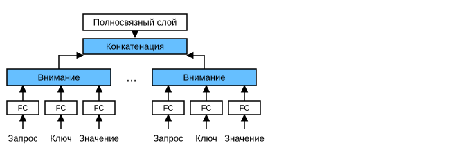

# 10.5 Многоголовое внимание

На практике при одном и том же наборе запросов, ключей и значений мы хотим, чтобы модель могла, опираясь на один и тот же механизм внимания, выучивать разные виды поведения, а затем объединять их как знания, чтобы захватывать зависимости разного масштаба внутри последовательности (например, краткосрочные и долгосрочные зависимости). Поэтому полезно позволить механизму внимания комбинировать разные *подпространства представлений* (representation subspaces) запросов, ключей и значений.

Для этого вместо одной агрегации внимания мы можем преобразовать запросы, ключи и значения с помощью $h$ независимо выученных *линейных проекций* (linear projections). Затем эти $h$ преобразованных запросов, ключей и значений параллельно подаются в агрегацию внимания. Наконец, выходы $h$ агрегаций внимания конкатенируются и преобразуются ещё одной обучаемой линейной проекцией, чтобы получить итоговый выход. Такая конструкция называется *многоголовым вниманием* (multihead attention) (Vaswani et al., 2017). Каждая из $h$ агрегаций внимания называется *головой* (head). На рис. 10.5.1 показано многоголовое внимание, в котором обучаемые линейные преобразования реализованы полносвязными слоями.



## Модель

Прежде чем реализовывать многоголовое внимание, опишем модель математически. Даны запрос $\mathbf{q} \in \mathbb{R}^{d_q}$, ключ $\mathbf{k} \in \mathbb{R}^{d_k}$ и значение $\mathbf{v} \in \mathbb{R}^{d_v}$. Каждая голова внимания $\mathbf{h}_i$ ($i = 1, \ldots, h$) вычисляется так:

$$\mathbf{h}_i = f(\mathbf W_i^{(q)}\mathbf q, \mathbf W_i^{(k)}\mathbf k,\mathbf W_i^{(v)}\mathbf v) \in \mathbb R^{p_v},$$

где обучаемые параметры включают $\mathbf W_i^{(q)}\in\mathbb R^{p_q\times d_q}$, $\mathbf W_i^{(k)}\in\mathbb R^{p_k\times d_k}$ и $\mathbf W_i^{(v)}\in\mathbb R^{p_v\times d_v}$, а $f$ — функция агрегации внимания. Функцией $f$ может быть аддитивное внимание или масштабированное скалярное произведение внимания из раздела 10.3. Выход многоголового внимания проходит ещё одно линейное преобразование, которое соответствует конкатенации $h$ голов, поэтому обучаемый параметр — $\mathbf W_o\in\mathbb R^{p_o\times h p_v}$:

$$\mathbf W_o \begin{bmatrix}\mathbf h_1\\\vdots\\\mathbf h_h\end{bmatrix} \in \mathbb{R}^{p_o}.$$

Благодаря этой конструкции каждая голова может обращать внимание на разные части входа, и вместе они способны представлять функции более сложные, чем простое взвешенное среднее.

**MXNet:**

```python
from d2l import mxnet as d2l
import math
from mxnet import autograd, np, npx
from mxnet.gluon import nn
npx.set_np()
```

**PyTorch:**

```python
from d2l import torch as d2l
import math
import torch
from torch import nn
```

**TensorFlow:**

```python
from d2l import tensorflow as d2l
import tensorflow as tf
```

**PaddlePaddle:**

```python
from d2l import paddle as d2l
import warnings
warnings.filterwarnings("ignore")
import math
import paddle
from paddle import nn
```

## Реализация

На практике при реализации **в качестве каждой головы внимания обычно выбирают масштабированное скалярное произведение внимания**. Чтобы избежать резкого роста вычислительных затрат и затрат на параметры, положим $p_q = p_k = p_v = p_o / h$. Заметим, что если задать число выходов линейных преобразований запросов, ключей и значений равным $p_q h = p_k h = p_v h = p_o$, то $h$ голов можно вычислять параллельно. В реализации ниже $p_o$ задаётся параметром `num_hiddens`.

**MXNet:**

```python
#@save
class MultiHeadAttention(nn.Block):
    """Многоголовое внимание"""
    def __init__(self, num_hiddens, num_heads, dropout, use_bias=False,
                 **kwargs):
        super(MultiHeadAttention, self).__init__(**kwargs)
        self.num_heads = num_heads
        self.attention = d2l.DotProductAttention(dropout)
        self.W_q = nn.Dense(num_hiddens, use_bias=use_bias, flatten=False)
        self.W_k = nn.Dense(num_hiddens, use_bias=use_bias, flatten=False)
        self.W_v = nn.Dense(num_hiddens, use_bias=use_bias, flatten=False)
        self.W_o = nn.Dense(num_hiddens, use_bias=use_bias, flatten=False)

    def forward(self, queries, keys, values, valid_lens):
        # Формы queries, keys, values:
        # (batch_size, число запросов или пар «ключ — значение», num_hiddens)
        # Форма valid_lens:
        # (batch_size,) или (batch_size, число запросов)
        # После преобразования формы queries, keys, values:
        # (batch_size*num_heads, число запросов или пар «ключ — значение»,
        # num_hiddens/num_heads)
        queries = transpose_qkv(self.W_q(queries), self.num_heads)
        keys = transpose_qkv(self.W_k(keys), self.num_heads)
        values = transpose_qkv(self.W_v(values), self.num_heads)

        if valid_lens is not None:
            # По оси 0 первый элемент (скаляр или вектор) повторяем num_heads раз,
            # затем так же повторяем второй элемент и так далее.
            valid_lens = valid_lens.repeat(self.num_heads, axis=0)

        # Форма output: (batch_size*num_heads, число запросов,
        # num_hiddens/num_heads)
        output = self.attention(queries, keys, values, valid_lens)
        
        # Форма output_concat: (batch_size, число запросов, num_hiddens)
        output_concat = transpose_output(output, self.num_heads)
        return self.W_o(output_concat)
```

**PyTorch:**

```python
#@save
class MultiHeadAttention(nn.Module):
    """Многоголовое внимание"""
    def __init__(self, key_size, query_size, value_size, num_hiddens,
                 num_heads, dropout, bias=False, **kwargs):
        super(MultiHeadAttention, self).__init__(**kwargs)
        self.num_heads = num_heads
        self.attention = d2l.DotProductAttention(dropout)
        self.W_q = nn.Linear(query_size, num_hiddens, bias=bias)
        self.W_k = nn.Linear(key_size, num_hiddens, bias=bias)
        self.W_v = nn.Linear(value_size, num_hiddens, bias=bias)
        self.W_o = nn.Linear(num_hiddens, num_hiddens, bias=bias)

    def forward(self, queries, keys, values, valid_lens):
        # Формы queries, keys, values:
        # (batch_size, число запросов или пар «ключ — значение», num_hiddens)
        # Форма valid_lens:
        # (batch_size,) или (batch_size, число запросов)
        # После преобразования формы queries, keys, values:
        # (batch_size*num_heads, число запросов или пар «ключ — значение»,
        # num_hiddens/num_heads)
        queries = transpose_qkv(self.W_q(queries), self.num_heads)
        keys = transpose_qkv(self.W_k(keys), self.num_heads)
        values = transpose_qkv(self.W_v(values), self.num_heads)

        if valid_lens is not None:
            # По оси 0 первый элемент (скаляр или вектор) повторяем num_heads раз,
            # затем так же повторяем второй элемент и так далее.
            valid_lens = torch.repeat_interleave(
                valid_lens, repeats=self.num_heads, dim=0)

        # Форма output: (batch_size*num_heads, число запросов,
        # num_hiddens/num_heads)
        output = self.attention(queries, keys, values, valid_lens)

        # Форма output_concat: (batch_size, число запросов, num_hiddens)
        output_concat = transpose_output(output, self.num_heads)
        return self.W_o(output_concat)
```

**TensorFlow:**

```python
#@save
class MultiHeadAttention(tf.keras.layers.Layer):
    """Многоголовое внимание"""
    def __init__(self, key_size, query_size, value_size, num_hiddens,
                 num_heads, dropout, bias=False, **kwargs):
        super().__init__(**kwargs)
        self.num_heads = num_heads
        self.attention = d2l.DotProductAttention(dropout)
        self.W_q = tf.keras.layers.Dense(num_hiddens, use_bias=bias)
        self.W_k = tf.keras.layers.Dense(num_hiddens, use_bias=bias)
        self.W_v = tf.keras.layers.Dense(num_hiddens, use_bias=bias)
        self.W_o = tf.keras.layers.Dense(num_hiddens, use_bias=bias)
    
    def call(self, queries, keys, values, valid_lens, **kwargs):
        # Формы queries, keys, values:
        # (batch_size, число запросов или пар «ключ — значение», num_hiddens)
        # Форма valid_lens:
        # (batch_size,) или (batch_size, число запросов)
        # После преобразования формы queries, keys, values:
        # (batch_size*num_heads, число запросов или пар «ключ — значение»,
        # num_hiddens/num_heads)
        queries = transpose_qkv(self.W_q(queries), self.num_heads)
        keys = transpose_qkv(self.W_k(keys), self.num_heads)
        values = transpose_qkv(self.W_v(values), self.num_heads)
        
        if valid_lens is not None:
            # По оси 0 первый элемент (скаляр или вектор) повторяем num_heads раз,
            # затем так же повторяем второй элемент и так далее.
            valid_lens = tf.repeat(valid_lens, repeats=self.num_heads, axis=0)
            
        # Форма output: (batch_size*num_heads, число запросов,
        # num_hiddens/num_heads)
        output = self.attention(queries, keys, values, valid_lens, **kwargs)
        
        # Форма output_concat: (batch_size, число запросов, num_hiddens)
        output_concat = transpose_output(output, self.num_heads)
        return self.W_o(output_concat)
```

**PaddlePaddle:**

```python
#@save
class MultiHeadAttention(nn.Layer):
    """Многоголовое внимание"""
    def __init__(self, key_size, query_size, value_size, num_hiddens,
                 num_heads, dropout, bias=False, **kwargs):
        super(MultiHeadAttention, self).__init__(**kwargs)
        self.num_heads = num_heads
        self.attention = d2l.DotProductAttention(dropout)
        self.W_q = nn.Linear(query_size, num_hiddens, bias_attr=bias)
        self.W_k = nn.Linear(key_size, num_hiddens, bias_attr=bias)
        self.W_v = nn.Linear(value_size, num_hiddens, bias_attr=bias)
        self.W_o = nn.Linear(num_hiddens, num_hiddens, bias_attr=bias)

    def forward(self, queries, keys, values, valid_lens):
        # Формы queries, keys, values:
        # (batch_size, число запросов или пар «ключ — значение», num_hiddens)
        # Форма valid_lens:
        # (batch_size,) или (batch_size, число запросов)
        # После преобразования формы queries, keys, values:
        # (batch_size*num_heads, число запросов или пар «ключ — значение»,
        # num_hiddens/num_heads)
        queries = transpose_qkv(self.W_q(queries), self.num_heads)
        keys = transpose_qkv(self.W_k(keys), self.num_heads)
        values = transpose_qkv(self.W_v(values), self.num_heads)
        if valid_lens is not None:
            # По оси 0 первый элемент (скаляр или вектор) повторяем num_heads раз,
            # затем так же повторяем второй элемент и так далее.
            valid_lens = paddle.repeat_interleave(
                valid_lens, repeats=self.num_heads, axis=0)

        # Форма output: (batch_size*num_heads, число запросов,
        # num_hiddens/num_heads)
        output = self.attention(queries, keys, values, valid_lens)

        # Форма output_concat: (batch_size, число запросов, num_hiddens)
        output_concat = transpose_output(output, self.num_heads)
        return self.W_o(output_concat)
```

Чтобы **все головы вычислялись параллельно**, класс `MultiHeadAttention` выше использует две функции транспонирования, определённые ниже. Функция `transpose_output` обращает операцию функции `transpose_qkv`.

**MXNet:**

```python
#@save
def transpose_qkv(X, num_heads):
    """Меняет форму для параллельного вычисления нескольких голов внимания"""
    # Форма входа X: (batch_size, число запросов или пар «ключ — значение», num_hiddens)
    # Форма выхода X: (batch_size, число запросов или пар «ключ — значение», num_heads,
    # num_hiddens/num_heads)
    X = X.reshape(X.shape[0], X.shape[1], num_heads, -1)

    # Форма выхода X: (batch_size, num_heads, число запросов или пар «ключ — значение»,
    # num_hiddens/num_heads)
    X = X.transpose(0, 2, 1, 3)

    # Форма итогового выхода: (batch_size*num_heads, число запросов или пар «ключ — значение»,
    # num_hiddens/num_heads)
    return X.reshape(-1, X.shape[2], X.shape[3])


#@save
def transpose_output(X, num_heads):
    """Обращает операцию функции transpose_qkv"""
    X = X.reshape(-1, num_heads, X.shape[1], X.shape[2])
    X = X.transpose(0, 2, 1, 3)
    return X.reshape(X.shape[0], X.shape[1], -1)
```

**PyTorch:**

```python
#@save
def transpose_qkv(X, num_heads):
    """Меняет форму для параллельного вычисления нескольких голов внимания"""
    # Форма входа X: (batch_size, число запросов или пар «ключ — значение», num_hiddens)
    # Форма выхода X: (batch_size, число запросов или пар «ключ — значение», num_heads,
    # num_hiddens/num_heads)
    X = X.reshape(X.shape[0], X.shape[1], num_heads, -1)

    # Форма выхода X: (batch_size, num_heads, число запросов или пар «ключ — значение»,
    # num_hiddens/num_heads)
    X = X.permute(0, 2, 1, 3)

    # Форма итогового выхода: (batch_size*num_heads, число запросов или пар «ключ — значение»,
    # num_hiddens/num_heads)
    return X.reshape(-1, X.shape[2], X.shape[3])


#@save
def transpose_output(X, num_heads):
    """Обращает операцию функции transpose_qkv"""
    X = X.reshape(-1, num_heads, X.shape[1], X.shape[2])
    X = X.permute(0, 2, 1, 3)
    return X.reshape(X.shape[0], X.shape[1], -1)
```

**TensorFlow:**

```python
#@save
def transpose_qkv(X, num_heads):
    """Меняет форму для параллельного вычисления нескольких голов внимания"""
    # Форма входа X: (batch_size, число запросов или пар «ключ — значение», num_hiddens)
    # Форма выхода X: (batch_size, число запросов или пар «ключ — значение», num_heads,
    # num_hiddens/num_heads)
    X = tf.reshape(X, shape=(X.shape[0], X.shape[1], num_heads, -1))

    # Форма выхода X: (batch_size, num_heads, число запросов или пар «ключ — значение»,
    # num_hiddens/num_heads)
    X = tf.transpose(X, perm=(0, 2, 1, 3))

    # Форма итогового выхода: (batch_size*num_heads, число запросов или пар «ключ — значение»,
    # num_hiddens/num_heads)
    return tf.reshape(X, shape=(-1, X.shape[2], X.shape[3]))


#@save
def transpose_output(X, num_heads):
    """Обращает операцию функции transpose_qkv"""
    X = tf.reshape(X, shape=(-1, num_heads, X.shape[1], X.shape[2]))
    X = tf.transpose(X, perm=(0, 2, 1, 3))
    return tf.reshape(X, shape=(X.shape[0], X.shape[1], -1))
```

**PaddlePaddle:**

```python
#@save
def transpose_qkv(X, num_heads):
    """Меняет форму для параллельного вычисления нескольких голов внимания"""
    # Форма входа X: (batch_size, число запросов или пар «ключ — значение», num_hiddens)
    # Форма выхода X: (batch_size, число запросов или пар «ключ — значение», num_heads,
    # num_hiddens/num_heads)
    X = X.reshape((X.shape[0], X.shape[1], num_heads, -1))

    # Форма выхода X: (batch_size, num_heads, число запросов или пар «ключ — значение»,
    # num_hiddens/num_heads)
    X = X.transpose((0, 2, 1, 3))

    # Форма итогового выхода: (batch_size*num_heads, число запросов или пар «ключ — значение»,
    # num_hiddens/num_heads)
    return X.reshape((-1, X.shape[2], X.shape[3]))


#@save
def transpose_output(X, num_heads):
    """Обращает операцию функции transpose_qkv"""
    X = X.reshape((-1, num_heads, X.shape[1], X.shape[2]))
    X = X.transpose((0, 2, 1, 3))
    return X.reshape((X.shape[0], X.shape[1], -1))
```

Проверим класс `MultiHeadAttention` на небольшом примере, в котором ключи и значения совпадают. Форма выхода многоголового внимания — (`batch_size`, `num_queries`, `num_hiddens`).

**MXNet:**

```python
num_hiddens, num_heads = 100, 5
attention = MultiHeadAttention(num_hiddens, num_heads, 0.5)
attention.initialize()
```

**PyTorch:**

```python
num_hiddens, num_heads = 100, 5
attention = MultiHeadAttention(num_hiddens, num_hiddens, num_hiddens,
                               num_hiddens, num_heads, 0.5)
attention.eval()
```

**TensorFlow:**

```python
num_hiddens, num_heads = 100, 5
attention = MultiHeadAttention(num_hiddens, num_hiddens, num_hiddens,
                               num_hiddens, num_heads, 0.5)
```

**PaddlePaddle:**

```python
num_hiddens, num_heads = 100, 5
attention = MultiHeadAttention(num_hiddens, num_hiddens, num_hiddens,
                               num_hiddens, num_heads, 0.5)
attention.eval()
```

**MXNet, PyTorch, PaddlePaddle:**

```python
batch_size, num_queries = 2, 4
num_kvpairs, valid_lens =  6, d2l.tensor([3, 2])
X = d2l.ones((batch_size, num_queries, num_hiddens))
Y = d2l.ones((batch_size, num_kvpairs, num_hiddens))
attention(X, Y, Y, valid_lens).shape
```

**TensorFlow:**

```python
batch_size, num_queries = 2, 4
num_kvpairs, valid_lens = 6, d2l.tensor([3, 2])
X = tf.ones((batch_size, num_queries, num_hiddens))
Y = tf.ones((batch_size, num_kvpairs, num_hiddens))
attention(X, Y, Y, valid_lens, training=False).shape
```

## Резюме

* Многоголовое внимание объединяет знания, полученные из нескольких агрегаций внимания, которые опираются на разные подпространства представлений одних и тех же запросов, ключей и значений.
* Опираясь на подходящие тензорные операции, можно реализовать параллельное вычисление многоголового внимания.

## Упражнения

1. Визуализируйте веса внимания для каждой головы в этом эксперименте.
1. Предположим, что есть обученная модель на основе многоголового внимания, и мы хотим удалить наименее важные головы внимания, чтобы ускорить предсказание. Как спланировать эксперимент, чтобы измерить важность голов внимания?

**MXNet:**
[Обсуждение](https://discuss.d2l.ai/t/5757)

**PyTorch:**
[Обсуждение](https://discuss.d2l.ai/t/5758)

**PaddlePaddle:**
[Обсуждение](https://discuss.d2l.ai/t/11843)

## Литература

* Vaswani, A., Shazeer, N., Parmar, N., Uszkoreit, J., Jones, L., Gomez, A. N., Kaiser, Ł., & Polosukhin, I. (2017). Attention is all you need. *Advances in Neural Information Processing Systems*, 5998–6008.
