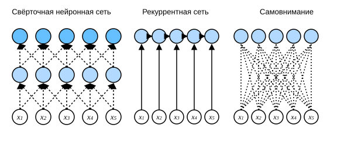

# 10.6 Самовнимание и позиционное кодирование

В глубоком обучении для кодирования последовательностей часто используют свёрточные нейронные сети (CNN) или рекуррентные нейронные сети (RNN). Представим, что после появления механизма внимания мы подаём последовательность токенов в агрегацию внимания так, что один и тот же набор токенов одновременно выступает в роли запросов, ключей и значений. Конкретно, каждый запрос обращает внимание на все пары «ключ — значение» и порождает выход внимания. Поскольку запросы, ключи и значения происходят из одного и того же набора входов, это называется *самовниманием* (self-attention) (Lin et al., 2017; Vaswani et al., 2017), а также *внутренним вниманием* (intra-attention) (Cheng et al., 2016; Parikh et al., 2016; Paulus et al., 2017). В этом разделе мы используем самовнимание для кодирования последовательностей и посмотрим, как порядок элементов последовательности может служить дополнительной информацией.

**MXNet:**

```python
from d2l import mxnet as d2l
import math
from mxnet import autograd, np, npx
from mxnet.gluon import nn
npx.set_np()
```

**PyTorch:**

```python
from d2l import torch as d2l
import math
import torch
from torch import nn
```

**TensorFlow:**

```python
from d2l import tensorflow as d2l
import numpy as np
import tensorflow as tf
```

**PaddlePaddle:**

```python
from d2l import paddle as d2l
import math
import warnings
warnings.filterwarnings("ignore")
import paddle
from paddle import nn
```

## [**Самовнимание**]

Дана входная последовательность из токенов $\mathbf{x}_1, \ldots, \mathbf{x}_n$, где каждый $\mathbf{x}_i \in \mathbb{R}^d$ ($1 \leq i \leq n$). Выход самовнимания для этой последовательности — последовательность той же длины $\mathbf{y}_1, \ldots, \mathbf{y}_n$, где

$$\mathbf{y}_i = f(\mathbf{x}_i, (\mathbf{x}_1, \mathbf{x}_1), \ldots, (\mathbf{x}_n, \mathbf{x}_n)) \in \mathbb{R}^d$$

и функция агрегации внимания $f$ определена в (10.3.1). Ниже приведён фрагмент кода, который вычисляет самовнимание для тензора с помощью многоголового внимания. Форма тензора — (размер пакета, число временных шагов или длина последовательности токенов, $d$). Форма выхода совпадает с формой входа.

**MXNet:**

```python
num_hiddens, num_heads = 100, 5
attention = d2l.MultiHeadAttention(num_hiddens, num_heads, 0.5)
attention.initialize()
```

**PyTorch:**

```python
num_hiddens, num_heads = 100, 5
attention = d2l.MultiHeadAttention(num_hiddens, num_hiddens, num_hiddens,
                                   num_hiddens, num_heads, 0.5)
attention.eval()
```

**TensorFlow:**

```python
num_hiddens, num_heads = 100, 5
attention = d2l.MultiHeadAttention(num_hiddens, num_hiddens, num_hiddens,
                                   num_hiddens, num_heads, 0.5)
```

**PaddlePaddle:**

```python
num_hiddens, num_heads = 100, 5
attention = d2l.MultiHeadAttention(num_hiddens, num_hiddens, num_hiddens,
                                   num_hiddens, num_heads, 0.5)
attention.eval()
```

**MXNet, PyTorch, PaddlePaddle:**

```python
batch_size, num_queries, valid_lens = 2, 4, d2l.tensor([3, 2])
X = d2l.ones((batch_size, num_queries, num_hiddens))
attention(X, X, X, valid_lens).shape
```

**TensorFlow:**

```python
batch_size, num_queries, valid_lens = 2, 4, tf.constant([3, 2])
X = tf.ones((batch_size, num_queries, num_hiddens))
attention(X, X, X, valid_lens, training=False).shape
```

## Сравнение свёрточных, рекуррентных сетей и самовнимания
:label:`subsec_cnn-rnn-self-attention`

Сравним несколько архитектур, цель которых — отобразить последовательность из $n$ токенов в последовательность той же длины, где каждый входной и выходной токен представлен вектором размерности $d$. Конкретно мы сравним свёрточные нейронные сети, рекуррентные нейронные сети и самовнимание по вычислительной сложности, числу последовательных операций и максимальной длине пути. Заметим, что последовательные операции препятствуют параллельным вычислениям, а чем короче путь между любыми позициями последовательности, тем легче выучить дальние зависимости в последовательности (Hochreiter et al., 2001).



Рассмотрим свёрточный слой с размером ядра $k$. В следующих главах мы подробнее разберём обработку последовательностей с помощью свёрточных сетей. Сейчас достаточно знать, что поскольку длина последовательности равна $n$, а число входных и выходных каналов равно $d$, вычислительная сложность свёрточного слоя составляет $\mathcal{O}(knd^2)$. Как показано на рис. 10.6.1, свёрточная сеть иерархична, поэтому для неё требуется $\mathcal{O}(1)$ последовательных операций, а максимальная длина пути равна $\mathcal{O}(n/k)$. Например, $\mathbf{x}_1$ и $\mathbf{x}_5$ попадают в рецептивное поле двухслойной свёрточной сети с ядром размера 3, показанной на рис. 10.6.1.

При обновлении скрытого состояния рекуррентной нейронной сети умножение матрицы весов $d \times d$ на скрытое состояние размерности $d$ имеет сложность $\mathcal{O}(d^2)$. Поскольку длина последовательности равна $n$, вычислительная сложность рекуррентного слоя составляет $\mathcal{O}(nd^2)$. По рис. 10.6.1 видно, что рекуррентная сеть требует $\mathcal{O}(n)$ последовательных операций, которые нельзя распараллелить, а максимальная длина пути также равна $\mathcal{O}(n)$.

В самовнимании запросы, ключи и значения — матрицы размера $n \times d$. Рассмотрим масштабированное скалярное произведение внимания из (10.3.4): умножение матрицы $n \times d$ на матрицу $d \times n$, затем умножение полученной матрицы $n \times n$ на матрицу $n \times d$. Поэтому самовнимание имеет вычислительную сложность $\mathcal{O}(n^2d)$. Как видно из рис. 10.6.1, каждый токен напрямую связан с любым другим токеном через самовнимание. Поэтому для параллельного вычисления требуется $\mathcal{O}(1)$ последовательных операций, а максимальная длина пути также равна $\mathcal{O}(1)$.

Итак, и свёрточные сети, и самовнимание допускают параллельные вычисления, причём у самовнимания самая короткая максимальная длина пути. Однако его вычислительная сложность квадратична по длине последовательности, поэтому на очень длинных последовательностях вычисления будут очень медленными.

## [**Позиционное кодирование**]
:label:`subsec_positional-encoding`

При обработке последовательности токенов рекуррентная нейронная сеть обрабатывает токены по одному и повторяет эту операцию, а самовнимание из-за параллельных вычислений отказывается от последовательных операций. Чтобы использовать информацию о порядке в последовательности, в представление входа добавляют *позиционное кодирование* (positional encoding), которое внедряет абсолютную или относительную информацию о позиции. Позиционное кодирование может быть обучаемым или фиксированным. Ниже описано фиксированное позиционное кодирование на основе синусов и косинусов (Vaswani et al., 2017).

Пусть входное представление $\mathbf{X} \in \mathbb{R}^{n \times d}$ содержит $d$-мерные векторные вложения для $n$ токенов последовательности. Позиционное кодирование возвращает $\mathbf{X} + \mathbf{P}$, где матрица позиционных вложений $\mathbf{P} \in \mathbb{R}^{n \times d}$ имеет ту же форму. Элементы в $i$-й строке, $2j$-м и $(2j+1)$-м столбцах равны:

$$\begin{aligned} p_{i, 2j} &= \sin\left(\frac{i}{10000^{2j/d}}\right),\\p_{i, 2j+1} &= \cos\left(\frac{i}{10000^{2j/d}}\right).\end{aligned}\tag{10.6.1}$$

На первый взгляд такая конструкция на основе тригонометрических функций выглядит странно. Прежде чем её объяснять, реализуем её в классе `PositionalEncoding` ниже.

**MXNet:**

```python
#@save
class PositionalEncoding(nn.Block):
    """Позиционное кодирование"""
    def __init__(self, num_hiddens, dropout, max_len=1000):
        super(PositionalEncoding, self).__init__()
        self.dropout = nn.Dropout(dropout)
        # Создаём достаточно длинную P
        self.P = d2l.zeros((1, max_len, num_hiddens))
        X = d2l.arange(max_len).reshape(-1, 1) / np.power(
            10000, np.arange(0, num_hiddens, 2) / num_hiddens)
        self.P[:, :, 0::2] = np.sin(X)
        self.P[:, :, 1::2] = np.cos(X)

    def forward(self, X):
        X = X + self.P[:, :X.shape[1], :].as_in_ctx(X.ctx)
        return self.dropout(X)
```

**PyTorch:**

```python
#@save
class PositionalEncoding(nn.Module):
    """Позиционное кодирование"""
    def __init__(self, num_hiddens, dropout, max_len=1000):
        super(PositionalEncoding, self).__init__()
        self.dropout = nn.Dropout(dropout)
        # Создаём достаточно длинную P
        self.P = d2l.zeros((1, max_len, num_hiddens))
        X = d2l.arange(max_len, dtype=torch.float32).reshape(
            -1, 1) / torch.pow(10000, torch.arange(
            0, num_hiddens, 2, dtype=torch.float32) / num_hiddens)
        self.P[:, :, 0::2] = torch.sin(X)
        self.P[:, :, 1::2] = torch.cos(X)

    def forward(self, X):
        X = X + self.P[:, :X.shape[1], :].to(X.device)
        return self.dropout(X)
```

**TensorFlow:**

```python
#@save
class PositionalEncoding(tf.keras.layers.Layer):
    """Позиционное кодирование"""
    def __init__(self, num_hiddens, dropout, max_len=1000):
        super().__init__()
        self.dropout = tf.keras.layers.Dropout(dropout)
        # Создаём достаточно длинную P
        self.P = np.zeros((1, max_len, num_hiddens))
        X = np.arange(max_len, dtype=np.float32).reshape(
            -1,1)/np.power(10000, np.arange(
            0, num_hiddens, 2, dtype=np.float32) / num_hiddens)
        self.P[:, :, 0::2] = np.sin(X)
        self.P[:, :, 1::2] = np.cos(X)
        
    def call(self, X, **kwargs):
        X = X + self.P[:, :X.shape[1], :]
        return self.dropout(X, **kwargs)
```

**PaddlePaddle:**

```python
#@save
class PositionalEncoding(nn.Layer):
    """Позиционное кодирование"""
    def __init__(self, num_hiddens, dropout, max_len=1000):
        super(PositionalEncoding, self).__init__()
        self.dropout = nn.Dropout(dropout)
        # Создаём достаточно длинную P
        self.P = paddle.zeros((1, max_len, num_hiddens))
        X = paddle.arange(max_len, dtype=paddle.float32).reshape(
            (-1, 1)) / paddle.pow(paddle.to_tensor([10000.0]), paddle.arange(
            0, num_hiddens, 2, dtype=paddle.float32) / num_hiddens)
        self.P[:, :, 0::2] = paddle.sin(X)
        self.P[:, :, 1::2] = paddle.cos(X)

    def forward(self, X):
        X = X + self.P[:, :X.shape[1], :]
        return self.dropout(X)
```

В матрице позиционных вложений $\mathbf{P}$ [**строки соответствуют позициям токенов в последовательности, а столбцы — разным измерениям позиционного кодирования**]. Из примера ниже видно, что частота в 6-м и 7-м столбцах матрицы позиционных вложений выше, чем в 8-м и 9-м. Сдвиг между 6-м и 7-м столбцами (так же как между 8-м и 9-м) обусловлен чередованием синуса и косинуса.

**MXNet:**

```python
encoding_dim, num_steps = 32, 60
pos_encoding = PositionalEncoding(encoding_dim, 0)
pos_encoding.initialize()
X = pos_encoding(np.zeros((1, num_steps, encoding_dim)))
P = pos_encoding.P[:, :X.shape[1], :]
d2l.plot(d2l.arange(num_steps), P[0, :, 6:10].T, xlabel='Row (position)',
         figsize=(6, 2.5), legend=["Col %d" % d for d in d2l.arange(6, 10)])
```

**PyTorch:**

```python
encoding_dim, num_steps = 32, 60
pos_encoding = PositionalEncoding(encoding_dim, 0)
pos_encoding.eval()
X = pos_encoding(d2l.zeros((1, num_steps, encoding_dim)))
P = pos_encoding.P[:, :X.shape[1], :]
d2l.plot(d2l.arange(num_steps), P[0, :, 6:10].T, xlabel='Row (position)',
         figsize=(6, 2.5), legend=["Col %d" % d for d in d2l.arange(6, 10)])
```

**TensorFlow:**

```python
encoding_dim, num_steps = 32, 60
pos_encoding = PositionalEncoding(encoding_dim, 0)
X = pos_encoding(tf.zeros((1, num_steps, encoding_dim)), training=False)
P = pos_encoding.P[:, :X.shape[1], :]
d2l.plot(np.arange(num_steps), P[0, :, 6:10].T, xlabel='Row (position)',
         figsize=(6, 2.5), legend=["Col %d" % d for d in np.arange(6, 10)])
```

**PaddlePaddle:**

```python
encoding_dim, num_steps = 32, 60
pos_encoding = PositionalEncoding(encoding_dim, 0)
pos_encoding.eval()
X = pos_encoding(paddle.zeros((1, num_steps, encoding_dim)))
P = pos_encoding.P[:, :X.shape[1], :]
d2l.plot(paddle.arange(num_steps), P[0, :, 6:10].T, xlabel='Row (position)',
         figsize=(6, 2.5), legend=["Col %d" % d for d in paddle.arange(6, 10)])
```

### Абсолютная позиционная информация

Чтобы понять связь между частотой, которая монотонно убывает по измерениям кодирования, и абсолютной позиционной информацией, выведем [**двоичное представление**] чисел $0, 1, \ldots, 7$. Как видно, в двоичной записи каждого числа, каждой пары и каждой четвёрки чисел значения битов чередуются соответственно в младшем, втором и третьем разрядах.

**MXNet, PyTorch, TensorFlow, PaddlePaddle:**

```python
for i in range(8):
    print(f'Двоичное представление {i}: {i:>03b}')
```

В двоичной записи биты старших разрядов чередуются реже, чем младших. Это похоже на тепловую карту ниже, с той разницей, что позиционное кодирование использует тригонометрические функции и [**снижает частоту по измерениям кодирования**]. Поскольку выходы — числа с плавающей точкой, такое непрерывное представление экономнее двоичной записи.

**MXNet:**

```python
P = np.expand_dims(np.expand_dims(P[0, :, :], 0), 0)
d2l.show_heatmaps(P, xlabel='Column (encoding dimension)',
                  ylabel='Row (position)', figsize=(3.5, 4), cmap='Blues')
```

**PyTorch:**

```python
P = P[0, :, :].unsqueeze(0).unsqueeze(0)
d2l.show_heatmaps(P, xlabel='Column (encoding dimension)',
                  ylabel='Row (position)', figsize=(3.5, 4), cmap='Blues')
```

**TensorFlow:**

```python
P = tf.expand_dims(tf.expand_dims(P[0, :, :], axis=0), axis=0)
d2l.show_heatmaps(P, xlabel='Column (encoding dimension)',
                  ylabel='Row (position)', figsize=(3.5, 4), cmap='Blues')
```

**PaddlePaddle:**

```python
P = P[0, :, :].unsqueeze(0).unsqueeze(0)
d2l.show_heatmaps(P, xlabel='Column (encoding dimension)',
                  ylabel='Row (position)', figsize=(3.5, 4), cmap='Blues')
```

### Относительная позиционная информация

Помимо абсолютной позиционной информации, описанное позиционное кодирование позволяет модели выучивать относительную позиционную информацию в последовательности входа. Это возможно потому, что для любого фиксированного смещения позиции $\delta$ позиционное кодирование на позиции $i + \delta$ можно выразить линейным преобразованием позиционного кодирования на позиции $i$.

Математически это выглядит так. Пусть $\omega_j = 1/10000^{2j/d}$. Тогда для любого фиксированного смещения $\delta$ любая пара $(p_{i, 2j}, p_{i, 2j+1})$ из (10.6.1) линейно проецируется в $(p_{i+\delta, 2j}, p_{i+\delta, 2j+1})$:

$$\begin{aligned}
&\begin{bmatrix} \cos(\delta \omega_j) & \sin(\delta \omega_j) \\  -\sin(\delta \omega_j) & \cos(\delta \omega_j) \\ \end{bmatrix}
\begin{bmatrix} p_{i, 2j} \\  p_{i, 2j+1} \\ \end{bmatrix}\\
=&\begin{bmatrix} \cos(\delta \omega_j) \sin(i \omega_j) + \sin(\delta \omega_j) \cos(i \omega_j) \\  -\sin(\delta \omega_j) \sin(i \omega_j) + \cos(\delta \omega_j) \cos(i \omega_j) \\ \end{bmatrix}\\
=&\begin{bmatrix} \sin\left((i+\delta) \omega_j\right) \\  \cos\left((i+\delta) \omega_j\right) \\ \end{bmatrix}\\
=& 
\begin{bmatrix} p_{i+\delta, 2j} \\  p_{i+\delta, 2j+1} \\ \end{bmatrix},
\end{aligned}$$

где матрица проекции размера $2\times 2$ не зависит от индекса позиции $i$.

## Резюме

* В самовнимании запросы, ключи и значения происходят из одного и того же набора входов.
* Свёрточные нейронные сети и самовнимание допускают параллельные вычисления, а у самовнимания самая короткая максимальная длина пути. Однако его вычислительная сложность квадратична по длине последовательности, поэтому на очень длинных последовательностях вычисления будут очень медленными.
* Чтобы использовать информацию о порядке в последовательности, в представление входа можно добавлять позиционное кодирование, внедряя абсолютную или относительную позиционную информацию.

## Упражнения

1. Предположим, что мы строим глубокую архитектуру, которая представляет последовательность, складывая слои самовнимания с позиционным кодированием. Какие проблемы могут возникнуть?
1. Предложите способ обучаемого позиционного кодирования.

**MXNet:**
[Обсуждение](https://discuss.d2l.ai/t/5761)

**PyTorch:**
[Обсуждение](https://discuss.d2l.ai/t/5762)

**PaddlePaddle:**
[Обсуждение](https://discuss.d2l.ai/t/11844)

## Литература

* Lin, Z., Feng, M., Santos, C. N. d., Yu, M., Xiang, B., Zhou, B., & Bengio, Y. (2017). A structured self-attentive sentence embedding. *arXiv preprint arXiv:1703.03130*.
* Vaswani, A., Shazeer, N., Parmar, N., Uszkoreit, J., Jones, L., Gomez, A. N., Kaiser, Ł., & Polosukhin, I. (2017). Attention is all you need. *Advances in Neural Information Processing Systems*, 5998–6008.
* Cheng, J., Dong, L., & Lapata, M. (2016). Long short-term memory-networks for machine reading. In *Proceedings of the 2016 Conference on Empirical Methods in Natural Language Processing*, 551–561.
* Parikh, A. P., Täckström, O., Das, D., & Uszkoreit, J. (2016). A decomposable attention model for natural language inference. *arXiv preprint arXiv:1606.01933*.
* Paulus, R., Xiong, C., & Socher, R. (2017). A deep reinforced model for abstractive summarization. *arXiv preprint arXiv:1705.04304*.
* Hochreiter, S., Bengio, Y., Frasconi, P., & Schmidhuber, J. (2001). Gradient flow in recurrent nets: the difficulty of learning long-term dependencies. In *A Field Guide to Dynamical Recurrent Neural Networks*. IEEE Press.
